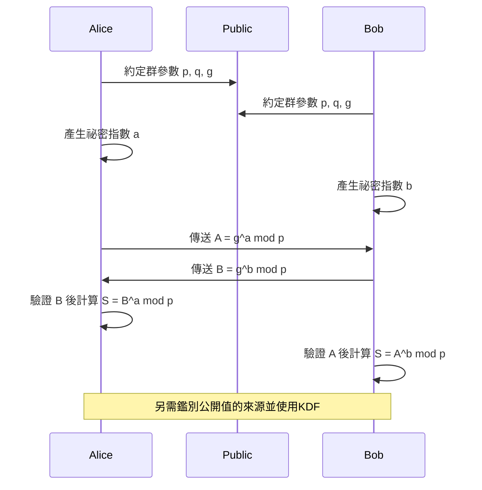
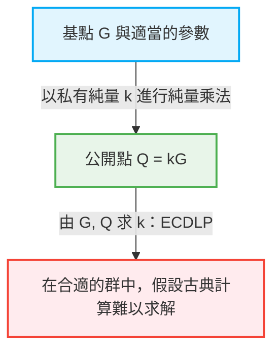

公鑰密碼學支援事先沒有共享秘密金鑰的雙方通訊。本文依序介紹迪菲–赫爾曼（DH）金鑰協議、RSA與橢圓曲線密碼學（ECC）的數學。不同體制即使金鑰長度相同，估計的安全強度也可能不同；僅有計算公式，無法保證整個通訊系統的安全。

## 1. 對稱密碼與金鑰分發問題

凱撒密碼與恩尼格瑪是收發雙方共享祕密設定的歷史實例。現代對稱密碼也使用共享的秘密金鑰。不過，不能將這些歷史體制視為與現代安全演算法同等。

### 金鑰分發問題

若透過未受保護的通道直接傳送對稱金鑰，竊聽者也會知道它。因此，需要解決「如何建立共享祕密，以及究竟與誰建立」的問題。公鑰技術有助於解決這個問題，但仍需要驗證通訊對方的身分。

對稱密碼並未失去作用。例如，TLS 1.3結合金鑰協議、身分鑑別，以及使用衍生金鑰的資料認證加密，並非以公鑰運算加密所有應用資料。

## 2. 迪菲–赫爾曼金鑰協議

迪菲與赫爾曼於1976年的論文中，描述雙方透過公開交換的資訊計算相同祕密值的方法。這裡討論有限體上的DH。

### 離散對數問題與共享值

在模質數 $p$ 的乘法群中，假設使用由 $g$ 生成、具有大質數階 $q$ 的子群，其中 $q$ 整除 $p-1$。這裡的 $g$ 是子群的生成元，不一定是整個乘法群的原根。實際協定應使用規定且具足夠強度的參數，不能自行選擇小整數作為參數來保護真實資料。

1. 愛麗絲使用密碼學安全的亂數，從 $1\le a\le q-1$ 中均勻選取祕密指數，傳送 $A=g^a\bmod p$。
2. 鮑伯同樣從 $1\le b\le q-1$ 中選取祕密指數，傳送 $B=g^b\bmod p$。
3. 雙方依方案要求驗證對方的公開值後，愛麗絲計算 $B^a\bmod p$，鮑伯計算 $A^b\bmod p$。

$$
B^a\equiv (g^b)^a\equiv g^{ab}\equiv(g^a)^b\equiv A^b\pmod p.
$$

將這個相同的值記為 $S$。由 $A$ 求 $a$ 是離散對數問題（DLP）；由 $g,A,B$ 求 $S$ 是計算型Diffie–Hellman問題（CDH）。解出DLP也能解出CDH，但這不代表兩者在所有情況下都已證明具有相同難度。討論DH的安全性時，必須指定群、協定及攻擊者的能力。

### 身分鑑別、公開值驗證與金鑰衍生

未經身分鑑別的DH無法阻止能竄改通訊的攻擊者實施中間人攻擊。攻擊者替換公開值後，可能分別與愛麗絲、鮑伯建立不同的共享值。驗證公開值是否合法，不能取代通訊對方的身分鑑別。

驗證方法也取決於參數。對上述質數階子群，應檢查正確範圍、子群成員資格，以及排除單位元素。RFC 7919針對其已知安全質數群所規定的 $1<Y<p-1$ 檢查，不能單獨套用為任意群的完整驗證規則。

不應直接將 $S$ 當作對稱金鑰。應依協定將它編碼，透過金鑰衍生函數（KDF）結合通訊脈絡資訊，為不同用途衍生金鑰。TLS 1.3的金鑰排程使用HKDF與交握訊息紀錄。

圖中僅顯示計算架構，不包含身分鑑別的具體訊息或完整的KDF步驟。

## 3. RSA與歐拉定理

由李維斯特、沙米爾與阿德曼提出的RSA，採用與DH不同的數學。基於RSA的加密方案與簽章方案有不同的設計。

### 金鑰與整數運算

以雙質數RSA為教學模型，選擇相異的大奇質數 $p,q$，令 $N=pq$。這裡的 $q$ 是RSA的質因數，與上一節的子群階不同。

$$
\phi(N)=(p-1)(q-1),\qquad ed\equiv1\pmod{\phi(N)}.
$$

選擇滿足 $1<e<\phi(N)$ 且 $\gcd(e,\phi(N))=1$ 的公開指數 $e$，求其模反元素，得到正的私有指數 $d<\phi(N)$。這是本節解說使用的充分條件。RFC 8017則使用 $\lambda(N)=\operatorname{lcm}(p-1,q-1)$ 表述條件 $ed\equiv1\pmod{\lambda(N)}$。公開金鑰為 $(N,e)$，私有金鑰的一種表示為 $(N,d)$。$d$ 是私有指數，應與完整的金鑰資訊區分。

對整數代表值 $0\le M<N$，基本運算如下：

$$
C=M^e\bmod N,\qquad M=C^d\bmod N.
$$

密文代表值 $C$ 也是滿足 $0\le C<N$ 的整數。這裡的 $M$ 並非任意長度的文字或位元組串本身。

### 為何可以還原原值

當 $\gcd(M,N)=1$ 時，歐拉定理給出 $M^{\phi(N)}\equiv1\pmod N$。寫成 $ed=1+t\phi(N)$，其中 $t\ge0$，可得：

$$
M^{ed}=M\bigl(M^{\phi(N)}\bigr)^t\equiv M\pmod N.
$$

若 $M$ 與 $N$ 不互質，不能直接套用歐拉定理。不過，對每個質因數 $r\in\{p,q\}$，若 $M\equiv0\pmod r$，則 $M^{ed}\equiv M\equiv0\pmod r$；否則，由費馬小定理與 $ed-1$ 是 $r-1$ 的倍數，可得 $M^{ed}\equiv M\pmod r$。中國餘數定理將兩者合併，得到模 $N$ 的同餘。因此，所有代表值 $0\le M<N$ 都能還原。

### 區分正確性與安全性

若能分解 $N$，就能計算 $\phi(N)$ 與 $d$。但這不代表所有針對RSA的攻擊都已證明必須進行質因數分解。薄弱的亂數、錯誤的編碼與實作中的資訊洩漏，也可能導致安全失守。

若直接以這種確定性的冪次運算加密，攻擊者可以用公開金鑰逐一測試少量候選訊息。實用加密方案需要專門的編碼與檢查，例如RSAES-OAEP；簽章方案也有相應要求，例如RSASSA-PSS。簽章不等於「以私有金鑰加密訊息」。也必須鑑別公開金鑰是否屬於預期對象。

## 4. 金鑰長度與估計安全強度

RSA金鑰長度通常指模數 $N$ 的位元數。計算能力與攻擊演算法的變化會影響安全評估。但不能將某種金鑰長度不再被建議使用，等同於宣稱RSA-1024模數已普遍遭到分解。

作為具體比較，2020年出版的NIST SP 800-57 Part 1 Rev.5之Table 2，將2048位元RSA模數列在估計最大安全強度112位元的一列，3072位元模數則列在128位元的一列。這是在該文件假設下針對古典計算的估計，並非適用於目前所有用途的金鑰長度建議，也不是成功解密的紀錄。

較長的模數通常會增加整數運算及金鑰、簽章儲存與傳輸的負擔。效能還取決於公開指數、CRT最佳化、實作、硬體與操作類型，不能只憑金鑰長度判定哪個體制較快。

## 5. 橢圓曲線密碼學的數學

米勒與科布利茨在1980年代各自提出將橢圓曲線用於密碼學。RFC 6090引用米勒在CRYPTO '85的論文，以及科布利茨1987年的論文。應區分提出時間與論文出版年份。

同一份NIST表格將基點階的位元數為256〜383的ECC，列在估計最大安全強度128位元的一列。這是RSA-3072與ECC-256比較的背景。ECC這一欄衡量的是基點階的長度，不代表包含座標的序列化公開金鑰檔案只有256位元。比較以適當的參數、金鑰管理等條件為前提。

### 有限體上的曲線

此處限於質數 $p>3$ 的質體 $\mathbb F_p$，並令 $a,b,x,y\in\mathbb F_p$。這些參數與前述RSA的質數不同。

$$
y^2\equiv x^3+ax+b\pmod p,\qquad 4a^3+27b^2\not\equiv0\pmod p.
$$

第二個條件確保曲線在該體上非奇異，僅在整數中不等於零還不夠。在曲線上的點與作為單位元素的無限遠點 $\mathcal O$ 所組成的集合上，可以定義加法。對特徵為2或3的體，不能只用這個方程式概括一般情況。

### 點加法與例外情況

在實數圖形中，可以用連接兩點的直線與曲線的第三個交點，再對水平軸鏡射，來解釋加法。有限體上則以對應的代數公式進行模 $p$ 運算。對 $P=(x_1,y_1)$、$Q=(x_2,y_2)$，一般情況的斜率為：

$$
s=\begin{cases}
(y_2-y_1)(x_2-x_1)^{-1} & (x_1\ne x_2),\\
(3x_1^2+a)(2y_1)^{-1} & (P=Q,\ y_1\ne0).
\end{cases}
$$

$$
x_3=s^2-x_1-x_2,\qquad y_3=s(x_1-x_3)-y_1\quad\text{in }\mathbb F_p.
$$

只有非零體元素才有乘法反元素。分母為零時，不能使用上述公式。

$$
P+\mathcal O=P,\qquad -P=(x_1,-y_1),\qquad P+(-P)=\mathcal O.
$$

若 $P=Q$ 且 $y_1=0$，則 $2P=\mathcal O$。計算 $P+P$ 是點的倍點運算（point doubling），也是求一般整數倍的純量乘法的一個特例。

### 純量乘法與ECDLP

使用生成大質數階 $n$ 子群的基點 $G$。階是使 $nG=\mathcal O$ 成立的最小正整數。使用密碼學安全的亂數，從 $1\le k\le n-1$ 中均勻選取私有純量 $k$。

$$
Q=kG=\underbrace{G+\cdots+G}_{k\text{ terms}}.
$$

$k$ 是私有金鑰，$Q$ 是公開金鑰。體的質數 $p$、子群階 $n$ 與私有純量 $k$ 各有不同角色。由 $G,Q$ 求 $k$，就是橢圓曲線離散對數問題（ECDLP）。

RFC 6090介紹的Pollard rho等通用古典攻擊，大致需要 $O(\sqrt n)$ 次群運算。當 $n$ 約為256位元時，規模約為 $2^{128}$。這是相對於位元長度呈指數成長的估計，並非所有曲線困難性的證明。也存在針對特殊曲線的攻擊，因此曲線與子群選擇、公開點驗證，以及實作的資訊洩漏防護都很重要。

## 6. 協定中的角色與量子計算

ECC並非單一加密方案的名稱。例如，ECDH用於金鑰協議，ECDSA用於簽章。ECDH也需要依協定從共享點衍生金鑰，並驗證公開值及進行身分鑑別。

TLS 1.3中，ECDHE等金鑰協議、ECDSA或RSA-PSS等簽章，以及以衍生對稱金鑰進行的認證加密，扮演不同角色。此外也有預先共享金鑰模式。TLS 1.3已移除RSA金鑰傳輸，但不表示也移除了RSA簽章。改用ECC無法保證每種操作都更快。

### 量子電腦與後量子密碼

秀爾（Shor）演算法能在具有足夠能力的量子電腦上，以相對於輸入位元長度的多項式步數，求解質因數分解與離散對數。它威脅RSA與傳統ECC，但多項式時間不代表瞬間完成，也不預測這種設備何時實現。

後量子密碼（PQC）旨在以考慮量子攻擊的其他假設，提供金鑰建立、簽章等功能。這不保證「即使量子電腦也絕對無法破解」。仍須評估個別方案、實作與遷移涉及的協定。

## 總結

DH計算共享值，RSA使用整數模冪次運算，ECC使用有限體上點的群運算。滿足數學成立條件後，還要結合身分鑑別、金鑰衍生、適當的編碼與驗證，以及金鑰管理，才能保護通訊。僅憑短金鑰或正確公式，無法判斷整個系統的安全性。

## 參考資料

- [RFC 7919 §5.1：已知FFDHE群的公開值驗證](https://www.rfc-editor.org/rfc/rfc7919.html#section-5.1)
- [RFC 8017：RSA金鑰、基本運算、OAEP與PSS](https://www.rfc-editor.org/rfc/rfc8017.html)
- [RFC 6090 §§2–4、10：有限體、曲線運算、ECDH與安全條件](https://www.rfc-editor.org/rfc/rfc6090.html)
- [NIST SP 800-57 Part 1 Rev.5（2020年），§5.6.1.1與Table 2：估計安全強度](https://csrc.nist.gov/pubs/sp/800/57/pt1/r5/final)
- [RFC 8446：TLS 1.3的角色分工與金鑰排程](https://www.rfc-editor.org/rfc/rfc8446.html)
- [Shor：量子質因數分解與離散對數論文摘要](https://arxiv.org/abs/quant-ph/9508027)
