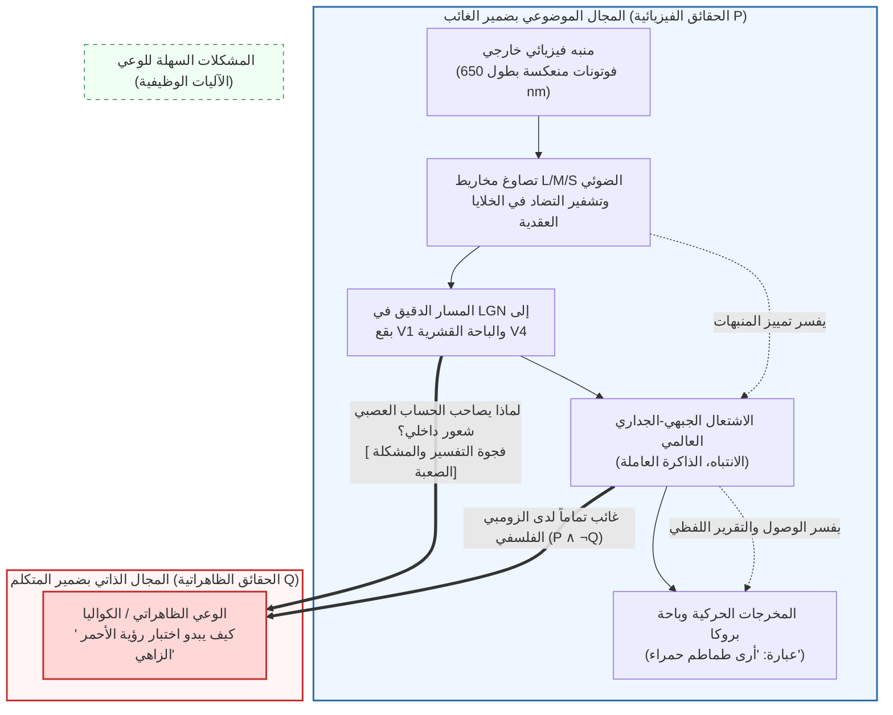
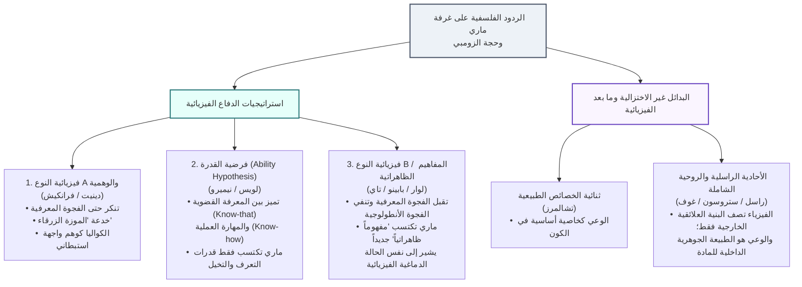

## 1. مقدمة: الهوة السحيقة بين الإشعاع الكهرومغناطيسي بطول موجي $\lambda = 650\,\text{nm}$ والتوهج الذاتي للون الأحمر

عندما نتأمل ثمرة طماطم ناضجة تحت شمس الأصيل، يمكن وصف هذه الظاهرة على مستويين مختلفين جذرياً.

المستوى الأول هو <strong>الوصف الموضوعي بضمير الغائب (الشخص الثالث) في العلوم الطبيعية</strong>: تمتص أصباغ الكاروتينات (الليكوبين) في قشرة الطماطم الأطوال الموجية القصيرة والمتوسطة، وتعكس انتقائياً الموجات الكهرومغناطيسية الطويلة المتمركزة حول $\lambda \approx 650\,\text{nm}$. تعبر هذه الفوتونات القرنية والعدسة لتصل إلى شبكية العين، حيث تمتصها المخاريط الحساسة للموجات الطويلة (مخاريط L، $\lambda_{\max} \approx 560\,\text{nm}$)، مما يحفز التصاوغ الضوئي لمركب 11-سيس-ريتينال إلى أول-ترانس-ريتينال. وعبر بروتين الترانسديوسين وإنزيم فوسفوديستراز (PDE)، يتحلل مركب $\text{cGMP}$، فتنغلق قنوات الكاتيونات ويحدث فرط استقطاب في غشاء المستقبل الضوئي. تُشفَّر الإشارة عبر قنوات التضاد اللوني ($L - M$ و$S - (L + M)$) في خلايا الشبكية العقدية، وتنتقل عبر الطبقات الدقيقة في النواة الركبية الجانبية (LGN) إلى القشرة البصرية الأولية (V1) وصولاً إلى <strong>الباحة البصرية الرابعة (V4)</strong> — مركز ثبات اللون في القشرة المخية — قبل تنشيط الشبكات الجبهية الجدارية وباحة بروكا لإنتاج العبارة المنطوقة: *«هذه الطماطم حمراء زاهية»*.

غير أن هناك مستوى ثانياً: <strong>الطابع الذاتي للتجربة الواعية بضمير المتكلم (الشخص الأول)</strong>. مهما بلغت دقة معادلات ماكسويل للكهرومغناطيسية أو معادلات هودجكين-هاكسلي التفاضلية لجهود الفعل العصبية، فإن هذه المعادلات لا تذكر حرفاً واحداً عن <strong>تلك الكيفية الحية والمتوهجة للون الأحمر</strong> التي نختبرها مباشرة في ساحة وعينا.

في فلسفة العقل (Philosophy of Mind) والعلوم المعرفية المعاصرة، تُسمى هذه الخصائص الكيفية الجوهرية للتجربة الذاتية <strong>الكواليا (Qualia / الكيفيات المحسوسة)</strong> أو <strong>الوعي الظاهراتي (Phenomenal Consciousness)</strong>. يعيد هذا المقال بناء <strong>الأركان الثلاثة المناهضة للفيزيائية (Anti-Physicalism)</strong>: خفاش توماس نايجل (1974)، وحجة المعرفة لفرانك جاكسون («غرفة ماري»، 1982/1986)، وفجوة التفسير لجوزيف ليفين (1983) وصولاً إلى «المشكلة الصعبة للوعي» وحجة الزومبي الفلسفي لديفيد تشالمرز (1995/1996). ثم نفحص الهجمات المضادة الثلاثة للفيزيائية (الوهمية، وفرضية القدرة، واستراتيجية المفاهيم الظاهراتية)، ونستكشف آفاق <strong>الأحادية الراسلية (الروحية الشاملة / Panpsychism)</strong>، و<strong>نظرية فضاء العمل العصبي العالمي (GNWT)</strong>، و<strong>نظرية المعلومات المتكاملة (IIT)</strong> لجوليو تونوني.

---

## 2. التعريف الدقيق للكواليا والوعي الظاهراتي

أدخل الفيلسوف الأمريكي <strong>كلارنس إيرفينغ لويس (C.I. Lewis)</strong> مصطلح <strong>الكواليا (Qualia)</strong> بمعناه التحليلي الحديث عام 1929 (*Mind and the World Order*). وفي عام 1995، قدّم الفيلسوف <strong>نيد بلوك (Ned Block)</strong> تمييزاً حاسماً بين مفهومين للوعي كثيراً ما يتم الخلط بينهما:
1. <strong>الوعي الظاهراتي (Phenomenal Consciousness / P-Consciousness)</strong>: الطابع الاختباري الكيفي الذاتي للحالة الذهنية — أي <strong>كيف يبدو الأمر (what it is like)</strong> بالنسبة للذات أن تعيش تلك الحالة.
2. <strong>وعي الوصول (Access Consciousness / A-Consciousness)</strong>: خاصية وظيفية لمعالجة المعلومات تكون فيها التمثيلات الذهنية متاحة عالمياً للاستدلال وتوجيه الفعل والتقرير اللفظي.

وقد لخص دانيال دينيت (1988) السمات الأربع الكلاسيكية للكواليا: <strong>عدم القابلية للتعبير اللفظي (Ineffability)</strong>، و<strong>الجوهرية الداخلية (Intrinsicness)</strong>، و<strong>الخصوصية الذاتية (Privateness)</strong>، و<strong>الإدراك المباشر في الوعي (Immediate Apprehensibility)</strong>. وتُظهر تجربة <strong>الطيف المعكوس (Inverted Spectrum)</strong> (لوك 1689؛ شوميكر 1982) أنه يمكن لشخصين أن يتطابقا وظيفياً وسلوكياً بنسبة 100% بينما تكون كواليا اللونين الأحمر والأخضر معكوسة داخلياً بينهما ($Q_{\text{red}} \leftrightarrow Q_{\text{green}}$)، مما يثبت استحالة اختزال الكواليا إلى مجرد دور وظيفي.

---

## 3. الأركان الثلاثة المناهضة للفيزيائية

### 3.1 الركن الأول: *«كيف يبدو الأمر أن تكون خفاشاً؟»* لتوماس نايجل (1974)

في مقالته الشهيرة عام 1974 (*What Is It Like to Be a Bat?*)، صاغ <strong>توماس نايجل (Thomas Nagel)</strong> المعيار الكلاسيكي للوعي:

> «في الأساس، يمتلك الكائن الحي حالات ذهنية واعية إذا وفقط إذا كان هناك <strong>شيء يبدو عليه الأمر أن تكون ذلك الكائن</strong> — شيء يبدو عليه الأمر <strong>بالنسبة</strong> لذلك الكائن نفسه.»

تتنقل الخفافيش الدقيقة (*Microchiroptera*) في الظلام الدامس عبر <strong>تحديد الموقع بالصدى (السونار البيولوجي)</strong> بإطلاق نبضات فوق صوتية ($20\text{--}120\,\text{kHz}$) وحساب المسافة $r = c\Delta t/2$ من تأخر الصدى $\Delta t$ والسرعة النسبية من إزاحة دوبلر $\Delta f$. عندما نحاول تخيل كيف يبدو الأمر أن نكون خفافيش معلقة رأساً على عقب في كهف، فنحن نتخيل فقط <strong>كيف سيبدو الأمر *بالنسبة لنا نحن البشر* أن نتصرف كخفاش</strong>، لكننا نعجز عن إدراك <strong>كيف يبدو الأمر *بالنسبة للخفاش نفسه* أن يكون خفاشاً</strong>.

ويكمن تشخيص نايجل الأعمق في <strong>مفارقة الاختزال الموضوعي</strong>: ينجح العلم الفيزيائي في اختزال «الحرارة» إلى متوسط الطاقة الحركية للجزيئات $\langle E_k \rangle = \frac{3}{2} k_B T$ عبر إقصاء وجهة النظر الذاتية للمراقب. لكن جوهر التجربة الواعية يكمن *في* وجهة النظر الذاتية نفسها؛ فإذا طرحنا منظور الشخص الأول للوصول إلى وصف عصبي بضمير الغائب، فنحن لم نختزل التجربة بل تخلينا عن الظاهرة المراد تفسيرها أصلاً!

### 3.2 الركن الثاني: حجة المعرفة لفرانك جاكسون («غرفة ماري»، 1982 / 1986)

يعرض الفيلسوف الأسترالي <strong>فرانك جاكسون (Frank Jackson)</strong> تجربة <strong>«غرفة ماري» (Mary's Room)</strong>:
ماري عالمة أعصاب عبقرية نشأت منذ ولادتها في <strong>غرفة تقتصر على الأبيض والأسود وتدرجات الرمادي</strong>. ومن خلال كتب وشاشات أحادية اللون، تعلمت ماري <strong>مجموع الحقائق الفيزيائية والبيولوجية العصبية والوظيفية الكاملة $\mathcal{P}$</strong> حول رؤية الألوان لدى البشر. وفي أحد الأيام، تُفتح الأبواب وتخرج ماري إلى الحديقة لترى لأول مرة <strong>ثمرة طماطم حمراء ناضجة</strong>. هل تتعلم ماري شيئاً جديداً؟

الصياغة الاستنباطية لـ <strong>حجة المعرفة (Knowledge Argument)</strong>:
1. <strong>المقدمة 1 (اكتمال المعرفة الفيزيائية قبل الخروج)</strong>: قبل إطلاق سراحها ($t_{\text{before}}$)، تعرف ماري جميع الحقائق الفيزيائية $\mathcal{P}$:
   $$\forall p \in \mathcal{P}, \quad K_{\text{before}}(\text{Mary}, p)$$
2. <strong>المقدمة 2 (اكتساب حقيقة جديدة عند الخروج)</strong>: عند رؤية الطماطم في $t_{\text{after}}$، تتعلم ماري حقيقة جديدة $Q$ (كيف يبدو اختبار رؤية اللون الأحمر):
   $$\exists Q \quad \text{بحيث} \quad \neg K_{\text{before}}(\text{Mary}, Q) \land K_{\text{after}}(\text{Mary}, Q)$$
3. <strong>النتيجة 1 (وجود حقائق غير فيزيائية)</strong>: بموجب قانون لايبنتز، $Q \notin \mathcal{P}$.
4. <strong>النتيجة 2 (بطلان الفيزيائية)</strong>: بما أن ليست كل الحقائق فيزيائية ($\mathcal{F}_{\text{world}} \not\subseteq \mathcal{P}$)، فإن <strong>الفيزيائية باطلة!</strong>

(ملاحظة: دافع جاكسون عام 1982 عن <strong>الظاهراتية المصاحبة / Epiphenomenalism</strong>، لكنه تراجع عام 2003 عن استنتاجه المناهض للفيزيائية وتحول إلى <strong>التمثيلية / Representationalism</strong> بسبب مفارقة أن الكواليا العاجزة سببياً لا يمكنها أن تدفع ماري لقول *«إذن هكذا يبدو اللون الأحمر!»*).

### 3.3 الركن الثالث: فجوة التفسير، «المشكلة الصعبة»، والزومبي الفلسفي (1983 / 1995 / 1996)

صاغ <strong>جوزيف ليفين (1983)</strong> مفهوم <strong>فجوة التفسير (Explanatory Gap)</strong>، وميّز <strong>ديفيد تشالمرز (1995/1996)</strong> بين <strong>«المشكلات السهلة» (Easy Problems)</strong> و<strong>«المشكلة الصعبة للوعي» (The Hard Problem)</strong>:

| بُعد المقارنة | المشكلات السهلة للوعي (Easy Problems) | المشكلة الصعبة للوعي (The Hard Problem) |
| :--- | :--- | :--- |
| <strong>السؤال الجوهري</strong> | كيف يميز الدماغ المنبهات ويدمج المعلومات ويتحكم في الانتباه ويصدر التقارير اللفظية؟ | <strong>لماذا وكيف يصاحب كلَّ هذه المعالجة الفيزيائية للمعلومات خبرةٌ ذاتية داخلية أصلاً؟</strong> |
| <strong>الهدف المفاهيمي</strong> | <strong>وعي الوصول والآليات الوظيفية</strong> (Access Consciousness) | <strong>الوعي الظاهراتي / الكواليا</strong> (Phenomenal Consciousness) |
| <strong>الاختزال الوظيفي</strong> | <strong>قابلة للحل مبدئياً</strong> عبر تحديد الدوائر العصبية والخوارزميات الحاسوبية. | <strong>عصية على الاختزال الوظيفي</strong>: حتى بعد تفسير جميع الوظائف بنسبة 100%، يظل سؤال وجود الخبرة الذاتية قائماً. |

تعتمد <strong>حجة القابلية للتصور (Conceivability Argument)</strong> لتشالمرز على <strong>الزومبي الفلسفي</strong> — كائن مطابق لنا فيزيائياً جزيئاً بجزيء ($\mathcal{P}$)، لكنه يفتقر تماماً إلى أي تجربة واعية ($\neg Q$):
1. <strong>المقدمة 1</strong>: عالم الزومبي ($\mathcal{P} \land \neg Q$) قابل للتصور مثالياً دون تناقض قبلي (a priori).
2. <strong>المقدمة 2</strong>: القابلية المثالية للتصور تستلزم الإمكان الميتافيزيقي ($\Diamond(\mathcal{P} \land \neg Q)$).
3. <strong>النتيجة</strong>: إذن $\mathcal{P}$ لا يستلزم $Q$ بالضرورة الميتافيزيقية ($\neg \Box(\mathcal{P} \to Q)$)، مما يدحض المادية!

ورداً على اعتراض الضرورة البعدية لصول كريبكي (*«الماء = $\text{H}_2\text{O}$»*)، تثبت <strong>الدلالات الموجهية ثنائية الأبعاد (2D Modal Semantics)</strong> لتشالمرز أنه بينما ينفصل المفهوم الأولي للماء (سائل شفاف يروي العطش) عن مفهومه الثانوي ($\text{H}_2\text{O}$)، فإن المظهر الذاتي للألم أو كواليا الأحمر $Q$ (المفهوم الأولي) وماهيته (المفهوم الثانوي) <strong>يتطابقان تماماً ($I_1(Q) = I_2(Q)$)</strong>، مما يجعل القابلية الأولية للتصور تضمن مباشرة الإمكان الميتافيزيقي $\Diamond(\mathcal{P} \land \neg Q)$.

---

## 4. الهجمات المضادة الثلاثة للفيزيائية

1. <strong>فيزيائية النوع A والوهمية (دينيت 1991، فرانكيش 2016)</strong>:
   من خلال تجربة <strong>«الموزة الزرقاء» (Blue Banana)</strong>، يرى دينيت أنه لو كانت ماري تعرف *حقاً* جميع الحقائق الفيزيائية، فستدرك فوراً عند رؤية موزة مطلية بالأزرق حالة الاستجابة في قشرتها V4 وتكشف الخدعة. وتؤكد <strong>الوهمية (Illusionism)</strong> لكيث فرانكيش أن الكواليا مجرد <strong>وهم مستخدم (user-illusion)</strong> ينتجه الرصد الذاتي الاستبطاني.
2. <strong>فرضية القدرة (The Ability Hypothesis — نيميرو 1980، ديفيد لويس 1988)</strong>:
   يميز لويس بين <strong>المعرفة القضوية (*معرفة-أن* / Know-that)</strong> و<strong>القدرة العملية (*معرفة-كيف* / Know-how)</strong>. عند خروج ماري، لا تتعلم أي حقيقة قضوية جديدة $Q$، بل تكتسب قدرات عملية للتعرف على اللون الأحمر وتخيله وتذكره.
3. <strong>استراتيجية المفاهيم الظاهراتية / فيزيائية النوع B (لوار 1990، بابينو 2002)</strong>:
   استناداً إلى تمييز فريجه بين <strong>المعنى (المفهوم) والمرجع (الخاصية الواقعية)</strong> («نجمة المساء = نجمة الصباح = كوكب الزهرة»)، تتطابق كواليا الأحمر $Q$ أنطولوجياً مع الحالة العصبية $N_{\text{red}}$ في الباحة V4 ($Q = N_{\text{red}}$). كانت ماري تعرف تلك الحالة عبر <strong>مفهوم نظري بضمير الغائب ($C_{\text{phys}}$)</strong>، وعند رؤية الطماطم اكتسبت <strong>مفهوماً ظاهراتياً جديداً بضمير المتكلم ($C_{\text{phen}}$)</strong> يشير إلى *نفس* الحالة الدماغية الفيزيائية!

| الموقف الفلسفي | أبرز الفلاسفة | الفجوة المعرفية | الفجوة الأنطولوجية | الأطروحة المركزية حول الكواليا |
| :--- | :--- | :--- | :--- | :--- |
| <strong>فيزيائية النوع A / الوهمية</strong> | دينيت، فرانكيش | <strong>مرفوضة</strong> | <strong>مرفوضة</strong> | الكواليا هي <strong>وهم واجهة استبطاني</strong>. |
| <strong>فرضية القدرة</strong> | د. لويس، نيميرو | <strong>مُعاد تفسيرها</strong> (مهارة عملية) | <strong>مرفوضة</strong> | ماري لا تتعلم حقيقة جديدة (*know-that*)، بل <strong>قدرات عملية (*know-how*)</strong>. |
| <strong>فيزيائية النوع B (المفاهيم الظاهراتية)</strong> | لوار، بابينو، تاي | <strong>مقبولة</strong> | <strong>مرفوضة</strong> ($C_{\text{phys}}$ و$C_{\text{phen}}$ يشيران لذات المرجع) | ماري تكتسب <strong>مفهوماً ظاهراتياً</strong> جديداً بضمير المتكلم لنفس الحالة العصبية. |
| <strong>ثنائية الخصائص</strong> | تشالمرز | <strong>مقبولة</strong> | <strong>مقبولة</strong> | الوعي <strong>خاصية أساسية</strong> في الكون تحكمها قوانين نفسية-فيزيائية. |
| <strong>الأحادية الراسلية / الروحية الشاملة</strong> | راسل، ستروسون، غوف | <strong>مقبولة</strong> | <strong>مدمجة أحادياً</strong> | الفيزياء تصف <strong>البنية العلائقية الخارجية</strong> فقط؛ والوعي هو <strong>الماهية الجوهرية الداخلية (Quiddity)</strong> للمادة. |

---

## 5. الآفاق المعاصرة: الأحادية الراسلية، GNWT، ونظرية المعلومات المتكاملة (IIT)

1. <strong>الأحادية الراسلية والروحية الشاملة (راسل 1927، إدنغتون 1928، ستروسون 2006، غوف 2017)</strong>:
   تُعرِّف الفيزياء الكتلة $m$ والشحنة $q$ حصراً عبر <strong>بنيتها العلائقية والاستعدادية الخارجية</strong>، وتصمت تماماً عن <strong>الطبيعة الجوهرية الداخلية (Quiddity)</strong> للمادة. وبما أن النظام الفيزيائي الوحيد الذي نعرف طبيعته الداخلية مباشرة من الداخل هو دماغنا نحن — في صورة <strong>الوعي الظاهراتي</strong> — فإن الوعي (أو الوعي الأولي) هو الطبيعة الجوهرية الداخلية للمادة الفيزيائية ذاتها! (ويتمثل تحديها الأكبر في <strong>مشكلة التجميع / Combination Problem</strong> لويليام جيمس).
2. <strong>نظرية فضاء العمل العصبي العالمي (GNWT — ديهان وشانجو، 2011)</strong>:
   يصبح التمثيل الحسي واعياً عندما يتجاوز عتبة غير خطية ويطلق <strong>اشتعالاً عالمياً (Global Ignition، نحو 300 مللي ثانية، موجة P3b)</strong> في الشبكة الجبهية-الجدارية بعيدة المدى، مما يبث المعلومات إلى كافة وحدات الذاكرة العاملة.
3. <strong>نظرية المعلومات المتكاملة (IIT 3.0 / 4.0 — جوليو تونوني، 2004، 2014، 2023)</strong>:
   انطلاقاً من <strong>خمس مسلمات ظاهراتية للتجربة (الوجود الجوهري، التركيب، المعلومات، التكامل، الإقصاء)</strong> مترجمة إلى موضوعات فيزيائية، تقيس نظرية IIT الوعي بكمية المعلومات المتكاملة $\Phi$ — أي الحد الأدنى من فقدان المعلومات السببية عند قطع النظام عبر <strong>تجزئة المعلومات الدنيا ($\text{MIP}$)</strong> $\pi$:
   $$\Phi(S_t) = \min_{\pi \in \mathcal{P}_{\text{MIP}}} D\!\left( p\bigl(S_{t \pm 1} \mid S_t\bigr) \;\middle\|\; \prod_{k \in \pi} p\bigl(S_{t \pm 1}^{(k)} \mid S_t^{(k)}\bigr) \right)$$
   - <strong>مفارقة المخيخ (Cerebellum)</strong>: يفتقر المخيخ (~69 مليار خلية عصبية) إلى الوعي ($\Phi \approx 0$) لأن دوائره تتكون من وحدات تغذية أمامية متوازية دون حلقات ارتجاعية، على عكس النظام المهادي-القشري الخلفي ذي القيمة العالية لـ $\Phi^{\max}$.
   - <strong>الشبكات ذات التغذية الأمامية الصرفة هي زومبي ($\Phi = 0$)</strong>: أي شبكة ذكاء اصطناعي ذات تغذية أمامية صرفة (*feedforward*) بلا تغذية راجعة سببية تمتلك حتماً <strong>$\Phi = 0$</strong>، فتظل مظلمة تماماً من الداخل.

---

## 6. خاتمة

تثبت غرفة ماري والزومبي الفلسفي استحالة استنباط الخبرة الذاتية $Q$ قبلياً من مجرد المعادلات البنيوية بضمير الغائب $\mathcal{P}$. وسواء فسرنا ذلك عبر الثنائية المفاهيمية في <strong>فيزيائية النوع B</strong> أو باعتباره البنية السببية الجوهرية ($\Phi^{\max}$) للمادة وفق <strong>الأحادية الراسلية ونظرية IIT</strong>، فإن الحمرة المتوهجة لثمرة الطماطم تذكرنا بتلك النقطة الفريدة التي يتوقف فيها الكون عن كونه رسماً بيانياً صامتاً للمعادلات ليضيء ذاته من الداخل.
