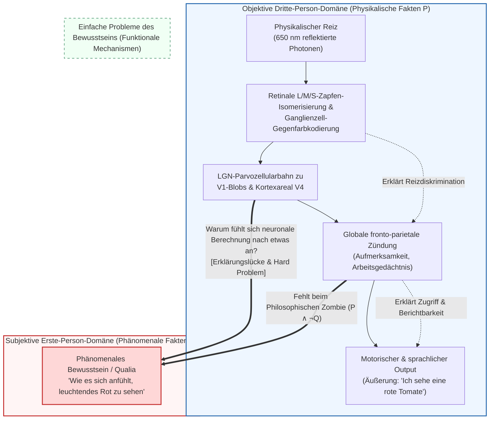
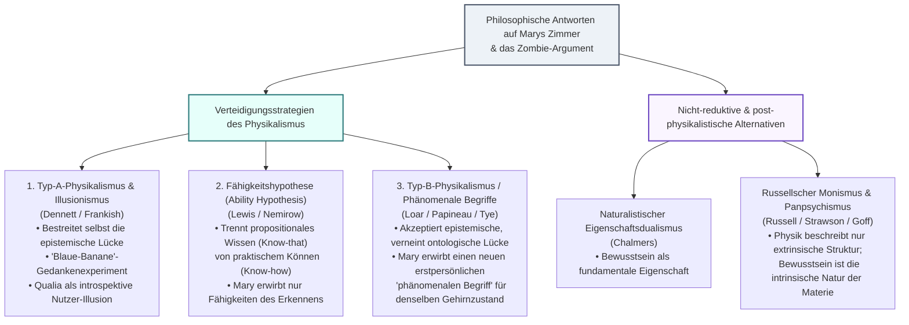

## 1. Einleitung: Der Abgrund zwischen $\lambda = 650\,\text{nm}$ elektromagnetischer Strahlung und dem subjektiven Leuchten von Rot

Wenn wir eine reife Tomate im Abendlicht betrachten, lässt sich dieser Vorgang auf zwei radikal unterschiedlichen Ebenen beschreiben.

Die erste Ebene ist die <strong>objektive Beschreibung der Naturwissenschaften aus der Dritte-Person-Perspektive</strong>: Carotinoid-Pigmente (Lycopin) in der Tomatenschale absorbieren kurz- und mittelwelliges Licht und reflektieren selektiv langwellige elektromagnetische Strahlung um $\lambda \approx 650\,\text{nm}$. Diese Photonen treffen auf die menschliche Netzhaut und bewirken in den langwellensensitiven Zapfen (L-Zapfen, $\lambda_{\max} \approx 560\,\text{nm}$) die Photoisomerisierung von 11-cis-Retinal zu all-trans-Retinal. Über Transducin und Phosphodiesterase (PDE) wird zyklisches GMP ($\text{cGMP}$) hydrolysiert, Kationenkanäle schließen sich, und die Photorezeptormembran hyperpolarisiert. Nach der Gegenfarbkodierung ($L - M$ und $S - (L + M)$) in retinalen Ganglienzellen gelangt das Signal über die parvozellulären Schichten des Corpus geniculatum laterale (LGN) in den primären visuellen Kortex (V1) und schließlich in das <strong>Areal V4</strong> (das kortikale Zentrum für Farbkonstanz), bevor fronto-parietale Sprachnetzwerke (Broca-Areal) die Äußerung hervorbringen: *„Diese Tomate ist leuchtend rot.“*

Doch es gibt eine zweite Ebene: das <strong>subjektive Erleben aus der Erste-Person-Perspektive</strong>. So präzise wir auch die Maxwell-Gleichungen, den quantenchemischen Hamilton-Operator der Retinal-Isomerisierung oder die Hodgkin-Huxley-Differentialgleichungen der Aktionspotentiale formulieren – in keiner dieser Gleichungen taucht <strong>das lebendige, glühende qualitative Rot-Erlebnis</strong> auf, das uns im Bewusstsein unmittelbar gegeben ist.

In der analytischen Philosophie des Geistes (Philosophy of Mind) werden diese subjektiven Erlebnisqualitäten als <strong>Qualia</strong> (Singular: *Quale*) oder <strong>phänomenales Bewusstsein (Phenomenal Consciousness)</strong> bezeichnet. Dieser Artikel rekonstruiert die <strong>drei Hauptsäulen des Antiphysikalismus</strong> – Thomas Nagels Fledermaus-Argument (1974), Frank Jacksons Wissensargument („Marys Zimmer“, 1982/1986) sowie Joseph Levines Erklärungslücke (1983) und David Chalmers' „Schwieriges Problem des Bewusstseins“ samt dem Zombie-Argument (1995/1996). Anschließend prüfen wir die drei großen Verteidigungsstrategien des Physikalismus (Illusionismus, Fähigkeitshypothese, Strategie der phänomenalen Begriffe) und beleuchten die modernen Grenzgebiete: den <strong>Russellschen Monismus (Panpsychismus)</strong>, die <strong>Global Neuronal Workspace Theory (GNWT)</strong> und Giulio Tononis mathematische <strong>Integrierte Informationstheorie (IIT)</strong>.

---

## 2. Präzise Definition von Qualia und phänomenalem Bewusstsein

Der Begriff <strong>Qualia</strong> wurde 1929 von <strong>Clarence Irving Lewis</strong> (*Mind and the World Order*) eingeführt. Im Jahr 1995 traf <strong>Ned Block</strong> die fundamentale Unterscheidung zwischen zwei Begriffen von Bewusstsein:
1. <strong>Phänomenales Bewusstsein (P-Consciousness)</strong>: Der subjektive Erlebnischarakter eines mentalen Zustands – <strong>wie es sich anfühlt (what it is like)</strong>, in diesem Zustand zu sein.
2. <strong>Zugriffsbewusstsein (Access Consciousness / A-Consciousness)</strong>: Ein funktionaler Zustand, bei dem eine mentale Repräsentation global für Schlussfolgerungen, Handlungssteuerung und sprachliche Berichte (Verbal report) verfügbar ist.

Daniel Dennett (1988) charakterisierte Qualia durch vier klassische Merkmale: <strong>Unaussprechlichkeit (Ineffability)</strong>, <strong>Intrinsität (Intrinsicness)</strong>, <strong>Privatheit (Privateness)</strong> und <strong>unmittelbare Erfassbarkeit im Bewusstsein (Immediate Apprehensibility)</strong>. Das Gedankenexperiment des <strong>invertierten Spektrums (Inverted Spectrum)</strong> (Locke 1689; Shoemaker 1982) zeigt, dass zwei Personen funktional und sprachlich zu 100 % identisch auf Farben reagieren können, während ihre inneren Qualia für Rot und Grün ($Q_{\text{red}} \leftrightarrow Q_{\text{green}}$) symmetrisch vertauscht sind – ein schwerer Schlag gegen den reinen Funktionalismus.

---

## 3. Die drei Säulen des Antiphysikalismus

### 3.1 Säule I: Thomas Nagels *„Wie ist es, eine Fledermaus zu sein?“* (1974)

In seinem berühmten Aufsatz *„What Is It Like to Be a Bat?“* (1974) formulierte <strong>Thomas Nagel</strong> das Wesen des Bewusstseins:

> „Grundsätzlich hat ein Organismus genau dann bewusste mentale Zustände, wenn es <strong>irgendwie ist, dieser Organismus zu sein</strong> – wenn es <strong>für</strong> den Organismus irgendwie ist.“

Echoortende Fledermäuse (*Microchiroptera*) orientieren sich im Dunkeln durch Ultraschallrufe ($20\text{--}120\,\text{kHz}$), wobei ihr auditiver Kortex aus der Laufzeitverzögerung $\Delta t$ die Entfernung $r = c\Delta t/2$ und aus der Doppler-Verschiebung $\Delta f$ die Relativgeschwindigkeit von Beuteinsekten berechnet. Wenn wir uns vorstellen, kopfüber in einer Höhle zu hängen, stellen wir uns lediglich vor, <strong>wie es für uns (Menschen) wäre, uns wie eine Fledermaus zu verhalten</strong> – nicht aber, <strong>wie es für eine Fledermaus ist, eine Fledermaus zu sein</strong>.

Nagels tiefste Diagnose betrifft die <strong>Paradoxie der objektiven Reduktion</strong>: Naturwissenschaftliche Reduktionen (etwa von „Wärme“ auf mittlere Molekülkinetik $\langle E_k \rangle = \frac{3}{2} k_B T$) funktionieren dadurch, dass sie den spezifischen subjektiven Standpunkt eines Beobachters abziehen, um zu einer standpunktunabhängigen Beschreibung zu gelangen. Beim Bewusstsein ist jedoch <strong>die subjektive Perspektive selbst das Wesen des Phänomens</strong>: Wer die Erste-Person-Perspektive subtrahiert, reduziert das Erlebnis nicht, sondern lässt den Untersuchungsgegenstand schlichtweg fallen!

### 3.2 Säule II: Frank Jacksons Wissensargument („Marys Zimmer“, 1982 / 1986)

Der australische Philosoph <strong>Frank Jackson</strong> entwarf das Gedankenexperiment von <strong>Marys Zimmer (Mary's Room)</strong>:
Die geniale Neurowissenschaftlerin Mary wächst in einem ausschließlich schwarz-weißen Raum auf. Über schwarz-weiße Bücher und Monitore erlernt sie <strong>die Gesamtheit aller physikalischen, neurobiologischen und funktionalen Tatsachen $\mathcal{P}$</strong> über das menschliche Farbsehen. Eines Tages wird sie freigelassen und sieht zum ersten Mal im Leben eine <strong>reife rote Tomate</strong>. Lernt sie etwas Neues?

Das <strong>Wissensargument (Knowledge Argument)</strong> lautet formalisiert (mit dem epistemischen Operator $K_t(\text{Mary}, p)$):
1. <strong>Prämisse 1 (Vollständiges physikalisches Wissen vor der Freilassung)</strong>: Vor ihrer Freilassung kennt Mary alle physikalischen Tatsachen $\mathcal{P}$:
   $$\forall p \in \mathcal{P}, \quad K_{\text{before}}(\text{Mary}, p)$$
2. <strong>Prämisse 2 (Erwerb einer neuen Tatsache nach der Freilassung)</strong>: Beim Anblick der roten Tomate lernt Mary eine neue Tatsache $Q$ (wie es ist, Rot zu erleben):
   $$\exists Q \quad \text{mit} \quad \neg K_{\text{before}}(\text{Mary}, Q) \land K_{\text{after}}(\text{Mary}, Q)$$
3. <strong>Konklusion 1 (Existenz nicht-physikalischer Tatsachen)</strong>: Nach dem Leibnizschen Gesetz folgt $Q \notin \mathcal{P}$.
4. <strong>Konklusion 2 (Falschheit des Physikalismus)</strong>: Da nicht alle Tatsachen physikalische Tatsachen sind ($\mathcal{F}_{\text{world}} \not\subseteq \mathcal{P}$), <strong>ist der Physikalismus falsch</strong>!

(Hinweis: Während Jackson 1982 noch den <strong>Epiphänomenalismus</strong> vertrat, wandte er sich 2003 wegen der kausalen Ohnmacht epiphänomenaler Qualia vom eigenen Argument ab und wechselte zum physikalistischen <strong>Repräsentationalismus</strong>.)

### 3.3 Säule III: Die Erklärungslücke, das „Hard Problem“ und Philosophische Zombies (1983 / 1995 / 1996)

<strong>Joseph Levine (1983)</strong> prägte den Begriff der <strong>Erklärungslücke (Explanatory Gap)</strong>, und <strong>David Chalmers (1995/1996)</strong> stellte den <strong>„Einfachen Problemen“ (Easy Problems)</strong> das <strong>„Schwierige Problem des Bewusstseins“ (The Hard Problem)</strong> gegenüber:

| Vergleichsdimension | Einfache Probleme (Easy Problems) | Das Schwierige Problem (The Hard Problem) |
| :--- | :--- | :--- |
| <strong>Kernfrage</strong> | Wie diskriminiert das Gehirn Reize, integriert Informationen, steuert Aufmerksamkeit und erzeugt Berichte? | <strong>Warum und wie wird all diese physikalische Informationsverarbeitung überhaupt von subjektivem Erleben begleitet?</strong> |
| <strong>Begriffliches Ziel</strong> | <strong>Zugriffsbewusstsein & kognitive Funktionen</strong> (Access Consciousness) | <strong>Phänomenales Bewusstsein / Qualia</strong> (Phenomenal Consciousness) |
| <strong>Reduzierbarkeit</strong> | <strong>Prinzipiell lösbar</strong> durch Aufklärung der neuronalen Schaltkreise und Algorithmen. | <strong>Widersetzt sich funktionaler Reduktion</strong>: Selbst nach Erklärung aller Funktionen bleibt die Frage nach dem subjektiven Erleben offen. |

Chalmers' <strong>Vorstellbarkeitsargument (Conceivability Argument)</strong> nutzt <strong>Philosophische Zombies (p-zombies)</strong> – Wesen, die uns Molekül für Molekül physikalisch exakt gleichen ($\mathcal{P}$), aber keinerlei phänomenales Erleben besitzen ($\neg Q$):
1. <strong>Prämisse 1</strong>: Eine Zombie-Welt ($\mathcal{P} \land \neg Q$) ist ideal und widerspruchsfrei vorstellbar (conceivable).
2. <strong>Prämisse 2</strong>: Ideale Vorstellbarkeit impliziert metaphysische Möglichkeit ($\Diamond(\mathcal{P} \land \neg Q)$).
3. <strong>Konklusion</strong>: Also erzwingt $\mathcal{P}$ nicht mit metaphysischer Notwendigkeit $Q$ ($\neg \Box(\mathcal{P} \to Q)$) – der Physikalismus ist falsch!

Gegen den Einwand a-posteriorischer Notwendigkeit im Sinne von Saul Kripke (*„Wasser = $\text{H}_2\text{O}$“*) zeigt Chalmers mittels der <strong>zweidimensionalen Modalsemantik (2D Modal Semantics)</strong>: Bei „Wasser“ fallen primäre Intension (wässriges Erscheinungsbild) und sekundäre Intension ($\text{H}_2\text{O}$) auseinander; bei „Schmerz“ oder „Rot-Quale $Q$“ hingegen <strong>fallen primäre Intension („sich wie Schmerz anfühlen“) und sekundäre Intension („Schmerz sein“) strikt zusammen ($I_1(Q) = I_2(Q)$)</strong>, weshalb aus primärer Vorstellbarkeit direkt die metaphysische Möglichkeit $\Diamond(\mathcal{P} \land \neg Q)$ folgt.

---

## 4. Die drei Gegenoffensiven des Physikalismus

1. <strong>Typ-A-Physikalismus & Illusionismus (Dennett 1991, Frankish 2016)</strong>:
   Mit dem <strong>Trick der „Blauen Banane“</strong> argumentiert Dennett: Wenn Mary *wirklich* alle physikalischen Tatsachen kennt, durchschaut sie sofort, dass eine blau angemalte Banane in ihrem Kortex den Zustand für Blau und nicht für Gelb auslöst. Keith Frankishs <strong>Illusionismus</strong> erklärt Qualia zu einer <strong>introspektiven Benutzeroberflächen-Illusion (User-illusion)</strong>.
2. <strong>Die Fähigkeitshypothese (The Ability Hypothesis — Nemirow 1980, David Lewis 1988)</strong>:
   Lewis unterscheidet zwischen <strong>propositionalem Wissen (*Wissen-dass* / Know-that)</strong> und <strong>praktischen Fähigkeiten (*Können* / Know-how)</strong>. Mary lernt beim Anblick der Tomate keine neue Tatsache $Q$, sondern erwirbt lediglich die Fähigkeiten, Rot wiederzuerkennen, sich Rot vorzustellen und sich daran zu erinnern.
3. <strong>Die Strategie der phänomenalen Begriffe / Typ-B-Physikalismus (Loar 1990, Papineau 2002)</strong>:
   Unter Berufung auf Freges Unterscheidung von <strong>Sinn (Gegebenheitsweise) und Bedeutung (Referenz)</strong> („Abendstern = Morgenstern = Venus“) gilt ontologisch: Das Rot-Quale $Q$ ist identisch mit dem physischen Gehirnzustand $N_{\text{red}}$ im Areal V4 ($Q = N_{\text{red}}$). Mary kannte diesen Zustand im Zimmer unter einem drittpersönlichen <strong>theoretischen Begriff ($C_{\text{phys}}$)</strong> und erwirbt beim Verlassen des Zimmers lediglich einen neuen, erstpersönlich-indexikalischen <strong>phänomenalen Begriff ($C_{\text{phen}}$)</strong> für <strong>denselben alten physischen Zustand</strong>!

| Philosophische Position | Hauptvertreter | Epistemische Lücke | Ontologische Lücke | Kernthese über Qualia |
| :--- | :--- | :--- | :--- | :--- |
| <strong>Typ-A-Physikalismus / Illusionismus</strong> | Dennett, Frankish | <strong>Verneint</strong> | <strong>Verneint</strong> | Qualia sind eine <strong>introspektive Nutzer-Illusion</strong> komplexer neuronaler Dispositionen. |
| <strong>Fähigkeitshypothese</strong> | D. Lewis, Nemirow | <strong>Umgedeutet</strong> (nur praktisches Können) | <strong>Verneint</strong> | Mary erwirbt kein neues *Wissen-dass*, sondern praktisches <strong>*Know-how*</strong> (Erkennen, Vorstellen, Erinnern). |
| <strong>Typ-B-Physikalismus (Phänomenale Begriffe)</strong> | Loar, Papineau, Tye | <strong>Akzeptiert</strong> | <strong>Verneint</strong> ($C_{\text{phys}}$ und $C_{\text{phen}}$ koreferieren) | Mary erwirbt einen neuen erstpersönlichen <strong>phänomenalen Begriff</strong> für denselben physischen Gehirnzustand. |
| <strong>Eigenschaftsdualismus</strong> | Chalmers | <strong>Akzeptiert</strong> | <strong>Akzeptiert</strong> | Bewusstsein ist eine <strong>fundamentale Eigenschaft</strong> des Universums neben Masse und Ladung. |
| <strong>Russellscher Monismus / Panpsychismus</strong> | Russell, Strawson, Goff | <strong>Akzeptiert</strong> | <strong>Monistisch integriert</strong> | Physik beschreibt nur <strong>extrinsische Relationen</strong>; Bewusstsein ist die <strong>intrinsische kategoriale Natur (Quiddity)</strong> der Materie. |

---

## 5. Die moderne Grenze: Russellscher Monismus, GNWT und Integrierte Informationstheorie (IIT)

1. <strong>Russellscher Monismus & Panpsychismus (Russell 1927, Eddington 1928, Strawson 2006, Goff 2017)</strong>:
   Die Physik definiert Eigenschaften wie Masse $m$ und Ladung $q$ ausschließlich über ihre <strong>extrinsisch-relationalen Dispositionen</strong> (Differentialgleichungen der Wechselwirkung), schweigt aber völlig über die <strong>intrinsische kategoriale Natur (Quiddity)</strong> der Materie. Da unser eigenes Gehirn das einzige Stück Materie ist, das wir von innen kennen, und sich diese Innenseite als <strong>phänomenales Bewusstsein</strong> zeigt, ist Bewusstsein (bzw. Proto-Bewusstsein) genau die intrinsische Natur der Materie selbst! (Die zentrale Herausforderung bleibt das <strong>Kombinationsproblem / Combination Problem</strong> nach William James).
2. <strong>Global Neuronal Workspace Theory (GNWT — Dehaene & Changeux, 2011)</strong>:
   Sensorische Repräsentationen werden bewusst, sobald sie eine nichtlineare Schwelle überschreiten und eine <strong>globale Zündung (Global Ignition, ca. $300\,\text{ms}$ nach dem Reiz, P3b-Welle)</strong> im weitreichenden fronto-parietalen Kortexnetzwerk auslösen, wodurch die Information im gesamten Arbeitsgedächtnis gebroadcastet wird.
3. <strong>Integrierte Informationstheorie (IIT 3.0 / 4.0 — Giulio Tononi, 2004, 2014, 2023)</strong>:
   IIT kehrt die Erklärungsrichtung um: Ausgehend von <strong>fünf phänomenologischen Axiomen des Erlebens (Intrinsische Existenz, Komposition, Information, Integration, Exklusion)</strong> formuliert Tononi fünf physikalische Postulate. Das Maß für die integrierte Information $\Phi$ eines Zustands $S_t$ ist die minimale Informationsdistanz $D$, die beim Schnitt entlang der schwächsten Stelle des Systems – der <strong>Minimum Information Partition ($\text{MIP}$)</strong> $\pi$ – verloren geht:
   $$\Phi(S_t) = \min_{\pi \in \mathcal{P}_{\text{MIP}}} D\!\left( p\bigl(S_{t \pm 1} \mid S_t\bigr) \;\middle\|\; \prod_{k \in \pi} p\bigl(S_{t \pm 1}^{(k)} \mid S_t^{(k)}\bigr) \right)$$
   - <strong>Das Kleinhirn-Rätsel</strong>: Warum ist das Kleinhirn (Cerebellum, 69 Milliarden Neuronen) unbewusst, während der Kortex (16 Milliarden Neuronen) bewusst ist? Weil das Kleinhirn aus parallelen Feedforward-Modulen ohne rekurrente Rückkopplung besteht ($\Phi \approx 0$), während das thalamokortikale System ein hohes $\Phi^{\max}$ aufweist.
   - <strong>Reine Feedforward-KI als Zombies</strong>: Da rein vorwärtsgerichtete (feedforward) neuronale Netze keine rekurrente Kausalstruktur besitzen, gilt für sie exakt <strong>$\Phi = 0$</strong> – selbst bei perfekter Verhaltenssimulation bleiben sie im Inneren dunkel.

---

## 6. Fazit

Marys Zimmer und die philosophischen Zombies beweisen, dass aus rein drittpersönlichen Strukturgleichungen $\mathcal{P}$ niemals a priori das erstpersönliche Rot-Erlebnis $Q$ abgeleitet werden kann. Ob wir dies mit dem <strong>Typ-B-Physikalismus</strong> als den Wechsel zwischen theoretischen und phänomenalen Begriffen für denselben kortikalen Zustand deuten oder mit dem <strong>Russellschen Monismus und der IIT</strong> als die intrinsische kausale Innenseite ($\Phi^{\max}$) der Materie begreifen: Das leuchtende Rot der Tomate zeigt uns den Punkt, an dem das Universum aufhört, ein bloßes Netz mathematischer Relationen zu sein, und sich von innen heraus selbst erhellt.
