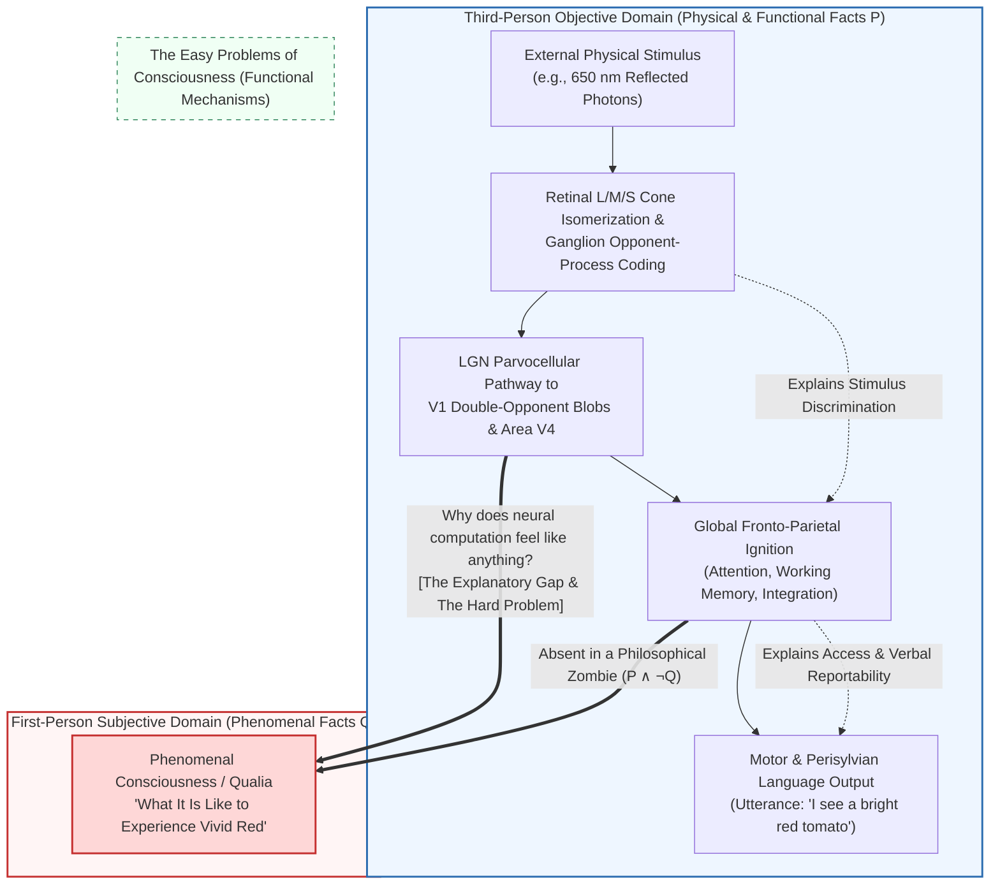
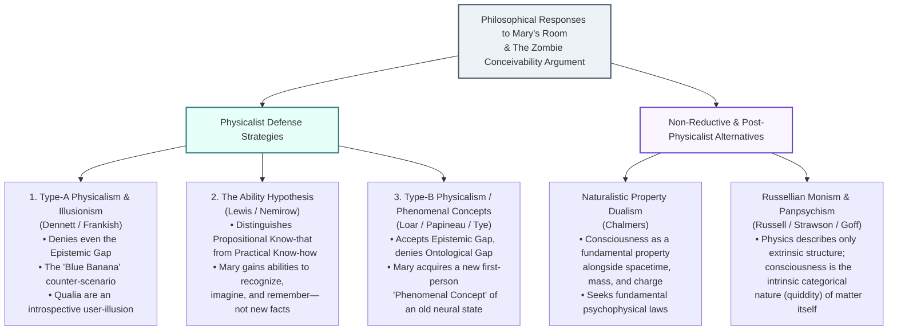

## 1. Introduction: The Abyss Between $\lambda = 650\,\text{nm}$ Electromagnetic Radiation and the Subjective Glow of Red

When we gaze at a ripe tomato in the late afternoon sun, our encounter can be described at two radically distinct epistemic and ontological levels.

The first is the <strong>third-person, objective description of natural science</strong>. Incident photons emitted by the sun strike the epidermal carotenoid pigments (primarily lycopene) of the tomato, whose conjugated polyene chains absorb short- and medium-wavelength radiation while selectively reflecting long-wavelength electromagnetic waves centered around $\lambda \approx 650\,\text{nm}$. Passing through the cornea and crystalline lens, these photons impinge upon the human retina and are absorbed by long-wavelength-sensitive cone photoreceptors (L-cones, $\lambda_{\max} \approx 560\,\text{nm}$). Photon absorption triggers the photoisomerization of the 11-cis-retinal chromophore into all-trans-retinal, inducing a conformational change in the G-protein-coupled opsin receptor. This activates transducin, which stimulates phosphodiesterase (PDE) to hydrolyze cyclic GMP ($\text{cGMP}$), closing cGMP-gated cation channels and hyperpolarizing the photoreceptor membrane. The resulting graded potential is transformed by retinal circuitry into opponent-process action potentials ($L - M$ and $S - (L + M)$ channels) in retinal ganglion cells, relayed through the parvocellular layers of the dorsal lateral geniculate nucleus (LGN) to the cytochrome-oxidase "blobs" of primary visual cortex (V1), and ultimately processed in <strong>extrastriate area V4</strong>—the cortical hub of color constancy—before recruiting fronto-parietal and perisylvian language networks (Broca's area) to drive the vocal-tract articulation: *"That tomato is bright red."*

Yet there is a second level of description—the <strong>first-person, subjective character of conscious experience</strong>. No matter how exhaustively we write down Maxwell's equations of electromagnetism, the quantum mechanical Hamiltonian governing retinal isomerization, or the Hodgkin-Huxley differential equations governing axonal spike trains, nothing in those equations mentions <strong>the vivid, burning qualitative redness</strong> that we directly experience in our visual field.

In contemporary philosophy of mind and cognitive science, these subjective, intrinsic, qualitative properties of experience are known as <strong>qualia</strong> (singular: *quale*), or <strong>phenomenal consciousness</strong>. Suppose humanity eventually achieves a complete neurobiological and physical theory of the brain—mapping every connectome synapse, every ion channel state, and every dynamical attractor. Would knowing the entirety of physical and functional facts automatically explain *why* and *how* certain neural computations feel like seeing red, smelling roasted coffee, or suffering the sharp sting of a toothache? Or does the subjective character of experience slip through the explanatory net of physicalism altogether?

In this comprehensive study, we reconstruct the <strong>Three Pillars of Anti-Physicalism</strong> in modern philosophy of mind: Thomas Nagel's *"What Is It Like to Be a Bat?"* (1974), Frank Jackson's *Knowledge Argument ("Mary's Room")* (1982/1986), and Joseph Levine's *Explanatory Gap* (1983) culminating in David Chalmers's *Hard Problem of Consciousness* and the *Conceivability Argument (Philosophical Zombies)* (1995/1996). We then critically examine the three primary physicalist counter-offensives—Type-A Physicalism and Illusionism (Dennett, Frankish), the Ability Hypothesis (Lewis, Nemirow), and the Phenomenal Concept Strategy / Type-B Physicalism (Loar, Papineau)—before exploring the cutting-edge frontier where metaphysics meets theoretical neuroscience: <strong>Russellian Monism and Panpsychism</strong>, <strong>Global Neuronal Workspace Theory (GNWT)</strong>, and Giulio Tononi's mathematical <strong>Integrated Information Theory (IIT)</strong>.

---

## 2. Defining Qualia and Phenomenal Consciousness

### 2.1 From C.I. Lewis to Ned Block: Phenomenal Consciousness vs. Access Consciousness

The philosophical term <strong>qualia</strong> (derived from the Latin *qualis*, meaning "of what sort" or "of what kind") was introduced in its modern analytic sense by the American philosopher <strong>Clarence Irving Lewis</strong> in his 1929 treatise *Mind and the World Order*. Lewis used the term to designate the recognizable, repeatable qualitative characters of the given in immediate experience—such as the specific phenomenal redness of a visual patch or the felt sharpness of a pain—prior to any conceptual judgment about external objects.

More than six decades later, in his landmark 1995 paper *"On a Confusion about a Function of Consciousness,"* philosopher <strong>Ned Block</strong> demonstrated that scientific and philosophical debates routinely conflate two fundamentally distinct concepts under the single word "consciousness":

1. <strong>Phenomenal Consciousness (P-Consciousness)</strong>:
   The experiential, subjective, first-person qualitative character of a mental state—<strong>what it is like</strong> for a subject to undergo that state. P-consciousness is constituted by qualia: the felt warmth of sunlight on skin, the velvet timbre of a cello, the throbbing ache of a migraine, or the chromatic richness of scarlet.
2. <strong>Access Consciousness (A-Consciousness)</strong>:
   A functional, information-processing property of a mental representation. A state is A-conscious if and only if its representational content is broadcast or poised for free use in reasoning, rational guidance of action, executive decision-making, and verbal report.

Block's distinction exposes a pervasive sleight of hand in cognitive neuroscience and artificial intelligence. When researchers explain how visual information is selected by attentional mechanisms, maintained in prefrontal working memory, and routed to speech production areas, they have explained <strong>Access Consciousness</strong>. Yet explaining how a computational system *accesses* and *reports* information leaves untouched the question of why there is <strong>Phenomenal Consciousness</strong>—why that information processing feels like anything at all.

### 2.2 The Four Classical Hallmarks of Qualia and the Inverted Spectrum

In his famous polemic *"Quining Qualia"* (1988), Daniel Dennett characterized the traditional philosophical conception of qualia via four defining properties (which Dennett sought to dismantle, though they remain the standard diagnostic criteria for phenomenal realists):

- <strong>Ineffability</strong>: One cannot communicate what a quale is like to a subject who has never experienced it solely via propositional description (e.g., no verbal lecture can convey the visual experience of magenta to someone congenitally blind).
- <strong>Intrinsicness</strong>: Qualia are non-relational, intrinsic properties of experience; their qualitative nature does not depend on how the experience is causally connected to external stimuli or downstream motor behavior.
- <strong>Privateness</strong>: Interpersonal comparisons of qualia are systematically impossible through direct third-person observation; my qualia are directly accessible only from my first-person perspective.
- <strong>Direct or Immediate Apprehensibility in Consciousness</strong>: To experience a quale is to know it immediately and non-inferentially; for phenomenal qualities, there is no distinction between *appearance* and *reality* (if an experience *feels* like pain, it *is* pain).

The independence of intrinsic qualia from functional and behavioral roles is vividly illustrated by the <strong>Inverted Spectrum (Inverted Qualia)</strong> thought experiment, originally sketched by John Locke in *An Essay Concerning Human Understanding* (1689, II.xxxii.15) and formalized in modern philosophy by Sydney Shoemaker (1982) and Ned Block (1990).

Suppose two individuals, Alice and Bob, are functionally and behaviorally isomorphic in every color discrimination task. Both point to ripe tomatoes and call them "red"; both stop at red traffic lights and go at green ones; both pass the Ishihara color vision test with identical reaction times. Nevertheless, it is entirely coherent and free of contradiction to suppose that the internal qualitative experience Alice undergoes when viewing a ripe tomato ($\lambda \approx 650\,\text{nm}$) is qualitatively identical to the experience Bob undergoes when viewing fresh grass ($\lambda \approx 530\,\text{nm}$), and vice versa. Because a complete symmetry inversion of the phenomenal color solid preserves all relational, behavioral, and functional structures while altering the underlying qualia, <strong>functionalism</strong>—the doctrine that mental states are exhausted by their causal-functional roles—cannot capture the intrinsic nature of phenomenal consciousness.

---

## 3. Pillar I: Thomas Nagel's *"What Is It Like to Be a Bat?"* (1974)

### 3.1 The Criterion of Consciousness: "Something It Is Like"

In 1974, during the heyday of reductive materialism and machine functionalism, <strong>Thomas Nagel</strong> published his seminal paper *"What Is It Like to Be a Bat?"* in *The Philosophical Review*. Nagel argued that every reductionist account of the mind tried thus far shared a fatal flaw: they left out the very feature that makes the mind-body problem intractable—consciousness itself.

Nagel formulated what has become the canonical definition of phenomenal consciousness:

> "Fundamentally an organism has conscious mental states if and only if there is <strong>something that it is like to be that organism</strong>—something it is like <strong>for</strong> the organism. We may call this the subjective character of experience."

A pebble, a thermostat, or a lookup table has no subjective perspective; there is nothing it is like *for* the pebble to roll down a hill. By contrast, for a conscious organism, experience is essentially perspectival—it is always given *to* a subject from a specific point of view.

### 3.2 Microchiropteran Echolocation and the Epistemic Wall of Subjectivity

Why did Nagel choose bats (specifically echolocating *Microchiroptera*) rather than Martians or insects? Because bats are mammals closely related to us on the phylogenetic tree—so we have overwhelming biological reason to believe they possess rich conscious experiences—yet their primary sensory modality is profoundly alien to human phenomenology.

Microchiropteran bats navigate and hunt flying insects in pitch darkness using biological <strong>sonar (echolocation)</strong>. Emitting rapid, high-intensity ultrasonic cries ($20\,\text{kHz}$ to $120\,\text{kHz}$, often combining constant-frequency and frequency-modulated sweeps) through their larynx or nose-leaf, bats analyze the returning echoes reflected from surrounding objects:

- The <strong>time delay $\Delta t$</strong> between emission and echo reception encodes radial distance $r = \frac{c \Delta t}{2}$ via delay-tuned combination-sensitive neurons in the auditory cortex.
- The <strong>Doppler shift $\Delta f = f_0 \frac{2v_{\text{rel}}}{c}$</strong> encodes relative velocity and the wing-beat frequency of prey.
- The <strong>interaural intensity and phase differences</strong> along with spectral notches induced by the complex geometry of the tragus and pinna encode three-dimensional azimuth, elevation, and surface texture.

Although bat sonar serves the same *functional* purpose as human stereoscopic vision (three-dimensional spatial perception and target tracking), there is no reason to believe that sonar feels subjectively anything like vision or human hearing.

Crucially, Nagel observes that when we try to imagine "what it is like to be a bat" by imagining ourselves flying through a dark cave, hanging upside down by our feet, and catching beetles in our mouths, we are failing the philosophical task. That exercise only tells us <strong>what it would be like *for us* (humans with human cognitive architecture) to behave as a bat behaves</strong>. The true question is: <strong>What is it like *for a bat* to be a bat?</strong> Because our ability to form sympathetic first-person concepts is strictly bounded by the structural limits of our own human sensory modalities, the subjective phenomenology of bat sonar lies beyond our imaginative reach—even though it is a completely real, objective fact about the world that there *is* something it is like to be a bat.

### 3.3 The Paradox of Objective Reduction

Nagel's deepest insight lies not in human imaginative limitations, but in diagnosing a structural clash between <strong>subjectivity</strong> and the <strong>methodology of physical reduction</strong>.

Consider how physical science achieves successful reductions elsewhere in nature:
- To reduce phenomenological "heat" to statistical mechanics ($\langle E_k \rangle = \frac{3}{2} k_B T$), physics systematically strips away how lukewarm or scalding water feels to human cutaneous thermoreceptors, moving to a structural description invariant across all observers.
- To reduce "sound" to longitudinal pressure waves $\nabla^2 p - \frac{1}{c^2}\frac{\partial^2 p}{\partial t^2} = 0$, acoustics strips away the auditory sensation of pitch and timbre.

In every standard scientific reduction, <strong>progress toward greater objectivity is achieved by moving away from a specific subjective viewpoint toward a viewpoint-independent, third-person characterization</strong>.

However, when the target of reduction is *conscious experience itself*, this methodology collapses into self-contradiction. The entire essence of the phenomenon of bat sonar—or of seeing red—consists in <strong>how it appears from a specific subjective point of view</strong>. If we subtract the subjective viewpoint in order to form a purely third-person neurophysiological description of bat auditory cortex, we have not reduced the experience; we have simply abandoned the phenomenon we set out to explain! As Nagel famously concluded: *"Every subjective phenomenon is essentially connected with a single point of view, and it seems inevitable that an objective, physical theory will abandon that point of view."*

---

## 4. Pillar II: Frank Jackson's Knowledge Argument ("Mary's Room", 1982 / 1986)

Building upon Nagel's epistemic divide, the Australian philosopher <strong>Frank Jackson</strong> crystallized the anti-physicalist intuition into a rigorous deductive argument in two classic papers: *"Epiphenomenal Qualia"* (1982) and *"What Mary Didn't Know"* (1986). Known universally as the <strong>Knowledge Argument</strong> or the thought experiment of <strong>Mary's Room</strong>, it remains one of the most intensely debated arguments in twentieth- and twenty-first-century philosophy.

### 4.1 The Complete Setup of Mary the Super-Scientist

Jackson invites us to consider Mary, a hypothetical neuroscientist of the future equipped with complete physical omniscience regarding color vision:

> <strong>【The Scenario of Mary's Room】</strong>
> Mary is a brilliant scientist who is, for whatever reason, forced to investigate the world from a <strong>strictly black-and-white room</strong> via a black-and-white television monitor. Her clothes, furniture, books, and skin are painted in shades of black, white, and gray. She has never once had a chromatic visual experience in her life.
>
> Specializing in the neurophysiology of vision, Mary acquires—through monochrome textbooks and black-and-white data readouts—<strong>all the physical, electromagnetic, chemical, neurobiological, and functional information there is to obtain</strong> about what goes on when humans see ripe tomatoes, the blue sky, and use terms like "red" or "green."
> - She knows the exact spectral reflectance curves $R(\lambda)$ of objects and how $\lambda = 650\,\text{nm}$ photons isomerize 11-cis-retinal in L-cones.
> - She knows the complete differential equations governing opponent-process retinal ganglion cells, LGN parvocellular layers, V1 double-opponent blobs, and V4 cortical columns.
> - She knows every functional and causal link between V4 firing rates, prefrontal attentional networks, and Broca's area that causes a human subject to utter the words *"The sky is blue"* or *"This tomato is red."*
>
> One day, the doors of the black-and-white room are unlocked. Mary steps outside into the garden and sees a <strong>ripe red tomato</strong> in full color for the very first time.
> <strong>The Question: Does Mary learn anything new upon seeing red for the first time?</strong>

It seems overwhelmingly obvious that she does! Upon seeing the tomato, Mary learns a monumental truth that all her equations and monochrome wiring diagrams left out: she learns <strong>what it is like to see red</strong> ($Q$).

### 4.2 Deductive Formalization of the Knowledge Argument

Let $\mathcal{P}$ denote the complete set of all physical, chemical, neurobiological, and functional truths about human color vision and the universe. Let $K_t(x, p)$ denote the epistemic operator "$x$ propositionally knows fact $p$ at time $t$." Jackson's Knowledge Argument takes the following deductively valid form:

1. <strong>Premise 1 (Complete Physical Knowledge Before Release)</strong>:
   Prior to her release at $t_{\text{before}}$, Mary knows all physical facts $\mathcal{P}$ pertaining to human color vision:
   $$\forall p \in \mathcal{P}, \quad K_{\text{before}}(\text{Mary}, p)$$
2. <strong>Premise 2 (Acquisition of a New Fact Upon Release)</strong>:
   Upon stepping outside and seeing a ripe tomato at $t_{\text{after}}$, Mary learns a genuine fact $Q$ (namely, the phenomenal fact of what it is like for a human to see red) that she did not know before:
   $$\exists Q \quad \text{such that} \quad \neg K_{\text{before}}(\text{Mary}, Q) \land K_{\text{after}}(\text{Mary}, Q)$$
3. <strong>Conclusion 1 (Incompleteness of Physical Knowledge and Facts)</strong>:
   By Leibniz's Law (the Indiscernibility of Identicals: if $x = y$, then $x$ and $y$ share all properties), since every $p \in \mathcal{P}$ has the property of being known by Mary at $t_{\text{before}}$ whereas $Q$ lacks this property, $Q$ cannot be identical to any member of $\mathcal{P}$:
   $$Q \notin \mathcal{P}$$
   Therefore, Mary did not know *all* facts before her release, and there exist non-physical facts about human vision.
4. <strong>Conclusion 2 (Refutation of Physicalism)</strong>:
   Physicalism is the metaphysical doctrine that all facts about the world are physical facts (or are a priori entailed by the complete physical truth $\mathcal{P}$): $\mathcal{F}_{\text{world}} \subseteq \mathcal{P}$. Since $Q \in \mathcal{F}_{\text{world}}$ and $Q \notin \mathcal{P}$, <strong>Physicalism is false</strong>.

Notice the logical structure: the move from epistemic premises ($K_{\text{before}}, K_{\text{after}}$) to a metaphysical conclusion ($\text{Physicalism is false}$) is airtight *provided* that knowing all physical facts is sufficient to know all facts if physicalism is true.

### 4.3 Epiphenomenalism and Jackson's Surprising 2003 Conversion to Representationalism

In his original 1982 paper, Jackson embraced <strong>epiphenomenalism</strong>—a form of property dualism holding that physical brain states $\mathcal{P}$ causally generate non-physical qualia $Q$ ($\mathcal{P} \to Q$), but qualia $Q$ themselves are <strong>causally impotent</strong> (they exert zero downward causal influence on neurons, muscles, or vocal cords, much like the whistle on a steam locomotive does no work in pulling the train). Jackson adopted epiphenomenalism out of respect for the <strong>Causal Closure of the Physical Domain</strong>: every physical event (such as Mary's mouth uttering *"Wow, so that's red!"*) already has a complete neurobiological cause in the firing of motor cortex neurons.

Remarkably, however, in the late 1990s and officially in his 2003 paper *"Mind and Illusion,"* <strong>Frank Jackson recanted his own anti-physicalist conclusion and converted to Physicalism!</strong>

What convinced the author of the Knowledge Argument to abandon property dualism? The decisive factor was the fatal epistemic paradox of epiphenomenalism itself: if qualia $Q$ have *zero causal power* over the physical brain, then Mary's newly acquired experience of red ($Q$) cannot play any causal role in making her say *"Aha! Now I know what red looks like!"* nor can it cause the formation of her memory traces in the hippocampus. Even if all qualia suddenly vanished while leaving the neural wiring intact, Mary's physical body would still utter the exact same words of amazement! Finding epiphenomenalism epistemically untenable, Jackson adopted <strong>strong representationalism (intensionalism)</strong>: sensory experiences do not instantiate non-physical mental properties ("qualia"); rather, seeing red is simply a complex physical mode of *representing* external physical surface properties, and Mary's surprise is an illusion produced by switching from a third-person linguistic representation to a first-person perceptual representation of the very same physical reality.

---

## 5. Pillar III: The Explanatory Gap, The Hard Problem of Consciousness, and Philosophical Zombies

### 5.1 Joseph Levine's Explanatory Gap (1983)

One year after Jackson's first paper, <strong>Joseph Levine</strong> published *"Materialism and Qualia: The Explanatory Gap"* (1983), shifting the focus from ontology to the theory of scientific explanation.

Why is the reduction of water to $\text{H}_2\text{O}$, or heat to mean molecular kinetic energy $\langle E_k \rangle = \frac{3}{2} k_B T$, or genes to DNA base-pair sequences completely transparent and satisfying? Because our pre-theoretic concepts of "water," "heat," and "gene" are defined by their <strong>causal and functional roles</strong>: "water" is whatever transparent, odorless liquid fills rivers, quenches thirst, freezes at $0^\circ\text{C}$, and boils at $100^\circ\text{C}$ at standard pressure. Once quantum chemistry demonstrates how the bent geometry ($104.5^\circ$) and hydrogen-bonding network of $\text{H}_2\text{O}$ molecules necessitate those exact phase transitions and solvent properties, <strong>nothing remains unexplained</strong>. It becomes inconceivable that $\text{H}_2\text{O}$ could obey the laws of physics at $20^\circ\text{C}$ and fail to be liquid water.

By contrast, consider the putative mind-brain identity statement: *"Pain is the firing of nociceptive C-fibers"* (or *"Seeing red is $40\,\text{Hz}$ gamma synchronization in cortical area V4"*). Even after neurobiology explains every causal role of C-fiber firing—how tissue damage activates TRPV1 ion channels, how signals ascend the spinothalamic tract, and how they trigger withdrawal reflexes and vocal groans—a profound mystery remains untouched: <strong>Why should C-fiber firing feel like *pain* rather than like a tickle, a patch of blue, or nothing at all?</strong> Because the concept of phenomenal consciousness is not exhausted by a causal-functional role, physical mechanisms never deductively close the gap to qualitative experience. This unbridgeable chasm between physical processes and phenomenal character is Levine's <strong>Explanatory Gap</strong>.

### 5.2 David Chalmers: The Easy Problems vs. The Hard Problem of Consciousness (1995 / 1996)

In his celebrated 1995 paper *"Facing Up to the Problem of Consciousness"* and his monumental 1996 book *The Conscious Mind: In Search of a Fundamental Theory*, <strong>David Chalmers</strong> synthesized the insights of Nagel, Jackson, and Levine into his famous dichotomy between the <strong>Easy Problems</strong> and the <strong>Hard Problem of Consciousness</strong>.

| Dimension of Comparison | The Easy Problems of Consciousness | The Hard Problem of Consciousness |
| :--- | :--- | :--- |
| <strong>Core Question</strong> | How does the brain discriminate stimuli, integrate information across modules, monitor internal states, and generate verbal reports? | <strong>Why and how is all of that physical information processing accompanied by subjective inner experience (*what it is like*) at all?</strong> |
| <strong>Conceptual Target</strong> | <strong>Access Consciousness & Functional Mechanisms</strong> (Cognitive and behavioral capacities) | <strong>Phenomenal Consciousness / Qualia</strong> (First-person qualitative subjectivity) |
| <strong>Representative Phenomena</strong> | • Ability to discriminate, categorize, and react to environmental stimuli • Integration of information by a cognitive system • Reportability of mental states • Focus of attention & deliberate control of behavior • Difference between wakefulness and sleep | • The felt redness of a sunset ($\lambda = 650\,\text{nm}$) • The raw, agonizing sting of pain • Why we are not unconscious biological automata operating in the dark • How subjective interiority arises from objective matter |
| <strong>Suitability for Reductive Functional Explanation</strong> | <strong>Fully tractable in principle</strong>: specifying the neural or computational mechanism that performs the function *solves* the problem. | <strong>Resistant to standard reductive explanation</strong>: even after every behavioral and cognitive function is explained, the question of *why experience accompanies the function* remains unanswered. |

As Chalmers emphasizes, the "Easy Problems" are not trivial in practice—solving them requires decades of painstaking empirical work in electrophysiology, optogenetics, and computational neuroscience. They are "easy" in the precise methodological sense that <strong>we know what a successful reductive explanation looks like</strong>: to explain reportability, we need only identify the neural circuit that routes perceptual representations to Broca's area.

The <strong>Hard Problem</strong> is uniquely "hard" because phenomenal consciousness is not a cognitive function. Even when cognitive neuroscience has mapped every last synapse involved in discrimination, attentional integration, and verbal reporting, one can still coherently ask: *Why doesn't all that neural computation take place completely "in the dark," free of any inner subjective movie?*

### 5.3 The Conceivability Argument: Philosophical Zombies and 2D Modal Semantics

To prove that the epistemic Explanatory Gap entails an ontological refutation of physicalism, Chalmers formulated the <strong>Conceivability Argument</strong> (or <strong>Zombie Argument</strong>).

In philosophy of mind, a <strong>Philosophical Zombie (p-zombie)</strong> is not the shambling undead monster of horror cinema, but a precise modal counterpart of a conscious human being:
- My zombie twin is <strong>molecule-for-molecule, quantum-state-for-quantum-state physically identical to me</strong>, obeying all fundamental physical laws (Maxwell's equations, the Dirac equation, general relativity, and Hodgkin-Huxley membrane dynamics).
- Furthermore, a <strong>Zombie World ($W_{\text{zombie}}$)</strong> is a possible world physically indiscernible from our actual world in every microphysical respect ($\mathcal{P}$ holds completely, including all functional and behavioral facts): my zombie twin smiles at sunsets, winces when burned, and writes passionate philosophy papers about qualia.
- Yet in $W_{\text{zombie}}$, <strong>nobody is conscious</strong> ($\neg Q$): there is no inner qualitative feel to anything; all is dark inside.

Let $\mathcal{P}$ be the conjunction of all microphysical truths about our universe (including the laws of physics), and let $Q$ be an arbitrary phenomenal truth (e.g., *"Someone experiences phenomenal redness"*). Using modal operators $\Diamond$ (metaphysical possibility) and $\Box$ (metaphysical necessity), Chalmers's Zombie Argument proceeds as follows:

1. <strong>Premise 1 (Ideal Conceivability of Zombies)</strong>:
   $\mathcal{P} \land \neg Q$ is ideally, positively, and primarily conceivable. That is, an ideal rational reasoner possessing limitless logical competence can coherently conceive of a world satisfying $\mathcal{P} \land \neg Q$ without encountering any a priori contradiction.
2. <strong>Premise 2 (The Modal Bridge: Conceivability Entails Metaphysical Possibility)</strong>:
   If $\mathcal{P} \land \neg Q$ is ideally conceivable, then $\mathcal{P} \land \neg Q$ is metaphysically possible:
   $$\text{Conceivable}_1(\mathcal{P} \land \neg Q) \implies \Diamond(\mathcal{P} \land \neg Q)$$
3. <strong>Premise 3 (Failure of Metaphysical Supervenience)</strong>:
   If there exists a metaphysically possible world where $\mathcal{P}$ holds and $Q$ fails ($\Diamond(\mathcal{P} \land \neg Q)$), then the physical facts $\mathcal{P}$ do not metaphysically necessitate the phenomenal facts $Q$:
   $$\Diamond(\mathcal{P} \land \neg Q) \iff \neg \Box(\mathcal{P} \to Q)$$
4. <strong>Conclusion (Falsity of Reductive and Non-Reductive Materialism)</strong>:
   Because materialism requires that phenomenal facts supervene with metaphysical necessity upon the complete physical truth ($\Box(\mathcal{P} \to Q)$), <strong>Materialism/Physicalism is false</strong>.

#### Defeating the Kripkean A Posteriori Necessity Objection via Two-Dimensional Modal Semantics

Physicalists immediately object to Premise 2 by appealing to Saul Kripke's *Naming and Necessity* (1980):
*"Wait! Before modern chemistry, it was conceivable that $\text{Water} \neq \text{H}_2\text{O}$ (that $\text{H}_2\text{O}$ could exist without water). Yet because 'water' and '$\text{H}_2\text{O}$' are rigid designators referring to the same substance, $\Box(\text{Water} = \text{H}_2\text{O})$ is a metaphysically necessary a posteriori truth! Why couldn't $\Box(\mathcal{P} \to Q)$ likewise be an a posteriori metaphysical necessity that merely seems contingent to our a priori imagination?"*

Following Kripke's own famous argument at the end of *Naming and Necessity* and extending it through <strong>Two-Dimensional (2D) Modal Semantics</strong>, Chalmers shows why the water/$\text{H}_2\text{O}$ analogy fails for consciousness.

In 2D modal semantics, every concept $E$ is associated with two intensions (functions from possible worlds to extensions):
- <strong>Primary Intension ($I_1(E, w)$)</strong>: Evaluates the reference of $E$ when world $w$ is considered *as actual* (capturing the a priori cognitive role that fixes reference). For "water," $I_1$ picks out whatever substance in $w$ is the transparent, drinkable liquid filling oceans (*watery stuff*).
- <strong>Secondary Intension ($I_2(E, w)$)</strong>: Fixes the reference of $E$ in our actual world $@$ (where watery stuff turns out to be $\text{H}_2\text{O}$), and evaluates that rigidified reference across counterfactual worlds $w$. Thus $I_2(\text{"water"}, w) = \text{H}_2\text{O}$ in every world $w$.

When someone imagines a world $w_{\text{XYZ}}$ where "water is not $\text{H}_2\text{O}$," what is genuinely conceivable is a world where the <strong>primary intension</strong> fails to match $\text{H}_2\text{O}$ (e.g., where the oceans are filled with a superficially watery chemical $\text{XYZ}$, or where $\text{H}_2\text{O}$ exists without behaving like watery stuff). Because primary conceivability always guarantees primary possibility ($\Diamond_1$), that world $w_{\text{XYZ}}$ is indeed a genuine metaphysically possible world! It simply gets misdescribed as a world without "water" in the secondary sense, because for "water," the primary intension (*appearance: watery stuff*) and secondary intension (*essence: $\text{H}_2\text{O}$*) come apart ($I_1 \neq I_2$).

Now apply this 2D framework to $\mathcal{P} \land \neg Q$:
- For fundamental physics $\mathcal{P}$ (or structural-dynamical properties), the primary and secondary intensions coincide (or else their gap points to Russellian Monism, as we will see in Section 7.1).
- Crucially, for phenomenal consciousness $Q$ (e.g., "pain" or "phenomenal redness"), <strong>the primary intension and secondary intension are strictly identical ($I_1(Q) = I_2(Q)$)!</strong> With water, a substance can *feel and look like water* ($I_1$) without *being $\text{H}_2\text{O}$* ($I_2$). With pain, however, <strong>there is no distinction between "feeling like pain" ($I_1$) and "being pain" ($I_2$)</strong>: any state that feels subjectively like pain *is* pain, and any state that does not feel like pain *is not* pain!

Therefore, because $I_1(Q) = I_2(Q)$, the primary possibility of a zombie world $\Diamond_1(\mathcal{P} \land \neg Q)$ (established by ideal conceivability) immediately collapses into secondary (metaphysical) possibility $\Diamond_2(\mathcal{P} \land \neg Q)$. There is no room for Kripkean a posteriori necessity to rescue reductive materialism from the Zombie Argument.

---

## 6. The Physicalist Counter-Offensives: Three Strategies for Saving Materialism

Confronted with Nagel's Bat, Jackson's Mary, and Chalmers's Zombies, physicalist philosophers developed three major families of responses. Each targets a specific premise in the anti-physicalist edifice.

### 6.1 Counter-Offensive 1: Type-A Physicalism and Illusionism (Dennett, Frankish)

<strong>Type-A Physicalism</strong> denies that there is even an epistemic gap between physical functions and consciousness: once all functional capacities (discrimination, reportability, reactive dispositions) are explained, nothing else exists to be explained. Its most celebrated champion is <strong>Daniel Dennett</strong> (*Consciousness Explained*, 1991).

Dennett attacks Premise 2 of Jackson's Knowledge Argument directly, arguing that our intuition that Mary learns something new rests on a massive failure of imagination regarding Premise 1 (*"Mary knows ALL physical facts"*). To expose this, Dennett proposes the famous <strong>"Blue Banana" thought experiment</strong>:

> <strong>【Dennett's Blue Banana Trick】</strong>
> Suppose that on the day Mary is released from her black-and-white room, her captors try to trick her by presenting her with a <strong>bright blue banana</strong>.
> If we take Premise 1 seriously—that Mary genuinely knows *everything* physical and neurocomputational about color vision—she will not be fooled for a millisecond! Before she even steps outside, she has already mapped out the exact functional consequences that yellow vs. blue wavelengths have on her own V4 neurons, her associative memory networks, and her reactive dispositions. Looking at the blue banana, she immediately says:
> *"Hey! You tried to trick me! Bananas are yellow, not blue! I recognize immediately that the visual processing state currently triggered in my cortex is the exact reactive disposition associated with blue objects, not yellow ones!"*

According to Dennett, we mistakenly assume Mary will be surprised only because we confuse "knowing a lot of neuroscience" with "knowing *all* physical facts." Similarly, Dennett rejects Philosophical Zombies as an incoherent philosopher's fantasy ("zombocom"): a creature that genuinely executes all the complex self-monitoring, emotional, and linguistic functions of a human being *is* conscious by definition.

In recent years, <strong>Keith Frankish</strong> (2016) has sharpened Type-A Physicalism into <strong>Illusionism</strong>. According to Illusionism, phenomenal consciousness (intrinsic, non-physical qualia) does not exist; rather, human introspection is a coarse-grained, self-monitoring mechanism that misrepresents complex, high-dimensional neural sensory states as if they possessed simple, intrinsic, ineffable qualitative properties ("qualia"). Just as a graphical user interface on a computer screen creates the helpful illusion of "solid desktop folders" out of binary transistor voltages, introspection generates a <strong>phenomenal user-illusion</strong>. Explaining *why* our cognitive architecture generates the irresistible intuition that we have qualia and face a Hard Problem—what Chalmers (2018) calls the <strong>Meta-Problem of Consciousness</strong>—thus becomes the central empirical task of consciousness science.

### 6.2 Counter-Offensive 2: The Ability Hypothesis (Nemirow, Lewis)

A second influential line of defense, developed by <strong>Laurence Nemirow</strong> (1980) and <strong>David Lewis</strong> (1988, *"What Experience Teaches"*), is the <strong>Ability Hypothesis</strong>.

Following Gilbert Ryle's classic distinction in *The Concept of Mind* (1949), Lewis and Nemirow distinguish between two fundamentally different kinds of knowledge:
1. <strong>Propositional Knowledge (*Knowing-that*)</strong>: Knowing that a proposition $p$ is true (information that can be written down in books and evaluated as true or false).
2. <strong>Practical / Procedural Knowledge (*Knowing-how*)</strong>: Possessing a practical capacity or skill (e.g., knowing how to ride a bicycle, how to play a violin, or how to use chopsticks).

You can read every physics textbook on angular momentum and classical mechanics (*knowing-that*) without yet knowing *how* to balance on a bicycle (*knowing-how*). When you finally step onto the pavement, wobble, and learn how to ride, you have not discovered a "non-physical fact" missing from Newtonian mechanics; you have simply acquired a motor skill!

Lewis argues that learning "what an experience is like" is strictly a species of <strong>knowing-how</strong>, not knowing-that. When Mary leaves her black-and-white room and sees a ripe tomato, she acquires <strong>no new propositional fact $Q$ whatsoever</strong>. Instead, she gains a bundle of three practical cognitive <strong>abilities</strong>:
- The <strong>ability to recognize</strong> red things directly by sight when she encounters them again;
- The <strong>ability to imagine</strong> red visually in her mind's eye;
- The <strong>ability to remember</strong> the experience of seeing red.

Because deductive arguments for the falsity of physicalism require that Mary learn a new *propositional fact* $Q \notin \mathcal{P}$, reducing her discovery to non-propositional abilities disarms the Knowledge Argument completely.

<strong>【Critiques of the Ability Hypothesis】</strong>
Despite its elegance, the Ability Hypothesis faces formidable counterexamples (e.g., Earl Conee 1994; Brian Loar 1990; Jason Stanley & Timothy Williamson 2001):
- <strong>Knowledge without Abilities</strong>: Suppose Mary suffers from a selective neurological deficit in visual imagery and episodic memory, such that the moment she looks away from the tomato, she *cannot* imagine red, *cannot* remember what it looked like, and *cannot* recognize it five minutes later. Nevertheless, <strong>while she is actively staring right at the red tomato</strong>, she clearly knows what it is like to see red (*"So THIS is what people have been talking about!"*). Thus, the abilities to imagine, remember, and recognize are not necessary for knowing what it is like.
- <strong>Abilities without Knowledge</strong>: Conversely, suppose Mary in her black-and-white room trains herself via biofeedback to voluntarily trigger the V4 neural correlate of red in her visual cortex whenever someone says "imagine red," without yet having seen it. Possession of the ability is fragile compared to the genuine cognitive insight gained in perception.
- <strong>Embedded Conditional Reasoning</strong>: Mary can embed her newly acquired knowledge in truth-functional conditionals—e.g., *"If seeing red feels like THIS, then seeing orange must feel somewhat similar"*—which requires propositional content (*knowing-that*), not mere procedural *know-how*.

### 6.3 Counter-Offensive 3: The Phenomenal Concept Strategy / Type-B Physicalism (Loar, Papineau, Tye)

Today, the most widely endorsed physicalist framework is <strong>Type-B Physicalism</strong>, articulated through the <strong>Phenomenal Concept Strategy (PCS)</strong> by <strong>Brian Loar</strong> (1990, *"Phenomenal States"*), <strong>David Papineau</strong> (2002), Christopher Hill, and Michael Tye.

Unlike Type-A Physicalism, Type-B Physicalism <strong>concedes the existence of an irreversible epistemic gap</strong>: Mary genuinely learns new propositional knowledge upon her release, and zombies are indeed *a priori* conceivable. However, Type-B Physicalism blocks the inference from this epistemic gap to an *ontological* gap by appealing to Frege's classic distinction between <strong>sense (concept / mode of presentation)</strong> and <strong>reference (underlying property)</strong>.

Consider standard co-referential identity statements in the philosophy of language:
- *"Hesperus (the Evening Star) is Phosphorus (the Morning Star)"* (both refer to the planet Venus).
- *"Cicero is Tully"* (both refer to the same Roman orator).
- *"Water is $\text{H}_2\text{O}$."*

An ancient astronomer who knows everything documented under the concept $\text{Hesperus}$ can still make a genuine, surprising propositional discovery upon learning *"Hesperus is Phosphorus."* Yet that epistemic discovery does not imply that Phosphorus is a ghostly second planet distinct from Hesperus! There is only <strong>one entity in the world</strong> (Venus), apprehended through <strong>two cognitively independent concepts (modes of presentation)</strong>.

The Phenomenal Concept Strategy applies this exact architecture to Mary's Room and the Zombie Argument:

1. <strong>Ontological Monism (One Physical Property)</strong>:
   In reality, there is only one property instantiated when someone sees red: a complex neurobiological state $N_{\text{red}}$ (e.g., synchronized $40\,\text{Hz}$ firing in V4 cortical columns). Phenomenal redness $Q$ is metaphysically identical to $N_{\text{red}}$ ($Q = N_{\text{red}}$).
2. <strong>Conceptual Dualism (Two Radically Distinct Modes of Presentation)</strong>:
   Human cognitive architecture possesses two completely isolated conceptual faculties for referring to $N_{\text{red}}$:
   - <strong>Theoretical / Physical Concepts ($C_{\text{phys}}$)</strong>: Third-person descriptive concepts expressed in the language of physics and neuroscience (e.g., *"synchronized $40\,\text{Hz}$ firing in area V4 triggered by $650\,\text{nm}$ light"*). Mary possessed $C_{\text{phys}}$ inside her black-and-white room.
   - <strong>Phenomenal Concepts ($C_{\text{phen}}$)</strong>: Special first-person recognitional or demonstrative concepts (*"THIS sort of experience"*) that a subject can form and deploy in introspection <strong>only by actually undergoing (or imaginatively recreating) the brain state $N_{\text{red}}$ itself</strong>. As Loar and Papineau argue, phenomenal concepts have a unique "quotational" or "constitutional" structure: the very neural state $N_{\text{red}}$ being referred to is physically embedded inside the tokening of the concept $C_{\text{phen}}$!
3. <strong>Explaining the Epistemic Gap Physicalistically</strong>:
   Because acquiring the phenomenal concept $C_{\text{phen}}$ causally requires having the brain state $N_{\text{red}}$ activated in one's own visual cortex, Mary inside her monochrome room could possess $C_{\text{phys}}$ without possessing $C_{\text{phen}}$. When she steps outside and sees the tomato, her V4 cortex enters state $N_{\text{red}}$ for the first time, enabling her to form the phenomenal concept $C_{\text{phen}}$ and acquire the genuinely new synthetic thought: *"Aha! $C_{\text{phys}}$ is $C_{\text{phen}}$!"* She learns a new *propositional representation* of an *old physical fact*. Likewise, zombies are a priori conceivable only because no a priori conceptual link connects $C_{\text{phys}}$ and $C_{\text{phen}}$, even though they refer to the exact same physical property across all metaphysically possible worlds ($\Box(C_{\text{phys}} = C_{\text{phen}})$).

<strong>【Chalmers's Master Argument Against the Phenomenal Concept Strategy (2007)】</strong>
In response, Chalmers (2007) formulated a rigorous dilemma—the <strong>Master Argument</strong>—designed to show that no purely physical account of phenomenal concepts can simultaneously explain our epistemic situation and be physically explicable. Let $\mathcal{C}$ denote the psychological thesis that human subjects possess phenomenal concepts with the special features posited by PCS:
- <strong>Horn 1</strong>: Is $\mathcal{P} \land \neg \mathcal{C}$ conceivable? If yes, then zombies would lack our phenomenal concepts $\mathcal{C}$, which means $\mathcal{C}$ itself is not physically reducible (recreating the very explanatory gap PCS tried to solve at the level of concepts!).
- <strong>Horn 2</strong>: If $\mathcal{P} \land \neg \mathcal{C}$ is *not* conceivable, then $\mathcal{C}$ is a priori entailed by $\mathcal{P}$. But if zombies *do* share our exact psychological concept-forming mechanisms $\mathcal{C}$ while lacking consciousness ($\mathcal{P} \land \mathcal{C} \land \neg Q$ is conceivable), then $\mathcal{C}$ cannot explain why *we* have substantive epistemic acquaintance with our conscious states that zombies lack!

| Philosophical Position | Key Proponents | Epistemic Gap (Mary's Surprise / Zombie Conceivability) | Ontological Gap (Non-Physical Properties) | Core Thesis on Qualia & Consciousness |
| :--- | :--- | :--- | :--- | :--- |
| <strong>Type-A Physicalism & Illusionism</strong> | D. Dennett K. Frankish | <strong>Denied</strong> (Vanishes under complete physical knowledge) | <strong>Denied</strong> (Only physical/functional properties exist) | Qualia are an <strong>introspective user-illusion</strong> created by coarse self-monitoring of complex neural dispositions. |
| <strong>The Ability Hypothesis</strong> | D. Lewis L. Nemirow | <strong>Reinterpreted</strong> (Practical skill deficit, not propositional gap) | <strong>Denied</strong> (Only physical facts exist) | Mary learns no new propositional fact (*know-that*), only practical <strong>abilities (*know-how*)</strong> to recognize, imagine, and remember. |
| <strong>Type-B Physicalism (Phenomenal Concept Strategy)</strong> | B. Loar D. Papineau M. Tye | <strong>Accepted</strong> ($C_{\text{phys}}$ cannot a priori yield $C_{\text{phen}}$) | <strong>Denied</strong> ($C_{\text{phys}}$ and $C_{\text{phen}}$ co-refer to one neural state) | Mary acquires a new first-person <strong>phenomenal concept</strong> referring to the *very same* physical brain state she already knew third-personally. |
| <strong>Naturalistic Property Dualism</strong> | D. Chalmers F. Jackson (1982) | <strong>Accepted</strong> | <strong>Accepted</strong> (Irreducible phenomenal properties exist) | Consciousness is a <strong>fundamental ontological feature</strong> of nature alongside mass, charge, and spacetime, governed by psychophysical laws. |
| <strong>Russellian Monism & Constitutive Panpsychism</strong> | B. Russell G. Strawson P. Goff | <strong>Accepted</strong> (Structural equations omit intrinsic nature) | <strong>Monistically Integrated</strong> (Consciousness *is* the intrinsic nature of matter) | Physics describes only the <strong>extrinsic relational structure</strong> of matter; consciousness (or proto-consciousness) is matter's <strong>intrinsic categorical nature (quiddity)</strong>. |

---

## 7. The Modern Frontier: Russellian Monism, Global Neuronal Workspace, and Integrated Information Theory (IIT)

If traditional Cartesian substance dualism violates the causal closure of physics, while standard reductive materialism struggles to bridge the Explanatory Gap, how can science and metaphysics move forward? In the twenty-first century, three bold paradigms have reshaped the landscape of consciousness studies.

### 7.1 Russellian Monism and Panpsychism: Consciousness as the Intrinsic Nature of Matter

Originating in the writings of <strong>Bertrand Russell</strong> (*The Analysis of Matter*, 1927) and astrophysicist <strong>Arthur Eddington</strong> (*The Nature of the Physical World*, 1928), and championed in contemporary philosophy by <strong>Galen Strawson</strong> (2006), David Chalmers (as "Type-F Monism"), and <strong>Philip Goff</strong> (2017), <strong>Russellian Monism</strong> offers a breathtaking synthesis that dissolves both the Hard Problem and the problem of mental causation.

Russell begins with a deceptively simple question about the epistemology of physics: <strong>What does physics actually tell us about matter?</strong>
When we examine the fundamental equations of physics—Maxwell's equations, the Standard Model Lagrangian, or Einstein's field equations—every single physical property is defined strictly in <strong>extrinsic, relational, structural, or dispositional terms</strong> (how an entity interacts with other entities across spacetime):
- <strong>Mass ($m$)</strong> is defined by how a body resists acceleration when acted upon by a force ($\mathbf{F} = m\mathbf{a}$) and how it curves spacetime or attracts other masses ($F = G m_1 m_2 / r^2$).
- <strong>Electric charge ($q$)</strong> is defined by how a particle responds to electromagnetic fields via the Lorentz force law $\mathbf{F} = q(\mathbf{E} + \mathbf{v} \times \mathbf{B})$.

Physics gives us a purely <strong>mathematical graph of causal relations</strong>, but remains completely silent about the <strong>intrinsic, categorical nature (quiddity)</strong> of the entities occupying the nodes of that graph! As Eddington famously remarked, physics tells us the schedule of train arrivals and departures, and how the pointers move on instrument dials, while telling us nothing about what the underlying reality is *in itself*.

Yet there is <strong>one place in the entire universe</strong> where we do not merely observe a physical system from the outside via instrument readings, but instead <strong>are</strong> that physical system from the inside: our own living brains! And when we acquaint ourselves directly with the intrinsic nature of our own brain states from the inside, what do we find? We find <strong>phenomenal consciousness (qualia)</strong>!

Russellian Monism connects these two profound halves of the puzzle:
1. Physics describes the *extrinsic, structural-relational skeleton* of matter, leaving its *intrinsic categorical nature* blank.
2. Consciousness is the *intrinsic categorical nature* of the one piece of matter we know from within (the brain).
3. Therefore, <strong>consciousness (or proto-consciousness) IS the intrinsic categorical nature of physical matter itself!</strong>

Under Russellian Monism, Mary in her black-and-white room knew the complete *structural-relational graph* ($\mathcal{P}$) of color vision, which is all that physics can ever express; upon stepping outside, she became directly acquainted with the *intrinsic categorical nature* ($Q$) that realizes that graph. Moreover, mental causation is effortlessly rescued: qualia are not causally impotent epiphenomena floating above physics; rather, intrinsic conscious properties are the very categorical grounds that *empower* physical causal relations to operate!

The primary challenge facing Russellian Panpsychism is the <strong>Combination Problem</strong>, first diagnosed by William James in *The Principles of Psychology* (1890) and systematically analyzed by Chalmers (2016): *How do micro-level phenomenal properties (associated with fundamental physical fields or individual neurons) combine to constitute the unified macro-level phenomenal consciousness of a human subject?* It is precisely this mathematical challenge of phenomenal integration and boundary formation that bridges philosophy of mind to contemporary theoretical neuroscience.

### 7.2 Global Neuronal Workspace Theory (GNWT — Dehaene & Changeux)

On the neurobiological front, one of the two leading empirical theories of consciousness is the <strong>Global Neuronal Workspace Theory (GNWT)</strong>, originally proposed in cognitive psychology by Bernard Baars (1988) and formulated as a neurocomputational model by <strong>Stanislas Dehaene</strong>, Jean-Pierre Changeux, and Lionel Naccache (2001, 2011).

According to GNWT, the brain consists of dozens of specialized, modular, unconscious processors (e.g., V1 for edge orientation, V4 for wavelength/color, MT for motion, fusiform gyrus for faces) operating in parallel. Most sensory inputs elicit only a transient, localized bottom-up wave of activity that decays within $100\text{--}200\,\text{ms}$ without ever reaching awareness (subliminal processing).

A representation becomes conscious if and only if it crosses a nonlinear dynamical threshold and triggers <strong>Global Ignition</strong> (typically around $250\text{--}300\,\text{ms}$ post-stimulus, indexed electrophysiologically by the P3b ERP wave and long-range gamma-band synchrony). During global ignition, dense recurrent loops of long-range excitatory pyramidal neurons (particularly in cortical layers II and III) linking the <strong>prefrontal cortex and posterior parietal cortex</strong> amplify the sensory representation and <strong>broadcast</strong> it globally across the entire "neuronal workspace"—making the information simultaneously available to working memory, verbal reporting (Broca's area), episodic memory (hippocampus), and voluntary motor planning.

In philosophical terms, GNWT provides a extraordinarily powerful mechanistic solution to Block's <strong>Access Consciousness</strong> and Chalmers's <strong>Easy Problems</strong>. Yet critics point out that GNWT remains silent on the Hard Problem: why should broadcasting information across a fronto-parietal communication bus generate intrinsic qualitative redness rather than merely enabling unconscious functional coordination?

### 7.3 Giulio Tononi's Integrated Information Theory (IIT 3.0 / 4.0)

In stark contrast to bottom-up neurocomputational approaches, <strong>Integrated Information Theory (IIT)</strong>—developed by neuroscientist <strong>Giulio Tononi</strong> (2004, 2014) in collaboration with Christof Koch, Marcello Massimini, and Larissa Albantakis (IIT 4.0, 2023)—tackles the Hard Problem by <strong>inverting the explanatory direction</strong>.

Instead of starting from physical brain circuits and trying to guess how they might squeeze out consciousness ($\text{Physics} \to \text{Phenomenology}$), IIT starts directly from the Cartesian certainty of experience itself ($\text{Phenomenology} \to \text{Physics}$). IIT first identifies <strong>five essential phenomenological axioms</strong> that are self-evidently true of every conceivable conscious experience, and then translates each axiom into a rigorous mathematical <strong>postulate</strong> specifying the causal structure a physical substrate must possess to instantiate experience.

#### The Five Phenomenological Axioms and Physical Postulates of IIT

1. <strong>Intrinsic Existence</strong>:
   - *Axiom*: Experience exists *intrinsically*—it is immediately real *for* the subject having it, independent of any external observer.
   - *Postulate*: To exist intrinsically in physical terms, a system in its current state $S_t$ must exert <strong>intrinsic cause-effect power upon itself</strong> (constraining its own possible past states $S_{t-1}$ and future states $S_{t+1}$).
2. <strong>Composition</strong>:
   - *Axiom*: Experience is structured, composed of multiple phenomenal distinctions and relations (e.g., left/right, red book, blue cup, spatial binding).
   - *Postulate*: Subsets of system elements (mechanisms) form higher-order combinations that exert distinct cause-effect power within the system, composing a multidimensional <strong>cause-effect structure</strong>.
3. <strong>Information</strong>:
   - *Axiom*: Every experience is *specific*—it is the exact way it is, thereby differing from a vast repertoire of other possible experiences (*a difference that makes a difference*).
   - *Postulate*: A system in state $S_t$ specifies a selective probability distribution (cause-effect repertoire) over past causes and future effects.
4. <strong>Integration</strong>:
   - *Axiom*: Every conscious experience is <strong>unified and irreducible</strong>; it cannot be subdivided into independent experiences (for instance, you cannot experience the "redness" of a tomato in one isolated half of your mind and its "roundness" in a completely separate half).
   - *Postulate*: The cause-effect structure of the system must be <strong>irreducible to the cause-effect structures of its independent parts</strong> across any partition of the system.
5. <strong>Exclusion</strong>:
   - *Axiom*: Every experience is <strong>definite</strong> in its content and spatio-temporal grain; at any moment there is a single, bounded experience (not an overlapping hierarchy of mini-subjects and super-subjects).
   - *Postulate*: Out of all overlapping candidate subsets of elements, <strong>only the single subset (Complex) that achieves the local maximum of integrated information ($\Phi^{\max}$) exists as a conscious subject</strong>. (This Exclusion Postulate provides a precise mathematical solution to the panpsychist Combination Problem!)

#### Mathematical Formulation of Integrated Information ($\Phi$)

Consider a discrete dynamical network of interacting elements $S = \{s_1, s_2, \dots, s_n\}$ governed by a causal <strong>Transition Probability Matrix (TPM)</strong> derived by perturbing the system into every possible state.

To measure the degree to which the system $S$ in state $S_t$ functions as a unified whole rather than a reducible collection of parts, we consider all possible directional <strong>partitions</strong> $\pi = \{M^{(1)}, M^{(2)}, \dots, M^{(k)}\}$ that sever causal connections between subsets of elements (replacing inter-partition connections with independent noise). The <strong>Minimum Information Partition ($\text{MIP}$)</strong> is the "weakest link" of the system—the partition across which cutting the system loses the *least* amount of cause-effect information.

The system's <strong>Integrated Information $\Phi$</strong> is defined as the distance $D$ (measured via Kullback-Leibler divergence $D_{\text{KL}}$ in early formulations, Earth Mover's Distance $D_{\text{EMD}}$ in IIT 3.0, and Intrinsic Difference $D_{\text{ID}}$ in IIT 4.0) between the unpartitioned cause-effect repertoire of the whole system and the product of the partitioned repertoires across the $\text{MIP}$:

$$\Phi(S_t) = \min_{\pi \in \mathcal{P}_{\text{MIP}}} D\!\left( p\bigl(S_{t \pm 1} \mid S_t\bigr) \;\middle\|\; \prod_{k \in \pi} p\bigl(S_{t \pm 1}^{(k)} \mid S_t^{(k)}\bigr) \right)$$

Under IIT's fundamental explanatory identity:
- The <strong>quantity (level) of consciousness</strong> of a physical complex is given by its maximal value $\Phi^{\max}$ ($\Phi = 0$ means the system disintegrates across its weakest link and has zero unified consciousness).
- The <strong>quality (qualia) of consciousness</strong>—why seeing red feels like red and why visual space feels extended—is strictly <strong>identical to the exact geometric constellation of the unfolded Cause-Effect Structure ($\mathcal{C}$)</strong> in high-dimensional qualia space (for example, Haun & Tononi 2019 mathematically proved how grid-like recurrent networks in posterior visual cortex generate the phenomenal geometry of two-dimensional spatial extendedness!).

#### Empirical Confirmations and Provocative Predictions of IIT

1. <strong>The Cortex vs. The Cerebellum Paradox</strong>:
   Why does the human cerebral cortex (~16 billion neurons) generate vivid conscious experience, whereas the <strong>cerebellum</strong> (~69 billion neurons—nearly 80% of all neurons in the human brain!) can be entirely absent (cerebellar agenesis) or lesioned without abolishing conscious experience?
   IIT explains this immediately from network topology: cerebellar circuitry is organized into millions of parallel, quasi-independent <strong>feedforward modules</strong> (mossy fibers $\to$ granule cells $\to$ Purkinje cells) with minimal recurrent cross-talk. Consequently, cutting across these modules yields $\Phi \approx 0$! Conversely, the posterior thalamocortical system combines high local functional specialization with dense recurrent integration, yielding an extraordinarily high $\Phi^{\max}$. Inspired by IIT, Marcello Massimini and Giulio Tononi developed the clinical <strong>Perturbational Complexity Index (PCI)</strong>—using Transcranial Magnetic Stimulation (TMS) coupled with high-density EEG to measure the algorithmic complexity of cortical echoes—which now reliably distinguishes vegetative (unresponsive wakefulness) patients from locked-in and minimally conscious patients at the bedside.
2. <strong>Why Purely Feedforward AI and von Neumann Simulations Are Philosophical Zombies ($\Phi = 0$)</strong>:
   By universal function approximation theorems, any recurrent neural network ($\Phi > 0$) can be "unfolded" into an input-output equivalent <strong>purely feedforward deep neural network</strong> that produces identical behavior (the *Unfolding Argument*, Doerig et al., 2019). However, in a strictly feedforward network ($L_1 \to L_2 \to \dots \to L_k$), upstream layers receive zero causal feedback from downstream layers; cutting unidirectionally between layers yields strictly <strong>$\Phi = 0$</strong>!
   Thus, IIT entails a radical departure from computational functionalism: <strong>consciousness is not a matter of *doing* (input-output computation), but a matter of *being* (intrinsic recurrent causal structure)</strong>. A silicon digital computer simulating a human brain on a von Neumann architecture—or a purely feedforward Large Language Model generating eloquent poetry about redness—may pass every behavioral Turing test while possessing $\Phi \approx 0$, remaining completely dark inside.
3. <strong>The COGITATE Adversarial Collaboration (GNWT vs. IIT)</strong>:
   In a landmark milestone for empirical consciousness science (2023–2025), proponents of GNWT and IIT joined forces in the <strong>COGITATE Consortium</strong> to test conflicting pre-registered predictions using fMRI, MEG, and intracranial EEG (iEEG). While IIT predicted sustained representation of conscious visual content in the <strong>posterior cortical hot zone</strong> (occipito-temporal-parietal areas) throughout the duration of a stimulus, GNWT predicted transient prefrontal ignition at stimulus onset and offset. The published results revealed sustained content-specific synchronization in posterior cortex alongside complex fronto-parietal dynamics, challenging both theories to refine their mechanistic assumptions.

---

## 8. Conclusion: Stepping Outside Mary's Room

Let us return to our opening question: <strong>If you knew every physical law of color, would you know what it is like to see red?</strong>

Our journey through five decades of analytic philosophy of mind and theoretical neuroscience reveals that the answer forces us to choose between three profound visions of reality:

1. <strong>The Epistemic Reality of the Explanatory Gap</strong>: If "physical facts" ($\mathcal{P}$) are restricted to the third-person structural, dynamical, and functional equations written in textbooks and monochrome monitors, then Thomas Nagel, Frank Jackson, and David Chalmers have decisively established that <strong>no a priori deduction can ever bridge the chasm from third-person structure $\mathcal{P}$ to first-person phenomenal experience $Q$</strong>.
2. <strong>The Conceptual Bridge of Type-B Physicalism</strong>: To preserve ontological materialism without denying the obvious reality of qualia, the Phenomenal Concept Strategy holds that reality itself is unitary and physical, but human cognition is bifurcated into two mutually untranslatable modes of presentation: third-person theoretical descriptions ($C_{\text{phys}}$) and first-person indexical phenomenal concepts ($C_{\text{phen}}$). When Mary steps into the garden and sees the red tomato, she does not encounter a supernatural non-physical entity; rather, she becomes directly acquainted from the inside with the very cortical symphony she had previously known only as a musical score.
3. <strong>The Structural-Intrinsic Synthesis of Russellian Monism and IIT</strong>: Alternatively, if we heed the insights of Bertrand Russell, Arthur Eddington, and Giulio Tononi, the reason third-person physics cannot deduce qualia is not because consciousness is a ghostly anomaly, but because <strong>differential equations describe only the extrinsic relational skeleton of the universe</strong>. Phenomenal consciousness—quantified mathematically as irreducible intrinsic cause-effect power ($\Phi^{\max}$)—is what it is like to *be* a tightly integrated physical structure from the inside.

When we look at the burning redness of an autumn sunset or a ripe tomato, we are not merely registering $\lambda = 650\,\text{nm}$ photons. We are witnessing the point where the universe ceases to be a silent graph of extrinsic mathematical relations and illuminates itself from within.

---

## References

- Lewis, C. I. (1929). *Mind and the World Order: Outline of a Theory of Knowledge*. Charles Scribner's Sons.
- Nagel, T. (1974). "What Is It Like to Be a Bat?" *The Philosophical Review*, 83(4), 435–450.
- Kripke, S. A. (1980). *Naming and Necessity*. Harvard University Press.
- Jackson, F. (1982). "Epiphenomenal Qualia." *The Philosophical Quarterly*, 32(127), 127–136.
- Levine, J. (1983). "Materialism and Qualia: The Explanatory Gap." *Pacific Philosophical Quarterly*, 64(4), 354–361.
- Jackson, F. (1986). "What Mary Didn't Know." *The Journal of Philosophy*, 83(5), 291–295.
- Lewis, D. (1988). "What Experience Teaches." *Proceedings of the Russellian Society*, 13, 29–57.
- Loar, B. (1990). "Phenomenal States." *Philosophical Perspectives*, 4, 81–108.
- Dennett, D. C. (1991). *Consciousness Explained*. Little, Brown and Company.
- Block, N. (1995). "On a Confusion about a Function of Consciousness." *Behavioral and Brain Sciences*, 18(2), 227–247.
- Chalmers, D. J. (1995). "Facing Up to the Problem of Consciousness." *Journal of Consciousness Studies*, 2(3), 200–219.
- Chalmers, D. J. (1996). *The Conscious Mind: In Search of a Fundamental Theory*. Oxford University Press.
- Jackson, F. (2003). "Mind and Illusion." *Royal Institute of Philosophy Supplement*, 53, 251–271.
- Strawson, G. (2006). "Realistic Monism: Why Physicalism Entails Panpsychism." *Journal of Consciousness Studies*, 13(10–11), 3–31.
- Chalmers, D. J. (2007). "Phenomenal Concepts and the Explanatory Gap." In T. Alter & S. Walter (Eds.), *Phenomenal Concepts and Phenomenal Knowledge*. Oxford University Press.
- Dehaene, S., & Changeux, J. P. (2011). "Experimental and Theoretical Approaches to Conscious Processing." *Neuron*, 70(2), 200–227.
- Tononi, G., Boly, M., Massimini, M., & Koch, C. (2016). "Integrated Information Theory: From Consciousness to Its Physical Substrate." *Nature Reviews Neuroscience*, 17(7), 450–461.
- Frankish, K. (2016). "Illusionism as a Theory of Consciousness." *Journal of Consciousness Studies*, 23(11–12), 11–39.
- Goff, P. (2017). *Consciousness and Fundamental Reality*. Oxford University Press.
- Albantakis, L., Barbosa, L., Findlay, G., Grasso, M., Haun, A. M., Marshall, W., ... & Tononi, G. (2023). "Integrated Information Theory (IIT) 4.0: Formulating the Properties of Phenomenal Existence in Physical Terms." *PLOS Computational Biology*, 19(10), e1011465.
- Cogitate Consortium et al. (2025). "Adversarial Testing of Global Neuronal Workspace and Integrated Information Theories of Consciousness." *Nature*.
