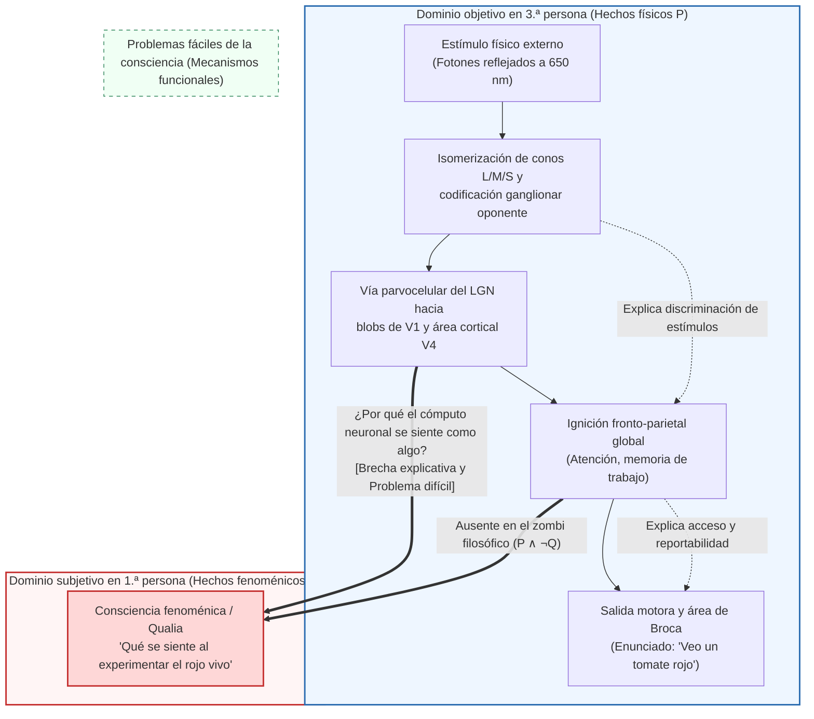
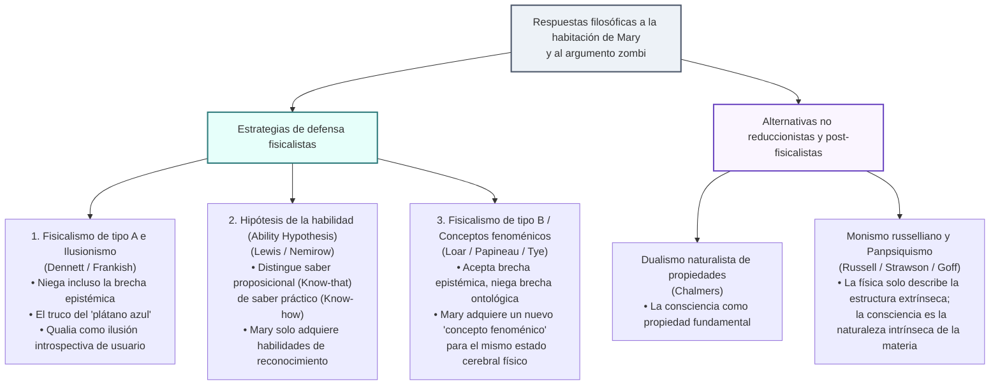

## 1. Introducción: El abismo entre la radiación electromagnética de $\lambda = 650\,\text{nm}$ y el resplandor subjetivo del rojo

Cuando contemplamos un tomate maduro bajo el sol de la tarde, nuestro encuentro puede describirse en dos niveles radicalmente distintos.

El primero es la <strong>descripción objetiva en tercera persona de las ciencias naturales</strong>: los pigmentos carotenoides (licopeno) de la piel del tomate absorben longitudes de onda cortas y medias y reflejan selectivamente ondas electromagnéticas alrededor de $\lambda \approx 650\,\text{nm}$. Estos fotones atraviesan la córnea y el cristalino hasta alcanzar la retina, donde son absorbidos por los fotorreceptores de cono sensibles a longitudes de onda largas (conos L, $\lambda_{\max} \approx 560\,\text{nm}$), provocando la fotoisomerización del 11-cis-retinal en todo-trans-retinal. A través de la transducina y la fosfodiesterasa (PDE), se hidroliza el $\text{cGMP}$, cerrando los canales catiónicos e hiperpolarizando la membrana del fotorreceptor. La señal se codifica mediante canales de procesos oponentes ($L - M$ y $S - (L + M)$) en las células ganglionares de la retina, viaja por las capas parvocelulares del núcleo geniculado lateral (LGN) hasta la corteza visual primaria (V1) y alcanza el <strong>área visual V4</strong> (centro cortical de la constancia del color), antes de reclutar redes fronto-parietales y el área de Broca para producir el enunciado: *«Ese tomate es de un rojo brillante»*.

Sin embargo, existe un segundo nivel: el <strong>carácter subjetivo de la experiencia consciente en primera persona</strong>. Por muy exhaustivamente que escribamos las ecuaciones de Maxwell o las ecuaciones diferenciales de Hodgkin-Huxley de los potenciales de acción, nada en esas fórmulas menciona <strong>la cualidad vívida y ardiente de la rojez</strong> que experimentamos directamente en nuestro campo visual.

En la filosofía de la mente (Philosophy of Mind) y la ciencia cognitiva contemporáneas, estas propiedades cualitativas intrínsecas de la experiencia se denominan <strong>qualia</strong> (singular: *quale*) o <strong>consciencia fenoménica</strong>. Este artículo reconstruye los <strong>tres pilares del antifisicalismo</strong>: el murciélago de Thomas Nagel (1974), el argumento del conocimiento de Frank Jackson («la habitación de Mary», 1982/1986), y la brecha explicativa de Joseph Levine (1983) junto con el «problema difícil de la consciencia» (Hard Problem) y el argumento de los zombis filosóficos de David Chalmers (1995/1996). Luego examinamos las tres grandes contraofensivas fisicalistas (ilusionismo, hipótesis de la habilidad y estrategia de los conceptos fenoménicos) y exploramos la frontera actual: el <strong>monismo russelliano (panpsiquismo)</strong>, la <strong>teoría del espacio de trabajo neuronal global (GNWT)</strong> y la <strong>teoría de la información integrada (IIT)</strong> de Giulio Tononi.

---

## 2. Definición rigurosa de los qualia y la consciencia fenoménica

Introducido en su sentido analítico moderno por <strong>Clarence Irving Lewis</strong> en 1929 (*Mind and the World Order*), el término <strong>qualia</strong> fue precisado en 1995 por <strong>Ned Block</strong> al distinguir dos conceptos que suelen confundirse:
1. <strong>Consciencia fenoménica (P-Consciousness)</strong>: El carácter experiencial, cualitativo y en primera persona de un estado mental —<strong>qué se siente (what it is like)</strong> estar en dicho estado—.
2. <strong>Consciencia de acceso (Access Consciousness / A-Consciousness)</strong>: Una propiedad funcional de procesamiento de información en la que una representación mental está disponible globalmente para el razonamiento, el control motor y el informe verbal.

Daniel Dennett (1988) resumió las cuatro características clásicas atribuidas a los qualia: <strong>inefabilidad</strong>, <strong>carácter intrínseco</strong>, <strong>privacidad</strong> y <strong>aprehensión directa e inmediata en la consciencia</strong>. El experimento mental del <strong>espectro invertido (Inverted Spectrum)</strong> (Locke 1689; Shoemaker 1982) demuestra que dos sujetos pueden ser funcional y conductualmente isomorfos al 100 % mientras sus qualia internos para el rojo y el verde están simétricamente invertidos ($Q_{\text{red}} \leftrightarrow Q_{\text{green}}$), lo que refuta que los qualia se agoten en su mero rol funcional.

---

## 3. Los tres pilares del antifisicalismo

### 3.1 Pilar I: *«¿Qué se siente ser un murciélago?»* de Thomas Nagel (1974)

En su célebre artículo de 1974 (*What Is It Like to Be a Bat?*), <strong>Thomas Nagel</strong> estableció el criterio canónico de la consciencia:

> «Fundamentalmente, un organismo tiene estados mentales conscientes si y solo si hay <strong>algo que se siente ser ese organismo</strong> —algo que se siente <strong>para</strong> el organismo—.»

Los murciélagos microquirópteros navegan en la oscuridad mediante <strong>ecolocalización (sonar biológico)</strong>, emitiendo pulsos ultrasónicos ($20\text{--}120\,\text{kHz}$) y calculando la distancia $r = c\Delta t/2$ a partir del retardo temporal del eco $\Delta t$ y la velocidad relativa mediante el desplazamiento Doppler $\Delta f$. Cuando intentamos imaginar qué se siente ser un murciélago colgando boca abajo en una cueva, solo imaginamos <strong>qué sentiríamos *nosotros* (humanos) al comportarnos como un murciélago</strong>, pero somos incapaces de concebir <strong>qué se siente *para un murciélago* ser un murciélago</strong>.

El diagnóstico más profundo de Nagel apunta a la <strong>paradoja de la reducción objetiva</strong>: mientras que la física reduce el «calor» a la energía cinética molecular media $\langle E_k \rangle = \frac{3}{2} k_B T$ eliminando el punto de vista subjetivo del observador, la esencia misma de la experiencia consciente reside *en* ese punto de vista subjetivo. Si sustraemos la perspectiva de primera persona para obtener una descripción neurofisiológica en tercera persona, no hemos reducido la experiencia: ¡simplemente hemos abandonado el fenómeno que pretendíamos explicar!

### 3.2 Pilar II: El argumento del conocimiento de Frank Jackson («La habitación de Mary», 1982 / 1986)

El filósofo australiano <strong>Frank Jackson</strong> nos presenta a <strong>Mary</strong>, una genial neurocientífica criada desde su nacimiento en una <strong>habitación estrictamente en blanco y negro</strong>. A través de libros y monitores monocromáticos, Mary aprende <strong>absolutamente todos los hechos físicos, neurobiológicos y funcionales $\mathcal{P}$</strong> sobre la visión humana del color. Un día, Mary sale al jardín y ve por primera vez un <strong>tomate rojo maduro</strong>. ¿Aprende algo nuevo?

El <strong>argumento del conocimiento (Knowledge Argument)</strong> se formaliza deductivamente así:
1. <strong>Premisa 1 (Completitud del conocimiento físico antes de salir)</strong>: Antes de su liberación ($t_{\text{before}}$), Mary conoce todos los hechos físicos $\mathcal{P}$:
   $$\forall p \in \mathcal{P}, \quad K_{\text{before}}(\text{Mary}, p)$$
2. <strong>Premisa 2 (Adquisición de un hecho nuevo al salir)</strong>: Al ver el tomate en $t_{\text{after}}$, Mary aprende un hecho genuinamente nuevo $Q$ (qué se siente al ver el rojo):
   $$\exists Q \quad \text{tal que} \quad \neg K_{\text{before}}(\text{Mary}, Q) \land K_{\text{after}}(\text{Mary}, Q)$$
3. <strong>Conclusión 1 (Existencia de hechos no físicos)</strong>: Por la ley de Leibniz, $Q \notin \mathcal{P}$.
4. <strong>Conclusión 2 (Falsedad del fisicalismo)</strong>:Dado que no todos los hechos del mundo son físicos ($\mathcal{F}_{\text{world}} \not\subseteq \mathcal{P}$), <strong>¡el fisicalismo es falso!</strong>

(Cabe señalar que Jackson defendió en 1982 el <strong>epifenomenalismo</strong>, pero en 2003 abjuró de su propia conclusión antifisicalista y se convirtió al <strong>representacionalismo</strong> fisicalista debido a la paradoja de que qualia causalmente inertes no podrían causar que Mary exclame *«¡Así que esto es el rojo!»*).

### 3.3 Pilar III: La brecha explicativa, el «problema difícil» y los zombis filosóficos (1983 / 1995 / 1996)

<strong>Joseph Levine (1983)</strong> formuló la <strong>brecha explicativa (Explanatory Gap)</strong>, y <strong>David Chalmers (1995/1996)</strong> trazó la distinción entre los <strong>«problemas fáciles» (Easy Problems)</strong> y el <strong>«problema difícil de la consciencia» (The Hard Problem)</strong>:

| Dimensión comparativa | Los problemas fáciles (Easy Problems) | El problema difícil (The Hard Problem) |
| :--- | :--- | :--- |
| <strong>Pregunta central</strong> | ¿Cómo discrimina el cerebro estímulos, integra información, controla la atención y emite informes verbales? | <strong>¿Por qué y cómo todo ese procesamiento físico de información va acompañado de experiencia subjetiva interna?</strong> |
| <strong>Objetivo conceptual</strong> | <strong>Consciencia de acceso y mecanismos funcionales</strong> (Access Consciousness) | <strong>Consciencia fenoménica / Qualia</strong> (Phenomenal Consciousness) |
| <strong>Reducción funcional</strong> | <strong>Totalmente resoluble en principio</strong> especificando el circuito neuronal o algoritmo. | <strong>Resistente a la reducción funcional</strong>: aun explicadas todas las funciones, persiste la pregunta de por qué hay experiencia subjetiva. |

El <strong>argumento de la concebibilidad (Conceivability Argument)</strong> de Chalmers apela a los <strong>zombis filosóficos</strong> —seres físicamente idénticos a nosotros molécula por molécula ($\mathcal{P}$), pero completamente desprovistos de experiencia consciente ($\neg Q$)—:
1. <strong>Premisa 1</strong>: Un mundo zombi ($\mathcal{P} \land \neg Q$) es idealmente concebible sin contradicción a priori.
2. <strong>Premisa 2</strong>: La concebibilidad ideal implica posibilidad metafísica ($\Diamond(\mathcal{P} \land \neg Q)$).
3. <strong>Conclusión</strong>: Por tanto, $\mathcal{P}$ no necesita metafísicamente a $Q$ ($\neg \Box(\mathcal{P} \to Q)$), ¡lo que refuta el materialismo!

Frente a la objeción de la necesidad a posteriori de Saul Kripke (*«Agua = $\text{H}_2\text{O}$»*), la <strong>semántica modal bidimensional (2D Modal Semantics)</strong> de Chalmers demuestra que mientras en el «agua» la intensión primaria (líquido transparente potable) y la intensión secundaria ($\text{H}_2\text{O}$) pueden separarse, en el «dolor» o el «quale rojo $Q$» <strong>la apariencia subjetiva (intensión primaria) y la esencia (intensión secundaria) coinciden estrictamente ($I_1(Q) = I_2(Q)$)</strong>, por lo que la concebibilidad primaria garantiza directamente la posibilidad metafísica $\Diamond(\mathcal{P} \land \neg Q)$.

---

## 4. Las tres contraofensivas fisicalistas

1. <strong>Fisicalismo de tipo A e Ilusionismo (Dennett 1991, Frankish 2016)</strong>:
   Con el experimento mental del <strong>«plátano azul» (Blue Banana)</strong>, Dennett sostiene que si Mary *realmente* conoce todos los hechos físicos, al ver un plátano pintado de azul detectará de inmediato la disposición reactiva de su corteza V4 y descubrirá el engaño. El <strong>ilusionismo</strong> de Keith Frankish afirma que los qualia son una <strong>ilusión de usuario (user-illusion)</strong> generada por el automonitoreo introspectivo.
2. <strong>La hipótesis de la habilidad (The Ability Hypothesis — Nemirow 1980, David Lewis 1988)</strong>:
   Lewis distingue entre <strong>conocimiento proposicional (*saber-qué* / Know-that)</strong> y <strong>habilidad práctica (*saber-cómo* / Know-how)</strong>. Al salir de la habitación, Mary no aprende ningún hecho proposicional nuevo $Q$, sino que adquiere las habilidades prácticas de reconocer, imaginar y recordar el rojo.
3. <strong>La estrategia de los conceptos fenoménicos / Fisicalismo de tipo B (Loar 1990, Papineau 2002)</strong>:
   Basándose en la distinción de Frege entre <strong>sentido (concepto) y referencia (propiedad real)</strong> («Héspero = Fósforo = Venus»), ontológicamente el quale rojo $Q$ es idéntico al estado neuronal $N_{\text{red}}$ del área V4 ($Q = N_{\text{red}}$). Mary ya conocía ese estado mediante un <strong>concepto teórico en tercera persona ($C_{\text{phys}}$)</strong> y, al ver el tomate, adquiere un <strong>nuevo concepto fenoménico en primera persona ($C_{\text{phen}}$)</strong> que refiere exactamente al *mismo* estado físico cerebral.

| Posición filosófica | Proponentes clave | Brecha epistémica | Brecha ontológica | Tesis central sobre los qualia |
| :--- | :--- | :--- | :--- | :--- |
| <strong>Fisicalismo de tipo A / Ilusionismo</strong> | Dennett, Frankish | <strong>Negada</strong> | <strong>Negada</strong> | Los qualia son una <strong>ilusión introspectiva de interfaz</strong>. |
| <strong>Hipótesis de la habilidad</strong> | D. Lewis, Nemirow | <strong>Reinterpretada</strong> (habilidad práctica) | <strong>Negada</strong> | Mary no aprende un hecho nuevo (*know-that*), sino <strong>habilidades prácticas (*know-how*)</strong>. |
| <strong>Fisicalismo de tipo B (Conceptos fenoménicos)</strong> | Loar, Papineau, Tye | <strong>Aceptada</strong> | <strong>Negada</strong> ($C_{\text{phys}}$ y $C_{\text{phen}}$ correfieren) | Mary adquiere un nuevo <strong>concepto fenoménico</strong> en 1.ª persona para el mismo estado neuronal. |
| <strong>Dualismo de propiedades</strong> | Chalmers | <strong>Aceptada</strong> | <strong>Aceptada</strong> | La consciencia es una <strong>propiedad fundamental</strong> del universo regida por leyes psicofísicas. |
| <strong>Monismo russelliano / Panpsiquismo</strong> | Russell, Strawson, Goff | <strong>Aceptada</strong> | <strong>Integrada en un monismo</strong> | La física solo describe la <strong>estructura relacional extrínseca</strong>; la consciencia es la <strong>naturaleza categórica intrínseca (quididad)</strong> de la materia. |

---

## 5. La frontera moderna: Monismo russelliano, GNWT y Teoría de la información integrada (IIT)

1. <strong>Monismo russelliano y Panpsiquismo (Russell 1927, Eddington 1928, Strawson 2006, Goff 2017)</strong>:
   La física define propiedades como la masa $m$ o la carga $q$ únicamente por sus <strong>estructuras relacionales y disposicionales extrínsecas</strong>, guardando silencio sobre la <strong>naturaleza categórica intrínseca (quididad)</strong> de la materia. Dado que el único sistema físico cuya naturaleza intrínseca conocemos directamente desde dentro es nuestro propio cerebro —en forma de <strong>consciencia fenoménica</strong>—, ¡la consciencia (o protoconsciencia) es la naturaleza intrínseca misma de la materia física! (Su reto central es el <strong>problema de la combinación / Combination Problem</strong> de William James).
2. <strong>Teoría del espacio de trabajo neuronal global (GNWT — Dehaene & Changeux, 2011)</strong>:
   Una representación sensorial se vuelve consciente cuando supera un umbral no lineal y desencadena una <strong>ignición global (Global Ignition, ~300 ms, onda P3b)</strong> en la red fronto-parietal de largo alcance, transmitiendo (broadcasting) la información a toda la memoria de trabajo.
3. <strong>Teoría de la información integrada (IIT 3.0 / 4.0 — Giulio Tononi, 2004, 2014, 2023)</strong>:
   Partiendo de <strong>cinco axiomas fenomenológicos de la experiencia (Existencia intrínseca, Composición, Información, Integración, Exclusión)</strong> traducidos en postulados físicos, la IIT cuantifica la consciencia mediante la información integrada $\Phi$ —la pérdida mínima de información causal al cortar el sistema por su <strong>partición de información mínima ($\text{MIP}$)</strong> $\pi$—:
   $$\Phi(S_t) = \min_{\pi \in \mathcal{P}_{\text{MIP}}} D\!\left( p\bigl(S_{t \pm 1} \mid S_t\bigr) \;\middle\|\; \prod_{k \in \pi} p\bigl(S_{t \pm 1}^{(k)} \mid S_t^{(k)}\bigr) \right)$$
   - <strong>La paradoja del cerebelo</strong>: El cerebelo (~69 mil millones de neuronas) carece de consciencia ($\Phi \approx 0$) porque sus circuitos son módulos *feedforward* paralelos sin bucles recurrentes, a diferencia del sistema talamocortical posterior ($\Phi^{\max}$ elevado).
   - <strong>Las redes puramente *feedforward* son zombis ($\Phi = 0$)</strong>: Toda red neuronal puramente *feedforward* sin retroalimentación causal posee estrictamente <strong>$\Phi = 0$</strong>, permaneciendo completamente a oscuras en su interior.

---

## 6. Conclusión

La habitación de Mary y los zombis filosóficos demuestran que ninguna deducción a priori puede extraer la experiencia subjetiva $Q$ de las meras ecuaciones estructurales en tercera persona $\mathcal{P}$. Ya sea que lo interpretemos mediante la dualidad conceptual del <strong>fisicalismo de tipo B</strong> o como la estructura causal intrínseca ($\Phi^{\max}$) de la materia según el <strong>monismo russelliano y la IIT</strong>, el rojo ardiente de un tomate nos recuerda el punto exacto donde el universo deja de ser un grafo silencioso de ecuaciones para iluminarse desde dentro.
