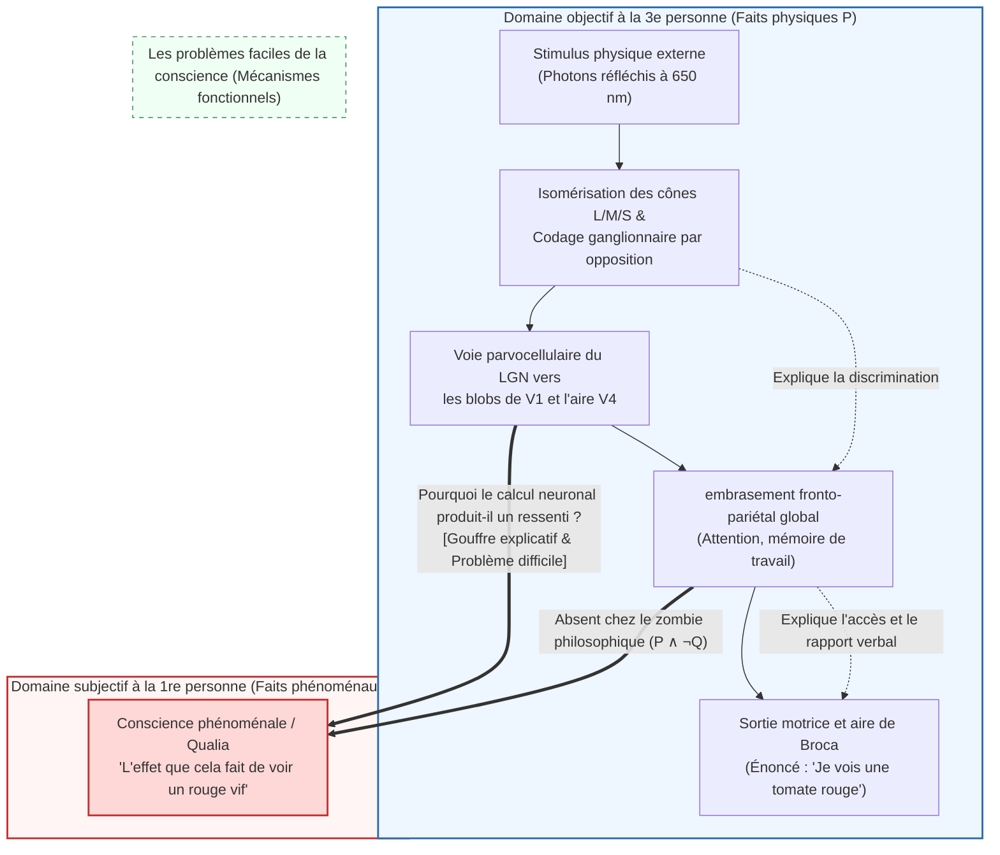
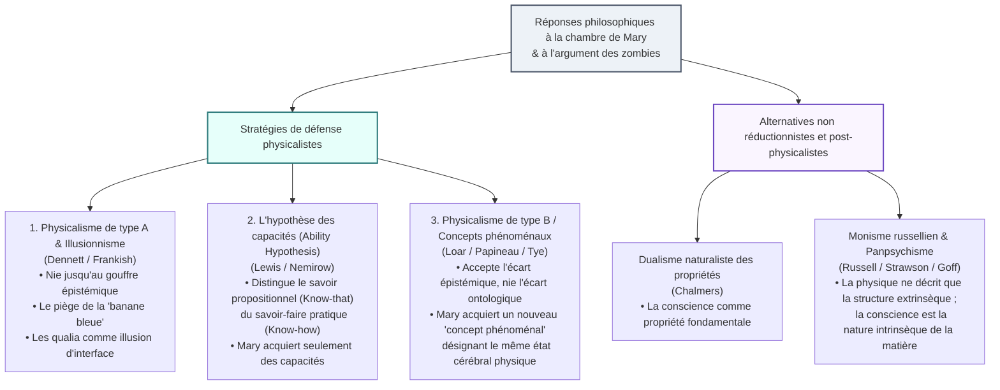

## 1. Introduction : L'abîme entre le rayonnement électromagnétique à $\lambda = 650\,\text{nm}$ et l'éclat subjectif du rouge

Lorsque nous contemplons une tomate mûre au soleil couchant, cet événement peut être décrit selon deux niveaux radicalement distincts.

Le premier est la <strong>description objective à la troisième personne des sciences naturelles</strong> : les pigments caroténoïdes (lycopène) de la peau de la tomate absorbent les courtes et moyennes longueurs d'onde et réfléchissent sélectivement les ondes électromagnétiques autour de $\lambda \approx 650\,\text{nm}$. Ces photons traversent la cornée et le cristallin pour frapper les cônes sensibles aux grandes longueurs d'onde (cônes L, $\lambda_{\max} \approx 560\,\text{nm}$) de la rétine, provoquant la photo-isomérisation du 11-cis-rétinal en tout-trans-rétinal. Via la transducine et la phosphodiestérase (PDE), l'hydrolyse du $\text{cGMP}$ ferme les canaux cationiques et hyperpolarise la membrane du photorécepteur. Le signal, codé par les cellules ganglionnaires à opposition chromatique ($L - M$ et $S - (L + M)$), transite par les couches parvocellulaires du corps géniculé latéral (LGN) jusqu'aux « blobs » du cortex visuel primaire (V1) et à l'<strong>aire extrastriée V4</strong> (centre de la constance des couleurs), avant d'activer l'aire de Broca pour produire l'énoncé : *« Cette tomate est d'un rouge éclatant. »*

Mais il existe un second niveau : le <strong>caractère subjectif de l'expérience vécue à la première personne</strong>. Aussi exhaustives que soient les équations de Maxwell ou les équations différentielles de Hodgkin-Huxley décrivant les trains de potentiels d'action, rien dans ces formules ne mentionne <strong>la qualité vécue, brûlante et flamboyante du rouge</strong> qui envahit notre champ de conscience.

En philosophie de l'esprit (Philosophy of Mind) et en sciences cognitives, ces propriétés qualitatives intrinsèques de l'expérience sont appelées <strong>qualia</strong> (singulier : *quale*) ou <strong>conscience phénoménale</strong>. Cet article reconstruit les <strong>trois piliers de l'anti-physicalisme</strong> : la chauve-souris de Thomas Nagel (1974), l'argument de la connaissance de Frank Jackson (« la chambre de Mary », 1982/1986), ainsi que le gouffre explicatif de Joseph Levine (1983) et le « problème difficile de la conscience » (Hard Problem) accompagné de l'argument des zombies philosophiques de David Chalmers (1995/1996). Nous analyserons ensuite les trois grandes contre-offensives physicalistes (l'illusionnisme, l'hypothèse des capacités et la stratégie des concepts phénoménaux), avant d'explorer le <strong>monisme russellien (panpsychisme)</strong>, la <strong>théorie de l'espace de travail neuronal global (GNWT)</strong> et la <strong>théorie de l'information intégrée (IIT)</strong> de Giulio Tononi.

---

## 2. Définition rigoureuse des qualia et de la conscience phénoménale

Introduit au sens moderne par <strong>Clarence Irving Lewis</strong> en 1929 (*Mind and the World Order*), le concept de <strong>qualia</strong> a été clarifié en 1995 par <strong>Ned Block</strong>, qui distingue deux concepts souvent confondus :
1. <strong>La conscience phénoménale (P-Consciousness)</strong> : l'aspect qualitatif et subjectif de l'expérience — <strong>l'effet que cela fait (what it is like)</strong> d'éprouver un état mental.
2. <strong>La conscience d'accès (Access Consciousness / A-Consciousness)</strong> : la disponibilité fonctionnelle d'une représentation mentale pour le raisonnement global, le contrôle de l'action et le rapport verbal.

Daniel Dennett (1988) a résumé les quatre propriétés classiques attribuées aux qualia : <strong>ineffabilité</strong>, <strong>caractère intrinsèque</strong>, <strong>caractère privé</strong> et <strong>appréhension directe dans la conscience</strong>. L'expérience de pensée du <strong>spectre inversé (Inverted Spectrum)</strong> (Locke 1689 ; Shoemaker 1982) montre que deux individus peuvent être fonctionnellement et comportementalement identiques à 100 % tout en ayant des qualia du rouge et du vert symétriquement inversés ($Q_{\text{red}} \leftrightarrow Q_{\text{green}}$), prouvant que les qualia ne se réduisent pas à un simple rôle fonctionnel.

---

## 3. Les trois piliers de l'anti-physicalisme

### 3.1 Pilier I : *« Quel effet cela fait-il d'être une chauve-souris ? »* de Thomas Nagel (1974)

Dans son article fondateur de 1974 (*What Is It Like to Be a Bat?*), <strong>Thomas Nagel</strong> définit ainsi la conscience :

> « Fondamentalement, un organisme a des états mentaux conscients si et seulement s'il y a <strong>quelque chose que cela fait d'être cet organisme</strong> — quelque chose que cela fait <strong>pour</strong> cet organisme. »

Les chauves-souris microchiroptères naviguent dans l'obscurité par <strong>écholocation (sonar biologique)</strong> en émettant des impulsions ultrasonores ($20\text{--}120\,\text{kHz}$) et en calculant la distance $r = c\Delta t/2$ via le délai d'écho $\Delta t$ et la vitesse relative via le décalage Doppler $\Delta f$. Si nous essayons d'imaginer ce que cela fait d'être une chauve-souris, nous imaginons seulement <strong>ce que cela ferait *pour nous* (humains) de nous comporter comme une chauve-souris</strong>, mais jamais <strong>ce que cela fait *pour une chauve-souris* d'être une chauve-souris</strong>.

Le diagnostic profond de Nagel porte sur le <strong>paradoxe de la réduction objective</strong> : alors que la physique réduit la « chaleur » à l'énergie cinétique moléculaire moyenne $\langle E_k \rangle = \frac{3}{2} k_B T$ en éliminant le point de vue subjectif de l'observateur, l'essence même de l'expérience consciente réside *dans* ce point de vue subjectif. Abandonner le point de vue à la première personne au profit d'une description neuronale à la troisième personne, ce n'est pas réduire l'expérience, c'est abandonner le phénomène même qu'il fallait expliquer !

### 3.2 Pilier II : L'argument de la connaissance de Frank Jackson (« La chambre de Mary », 1982 / 1986)

Le philosophe australien <strong>Frank Jackson</strong> met en scène <strong>Mary</strong>, une brillante neuroscientifique élevée depuis sa naissance dans une <strong>chambre strictement en noir et blanc</strong>. Grâce à des livres et des écrans monochromes, Mary connaît <strong>l'intégralité des faits physiques, neurobiologiques et fonctionnels $\mathcal{P}$</strong> concernant la vision des couleurs. Un jour, on ouvre la porte : Mary sort et voit pour la première fois une <strong>tomate rouge mûre</strong>. Apprend-elle quelque chose de nouveau ?

L'<strong>argument de la connaissance (Knowledge Argument)</strong> se formalise déductivement ainsi :
1. <strong>Prémisse 1 (Complétude du savoir physique avant la sortie)</strong> : Avant sa libération ($t_{\text{before}}$), Mary connaît tous les faits physiques $\mathcal{P}$ :
   $$\forall p \in \mathcal{P}, \quad K_{\text{before}}(\text{Mary}, p)$$
2. <strong>Prémisse 2 (Découverte d'un fait nouveau à la sortie)</strong> : En voyant la tomate à $t_{\text{after}}$, Mary apprend un fait nouveau $Q$ (l'effet que cela fait de voir du rouge) :
   $$\exists Q \quad \text{tel que} \quad \neg K_{\text{before}}(\text{Mary}, Q) \land K_{\text{after}}(\text{Mary}, Q)$$
3. <strong>Conclusion 1 (Existence de faits non physiques)</strong> : Par la loi de Leibniz, $Q \notin \mathcal{P}$.
4. <strong>Conclusion 2 (Réfutation du physicalisme)</strong> : Puisque tous les faits ne sont pas des faits physiques ($\mathcal{F}_{\text{world}} \not\subseteq \mathcal{P}$), <strong>le physicalisme est faux</strong> !

(Notons qu'après avoir défendu l'<strong>épiphénoménisme</strong> en 1982, Jackson s'est lui-même converti en 2003 au <strong>représentationnalisme</strong> physicaliste pour échapper au paradoxe d'une conscience causalement impuissante.)

### 3.3 Pilier III : Le gouffre explicatif, le « problème difficile » et les zombies philosophiques (1983 / 1995 / 1996)

<strong>Joseph Levine (1983)</strong> a identifié le <strong>gouffre explicatif (Explanatory Gap)</strong> entre processus physiques et qualia, et <strong>David Chalmers (1995/1996)</strong> a distingué les <strong>« problèmes faciles » (Easy Problems)</strong> du <strong>« problème difficile de la conscience » (The Hard Problem)</strong> :

| Axe de comparaison | Les problèmes faciles (Easy Problems) | Le problème difficile (The Hard Problem) |
| :--- | :--- | :--- |
| <strong>Question centrale</strong> | Comment le cerveau discrimine-t-il les stimuli, intègre-t-il l'information et produit-il des rapports verbaux ? | <strong>Pourquoi et comment tout ce traitement physique de l'information s'accompagne-t-il d'une expérience subjective interne ?</strong> |
| <strong>Cible conceptuelle</strong> | <strong>Conscience d'accès et fonctions cognitives</strong> (Access Consciousness) | <strong>Conscience phénoménale / Qualia</strong> (Phenomenal Consciousness) |
| <strong>Explication réductionniste</strong> | <strong>Résoluble en principe</strong> par l'identification des circuits neuronaux et algorithmes. | <strong>Rétif à la réduction fonctionnelle</strong> : même une fois toutes les fonctions expliquées, la question du ressenti subjectif demeure intacte. |

L'<strong>argument de la concevabilité (Conceivability Argument)</strong> de Chalmers invoque les <strong>zombies philosophiques</strong> — des êtres physiquement identiques à nous molécule pour molécule ($\mathcal{P}$), mais totalement dépourvus d'expérience consciente ($\neg Q$) :
1. <strong>Prémisse 1</strong> : Un monde zombie ($\mathcal{P} \land \neg Q$) est idéalement concevable sans contradiction a priori.
2. <strong>Prémisse 2</strong> : La concevabilité idéale entraîne la possibilité métaphysique ($\Diamond(\mathcal{P} \land \neg Q)$).
3. <strong>Conclusion</strong> : Donc $\mathcal{P}$ ne nécessite pas métaphysiquement $Q$ ($\neg \Box(\mathcal{P} \to Q)$), ce qui réfute le matérialisme !

Face à l'objection de la nécessité a posteriori de Saul Kripke (*« Eau = $\text{H}_2\text{O}$ »*), la <strong>sémantique modale bidimensionnelle (2D Modal Semantics)</strong> de Chalmers démontre que si pour « l'eau » l'intension primaire (liquide transparent potable) et l'intension secondaire ($\text{H}_2\text{O}$) peuvent diverger, pour « la douleur » ou « le quale rouge $Q$ », <strong>l'apparence subjective (intension primaire) et l'essence (intension secondaire) coïncident strictement ($I_1(Q) = I_2(Q)$)</strong> : ce qui est ressenti comme une douleur *est* une douleur ! Dès lors, la concevabilité primaire implique directement la possibilité métaphysique $\Diamond(\mathcal{P} \land \neg Q)$.

---

## 4. Les trois contre-offensives physicalistes

1. <strong>Physicalisme de type A et Illusionnisme (Dennett 1991, Frankish 2016)</strong> :
   Avec le contre-exemple de la <strong>« banane bleue » (Blue Banana)</strong>, Dennett soutient que si Mary connaît *vraiment* tous les faits physiques, elle déjouera immédiatement le piège d'une banane peinte en bleu en identifiant l'état réactif de son propre cortex V4. L'<strong>illusionnisme</strong> de Keith Frankish affirme que les qualia sont une simple <strong>illusion d'utilisateur (user-illusion)</strong> générée par l'introspection.
2. <strong>L'hypothèse des capacités (The Ability Hypothesis — Nemirow 1980, David Lewis 1988)</strong> :
   Lewis distingue le <strong>savoir propositionnel (*savoir-que* / Know-that)</strong> du <strong>savoir-faire pratique (*savoir-comment* / Know-how)</strong>. En sortant de sa chambre, Mary n'apprend aucun fait propositionnel nouveau $Q$, mais acquiert seulement un faisceau de capacités pratiques : reconnaître, imaginer et se rappeler le rouge.
3. <strong>La stratégie des concepts phénoménaux / Physicalisme de type B (Loar 1990, Papineau 2002)</strong> :
   En appliquant la distinction frégéenne entre <strong>sens (concept) et dénotation (propriété réelle)</strong> (« Hesperus = Phosphorus = Vénus »), le physicalisme de type B soutient qu'ontologiquement, le quale rouge $Q$ est strictement identique à l'état neuronal $N_{\text{red}}$ de l'aire V4 ($Q = N_{\text{red}}$). Mary connaissait déjà cet état sous un <strong>concept théorique à la troisième personne ($C_{\text{phys}}$)</strong> et acquiert à sa sortie un <strong>nouveau concept phénoménal à la première personne ($C_{\text{phen}}$)</strong> qui réfère exactement au *même* état physique du cerveau !

| Position philosophique | Auteurs clés | Gouffre épistémique | Gouffre ontologique | Thèse centrale sur les qualia |
| :--- | :--- | :--- | :--- | :--- |
| <strong>Physicalisme de type A / Illusionnisme</strong> | Dennett, Frankish | <strong>Nié</strong> | <strong>Nié</strong> | Les qualia sont une <strong>illusion introspective d'interface</strong>. |
| <strong>Hypothèse des capacités</strong> | D. Lewis, Nemirow | <strong>Réinterprété</strong> (savoir-faire pratique) | <strong>Nié</strong> | Mary n'acquiert aucun fait nouveau (*know-that*), mais des <strong>capacités pratiques (*know-how*)</strong>. |
| <strong>Physicalisme de type B (Concepts phénoménaux)</strong> | Loar, Papineau, Tye | <strong>Accepté</strong> | <strong>Nié</strong> ($C_{\text{phys}}$ et $C_{\text{phen}}$ co-réfèrent) | Mary acquiert un nouveau <strong>concept phénoménal</strong> à la 1re personne référant au même état neuronal. |
| <strong>Dualisme des propriétés</strong> | Chalmers | <strong>Accepté</strong> | <strong>Accepté</strong> | La conscience est une <strong>propriété fondamentale</strong> de l'univers régie par des lois psychophysiques. |
| <strong>Monisme russellien / Panpsychisme</strong> | Russell, Strawson, Goff | <strong>Accepté</strong> | <strong>Intégré dans un monisme</strong> | La physique ne décrit que la <strong>structure relationnelle extrinsèque</strong> ; la conscience est la <strong>nature catégorique intrinsèque (quiddité)</strong> de la matière. |

---

## 5. La frontière contemporaine : Monisme russellien, GNWT et Théorie de l'information intégrée (IIT)

1. <strong>Monisme russellien et Panpsychisme (Russell 1927, Eddington 1928, Strawson 2006, Goff 2017)</strong> :
   Les équations de la physique définissent la masse $m$ ou la charge $q$ uniquement par leurs <strong>structures relationnelles et dispositionnelles extrinsèques</strong>, restant muettes sur la <strong>nature catégorique intrinsèque (quiddité)</strong> de la matière. Or, la seule portion de matière dont nous connaissons directement la nature intrinsèque de l'intérieur est notre propre cerveau — sous la forme de la <strong>conscience phénoménale</strong> ! La conscience (ou proto-conscience) est donc l'étoffe intrinsèque même de la matière physique (avec pour défi majeur le <strong>problème de la combinaison / Combination Problem</strong> de William James).
2. <strong>Théorie de l'espace de travail neuronal global (GNWT — Dehaene & Changeux, 2011)</strong> :
   Une représentation sensorielle devient consciente lorsqu'elle franchit un seuil non linéaire et déclenche un <strong>embrasement global (Global Ignition, vers $300\,\text{ms}$, onde P3b)</strong> à travers les neurones pyramidaux à longue portée reliant les cortex préfrontal et pariétal, diffusant l'information à l'ensemble des modules cognitifs.
3. <strong>Théorie de l'information intégrée (IIT 3.0 / 4.0 — Giulio Tononi, 2004, 2014, 2023)</strong> :
   Partant de <strong>cinq axiomes phénoménologiques de l'expérience (Existence intrinsèque, Composition, Information, Intégration, Exclusion)</strong> traduits en postulats physiques, l'IIT quantifie la conscience d'un système dans l'état $S_t$ par l'information intégrée $\Phi$ — la perte minimale d'information causale lorsque le système est coupé selon sa <strong>partition d'information minimale ($\text{MIP}$)</strong> $\pi$ :
   $$\Phi(S_t) = \min_{\pi \in \mathcal{P}_{\text{MIP}}} D\!\left( p\bigl(S_{t \pm 1} \mid S_t\bigr) \;\middle\|\; \prod_{k \in \pi} p\bigl(S_{t \pm 1}^{(k)} \mid S_t^{(k)}\bigr) \right)$$
   - <strong>Le paradoxe du cervelet</strong> : Le cervelet (~69 milliards de neurones, 80 % des neurones du cerveau) ne génère pas de conscience ($\Phi \approx 0$) car il est organisé en modules parallèles *feedforward* sans boucles récurrentes, contrairement au système thalamocortical postérieur ($\Phi^{\max}$ élevé).
   - <strong>Les réseaux purement *feedforward* sont des zombies ($\Phi = 0$)</strong> : Tout réseau neuronal purement *feedforward* dépourvu de rétroaction causale possède strictement <strong>$\Phi = 0$</strong>, même s'il imite parfaitement le comportement linguistique humain.

---

## 6. Conclusion

La chambre de Mary et les zombies philosophiques démontrent qu'aucune déduction a priori ne peut extraire le ressenti subjectif $Q$ des seules équations structurelles à la troisième personne $\mathcal{P}$. Que l'on interprète cet écart via la dualité conceptuelle du <strong>physicalisme de type B</strong> ou comme la révélation de la structure causale intrinsèque ($\Phi^{\max}$) de la matière selon le <strong>monisme russellien et l'IIT</strong>, l'éclat rouge de la tomate demeure le lieu où l'univers cesse d'être un graphe silencieux d'équations pour s'illuminer de l'intérieur.
