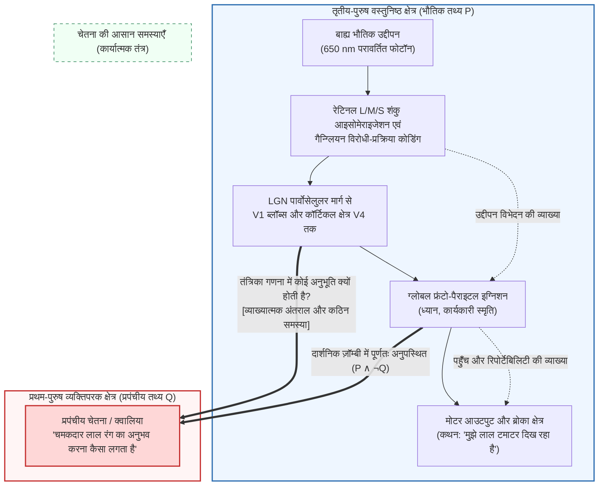
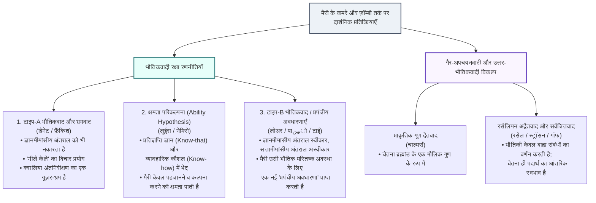

## 1. परिचय: $\lambda = 650\,\text{nm}$ विद्युतचुंबकीय विकिरण और लाल रंग की व्यक्तिपरक चमक के बीच की खाई

जब हम ढलते सूरज की रोशनी में एक पके हुए लाल टमाटर को देखते हैं, तो इस घटना को दो बिल्कुल अलग स्तरों पर वर्णित किया जा सकता है।

पहला स्तर <strong>प्राकृतिक विज्ञान का तृतीय-पुरुष (third-person), वस्तुनिष्ठ विवरण</strong> है: टमाटर के छिलके में मौजूद कैरोटीनॉयड वर्णक (लाइकोपीन) छोटी और मध्यम तरंगदैर्घ्य के प्रकाश को अवशोषित करते हैं और $\lambda \approx 650\,\text{nm}$ के आसपास की लंबी तरंगदैर्घ्य वाली विद्युतचुंबकीय तरंगों को चयनात्मक रूप से परावर्तित करते हैं। ये फोटॉन कॉर्निया और लेंस से गुजरकर रेटिना तक पहुँचते हैं, जहाँ उन्हें लंबी-तरंगदैर्घ्य के प्रति संवेदनशील शंकु कोशिकाओं (L-cones, $\lambda_{\max} \approx 560\,\text{nm}$) द्वारा अवशोषित किया जाता है, जिससे 11-सिस-रेटिनल का ऑल-ट्रांस-रेटिनल में फोटोआइसोमेराइजेशन होता है। ट्रांसड्यूसिन और फॉस्फोडिएस्टरेज़ (PDE) के माध्यम से $\text{cGMP}$ का जल-अपघटन होता है, धनायन चैनल बंद हो जाते हैं और फोटोरिसेप्टर झिल्ली हाइपरपोलराइज़ हो जाती है। यह संकेत रेटिनल गैन्ग्लियन कोशिकाओं में विरोधी-प्रक्रिया चैनलों ($L - M$ और $S - (L + M)$) द्वारा कोडित होकर लेटरल जेनिकुलेट न्यूक्लियस (LGN) के पार्वोसेलुलर स्तरों से होते हुए प्राथमिक दृश्य प्रांतस्था (V1) और अंततः <strong>दृश्य क्षेत्र V4</strong> (रंग स्थिरता के कॉर्टिकल केंद्र) तक पहुँचता है, और अंत में ब्रोका क्षेत्र (Broca's area) को सक्रिय कर यह वाक्य उत्पन्न करता है: *«वह टमाटर चमकदार लाल है।»*

किंतु एक दूसरा स्तर भी है: <strong>प्रथम-पुरुष (first-person) सचेत अनुभव का व्यक्तिपरक चरित्र</strong>। चाहे हम मैक्सवेल के समीकरणों या तंत्रिका आवेगों के हॉजकिन-हक्सले (Hodgkin-Huxley) अवकल समीकरणों को कितना भी सटीक क्यों न लिख लें, उन समीकरणों में कहीं भी <strong>उस जीवंत, दहकती हुई लालिमा के गुणात्मक अनुभव</strong> का उल्लेख नहीं मिलता जिसे हम अपनी चेतना में सीधे महसूस करते हैं।

समकालीन मन के दर्शन (Philosophy of Mind) और संज्ञानात्मक विज्ञान में, अनुभव के इन व्यक्तिपरक, आंतरिक, गुणात्मक गुणों को <strong>क्वालिया (Qualia, एकवचन: *Quale*)</strong> या <strong>प्रपंचीय चेतना (Phenomenal Consciousness)</strong> कहा जाता है। यह लेख <strong>भौतिकवाद-विरोध (Anti-Physicalism) के तीन स्तंभों</strong> का पुनर्निर्माण करता है: थॉमस नेगेल का *"चमगादड़ होना कैसा होता है?"* (1974), फ्रैंक जैक्सन का *ज्ञान तर्क ("मैरी का कमरा")* (1982/1986), तथा जोसेफ लेविन का *व्याख्यात्मक अंतराल* (1983) और डेविड चाल्मर्स की *चेतना की कठिन समस्या (Hard Problem)* एवं *दार्शनिक ज़ॉम्बी तर्क* (1995/1996)। इसके बाद हम भौतिकवाद के तीन प्रमुख प्रति-आक्रमणों (भ्रमवाद, क्षमता परिकल्पना और प्रपंचीय अवधारणा रणनीति) की जाँच करेंगे और आधुनिक सीमांत—<strong>रसेलियन अद्वैतवाद (सर्वचित्तवाद / Panpsychism)</strong>, <strong>ग्लोबल न्यूरोनल वर्कस्पेस थ्योरी (GNWT)</strong> और जूलियो टोनोनी के <strong>एकीकृत सूचना सिद्धांत (IIT)</strong>—की पड़ताल करेंगे।

---

## 2. क्वालिया और प्रपंचीय चेतना की सटीक परिभाषा

1929 में अमेरिकी दार्शनिक <strong>क्लेरेंस इरविंग लुईस (C.I. Lewis)</strong> ने अपनी पुस्तक *Mind and the World Order* में आधुनिक विश्लेषणात्मक अर्थ में <strong>क्वालिया</strong> शब्द का परिचय दिया। 1995 में दार्शनिक <strong>नेड ब्लॉक (Ned Block)</strong> ने चेतना की दो अवधारणाओं के बीच मौलिक अंतर स्पष्ट किया:
1. <strong>प्रपंचीय चेतना (Phenomenal Consciousness / P-Consciousness)</strong>: किसी मानसिक अवस्था का अनुभवात्मक, व्यक्तिपरक, प्रथम-पुरुष गुणात्मक चरित्र—अर्थात उस अवस्था में होना कर्ता के लिए <strong>कैसा महसूस होता है (what it is like)</strong>।
2. <strong>पहुँच चेतना (Access Consciousness / A-Consciousness)</strong>: एक कार्यात्मक सूचना-प्रसंस्करण गुण जिसमें कोई मानसिक प्रतिनिधित्व तर्क, व्यवहार नियंत्रण और मौखिक रिपोर्ट के लिए वैश्विक रूप से उपलब्ध होता है।

डैनियल डेनेट (1988) ने क्वालिया के चार शास्त्रीय लक्षण बताए: <strong>अवर्णनीयता (Ineffability)</strong>, <strong>आंतरिकता (Intrinsicness)</strong>, <strong>निजता (Privateness)</strong>, और <strong>चेतना में प्रत्यक्ष ग्राह्यता (Immediate Apprehensibility)</strong>। जॉन लॉक (1689) और सिडनी शूमेकर (1982) का <strong>उल्टा स्पेक्ट्रम (Inverted Spectrum)</strong> विचार प्रयोग दिखाता है कि दो व्यक्ति कार्यात्मक और व्यावहारिक रूप से 100% समान हो सकते हैं, जबकि लाल और हरे रंग के लिए उनके आंतरिक क्वालिया सममित रूप से उल्टे ($Q_{\text{red}} \leftrightarrow Q_{\text{green}}$) हो सकते हैं—जो सिद्ध करता है कि क्वालिया को केवल कार्यात्मक भूमिका में अपचयित नहीं किया जा सकता।

---

## 3. भौतिकवाद-विरोध के तीन स्तंभ

### 3.1 स्तंभ I: थॉमस नेगेल का *"चमगादड़ होना कैसा होता है?"* (1974)

1974 के अपने ऐतिहासिक शोधपत्र (*What Is It Like to Be a Bat?*) में <strong>थॉमस नेगेल (Thomas Nagel)</strong> ने चेतना की कसौटी प्रस्तुत की:

> «मूल रूप से, किसी जीव में सचेत मानसिक अवस्थाएँ तभी होती हैं जब <strong>उस जीव का होना कैसा है (what it is like to be that organism)</strong> जैसा कुछ अस्तित्व में हो—अर्थात <strong>स्वयं उस जीव के लिए</strong> वह कैसा है।»

माइक्रोकायरोप्टेरा चमगादड़ अंधेरे में <strong>इकोलोकेशन (जैविक सोनार)</strong> द्वारा $20\text{--}120\,\text{kHz}$ की अल्ट्रासोनिक तरंगें उत्सर्जित करके और प्रतिध्वनि के समय-विलंब $\Delta t$ से दूरी $r = c\Delta t/2$ तथा डॉपलर विस्थापन $\Delta f$ से सापेक्ष वेग की गणना करके त्रि-आयामी स्थान का बोध करते हैं। जब हम गुफा में उल्टा लटकने की कल्पना करते हैं, तो हम केवल यह कल्पना करते हैं कि <strong>चमगादड़ की तरह व्यवहार करना *हमारे (मनुष्यों के) लिए* कैसा होगा</strong>, न कि यह कि <strong>*एक चमगादड़ के लिए* चमगादड़ होना कैसा होता है</strong>।

नेगेल का सबसे गहरा निदान <strong>वस्तुनिष्ठ अपचयन के विरोधाभास (Paradox of Objective Reduction)</strong> को उजागर करता है: भौतिकी 'ऊष्मा' को अणुओं की औसत गतिज ऊर्जा $\langle E_k \rangle = \frac{3}{2} k_B T$ में इसलिए अपचयित कर पाती है क्योंकि वह प्रेक्षक के व्यक्तिपरक दृष्टिकोण को हटा देती है। किंतु सचेत अनुभव का सार *स्वयं उस व्यक्तिपरक दृष्टिकोण में* निहित है; यदि हम तृतीय-पुरुष तंत्रिका-विवरण के लिए प्रथम-पुरुष दृष्टिकोण को घटा देते हैं, तो हम अनुभव की व्याख्या नहीं करते, बल्कि व्याख्या किए जाने वाले विषय को ही त्याग देते हैं!

### 3.2 स्तंभ II: फ्रैंक जैक्सन का ज्ञान तर्क ("मैरी का कमरा", 1982 / 1986)

ऑस्ट्रेलियाई दार्शनिक <strong>फ्रैंक जैक्सन (Frank Jackson)</strong> ने <strong>"मैरी का कमरा" (Mary's Room)</strong> विचार प्रयोग प्रस्तुत किया:
प्रतिभाशाली तंत्रिका-वैज्ञानिक मैरी जन्म से ही एक <strong>पूरी तरह से काले और सफेद कमरे</strong> में पली-बढ़ी है। मोनोक्रोम पुस्तकों और मॉनिटरों के माध्यम से, मैरी मानव रंग दृष्टि के बारे में <strong>सभी भौतिक, तंत्रिका-जैविक और कार्यात्मक तथ्यों के समुच्चय $\mathcal{P}$</strong> को पूरी तरह जान लेती है। एक दिन वह कमरे से बाहर बगीचे में कदम रखती है और पहली बार एक <strong>पका हुआ लाल टमाटर</strong> देखती है। क्या वह कुछ नया सीखती है?

<strong>ज्ञान तर्क (Knowledge Argument)</strong> का निगमनात्मक सूत्रीकरण:
1. <strong>आधारिका 1 (मुक्ति से पूर्व संपूर्ण भौतिक ज्ञान)</strong>: बाहर आने से पहले ($t_{\text{before}}$), मैरी सभी भौतिक तथ्य $\mathcal{P}$ जानती है:
   $$\forall p \in \mathcal{P}, \quad K_{\text{before}}(\text{Mary}, p)$$
2. <strong>आधारिका 2 (मुक्ति के पश्चात नए तथ्य की प्राप्ति)</strong>: $t_{\text{after}}$ पर टमाटर देखने पर मैरी एक नया तथ्य $Q$ (लाल रंग देखना कैसा होता है) सीखती है:
   $$\exists Q \quad \text{ताकि} \quad \neg K_{\text{before}}(\text{Mary}, Q) \land K_{\text{after}}(\text{Mary}, Q)$$
3. <strong>निष्कर्ष 1 (अभौतिक तथ्यों का अस्तित्व)</strong>: लाइबनिज़ के नियम द्वारा, $Q \notin \mathcal{P}$।
4. <strong>निष्कर्ष 2 (भौतिकवाद का खंडन)</strong>: चूँकि सभी तथ्य भौतिक तथ्य नहीं हैं ($\mathcal{F}_{\text{world}} \not\subseteq \mathcal{P}$), अतः <strong>भौतिकवाद असत्य है!</strong>

(ध्यान दें कि 1982 में जैक्सन ने <strong>उपाधि-प्रपंचवाद / Epiphenomenalism</strong> का समर्थन किया था, किंतु 2003 में उन्होंने कारण-रहित क्वालिया के विरोधाभास के कारण अपने ही भौतिकवाद-विरोधी निष्कर्ष को त्याग दिया और <strong>प्रतिनिधित्ववाद / Representationalism</strong> अपना लिया।)

### 3.3 स्तंभ III: व्याख्यात्मक अंतराल, "कठिन समस्या" और दार्शनिक ज़ॉम्बी (1983 / 1995 / 1996)

<strong>जोसेफ लेविन (1983)</strong> ने <strong>व्याख्यात्मक अंतराल (Explanatory Gap)</strong> की अवधारणा दी, और <strong>डेविड चाल्मर्स (1995/1996)</strong> ने चेतना की <strong>"आसान समस्याओं" (Easy Problems)</strong> और <strong>"कठिन समस्या" (The Hard Problem)</strong> के बीच विभाजन किया:

| तुलना का आयाम | चेतना की आसान समस्याएँ (Easy Problems) | चेतना की कठिन समस्या (The Hard Problem) |
| :--- | :--- | :--- |
| <strong>मूल प्रश्न</strong> | मस्तिष्क उद्दीपनों में भेद कैसे करता है, सूचना को कैसे जोड़ता है और मौखिक रिपोर्ट कैसे देता है? | <strong>यह समस्त भौतिक सूचना प्रसंस्करण आंतरिक व्यक्तिपरक अनुभव (आंतरिक सिनेमा) के साथ क्यों और कैसे घटित होता है?</strong> |
| <strong>अवधारणात्मक लक्ष्य</strong> | <strong>पहुँच चेतना और कार्यात्मक तंत्र</strong> (Access Consciousness) | <strong>प्रपंचीय चेतना / क्वालिया</strong> (Phenomenal Consciousness) |
| <strong>कार्यात्मक अपचयन</strong> | <strong>सैद्धांतिक रूप से पूर्णतः हल करने योग्य</strong> (तंत्रिका सर्किट और एल्गोरिदम की पहचान द्वारा)। | <strong>कार्यात्मक अपचयन से परे</strong>: सभी कार्यों की 100% व्याख्या के बाद भी यह प्रश्न शेष रहता है कि व्यक्तिपरक अनुभव क्यों होता है। |

चाल्मर्स का <strong>कल्पनीयता तर्क (Conceivability Argument)</strong> <strong>दार्शनिक ज़ॉम्बी (Philosophical Zombies)</strong> का उपयोग करता है—ऐसे प्राणी जो अणु-दर-अणु भौतिक रूप से हमारे समान हैं ($\mathcal{P}$), किंतु जिनमें सचेत अनुभव पूर्णतः अनुपस्थित है ($\neg Q$):
1. <strong>आधारिका 1</strong>: एक ज़ॉम्बी संसार ($\mathcal{P} \land \neg Q$) बिना किसी प्रागनुभविक (a priori) विरोधाभास के आदर्श रूप से कल्पनीय है।
2. <strong>आधारिका 2</strong>: आदर्श कल्पनीयता तात्त्विक संभावना ($\Diamond(\mathcal{P} \land \neg Q)$) को जन्म देती है।
3. <strong>निष्कर्ष</strong>: अतः $\mathcal{P}$ तात्त्विक अनिवार्यता के साथ $Q$ को निर्धारित नहीं करता ($\neg \Box(\mathcal{P} \to Q)$), जिससे भौतिकवाद खंडित होता है!

सॉल क्रिप्की के अनुभवजन्य अनिवार्यता (*«जल = $\text{H}_2\text{O}$»*) वाले आक्षेप के विरुद्ध चाल्मर्स का <strong>द्वि-आयामी मोडल सेमैंटिक्स (2D Modal Semantics)</strong> दिखाता है कि जहाँ 'जल' में प्राथमिक आशय (पारदर्शी पेय द्रव) और द्वितीयक आशय ($\text{H}_2\text{O}$) अलग हो सकते हैं, वहीं 'दर्द' या 'लाल क्वालिया $Q$' में <strong>व्यक्तिपरक प्रतीति (प्राथमिक आशय) और वास्तविक सार (द्वितीयक आशय) पूर्णतः एक ही हैं ($I_1(Q) = I_2(Q)$)</strong>, इसलिए प्राथमिक कल्पनीयता सीधे तात्त्विक संभावना $\Diamond(\mathcal{P} \land \neg Q)$ को सिद्ध करती है।

---

## 4. भौतिकवाद के तीन प्रति-आक्रमण

1. <strong>टाइप-A भौतिकवाद और भ्रमवाद (डेनेट 1991, फ्रैंकिश 2016)</strong>:
   <strong>"नीले केले" (Blue Banana)</strong> के उदाहरण से डेनेट तर्क देते हैं कि यदि मैरी *वास्तव में* सभी भौतिक तथ्य जानती है, तो नीले रंगे केले को देखते ही वह अपने V4 कॉर्टेक्स की प्रतिक्रिया को पहचान लेगी और धोखे को पकड़ लेगी। कीथ फ्रैंकिश का <strong>भ्रमवाद (Illusionism)</strong> कहता है कि क्वालिया अंतर्निरीक्षण द्वारा उत्पन्न एक <strong>उपयोगकर्ता-भ्रम (user-illusion)</strong> मात्र है।
2. <strong>क्षमता परिकल्पना (The Ability Hypothesis — नेमिरो 1980, डेविड लुईस 1988)</strong>:
   लुईस <strong>प्रतिज्ञप्ति ज्ञान (*जानना-कि* / Know-that)</strong> और <strong>व्यावहारिक क्षमता (*जानना-कैसे* / Know-how)</strong> में अंतर करते हैं। कमरे से बाहर आने पर मैरी कोई नया तथ्य $Q$ नहीं सीखती, बल्कि लाल रंग को पहचानने, कल्पना करने और याद रखने की व्यावहारिक क्षमताएँ प्राप्त करती है।
3. <strong>प्रपंचीय अवधारणा रणनीति / टाइप-B भौतिकवाद (लोअर 1990, पाبينो 2002)</strong>:
   फ्रेगे के <strong>अर्थ (अवधारणा) और संदर्भ (वास्तविक गुण)</strong> के भेद («सांध्य तारा = भोर का तारा = शुक्र ग्रह») के आधार पर, सत्तामीमांसीय रूप से लाल क्वालिया $Q$ क्षेत्र V4 की तंत्रिका अवस्था $N_{\text{red}}$ के सर्वथा समान है ($Q = N_{\text{red}}$)। मैरी पहले उस अवस्था को <strong>तृतीय-पुरुष सैद्धांतिक अवधारणा ($C_{\text{phys}}$)</strong> से जानती थी, और टमाटर देखने पर वह *उसी* भौतिक मस्तिष्क अवस्था को इंगित करने वाली एक <strong>नई प्रथम-पुरुष प्रपंचीय अवधारणा ($C_{\text{phen}}$)</strong> प्राप्त करती है!

| दार्शनिक दृष्टिकोण | प्रमुख प्रस्तावक | ज्ञानमीमांसीय अंतराल | सत्तामीमांसीय अंतराल | क्वालिया पर केंद्रीय सिद्धांत |
| :--- | :--- | :--- | :--- | :--- |
| <strong>टाइप-A भौतिकवाद / भ्रमवाद</strong> | डेनेट, फ्रैंकिश | <strong>अस्वीकृत</strong> | <strong>अस्वीकृत</strong> | क्वालिया एक <strong>अंतर्निरीक्षणात्मक यूज़र-भ्रम</strong> है। |
| <strong>क्षमता परिकल्पना</strong> | डी. लुईस, नेमिरो | <strong>पुनर्व्याख्यायित</strong> (व्यावहारिक कौशल) | <strong>अस्वीकृत</strong> | मैरी नया तथ्य (*know-that*) नहीं, बल्कि <strong>व्यावहारिक क्षमताएँ (*know-how*)</strong> सीखती है। |
| <strong>टाइप-B भौतिकवाद (प्रपंचीय अवधारणा)</strong> | लोअर, पाبينो, टाई | <strong>स्वीकृत</strong> | <strong>अस्वीकृत</strong> ($C_{\text{phys}}$ व $C_{\text{phen}}$ सह-संदर्भित हैं) | मैरी उसी तंत्रिका अवस्था के लिए एक नई प्रथम-पुरुष <strong>प्रपंचीय अवधारणा</strong> प्राप्त करती है। |
| <strong>गुण द्वैतवाद</strong> | चाल्मर्स | <strong>स्वीकृत</strong> | <strong>स्वीकृत</strong> | चेतना द्रव्यमान और आवेश के समान ब्रह्मांड का एक <strong>मौलिक गुण</strong> है। |
| <strong>रसेलियन अद्वैतवाद / सर्वचित्तवाद</strong> | रसेल, स्ट्रॉसन, गॉफ | <strong>स्वीकृत</strong> | <strong>अद्वैतवादी एकीकरण</strong> | भौतिकी केवल <strong>बाह्य संबंधपरक संरचना</strong> बताती है; चेतना ही पदार्थ का <strong>आंतरिक स्वभाव (Quiddity)</strong> है। |

---

## 5. आधुनिक सीमांत: रसेलियन अद्वैतवाद, GNWT और एकीकृत सूचना सिद्धांत (IIT)

1. <strong>रसेलियन अद्वैतवाद और सर्वचित्तवाद (रसेल 1927, एडिंगटन 1928, स्ट्रॉसन 2006, गॉफ 2017)</strong>:
   भौतिकी द्रव्यमान $m$ और आवेश $q$ को केवल उनकी <strong>बाह्य संबंधपरक संरचना</strong> से परिभाषित करती है, और पदार्थ के <strong>आंतरिक श्रेणीबद्ध स्वभाव (Quiddity)</strong> पर मौन रहती है। चूँकि एकमात्र भौतिक प्रणाली जिसका आंतरिक स्वभाव हम भीतर से सीधे जानते हैं, वह हमारा अपना मस्तिष्क है—<strong>प्रपंचीय चेतना</strong> के रूप में—इसलिए चेतना (या आद्य-चेतना) ही भौतिक पदार्थ का आंतरिक स्वभाव है! (इसकी मुख्य चुनौती विलियम जेम्स की <strong>संयोजन समस्या / Combination Problem</strong> है)।
2. <strong>ग्लोबल न्यूरोनल वर्कस्पेस थ्योरी (GNWT — देहाने और शांजू, 2011)</strong>:
   कोई संवेदी प्रतिनिधित्व तब सचेत होता है जब वह एक अरैखिक दहलीज को पार कर लंबी दूरी के फ्रंटो-पैराइटल नेटवर्क में <strong>ग्लोबल इग्निशन (Global Ignition, ~300 ms, P3b तरंग)</strong> उत्पन्न करता है और सूचना को संपूर्ण कार्यकारी स्मृति में प्रसारित (broadcast) करता है।
3. <strong>एकीकृत सूचना सिद्धांत (IIT 3.0 / 4.0 — जूलियो टोनोनी, 2004, 2014, 2023)</strong>:
   अनुभव के <strong>पाँच प्रपंचशास्त्रीय स्वयंसिद्धों (आंतरिक अस्तित्व, संरचना, सूचना, एकीकरण, अपवर्जन)</strong> को भौतिक अभिगृहीतों में बदलते हुए, IIT चेतना को एकीकृत सूचना $\Phi$ द्वारा मापता है—अर्थात <strong>न्यूनतम सूचना विभाजन ($\text{MIP}$)</strong> $\pi$ के अनुदिश प्रणाली को काटने पर होने वाली कार्य-कारण सूचना की न्यूनतम हानि:
   $$\Phi(S_t) = \min_{\pi \in \mathcal{P}_{\text{MIP}}} D\!\left( p\bigl(S_{t \pm 1} \mid S_t\bigr) \;\middle\|\; \prod_{k \in \pi} p\bigl(S_{t \pm 1}^{(k)} \mid S_t^{(k)}\bigr) \right)$$
   - <strong>सेरेबेलम (अनुमस्तिष्क) का विरोधाभास</strong>: सेरेबेलम (~69 अरब न्यूरॉन) में चेतना नहीं होती ($\Phi \approx 0$) क्योंकि इसके सर्किट बिना पुनरावर्ती (recurrent) लूप वाले समानांतर *feedforward* मॉड्यूल हैं, जबकि पश्च थैलेमोकॉर्टिकल प्रणाली में उच्च $\Phi^{\max}$ होता है।
   - <strong>शुद्ध *Feedforward* AI ज़ॉम्बी हैं ($\Phi = 0$)</strong>: बिना कार्य-कारण फीडबैक वाले किसी भी शुद्ध *feedforward* नेटवर्क के लिए <strong>$\Phi = 0$</strong> होता है, अर्थात वह भीतर से पूरी तरह अंधकारमय रहता है।

---

## 6. निष्कर्ष

मैरी का कमरा और दार्शनिक ज़ॉम्बी यह सिद्ध करते हैं कि केवल तृतीय-पुरुष संरचनात्मक समीकरणों $\mathcal{P}$ से प्रथम-पुरुष व्यक्तिपरक अनुभव $Q$ का प्रागनुभविक निगमन असंभव है। चाहे हम इसे <strong>टाइप-B भौतिकवाद</strong> के अवधारणात्मक द्वैत के रूप में देखें या <strong>रसेलियन अद्वैतवाद और IIT</strong> के अनुसार पदार्थ की आंतरिक कार्य-कारण संरचना ($\Phi^{\max}$) के रूप में, पके हुए टमाटर की दहकती लालिमा हमें उस बिंदु का साक्षात्कार कराती है जहाँ ब्रह्मांड समीकरणों का एक मूक ग्राफ न रहकर भीतर से स्वयं को आलोकित करता है।
