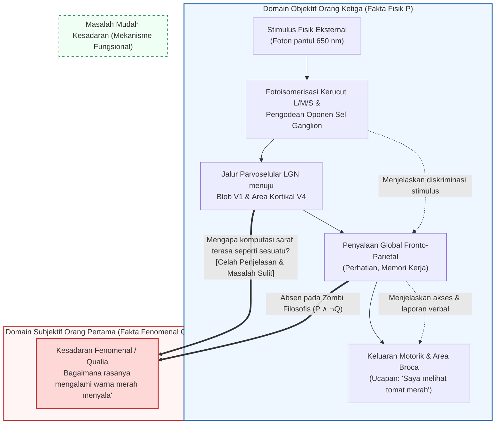
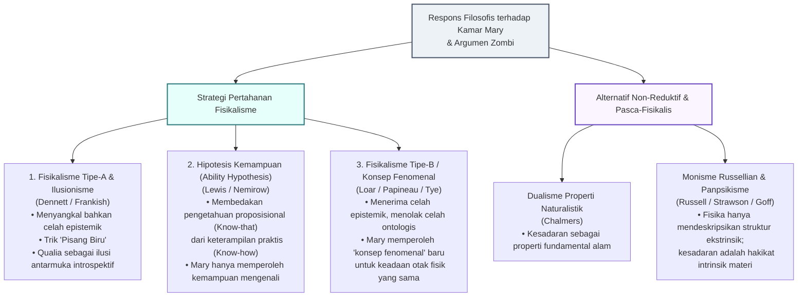

## 1. Pendahuluan: Jurang Antara Radiasi Elektromagnetik $\lambda = 650\,\text{nm}$ dan Pijar Subjektif Warna Merah

Ketika kita menatap sebutir tomat matang di bawah sinar matahari sore, peristiwa tersebut dapat dijelaskan pada dua tingkat yang sangat berbeda.

Tingkat pertama adalah <strong>deskripsi objektif orang ketiga dari ilmu pengetahuan alam</strong>: pigmen karotenoid (likopen) pada kulit tomat menyerap gelombang pendek dan menengah serta secara selektif memantulkan gelombang elektromagnetik panjang di sekitar $\lambda \approx 650\,\text{nm}$. Foton-foton ini melewati kornea dan lensa menuju retina, lalu diserap oleh fotoreseptor kerucut peka gelombang panjang (kerucut-L, $\lambda_{\max} \approx 560\,\text{nm}$), memicu fotoisomerisasi 11-cis-retinal menjadi all-trans-retinal. Melalui transdusin dan fosfodiesterase (PDE), $\text{cGMP}$ dihidrolisis sehingga saluran kation tertutup dan membran fotoreseptor mengalami hiperpolarisasi. Sinyal tersebut dikodekan oleh saluran proses-oponen ($L - M$ dan $S - (L + M)$) pada sel ganglion retina, diteruskan melalui lapisan parvoselular nukleus genikulatum lateral (LGN) ke korteks visual primer (V1) dan mencapai <strong>area visual V4</strong> (pusat konstansi warna kortikal), sebelum mengaktifkan jaringan fronto-parietal dan area Broca untuk menghasilkan ucapan: *«Tomat itu berwarna merah cerah.»*

Namun, ada tingkat kedua: <strong>karakter subjektif pengalaman sadar orang pertama</strong>. Seberapa lengkap pun kita menuliskan persamaan Maxwell atau persamaan diferensial Hodgkin-Huxley tentang potensial aksi saraf, tidak ada satu baris pun dalam rumus tersebut yang menyebutkan <strong>kualitas kemerahan yang hidup dan menyala-nyala</strong> yang kita alami secara langsung di dalam kesadaran kita.

Dalam filsafat budi (Philosophy of Mind) dan ilmu kognitif kontemporer, sifat kualitatif intrinsik dari pengalaman subjektif ini disebut <strong>qualia</strong> (tunggal: *quale*) atau <strong>kesadaran fenomenal (Phenomenal Consciousness)</strong>. Artikel ini merekonstruksi <strong>tiga pilar antifisikalisme</strong>: kelelawar Thomas Nagel (1974), argumen pengetahuan Frank Jackson («Kamar Mary», 1982/1986), serta celah penjelasan Joseph Levine (1983) dan «Masalah Sulit Kesadaran» (Hard Problem) beserta argumen zombi filosofis David Chalmers (1995/1996). Selanjutnya, kita menguji tiga strategi pertahanan utama fisikalisme (ilusionisme, hipotesis kemampuan, dan strategi konsep fenomenal) serta menjelajahi batas mutakhir: <strong>monisme Russellian (panpsikisme)</strong>, <strong>Global Neuronal Workspace Theory (GNWT)</strong>, dan <strong>Teori Informasi Terintegrasi (IIT)</strong> karya Giulio Tononi.

---

## 2. Definisi Ketat Qualia dan Kesadaran Fenomenal

Diperkenalkan dalam arti analitik modern oleh <strong>Clarence Irving Lewis</strong> pada tahun 1929 (*Mind and the World Order*), konsep <strong>qualia</strong> diperjelas pada tahun 1995 oleh <strong>Ned Block</strong> yang membedakan dua konsep kesadaran:
1. <strong>Kesadaran Fenomenal (P-Consciousness)</strong>: Karakter pengalaman subjektif orang pertama dari suatu keadaan mental — <strong>bagaimana rasanya (what it is like)</strong> mengalami keadaan tersebut.
2. <strong>Kesadaran Akses (Access Consciousness / A-Consciousness)</strong>: Properti pemrosesan informasi fungsional di mana suatu representasi mental tersedia secara global untuk penalaran, kendali tindakan, dan laporan verbal.

Daniel Dennett (1988) merangkum empat ciri klasik qualia: <strong>tak terkatakan (Ineffability)</strong>, <strong>intrinsik (Intrinsicness)</strong>, <strong>privat (Privateness)</strong>, dan <strong>dapat ditangkap secara langsung dalam kesadaran (Immediate Apprehensibility)</strong>. Eksperimen pikiran <strong>Spektrum Terbalik (Inverted Spectrum)</strong> (Locke 1689; Shoemaker 1982) menunjukkan bahwa dua orang bisa 100% identik secara fungsional dan perilaku, sementara qualia internal mereka untuk merah dan hijau terbalik secara simetris ($Q_{\text{red}} \leftrightarrow Q_{\text{green}}$), membuktikan bahwa qualia tidak dapat direduksi menjadi sekadar peran fungsional.

---

## 3. Tiga Pilar Antifisikalisme

### 3.1 Pilar I: *«Bagaimana Rasanya Menjadi Kelelawar?»* karya Thomas Nagel (1974)

Dalam makalah terkenalnya tahun 1974 (*What Is It Like to Be a Bat?*), <strong>Thomas Nagel</strong> merumuskan kriteria kanonik kesadaran:

> «Secara fundamental, suatu organisme memiliki keadaan mental sadar jika dan hanya jika ada <strong>sesuatu tentang bagaimana rasanya menjadi organisme tersebut</strong> — sesuatu tentang bagaimana rasanya <strong>bagi</strong> organisme itu sendiri.»

Kelelawar mikrokiroptera bernavigasi dalam kegelapan melalui <strong>ekolokasi (sonar biologis)</strong> dengan memancarkan pulsa ultrasonik ($20\text{--}120\,\text{kHz}$) dan menghitung jarak $r = c\Delta t/2$ dari tunda waktu gema $\Delta t$ serta kecepatan relatif dari pergeseran Doppler $\Delta f$. Ketika kita mencoba membayangkan menjadi kelelawar, kita hanya membayangkan <strong>bagaimana rasanya *bagi kita* (manusia) berperilaku seperti kelelawar</strong>, tetapi gagal menjangkau <strong>bagaimana rasanya *bagi kelelawar* untuk menjadi kelelawar</strong>.

Diagnosis terdalam Nagel mengungkap <strong>paradoks reduksi objektif</strong>: fisika berhasil mereduksi «panas» menjadi energi kinetik rata-rata molekul $\langle E_k \rangle = \frac{3}{2} k_B T$ dengan cara menghapus sudut pandang subjektif pengamat. Namun, esensi pengalaman sadar justru terletak *pada* sudut pandang subjektif itu sendiri; jika kita membuang perspektif orang pertama demi deskripsi neurofisiologis orang ketiga, kita bukan mereduksi pengalaman, melainkan membuang fenomena yang hendak dijelaskan!

### 3.2 Pilar II: Argumen Pengetahuan Frank Jackson («Kamar Mary», 1982 / 1986)

Filsuf Australia <strong>Frank Jackson</strong> memperkenalkan <strong>Mary</strong>, seorang ilmuwan saraf jenius yang dibesarkan sejak lahir di dalam <strong>kamar yang sepenuhnya hitam-putih</strong>. Melalui buku dan monitor monokrom, Mary mempelajari <strong>seluruh fakta fisik, neurobiologis, dan fungsional $\mathcal{P}$</strong> tentang penglihatan warna manusia. Suatu hari, Mary keluar ke taman dan melihat <strong>tomat merah matang</strong> untuk pertama kalinya. Apakah ia mempelajari sesuatu yang baru?

Formalisasi deduktif <strong>Argumen Pengetahuan (Knowledge Argument)</strong>:
1. <strong>Premis 1 (Kelengkapan pengetahuan fisik sebelum dibebaskan)</strong>: Sebelum keluar ($t_{\text{before}}$), Mary mengetahui semua fakta fisik $\mathcal{P}$:
   $$\forall p \in \mathcal{P}, \quad K_{\text{before}}(\text{Mary}, p)$$
2. <strong>Premis 2 (Perolehan fakta baru setelah dibebaskan)</strong>: Saat melihat tomat pada $t_{\text{after}}$, Mary mempelajari fakta baru $Q$ (bagaimana rasanya melihat warna merah):
   $$\exists Q \quad \text{sehingga} \quad \neg K_{\text{before}}(\text{Mary}, Q) \land K_{\text{after}}(\text{Mary}, Q)$$
3. <strong>Kesimpulan 1 (Adanya fakta non-fisik)</strong>: Berdasarkan Hukum Leibniz, $Q \notin \mathcal{P}$.
4. <strong>Kesimpulan 2 (Ketidakbenaran fisikalisme)</strong>: Karena tidak semua fakta adalah fakta fisik ($\mathcal{F}_{\text{world}} \not\subseteq \mathcal{P}$), maka <strong>fisikalisme salah!</strong>

(Catatan: Jackson awalnya membela <strong>epifenomenalisme</strong> pada tahun 1982, namun pada tahun 2003 ia menarik kembali kesimpulan antifisikalisnya dan beralih ke <strong>representasionalisme</strong> fisikalis karena paradoks bahwa qualia yang lumpuh secara kausal tidak mungkin menyebabkan Mary berseru *«Oh, jadi begini rasanya melihat merah!»*).

### 3.3 Pilar III: Celah Penjelasan, «Masalah Sulit», dan Zombi Filosofis (1983 / 1995 / 1996)

<strong>Joseph Levine (1983)</strong> merumuskan <strong>Celah Penjelasan (Explanatory Gap)</strong>, dan <strong>David Chalmers (1995/1996)</strong> membedakan antara <strong>«Masalah Mudah» (Easy Problems)</strong> dan <strong>«Masalah Sulit Kesadaran» (The Hard Problem)</strong>:

| Dimensi Perbandingan | Masalah Mudah Kesadaran (Easy Problems) | Masalah Sulit Kesadaran (The Hard Problem) |
| :--- | :--- | :--- |
| <strong>Pertanyaan Inti</strong> | Bagaimana otak membedakan stimulus, mengintegrasikan informasi, mengendalikan perhatian, dan menghasilkan laporan verbal? | <strong>Mengapa dan bagaimana semua pemrosesan informasi fisik tersebut disertai dengan pengalaman subjektif batiniah?</strong> |
| <strong>Target Konseptual</strong> | <strong>Kesadaran Akses & Mekanisme Fungsional</strong> (Access Consciousness) | <strong>Kesadaran Fenomenal / Qualia</strong> (Phenomenal Consciousness) |
| <strong>Reduksi Fungsional</strong> | <strong>Dapat dipecahkan secara prinsipil</strong> dengan menemukan sirkuit saraf atau algoritma komputasinya. | <strong>Kebal terhadap reduksi fungsional</strong>: bahkan setelah semua fungsi dijelaskan 100%, pertanyaan mengapa ada pengalaman subjektif tetap tersisa. |

<strong>Argumen Keterbayangan (Conceivability Argument)</strong> Chalmers menggunakan <strong>Zombi Filosofis</strong> — makhluk yang secara fisik identik dengan kita molekul demi molekul ($\mathcal{P}$), tetapi sama sekali tidak memiliki pengalaman sadar ($\neg Q$):
1. <strong>Premis 1</strong>: Dunia zombi ($\mathcal{P} \land \neg Q$) dapat dibayangkan secara ideal tanpa kontradiksi a priori.
2. <strong>Premis 2</strong>: Keterbayangan ideal menyiratkan kemungkinan metafisik ($\Diamond(\mathcal{P} \land \neg Q)$).
3. <strong>Kesimpulan</strong>: Maka $\mathcal{P}$ tidak mengharuskan $Q$ secara metafisik ($\neg \Box(\mathcal{P} \to Q)$), sehingga materialisme gugur!

Menghadapi sanggahan keniscayaan a posteriori Saul Kripke (*«Air = $\text{H}_2\text{O}$»*), <strong>Semantik Modal Dua Dimensi (2D Modal Semantics)</strong> Chalmers membuktikan bahwa sementara pada «air» intensi primer (cairan bening pelepas dahaga) dan intensi sekunder ($\text{H}_2\text{O}$) dapat terpisah, pada «rasa sakit» atau «quale merah $Q$» <strong>penampakan subjektif (intensi primer) dan esensi (intensi sekunder)严格 berimpit ($I_1(Q) = I_2(Q)$)</strong>, sehingga keterbayangan primer langsung menjamin kemungkinan metafisik $\Diamond(\mathcal{P} \land \neg Q)$.

---

## 4. Tiga Serangan Balik Fisikalisme

1. <strong>Fisikalisme Tipe-A & Ilusionisme (Dennett 1991, Frankish 2016)</strong>:
   Melalui eksperimen pikiran <strong>«Pisang Biru» (Blue Banana)</strong>, Dennett berpendapat bahwa jika Mary *benar-benar* mengetahui semua fakta fisik, saat melihat pisang yang dicat biru ia akan langsung mengenali disposisi reaktif korteks V4-nya dan membongkar tipuan tersebut. <strong>Ilusionisme</strong> Keith Frankish menyatakan bahwa qualia hanyalah <strong>ilusi pengguna (user-illusion)</strong> yang diciptakan oleh pemantauan diri introspektif.
2. <strong>Hipotesis Kemampuan (The Ability Hypothesis — Nemirow 1980, David Lewis 1988)</strong>:
   Lewis membedakan antara <strong>pengetahuan proposisional (*knowing-that*)</strong> dan <strong>kemampuan praktis (*knowing-how*)</strong>. Saat keluar kamar, Mary tidak mempelajari fakta proposisional baru $Q$, melainkan memperoleh kemampuan praktis untuk mengenali, membayangkan, dan mengingat warna merah.
3. <strong>Strategi Konsep Fenomenal / Fisikalisme Tipe-B (Loar 1990, Papineau 2002)</strong>:
   Berdasarkan pembedaan Frege antara <strong>makna (konsep) dan rujukan (properti nyata)</strong> («Bintang Kejora = Bintang Senja = Venus»), secara ontologis quale merah $Q$ identik dengan keadaan saraf $N_{\text{red}}$ di area V4 ($Q = N_{\text{red}}$). Mary sebelumnya telah mengenal keadaan itu melalui <strong>konsep teoretis orang ketiga ($C_{\text{phys}}$)</strong>, dan saat melihat tomat ia memperoleh <strong>konsep fenomenal orang pertama yang baru ($C_{\text{phen}}$)</strong> yang merujuk pada keadaan fisik otak yang *sama persis*!

| Posisi Filosofis | Tokoh Utama | Celah Epistemik | Celah Ontologis | Tesis Utama tentang Qualia |
| :--- | :--- | :--- | :--- | :--- |
| <strong>Fisikalisme Tipe-A / Ilusionisme</strong> | Dennett, Frankish | <strong>Disangkal</strong> | <strong>Disangkal</strong> | Qualia adalah <strong>ilusi antarmuka introspektif</strong>. |
| <strong>Hipotesis Kemampuan</strong> | D. Lewis, Nemirow | <strong>Ditafsir ulang</strong> (keterampilan praktis) | <strong>Disangkal</strong> | Mary tidak mempelajari fakta baru (*know-that*), melainkan <strong>kemampuan praktis (*know-how*)</strong>. |
| <strong>Fisikalisme Tipe-B (Konsep Fenomenal)</strong> | Loar, Papineau, Tye | <strong>Diterima</strong> | <strong>Disangkal</strong> ($C_{\text{phys}}$ dan $C_{\text{phen}}$ merujuk hal sama) | Mary memperoleh <strong>konsep fenomenal</strong> orang pertama baru untuk keadaan saraf yang sama. |
| <strong>Dualisme Properti</strong> | Chalmers | <strong>Diterima</strong> | <strong>Diterima</strong> | Kesadaran adalah <strong>properti fundamental</strong> alam semesta di samping massa dan muatan. |
| <strong>Monisme Russellian / Panpsikisme</strong> | Russell, Strawson, Goff | <strong>Diterima</strong> | <strong>Diintegrasikan secara monistik</strong> | Fisika hanya menjelaskan <strong>struktur relasional ekstrinsik</strong>; kesadaran adalah <strong>hakikat kategoris intrinsik (quiddity)</strong> materi. |

---

## 5. Batas Mutakhir: Monisme Russellian, GNWT, dan Teori Informasi Terintegrasi (IIT)

1. <strong>Monisme Russellian dan Panpsikisme (Russell 1927, Eddington 1928, Strawson 2006, Goff 2017)</strong>:
   Fisika mendefinisikan massa $m$ dan muatan $q$ semata-mata melalui <strong>struktur relasional dan disposisional ekstrinsiknya</strong>, namun bungkam tentang <strong>hakikat kategoris intrinsik (quiddity)</strong> materi. Karena satu-satunya sistem fisik yang hakikat intrinsiknya kita kenal langsung dari dalam adalah otak kita sendiri — berupa <strong>kesadaran fenomenal</strong> — maka kesadaran (atau protokesadaran) adalah hakikat intrinsik dari materi fisik itu sendiri! (Tantangan utamanya adalah <strong>Masalah Kombinasi / Combination Problem</strong> dari William James).
2. <strong>Global Neuronal Workspace Theory (GNWT — Dehaene & Changeux, 2011)</strong>:
   Representasi sensorik menjadi sadar ketika melewati ambang batas nonlinier dan memicu <strong>penyalaan global (Global Ignition, ~300 ms, gelombang P3b)</strong> di jaringan fronto-parietal jarak jauh, menyiarkan informasi ke seluruh memori kerja.
3. <strong>Teori Informasi Terintegrasi (IIT 3.0 / 4.0 — Giulio Tononi, 2004, 2014, 2023)</strong>:
   Berangkat dari <strong>lima aksioma fenomenologis pengalaman (Eksistensi Intrinsik, Komposisi, Informasi, Integrasi, Eksklusi)</strong> yang diterjemahkan ke dalam postulat fisik, IIT mengukur kesadaran melalui informasi terintegrasi $\Phi$ — kehilangan informasi kausal minimum saat sistem dipotong sepanjang <strong>Partisi Informasi Minimum ($\text{MIP}$)</strong> $\pi$:
   $$\Phi(S_t) = \min_{\pi \in \mathcal{P}_{\text{MIP}}} D\!\left( p\bigl(S_{t \pm 1} \mid S_t\bigr) \;\middle\|\; \prod_{k \in \pi} p\bigl(S_{t \pm 1}^{(k)} \mid S_t^{(k)}\bigr) \right)$$
   - <strong>Paradoks Serebelum (Otak Kecil)</strong>: Serebelum (~69 miliar neuron) tidak menghasilkan kesadaran ($\Phi \approx 0$) karena sirkuitnya tersusun atas modul *feedforward* paralel tanpa umpan balik rekuren, berbeda dengan sistem talamokortikal posterior ($\Phi^{\max}$ tinggi).
   - <strong>Jaringan Murni *Feedforward* adalah Zombi ($\Phi = 0$)</strong>: Setiap jaringan saraf tiruan murni *feedforward* tanpa umpan balik kausal memiliki <strong>$\Phi = 0$</strong> secara ketat, sehingga tetap gelap gulita di dalamnya.

---

## 6. Kesimpulan

Kamar Mary dan zombi filosofis membuktikan bahwa tidak ada deduksi a priori yang dapat menurunkan pengalaman subjektif $Q$ dari sekadar persamaan struktural orang ketiga $\mathcal{P}$. Baik kita menafsirkannya melalui dualitas konseptual <strong>fisikalisme tipe-B</strong> maupun sebagai struktur kausal intrinsik ($\Phi^{\max}$) materi menurut <strong>monisme Russellian dan IIT</strong>, warna merah menyala dari sebutir tomat mengingatkan kita pada titik di mana alam semesta berhenti menjadi sekadar grafik persamaan yang membisu dan mulai menerangi dirinya sendiri dari dalam.
