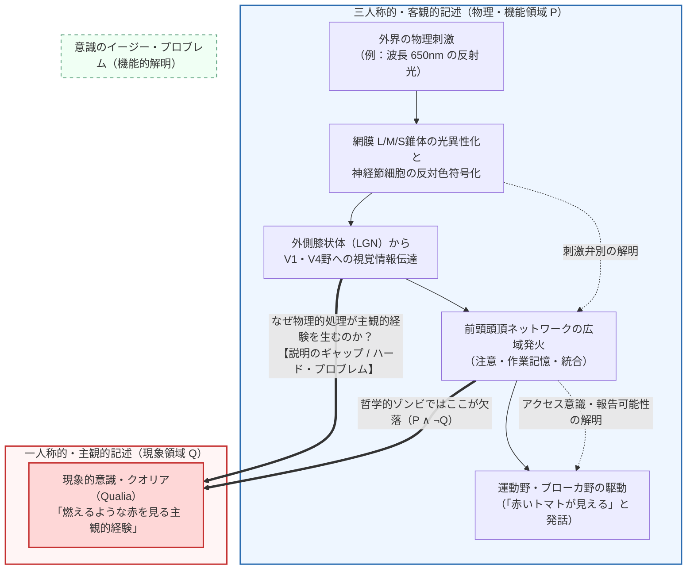
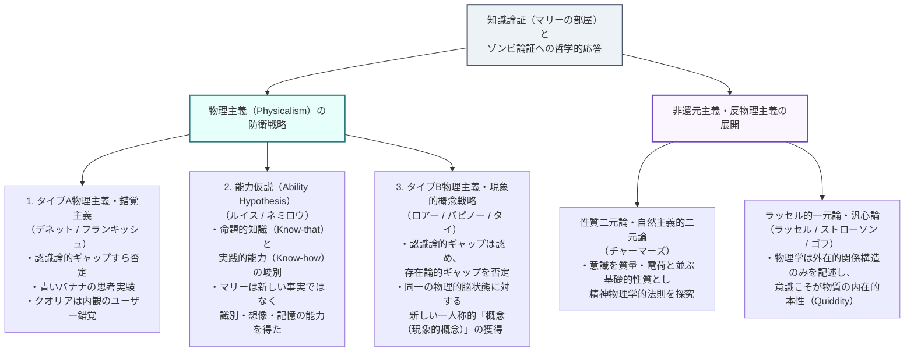

## 1. 導入：波長 $650\,\text{nm}$ の電磁波と「燃えるような赤さ」のあいだの深淵

私たちがよく晴れた秋の夕暮れに熟したトマトを見つめるとき、そこには二つのまったく異なる記述のレベルが存在します。

一つ目は、<strong>三人称的・客観的な自然科学の記述</strong>です。太陽から放出された光子のうち、トマトの表皮に含まれるカロテノイド系色素（リコピン）の共役二重結合によって短波長・中波長の光が吸収され、波長 $\lambda \approx 650\,\text{nm}$ 前後の長波長電磁波が選択的に反射されます。この光子が角膜と水晶体を通過して網膜に到達すると、長波長感受性錐体（L錐体）の視物質オプシンに結合した 11-シス-レチナールが光異性化を起こしてオール-トランス-レチナールへと構造変化します。これによりGタンパク質（トランスデューシン）を介したシグナル伝達カスケードが駆動され、ホスホジエステラーゼが環状GMP（$\text{cGMP}$）を加水分解し、陽イオンチャネルが閉鎖することで視細胞膜が過分極します。この電気化学的信号は網膜神経節細胞の反対色チャネル（$L - M$）によって符号化され、外側膝状体（LGN）の小細胞層（Parvocellular layer）を経由して一次視覚野（V1）の二重反対色細胞（ブロブ領域）、さらには腹側視覚路の<strong>V4野（色恒常性と色覚処理の中枢）</strong>へと伝達され、特定の神経細胞集団の同期発火（たとえば $40\,\text{Hz}$ 帯域のガンマ波振動）を引き起こします。

しかし、ここには二つ目の記述レベル――すなわち<strong>一人称的・主観的な経験の記述</strong>――が存在します。どれほど精密にマクスウェルの方程式、レチナールの量子化学的異性化、そしてホジキン・ハクスレー（Hodgkin-Huxley）の膜電位方程式を書き並べたとしても、そこには私たちがその瞬間に生き生きと味わっている<strong>「あの鮮烈で燃えるような赤さの質感」</strong>という言葉は一行たりとも登場しません。

現代の心の哲学（Philosophy of Mind）および意識の科学において、この「主観的経験に伴う固有の感覚的質感」は<strong>クオリア（Qualia；単数形は Quale）</strong>、あるいは<strong>現象的意識（Phenomenal Consciousness）</strong>と呼ばれます。もし人類がいつの日か宇宙と脳に関するすべての物理法則と神経回路の配線を完全に解明したとしたら、なぜ特定の神経発火が「無（暗闇）」ではなく「赤を見る経験」や「鋭い歯痛の感覚」を伴うのかという謎も自動的に解けるのでしょうか？それとも、主観的な経験の質感は物理主義（Physicalism / Materialism）の網の目から原理的にこぼれ落ちてしまうのでしょうか？

本稿では、現代の心の哲学において物理主義に対する最強の挑戦状として聳え立つ<strong>三大反物理主義論証</strong>――トマス・ネーゲルの「コウモリであるとはどういうことか」、フランク・ジャクソンの「マリーの部屋（知識論証）」、そしてデイヴィッド・チャーマーズの「哲学的ゾンビと意識のハード・プロブレム」――を論理的・数理的に厳密に再構築します。さらに、それらを迎え撃つ物理主義陣営の精緻な反論（ダニエル・デネットの錯覚主義、デイヴィッド・ルイスの能力仮説、ブライアン・ロアーらの現象的概念戦略）を検証したうえで、ラッセル的一元論（汎心論）やジュリオ・トノーニの<strong>統合情報理論（Integrated Information Theory: IIT）</strong>に至る現代の最前線までを一気に駆け抜けます。

---

## 2. クオリア（Qualia）と現象的意識の厳密な定義

### 2.1 C.I. ルイスからネッド・ブロックへ：現象的意識とアクセス意識の峻別

「クオリア（Qualia）」という哲学用語を現代的な意味で最初に導入したのは、アメリカの哲学者<strong>クラレンス・アーヴィング・ルイス（Clarence Irving Lewis）</strong>の1929年の著作『精神と世界の秩序（Mind and the World Order）』でした。ルイスは、経験の中に与えられている直接的で反復可能な質的性格――たとえば、ある特定の赤さの見た目や、ローストしたコーヒーの香りの質感、針で刺されたときの鋭い痛みの生々しさ――を「クオリア」と呼び、それを対象についての概念的判断から区別しました。

その後、1995年に哲学者<strong>ネッド・ブロック（Ned Block）</strong>は歴史的論文『意識についての混乱について（On a Confusion about a Function of Consciousness）』において、私たちが日常的に「意識（Consciousness）」と呼んでいる概念が、実はまったく異なる二つの概念の混同であることを決定的に明らかにしました。

1. <strong>現象的意識（Phenomenal Consciousness / P-Consciousness）</strong>：
   経験そのものが持つ主観的・一人称的な「感じ（What it is like）」。クオリアとほぼ同義であり、「赤い色を見る経験」「ベルベットに触れる感触」「激しい嫉妬の胸の苦しさ」など、<strong>それを経験することが主体にとってどのような感じであるか</strong>という質的側面を指します。
2. <strong>アクセス意識（Access Consciousness / A-Consciousness）</strong>：
   ある心的な表象（情報）が、脳内の他の認知システム――推論、意思決定、行動計画、運動制御、そして言語的報告（Verbal report）――によって<strong>機能的に利用可能（ poised for free use in reasoning and direct control of action and speech ）である状態</strong>を指します。

ブロックが指摘した通り、認知科学やAI研究が「意識のメカニズム」として説明しようとするとき、無意識のうちに「現象的意識（P意識）」を「アクセス意識（A意識）」へとすり替えてしまうことが頻繁に起こります。たとえば、コンピュータビジョンを備えたロボットが波長 $650\,\text{nm}$ の光を検出して内部メモリにフラグを立て、スピーカーから「ここに赤いトマトがあります」と発話するとき、そのロボットはトマトの視覚情報に対して完全な<strong>アクセス意識（機能的情報利用可能性）</strong>を持っています。しかし、そのロボットの内面に「赤さのクオリア（現象的意識）」が宿っているかどうかは、まったく別の問題なのです。

### 2.2 クオリアの4つの古典的特徴と「逆転スペクトル」

ダニエル・デネット（1988年『Quining Qualia』）は、伝統的な哲学者がクオリアに帰属させてきた性質を以下の<strong>4つの特徴</strong>として整理しました（デネット自身はこれらを批判的に解体するために定義しましたが、クオリア概念の輪郭を掴むうえで極めて有用です）。

- <strong>言語化不可能性（Ineffability）</strong>：クオリアはどれほど言葉を尽くしても、それを未経験の他者に言語的記述だけで伝達することはできない（生まれつき盲目の人に「赤がどのような見た目か」を言葉だけで教えることはできない）。
- <strong>内在性（Intrinsicness）</strong>：クオリアは、その経験が行動や他の心的状態に対して持つ関係的・機能的役割（外在的関係）とは独立した、経験そのものに内在する非関係的な性質である。
- <strong>私秘性（Privateness）</strong>：すべてのクオリアは本質的に一人称的であり、他者のクオリアと自分のクオリアを直接比較することは原理的に不可能である。
- <strong>意識における直接的把握可能性（Direct or Immediate Apprehensibility）</strong>：自分の経験しているクオリアを知るのに推論は不要であり、主体は自らのクオリアを直接的・非推論的に把握している（「見かけ」と「実在」の区別が存在しない）。

この「内在性」と「私秘性」を最も鮮やかに浮き彫りにする思考実験が、ジョン・ロックが『人間知性論』（1689年）で原型を提示し、シドニー・シューメーカー（Sydney Shoemaker, 1982）らが現代的に精緻化した<strong>「逆転スペクトル（Inverted Spectrum / 逆転クオリア）」</strong>です。

あなたと友人のAさんが、まったく同じトマトを見て「これは赤い」と言い、信号機の色を同じように識別し、色覚検査（石原式色覚異常検査表など）でもまったく同じスコアを出し、さらには行動的にも機能的にも生涯にわたって100%区別がつかないと仮定しましょう。それでもなお、<strong>あなたがトマトを見たときに心の中で生じているクオリア $Q_{\text{red}}$ が、Aさんがキュウリを見たときに生じているクオリア $Q_{\text{green}}$ と同じであり、逆にAさんがトマトを見ているときにはあなたの $Q_{\text{green}}$ が生じている</strong>という事態（主観的色空間の対称的反転）は、論理的に何の矛盾もなく想像できます。機能的・行動的役割が完全に同一であってもクオリアが逆転しうるのであれば、クオリアは機能的役割そのものに還元することはできないはずです。

---

## 3. 反物理主義の第一の柱：トマス・ネーゲル「コウモリであるとはどういうことか」（1974年）

### 3.1 主観的経験の定義：「〜であるとはどういうことか（What it is like to be）」

1974年、哲学者<strong>トマス・ネーゲル（Thomas Nagel）</strong>は『Philosophical Review』誌に発表した不朽の論文『コウモリであるとはどういうことか（What Is It Like to Be a Bat?）』において、当時の心の哲学を席巻していた還元主義的唯物論および機能主義に対して強烈な一撃を加えました。

ネーゲルはまず、ある有機体が意識的な心的状態を持つということの意味を、いかなる特定の理論にも依存しない最も純粋な形で次のように定義しました。

> 「ある有機体が意識経験を持つとは、<strong>その有機体であるとはどういうことか（what it is like to be that organism）</strong>という何かが存在する、ということを意味する。……ある有機体が意識を持つのは、その有機体であるとはどういうことかという何か――<strong>その有機体にとって（for the organism）</strong>どういうことかという何か――が存在する場合であり、かつその場合に限られる。」

岩石や水分子、あるいは現在の汎用コンピュータには、「それであるとは（それ自身にとって）どういうことか」という内的な世界は存在しません。しかし、人間や犬、そしてコウモリには、その主体にとっての主観的な世界の見え方・感じ方が存在します。

### 3.2 反響定位（エコーロケーション）という異質な現象学

なぜネーゲルは思考実験の主役として「コウモリ（特に小翼手亜目 Microchiroptera）」を選んだのでしょうか？それは、コウモリが私たちと同じ哺乳類であり（したがって意識経験を持つことを疑う余地がほとんどなく）、しかも<strong>人間の五感とは根本的に異なる感覚モダリティによって世界を生きているから</strong>です。

小翼手亜目のコウモリは視覚が未発達である代わりに、喉頭や鼻孔から $20\,\text{kHz} \sim 120\,\text{kHz}$ の高周波超音波パルスを発射し、周囲の障害物や飛翔する蛾（ガ）から跳ね返ってくる反響音（エコー）を両耳で受容する<strong>反響定位（エコーロケーション / ソナー）</strong>によって空間を知覚しています。コウモリの聴覚皮質は、以下の物理パラメータをミリ秒単位で並列計算しています。

- パルス発射からエコー到達までの<strong>時間遅延 $\Delta t$</strong> から対象までの距離 $r = \frac{c \Delta t}{2}$ を算出。
- 獲物の羽ばたきや相対運動による<strong>ドップラーシフト $\Delta f$</strong> から相対速度ベクトルを算出。
- 耳介（Pinna）の複雑な凹凸による<strong>周波数スペクトルの干渉パターン</strong>から仰角・方位角および対象の表面テクスチャを算出。

結果として、コウモリは私たちの視覚に匹敵する三次元的な空間解像度で世界を知覚しています。しかし、<strong>「超音波ソナーによって三次元空間を知覚するとは、主観的にどのような感じ（クオリア）なのか？」</strong>と問われたとき、私たちの想像力は完全に壁に突き当たります。

私たちが「コウモリになること」を想像しようとして、暗闇の中で逆さまにぶら下がり、口から叫び声を上げながら腕を羽ばたかせて虫を捕まえる姿を思い浮かべたとしても、それは単に<strong>「私（人間）がコウモリのように振る舞ったら、私にとってどう感じられるか」</strong>を想像しているにすぎません。本当に問われているのは、<strong>「コウモリにとって、コウモリであるとはどういうことか（what it is like for a bat to be a bat）」</strong>なのです。私たちの心的なレパートリーにはコウモリ固有の現象的クオリアが存在しないため、一人称的な想像力によってその主観的領域に到達することは原理的に不可能です。

### 3.3 客観性の罠：なぜ三人称的科学は主観性を取り逃がすのか

ネーゲルの議論の真に鋭い点は、単なる「人間の想像力の限界」を指摘したことではなく、<strong>自然科学における「客観的還元（Objective reduction）」の方法論そのものが抱える構造的限界</strong>を暴き出したことにあります。

物理学や化学における還元がなぜ成功してきたかを振り返ってみましょう。
- 私たちが日常的に感じる「熱い・冷たい」という主観的な温度感覚から、特定の人間や感覚器の視点を引き算し、誰がどの視点から測定しても不変な構造を取り出すことで、「熱とは分子の平均運動エネルギー $\langle E_k \rangle = \frac{3}{2}k_B T$ である」という客観的な物理的還元が達成されました。
- 「雷鳴」や「稲妻」という聴覚的・視覚的な現れから特定の観察者の視点を捨象することで、「大気中の急激な放電と衝撃波」という客観的記述が得られました。

つまり、従来の科学的還元とは常に<strong>「特定の主観的視点（Point of view）への依存度を減らし、いかなる視点からもアクセス可能な三人称的・客観的記述へと移行するプロセス」</strong>だったのです。

ところが、「意識経験（クオリア）」を還元しようとするとき、この方法論は致命的な自己矛盾に陥ります。なぜなら、<strong>意識経験の本質は「特定の主観的視点においてどう現れるか」そのものの中に宿っているから</strong>です。コウモリのソナー経験から「コウモリ固有の主観的視点」を引き算して客観的な神経発火パターンへと移行した瞬間、私たちは現象を説明したのではなく、<strong>説明すべき現象そのものを考察の対象から放り出してしまった</strong>ことになるのです。ネーゲルが喝破した通り、「より客観的な記述へと近づけば近づくほど、現象の真の本質から遠ざかってしまう」という認識論的ジレンマこそが、心身問題を他のすべての科学的問題から隔てている壁なのです。

---

## 4. 反物理主義の第二の柱：フランク・ジャクソン「マリーの部屋（知識論証）」（1982 / 1986年）

ネーゲルが提示した「三人称的科学と一人称的経験の断絶」を、最も切れ味鋭い演繹的論証へと結晶化させたのが、オーストラリアの哲学者<strong>フランク・ジャクソン（Frank Jackson）</strong>が論文『Epiphenomenal Qualia』（1982年）および『What Mary Didn't Know』（1986年）で発表した思考実験<strong>「マリーの部屋（Mary's Room）」</strong>――哲学史において<strong>「知識論証（The Knowledge Argument）」</strong>と呼ばれる議論です。

### 4.1 思考実験「マリーの部屋」の完全な設定

ジャクソンは次のような極限的な思考実験を設定します。

> <strong>【マリーの部屋のシナリオ】</strong>
> マリー（Mary）は、23世紀に生きる人類史上最高の天才神経科学者・物理学者である。しかし彼女は、何らかの理由により、生まれた瞬間から<strong>完全に白と黒（およびその中間である灰色の濃淡）しか存在しない部屋</strong>の中で育てられてきた。彼女の部屋にある家具も壁もすべて白黒であり、彼女自身の肌や髪も特殊な白黒塗料で覆われ、彼女が読む本も、彼女が外の世界を観察し研究するために使うテレビモニターもすべて<strong>白黒（アクロマティック）</strong>である。
>
> しかし、マリーはこの白黒のモニターと白黒の専門書を通じて、<strong>色覚に関するありとあらゆる物理的・化学的・神経科学的・機能的事実のすべて</strong>を完璧に学び尽くした。
> - 彼女はマクスウェルの電磁場方程式、太陽光のスペクトル分布、熟したトマトの表面の分光反射率 $R(\lambda)$ を完全に知っている。
> - 彼女は波長 $\lambda = 650\,\text{nm}$ の光子が網膜のL錐体オプシン（$\lambda_{\max} \approx 560\,\text{nm}$）、M錐体オプシン（$\lambda_{\max} \approx 530\,\text{nm}$）、S錐体オプシン（$\lambda_{\max} \approx 420\,\text{nm}$）にどのような比率で吸収されるかを量子力学レベルまで知り尽くしている。
> - 彼女は網膜神経節細胞の反対色処理、外側膝状体（LGN）、一次視覚野（V1）、そして第4視覚野（V4）から前頭前野・言語野（ブローカ野）に至るすべてのシナプス結合重みと発火率方程式を知り尽くしており、どの神経回路がどのように発火した結果として人間の声帯が振動し、「ああ、なんて美しい赤いトマトだろう」という音声波形が出力されるかを100%正確に予測できる。
>
> さて、ある日ついに白黒の部屋の扉が開かれ、マリーは生まれて初めて外の世界へと足を踏み出し、目の前に置かれた<strong>真っ赤に熟したトマト</strong>をその目で直接見た。
> <strong>問い：この瞬間、マリーは何か新しいことを学んだだろうか？</strong>

私たちの直観は圧倒的な力をもって<strong>「イエス！」</strong>と答えます。マリーは部屋を出る前には決して知らなかった何か――すなわち<strong>「赤を見るとは主観的にどのような感じか（What it is like to see red）」という現象的真理 $Q$</strong>――を、その瞬間に初めて学んだ（発見した）ように思われます。

### 4.2 知識論証の演繹的定式化

ジャクソンは、この直観を単なる印象にとどめず、<strong>物理主義（Physicalism）を論理的に論駁する演繹的論証</strong>として定式化しました。世界のすべての物理的・機能的命題の集合を $\mathcal{P}$ とし、時点 $t$ において主体 $x$ が命題 $p$ を知っているという認識論理オペレータを $K_t(x, p)$ と表記すると、知識論証は以下のように厳密に記述されます。

1. <strong>前提1（解放前の物理的知識の完全性）</strong>：
   部屋から解放される前の時点 $t_{\text{before}}$ において、マリーは人間の色覚と脳と物理世界に関するすべての物理的事実 $\mathcal{P}$ を知っている。
   $$\forall p \in \mathcal{P}, \quad K_{\text{before}}(\text{Mary}, p)$$
2. <strong>前提2（解放後の実質的な知識の獲得）</strong>：
   部屋から解放され、初めて赤いトマトを見た時点 $t_{\text{after}}$ において、マリーは解放前には知らなかった新しい事実 $Q$（「赤を見る経験とはどのようなものか」という事実）を学ぶ。
   $$\exists Q \quad \text{s.t.} \quad \neg K_{\text{before}}(\text{Mary}, Q) \land K_{\text{after}}(\text{Mary}, Q)$$
3. <strong>結論1（非物理的事実の存在）</strong>：
   ライプニッツの法則（同一者不可識別の原理：もし $x = y$ ならば、$x$ が持つすべての性質を $y$ も持つ）により、マリーの解放前に知られていた命題集合 $\mathcal{P}$ のいかなる要素も、解放前に知られていなかった命題 $Q$ とは同一でありえない。したがって、$Q$ は物理的事実の集合 $\mathcal{P}$ には含まれない。
   $$Q \notin \mathcal{P}$$
4. <strong>結論2（物理主義の偽性）</strong>：
   物理主義とは「世界に関するすべての事実は物理的事実である（$\forall f \in \mathcal{F}_{\text{world}}, f \in \mathcal{P}$）」という形而上学的テーゼである。しかし $Q \in \mathcal{F}_{\text{world}}$ かつ $Q \notin \mathcal{P}$ であるから、<strong>物理主義は偽である</strong>。

この論証は<strong>演繹的に妥当（Deductively valid）</strong>です。つまり、前提1と前提2を認める限り、結論（「物理主義は偽である」）を拒絶することは論理的に不可能です。物理主義を守ろうとする者は、前提1（「白黒の部屋で本当にすべての物理的事実を知りうるのか？」）を否定するか、あるいは前提2（「マリーは本当に新しい命題的『事実』を学んだのか？」）を否定するかのどちらかを選ばなければなりません。

### 4.3 随伴現象説（Epiphenomenalism）とジャクソン自身の劇的な「転向」（2003年）

1982年当時のジャクソンは、この知識論証に基づいて<strong>随伴現象説（Epiphenomenalism）</strong>を擁護しました。随伴現象説とは、脳の物理的状態 $\mathcal{P}$ が原因となって非物理的なクオリア $Q$ を生み出す（$\mathcal{P} \to Q$）が、クオリア $Q$ の側からは物理的な脳や身体の行動に対して<strong>いかなる因果的影響力も及ぼさない（Causal impotence）</strong>という性質二元論の一形態です（あたかも蒸気機関車が走るときに煙突から出る「煙」が、機関車の走行自体には何の推進力も与えないのと同様です）。なぜなら、物理世界には「物理的領域の因果的閉包性（Causal Closure of the Physical Domain：すべての物理的出来事の十分な原因は物理的領域の内部で完結している）」があるからです。

ところが、哲学史の極めて興味深いエピソードとして、知識論証の生みの親であるジャクソン自身は、約20年後の2003年（論文『Mind and Illusion』）において<strong>自らの知識論証を撤回し、物理主義（特に表象主義 / Representationalism）へと転向</strong>しました！

なぜジャクソンは転向したのでしょうか？その最大の理由は、まさに<strong>随伴現象説が抱える深刻な自己論駁的パラドックス</strong>にありました。もしクオリア $Q$ が脳の物理的プロセス（発話や記憶形成を含む）に対して一切の因果的力を持たないのであれば、部屋から出たマリーが「わあ！赤って<strong>こういう感じ</strong>だったのか！」と叫び、その驚きを論文に書くという物理的行動の原因の中にも、クオリア $Q$ はまったく関与していないことになります。自分が経験しているクオリアが、自分の「クオリアについての判断や記憶」の原因になりえないとすれば、なぜ私たちはクオリアについて語り、知ることができるのでしょうか？このアポリアに直面したジャクソンは、後に第6節で詳述する物理主義的アプローチ（感覚経験を世界の性質についての表象として捉える表象主義）へと立場を移すことになったのです。しかし、生みの親が転向した後もなお、「マリーの部屋」という怪物的な思考実験そのものは独自の生命力を持ち続け、現代哲学の中心に君臨し続けています。

---

## 5. 反物理主義の第三の柱：説明のギャップ、意識のハード・プロブレム、そして哲学的ゾンビ

### 5.1 ジョセフ・レヴィーンの「説明のギャップ（Explanatory Gap）」（1983年）

ジャクソンの論文の翌年、1983年に哲学者<strong>ジョセフ・レヴィーン（Joseph Levine）</strong>は論文『Materialism and Qualia: The Explanatory Gap』において、仮に形而上学的に心と脳が同一であったとしても、そこには埋めがたい<strong>認識論的・説明的な空白（Explanatory Gap）</strong>が存在することを指摘しました。

科学の歴史において、「水とは $\text{H}_2\text{O}$ である」や「熱とは分子の平均運動エネルギーである」という理論的同一性（Theoretical identity）は、見事な<strong>還元的説明（Reductive explanation）</strong>を提供します。なぜなら、私たちが日常的に「水」や「熱」と呼ぶ概念は、そもそも「常温で液体であり、渇きを癒やし、$100^\circ\text{C}$ で沸騰して気体になる物質」や「氷を溶かし、水銀柱を押し上げる原因となるもの」といった<strong>因果的・機能的役割（Causal/functional role）</strong>によって定義されているからです。したがって、分子物理学が「$\text{H}_2\text{O}$ 分子の水素結合ネットワークがまさにその沸点や流動性という因果的役割を果たす」ことを演繹的に導出した瞬間、「なぜ $\text{H}_2\text{O}$ が水なのか？」という疑問は完全に消滅します。

ところが、「痛みとはC線維（無髄侵害受容線維）の発火である」とか「赤の経験とはV4野の $40\,\text{Hz}$ 同期発火である」と言われたとき、事態はまったく異なります。たとえC線維の発火が「手を引っ込めさせ、心拍数を上げ、『痛い』と叫ばせる」という機能的役割を100%説明したとしても、<strong>「なぜそのC線維の発火が、無感覚でも痒みでもなく、あの耐え難い『痛みのクオリア』を伴わなければならないのか？」</strong>という問いにはまったく答えられていません。物理的記述から現象的記述への移行が常に恣意的・神秘的に見えてしまうこの断絶こそが、「説明のギャップ」です。

### 5.2 デイヴィッド・チャーマーズ：「イージー・プロブレム」と「ハード・プロブレム」（1995 / 1996年）

1994年のツーソン会議（Toward a Science of Consciousness）における伝説的な講演、および1995年の論文『Facing Up to the Problem of Consciousness』と1996年の主著『意識する心（The Conscious Mind）』において、オーストラリアの哲学者<strong>デイヴィッド・チャーマーズ（David Chalmers）</strong>は、意識をめぐる諸問題を<strong>「イージー・プロブレム（Easy Problems）」</strong>と<strong>「ハード・プロブレム（The Hard Problem）」</strong>という二つのカテゴリーに鮮やかに峻別しました。

| 比較軸 | 意識のイージー・プロブレム（Easy Problems） | 意識のハード・プロブレム（The Hard Problem） |
| :--- | :--- | :--- |
| <strong>核心となる問い</strong> | 脳はいかにして外部刺激を識別し、情報を統合し、行動を制御し、内部状態を言語報告するのか？ | <strong>なぜ、そしていかにして、それらすべての物理的・機能的情報処理が「主観的経験（内なる映画館）」を伴うのか？</strong> |
| <strong>概念的性質</strong> | <strong>機能的・計算的メカニズム</strong>の問題（Access Consciousness / 認知機能） | <strong>現象的意識・クオリア</strong>の問題（Phenomenal Consciousness / What it is like） |
| <strong>具体的な研究課題</strong> | ・環境刺激の弁別とカテゴリ化 ・複数の感覚モダリティの情報統合（バインディング） ・注意（Attention）による情報選択 ・覚醒と睡眠の神経スイッチ ・内部状態の言語的報告可能性 | ・波長 $650\,\text{nm}$ の処理がなぜ「赤の質感」を生むのか？ ・なぜ私たちは機能だけを果たす暗闇のロボット（ゾンビ）ではないのか？ ・物理系から主観的視点が立ち現れる根本原理は何か？ |
| <strong>標準的な認知科学・神経科学の有効性</strong> | <strong>原理的に解決可能</strong>（計算論的神経科学・神経回路網の解明により着実に解明が進む） | <strong>標準的な還元的説明が原理的に通用しない</strong>（機能をすべて説明しても問いがそのまま残る） |

チャーマーズが強調するように、「イージー・プロブレム」とは決して「明日にでも簡単に解けるという意味で簡単」なのではなく（実際には何十年もの地道な実験神経科学を要します）、<strong>「どのような計算機構や神経回路が見つかれれば問題が解けたことになるかが概念的に明確である」</strong>という意味で「イージー（標準的科学の枠内にある）」なのです。

それに対して<strong>ハード・プロブレム</strong>は、脳がいかにして情報を識別し、統合し、注意を向け、言語報告するかという<strong>すべての機能的メカニズム（イージー・プロブレムのすべて）が100%解明された後にもなお、「なぜそれらの機能遂行に主観的な経験（クオリア）が伴うのか？」という問いが無傷のまま残ってしまう</strong>という点において、本質的にハードなのです。

### 5.3 哲学的ゾンビ（Philosophical Zombies）と様相的想像可能性論証

説明のギャップ（認識論的ギャップ）を、物理主義を打ち砕く<strong>存在論的・形而上学的ギャップ</strong>へと変換するためにチャーマーズが構築した最強の兵器が、<strong>「哲学的ゾンビ（Philosophical Zombie / p-zombie）」</strong>を用いた<strong>想像可能性論証（The Conceivability Argument）</strong>です。

ハリウッド映画に登場するゾンビ（腐敗した肉体でうめき声を上げながら歩き回る怪物）とは異なり、心の哲学における<strong>哲学的ゾンビ</strong>とは以下のように厳密に定義される存在です。

- 私の哲学的ゾンビ双子（Zombie twin）は、素粒子・原子・分子の配置から、シナプス間隙の神経伝達物質の濃度、イオンチャネルの開閉、V4野や前頭前野の神経発火パターンに至るまで、<strong>物理的・ミクロ物理学的に私と100%完全に同一（Molecule-for-molecule identical）</strong>である。
- したがって、物理法則（シュレーディンガー方程式やマクスウェル方程式）に従う限り、ゾンビは私と<strong>行動的にも機能的にも100%同一に振る舞う</strong>。トマトを見れば「なんて鮮やかな赤だろう！」と感嘆し、針で刺されれば「痛い！」と叫んで手を引っ込め、さらにはチャーマーズの『意識する心』を読んで「やっぱり私にはクオリアがある、ハード・プロブレムは深刻だ！」と熱心に議論する。
- しかし、ただ一点だけ私と異なる。<strong>ゾンビの内面は完全な「暗闇」であり、いかなる主観的経験（クオリア $Q$）も一切存在しない（There is nothing it is like to be a zombie）</strong>。

チャーマーズは、私たちの宇宙とミクロ物理学的に完全に同一（すべての物理的事実 $\mathcal{P}$ が成立する）でありながら、いかなる意識経験も存在しない（$\neg Q$）ような可能世界――<strong>ゾンビ世界 $W_{\text{zombie}}$</strong>――を用いて、以下の様相論理的論証を展開します（ここで $\Diamond$ は形而上学的可能性、$\Box$ は形而上学的必然性を表します）。

1. <strong>前提1（理想的想像可能性 / Conceivability）</strong>：
   すべての物理的事実 $\mathcal{P}$ が成り立ち、かつ意識経験 $Q$ が成り立たない世界（$\mathcal{P} \land \neg Q$、すなわちゾンビ世界）は、<strong>理想的に想像可能（Ideally, positively, primarily conceivable）</strong>である。つまり、どれほど無限の計算能力を持つ理性的主体が $\mathcal{P} \land \neg Q$ を分析しても、「丸い四角」のようなアプリオリな論理的矛盾は一切導出されない。
2. <strong>前提2（想像可能性から形而上学的可能性への移行 / Conceivability entails Possibility）</strong>：
   もし $\mathcal{P} \land \neg Q$ が理想的に想像可能であるならば、$\mathcal{P} \land \neg Q$ は<strong>形而上学的に可能（Metaphysically possible）</strong>である。
   $$\text{Conceivable}(\mathcal{P} \land \neg Q) \implies \Diamond(\mathcal{P} \land \neg Q)$$
3. <strong>前提3（形而上学的付随性の不成立）</strong>：
   もし $\Diamond(\mathcal{P} \land \neg Q)$ が真であるならば、物理的事実 $\mathcal{P}$ は現象的事実 $Q$ を形而上学的に必然化しない（論理的・形而上学的付随性 Logical/Metaphysical Supervenience が成り立たない）。
   $$\Diamond(\mathcal{P} \land \neg Q) \iff \neg \Box(\mathcal{P} \to Q)$$
4. <strong>結論（物理主義の崩壊）</strong>：
   物理主義が真であるためには、神が世界のすべてのミクロ物理的状態 $\mathcal{P}$ を固定した時点で、追加の仕事を何もしなくても意識 $Q$ が形而上学的必然性をもって（$\Box(\mathcal{P} \to Q)$ として）自動的に定まらなければならない。しかし $\neg \Box(\mathcal{P} \to Q)$ であるから、<strong>物理主義は偽である</strong>。

### 5.4 クリプキのアポステリオリな必然性とチャーマーズの「2次元様相意味論」

ここで、現代の分析哲学に通じた読者であれば、直ちに次のような強力な反論が頭に浮かぶはずです。

> <strong>【クリプキ型のアポステリオリな必然性による反論】</strong>
> ソール・クリプキ（Saul Kripke）が『名指しと必然性（Naming and Necessity）』（1980年）で証明したように、「水 ＝ $\text{H}_2\text{O}$」という同一性は、経験的発見によって初めて知られる<strong>アポステリオリ（後天的）な真理</strong>でありながら、すべての可能世界で成り立つ<strong>形而上学的必然性（$\Box(\text{Water} = \text{H}_2\text{O})$）</strong>を持つ。
> 古代の人が「$\text{H}_2\text{O}$ が存在するが水が存在しない世界」を想像（Conceivable）できたとしても、そのような世界は形而上学的には不可能（$\neg \Diamond$）である。同様に、「$\mathcal{P} \land \neg Q$（ゾンビ）」がアプリオリに想像可能だからといって、それが形而上学的に可能（$\Diamond(\mathcal{P} \land \neg Q)$）だとは限らないのではないか？「痛み ＝ C線維発火」も、「水 ＝ $\text{H}_2\text{O}$」と同じく<strong>アポステリオリな形而上学的必然性</strong>なのではないか？

この反論を粉砕するために、実はすでにクリプキ自身が『名指しと必然性』の第3講義で本質的な洞察を示しており、チャーマーズはそれを<strong>「2次元様相意味論（Two-Dimensional Modal Semantics）」</strong>という極めて精緻な形式的枠組みへと完成させました。

2次元様相意味論では、あらゆる概念（語）の外延（指示対象）は、二つの異なる次元――<strong>第1内包（Primary Intension：その可能世界を「現実世界として考慮」したときに何を指示するか）</strong>と、<strong>第2内包（Secondary Intension：現実世界を固定したうえで、その可能世界を「反事実的世界として評価」したときに何を指示するか）</strong>――によって決定されます。

- <strong>「水（Water）」の場合</strong>：
  「水」の第1内包は「無色透明で川や海を満たし、渇きを癒やす液体（watery stuff）」という機能的・現象的記述です。現実世界ではその役割を果たす物質が $\text{H}_2\text{O}$ であったため、「水」の固定指示子としての第2内包は「$\text{H}_2\text{O}$」になります。もしある可能世界 $W_{\text{XYZ}}$ で $\text{H}_2\text{O}$ ではなく別物質 $\text{XYZ}$ が海を満たしていた場合、私たちが「水がない世界（あるいは水が $\text{H}_2\text{O}$ ではない世界）」を想像しているとき、実は第1内包と第2内包がズレているのです。つまり、「$\text{H}_2\text{O}$ があるのに watery stuff がない」のではなく、単に見かけの役割と背後の本性が分離できるにすぎません。
- <strong>「意識・痛み（Consciousness / Pain）」の場合</strong>：
  ところが、意識や痛みにおいては、<strong>第1内包（「痛みのように感じられる経験」）と第2内包（「痛みそのもの」）が完全に一致します！</strong> 水の場合には「水のように見えるが、実は本物の水（$\text{H}_2\text{O}$）ではない偽の水（$\text{XYZ}$）」という区別が成り立ちますが、痛みの場合には<strong>「主観的に痛みのように感じられる（第1内包を満たす）が、実は本物の痛みではない」という区別は存在しません</strong>。痛みにおいては、<strong>「痛みのように感じられること（現象的現れ）」こそが「痛みであること（本質）」そのもの</strong>なのです。

したがって、物理的記述 $\mathcal{P}$ についても（物理的構造そのものが本質であるため第1内包と第2内包が一致し）、現象的記述 $Q$ についても第1内包と第2内包が一致します。その結果、第1内包のレベルで $\mathcal{P} \land \neg Q$ が想像可能（第1内包的に可能）であるならば、クリプキ的な「見かけと本性のズレ」に逃げ込む余地は一切なく、<strong>第2内包のレベル（形而上学的可能性）でも直ちに $\Diamond(\mathcal{P} \land \neg Q)$ が成立してしまう</strong>のです。これが、水と $\text{H}_2\text{O}$ のアナロジーが意識のハード・プロブレムには通用しないことの厳密な様相論理的証明です。

---

## 6. 物理主義陣営からの三大反撃：物理主義はいかにしてクオリアを迎え撃つか

ネーゲル、ジャクソン、チャーマーズが突きつけた三つの刃に対し、物理主義（唯物論）の哲学者たちは決して沈黙していたわけではありません。彼らは認識論的ギャップと存在論的ギャップの関係を徹底的に問い直すことで、大きく分けて<strong>三つの洗練された防衛戦略</strong>を構築しました。チャーマーズの分類に従えば、これらは<strong>タイプA物理主義</strong>、<strong>能力仮説</strong>、そして<strong>タイプB物理主義（現象的概念戦略）</strong>として整理されます。

### 6.1 反撃1：タイプA物理主義と「錯覚主義（Illusionism）」（デネット、フランキッシュ）

最も急進的な物理主義の立場である<strong>タイプA物理主義（Type-A Physicalism）</strong>は、「そもそも認識論的な説明のギャップすら存在しない（すべての機能的問題を解き尽くせば、説明すべきことは何一つ残らない）」と主張します。その代表格が<strong>ダニエル・デネット（Daniel Dennett）</strong>（1991年『解明される意識（Consciousness Explained）』）です。

デネットは、ジャクソンの「マリーの部屋」の前提2（「解放されたマリーは何か新しいことを学ぶ」）を真っ向から否定し、有名な<strong>「青いバナナ（Blue Banana）」のカウンター思考実験</strong>を提示しました。

> <strong>【デネットの青いバナナの思考実験】</strong>
> 部屋から解放されたマリーを驚かせようとして、意地悪な実験者たちが<strong>真っ青に塗ったバナナ</strong>を彼女の目の前に差し出したとしよう。
> しかし忘れるべきではない――前提1により、マリーは色覚と脳に関する<strong>文字通りすべての物理的・神経科学的事実 $\mathcal{P}$ を知り尽くしている</strong>のである！
> 彼女は青いバナナを見た瞬間、自分の網膜からV4野を経て前頭前野に至る神経発火パターンを（あるいはその認知的帰結を）即座に把握し、こう言い放つだろう。
> 「ふむ、あなた方は今、バナナを青く塗って私を騙そうとしましたね。なぜなら、今私の視覚野で生じている状態 $S_{\text{blue}}$ は、黄色い物体ではなく青い物体を見たときに生じるものであり、あなたがたの意図は私に『黄色とはこういうものか』と誤認させることだったはずですから！」

デネットの指摘は痛烈です。私たちが「マリーは部屋を出たときに驚くはずだ」と直観してしまうのは、私たちが<strong>「文字通りすべての物理的・神経科学的事実を知り尽くしている状態」がどれほど途方もない全知（Omniscience）であるかをまったく想像できていないから（想像力の欠如を論証と取り違えているから）</strong>にすぎない、というのです。

さらに近年、デネットの系譜を継ぐ哲学者<strong>キース・フランキッシュ（Keith Frankish, 2016）</strong>らは、この立場を<strong>「錯覚主義（Illusionism）」</strong>として定式化しました。錯覚主義によれば、非物理的で内在的な「クオリア」なる性質は実在せず、私たちの<strong>内観システム（Introspection）が、複雑で高次元な脳の感覚処理・行動傾向性をモニタリングする際に、あたかもそこに単純で内在的な「光り輝く質感（クオリア）」が存在するかのように表象してしまう認知的錯覚（ユーザー・イリュージョン）</strong>にすぎません（ちょうどパソコンのデスクトップ画面の「フォルダのアイコン」が、実際にはハードディスク上の複雑な磁気ビット列に対する便利なユーザー錯覚であるのと同じです）。

この錯覚主義に対しては、チャーマーズ（2018年）も<strong>「意識のメタ・プロブレム（The Meta-Problem of Consciousness：なぜ私たちは自分にハード・プロブレムやクオリアがあると思い込み、そう発話するような認知構造を持っているのかという機能的問題）」</strong>を提起し、イージー・プロブレムとハード・プロブレムをつなぐ最重要の研究領域として議論が白熱しています。もっとも、反物理主義者（たとえばギャレン・ストローソン）からは、「錯覚が生じるためには『錯覚を経験している意識的主体（錯覚のクオリア）』がまず存在しなければならず、意識そのものを錯覚と呼ぶのは自己矛盾である」という激しい再反論もなされています。

### 6.2 反撃2：能力仮説（The Ability Hypothesis）（ネミロウ、ルイス）

第二の有力な反論は、ローレンス・ネミロウ（Laurence Nemirow, 1980）と<strong>デイヴィッド・ルイス（David Lewis, 1988）</strong>が提唱した<strong>「能力仮説（The Ability Hypothesis）」</strong>です。

ギルバート・ライル（Gilbert Ryle）以来、分析哲学では知識を二つのカテゴリーに区別してきました。
1. <strong>命題的知識（Propositional Knowledge / Know-that）</strong>：「地球は太陽の周りを公転している」「水の化学式は $\text{H}_2\text{O}$ である」といった、真偽値を持つ事実（命題）についての知識。
2. <strong>実践的能力・手続き的知識（Practical Ability / Know-how）</strong>：「自転車に乗る方法を知っている」「箸を動かす方法を知っている」といった、特定の行為や認知操作を遂行するスキル・能力。

たとえあなたがニュートン力学とジャイロ効果の微分方程式（自転車に関するすべての命題的知識 Know-that）を本で完璧に暗記したとしても、実際にサドルにまたがって練習するまでは自転車に乗ること（Know-how）はできません。そして、練習して初めて自転車に乗れるようになったとき、あなたは物理学の教科書に載っていなかった「非物理的な新しい事実（命題）」を発見したわけではなく、単に<strong>運動制御の実践的能力（Know-how）を獲得しただけ</strong>です。

ルイスとネミロウは、マリーの部屋で起きていることもこれとまったく同じだと主張します！
すなわち、部屋から出て初めて赤いトマトを見たマリーは、世界についての<strong>新しい命題的事実 $Q$（Know-that）を学んだのではなく</strong>、以下の三つの<strong>新しい認知的能力（Know-how）の束</strong>を獲得したにすぎないのです。
- 次に赤いものを見たときにそれを「赤」として即座に<strong>再認・識別する能力（Ability to recognize）</strong>
- 目を閉じて赤いトマトの見た目を<strong>心的に想像する能力（Ability to imagine）</strong>
- 赤を見たときの経験を<strong>エピソード記憶として想起する能力（Ability to remember）</strong>

もしマリーが獲得したものが「命題的知識（事実 $Q$）」ではなく単なる「実践的能力（Know-how）」であるならば、知識論証の前提2（$\exists Q \text{ s.t. } \neg K_{\text{before}}(Q) \land K_{\text{after}}(Q)$）は崩壊し、非物理的事実の存在は一切導かれません。

<strong>【能力仮説への再反論】</strong>
しかし、能力仮説に対してはアール・コニー（Earl Conee, 1994）やジェイソン・スタンリー＆ティモシー・ウィリアムソン（2001）らから鋭い反論が突きつけられています。
たとえば、もしマリーが脳の記憶障害を抱えており、赤いトマトを見つめているその瞬間が終わると同時に、赤を<strong>記憶する能力も想像する能力も再認する能力も一切定着しない</strong>と仮定してみましょう。それでもなお、彼女が目の前のトマトをじっと見つめている<strong>まさにその最中</strong>において、「ああ、赤を見るとは<strong>こういうこと</strong>（this）なのか！」という真理を彼女は確実に学んでいます。さらに彼女は、「もし赤を見る経験が<strong>これ</strong>であるならば、ゴッホがこの絵に赤を使った理由がわかる」といった条件文の推論（これは実践的能力ではなく命題的思考の典型です）を行うことができます。したがって、マリーの獲得した知識を単なる Know-how に還元し切ることは困難であると多くの哲学者は考えています。

### 6.3 反撃3：タイプB物理主義と「現象的概念戦略（Phenomenal Concept Strategy）」（ロアー、パピノー）

現在、物理主義陣営の中で最も多くの支持を集めている洗練された標準理論が、<strong>ブライアン・ロアー（Brian Loar, 1990）</strong>、<strong>デイヴィッド・パピノー（David Papineau, 2002）</strong>、マイケル・タイ（Michael Tye）らが発展させた<strong>「現象的概念戦略（The Phenomenal Concept Strategy / タイプB物理主義）」</strong>です。

タイプB物理主義の核心的なアイデアは、ゴットロープ・フレーゲ（Gottlob Frege）の古典的な<strong>「意義（Sinn / 概念・提示の様態）」と「指示対象（Bedeutung / 実在の性質）」の区別</strong>を心の哲学に適用することにあります。

有名な例を考えてみましょう。古代バビロニアの天文学者は、夕方の西の空に輝く「宵の明星（Hesperus）」と、明け方の東の空に輝く「明けの明星（Phosphorus）」を別々の天体だと思っていました。後に、実は両者がどちらも同じ一つの惑星「金星（Venus）」であることが発見されました。
また、物語の中でロイス・レインは「新聞記者のクラーク・ケント」に関するあらゆる事実を知りながら、「クラーク・ケントがスーパーマンである」ことを知りませんでした。彼女が初めて「クラーク・ケント ＝ スーパーマン」と知ったとき、彼女は真に新しい知識を獲得し、大いに驚きます。しかし、だからといって世界の中に「クラーク・ケント」という人間とは別に、「スーパーマン」という<strong>二人目の非物理的な超人が追加で存在していたわけではありません！</strong> 存在論的にはただ一人の人物しかおらず、ロイス・レインは<strong>その同一の対象を指し示す二つの異なる概念（提示の様態 / Modes of presentation）</strong>を結びつけただけなのです。

現象的概念戦略は、マリーの部屋で起きていることを次のように鮮やかに説明します。

1. <strong>存在論的同一性（新しい性質や事実は存在しない）</strong>：
   世界の中に存在する性質（Fact / Property）としては、「V4野の特定の神経発火状態 $N_{\text{red}}$」という<strong>ただ一つの物理的性質</strong>しか存在しない。「赤のクオリア $Q$」とは、実は存在論的にはこの物理的脳状態 $N_{\text{red}}$ と完全に同一（$Q = N_{\text{red}}$）である。
2. <strong>概念の二元性（新しい概念の獲得）</strong>：
   しかし、私たちがこの単一の物理的脳状態 $N_{\text{red}}$ を思考・表象するための<strong>「概念（Concepts / 心的表象の様式）」</strong>には、根本的に異なる二種類のルートが存在する。
   - <strong>理論的・物理的概念（Theoretical / Physical Concept $C_{\text{phys}}$）</strong>：白黒の部屋にいたマリーが教科書や神経計測を通じて持っていた概念。「波長 $650\,\text{nm}$ の光に応答するV4野の第4層の錐体細胞の $40\,\text{Hz}$ 同期発火」といった三人称的・記述的な概念。
   - <strong>現象的概念（Phenomenal Concept $C_{\text{phen}}$）</strong>：その脳状態 $N_{\text{red}}$ が<strong>自分自身の脳内で実際に生起しているときにのみ</strong>、内観的注意を向けることで直接的・直示的（Indexical / Demonstrative）に形成・行使できる特殊な一人称的概念（「<strong>この</strong>感覚体験」という形で直接対象を掴み取る概念）。
3. <strong>認識論的ギャップの物理主義的解明</strong>：
   理論的概念 $C_{\text{phys}}$ と現象的概念 $C_{\text{phen}}$ は、脳内の認知アーキテクチャにおいてまったく異なるモジュール（言語・推論系と感覚・内観系）に属しており、両者の間にはアプリオリな推論の橋渡しが存在しない。だからこそ、部屋の中のマリーは $C_{\text{phys}}$ だけから $C_{\text{phen}}$ を演繹できず（<strong>認識論的ギャップは実在する！</strong>）、部屋を出て実際に自らのV4野を発火させることで初めて現象的概念 $C_{\text{phen}}$ を獲得し、「私がずっと理論的に知っていた状態 $C_{\text{phys}}$ は、一人称的には $C_{\text{phen}}$ として現れるものだったのか！」という新しい命題的信念を獲得するのである。

このように、現象的概念戦略は「マリーが新しいことを学ぶ」という直観も、「ゾンビが一見するとアプリオリに想像可能に見える」という直観も<strong>すべて概念のレベル（認識論）で丸ごと受け入れたうえで、性質のレベル（存在論）では厳格な物理主義を守り抜く</strong>という、極めて巧妙な離れ業をやってのけます。

<strong>【チャーマーズによる「マスター・アーギュメント（Master Argument）」（2007年）】</strong>
これに対し、チャーマーズは2007年の論文『Phenomenal Concepts and the Explanatory Gap』において、現象的概念戦略そのものを標的にした<strong>「マスター・アーギュメント」</strong>を繰り出しました。
現象的概念戦略が成功するためには、私たちが現象的概念 $C_{\text{phen}}$ を形成・保持する脳の認知メカニズム（それを $\mathcal{C}$ と呼ぼう）自体が純粋に物理的なものでなければなりません。すると、次の二択（ジレンマ）が生じます。
- <strong>角1</strong>：もし物理的状態 $\mathcal{P}$ と認知メカニズム $\mathcal{C}$ が想像可能な形で意識を欠きうる（$\mathcal{P} \land \neg \mathcal{C}$ またはゾンビが同じ概念メカニズムを持つことが想像可能である）ならば、$\mathcal{C}$ は私たちが実際にクオリアについて持っている認識的状況（自分の意識を直接把握していること）を説明できない。
- <strong>角2</strong>：逆に、もし $\mathcal{P}$ から $\mathcal{C}$ がアプリオリに導出可能であるならば、白黒の部屋にいる全知のマリーは $\mathcal{P}$ から $\mathcal{C}$（現象的概念を持つことの全構造）をも完全に理解できるはずであり、なぜそこにギャップが生じるのかが再び説明できなくなる。
この論争は現在も分析哲学の最前線で火花を散らし続けています。

| 哲学的立場 | 代表的論者 | 認識論的ギャップ（マリーの驚き・ゾンビの想像可能性） | 存在論的ギャップ（非物理的性質の実在） | クオリアの正体に関する核心的主張 |
| :--- | :--- | :--- | :--- | :--- |
| <strong>タイプA物理主義・錯覚主義</strong> | D. デネット K. フランキッシュ | <strong>否定する</strong>（完全な物理知識があればギャップは消える） | <strong>否定する</strong>（物理的機能のみが存在） | クオリアは内観が複雑な機能的傾向性を単純化して表象する<strong>認知的ユーザー錯覚</strong>である。 |
| <strong>能力仮説（Ability Hypothesis）</strong> | D. ルイス L. ネミロウ | <strong>再解釈する</strong>（命題的ギャップではなく能力の有無） | <strong>否定する</strong>（物理的事実のみが存在） | マリーが学ぶのは新しい命題的事実（Know-that）ではなく、識別・想像・記憶の<strong>実践的能力（Know-how）</strong>である。 |
| <strong>タイプB物理主義（現象的概念戦略）</strong> | B. ロアー D. パピノー | <strong>肯定する</strong>（物理的概念から現象的概念はアプリオリに導けない） | <strong>否定する</strong>（指示対象は同一の物理的脳状態） | マリーは<strong>既存の物理的脳状態（V4野の発火）を指し示す新しい一人称的「現象的概念」</strong>を獲得した。 |
| <strong>自然主義的二元論（タイプF以外の反物理主義）</strong> | D. チャーマーズ F. ジャクソン(初期) | <strong>肯定する</strong> | <strong>肯定する</strong>（物理的性質に還元不能な現象的性質が実在） | 意識は時空・質量・電荷と並ぶ宇宙の<strong>基礎的性質（Fundamental property）</strong>であり、新たな精神物理法則が必要。 |
| <strong>ラッセル的一元論・構成的汎心論</strong> | B. ラッセル G. ストローソン P. ゴフ | <strong>肯定する</strong>（構造的記述からは内在的本性は導けない） | <strong>一元論的統合</strong>（物質の内在的本性こそが意識） | 物理学は物質の<strong>外在的・関係的構造</strong>しか記述しない。その空白を埋める<strong>物質の内在的・カテゴリカルな本性（Quiddity）</strong>こそが意識（原意識）である。 |

---

## 7. 現代のフロンティア：ラッセル的一元論、グローバル・ワークスペース、そして統合情報理論（IIT）

古いデカルト的実体二元論（幽霊のような非物質的魂が脳の松果体を動かすという説）は、エネルギー保存則や物理的領域の因果的閉包性と正面衝突するため、現代の科学と哲学において支持することはほぼ不可能です。しかし、還元主義的物理主義もまたハード・プロブレムの壁に阻まれているとしたら、私たちはどこへ向かえばよいのでしょうか？

21世紀の心の哲学と理論神経科学は、このデッドロックを打破するために、驚くべき<strong>三つの新しいパラダイム</strong>を切り拓いています。

### 7.1 ラッセル的一元論（Russellian Monism）と現代の汎心論（Panpsychism）

第一のパラダイムは、20世紀最大の論理学者<strong>バートランド・ラッセル（Bertrand Russell）</strong>が『物質の分析（The Analysis of Matter）』（1927年）で提示し、天体物理学者アーサー・エディントン（Arthur Eddington, 1928）が発展させ、近年<strong>ギャレン・ストローソン（Galen Strawson, 2006）</strong>、デイヴィッド・チャーマーズ（タイプF一元論）、<strong>フィリップ・ゴフ（Philip Goff, 2017）</strong>らによって劇的な復権を遂げた<strong>「ラッセル的一元論（Russellian Monism）」</strong>および<strong>汎心論（Panpsychism）</strong>です。

ラッセルの洞察は、私たちの「物理学」に対する常識を根底から覆すものです。
私たちは普段、「物理学は物質（電子やクォーク）が『それ自体として何であるか』をすべて教えてくれる」と思い込んでいます。しかしラッセルは問います。<strong>物理学の教科書を開いたとき、「質量（Mass）」や「電荷（Charge）」はどのように定義されているでしょうか？</strong>

- 質量 $m$ とは、「力 $F$ が加わったときに加速度 $a = F/m$ で応答し、他の質量と重力 $G m_1 m_2 / r^2$ で引き合う性質」として定義されます。
- 電荷 $q$ とは、「電磁場 $(\mathbf{E}, \mathbf{B})$ の中でローレンツ力 $\mathbf{F} = q(\mathbf{E} + \mathbf{v} \times \mathbf{B})$ を受け、周囲に電磁場を生み出す性質」として定義されます。

お気づきでしょうか？物理学が語っているのは、最初から最後まで<strong>「あるものが他のものに対してどのように振る舞うか（数理的・外在的・関係的・因果的構造 Extrinsic / Relational / Dispositional Structure）」だけ</strong>なのです！物理学は、その因果的ネットワークの結び目（ノード）に座っている実体が<strong>「関係性から切り離されたそれ自体として、どのような内在的・カテゴリカルな本性（Intrinsic categorical nature / Quiddity）を持っているか」については、完全に沈黙している（空白のままにしている）</strong>のです。エディントンの有名な比喩を借りれば、物理学とは「チェスの駒が盤上でどのように動くかというルール（関係構造）」だけを完璧に記述したカタログであり、「その駒が木でできているのか、象牙でできているのか（内在的本性）」については一言も語っていません。

一方、私たちが宇宙の中で唯一、外からの関係的観察（三人称）としてではなく、<strong>内側から直接的に（一人称として）その内在的本性を知っている実在</strong>が一つだけあります。それが<strong>「私たち自身の脳の意識経験（クオリア）」</strong>です！

ここからラッセル的一元論は、目もくらむような美しい結論を導き出します。
1. 物理学は物質の「外在的・関係的構造」を記述するが、その背後にはそれを支える「内在的本性」が必ず存在するはずである。
2. 私たちは自らの脳という物質の塊について、その「内在的本性」を内側から直接経験している――それこそが<strong>現象的意識（クオリア）</strong>である。
3. したがって、心と物質という二つの異なる実体があるのではなく、<strong>意識（あるいは原意識 Proto-consciousness）こそが、物理学が数式という外在的骨格だけで記述している「物質そのものの内在的な中身（血肉）」なのである！</strong>

この立場に立てば、随伴現象説が苦しんだ「なぜ意識が物理世界に因果的作用を及ぼせるのか？」という問題も一挙に解決します。なぜなら、電子や神経細胞が物理法則に従って因果的に振る舞うとき、その因果的力を内側から担っている実体そのものが意識（内在的本性）だからです。

もっとも、ラッセル的一元論・汎心論にも最大の難問が立ちはだかります。それがウィリアム・ジェームズ（1890年）以来知られる<strong>「結合問題（The Combination Problem）」</strong>です。仮に素粒子や個々の神経細胞に極微の原初的経験（マイクロ・クオリア）が宿っているとしても、<strong>何百億個もの小さな主観的視点がどのようにして「合体」し、私という単一の統一されたマクロな意識主体を生み出すのか？</strong> 多くの小さな「私」をただ空間的に並べただけでは、一つの大きな「私」にはならないのではないか？――この「結合問題」を数学的に解決しようとする試みこそが、次に紹介する神経科学・情報理論のフロンティアへと直結していきます。

### 7.2 グローバル・ニューロナル・ワークスペース理論（GNWT：ドゥアンヌ、シャンジュー）

神経科学の側から意識の謎に挑む二大巨頭の一つが、認知心理学者バーナード・バーズ（Bernard Baars, 1988）のグローバル・ワークスペース理論を神経生物学的に発展させた、<strong>スタニスラス・ドゥアンヌ（Stanislas Dehaene）</strong>とジャン＝ピエール・シャンジュー（Jean-Pierre Changeux）らの<strong>「グローバル・ニューロナル・ワークスペース理論（Global Neuronal Workspace Theory: GNWT）」</strong>です。

人間の脳内では、網膜から入った色や形の情報、聴覚野の音情報、運動野のプログラムなどが、無数の局所的・専門的なモジュール（V1, V4, MT野など）で並列かつ<strong>無意識的に</strong>処理されています。GNWTによれば、ある感覚表象が「無意識」から「意識」へと浮上するのは、その局所的な情報が閾値を超え、前頭前野（Prefrontal cortex）と頭頂葉（Parietal cortex）を結ぶ長距離興奮性軸索（特に大脳皮質第2/3層の錐体細胞）のネットワークを一斉に発火させる非線形な相転移――<strong>「グローバル・イグニッション（Global Ignition / 全脳的発火、刺激提示後約 $300\,\text{ms}$ の P3b 電位として観測される）」</strong>――を引き起こした瞬間です。

この「グローバル・ワークスペース」という共有黒板に情報が書き込まれ、ワーキングメモリ、言語野、注意システム、長期記憶、運動計画モジュールへと一斉に<strong>ブロードキャスト（放送）</strong>されることこそが、情報が意識にのぼることの正体であるとドゥアンヌらは主張します。

哲学的な観点から整理すれば、GNWTはネッド・ブロックの言う<strong>「アクセス意識（Access Consciousness）」およびチャーマーズの「イージー・プロブレム（なぜある情報は言語報告可能になり、他の情報はサブリミナルにとどまるのか）」に対する極めて強力かつ実証的な解答</strong>です。しかし、反物理主義者や現象学的な研究者からは、「なぜ情報を全脳のモジュールにブロードキャストすると、そこに主観的なクオリアが宿るのか？（巨大な放送網を持つインターネットや放送局にはクオリアがあるのか？）」というハード・プロブレムの問いが依然として突きつけられます。

### 7.3 ジュリオ・トノーニの「統合情報理論（Integrated Information Theory: IIT）」

このハード・プロブレムおよび汎心論の「結合問題」に対して、真正面から数学的公理系をもって挑んだ現代で最も野心的な理論が、神経科学者<strong>ジュリオ・トノーニ（Giulio Tononi, 2004, 2014）</strong>とクリストフ・コッホ（Christof Koch）らが提唱する<strong>「統合情報理論（Integrated Information Theory: IIT 3.0 / 4.0）」</strong>です。

従来のすべての脳科学理論が「まず物理的な脳回路から出発し、そこからどうやって意識を絞り出せるか（Brain $\to$ Consciousness）」を考えては説明のギャップに阻まれてきたのに対し、トノーニのIITは<strong>発想を180度逆転</strong>させました。
すなわち、デカルトの「我思う、ゆえに我あり」と同様に、<strong>まず疑いようのない直接的与件である「主観的経験（現象的意識）そのものが持つ構造的特徴」を5つの現象学的公理（Axioms）として抽出し、次に、その公理を満たすために物理システムが備えていなければならない条件を5つの物理的公準（Postulates）へと翻訳する（Phenomenology $\to$ Physics）</strong>というアプローチをとったのです。

#### IITの5つの現象学的公理（Axioms of Phenomenology）と物理的公準（Postulates）

1. <strong>内在的存在（Intrinsic Existence）</strong>：
   - *公理*：私の経験は、外部の観察者がいなくても、<strong>私自身にとっていま・ここに内在的に実在</strong>する。
   - *公準*：システムは外部からの解釈に依存せず、システム自身の内部状態に対して<strong>内在的な因果的力（Cause-effect power：過去の状態が現在の状態を制約し、現在の状態が未来の状態を制約する力）</strong>を持たなければならない。
2. <strong>組成・構造（Composition）</strong>：
   - *公理*：経験は構造化されている（視野の右側に赤い本、左側に青いカップといった多様な要素と関係から成る）。
   - *公準*：システムの要素の部分集合（高次のメカニズム）がそれぞれ固有の因果的役割を持ち、因果構造（Cause-effect structure）を組成する。
3. <strong>情報（Information）</strong>：
   - *公理*：あらゆる経験は<strong>その特定の経験</strong>であり、他の無数の可能な経験（暗闇、青い画面、鐘の音など）とは明確に区別される（特定性 Specificity）。
   - *公準*：システムは特定の状態にあることで、可能な過去の因と未来の果のレパートリーを固有の確率分布へと絞り込む（差異を生む差異 a difference that makes a difference）。
4. <strong>統合（Integration）</strong>：
   - *公理*：あらゆる意識経験は<strong>単一で不可分（Unified / Irreducible）</strong>である。たとえば「赤い丸」を見るとき、「赤さだけの経験」と「丸さだけの経験」を別々の半分として独立に経験することはできない。
   - *公準*：システムの因果的構造は、システムをいかなる部分集合に分割しても失われてしまうような<strong>分割不可能性（Irreducibility）</strong>を持たなければならない。
5. <strong>排他性（Exclusion）</strong>：
   - *公理*：経験は空間的にも時間的にも<strong>確定した境界</strong>を持つ。私はいま自分の視野全体を経験しているが、「自分の視野の左半分だけ」という別の意識主体や、「私と隣の人の脳を合わせた意識主体」が同時に重なり合って存在しているわけではない（ここが汎心論の「結合問題」に対するIITの決定的な解答となる！）。
   - *公準*：重なり合う複数の要素集合のうち、統合情報の量が<strong>局所的最大値（極大値 $\Phi^{\max}$）をとるただ一つの複合体（Complex）のみ</strong>が意識の主体として実在し、その部分集合や上位集合の意識は排他的に消去される。

#### 統合情報量 $\Phi$（ファイ）の数理的定式化

要素集合 $S = \{s_1, s_2, \dots, s_n\}$ から成る離散力学系を考え、その状態遷移確率行列（Transition Probability Matrix: TPM）がシステムの因果的相互作用を完全に記述しているとします。
システム全体が現在の状態 $S_t$ にあるとき、それが過去・未来の状態分布 $p(S_{t \pm 1} \mid S_t)$ に対してどれほど「部分に分割できない統合された情報」を生み出しているかを測るため、システムを互いに素な部分集合へと切り分ける<strong>分割（Partition）</strong> $\pi = \{M^{(1)}, M^{(2)}, \dots, M^{(k)}\}$ を考えます。

もしシステムを分割線 $\pi$ に沿って切断（ノイズ注入により部分間の因果的結合を独立化）したときに、システム全体の因果的レパートリーがまったく変化しないのであれば、そのシステムは単なる独立した部品の寄せ集めにすぎません。逆に、<strong>「最もダメージの少ない急所（最小情報分割 Minimum Information Partition: MIP）」で切断したときでさえ、なお失われてしまう情報量</strong>こそが、そのシステムが不可分な統一体として生み出している<strong>統合情報量 $\Phi$（Integrated Information）</strong>です。

確率分布間の距離測度（IIT 1.0/2.0ではカルバック・ライブラー情報量 $D_{\text{KL}}$、IIT 3.0ではアース・ムーバー距離 Earth Mover's Distance $D_{\text{EMD}}$、IIT 4.0では内在的差異 Intrinsic Difference $D_{\text{ID}}$）を用いると、その基本構造は次のように表されます。

$$\Phi(S_t) = \min_{\pi \in \mathcal{P}_{\text{MIP}}} D\!\left( p\bigl(S_{t \pm 1} \mid S_t\bigr) \;\middle\|\; \prod_{k \in \pi} p\bigl(S_{t \pm 1}^{(k)} \mid S_t^{(k)}\bigr) \right)$$

ここで、
- $\Phi = 0$ のシステムは、完全に独立した部分に還元可能であり、<strong>内在的な意識を一切持たない（哲学的ゾンビに相当する）</strong>。
- $\Phi > 0$ の極大値 $\Phi^{\max}$ を持つ複合体（Complex）には、その<strong>$\Phi^{\max}$ の大きさに比例した「意識の量（覚醒度・豊かさ）」</strong>が宿る。
- そして「なぜ赤は赤く感じられ、空間は広がりを持って感じられるのか？」という<strong>クオリアの質（Quality）</strong>は、高次元概念空間（Qualia space）における<strong>因果構造（Cause-Effect Structure / 概念の星座 $\mathcal{C}$）の幾何学的形状そのものと完全に同一（Identity）である</strong>と主張されるのです！（たとえば、視覚空間の二次元的な「広がりのクオリア」は、視覚皮質の格子状ネットワークが織りなす局所的・反射的な高次統合情報構造の幾何学そのものであると数学的に導出されます — Haun & Tononi, 2019）。

#### IITが導く衝撃的な帰結：小脳の謎、フィードフォワードAIの無意識性、そしてCOGITATE検証

IITのこの数理的定式化は、単なる哲学的思弁にとどまらず、実際の脳とAIに関して驚くべき予測と説明力を発揮します。

1. <strong>なぜ大脳皮質には意識があり、小脳（Cerebellum）には意識がないのか？</strong>
   人間の脳全体のニューロン約860億個のうち、実に約690億個（約80%）は<strong>小脳</strong>に集中しており、大脳皮質には約160億個しかありません。しかし、小脳を広範に損傷しても（運動失調は起きるものの）意識経験そのものはまったく失われないのに対し、大脳皮質（特に後部皮質ホットゾーン）が損傷したり深いノンレム睡眠に入ったりすると意識は消失します。
   なぜか？IITはその理由を回路トポロジーから見事に説明します。小脳の神経回路は、平行線維とプルキンエ細胞から成る<strong>ほぼ完全に独立した並列フィードフォワード・モジュール</strong>の巨大な集合体であり、モジュール間の再帰的（Recurrent）な相互結合が極めて乏しいため、どれほどニューロン数が多くても最小分割（MIP）で簡単に切断されてしまい、<strong>$\Phi \approx 0$</strong> となるのです。対照的に、大脳皮質―視床系（Thalamocortical system）は密な局所的専門化と長距離の再帰的ループが絶妙に絡み合ったネットワークであり、極めて高い $\Phi^{\max}$ を生み出します（これに基づき、トノーニとマッシミニらは磁気刺激と脳波から意識レベルを定量測定する指標 <strong>PCI: Perturbational Complexity Index</strong> を開発し、植物状態と最小意識状態の臨床的鑑別に革命をもたらしました）。
2. <strong>現在のディープラーニング・大規模言語モデル（フィードフォワード回路）は意識を持ちうるか？</strong>
   IITの最も挑発的な帰結の一つが、<strong>「機能的同値性は現象的同値性を保証しない」</strong>という点です。
   数学的に、いかなる再帰的ネットワーク（$\Phi > 0$）の入出力関数も、十分に巨大な<strong>純粋フィードフォワード・ネットワーク（単方向層状回路）</strong>へと展開（Unfold）して100%完全に模倣させることができます（これを Doerig et al., 2019 は「展開論証 Unfolding Argument」と呼びました）。
   ところが、純粋なフィードフォワード回路では、上流の層は下流の層から一切のフィードバックを受けないため、上流と下流の間で一方向の切断を入れると統合情報量は厳密に <strong>$\Phi = 0$</strong> になります！つまりIITによれば、<strong>人間と外見上まったく同じ会話をし、同じ入出力関数を計算する超巨大AIであっても、その物理的アーキテクチャが純粋なフィードフォワード計算（あるいはフォン・ノイマン型CPU上の時分割シミュレーション）である限り、その内面にはクオリアは一切宿らない（完璧なデジタル・哲学的ゾンビである）</strong>ということになります。意識とは「何を計算するか（アルゴリズム・機能）」ではなく、「どのような因果的トポロジーで物理的に存在しているか（Being）」の問題だからです。
3. <strong>GNWT vs. IIT の「敵対的共同研究（COGITATEプロジェクト）」</strong>：
   2023年から2025年にかけて、意識の二大理論であるGNWT（前頭前野を含む全脳的ブロードキャストが意識の鍵だとする説）とIIT（後部大脳皮質の感覚野における高密度な再帰的統合構造こそがクオリアの座だとする説）の提唱者たちが自ら実験プロトコルに事前合意し、fMRI・MEG・頭蓋内脳波（iEEG）を用いて直接対決する前代未聞の国際プロジェクト<strong>「COGITATE Consortium」</strong>の結果が『Nature』等に発表されました。その結果、後部皮質における持続的な視覚内容の同期表現（IITの予測に近い側面）と、刺激変化時の前頭部の関与の両面で、双方の理論に修正とさらなる精緻化を迫る極めてスリリングな実証データが得られています。

---

## 8. 結論：マリーの部屋から出た私たちが立つ場所

私たちが最初に立てた問いへと立ち返りましょう。
<strong>「色についてのすべての物理法則を知り尽くせば、『赤を見る経験』もわかるのか？」</strong>

これまでの長大な哲学的・科学的旅路が明らかにした通り、この問いに対する答えは、私たちが「物理的事実（Physical facts）」と「知る（Know）」という言葉に何を込めるかによって、世界の姿そのものを変貌させます。

1. もし「物理的事実」を、現代物理学や神経科学が三人称的な方程式として書き下す<strong>外在的・構造的・機能的な記述の総体 $\mathcal{P}$</strong> として定義するならば、ネーゲルのコウモリ、ジャクソンの知識論証、そしてチャーマーズの2次元様相意味論によるゾンビ論証が示した通り、<strong>$\mathcal{P}$ だけから一人称的なクオリア $Q$ をアプリオリに演繹することは原理的に不可能</strong>です。そこには間違いなく認識論的な「説明のギャップ」が存在します。
2. このギャップを前にして、<strong>物理主義（特にタイプB物理主義／現象的概念戦略）</strong>は、「世界の実在（存在論）としては単一の物理的な脳状態しか存在しないが、私たちの認知システムはそれを『外からの科学的概念』と『内からの現象的概念』という二つの翻訳不可能な言語で表象するようにできているのだ」と答えます。白黒の部屋を出たマリーは、新しい非物質的幽霊に出会ったのではなく、自分がずっと数式として知っていた脳の交響曲を、初めて「内側の客席」から聴いたのです。
3. 一方、<strong>ラッセル的一元論や統合情報理論（IIT）</strong>は、さらに踏み込んで私たちの「物質観」そのものの変革を迫ります。なぜ三人称の物理学から一人称のクオリアが導けないのか？それは意識が自然界から浮き上がった奇跡だからではなく、逆に<strong>物理学のほうが世界の「外側の骨格（関係構造）」しか記述していないから</strong>であり、その骨格を内側から満たしている<strong>「物質自身の内在的な存在のあり方（統合された因果的構造）」こそがクオリアそのもの</strong>だからです。

熟したトマトの「燃えるような赤さ」を見つめるとき、私たちは単なる波長 $650\,\text{nm}$ の電磁波の反射を処理しているだけではありません。私たちは、宇宙の中で物質が自らの存在を「内側から」照らし出すという、最も身近でありながら最も深遠な形而上学的神秘のただ中に立っているのです。

---

## 参考文献（References）

- Lewis, C. I. (1929). *Mind and the World Order: Outline of a Theory of Knowledge*. Charles Scribner's Sons.
- Nagel, T. (1974). "What Is It Like to Be a Bat?" *The Philosophical Review*, 83(4), 435–450.
- Kripke, S. A. (1980). *Naming and Necessity*. Harvard University Press.
- Jackson, F. (1982). "Epiphenomenal Qualia." *The Philosophical Quarterly*, 32(127), 127–136.
- Levine, J. (1983). "Materialism and Qualia: The Explanatory Gap." *Pacific Philosophical Quarterly*, 64(4), 354–361.
- Jackson, F. (1986). "What Mary Didn't Know." *The Journal of Philosophy*, 83(5), 291–295.
- Lewis, D. (1988). "What Experience Teaches." *Proceedings of the Russellian Society*, 13, 29–57.
- Loar, B. (1990). "Phenomenal States." *Philosophical Perspectives*, 4, 81–108.
- Dennett, D. C. (1991). *Consciousness Explained*. Little, Brown and Company.
- Block, N. (1995). "On a Confusion about a Function of Consciousness." *Behavioral and Brain Sciences*, 18(2), 227–247.
- Chalmers, D. J. (1995). "Facing Up to the Problem of Consciousness." *Journal of Consciousness Studies*, 2(3), 200–219.
- Chalmers, D. J. (1996). *The Conscious Mind: In Search of a Fundamental Theory*. Oxford University Press.
- Jackson, F. (2003). "Mind and Illusion." *Royal Institute of Philosophy Supplement*, 53, 251–271.
- Strawson, G. (2006). "Realistic Monism: Why Physicalism Entails Panpsychism." *Journal of Consciousness Studies*, 13(10–11), 3–31.
- Chalmers, D. J. (2007). "Phenomenal Concepts and the Explanatory Gap." In T. Alter & S. Walter (Eds.), *Phenomenal Concepts and Phenomenal Knowledge*. Oxford University Press.
- Dehaene, S., & Changeux, J. P. (2011). "Experimental and Theoretical Approaches to Conscious Processing." *Neuron*, 70(2), 200–227.
- Tononi, G., Boly, M., Massimini, M., & Koch, C. (2016). "Integrated Information Theory: From Consciousness to Its Physical Substrate." *Nature Reviews Neuroscience*, 17(7), 450–461.
- Frankish, K. (2016). "Illusionism as a Theory of Consciousness." *Journal of Consciousness Studies*, 23(11–12), 11–39.
- Goff, P. (2017). *Consciousness and Fundamental Reality*. Oxford University Press.
- Cogitate Consortium et al. (2025). "Adversarial Testing of Global Neuronal Workspace and Integrated Information Theories of Consciousness." *Nature*.
