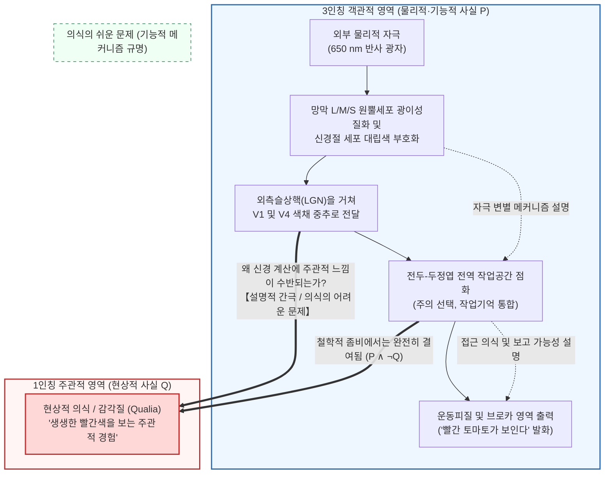
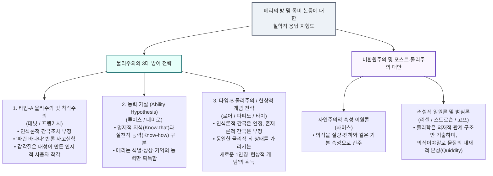

## 1. 서론: 파장 $\lambda = 650\,\text{nm}$ 의 전자기파와 '타오르는 붉음' 사이의 심연

우리가 잘 익은 빨간 토마토를 바라볼 때, 거기에는 두 가지 완전히 다른 기술(description)의 차원이 존재합니다.

첫 번째는 <strong>3인칭적·객관적인 자연과학의 기술</strong>입니다. 토마토 표피의 리코펜 색소가 단파장·중파장 빛을 흡수하고 파장 $\lambda \approx 650\,\text{nm}$ 부근의 장파장 전자기파를 반사합니다. 이 광자가 망막의 장파장 민감 원뿔세포(L-원뿔세포, $\lambda_{\max} \approx 560\,\text{nm}$)에 도달하면 11-시스-레티날이 올-트랜스-레티날로 광이성질화되며, 트랜스듀신과 포스포디에스테라제(PDE)를 활성화해 $\text{cGMP}$를 가수분해하고 세포막을 과분극시킵니다. 이 신호는 망막 신경절 세포의 대립색 채널($L - M$, $S - (L + M)$)과 외측슬상핵(LGN)을 거쳐 1차 시각피질(V1) 및 <strong>제4시각영역(V4, 색채 항상성 중추)</strong>의 $40\,\text{Hz}$ 감마파 동기화 발화를 유도하고, 최종적으로 브로카 영역을 자극해 "이 토마토는 빨갛다"라는 발화를 생성합니다.

그러나 두 번째 차원, 즉 <strong>1인칭적·주관적인 경험의 기술</strong>이 존재합니다. 맥스웰 방정식과 호지킨-헉슬리(Hodgkin-Huxley) 신경막 전위 방정식을 아무리 완벽하게 나열해도, 그 수식 어디에도 우리가 토마토를 볼 때 생생하게 느끼는 <strong>'그 강렬하고 타오르는 듯한 빨간색의 주관적 질감'</strong>은 등장하지 않습니다.

현대 심리철학(Philosophy of Mind)과 인지과학에서 이러한 주관적 경험의 질적 성질을 <strong>감각질(Qualia, 단수형 Quale)</strong> 또는 <strong>현상적 의식(Phenomenal Consciousness)</strong>이라고 부릅니다. 만약 인류가 뇌의 모든 물리적·신경생물학적 법칙을 남김없이 밝혀낸다면, 왜 특정 신경 발화가 '어둠(무감각)'이 아니라 '빨간색을 보는 느낌'이나 '날카로운 치통'을 수반하는지도 저절로 설명될까요?

이 글에서는 현대 심리철학에서 물리주의(Physicalism)를 위협하는 <strong>3대 반물리주의 논증</strong>—토머스 네이글의 "박쥐가 된다는 것은 어떤 것인가?"(1974), 프랭크 잭슨의 "메리의 방(지식 논증)"(1982/1986), 조지프 레빈의 "설명적 간극"(1983)과 데이비드 차머스의 "의식의 어려운 문제 및 철학적 좀비 논증"(1995/1996)—을 엄밀하게 재구성합니다. 이어서 물리주의 진영의 3대 반격(착각주의, 능력 가설, 현상적 개념 전략)과 현대의 최전선인 <strong>러셀적 일원론(범심론)</strong>, <strong>전역 신경 작업공간 이론(GNWT)</strong>, 줄리오 토노니의 <strong>통합정보이론(IIT)</strong>을 심층 탐구합니다.

---

## 2. 감각질(Qualia)과 현상적 의식의 엄밀한 정의

### 2.1 C.I. 루이스에서 네드 블록으로: 현상적 의식과 접근 의식

<strong>감각질(Qualia)</strong>이라는 용어는 1929년 미국의 철학자 <strong>클래런스 어빙 루이스(C.I. Lewis)</strong>가 『마음과 세계 질서』(*Mind and the World Order*)에서 직접적 경험에 주어진 반복 가능한 질적 성격을 지칭하기 위해 처음 도입했습니다.

1995년 철학자 <strong>네드 블록(Ned Block)</strong>은 역사적인 논문에서 우리가 흔히 '의식'이라 부르는 개념이 사실은 두 가지 전혀 다른 개념의 혼동임을 밝혔습니다.
1. <strong>현상적 의식(Phenomenal Consciousness / P-Consciousness)</strong>: 경험의 주관적·1인칭적 질감, 즉 그 상태에 있는 것이 주체에게 <strong>'어떤 느낌인가(What it is like)'</strong>를 뜻하며 감각질로 구성됩니다.
2. <strong>접근 의식(Access Consciousness / A-Consciousness)</strong>: 어떤 심적 표상이 추론, 의사결정, 행동 통제 및 언어적 보고(Verbal report)에 기능적으로 자유롭게 이용 가능한 정보 처리 상태를 뜻합니다.

또한 대니얼 데닛(1988)은 고전적 감각질의 4대 특징을 <strong>언어화 불가능성(Ineffability)</strong>, <strong>내재성(Intrinsicness)</strong>, <strong>사밀성(Privateness)</strong>, <strong>의식에서의 직접적 파악 가능성(Immediate Apprehensibility)</strong>으로 정리했습니다. 로크(1689)와 슈메이커(Shoemaker, 1982)의 <strong>'전도된 스펙트럼(Inverted Spectrum)'</strong> 사고실험이 보여주듯, 두 사람이 모든 색채 식별 검사와 언어 행동(기능적 역할)에서 100% 동일하더라도 내면에서 느끼는 빨강과 초록의 감각질($Q_{\text{red}} \leftrightarrow Q_{\text{green}}$)이 서로 뒤바뀌어 있을 가능성은 논리적으로 아무런 모순이 없습니다.

---

## 3. 반물리주의의 3대 기둥

### 3.1 제1기둥: 토머스 네이글 "박쥐가 된다는 것은 어떤 것인가?" (1974)

<strong>토머스 네이글(Thomas Nagel)</strong>은 1974년 논문 *"What Is It Like to Be a Bat?"*에서 의식 경험의 본질을 다음과 같이 정의했습니다.

> "근본적으로 한 유기체가 의식적 심적 상태를 갖는다는 것은, <strong>그 유기체가 된다는 것이 어떤 것인가(what it is like to be that organism)</strong>—즉 <strong>그 유기체 자신에게</strong> 어떤 것인가—하는 무언가가 존재한다는 뜻이다."

박쥐(소익수아목)는 후두에서 $20\,\text{kHz} \sim 120\,\text{kHz}$의 초음파 펄스를 발사하고 반향음의 시간 지연 $\Delta t$(거리 $r = c\Delta t/2$)와 도플러 편이 $\Delta f$(상대 속도)를 분석하는 <strong>반향정위(Echolocation / 소나)</strong>로 3차원 공간을 지각합니다. 네이글은 우리가 박쥐처럼 어둠 속에서 거꾸로 매달려 날아다니는 상상을 해보았자, 그것은 단지 <strong>'인간인 내가 박쥐처럼 행동한다면 나에게 어떤 느낌일까'</strong>를 상상하는 것일 뿐, <strong>'박쥐에게 박쥐가 된다는 것이 어떤 느낌인가'</strong>라는 1인칭 주관적 감각질에는 결코 도달할 수 없음을 지적했습니다.

더 나아가 네이글은 <strong>객관적 환원 방법론의 구조적 한계</strong>를 폭로했습니다. 물리학이 '열'을 분자의 평균 운동에너지 $\langle E_k \rangle = \frac{3}{2} k_B T$로 성공적으로 환원할 수 있었던 이유는 특정 관찰자의 주관적 관점을 제거하고 제3자적 객관성으로 이동했기 때문입니다. 그러나 의식 경험의 본질은 바로 <strong>특정한 주관적 관점 그 자체</strong>에 있습니다. 객관성을 얻기 위해 주관적 관점을 빼버리는 순간, 과학은 현상을 설명한 것이 아니라 설명해야 할 대상 자체를 버린 셈이 됩니다.

### 3.2 제2기둥: 프랭크 잭슨의 "메리의 방(지식 논증)" (1982 / 1986)

호주의 철학자 <strong>프랭크 잭슨(Frank Jackson)</strong>은 <strong>'메리의 방(Mary's Room)'</strong> 사고실험을 통해 물리주의를 논박하는 <strong>지식 논증(The Knowledge Argument)</strong>을 정식화했습니다.

천재 신경과학자 메리는 태어날 때부터 오직 흑백과 회색 농담만 존재하는 방에서 자랐습니다. 그녀는 흑백 모니터와 흑백 서적을 통해 인간 색각에 관한 <strong>모든 물리적·화학적·신경과학적·기능적 사실의 집합 $\mathcal{P}$</strong>를 완벽히 습득했습니다. 어느 날 방에서 풀려난 메리가 세상에 나와 생애 처음으로 <strong>잘 익은 빨간 토마토</strong>를 직접 보았을 때, 그녀는 새로운 것을 배웠을까요?

직관적으로 그녀는 분명 새로운 사실 $Q$(빨간색을 보는 것이 어떤 느낌인가)를 배웠습니다! 이를 연역적으로 정식화하면 다음과 같습니다:

1. <strong>전제 1 (석방 전 물리적 지식의 완전성)</strong>: 석방 전($t_{\text{before}}$), 메리는 색각에 관한 모든 물리적 사실 $\mathcal{P}$를 알고 있다.
   $$\forall p \in \mathcal{P}, \quad K_{\text{before}}(\text{Mary}, p)$$
2. <strong>전제 2 (석방 후 새로운 사실의 습득)</strong>: 석방 후($t_{\text{after}}$), 메리는 이전에는 몰랐던 새로운 사실 $Q$를 배운다.
   $$\exists Q \quad \text{s.t.} \quad \neg K_{\text{before}}(\text{Mary}, Q) \land K_{\text{after}}(\text{Mary}, Q)$$
3. <strong>결론 1 (비물리적 사실의 존재)</strong>: 라이프니츠 법칙(동일자 식별불가능성 원리)에 의해 $Q \notin \mathcal{P}$이다.
4. <strong>결론 2 (물리주의의 거짓)</strong>: 모든 사실이 물리적 사실이라는 물리주의($\mathcal{F}_{\text{world}} \subseteq \mathcal{P}$)는 <strong>거짓이다</strong>!

흥미롭게도 1982년 당시에는 <strong>부수현상론(Epiphenomenalism: 뇌 상태가 감각질을 생성하지만 감각질은 물리 세계에 아무런 인과적 힘을 미치지 못한다는 입장)</strong>을 옹호했던 잭슨 자신이, 2003년에는 부수현상론의 인식론적 역설을 깨닫고 물리주의 진영의 <strong>표상주의(Representationalism)</strong>로 극적인 전향을 선언했습니다.

### 3.3 제3기둥: 설명적 간극, 의식의 어려운 문제, 그리고 철학적 좀비 (1983 / 1995 / 1996)

<strong>조지프 레빈(Joseph Levine, 1983)</strong>은 물리적 뇌 상태와 감각질 사이에 메울 수 없는 <strong>'설명적 간극(Explanatory Gap)'</strong>이 존재함을 지적했습니다. 이어 <strong>데이비드 차머스(David Chalmers, 1995/1996)</strong>는 의식 연구를 <strong>'쉬운 문제(Easy Problems)'</strong>와 <strong>'어려운 문제(The Hard Problem)'</strong>로 엄격히 구분했습니다.

| 비교 기준 | 의식의 쉬운 문제 (Easy Problems) | 의식의 어려운 문제 (The Hard Problem) |
| :--- | :--- | :--- |
| <strong>핵심 질문</strong> | 뇌는 어떻게 자극을 구별하고, 정보를 통합하며, 행동을 제어하고 언어적으로 보고하는가? | <strong>왜, 그리고 어떻게 그러한 모든 물리적·계산적 정보 처리에 '주관적 경험(내면의 영화관)'이 수반되는가?</strong> |
| <strong>개념적 대상</strong> | <strong>접근 의식 및 인지적 기능 메커니즘</strong> (Access Consciousness) | <strong>현상적 의식 및 감각질</strong> (Phenomenal Consciousness / Qualia) |
| <strong>환원적 설명 가능성</strong> | <strong>원리적으로 해결 가능</strong>: 해당 기능을 수행하는 신경회로나 알고리즘을 규명하면 해결됨. | <strong>표준적 기능 환원 불가능</strong>: 모든 인지 기능을 100% 설명해도 '왜 거기에 주관적 느낌이 동반되는가'라는 질문이 그대로 남음. |

차머스는 <strong>'철학적 좀비(Philosophical Zombies)'</strong>를 이용한 <strong>상상 가능성 논증(Conceivability Argument)</strong>을 통해 인식론적 간극을 존재론적 논박으로 전환합니다:
- <strong>전제 1 (이상적 상상 가능성)</strong>: 우리 세계와 분자 단위까지 미시물리적으로 100% 동일하고($\mathcal{P}$) 똑같이 행동하지만, 내면의 의식 경험만 완전히 결여된($\neg Q$) <strong>철학적 좀비 세계 $W_{\text{zombie}}$($\mathcal{P} \land \neg Q$)</strong>는 논리적 모순 없이 이상적으로 상상 가능하다.
- <strong>전제 2 (양상적 다리)</strong>: $\mathcal{P} \land \neg Q$가 이상적으로 상상 가능하다면, 그것은 형이상학적으로 가능하다($\Diamond(\mathcal{P} \land \neg Q)$).
- <strong>결론 (물리주의의 반박)</strong>: $\Diamond(\mathcal{P} \land \neg Q)$이므로 물리적 사실 $\mathcal{P}$는 현상적 사실 $Q$를 형이상학적으로 필연화하지 못한다($\neg \Box(\mathcal{P} \to Q)$). 따라서 물리주의는 거짓이다!

크립키(Kripke, 1980)의 후험적 필연성 반론("물 ＝ $\text{H}_2\text{O}$"처럼 의식도 후험적 필연성이 아니냐는 반론)에 대해, 차머스는 <strong>2차원 양상 의미론(Two-Dimensional Modal Semantics)</strong>으로 답합니다. '물'은 1차 내포(투명한 액체라는 외양)와 2차 내포($\text{H}_2\text{O}$라는 본질)가 분리될 수 있지만, '고통'이나 '감각질 $Q$'는 <strong>고통스럽게 느껴지는 외양(1차 내포)이 곧 고통이라는 본질(2차 내포) 그 자체($I_1(Q) = I_2(Q)$)</strong>이므로, 1차 상상 가능성은 곧바로 형이상학적 가능성 $\Diamond(\mathcal{P} \land \neg Q)$을 함의합니다.

---

## 4. 물리주의 진영의 3대 반격 전략

1. <strong>타입-A 물리주의 및 착각주의(Type-A Physicalism & Illusionism — 데닛 Dennett 1991, 프랭키시 Frankish 2016)</strong>:
   데닛은 <strong>'파란 바나나(Blue Banana)'</strong> 사고실험을 통해, 만약 메리가 정말로 <strong>모든</strong> 물리적 사실을 안다면 파랗게 칠한 바나나를 보자마자 자신의 V4 신경 반응 성향을 파악해 속임수를 즉시 간파할 것이라고 주장합니다. 프랭키시의 <strong>착각주의</strong>는 감각질이 내성(Introspection) 메커니즘이 복잡한 신경 반응 성향을 단순화해 표상하는 <strong>인지적 사용자 착각(User-illusion)</strong>일 뿐이라고 봅니다.
2. <strong>능력 가설(The Ability Hypothesis — 네미로 Nemirow 1980, 데이비드 루이스 David Lewis 1988)</strong>:
   루이스는 <strong>명제적 지식(Knowing-that)</strong>과 <strong>실천적 능력(Knowing-how, 자전거 타는 법 등)</strong>을 구분합니다. 메리가 방을 나와 토마토를 보았을 때 얻은 것은 새로운 명제적 사실 $Q$가 아니라, 빨간색을 <strong>재인식(recognize)하고, 상상(imagine)하고, 기억(remember)하는 실천적 능력(Know-how)</strong>뿐이라는 것입니다.
3. <strong>현상적 개념 전략 / 타입-B 물리주의(The Phenomenal Concept Strategy / Type-B Physicalism — 로어 Loar 1990, 파피노 Papineau 2002)</strong>:
   프레게의 <strong>'뜻(Sinn/개념)'과 '지시체(Bedeutung/대상)'의 구분</strong>("샛별 ＝ 개밥바라기별 ＝ 금성")을 적용합니다. 존재론적으로는 'V4 영역의 신경 발화 $N_{\text{red}}$'라는 단 하나의 물리적 상태만 존재합니다($Q = N_{\text{red}}$). 메리는 방 안에서 3인칭적인 <strong>이론적·물리적 개념($C_{\text{phys}}$)</strong>으로 그 뇌 상태를 알고 있었고, 방을 나와 직접 자신의 V4 영역을 활성화시킴으로써 <strong>동일한 물리적 뇌 상태를 가리키는 새로운 1인칭적 '현상적 개념(Phenomenal Concept, $C_{\text{phen}}$)'</strong>을 획득한 것입니다!

| 철학적 입장 | 대표 학자 | 인식론적 간극 (메리의 놀람 / 좀비 상상 가능성) | 존재론적 간극 (비물리적 속성의 실재) | 감각질(Qualia)에 관한 핵심 테제 |
| :--- | :--- | :--- | :--- | :--- |
| <strong>타입-A 물리주의 / 착각주의</strong> | 데닛, 프랭키시 | <strong>부정</strong> (완전한 물리 지식 하에서 소멸) | <strong>부정</strong> (물리적 기능만 존재) | 감각질은 내성 시스템이 만들어낸 <strong>인지적 사용자 착각</strong>이다. |
| <strong>능력 가설</strong> | 데이비드 루이스, 네미로 | <strong>재해석</strong> (명제적 간극이 아닌 실천적 숙련) | <strong>부정</strong> (물리적 사실만 존재) | 메리는 새로운 사실(Know-that)이 아니라 식별·상상·기억의 <strong>실천적 능력(Know-how)</strong>을 얻었다. |
| <strong>타입-B 물리주의 (현상적 개념 전략)</strong> | 로어, 파피노, 타이 | <strong>인정</strong> ($C_{\text{phys}}$에서 $C_{\text{phen}}$은 선험적으로 도출 불가) | <strong>부정</strong> (두 개념은 동일한 물리적 뇌 상태를 지시) | 메리는 기존의 물리적 뇌 상태를 지시하는 <strong>새로운 1인칭 '현상적 개념'</strong>을 획득했다. |
| <strong>자연주의적 속성 이원론</strong> | 차머스 | <strong>인정</strong> | <strong>인정</strong> (환원 불가능한 현상적 속성 실재) | 의식은 질량·전하·시공간과 나란한 우주의 <strong>기본적 속성</strong>이다. |
| <strong>러셀적 일원론 / 범심론</strong> | 러셀, 스트로슨, 고프 | <strong>인정</strong> (구조 방정식은 내재적 본성을 누락함) | <strong>일원론적 통합</strong> (물질의 내재적 본성이 곧 의식) | 물리학은 물질의 <strong>외재적 관계 구조</strong>만 기술하며, 의식은 물질의 <strong>내재적 본성(Quiddity)</strong>이다. |

---

## 5. 현대의 최전선: 러셀적 일원론, 전역 작업공간(GNWT), 그리고 통합정보이론(IIT)

### 5.1 러셀적 일원론과 범심론 (Russellian Monism & Panpsychism)

<strong>버트런드 러셀(Bertrand Russell, 1927)</strong>, 에딩턴(Eddington, 1928), 그리고 현대의 <strong>갤런 스트로슨(Galen Strawson, 2006)</strong>과 <strong>필립 고프(Philip Goff, 2017)</strong>는 물리학이 질량이나 전하를 오직 <strong>외재적·관계적·인과적 구조(Extrinsic relational structure)</strong>로만 정의할 뿐, 물질이 그 자체로서 가지는 <strong>내재적·범주적 본성(Intrinsic categorical nature / Quiddity)</strong>에 대해서는 완전히 침묵하고 있음을 밝혀냈습니다. 그리고 우주에서 우리가 그 내재적 본성을 안에서부터 직접 경험하는 유일한 물리계가 바로 우리 자신의 뇌—즉 <strong>현상적 의식(감각질)</strong>—입니다! 따라서 의식(또는 원초적 의식)이야말로 물리적 물질의 내재적 본성 그 자체라는 것이 <strong>러셀적 일원론</strong>입니다(다만 미시적 경험들이 어떻게 하나의 거시적 주체로 합쳐지는가 하는 <strong>'결합 문제 Combination Problem'</strong>가 핵심 과제로 남습니다).

### 5.2 전역 신경 작업공간 이론(GNWT)과 통합정보이론(IIT)

1. <strong>전역 신경 작업공간 이론(GNWT — 드하네 Dehaene & Changeux, 2011)</strong>:
   감각 모듈의 국소적 정보가 비선형 임계치를 넘어 <strong>전두-두정엽 장거리 네트워크의 '전역적 점화(Global Ignition, 자극 후 약 $300\,\text{ms}$의 P3b 파형)'</strong>를 일으키고 뇌 전체의 작업공간으로 브로드캐스트될 때 의식적 접근이 이루어진다고 설명합니다.
2. <strong>통합정보이론(Integrated Information Theory, IIT 3.0 / 4.0 — 토노니 Giulio Tononi, 2004, 2014, 2023)</strong>:
   토노니는 뇌에서 의식을 짜내는 대신, <strong>의식 경험 자체의 5대 현상학적 공리(내재적 존재 Intrinsic Existence, 조성 Composition, 정보 Information, 통합 Integration, 배타성 Exclusion)</strong>에서 출발하여 이를 물리적 인과 시스템의 5대 공준으로 번역합니다.
   상태 전이 확률 행렬(TPM)로 기술되는 시스템 $S$가 상태 $S_t$에 있을 때 생성하는 <strong>통합정보량 $\Phi$(Integrated Information)</strong>는, 시스템의 가장 취약한 연결고리인 <strong>최소정보분할(Minimum Information Partition, MIP)</strong> $\pi$를 따라 인과 결합을 절단했을 때 손실되는 인과 레퍼토리의 거리($D$)로 정의됩니다:
   $$\Phi(S_t) = \min_{\pi \in \mathcal{P}_{\text{MIP}}} D\!\left( p\bigl(S_{t \pm 1} \mid S_t\bigr) \;\middle\|\; \prod_{k \in \pi} p\bigl(S_{t \pm 1}^{(k)} \mid S_t^{(k)}\bigr) \right)$$
   - <strong>소뇌의 역설 해결</strong>: 인간 뇌 뉴런의 80%(약 690억 개)가 몰려 있는 <strong>소뇌(Cerebellum)</strong>가 손상되어도 의식이 사라지지 않는 이유는, 소뇌 회로가 상호 재귀적(Recurrent) 루프가 없는 독립적 병렬 피드포워드 모듈들로 이루어져 있어 $\Phi \approx 0$이기 때문입니다. 반면 대뇌피질-시상계는 높은 $\Phi^{\max}$를 가집니다.
   - <strong>순수 피드포워드 AI의 무의식성</strong>: 피드백 루프가 없는 순수 피드포워드 신경망은 수학적으로 항상 <strong>$\Phi = 0$</strong>입니다. 즉, 인간과 똑같은 기능적 입출력을 수행하는 거대 AI라 할지라도 그 물리적 인과 토폴로지가 피드포워드 구조라면 내면에 감각질이 전혀 없는 완벽한 디지털 철학적 좀비라는 결론이 도출됩니다.

---

## 6. 결론

<strong>"색에 관한 모든 물리 법칙을 다 안다면, 빨간색을 보는 경험도 알 수 있을까?"</strong>
메리의 방과 철학적 좀비는 제3자적 구조 방정식 $\mathcal{P}$만으로는 1인칭적 감각질 $Q$를 선험적으로 연역할 수 없음을 증명했습니다. 이를 <strong>현상적 개념 전략(타입-B 물리주의)</strong>처럼 동일한 뇌 상태에 대한 3인칭 이론적 개념과 1인칭 현상적 개념의 이중성으로 해명하든, <strong>러셀적 일원론과 통합정보이론(IIT)</strong>처럼 물리학의 관계적 골격을 안에서부터 채우고 있는 내재적 인과 구조($\Phi^{\max}$) 그 자체로 파악하든, 잘 익은 토마토의 타오르는 붉음은 물리적 우주가 그 자신의 존재를 '안에서부터' 비추어내는 가장 경이로운 현장입니다.
