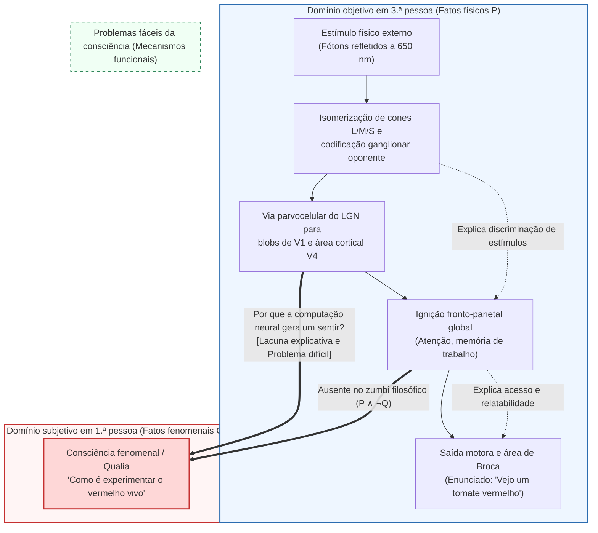
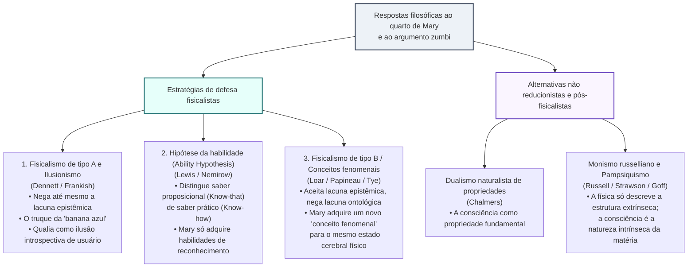

## 1. Introdução: O abismo entre a radiação eletromagnética de $\lambda = 650\,\text{nm}$ e o brilho subjetivo do vermelho

Quando contemplamos um tomate maduro sob o sol do fim da tarde, esse encontro pode ser descrito em dois níveis radicalmente distintos.

O primeiro é a <strong>descrição objetiva em terceira pessoa das ciências naturais</strong>: os pigmentos carotenoides (licopeno) da casca do tomate absorvem comprimentos de onda curtos e médios e refletem seletivamente ondas eletromagnéticas em torno de $\lambda \approx 650\,\text{nm}$. Esses fótons atravessam a córnea e o cristalino até atingir a retina, onde são absorvidos pelos fotorreceptores de cone sensíveis a ondas longas (cones L, $\lambda_{\max} \approx 560\,\text{nm}$), provocando a fotoisomerização do 11-cis-retinal em todo-trans-retinal. Por meio da transducina e da fosfodiesterase (PDE), o $\text{cGMP}$ é hidrolisado, fechando os canais catiônicos e hiperpolarizando a membrana do fotorreceptor. O sinal é codificado pelos canais de processos oponentes ($L - M$ e $S - (L + M)$) nas células ganglionares da retina, passa pelas camadas parvocelulares do núcleo geniculado lateral (LGN) até o córtex visual primário (V1) e atinge a <strong>área visual V4</strong> (centro cortical da constância da cor), antes de recrutar redes fronto-parietais e a área de Broca para produzir a frase: *«Esse tomate é de um vermelho vivo»*.

Contudo, existe um segundo nível: o <strong>caráter subjetivo da experiência consciente em primeira pessoa</strong>. Por mais exaustivamente que escrevamos as equações de Maxwell ou as equações diferenciais de Hodgkin-Huxley dos potenciais de ação, nada nessas fórmulas menciona <strong>a qualidade vívida e ardente da vermelhidão</strong> que experimentamos diretamente em nosso campo visual.

Na filosofia da mente (Philosophy of Mind) e na ciência cognitiva contemporâneas, essas propriedades qualitativas intrínsecas da experiência são chamadas de <strong>qualia</strong> (singular: *quale*) ou <strong>consciência fenomenal</strong>. Este artigo reconstrói os <strong>três pilares do antifisicalismo</strong>: o morcego de Thomas Nagel (1974), o argumento do conhecimento de Frank Jackson («o quarto de Mary», 1982/1986), e a lacuna explicativa de Joseph Levine (1983) juntamente com o «problema difícil da consciência» (Hard Problem) e o argumento dos zumbis filosóficos de David Chalmers (1995/1996). Em seguida, examinamos as três grandes contraofensivas fisicalistas (ilusionismo, hipótese da habilidade e estratégia dos conceitos fenomenais) e exploramos a fronteira atual: o <strong>monismo russelliano (pampsiquismo)</strong>, a <strong>teoria do espaço de trabalho neuronal global (GNWT)</strong> e a <strong>teoria da informação integrada (IIT)</strong> de Giulio Tononi.

---

## 2. Definição rigorosa de qualia e consciência fenomenal

Introduzido em seu sentido analítico moderno por <strong>Clarence Irving Lewis</strong> em 1929 (*Mind and the World Order*), o termo <strong>qualia</strong> foi elucidado em 1995 por <strong>Ned Block</strong> ao distinguir dois conceitos frequentemente confundidos:
1. <strong>Consciência fenomenal (P-Consciousness)</strong>: O caráter experiencial, qualitativo e em primeira pessoa de um estado mental — <strong>como é (what it is like)</strong> estar nesse estado.
2. <strong>Consciência de acesso (Access Consciousness / A-Consciousness)</strong>: Uma propriedade funcional de processamento de informação na qual uma representação mental está disponível globalmente para o raciocínio, o controle motor e o relato verbal.

Daniel Dennett (1988) resumiu as quatro características clássicas atribuídas aos qualia: <strong>inefabilidade</strong>, <strong>caráter intrínseco</strong>, <strong>privacidade</strong> e <strong>apreensão direta e imediata na consciência</strong>. O experimento mental do <strong>espectro invertido (Inverted Spectrum)</strong> (Locke 1689; Shoemaker 1982) demonstra que dois indivíduos podem ser funcional e comportamentalmente isomórficos em 100%, enquanto seus qualia internos para o vermelho e o verde estão simetricamente invertidos ($Q_{\text{red}} \leftrightarrow Q_{\text{green}}$), provando que os qualia não se reduzem ao seu mero papel funcional.

---

## 3. Os três pilares do antifisicalismo

### 3.1 Pilar I: *«Como é ser um morcego?»* de Thomas Nagel (1974)

Em seu célebre artigo de 1974 (*What Is It Like to Be a Bat?*), <strong>Thomas Nagel</strong> estabeleceu o critério canônico da consciência:

> «Fundamentalmente, um organismo tem estados mentais conscientes se e somente se há <strong>algo que é como ser esse organismo</strong> — algo que é como <strong>para</strong> o organismo.»

Os morcegos microquirópteros navegam na escuridão por <strong>ecolocalização (sonar biológico)</strong>, emitindo pulsos ultrassônicos ($20\text{--}120\,\text{kHz}$) e calculando a distância $r = c\Delta t/2$ a partir do atraso temporal do eco $\Delta t$ e a velocidade relativa pelo deslocamento Doppler $\Delta f$. Quando tentamos imaginar como é ser um morcego pendurado de cabeça para baixo em uma caverna, apenas imaginamos <strong>como seria *para nós* (humanos) nos comportarmos como um morcego</strong>, mas somos incapazes de conceber <strong>como é *para um morcego* ser um morcego</strong>.

O diagnóstico mais profundo de Nagel aponta para o <strong>paradoxo da redução objetiva</strong>: enquanto a física reduz o «calor» à energia cinética molecular média $\langle E_k \rangle = \frac{3}{2} k_B T$ eliminando o ponto de vista subjetivo do observador, a própria essência da experiência consciente reside *nesse* ponto de vista subjetivo. Se subtrairmos a perspectiva de primeira pessoa para obter uma descrição neurofisiológica em terceira pessoa, não reduzimos a experiência: simplesmente abandonamos o fenômeno que pretendíamos explicar!

### 3.2 Pilar II: O argumento do conhecimento de Frank Jackson («O quarto de Mary», 1982 / 1986)

O filósofo australiano <strong>Frank Jackson</strong> nos apresenta <strong>Mary</strong>, uma brilhante neurocientista criada desde o nascimento em um <strong>quarto estritamente preto e branco</strong>. Por meio de livros e monitores monocromáticos, Mary aprende <strong>absolutamente todos os fatos físicos, neurobiológicos e funcionais $\mathcal{P}$</strong> sobre a visão humana de cores. Um dia, Mary sai para o jardim e vê pela primeira vez um <strong>tomate vermelho maduro</strong>. Ela aprende algo novo?

O <strong>argumento do conhecimento (Knowledge Argument)</strong> é formalizado dedutivamente assim:
1. <strong>Premissa 1 (Completude do conhecimento físico antes da saída)</strong>: Antes de sua libertação ($t_{\text{before}}$), Mary conhece todos os fatos físicos $\mathcal{P}$:
   $$\forall p \in \mathcal{P}, \quad K_{\text{before}}(\text{Mary}, p)$$
2. <strong>Premissa 2 (Aquisição de um fato novo ao sair)</strong>: Ao ver o tomate em $t_{\text{after}}$, Mary aprende um fato genuinamente novo $Q$ (como é ver o vermelho):
   $$\exists Q \quad \text{tal que} \quad \neg K_{\text{before}}(\text{Mary}, Q) \land K_{\text{after}}(\text{Mary}, Q)$$
3. <strong>Conclusão 1 (Existência de fatos não físicos)</strong>: Pela lei de Leibniz, $Q \notin \mathcal{P}$.
4. <strong>Conclusão 2 (Falsidade do fisicalismo)</strong>: Como nem todos os fatos do mundo são físicos ($\mathcal{F}_{\text{world}} \not\subseteq \mathcal{P}$), <strong>o fisicalismo é falso!</strong>

(Vale notar que Jackson defendeu em 1982 o <strong>epifenomenalismo</strong>, mas em 2003 renunciou à sua própria conclusão antifisicalista e converteu-se ao <strong>representacionalismo</strong> fisicalista devido ao paradoxo de que qualia causalmente inertes não poderiam causar que Mary exclame *«Então é assim que é o vermelho!»*).

### 3.3 Pilar III: A lacuna explicativa, o «problema difícil» e os zumbis filosóficos (1983 / 1995 / 1996)

<strong>Joseph Levine (1983)</strong> formulou a <strong>lacuna explicativa (Explanatory Gap)</strong>, e <strong>David Chalmers (1995/1996)</strong> traçou a distinção entre os <strong>«problemas fáceis» (Easy Problems)</strong> e o <strong>«problema difícil da consciência» (The Hard Problem)</strong>:

| Dimensão comparativa | Os problemas fáceis (Easy Problems) | O problema difícil (The Hard Problem) |
| :--- | :--- | :--- |
| <strong>Questão central</strong> | Como o cérebro discrimina estímulos, integra informações, controla a atenção e emite relatos verbais? | <strong>Por que e como todo esse processamento físico de informação é acompanhado por uma experiência subjetiva interna?</strong> |
| <strong>Alvo conceitual</strong> | <strong>Consciência de acesso e mecanismos funcionais</strong> (Access Consciousness) | <strong>Consciência fenomenal / Qualia</strong> (Phenomenal Consciousness) |
| <strong>Redução funcional</strong> | <strong>Totalmente solúvel em princípio</strong> especificando o circuito neural ou algoritmo. | <strong>Resistente à redução funcional</strong>: mesmo explicadas todas as funções, persiste a questão de por que há experiência subjetiva. |

O <strong>argumento da concebibilidade (Conceivability Argument)</strong> de Chalmers apela aos <strong>zumbis filosóficos</strong> — seres fisicamente idênticos a nós molécula por molécula ($\mathcal{P}$), mas completamente desprovidos de experiência consciente ($\neg Q$):
1. <strong>Premissa 1</strong>: Um mundo zumbi ($\mathcal{P} \land \neg Q$) é idealmente concebível sem contradição a priori.
2. <strong>Premissa 2</strong>: A concebibilidade ideal implica possibilidade metafísica ($\Diamond(\mathcal{P} \land \neg Q)$).
3. <strong>Conclusão</strong>: Portanto, $\mathcal{P}$ não necessita metafisicamente de $Q$ ($\neg \Box(\mathcal{P} \to Q)$), refutando o materialismo!

Diante da objeção da necessidade a posteriori de Saul Kripke (*«Água = $\text{H}_2\text{O}$»*), a <strong>semântica modal bidimensional (2D Modal Semantics)</strong> de Chalmers demonstra que, enquanto na «água» a intensão primária (líquido transparente potável) e a intensão secundária ($\text{H}_2\text{O}$) podem se separar, na «dor» ou no «quale vermelho $Q$» <strong>a aparência subjetiva (intensão primária) e a essência (intensão secundária) coincidem estritamente ($I_1(Q) = I_2(Q)$)</strong>, de modo que a concebibilidade primária garante diretamente a possibilidade metafísica $\Diamond(\mathcal{P} \land \neg Q)$.

---

## 4. As três contraofensivas fisicalistas

1. <strong>Fisicalismo de tipo A e Ilusionismo (Dennett 1991, Frankish 2016)</strong>:
   Com o experimento mental da <strong>«banana azul» (Blue Banana)</strong>, Dennett sustenta que se Mary *realmente* conhece todos os fatos físicos, ao ver uma banana pintada de azul detectará imediatamente a disposição reativa de seu córtex V4 e descobrirá o truque. O <strong>ilusionismo</strong> de Keith Frankish afirma que os qualia são uma <strong>ilusão de usuário (user-illusion)</strong> gerada pelo automonitoramento introspectivo.
2. <strong>A hipótese da habilidade (The Ability Hypothesis — Nemirow 1980, David Lewis 1988)</strong>:
   Lewis distingue entre <strong>conhecimento proposicional (*saber-que* / Know-that)</strong> e <strong>habilidade prática (*saber-como* / Know-how)</strong>. Ao sair do quarto, Mary não aprende nenhum fato proposicional novo $Q$, mas adquire as habilidades práticas de reconhecer, imaginar e lembrar o vermelho.
3. <strong>A estratégia dos conceitos fenomenais / Fisicalismo de tipo B (Loar 1990, Papineau 2002)</strong>:
   Com base na distinção de Frege entre <strong>sentido (conceito) e referência (propriedade real)</strong> («Héspero = Fósforo = Vênus»), ontologicamente o quale vermelho $Q$ é idêntico ao estado neural $N_{\text{red}}$ da área V4 ($Q = N_{\text{red}}$). Mary já conhecia esse estado mediante um <strong>conceito teórico em terceira pessoa ($C_{\text{phys}}$)</strong> e, ao ver o tomate, adquire um <strong>novo conceito fenomenal em primeira pessoa ($C_{\text{phen}}$)</strong> que refere exatamente ao *mesmo* estado físico cerebral.

| Posição filosófica | Proponentes principais | Lacuna epistêmica | Lacuna ontológica | Tese central sobre os qualia |
| :--- | :--- | :--- | :--- | :--- |
| <strong>Fisicalismo de tipo A / Ilusionismo</strong> | Dennett, Frankish | <strong>Negada</strong> | <strong>Negada</strong> | Os qualia são uma <strong>ilusão introspectiva de interface</strong>. |
| <strong>Hipótese da habilidade</strong> | D. Lewis, Nemirow | <strong>Reinterpretada</strong> (habilidade prática) | <strong>Negada</strong> | Mary não aprende um fato novo (*know-that*), mas <strong>habilidades práticas (*know-how*)</strong>. |
| <strong>Fisicalismo de tipo B (Conceitos fenomenais)</strong> | Loar, Papineau, Tye | <strong>Aceita</strong> | <strong>Negada</strong> ($C_{\text{phys}}$ e $C_{\text{phen}}$ correferem) | Mary adquire um novo <strong>conceito fenomenal</strong> em 1.ª pessoa para o mesmo estado neural. |
| <strong>Dualismo de propriedades</strong> | Chalmers | <strong>Aceita</strong> | <strong>Aceita</strong> | A consciência é uma <strong>propriedade fundamental</strong> do universo regida por leis psicofísicas. |
| <strong>Monismo russelliano / Pampsiquismo</strong> | Russell, Strawson, Goff | <strong>Aceita</strong> | <strong>Integrada em um monismo</strong> | A física só descreve a <strong>estrutura relacional extrínseca</strong>; a consciência é a <strong>natureza categórica intrínseca (quididade)</strong> da matéria. |

---

## 5. A fronteira moderna: Monismo russelliano, GNWT e Teoria da informação integrada (IIT)

1. <strong>Monismo russelliano e Pampsiquismo (Russell 1927, Eddington 1928, Strawson 2006, Goff 2017)</strong>:
   A física define propriedades como a massa $m$ ou a carga $q$ unicamente por suas <strong>estruturas relacionais e disposicionais extrínsecas</strong>, silenciando sobre a <strong>natureza categórica intrínseca (quididade)</strong> da matéria. Como o único sistema físico cuja natureza intrínseca conhecemos diretamente de dentro é o nosso próprio cérebro — na forma de <strong>consciência fenomenal</strong> —, a consciência (ou protoconsciência) é a própria natureza intrínseca da matéria física! (Seu desafio central é o <strong>problema da combinação / Combination Problem</strong> de William James).
2. <strong>Teoria do espaço de trabalho neuronal global (GNWT — Dehaene & Changeux, 2011)</strong>:
   Uma representação sensorial torna-se consciente quando supera um limiar não linear e desencadeia uma <strong>ignição global (Global Ignition, ~300 ms, onda P3b)</strong> na rede fronto-parietal de longo alcance, transmitindo (broadcasting) a informação para toda a memória de trabalho.
3. <strong>Teoria da informação integrada (IIT 3.0 / 4.0 — Giulio Tononi, 2004, 2014, 2023)</strong>:
   Partindo de <strong>cinco axiomas fenomenológicos da experiência (Existência intrínseca, Composição, Informação, Integração, Exclusão)</strong> traduzidos em postulados físicos, a IIT quantifica a consciência pela informação integrada $\Phi$ — a perda mínima de informação causal ao cortar o sistema por sua <strong>partição de informação mínima ($\text{MIP}$)</strong> $\pi$:
   $$\Phi(S_t) = \min_{\pi \in \mathcal{P}_{\text{MIP}}} D\!\left( p\bigl(S_{t \pm 1} \mid S_t\bigr) \;\middle\|\; \prod_{k \in \pi} p\bigl(S_{t \pm 1}^{(k)} \mid S_t^{(k)}\bigr) \right)$$
   - <strong>O paradoxo do cerebelo</strong>: O cerebelo (~69 bilhões de neurônios) carece de consciência ($\Phi \approx 0$) porque seus circuitos são módulos *feedforward* paralelos sem loops recorrentes, ao contrário do sistema talamocortical posterior ($\Phi^{\max}$ elevado).
   - <strong>Redes puramente *feedforward* são zumbis ($\Phi = 0$)</strong>: Toda rede neural puramente *feedforward* sem retroalimentação causal possui estritamente <strong>$\Phi = 0$</strong>, permanecendo completamente no escuro em seu interior.

---

## 6. Conclusão

O quarto de Mary e os zumbis filosóficos demonstram que nenhuma dedução a priori pode extrair a experiência subjetiva $Q$ das meras equações estruturais em terceira pessoa $\mathcal{P}$. Quer interpretemos isso pela dualidade conceitual do <strong>fisicalismo de tipo B</strong> ou como a estrutura causal intrínseca ($\Phi^{\max}$) da matéria segundo o <strong>monismo russelliano e a IIT</strong>, o vermelho ardente de um tomate nos lembra o ponto exato onde o universo deixa de ser um grafo silencioso de equações para iluminar-se a partir de dentro.
