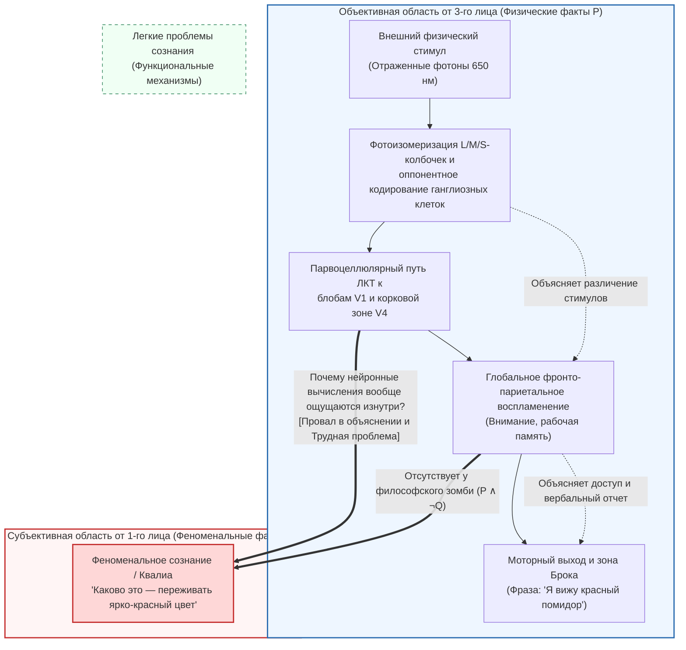
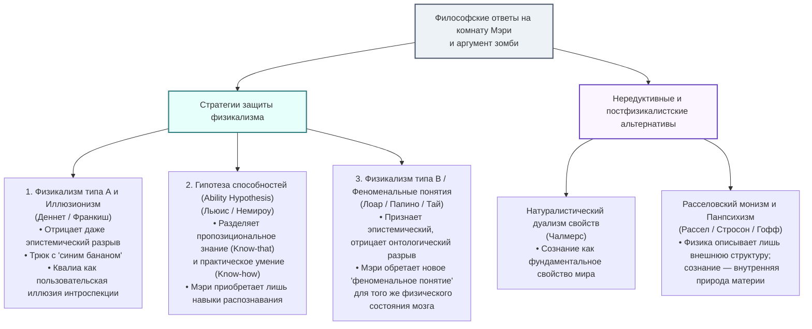

## 1. Введение: Пропасть между электромагнитным излучением $\lambda = 650\,\text{нм}$ и субъективным сиянием красного

Когда мы смотрим на спелый помидор в лучах закатного солнца, это событие можно описать на двух радикально различных уровнях.

Первый уровень — <strong>объективное описание естественных наук от третьего лица</strong>: каротиноидные пигменты (ликопин) в кожице помидора поглощают короткие и средние длины волн и избирательно отражают длинноволновое электромагнитное излучение с $\lambda \approx 650\,\text{нм}$. Эти фотоны проходят через роговицу и хрусталик, попадая на сетчатку, где поглощаются длинноволновыми колбочками (L-колбочками, $\lambda_{\max} \approx 560\,\text{нм}$), вызывая фотоизомеризацию 11-цис-ретиналя в полностью-транс-ретиналь. Через трансдуцин и фосфодиэстеразу (ФДЭ) гидролизуется $\text{цГМФ}$, закрываются катионные каналы и мембрана фоторецептора гиперполяризуется. Сигнал кодируется оппонентными каналами ($L - M$ и $S - (L + M)$) ганглиозных клеток сетчатки, проходит через парвоцеллюлярные слои латерального коленчатого тела (ЛКТ) в первичную зрительную кору (V1) и достигает <strong>зрительной зоны V4</strong> (коркового центра цветовой константности), после чего фронто-париетальные сети и зона Брока генерируют высказывание: *«Этот помидор ярко-красный»*.

Но существует и второй уровень — <strong>субъективный характер сознательного опыта от первого лица</strong>. Как бы детально мы ни выписывали уравнения Максвелла или дифференциальные уравнения Ходжкина — Хаксли для потенциалов действия, ни в одной из этих формул нет ни слова о <strong>живом, пылающем качественном переживании красноты</strong>, которое непосредственно дано нам в сознании.

В современной аналитической философии сознания (Philosophy of Mind) и когнитивной науке эти субъективные, внутренние качественные свойства опыта называются <strong>квалиа</strong> (qualia, ед. ч. *quale*) или <strong>феноменальным сознанием</strong>. В этой статье мы строго реконструируем <strong>три столпа антифизикализма</strong>: «Каково это — быть летучей мышью?» Томаса Нагеля (1974), «Аргумент знания» («Комната Мэри») Фрэнка Джексона (1982/1986), а также «Провал в объяснении» Джозефа Левина (1983) и «Трудную проблему сознания» вместе с аргументом философских зомби Дэвида Чалмерса (1995/1996). Затем мы проанализируем три главные контрстратегии физикализма (иллюзионизм, гипотезу способностей и стратегию феноменальных понятий) и обратимся к современному переднему краю: <strong>расселовскому монизму (панпсихизму)</strong>, <strong>теории глобального нейронного рабочего пространства (GNWT)</strong> и <strong>теории интегрированной информации (IIT)</strong> Джулио Тонони.

---

## 2. Строгое определение квалиа и феноменального сознания

Термин <strong>квалиа</strong> был введен в современном аналитическом смысле <strong>Кларенсом Ирвингом Льюисом</strong> в 1929 году (*Mind and the World Order*). В 1995 году философ <strong>Нед Блок</strong> провел фундаментальное различие между двумя понятиями сознания:
1. <strong>Феноменальное сознание (P-Consciousness)</strong>: субъективный, качественный характер опыта от первого лица — <strong>каково это (what it is like)</strong> переживать данное состояние.
2. <strong>Сознание доступа (Access Consciousness / A-Consciousness)</strong>: функциональное информационное состояние, при котором ментальная репрезентация глобально доступна для рассуждений, контроля поведения и вербального отчета.

Дэниел Деннет (1988) выделил четыре классических признака квалиа: <strong>невыразимость (Ineffability)</strong>, <strong>внутреннюю присущность (Intrinsicness)</strong>, <strong>приватность (Privateness)</strong> и <strong>непосредственную схватываемость в сознании (Immediate Apprehensibility)</strong>. Мысленный эксперимент <strong>«Инвертированного спектра» (Inverted Spectrum)</strong> (Локк, 1689; Шумейкер, 1982) показывает, что два человека могут быть функционально и поведенчески на 100% идентичны, в то время как их внутренние квалиа красного и зеленого симметрично поменяны местами ($Q_{\text{red}} \leftrightarrow Q_{\text{green}}$), что опровергает сводимость квалиа к функциональной роли.

---

## 3. Три столпа антифизикализма

### 3.1 Столп I: *«Каково это — быть летучей мышью?»* Томаса Нагеля (1974)

В своей знаменитой статье 1974 года (*What Is It Like to Be a Bat?*) <strong>Томас Нагель</strong> сформулировал канонический критерий сознания:

> «В фундаментальном смысле организм обладает сознательными ментальными состояниями тогда и только тогда, когда существует <strong>нечто, каково это — быть этим организмом</strong>, — нечто, каково это <strong>для самого</strong> организма».

Летучие мыши подотряда *Microchiroptera* ориентируются в темноте с помощью <strong>эхолокации (биологического сонара)</strong>, испуская ультразвуковые импульсы ($20\text{--}120\,\text{кГц}$) и вычисляя расстояние $r = c\Delta t/2$ по задержке эха $\Delta t$ и относительную скорость по доплеровскому сдвигу $\Delta f$. Пытаясь представить себя висящими вниз головой в пещере, мы представляем лишь то, <strong>каково было бы *для нас* (людей) вести себя как летучая мышь</strong>, но не способны постичь, <strong>каково это *для самой летучей мыши* — быть летучей мышью</strong>.

Главный вывод Нагеля раскрывает <strong>парадокс объективной редукции</strong>: естествознание сводит «тепло» к средней кинетической энергии молекул $\langle E_k \rangle = \frac{3}{2} k_B T$ путем устранения субъективной точки зрения наблюдателя. Однако сущность сознательного опыта заключается в *самой* субъективной точке зрения: отбрасывая перспективу первого лица ради нейрофизиологического описания от третьего лица, мы не редуцируем опыт, а просто теряем сам предмет объяснения!

### 3.2 Столп II: Аргумент знания Фрэнка Джексона («Комната Мэри», 1982 / 1986)

Австралийский философ <strong>Фрэнк Джексон</strong> предлагает мысленный эксперимент <strong>«Комната Мэри» (Mary's Room)</strong>:
Гениальная исследовательница нейрофизиологии зрения Мэри с рождения живет в <strong>строго черно-белой комнате</strong>. По черно-белым книгам и мониторам она изучила <strong>абсолютно все физические, нейробиологические и функциональные факты $\mathcal{P}$</strong> о цветовом зрении человека. Однажды двери открываются, Мэри выходит в сад и впервые видит <strong>спелый красный помидор</strong>. Узнаёт ли она что-то новое?

Дедуктивная формализация <strong>Аргумента знания (Knowledge Argument)</strong>:
1. <strong>Посылка 1 (Полнота физического знания до освобождения)</strong>: До выхода ($t_{\text{before}}$) Мэри знает все физические факты $\mathcal{P}$:
   $$\forall p \in \mathcal{P}, \quad K_{\text{before}}(\text{Mary}, p)$$
2. <strong>Посылка 2 (Приобретение нового факта после освобождения)</strong>: Увидев помидор в $t_{\text{after}}$, Мэри узнаёт новый факт $Q$ (каково это — видеть красное):
   $$\exists Q \quad \text{такой, что} \quad \neg K_{\text{before}}(\text{Mary}, Q) \land K_{\text{after}}(\text{Mary}, Q)$$
3. <strong>Вывод 1 (Существование нефизических фактов)</strong>: По закону Лейбница $Q \notin \mathcal{P}$.
4. <strong>Вывод 2 (Ложность физикализма)</strong>: Поскольку не все факты являются физическими ($\mathcal{F}_{\text{world}} \not\subseteq \mathcal{P}$), <strong>физикализм ложен!</strong>

(Примечательно, что в 1982 году Джексон защищал <strong>эпифеноменализм</strong>, но в 2003 году отказался от собственного антифизикалистского вывода и перешел на позиции физикалистского <strong>репрезентационализма</strong> из-за парадокса каузальной бессильности эпифеноменальных квалиа).

### 3.3 Столп III: Провал в объяснении, «Трудная проблема» и философские зомби (1983 / 1995 / 1996)

<strong>Джозеф Левин (1983)</strong> сформулировал понятие <strong>«провала в объяснении» (Explanatory Gap)</strong>, а <strong>Дэвид Чалмерс (1995/1996)</strong> разделил проблемы сознания на <strong>«легкие проблемы» (Easy Problems)</strong> и <strong>«трудную проблему сознания» (The Hard Problem)</strong>:

| Критерий сравнения | Легкие проблемы сознания (Easy Problems) | Трудная проблема сознания (The Hard Problem) |
| :--- | :--- | :--- |
| <strong>Центральный вопрос</strong> | Как мозг различает стимулы, интегрирует информацию, управляет вниманием и формирует вербальные отчеты? | <strong>Почему и каким образом вся эта физическая обработка информации вообще сопровождается внутренним субъективным опытом?</strong> |
| <strong>Концептуальная цель</strong> | <strong>Сознание доступа и функциональные механизмы</strong> (Access Consciousness) | <strong>Феноменальное сознание / Квалиа</strong> (Phenomenal Consciousness) |
| <strong>Применимость функциональной редукции</strong> | <strong>Принципиально разрешимы</strong> путем выявления нейронных цепей и алгоритмов. | <strong>Не поддается функциональной редукции</strong>: даже после полного объяснения всех функций вопрос о причине субъективного переживания остается открытым. |

<strong>Аргумент мыслимости (Conceivability Argument)</strong> Чалмерса опирается на <strong>философских зомби</strong> — существ, молекула за молекулой физически идентичных нам ($\mathcal{P}$), но полностью лишенных сознательного опыта ($\neg Q$):
1. <strong>Посылка 1</strong>: Мир зомби ($\mathcal{P} \land \neg Q$) идеально мыслим без априорного противоречия.
2. <strong>Посылка 2</strong>: Идеальная мыслимость влечет метафизическую возможность ($\Diamond(\mathcal{P} \land \neg Q)$).
3. <strong>Вывод</strong>: Следовательно, $\mathcal{P}$ метафизически не определяет $Q$ с необходимостью ($\neg \Box(\mathcal{P} \to Q)$), что опровергает материализм!

Против возражения апостериорной необходимости Сола Крипке (*«Вода = $\text{H}_2\text{O}$»*) <strong>двумерная модальная семантика (2D Modal Semantics)</strong> Чалмерса показывает: если у «воды» первичная интенсиональность (прозрачная питьевая жидкость) и вторичная интенсиональность ($\text{H}_2\text{O}$) могут расходиться, то у «боли» или «квалиа красного $Q$» <strong>субъективная видимость (первичная интенсиональность) и сущность (вторичная интенсиональность) строго совпадают ($I_1(Q) = I_2(Q)$)</strong>, поэтому первичная мыслимость прямо гарантирует метафизическую возможность $\Diamond(\mathcal{P} \land \neg Q)$.

---

## 4. Три контрнаступления физикализма

1. <strong>Физикализм типа А и Иллюзионизм (Деннет 1991, Франкиш 2016)</strong>:
   С помощью мысленного эксперимента <strong>«Синий банан» (Blue Banana)</strong> Деннет утверждает, что если Мэри *действительно* знает все физические факты, то при виде выкрашенного в синий цвет банана она мгновенно распознает реактивное состояние своей зоны V4 и разоблачит обман. <strong>Иллюзионизм</strong> Кита Франкиша объявляет квалиа <strong>пользовательской иллюзией (user-illusion)</strong>, создаваемой системой интроспективного самомониторинга.
2. <strong>Гипотеза способностей (The Ability Hypothesis — Немироу 1980, Дэвид Льюис 1988)</strong>:
   Льюис разделяет <strong>пропозициональное знание (*знание-что* / Know-that)</strong> и <strong>практические умения (*знание-как* / Know-how)</strong>. Выйдя из комнаты, Мэри не узнаёт никакого нового пропозиционального факта $Q$, а лишь обретает практические способности распознавать, воображать и помнить красный цвет.
3. <strong>Стратегия феноменальных понятий / Физикализм типа B (Лоар 1990, Папино 2002)</strong>:
   Опираясь на различие Фреге между <strong>смыслом (понятием) и денотатом (реальным свойством)</strong> («Геспер = Фосфор = Венера»), онтологически квалиа красного $Q$ тождественно нейронному состоянию $N_{\text{red}}$ в зоне V4 ($Q = N_{\text{red}}$). Мэри уже знала это состояние через <strong>теоретическое понятие от третьего лица ($C_{\text{phys}}$)</strong>, а увидев помидор, обретает <strong>новое феноменальное понятие от первого лица ($C_{\text{phen}}$)</strong>, указывающее на *то же самое* физическое состояние мозга!

| Философская позиция | Ключевые авторы | Эпистемический разрыв | Онтологический разрыв | Главный тезис о квалиа |
| :--- | :--- | :--- | :--- | :--- |
| <strong>Физикализм типа А / Иллюзионизм</strong> | Деннет, Франкиш | <strong>Отрицается</strong> | <strong>Отрицается</strong> | Квалиа — это <strong>интроспективная пользовательская иллюзия</strong>. |
| <strong>Гипотеза способностей</strong> | Д. Льюис, Немироу | <strong>Переосмыслен</strong> (практический навык) | <strong>Отрицается</strong> | Мэри обретает не новый факт (*know-that*), а <strong>практические умения (*know-how*)</strong>. |
| <strong>Физикализм типа B (Феноменальные понятия)</strong> | Лоар, Папино, Тай | <strong>Признается</strong> | <strong>Отрицается</strong> ($C_{\text{phys}}$ и $C_{\text{phen}}$ кореферентны) | Мэри обретает новое <strong>феноменальное понятие</strong> от 1-го лица для того же состояния мозга. |
| <strong>Дуализм свойств</strong> | Чалмерс | <strong>Признается</strong> | <strong>Признается</strong> | Сознание — <strong>фундаментальное свойство</strong> Вселенной, подчиняющееся психофизическим законам. |
| <strong>Расселовский монизм / Панпсихизм</strong> | Рассел, Стросон, Гофф | <strong>Признается</strong> | <strong>Монистически снят</strong> | Физика описывает лишь <strong>внешнюю реляционную структуру</strong>; сознание есть <strong>внутренняя категориальная природа (чтойность)</strong> материи. |

---

## 5. Современный фронтир: Расселовский монизм, GNWT и Теория интегрированной информации (IIT)

1. <strong>Расселовский монизм и Панпсихизм (Рассел 1927, Эддингтон 1928, Стросон 2006, Гофф 2017)</strong>:
   Физика определяет массу $m$ и заряд $q$ исключительно через их <strong>внешние реляционные и диспозициональные структуры</strong>, умалчивая о <strong>внутренней категориальной природе (quiddity)</strong> материи. Поскольку единственная часть материи, внутреннюю природу которой мы знаем непосредственно изнутри, — это наш собственный мозг (в форме <strong>феноменального сознания</strong>), сознание (или протосознание) и есть внутренняя природа самой физической материи! (Главный вызов здесь — <strong>проблема комбинации / Combination Problem</strong> Уильяма Джеймса).
2. <strong>Теория глобального нейронного рабочего пространства (GNWT — Деан и Шанжё, 2011)</strong>:
   Сенсорная репрезентация становится сознательной, когда она преодолевает нелинейный порог и вызывает <strong>глобальное воспламенение (Global Ignition, ~300 мс, волна P3b)</strong> в дистантной фронто-париетальной сети, транслируя (broadcasting) информацию во все модули рабочей памяти.
3. <strong>Теория интегрированной информации (IIT 3.0 / 4.0 — Джулио Тонони, 2004, 2014, 2023)</strong>:
   Исходя из <strong>пяти феноменологических аксиом опыта (Внутреннее существование, Композиция, Информация, Интеграция, Исключение)</strong>, переведенных в физические постулаты, IIT измеряет сознание величиной интегрированной информации $\Phi$ — минимальной потерей каузальной информации при разрезании системы по ее <strong>разбиению минимальной информации ($\text{MIP}$)</strong> $\pi$:
   $$\Phi(S_t) = \min_{\pi \in \mathcal{P}_{\text{MIP}}} D\!\left( p\bigl(S_{t \pm 1} \mid S_t\bigr) \;\middle\|\; \prod_{k \in \pi} p\bigl(S_{t \pm 1}^{(k)} \mid S_t^{(k)}\bigr) \right)$$
   - <strong>Парадокс мозжечка</strong>: Мозжечок (~69 млрд нейронов) лишен сознания ($\Phi \approx 0$), так как состоит из параллельных прямых (*feedforward*) модулей без рекуррентных петель, в отличие от таламокортикальной системы ($\Phi^{\max}$ высок).
   - <strong>Чисто прямые (*feedforward*) нейросети — это зомби ($\Phi = 0$)</strong>: Любая чисто прямая архитектура ИИ без каузальной обратной связи имеет строго <strong>$\Phi = 0$</strong>, оставаясь внутри абсолютно темной.

---

## 6. Заключение

Комната Мэри и философские зомби доказывают, что никакая априорная дедукция не способна вывести субъективный опыт $Q$ из одних лишь структурных уравнений от третьего лица $\mathcal{P}$. Будь то концептуальная двойственность <strong>физикализма типа B</strong> или внутренняя каузальная структура ($\Phi^{\max}$) материи в <strong>расселовском монизме и IIT</strong>, пылающая краснота спелого помидора указывает на ту самую точку, где Вселенная перестает быть безмолвным графом математических отношений и освещает саму себя изнутри.
