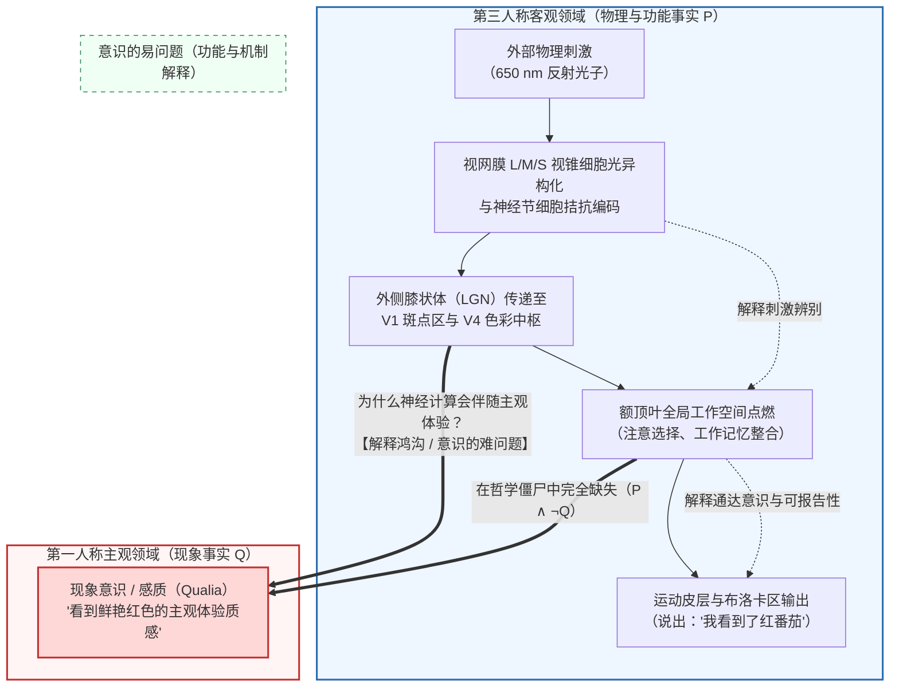
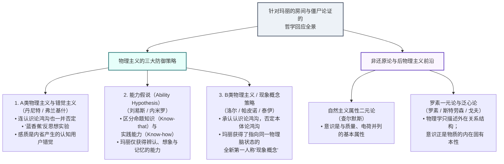

## 1. 引言：波长 $\lambda = 650\,\text{nm}$ 的电磁波与“炽热之红”之间的深渊

当我们注视一颗在夕阳下熟透的红番茄时，存在着两个截然不同的描述层面。

第一个是<strong>第三人称的客观自然科学描述</strong>：番茄表皮中的番茄红素吸收了短波和中波光子，选择性反射波长集中在 $\lambda \approx 650\,\text{nm}$ 的长波电磁辐射。光子穿过角膜与晶状体到达视网膜，被长波敏感视锥细胞（L-视锥，$\lambda_{\max} \approx 560\,\text{nm}$）中的 11-顺式视黄醛吸收并发生光异构化，转化为全反式视黄醛。这一构象变化激活转导蛋白（Transducin）与磷酸二酯酶（PDE），水解环磷酸鸟苷（$\text{cGMP}$），导致阳离子通道关闭、光感受器膜超极化。随后，视网膜神经节细胞通过拮抗通道（$L - M$ 与 $S - (L + M)$）将信号编码为动作电位，经由外侧膝状体（LGN）的小细胞层传递至初级视觉皮层（V1）的双拮抗斑点区（Blobs），最终激活腹侧视觉通路中的<strong>第四视觉区（V4区，色彩恒常性中枢）</strong>，引起约 $40\,\text{Hz}$ 的伽马波段同步振荡，并驱动布洛卡区（Broca's area）发出语音：“这是一个红色的番茄。”

然而，还存在第二个层面——<strong>第一人称的主观体验描述</strong>。无论我们把麦克斯韦电磁方程组、视黄醛异构化的量子化学哈密顿量，还是霍奇金-赫胥黎（Hodgkin-Huxley）膜电位微分方程写得多么精确，这些公式里都没有半个字提到我们在看到番茄那一刻所感受到的<strong>“那种鲜艳、饱满、炽热的红色质感”</strong>。

在当代心灵哲学（Philosophy of Mind）与认知科学中，这种伴随主观体验而来的内在定性特征被称为<strong>感质（Qualia，单数形式为 Quale）</strong>或<strong>现象意识（Phenomenal Consciousness）</strong>。如果人类终有一天解开了大脑连接组与物理定律的全部奥秘，为什么特定的神经元放电会伴随着“看到红色的主观感受”或“剧烈的牙痛感”，而不是像一台在黑暗中静默运行的计算机？主观感质究竟能否被还原为物理事实？

本文将严格重构当代心灵哲学中反物理主义的<strong>三大支柱论证</strong>——托马斯·内格尔的“作为一只蝙蝠是什么感觉”（1974）、弗兰克·杰克逊的“玛丽的房间（知识论证）”（1982/1986），以及约瑟夫·莱文的“解释鸿沟”（1983）与大卫·查尔默斯的“意识难问题及哲学僵尸论证”（1995/1996）。随后，我们将剖析物理主义阵营的三大反击策略（错觉主义、能力假说、现象概念策略），并探索当代最前沿的<strong>罗素一元论（泛心论）</strong>、<strong>全局神经工作空间理论（GNWT）</strong>以及朱利奥·托诺尼的<strong>整合信息理论（IIT）</strong>。

---

## 2. 感质（Qualia）与现象意识的严格界定

### 2.1 从 C.I. 刘易斯到内德·布洛克：现象意识与通达意识

<strong>感质（Qualia）</strong>一词在现代哲学中的用法最早由美国哲学家<strong>克拉伦斯·欧文·刘易斯（C.I. Lewis）</strong>在1929年的著作《心灵与世界秩序》（*Mind and the World Order*）中提出，用以指称直接经验中可辨认、可重复的定性特征。

1995年，哲学家<strong>内德·布洛克（Ned Block）</strong>在经典论文《论关于意识功能的一个混淆》中指出，科学界常将两种完全不同的概念混为一谈：
1. <strong>现象意识（Phenomenal Consciousness / P-Consciousness）</strong>：经验的主观体验特征，即经历某种心理状态对主体而言<strong>“是什么感觉（What it is like）”</strong>。感质正是现象意识的核心构成。
2. <strong>通达意识（Access Consciousness / A-Consciousness）</strong>：一种功能性的信息加工状态。当大脑中的某个表征可被自由地用于推理、决策、行为控制以及言语报告时，该状态便具有通达意识。

此外，丹尼尔·丹尼特（1988）总结了传统感质的四大特征：<strong>不可言传性（Ineffability）</strong>、<strong>内在性（Intrinsicness）</strong>、<strong>私密性（Privateness）</strong>以及<strong>意识中的直接把握性（Immediate Apprehensibility）</strong>。洛克（1689）与休梅克（Shoemaker, 1982）提出的<strong>“颠倒光谱（Inverted Spectrum）”</strong>思想实验表明：即便两个人在所有颜色辨别测试和语言行为（功能角色）上100%完全相同，一个人看红番茄时的内在感质 $Q_{\text{red}}$ 完全可能与另一个人看绿黄瓜时的感质 $Q_{\text{green}}$ 发生对称颠倒。这意味着感质无法被简化为纯粹的功能角色。

---

## 3. 反物理主义的三大支柱论证

### 3.1 第一支柱：托马斯·内格尔“作为一只蝙蝠是什么感觉？”（1974）

在1974年的里程碑论文《作为一只蝙蝠是什么感觉？》（*What Is It Like to Be a Bat?*）中，<strong>托马斯·内格尔（Thomas Nagel）</strong>给出了意识经验的经典判准：

> “从根本上说，一个有机体拥有有意识的心理状态，当且仅当存在着<strong>作为该有机体是什么感觉（what it is like to be that organism）</strong>——即<strong>对该有机体自身而言</strong>是什么感觉。”

微翼手亚目（Microchiroptera）蝙蝠通过喉部发射 $20\,\text{kHz} \sim 120\,\text{kHz}$ 的高频超声波脉冲，并利用回声的时间延迟 $\Delta t$（计算距离 $r = c\Delta t/2$）、多普勒频移 $\Delta f$（计算相对速度）以及耳廓反射谱来构建三维空间感知（回声定位）。内格尔指出，当我们试图想象“倒挂在洞穴里并在黑暗中飞翔”时，我们只是在想象<strong>“对于我们人类而言，像蝙蝠那样行动是什么感觉”</strong>，却无法通过第一人称想象触及<strong>“对于蝙蝠自身而言，拥有声呐感质是什么感觉”</strong>。

更重要的是，内格尔揭示了<strong>客观还原方法论的内在悖论</strong>：物理学之所以能成功地将“热”还原为分子平均动能 $\langle E_k \rangle = \frac{3}{2} k_B T$，是因为科学还原通过剥离特定的主观视角来走向客观性。然而，意识体验的本质恰恰在于<strong>特定的主观视角本身</strong>；一旦为了追求第三人称客观性而抽离主观视角，我们就不是解释了意识，而是直接抛弃了需要解释的对象本身！

### 3.2 第二支柱：弗兰克·杰克逊的“玛丽的房间（知识论证）”（1982 / 1986）

澳大利亚哲学家<strong>弗兰克·杰克逊（Frank Jackson）</strong>提出了著名的<strong>“玛丽的房间（Mary's Room）”</strong>思想实验：
天才视觉神经科学家玛丽自幼被锁在一间只有黑、白、灰三色的房间里。她通过黑白书籍和黑白显示器，彻底掌握了关于人类色彩视觉的<strong>一切物理、化学、神经生物学与功能事实的集合 $\mathcal{P}$</strong>（从 $\lambda = 650\,\text{nm}$ 光子触发视锥细胞异构化，到V4区同步放电，再到引发说出“红色”一词的声带运动）。某一天，玛丽走出黑白房间，亲眼看到了一颗熟透的红番茄。她是否学到了新的知识？

杰克逊将<strong>知识论证（The Knowledge Argument）</strong>形式化为如下有效演绎推理（令 $K_t(x, p)$ 表示主体 $x$ 在时刻 $t$ 知道命题 $p$）：

1. <strong>前提1（释放前物理知识的完备性）</strong>：释放前，玛丽知道关于色觉的一切物理事实 $\mathcal{P}$：
   $$\forall p \in \mathcal{P}, \quad K_{\text{before}}(\text{Mary}, p)$$
2. <strong>前提2（释放后获得实质性新知识）</strong>：释放后看到红番茄时，玛丽学到了一个她此前不知道的新事实 $Q$（即“看见红色是什么主观感觉”）：
   $$\exists Q \quad \text{s.t.} \quad \neg K_{\text{before}}(\text{Mary}, Q) \land K_{\text{after}}(\text{Mary}, Q)$$
3. <strong>结论1（存在非物理事实）</strong>：根据莱布尼茨同一律（不可分辨者的同一性），既然 $Q$ 与 $\mathcal{P}$ 中的任何元素具有不同的认知属性，则：
   $$Q \notin \mathcal{P}$$
4. <strong>结论2（物理主义为假）</strong>：物理主义断言一切事实皆为物理事实（$\mathcal{F}_{\text{world}} \subseteq \mathcal{P}$）。由于 $Q \notin \mathcal{P}$，<strong>物理主义为假</strong>！

值得注意的是，杰克逊早期（1982）主张<strong>副现象论（Epiphenomenalism，即物理脑状态产生感质，但感质对物理世界没有任何因果效力）</strong>；但在2003年，杰克逊本人由于无法接受副现象论导致的认知悖论（如果感质没有因果力，玛丽的感质就无法促使她说出“哇，这就是红色！”），戏剧性地转向了物理主义阵营中的<strong>表征主义（Representationalism）</strong>。

### 3.3 第三支柱：解释鸿沟、意识的难问题与“哲学僵尸”（1983 / 1995 / 1996）

<strong>约瑟夫·莱文（Joseph Levine, 1983）</strong>提出了<strong>“解释鸿沟（Explanatory Gap）”</strong>：由于“水”是由其功能角色（液态、解渴、$100^\circ\text{C}$ 沸腾）定义的，一旦化学证明 $\text{H}_2\text{O}$ 的氢键网络必然实现该功能，还原就彻底完成了；但“疼痛”并非由功能角色定义，即使神经科学完全解释了C纤维放电如何引起缩手反射，我们依然无法理解<strong>为什么C纤维放电会带有疼痛感而非麻痒感或毫无感觉</strong>。

在此基础上，<strong>大卫·查尔默斯（David Chalmers, 1995/1996）</strong>将意识问题划分为<strong>“易问题（Easy Problems）”</strong>与<strong>“难问题（The Hard Problem）”</strong>：

| 比较维度 | 意识的易问题（Easy Problems） | 意识的难问题（The Hard Problem） |
| :--- | :--- | :--- |
| <strong>核心追问</strong> | 大脑如何辨别刺激、整合信息、控制注意力并作出言语报告？ | <strong>为什么所有这些物理与计算信息加工会伴随着第一人称的主观体验（内在电影院）？</strong> |
| <strong>目标概念</strong> | <strong>通达意识与认知功能机制</strong>（Access Consciousness） | <strong>现象意识与感质</strong>（Phenomenal Consciousness / Qualia） |
| <strong>还原解释的适用性</strong> | <strong>原则上完全可解</strong>：只要找到实现该功能的神经回路或算法即可解决。 | <strong>标准功能还原失效</strong>：即使所有认知功能都得到100%解释，为何存在主观感受的问题依然原封不动地残留。 |

为了将认识论上的“解释鸿沟”转化为本体论上对物理主义的否证，查尔默斯构建了著名的<strong>“哲学僵尸（Philosophical Zombies）”可设想性论证（Conceivability Argument）</strong>：
- <strong>前提1（可设想性）</strong>：一个与我们的世界在微观物理上逐个分子完全相同（满足全部物理定律与神经动力学 $\mathcal{P}$）、行为上毫无区别，但内部完全没有主观体验或感质（$\neg Q$）的<strong>哲学僵尸世界 $W_{\text{zombie}}$（即 $\mathcal{P} \land \neg Q$）</strong>在逻辑上是理想可设想的（不包含任何先验矛盾）。
- <strong>前提2（模态桥梁）</strong>：如果 $\mathcal{P} \land \neg Q$ 是理想可设想的，那么它在形而上学上是可能的（$\Diamond(\mathcal{P} \land \neg Q)$）。
- <strong>结论（物理主义破产）</strong>：既然 $\Diamond(\mathcal{P} \land \neg Q)$ 成立，物理事实 $\mathcal{P}$ 就不能形而上学地必然决定现象事实 $Q$（$\neg \Box(\mathcal{P} \to Q)$）。因此，还原物理主义为假！

针对克里普克（Kripke, 1980）式的反驳（即“水 ＝ $\text{H}_2\text{O}$”虽是后天发现却具有形而上学必然性），查尔默斯利用<strong>二维模态语义学（Two-Dimensional Modal Semantics）</strong>证明：对于“水”，其初级内涵（Primary Intension：无色透明可饮用的液体外观）与次级内涵（Secondary Intension：固定指称的化学本质 $\text{H}_2\text{O}$）可以分离；但对于“疼痛”或“红色感质 $Q$”，<strong>主观上感觉像疼痛（初级内涵）就是疼痛本身（次级内涵），即 $I_1(Q) = I_2(Q)$</strong>！因此，初级可设想性直接蕴涵次级（形而上学）可能性 $\Diamond(\mathcal{P} \land \neg Q)$，物理主义无法借后天必然性逃脱。

---

## 4. 物理主义阵营的三大反击策略

面对反物理主义的三大支柱，物理主义哲学家发展出了三种极具深度的防御策略：

1. <strong>A类物理主义与错觉主义（Type-A Physicalism & Illusionism — 丹尼特 Dennett 1991, 弗兰基什 Frankish 2016）</strong>：
   丹尼特直接否定前提2（玛丽学到了新知识），并提出著名的<strong>“蓝香蕉（Blue Banana）”诡计</strong>：如果玛丽真的掌握了<strong>全部</strong>物理与神经事实，当实验者拿一根涂成蓝色的香蕉试图欺骗她时，她会立刻根据自己大脑V4区和联想皮层的反应倾向识破诡计！我们对玛丽会惊讶的直觉，仅仅源于我们无法想象“拥有完备物理知识”意味着什么。弗兰基什进一步提出<strong>错觉主义</strong>：内在的“感质”根本不存在，它只是人类粗糙的内省自我监测机制将高维神经反应倾向简化表征为“发光质感”的<strong>认知用户错觉（User-illusion）</strong>。解释为何我们会产生自己拥有感质的强烈直觉，被称为<strong>“意识的元问题（Meta-Problem of Consciousness）”</strong>（Chalmers, 2018）。
2. <strong>能力假说（The Ability Hypothesis — 内米罗 Nemirow 1980, 大卫·刘易斯 David Lewis 1988）</strong>：
   刘易斯区分了<strong>命题性知识（Knowing-that，知道某个事实为真）</strong>与<strong>实践性能力（Knowing-how，掌握某种技能，如骑自行车）</strong>。玛丽走出房间看到红番茄时，并没有学到任何新的命题事实 $Q$，而只是获得了三种<strong>实践能力（Know-how）</strong>：辨认红色的能力、在脑海中想象红色的能力，以及回忆红色体验的能力。然而批评者（Conee, 1994）指出：即便玛丽患有记忆与想象障碍（无法形成记忆或想象能力），当她正盯着红番茄看的那一瞬间，她依然学到了“原来红色看起来是<strong>这样</strong>的”这一实质性认知内容。
3. <strong>现象概念策略 / B类物理主义（The Phenomenal Concept Strategy / Type-B Physicalism — 洛尔 Loar 1990, 帕皮诺 Papineau 2002）</strong>：
   这是目前最主流的物理主义方案。它借鉴弗雷格（Frege）关于<strong>“涵义（Sinn / 概念）”与“指称（Bedeutung / 实体）”</strong>的区分（正如“暮星 ＝ 晨星 ＝ 金星”或“克拉克·肯特 ＝ 超人”）。在本体论上，“红色的感质 $Q$”与“V4区的特定神经放电状态 $N_{\text{red}}$”是<strong>完全同一个物理属性（$Q = N_{\text{red}}$）</strong>。但人类大脑拥有两套彼此孤立的概念表征系统：在房间里时，玛丽拥有的是第三人称的<strong>理论/物理概念（$C_{\text{phys}}$）</strong>；走出房间亲眼看到番茄时，她激活了自己的V4区，从而首次在第一人称内省中获得了指向<strong>同一个旧物理脑状态 $N_{\text{red}}$ 的全新“现象概念（Phenomenal Concept, $C_{\text{phen}}$）”</strong>。认识论鸿沟源自概念表征方式的不同，而非非物理属性的存在！

| 哲学立场 | 代表人物 | 认识论鸿沟（玛丽的惊讶 / 僵尸的可设想性） | 本体论鸿沟（非物理属性的存在） | 关于感质（Qualia）的核心主张 |
| :--- | :--- | :--- | :--- | :--- |
| <strong>A类物理主义 / 错觉主义</strong> | 丹尼特、弗兰基什 | <strong>否定</strong>（完备物理知识下无鸿沟） | <strong>否定</strong>（仅有物理功能） | 感质是内省机制对复杂神经功能倾向产生的<strong>认知用户错觉</strong>。 |
| <strong>能力假说</strong> | 大卫·刘易斯、内米罗 | <strong>重新解释</strong>（仅是实践技能的获得） | <strong>否定</strong>（仅有物理事实） | 玛丽未获得新的命题知识（Know-that），只获得了辨认、想象与记忆的<strong>实践能力（Know-how）</strong>。 |
| <strong>B类物理主义（现象概念策略）</strong> | 洛尔、帕皮诺、泰伊 | <strong>承认</strong>（物理概念无法先验导出现象概念） | <strong>否定</strong>（两种概念指称同一物理脑状态） | 玛丽获得了指向她早已熟知的同一物理脑状态的<strong>全新第一人称“现象概念”</strong>。 |
| <strong>自然主义属性二元论</strong> | 查尔默斯 | <strong>承认</strong> | <strong>承认</strong>（存在不可还原的现象属性） | 意识是与质量、电荷、时空并列的<strong>宇宙基本属性</strong>，受心物基本定律支配。 |
| <strong>罗素一元论 / 构成泛心论</strong> | 罗素、斯特劳森、戈夫 | <strong>承认</strong>（结构方程不包含内在性质） | <strong>一元论融合</strong>（意识即物质的内在本性） | 物理学只描述物质的<strong>外在关系结构</strong>，而意识正是填充该结构的<strong>内在本性（Quiddity）</strong>。 |

---

## 5. 当代前沿：罗素一元论、全局工作空间（GNWT）与整合信息理论（IIT）

### 5.1 罗素一元论与泛心论（Russellian Monism & Panpsychism）

<strong>伯特兰·罗素（Bertrand Russell, 1927）</strong>、爱丁顿（Eddington, 1928）以及当代的<strong>盖伦·斯特劳森（Galen Strawson, 2006）</strong>与<strong>菲利普·戈夫（Philip Goff, 2017）</strong>指出：物理学教科书中的一切概念（质量 $m$、电荷 $q$、自旋）都纯粹是通过<strong>外在的关系与因果结构（Extrinsic relational structure）</strong>（即它如何根据微分方程改变其他粒子的运动状态）来定义的。物理学对于占据这些关系节点的物质<strong>“其自身的内在定性本质（Intrinsic categorical nature / Quiddity）究竟是什么”</strong>保持着彻底的沉默！

而在整个宇宙中，唯一一个我们不仅从外部观察其关系结构，而且<strong>从内部直接作为其本身而体验到其内在本性</strong>的物理系统，就是我们自己的大脑——而大脑从内部呈现出的内在本性正是<strong>意识体验（感质）</strong>！因此，<strong>罗素一元论</strong>主张：意识（或原初意识 Proto-consciousness）并非游离于物理世界之外的幽灵，而是<strong>物理物质本身的内在定性底基</strong>。这一立场面临的核心挑战是威廉·詹姆斯提出的<strong>“组合问题（The Combination Problem）”</strong>：微观层面的原初体验如何组合并涌现为宏观人类主体统一的意识？

### 5.2 全局神经工作空间理论（GNWT）与整合信息理论（IIT）

在当代计算与理论神经科学中，两大理论正围绕意识的物理基底展开激烈交锋（如2023–2025年著名的<strong>COGITATE对抗性合作实验</strong>）：

1. <strong>全局神经工作空间理论（GNWT — 德阿纳 Dehaene & Changeux, 2011）</strong>：
   大脑的局部感觉模块（如V1、V4）持续进行无意识的并行加工。当某个局部表征跨越非线性阈值，触发连接<strong>前额叶与顶叶皮层</strong>的长程兴奋性锥体神经元发生<strong>“全局点燃（Global Ignition，约在刺激后 $300\,\text{ms}$ 表现为 P3b 脑电成分）”</strong>时，该信息被广播至工作记忆、语言和执行控制模块，从而成为有意识的表征。
2. <strong>整合信息理论（Integrated Information Theory, IIT 3.0 / 4.0 — 托诺尼 Giulio Tononi, 2004, 2014, 2023）</strong>：
   托诺尼将解释方向反转：不再从物理脑出发去推导意识，而是从<strong>主观经验本身的五大现象学公理（内在存在性 Intrinsic Existence、组合性 Composition、信息性 Information、整合性 Integration、排他性 Exclusion）</strong>出发，将其严格映射为物理因果系统的五大公设。
   对于一个由状态转移概率矩阵（TPM）描述的物理网络 $S$，其在状态 $S_t$ 下产生的<strong>整合信息量 $\Phi$（Integrated Information）</strong>被定义为：当沿着系统最薄弱的切口——<strong>最小信息分割（Minimum Information Partition, MIP）</strong> $\pi$——切断系统内部因果连接时，系统的因果分布所损失的最小信息距离（如KL散度 $D_{\text{KL}}$、推土机距离 $D_{\text{EMD}}$ 或内在差异度 $D_{\text{ID}}$）：
   $$\Phi(S_t) = \min_{\pi \in \mathcal{P}_{\text{MIP}}} D\!\left( p\bigl(S_{t \pm 1} \mid S_t\bigr) \;\middle\|\; \prod_{k \in \pi} p\bigl(S_{t \pm 1}^{(k)} \mid S_t^{(k)}\bigr) \right)$$
   IIT揭示了两个震撼性的推论：
   - <strong>小脑之谜的解答</strong>：小脑拥有约690亿个神经元（占人脑神经元总数的80%），但切除小脑几乎不影响意识，而仅含160亿神经元的大脑皮层（尤其是后部皮层热区）却是意识的摇篮。原因在于小脑由平行的前馈模块构成，缺乏递归（Recurrent）因果回路，导致 $\Phi \approx 0$；而丘脑-皮层网络兼具高度分化与密集递归整合，具有极高的局部极大值 $\Phi^{\max}$。
   - <strong>纯前馈AI的数字僵尸性</strong>：任何纯前馈深度神经网络（Feedforward Network）由于层与层之间只有单向传递而无因果反馈回路，其整合信息量严格为 <strong>$\Phi = 0$</strong>！这意味着，即便一个庞大的前馈人工智能在语言行为上完美模仿人类对红色的赞美，只要它缺乏内在不可分割的递归因果拓扑结构，它在本体论上就依然是一个没有内在光亮的数字哲学僵尸。

---

## 6. 结语

回到我们最初的问题：<strong>如果掌握了关于颜色的一切物理定律，就能懂得“看见红色”的体验吗？</strong>
玛丽的房间与哲学僵尸告诉我们：纯粹第三人称的物理结构方程 $\mathcal{P}$ 无法先验地推导出第一人称的感质 $Q$。无论我们像<strong>现象概念策略（B类物理主义）</strong>那样将其视为人类大脑从“外部科学概念”向“内部直接内省概念”切换时产生的认知双重视角，还是像<strong>罗素一元论与整合信息理论（IIT）</strong>那样将感质视为高维整合因果结构从内部呈现出的固有存在本质，那抹在夕阳下燃烧的番茄之红都在提醒我们：意识不仅是大脑计算外部世界的功能工具，更是物理宇宙从内部照亮自身的方式。
