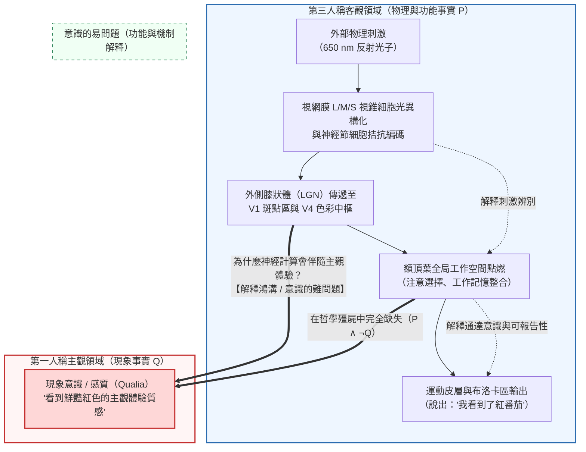
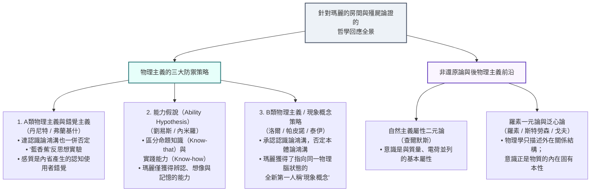

## 1. 引言：波長 $\lambda = 650\,\text{nm}$ 的電磁波與「熾熱之紅」之間的深淵

當我們注視一顆在夕陽下熟透的紅番茄時，存在著兩個截然不同的描述層面。

第一個是<strong>第三人稱的客觀自然科學描述</strong>：番茄表皮中的茄紅素吸收了短波與中波光子，選擇性反射波長集中在 $\lambda \approx 650\,\text{nm}$ 的長波電磁輻射。光子穿過角膜與水晶體到達視網膜，被長波敏感視錐細胞（L-視錐，$\lambda_{\max} \approx 560\,\text{nm}$）中的 11-順式視黃醛吸收並發生光異構化，轉化為全反式視黃醛。這一構象變化激活轉導蛋白（Transducin）與磷酸二酯酶（PDE），水解環磷酸鳥苷（$\text{cGMP}$），導致陽離子通道關閉、光感受器膜超極化。隨後，視網膜神經節細胞透過拮抗通道（$L - M$ 與 $S - (L + M)$）將訊號編碼為動作電位，經由外側膝狀體（LGN）的小細胞層傳遞至初級視覺皮層（V1）的雙拮抗斑點區（Blobs），最終激活腹側視覺通路中的<strong>第四視覺區（V4區，色彩恆常性中樞）</strong>，引起約 $40\,\text{Hz}$ 的伽馬波段同步振盪，並驅動布洛卡區（Broca's area）發出語音：「這是一個紅色的番茄。」

然而，還存在第二個層面——<strong>第一人稱的主觀體驗描述</strong>。無論我們把馬克士威電磁方程組、視黃醛異構化的量子化學哈密頓量，還是霍奇金-赫胥黎（Hodgkin-Huxley）膜電位微分方程寫得多麼精確，這些公式裡都沒有半個字提到我們在看到番茄那一刻所感受到的<strong>「那種鮮豔、飽滿、熾熱的紅色質感」</strong>。

在當代心靈哲學（Philosophy of Mind）與認知科學中，這種伴隨主觀體驗而來的內在定性特徵被稱為<strong>感質（Qualia，單數形式為 Quale）</strong>或<strong>現象意識（Phenomenal Consciousness）</strong>。如果人類終有一天解開了大腦連接組與物理定律的全部奧秘，為什麼特定的神經元放電會伴隨著「看到紅色的主觀感受」或「劇烈的牙痛感」，而不是像一台在黑暗中靜默運行的電腦？主觀感質究竟能否被還原為物理事實？

本文將嚴格重構當代心靈哲學中反物理主義的<strong>三大支柱論證</strong>——湯瑪斯·內格爾的「作為一隻蝙蝠是什麼感覺」（1974）、法蘭克·傑克遜的「瑪麗的房間（知識論證）」（1982/1986），以及約瑟夫·萊文的「解釋鴻溝」（1983）與大衛·查爾默斯的「意識難問題及哲學殭屍論證」（1995/1996）。隨後，我們將剖析物理主義陣營的三大反擊策略（錯覺主義、能力假說、現象概念策略），並探索當代最前沿的<strong>羅素一元論（泛心論）</strong>、<strong>全局神經工作空間理論（GNWT）</strong>以及朱利奧·托諾尼的<strong>整合資訊理論（IIT）</strong>。

---

## 2. 感質（Qualia）與現象意識的嚴格界定

### 2.1 從 C.I. 劉易斯到內德·布洛克：現象意識與通達意識

<strong>感質（Qualia）</strong>一詞在現代哲學中的用法最早由美國哲學家<strong>克拉倫斯·歐文·劉易斯（C.I. Lewis）</strong>在1929年的著作《心靈與世界秩序》（*Mind and the World Order*）中提出，用以指稱直接經驗中可辨認、可重複的定性特徵。

1995年，哲學家<strong>內德·布洛克（Ned Block）</strong>在經典論文《論關於意識功能的一個混淆》中指出，科學界常將兩種完全不同的概念混為一談：
1. <strong>現象意識（Phenomenal Consciousness / P-Consciousness）</strong>：經驗的主觀體驗特徵，即經歷某種心理狀態對主體而言<strong>「是什麼感覺（What it is like）」</strong>。感質正是現象意識的核心構成。
2. <strong>通達意識（Access Consciousness / A-Consciousness）</strong>：一種功能性的資訊加工狀態。當大腦中的某個表徵可被自由地用於推理、決策、行為控制以及言語報告時，該狀態便具有通達意識。

此外，丹尼爾·丹尼特（1988）總結了傳統感質的四大特徵：<strong>不可言傳性（Ineffability）</strong>、<strong>內在性（Intrinsicness）</strong>、<strong>私密性（Privateness）</strong>以及<strong>意識中的直接把握性（Immediate Apprehensibility）</strong>。洛克（1689）與休梅克（Shoemaker, 1982）提出的<strong>「顛倒光譜（Inverted Spectrum）」</strong>思想實驗表明：即便兩個人在所有顏色辨別測試和語言行為（功能角色）上100%完全相同，一個人看紅番茄時的內在感質 $Q_{\text{red}}$ 完全可能與另一個人看綠黃瓜時的感質 $Q_{\text{green}}$ 發生對稱顛倒。這意味著感質無法被簡化為純粹的功能角色。

---

## 3. 反物理主義的三大支柱論證

### 3.1 第一支柱：湯瑪斯·內格爾「作為一隻蝙蝠是什麼感覺？」（1974）

在1974年的里程碑論文《作為一隻蝙蝠是什麼感覺？》（*What Is It Like to Be a Bat?*）中，<strong>湯瑪斯·內格爾（Thomas Nagel）</strong>給出了意識經驗的經典判準：

> 「從根本上說，一個有機體擁有有意識的心理狀態，當且僅當存在著<strong>作為該有機體是什麼感覺（what it is like to be that organism）</strong>——即<strong>對該有機體自身而言</strong>是什麼感覺。」

微翼手亞目（Microchiroptera）蝙蝠透過喉部發射 $20\,\text{kHz} \sim 120\,\text{kHz}$ 的高頻超音波脈衝，並利用回聲的時間延遲 $\Delta t$（計算距離 $r = c\Delta t/2$）、都卜勒頻移 $\Delta f$（計算相對速度）以及耳廓反射譜來構建三維空間感知（回聲定位）。內格爾指出，當我們試圖想像「倒掛在洞穴裡並在黑暗中飛翔」時，我們只是在想像<strong>「對於我們人類而言，像蝙蝠那樣行動是什麼感覺」</strong>，卻無法透過第一人稱想像觸及<strong>「對於蝙蝠自身而言，擁有聲吶感質是什麼感覺」</strong>。

更重要的是，內格爾揭示了<strong>客觀還原方法論的內在悖論</strong>：物理學之所以能成功地將「熱」還原為分子平均動能 $\langle E_k \rangle = \frac{3}{2} k_B T$，是因為科學還原透過剝離特定的主觀視角來走向客觀性。然而，意識體驗的本質恰恰在於<strong>特定的主觀視角本身</strong>；一旦為了追求第三人稱客觀性而抽離主觀視角，我們就不是解釋了意識，而是直接拋棄了需要解釋的對象本身！

### 3.2 第二支柱：法蘭克·傑克遜的「瑪麗的房間（知識論證）」（1982 / 1986）

澳洲哲學家<strong>法蘭克·傑克遜（Frank Jackson）</strong>提出了著名的<strong>「瑪麗的房間（Mary's Room）」</strong>思想實驗：
天才視覺神經科學家瑪麗自幼被鎖在一間只有黑、白、灰三色的房間裡。她透過黑白書籍和黑白顯示器，徹底掌握了關於人類色彩視覺的<strong>一切物理、化學、神經生物學與功能事實的集合 $\mathcal{P}$</strong>（從 $\lambda = 650\,\text{nm}$ 光子觸發視錐細胞異構化，到V4區同步放電，再到引發說出「紅色」一詞的聲帶運動）。某一天，瑪麗走出黑白房間，親眼看到了一顆熟透的紅番茄。她是否學到了新的知識？

傑克遜將<strong>知識論證（The Knowledge Argument）</strong>形式化為如下有效演繹推理（令 $K_t(x, p)$ 表示主體 $x$ 在時刻 $t$ 知道命題 $p$）：

1. <strong>前提1（釋放前物理知識的完備性）</strong>：釋放前，瑪麗知道關於色覺的一切物理事實 $\mathcal{P}$：
   $$\forall p \in \mathcal{P}, \quad K_{\text{before}}(\text{Mary}, p)$$
2. <strong>前提2（釋放後獲得實質性新知識）</strong>：釋放後看到紅番茄時，瑪麗學到了一個她此前不知道的新事實 $Q$（即「看見紅色是什麼主觀感覺」）：
   $$\exists Q \quad \text{s.t.} \quad \neg K_{\text{before}}(\text{Mary}, Q) \land K_{\text{after}}(\text{Mary}, Q)$$
3. <strong>結論1（存在非物理事實）</strong>：根據萊布尼茨同一律（不可分辨者的同一性），既然 $Q$ 與 $\mathcal{P}$ 中的任何元素具有不同的認知屬性，則：
   $$Q \notin \mathcal{P}$$
4. <strong>結論2（物理主義為假）</strong>：物理主義斷言一切事實皆為物理事實（$\mathcal{F}_{\text{world}} \subseteq \mathcal{P}$）。由於 $Q \notin \mathcal{P}$，<strong>物理主義為假</strong>！

值得注意的是，傑克遜早期（1982）主張<strong>副現象論（Epiphenomenalism，即物理腦狀態產生感質，但感質對物理世界沒有任何因果效力）</strong>；但在2003年，傑克遜本人由於無法接受副現象論導致的認知悖論（如果感質沒有因果力，瑪麗的感質就無法促使她說出「哇，這就是紅色！」），戲劇性地轉向了物理主義陣營中的<strong>表徵主義（Representationalism）</strong>。

### 3.3 第三支柱：解釋鴻溝、意識的難問題與「哲學殭屍」（1983 / 1995 / 1996）

<strong>約瑟夫·萊文（Joseph Levine, 1983）</strong>提出了<strong>「解釋鴻溝（Explanatory Gap）」</strong>：由於「水」是由其功能角色（液態、解渴、$100^\circ\text{C}$ 沸騰）定義的，一旦化學證明 $\text{H}_2\text{O}$ 的氫鍵網路必然實現該功能，還原就徹底完成了；但「疼痛」並非由功能角色定義，即使神經科學完全解釋了C纖維放電如何引起縮手反射，我們依然無法理解<strong>為什麼C纖維放電會帶有疼痛感而非麻癢感或毫無感覺</strong>。

在此基礎上，<strong>大衛·查爾默斯（David Chalmers, 1995/1996）</strong>將意識問題劃分為<strong>「易問題（Easy Problems）」</strong>與<strong>「難問題（The Hard Problem）」</strong>：

| 比較維度 | 意識的易問題（Easy Problems） | 意識的難問題（The Hard Problem） |
| :--- | :--- | :--- |
| <strong>核心追問</strong> | 大腦如何辨別刺激、整合資訊、控制注意力並作出言語報告？ | <strong>為什麼所有這些物理與計算資訊加工會伴隨著第一人稱的主觀體驗（內在電影院）？</strong> |
| <strong>目標概念</strong> | <strong>通達意識與認知功能機制</strong>（Access Consciousness） | <strong>現象意識與感質</strong>（Phenomenal Consciousness / Qualia） |
| <strong>還原解釋的適用性</strong> | <strong>原則上完全可解</strong>：只要找到實現該功能的神經迴路或演算法即可解決。 | <strong>標準功能還原失效</strong>：即使所有認知功能都得到100%解釋，為何存在主觀感受的問題依然原封不動地殘留。 |

為了將認識論上的「解釋鴻溝」轉化為本體論上對物理主義的否證，查爾默斯構建了著名的<strong>「哲學殭屍（Philosophical Zombies）」可設想性論證（Conceivability Argument）</strong>：
- <strong>前提1（可設想性）</strong>：一個與我們的世界在微觀物理上逐個分子完全相同（滿足全部物理定律與神經動力學 $\mathcal{P}$）、行為上毫無區別，但內部完全沒有主觀體驗或感質（$\neg Q$）的<strong>哲學殭屍世界 $W_{\text{zombie}}$（即 $\mathcal{P} \land \neg Q$）</strong>在邏輯上是理想可設想的（不包含任何先驗矛盾）。
- <strong>前提2（模態橋樑）</strong>：如果 $\mathcal{P} \land \neg Q$ 是理想可設想的，那麼它在形上學上是可能的（$\Diamond(\mathcal{P} \land \neg Q)$）。
- <strong>結論（物理主義破產）</strong>：既然 $\Diamond(\mathcal{P} \land \neg Q)$ 成立，物理事實 $\mathcal{P}$ 就不能形上學地必然決定現象事實 $Q$（$\neg \Box(\mathcal{P} \to Q)$）。因此，還原物理主義為假！

針對克里普克（Kripke, 1980）式的反駁（即「水 ＝ $\text{H}_2\text{O}$」雖是後天發現卻具有形上學必然性），查爾默斯利用<strong>二維模態語義學（Two-Dimensional Modal Semantics）</strong>證明：對於「水」，其初級內涵（Primary Intension：無色透明可飲用的液體外觀）與次級內涵（Secondary Intension：固定指稱的化學本質 $\text{H}_2\text{O}$）可以分離；但對於「疼痛」或「紅色感質 $Q$」，<strong>主觀上感覺像疼痛（初級內涵）就是疼痛本身（次級內涵），即 $I_1(Q) = I_2(Q)$</strong>！因此，初級可設想性直接蘊涵次級（形上學）可能性 $\Diamond(\mathcal{P} \land \neg Q)$，物理主義無法藉後天必然性逃脫。

---

## 4. 物理主義陣營的三大反擊策略

面對反物理主義的三大支柱，物理主義哲學家發展出了三種極具深度的防禦策略：

1. <strong>A類物理主義與錯覺主義（Type-A Physicalism & Illusionism — 丹尼特 Dennett 1991, 弗蘭基什 Frankish 2016）</strong>：
   丹尼特直接否定前提2（瑪麗學到了新知識），並提出著名的<strong>「藍香蕉（Blue Banana）」詭計</strong>：如果瑪麗真的掌握了<strong>全部</strong>物理與神經事實，當實驗者拿一根塗成藍色的香蕉試圖欺騙她時，她會立刻根據自己大腦V4區和聯想皮層的反應傾向識破詭計！我們對瑪麗會驚訝的直覺，僅僅源於我們無法想像「擁有完備物理知識」意味著什麼。弗蘭基什進一步提出<strong>錯覺主義</strong>：內在的「感質」根本不存在，它只是人類粗糙的內省自我監測機制將高維神經反應傾向簡化表徵為「發光質感」的<strong>認知使用者錯覺（User-illusion）</strong>。解釋為何我們會產生自己擁有感質的強烈直覺，被稱為<strong>「意識的元問題（Meta-Problem of Consciousness）」</strong>（Chalmers, 2018）。
2. <strong>能力假說（The Ability Hypothesis — 內米羅 Nemirow 1980, 大衛·劉易斯 David Lewis 1988）</strong>：
   劉易斯區分了<strong>命題性知識（Knowing-that，知道某個事實為真）</strong>與<strong>實踐性能力（Knowing-how，掌握某種技能，如騎自行車）</strong>。瑪麗走出房間看到紅番茄時，並沒有學到任何新的命題事實 $Q$，而只是獲得了三種<strong>實踐能力（Know-how）</strong>：辨認紅色的能力、在腦海中想像紅色的能力，以及回憶紅色體驗的能力。然而批評者（Conee, 1994）指出：即便瑪麗患有記憶與想像障礙（無法形成記憶或想像能力），當她正盯著紅番茄看的那一瞬間，她依然學到了「原來紅色看起來是<strong>這樣</strong>的」這一實質性認知內容。
3. <strong>現象概念策略 / B類物理主義（The Phenomenal Concept Strategy / Type-B Physicalism — 洛爾 Loar 1990, 帕皮諾 Papineau 2002）</strong>：
   這是目前最主流的物理主義方案。它借鑑弗雷格（Frege）關於<strong>「涵義（Sinn / 概念）」與「指稱（Bedeutung / 實體）」</strong>的區分（正如「暮星 ＝ 晨星 ＝ 金星」或「克拉克·肯特 ＝ 超人」）。在本體論上，「紅色的感質 $Q$」與「V4區的特定神經放電狀態 $N_{\text{red}}$」是<strong>完全同一個物理屬性（$Q = N_{\text{red}}$）</strong>。但人類大腦擁有兩套彼此孤立的概念表徵系統：在房間裡時，瑪麗擁有的是第三人稱的<strong>理論/物理概念（$C_{\text{phys}}$）</strong>；走出房間親眼看到番茄時，她激活了自己的V4區，從而首次在第一人稱內省中獲得了指向<strong>同一個舊物理腦狀態 $N_{\text{red}}$ 的全新「現象概念（Phenomenal Concept, $C_{\text{phen}}$）」</strong>。認識論鴻溝源自概念表徵方式的不同，而非非物理屬性的存在！

| 哲學立場 | 代表人物 | 認識論鴻溝（瑪麗的驚訝 / 殭屍的可設想性） | 本體論鴻溝（非物理屬性的存在） | 關於感質（Qualia）的核心主張 |
| :--- | :--- | :--- | :--- | :--- |
| <strong>A類物理主義 / 錯覺主義</strong> | 丹尼特、弗蘭基什 | <strong>否定</strong>（完備物理知識下無鴻溝） | <strong>否定</strong>（僅有物理功能） | 感質是內省機制對複雜神經功能傾向產生的<strong>認知使用者錯覺</strong>。 |
| <strong>能力假說</strong> | 大衛·劉易斯、內米羅 | <strong>重新解釋</strong>（僅是實踐技能的獲得） | <strong>否定</strong>（僅有物理事實） | 瑪麗未獲得新的命題知識（Know-that），只獲得了辨認、想像與記憶的<strong>實踐能力（Know-how）</strong>。 |
| <strong>B類物理主義（現象概念策略）</strong> | 洛爾、帕皮諾、泰伊 | <strong>承認</strong>（物理概念無法先驗導出現象概念） | <strong>否定</strong>（兩種概念指稱同一物理腦狀態） | 瑪麗獲得了指向她早已熟知的同一物理腦狀態的<strong>全新第一人稱「現象概念」</strong>。 |
| <strong>自然主義屬性二元論</strong> | 查爾默斯 | <strong>承認</strong> | <strong>承認</strong>（存在不可還原的現象屬性） | 意識是與質量、電荷、時空並列的<strong>宇宙基本屬性</strong>，受心物基本定律支配。 |
| <strong>羅素一元論 / 構成泛心論</strong> | 羅素、斯特勞森、戈夫 | <strong>承認</strong>（結構方程不包含內在性質） | <strong>一元論融合</strong>（意識即物質的內在本性） | 物理學只描述物質的<strong>外在關係結構</strong>，而意識正是填充該結構的<strong>內在本性（Quiddity）</strong>。 |

---

## 5. 當代前沿：羅素一元論、全局工作空間（GNWT）與整合資訊理論（IIT）

### 5.1 羅素一元論與泛心論（Russellian Monism & Panpsychism）

<strong>伯特蘭·羅素（Bertrand Russell, 1927）</strong>、愛丁頓（Eddington, 1928）以及當代的<strong>蓋倫·斯特勞森（Galen Strawson, 2006）</strong>與<strong>菲利普·戈夫（Philip Goff, 2017）</strong>指出：物理學教科書中的一切概念（質量 $m$、電荷 $q$、自旋）都純粹是透過<strong>外在的關係與因果結構（Extrinsic relational structure）</strong>（即它如何根據微分方程改變其他粒子的運動狀態）來定義的。物理學對於佔據這些關係節點的物質<strong>「其自身的內在定性本質（Intrinsic categorical nature / Quiddity）究竟是什麼」</strong>保持著徹底的沉默！

而在整個宇宙中，唯一一個我們不僅從外部觀察其關係結構，而且<strong>從內部直接作為其本身而體驗到其內在本性</strong>的物理系統，就是我們自己的大腦——而大腦從內部呈現出的內在本性正是<strong>意識體驗（感質）</strong>！因此，<strong>羅素一元論</strong>主張：意識（或原初意識 Proto-consciousness）並非游離於物理世界之外的幽靈，而是<strong>物理物質本身的內在定性底基</strong>。這一立場面臨的核心挑戰是威廉·詹姆斯提出的<strong>「組合問題（The Combination Problem）」</strong>：微觀層面的原初體驗如何組合並湧現為宏觀人類主體統一的意識？

### 5.2 全局神經工作空間理論（GNWT）與整合資訊理論（IIT）

在當代計算與理論神經科學中，兩大理論正圍繞意識的物理基底展開激烈交鋒（如2023–2025年著名的<strong>COGITATE對抗性合作實驗</strong>）：

1. <strong>全局神經工作空間理論（GNWT — 德阿納 Dehaene & Changeux, 2011）</strong>：
   大腦的局部感覺模組（如V1、V4）持續進行無意識的並行加工。當某個局部表徵跨越非線性閾值，觸發連接<strong>前額葉與頂葉皮層</strong>的長程興奮性錐體神經元發生<strong>「全局點燃（Global Ignition，約在刺激後 $300\,\text{ms}$ 表現為 P3b 腦電成分）」</strong>時，該資訊被廣播至工作記憶、語言和執行控制模組，從而成為有意識的表徵。
2. <strong>整合資訊理論（Integrated Information Theory, IIT 3.0 / 4.0 — 托諾尼 Giulio Tononi, 2004, 2014, 2023）</strong>：
   托諾尼將解釋方向反轉：不再從物理腦出發去推導意識，而是從<strong>主觀經驗本身的五大現象學公理（內在存在性 Intrinsic Existence、組合性 Composition、資訊性 Information、整合性 Integration、排他性 Exclusion）</strong>出發，將其嚴格映射為物理因果系統的五大公設。
   對於一個由狀態轉移機率矩陣（TPM）描述的物理網路 $S$，其在狀態 $S_t$ 下產生的<strong>整合資訊量 $\Phi$（Integrated Information）</strong>被定義為：當沿著系統最薄弱的切口——<strong>最小資訊分割（Minimum Information Partition, MIP）</strong> $\pi$——切斷系統內部因果連接時，系統的因果分佈所損失的最小資訊距離（如KL散度 $D_{\text{KL}}$、推土機距離 $D_{\text{EMD}}$ 或內在差異度 $D_{\text{ID}}$）：
   $$\Phi(S_t) = \min_{\pi \in \mathcal{P}_{\text{MIP}}} D\!\left( p\bigl(S_{t \pm 1} \mid S_t\bigr) \;\middle\|\; \prod_{k \in \pi} p\bigl(S_{t \pm 1}^{(k)} \mid S_t^{(k)}\bigr) \right)$$
   IIT揭示了兩個震撼性的推論：
   - <strong>小腦之謎的解答</strong>：小腦擁有約690億個神經元（佔人腦神經元總數的80%），但切除小腦幾乎不影響意識，而僅含160億神經元的大腦皮層（尤其是後部皮層熱區）卻是意識的搖籃。原因在於小腦由平行的前饋模組構成，缺乏遞迴（Recurrent）因果迴路，導致 $\Phi \approx 0$；而視丘-皮層網路兼具高度分化與密集遞迴整合，具有極高的局部極大值 $\Phi^{\max}$。
   - <strong>純前饋AI的數位殭屍性</strong>：任何純前饋深度神經網路（Feedforward Network）由於層與層之間只有單向傳遞而無因果回饋迴路，其整合資訊量嚴格為 <strong>$\Phi = 0$</strong>！這意味著，即便一個龐大的前饋人工智慧在語言行為上完美模仿人類對紅色的讚美，只要它缺乏內在不可分割的遞迴因果拓撲結構，它在本體論上就依然是一個沒有內在光亮的數位哲學殭屍。

---

## 6. 結語

回到我們最初的問題：<strong>如果掌握了關於顏色的一切物理定律，就能懂得「看見紅色」的體驗嗎？</strong>
瑪麗的房間與哲學殭屍告訴我們：純粹第三人稱的物理結構方程 $\mathcal{P}$ 無法先驗地推導出第一人稱的感質 $Q$。無論我們像<strong>現象概念策略（B類物理主義）</strong>那樣將其視為人類大腦從「外部科學概念」向「內部直接內省概念」切換時產生的認知雙重視角，還是像<strong>羅素一元論與整合資訊理論（IIT）</strong>那樣將感質視為高維整合因果結構從內部呈現出的固有存在本質，那抹在夕陽下燃燒的番茄之紅都在提醒我們：意識不僅是大腦計算外部世界的功能工具，更是物理宇宙從內部照亮自身的方式。
