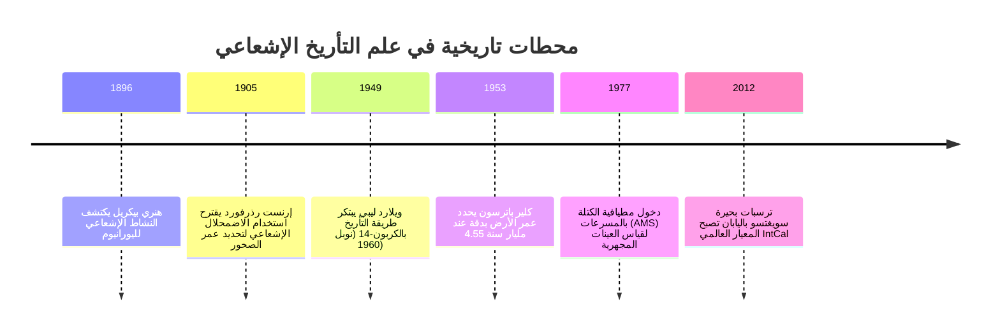
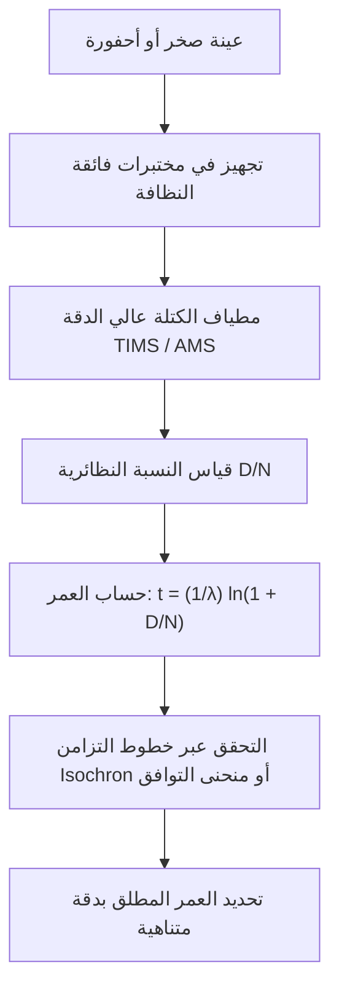

"كم يبلغ عمر هذه الأحفورة؟" "متى تبلور هذا الغرانيت من الصهارة المنصهرة؟" "ما هو العمر الفعلي لكوكب الأرض؟"

طوال قرون مديدة، افتقرت البشرية إلى أداة فيزيائية موضوعية لقياس "سهم الزمن". في القرن السابع عشر، استنتج رئيس الأساقفة جيمس آشر من الأنساب التوراتية أن الأرض خُلقت في عام 4004 قبل الميلاد. وفي أواخر القرن التاسع عشر، قدّر اللورد كلفن عبر نماذج التبريد الديناميكي الحراري عمر الأرض بما بين 20 و 40 مليون عام فقط.

انهارت كل تلك التقديرات في مطلع القرن العشرين بفضل **اكتشاف النشاط الإشعاعي (Radioactivity)** على يد بيكريل وآل كوري ورذرفورد. إن الاضمحلال التلقائي للأنوية الذرية يخضع لقوانين الاحتمالية الكمومية الثابتة، بمعزل تام عن الضغط والحرارة والروابط الكيميائية، مما منح العلماء **ساعات ذرية طبيعية** تمكنهم من سبر أغوار الزمن السحيق (Deep Time).



---

## 1. فيزياء ورياضيات الاضمحلال الإشعاعي

يتناسب معدل اضمحلال الأنوية الأم غير المستقرة $N(t)$ طردياً مع عددها:

$$\frac{dN}{dt} = -\lambda N(t)$$

حيث $\lambda$ هو **ثابت الاضمحلال**. وبتكامل هذه المعادلة التفاضلية نحصل على **قانون الاضمحلال الإشعاعي**:

$$N(t) = N_0 e^{-\lambda t}$$

وعمر النصف ($t_{1/2}$) يُحسب بالمعادلة:

$$t_{1/2} = \frac{\ln 2}{\lambda} \approx \frac{0.69315}{\lambda}$$

وبحساب تراكم الأنوية الوليدة الناتجة عن الاضمحلال $D(t) = N_0 - N(t) = N(t)(e^{\lambda t} - 1)$، نصل إلى **معادلة التأريخ الإشعاعي الأساسية**:

$$t = \frac{1}{\lambda} \ln\left(1 + \frac{D(t)}{N(t)}\right)$$



---

## 2. الكربون-14 ومعجزة ترسبات بحيرة سويغتسو

تولد الأشعة الكونية نيوترونات تتفاعل مع نيتروجين الغلاف الجوي لإنتاج الكربون-14:

$$n + {}^{14}_7N \rightarrow {}^{14}_6C + p$$

يدخل $^{14}C$ في السلسلة الغذائية عبر التركيب الضوئي. وبموت الكائن يتوقف التبادل، ويبدأ $^{14}C$ بالاضمحلال بنصف عمر قدره 5,730 سنة.

ولمعايرة تذبذبات تركيز $^{14}C$ عبر العصور، وفرت **بحيرة سويغتسو في اليابان** سجلاً رسوبياً فريداً يحتوي على أكثر من 50,000 طبقة سنوية متعاقبة لم تتعرض لأي اضطراب، مما شكل العمود الفقري لمنحنى المعايرة العالمي **IntCal**.

---

## 3. كرونومترات الأزمنة الجيولوجية العميقة وطريقة خطوط التزامن (Isochron)

| الطريقة | نظام الاضمحلال | نصف العمر | المدى الزمني | المعادن المستهدفة |
| :--- | :--- | :--- | :--- | :--- |
| **الكربون-14** | $^{14}C \rightarrow {}^{14}N$ | 5,730 سنة | 300 - 50,000 سنة | المواد العضوية، الخشب، العظام |
| **البوتاسيوم-الأرغون (K-Ar)** | $^{40}K \rightarrow {}^{40}Ar$ | 1.25 مليار سنة | 10 آلاف - 4.5 مليار سنة | الفلسبار، الميكا، الرماد البركاني |
| **اليورانيوم-الرصاص (U-Pb)** | $^{238}U \rightarrow {}^{206}Pb$<br>$^{235}U \rightarrow {}^{207}Pb$ | 4.47 مليار سنة<br>704 مليون سنة | مليون - 4.56 مليار سنة | **الزركون ($ZrSiO_4$)**، المونازيت |
| **الروبيديوم-السترونشيوم** | $^{87}Rb \rightarrow {}^{87}Sr$ | 48.8 مليار سنة | 10 ملايين - 4.5 مليار سنة | الصخور النارية والمتحولة |

### البرهان الرياضي لطريقة خطوط التزامن:
بمعايرة المعادلة إلى نظير مستقر غير إشعاعي ($^{86}Sr$):

$$\frac{{}^{87}Sr}{{}^{86}Sr} = \left(\frac{{}^{87}Sr}{{}^{86}Sr}\right)_0 + \frac{{}^{87}Rb}{{}^{86}Sr} (e^{\lambda t} - 1)$$

إن ميل المستقيم الناتج $m = e^{\lambda t} - 1$ يتيح حساب العمر بدقة $t = \frac{\ln(1+m)}{\lambda}$ دون الحاجة لمعرفة النسبة الأولية للسترونشيوم.

```mermaid
xychart-beta
    title "مخطط خط التزامن للروبيديوم-السترونشيوم"
    x-axis "87Rb / 86Sr" [0, 1, 2, 3, 4, 5]
    y-axis "87Sr / 86Sr" 0.69 to 0.76
    line [0.700, 0.710, 0.720, 0.730, 0.740, 0.750]
```

---

## 4. تحديد عمر الأرض ومعركة كلير باترسون البطولية

نظراً لإعادة تدوير القشرة الأرضية بواسطة الصفائح التكتونية، لم تتبق صخور أصلية من نشأة الأرض. في عام 1953، قام الجيوكيميائي **كلير باترسون** بتحليل نظائر الرصاص في نيزك كانيون ديابلو، ليثبت للعالم أن عمر الأرض والنظام الشمسي هو **4.55 مليار سنة**.

وخلال أبحاثه، اكتشف باترسون التلوث الشديد بالرصاص في الغلاف الجوي الناتج عن وقود السيارات، فابتكر **الغرف النظيفة (Clean Rooms)** وخاض كفاحاً تاريخياً أدى لحظر **البنزين المحتوي على الرصاص** في كافة أنحاء العالم.
