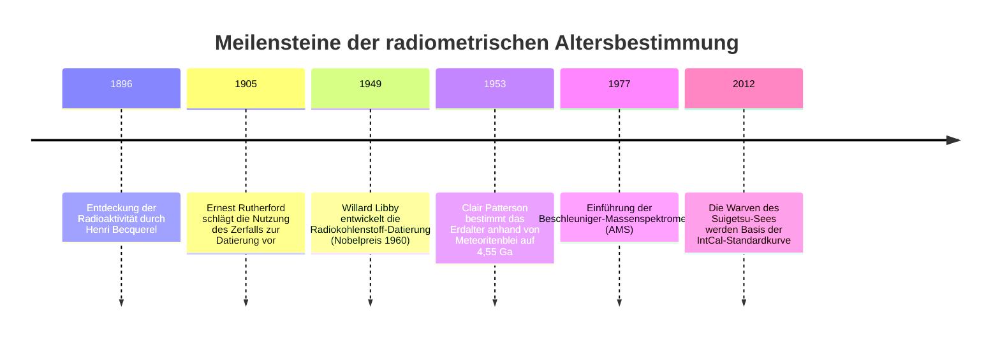
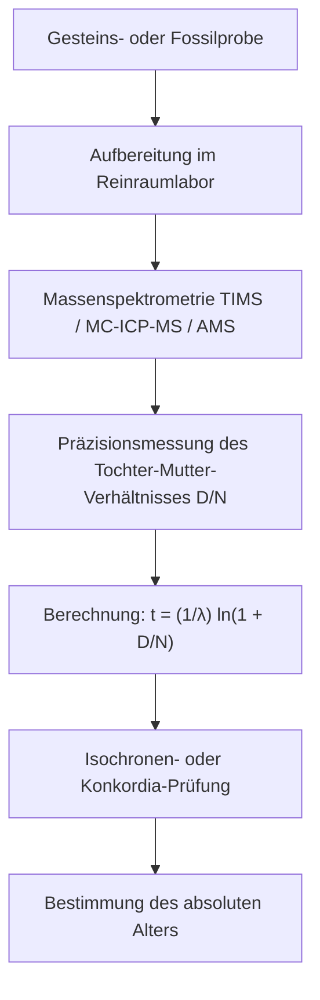

„Wie alt ist dieses Fossil?“ „Wann erstarrte dieser Granit aus dem glutflüssigen Magma?“ „Wie alt ist unser Planet Erde wirklich?“

Über Jahrhunderte fehlte der Menschheit ein physikalisch fundiertes Instrument zur Messung der tiefen geologischen Zeit. Im 17. Jahrhundert berechnete Erzbischof James Ussher aus biblischen Schriften das Schöpfungsdatum auf das Jahr 4004 v. Chr. Im späten 19. Jahrhundert postulierte Lord Kelvin anhand thermodynamischer Abkühlungsmodelle ein Erdalter von lediglich 20 bis 40 Millionen Jahren.

Erst die **Entdeckung der Radioaktivität** zu Beginn des 20. Jahrhunderts durch Becquerel, die Curies und Rutherford revolutionierte das menschliche Zeitverständnis. Der spontane Zerfall instabiler Atomkerne gehorcht unerbittlichen quantenmechanischen Wahrscheinlichkeitsgesetzen – völlig unbeeinflusst von Temperatur, Druck oder chemischer Bindung. Mit diesen **natürlichen Atomuhren** gelang der Menschheit der Vorstoß in die Tiefenzeit der Erd- und Menschheitsgeschichte.



---

## 1. Physik und Mathematik des radioaktiven Zerfalls

Die Anzahl der Kerne $dN$, die in einem Zeitintervall $dt$ zerfallen, ist streng proportional zur Zahl der vorhandenen Mutterkerne $N(t)$:

$$\frac{dN}{dt} = -\lambda N(t)$$

wobei $\lambda$ die nuklidspezifische **Zerfallskonstante** darstellt. Die Integration liefert das fundamentale **Zerfallsgesetz**:

$$N(t) = N_0 e^{-\lambda t}$$

Daraus folgt die **Halbwertszeit** $t_{1/2}$:

$$t_{1/2} = \frac{\ln 2}{\lambda} \approx \frac{0{,}69315}{\lambda}$$

Unter der Annahme, dass zu Beginn keine Tochterkerne vorlagen ($D_0 = 0$), ergibt sich für die angesammelten radiogenen Tochterkerne $D(t) = N_0 - N(t) = N(t)(e^{\lambda t} - 1)$. Die Auflösung nach der Zeit $t$ liefert die grundlegende **Altersgleichung**:

$$t = \frac{1}{\lambda} \ln\left(1 + \frac{D(t)}{N(t)}\right)$$



---

## 2. Radiokohlenstoff-Datierung ($^{14}C$) und der Suigetsu-See

Kosmische Strahlung erzeugt in der oberen Atmosphäre Neutronen, die mit Stickstoff reagieren:

$$n + {}^{14}_7N \rightarrow {}^{14}_6C + p$$

Über das atmosphärische $^{14}CO_2$ gelangt der Kohlenstoff in die Nahrungskette. Nach dem biologischen Tod zerfällt $^{14}C$ mit einer Halbwertszeit von 5.730 Jahren:

$${}^{14}_6C \rightarrow {}^{14}_7N + e^- + \bar{\nu}_e$$

Da die atmosphärische $^{14}C$-Konzentration im Laufe der Jahrtausende schwankte, erfordert die Datierung eine lückenlose Eichung. Der **Suigetsu-See in Japan** lieferte über 70 Meter Sedimentkerne mit mehr als 50.000 ungestörten Jahreswarven (helle Kieselalgen- und dunkle Tonschichten). Durch die Analyse von Blätterfossilien aus diesen Schichten entstand die internationale Kalibrierungskurve **IntCal**.

---

## 3. Geologische Uhren und die Isochronenmethode

| Methode | Zerfall | Halbwertszeit | Messbereich | Typische Minerale |
| :--- | :--- | :--- | :--- | :--- |
| **$^{14}C$-Methode** | $^{14}C \rightarrow {}^{14}N$ | 5.730 a | 300 bis 50.000 a | Holz, Knochen, Holzkohle |
| **K-Ar / Ar-Ar** | $^{40}K \rightarrow {}^{40}Ar$ | 1,25 Ga | 10.000 a bis 4,5 Ga | Feldspat, Glimmer, Vulkanasche |
| **U-Pb-Methode** | $^{238}U \rightarrow {}^{206}Pb$<br>$^{235}U \rightarrow {}^{207}Pb$ | 4,47 Ga<br>704 Ma | 1 Ma bis 4,56 Ga | **Zirkon ($ZrSiO_4$)**, Monazit |
| **Rb-Sr-Methode** | $^{87}Rb \rightarrow {}^{87}Sr$ | 48,8 Ga | 10 Ma bis 4,5 Ga | Gesamtgestein, Magmatite |

### Mathematischer Beweis der Isochronenmethode:
Bei unbekanntem Anfangsgehalt an Tochterkernen ($D_0$) wird die Gleichung auf ein stabiles Referenzisotop ($^{86}Sr$) normiert:

$$\frac{{}^{87}Sr}{{}^{86}Sr} = \left(\frac{{}^{87}Sr}{{}^{86}Sr}\right)_0 + \frac{{}^{87}Rb}{{}^{86}Sr} (e^{\lambda t} - 1)$$

Dies entspricht einer Geradengleichung $y = b + mx$ mit der Steigung $m = e^{\lambda t} - 1$. Durch lineare Regression über verschiedene Minerale desselben Gesteins lässt sich das Alter $t = \frac{\ln(1+m)}{\lambda}$ exakt und ohne Kenntnis des Anfangsverhältnisses ermitteln.

```mermaid
xychart-beta
    title "Rubidium-Strontium-Isochronendiagramm"
    x-axis "87Rb / 86Sr" [0, 1, 2, 3, 4, 5]
    y-axis "87Sr / 86Sr" 0.69 to 0.76
    line [0.700, 0.710, 0.720, 0.730, 0.740, 0.750]
```

---

## 4. Das Alter der Erde: Clair Pattersons Triumph

Da auf der Erde durch Plattentektonik keine Urkruste erhalten blieb, untersuchte der Geochemiker **Clair Patterson** uranfreie Troilitphasen des Canyon-Diablo-Meteoriten. 1953 datierte er das Alter von Erde und Sonnensystem präzise auf **4,55 Milliarden Jahre**.

Im Zuge seiner Forschungen erfand Patterson die moderne **Reinraumtechnik** zur Vermeidung von Bleikontaminationen und führte einen jahrzehntelangen, erfolgreichen Feldzug gegen die Bleivergiftung durch verbleites Benzin.
