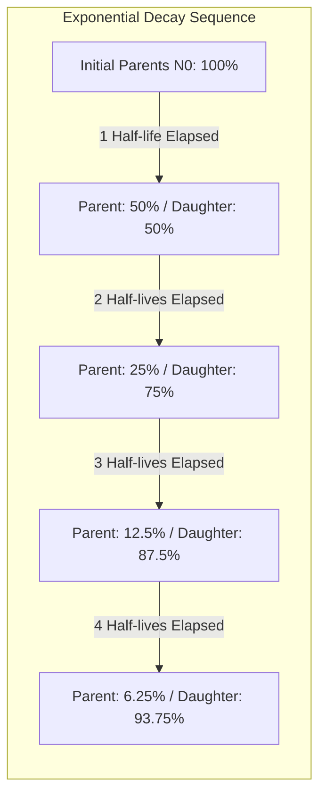
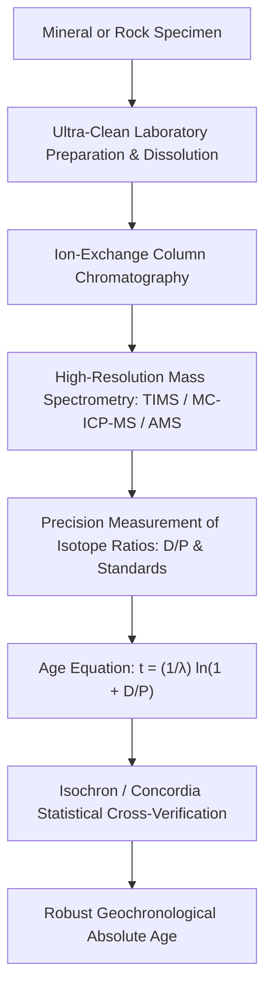
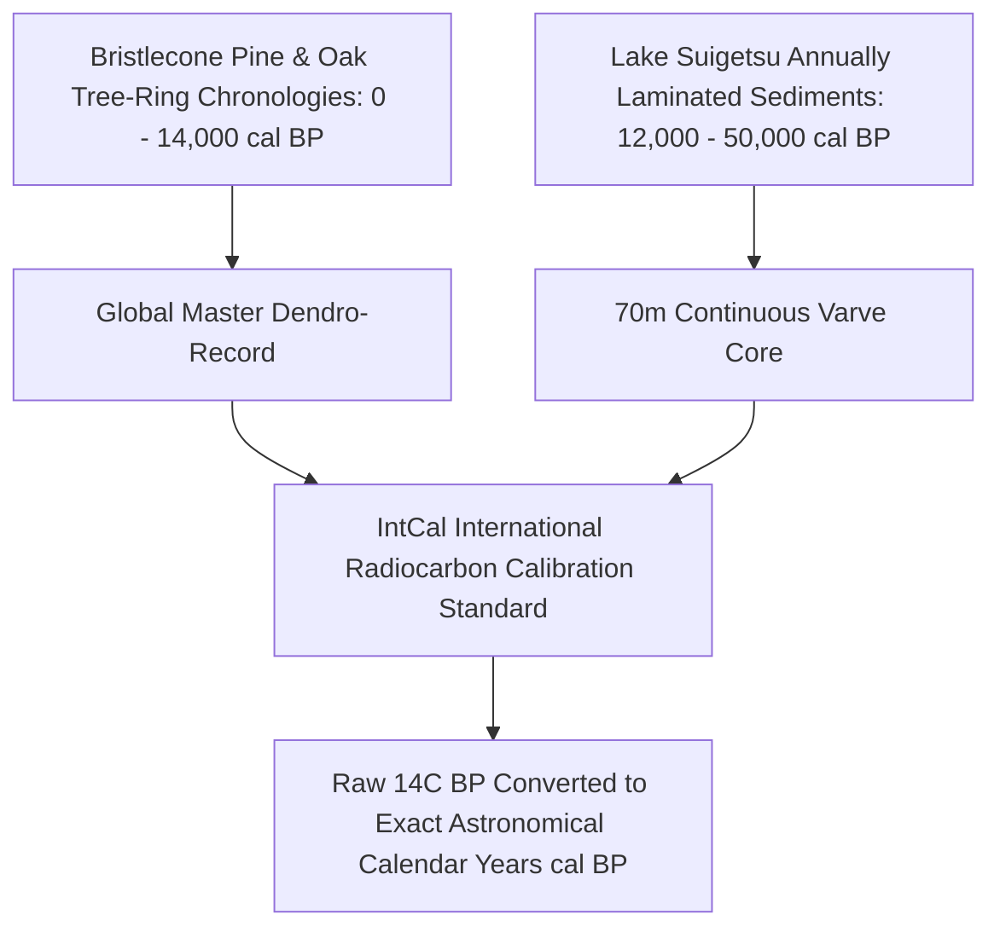
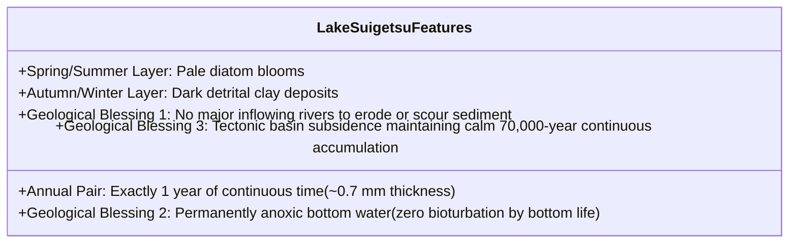
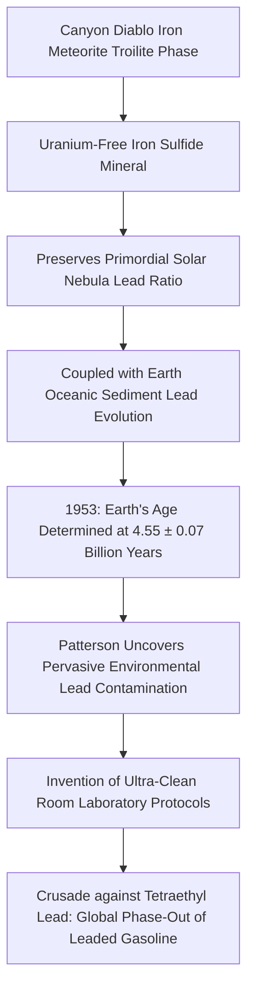

"How old is this fossil?" "When did this granite crystallize from molten magma?" "What is the true age of planet Earth?"

For millennia, humanity lacked an objective method to calibrate the arrow of time. In the 17th century, Archbishop James Ussher famously calculated from biblical genealogies that Earth was created on the evening of October 22, 4004 BCE. In the late 19th century, Lord Kelvin applied thermodynamic heat-conduction physics to estimate that a molten Earth would have cooled to its present temperature in 20 to 40 million years.

Both calculations collapsed at the dawn of the 20th century with the discovery of **radioactivity** by Henri Becquerel, Marie and Pierre Curie, and Ernest Rutherford. 

Atomic nuclei decay spontaneously according to inviolable quantum mechanical probability laws, utterly unaffected by ambient temperatures, chemical bonds, or tectonic pressures. In discovering radioactive decay, humanity unlocked a set of **flawless natural atomic clocks**, allowing us to navigate deep geological time spanning from early human archaeological sites to the 4.56-billion-year dawn of the Solar System.

This article provides an exhaustive, mathematically rigorous analysis of radiometric dating: the fundamental calculus of radioactive decay, radiocarbon AMS dynamics, the miraculous annual varves of Lake Suigetsu, U-Pb zircon concordia systematics, algebraic proofs of isochron equations, and Clair Patterson's epic battle to measure the age of Earth.

---

## 1. Physics and Calculus of Radioactive Decay

### 1.1 Stochastic Nuclear Decay and the Exponential Decay Law

Radioactive decay is an intrinsically stochastic process governed by quantum tunneling and weak/strong nuclear forces. For any individual unstable parent nucleus, the probability of decaying within an infinitesimal time increment $dt$ is constant and independent of the nucleus's history.

For an ensemble of $N(t)$ radioactive parent nuclei, the decay rate $\frac{dN}{dt}$ is directly proportional to the number of parent nuclei present:

$$\frac{dN}{dt} = -\lambda N(t)$$

where $\lambda$ is the **decay constant** characteristic of that specific isotope (expressed in units of $\text{s}^{-1}$ or $\text{year}^{-1}$).

Solving this separable first-order differential equation:

$$\frac{dN}{N} = -\lambda dt$$

Integrating both sides from time $t = 0$ (where $N(0) = N_0$) to time $t$:

$$\int_{N_0}^{N(t)} \frac{dN}{N} = -\lambda \int_0^t dt$$

$$\ln\left(\frac{N(t)}{N_0}\right) = -\lambda t$$

Exponentiating yields the universal **law of radioactive decay**:

$$N(t) = N_0 e^{-\lambda t}$$



---

### 1.2 Half-Life ($t_{1/2}$) Derivation

The half-life ($t_{1/2}$) is the time duration required for half of the initial unstable parent nuclei to decay:

$$N(t_{1/2}) = \frac{N_0}{2} = N_0 e^{-\lambda t_{1/2}}$$

$$\frac{1}{2} = e^{-\lambda t_{1/2}} \implies \ln(1/2) = -\lambda t_{1/2}$$

$$t_{1/2} = \frac{\ln 2}{\lambda} \approx \frac{0.693147}{\lambda}$$

---

### 1.3 The Fundamental Age Equation

Consider a closed system where an unstable parent isotope $P$ decays into a stable radiogenic daughter isotope $D^*$. Assuming no daughter atoms were initially present ($D_0 = 0$), the quantity of daughter atoms accumulated at time $t$ equals the number of decayed parents:

$$D^*(t) = P_0 - P(t)$$

Since $P_0 = P(t) e^{\lambda t}$, substitution gives:

$$D^*(t) = P(t) e^{\lambda t} - P(t) = P(t)(e^{\lambda t} - 1)$$

Dividing by current parent abundance $P(t)$:

$$\frac{D^*(t)}{P(t)} = e^{\lambda t} - 1$$

Solving explicitly for time elapsed $t$ yields the **basic radiometric age equation**:

$$t = \frac{1}{\lambda} \ln\left(1 + \frac{D^*(t)}{P(t)}\right)$$

By measuring the isotopic ratio of radiogenic daughters to parent atoms $\frac{D^*}{P}$ with modern mass spectrometry, the age $t$ since system closure is calculated directly.



---

## 2. Radiocarbon Dating ($^{14}C$) and the Archaeological Revolution

### 2.1 Atmospheric Generation and Biosphere Assimilation

In the late 1940s, Willard Libby at the University of Chicago developed **radiocarbon dating**, earning the 1960 Nobel Prize in Chemistry.

```mermaid
flowchart TD
    Cosmic[High-Energy Galactic Cosmic Rays] --> UpperAtm[Upper Atmosphere: Spallation Neutrons Produced]
    UpperAtm --> Capture["Thermal Neutron Capture on 14N: n + 14N -> 14C + p"]
    Capture --> Oxid["Rapid Chemical Oxidation: 14CO2 Formed"]
    Oxid --> Global[Homogeneous Mixing in Atmosphere and Oceans]
    Global --> Photo[Photosynthetic Carbon Fixation in Terrestrial Plants]
    Photo --> FoodWeb[Herbivores and Carnivores Ingest 14C Biomass]
    FoodWeb --> Death[Organism Dies: Carbon Exchange Ceases (Clock Starts)]
    Death --> Decay["Beta-Minus Decay (Half-life = 5,730 yr): 14C -> 14N + e- + νe"]
```

#### Nuclear Reactions:
1. **Cosmogenic Production**:
   Thermal neutrons generated by cosmic ray cascades react with atmospheric nitrogen-14:
   $$n + {}^{14}_7N \rightarrow {}^{14}_6C + p$$
2. **Dynamic Equilibrium**:
   $^{14}C$ rapidly oxidizes into $^{14}CO_2$, assimilating into the terrestrial carbon cycle. While alive, organisms maintain a fixed ratio of $^{14}C/{}^{12}C \approx 1.2 \times 10^{-12}$ (one part per trillion).
3. **Post-Mortem Decay**:
   Upon biological death, respiration ceases. $^{14}C$ undergoes $\beta^-$ decay back to $^{14}N$:
   $${}^{14}_6C \rightarrow {}^{14}_7N + e^- + \bar{\nu}_e \quad (t_{1/2} = 5,730 \pm 40\text{ years})$$

---

### 2.2 Accelerator Mass Spectrometry (AMS)

Original beta-counting methods required grams of combusted organic material and days of counting. The advent of **Accelerator Mass Spectrometry (AMS)** transformed radiocarbon geochronology.

AMS accelerates negative carbon ions ($^{14}C^-$, $^{12}C^-$, $^{13}C^-$) through megavolt electrostatic potentials. By passing through a gas stripper cell, outer electrons are stripped, turning ions positive and destroying isobaric molecular interferences like $^{13}CH^-$ and $^{12}CH_2^-$. 

AMS directly counts individual $^{14}C$ atoms, slashing required sample sizes from grams to **fractions of a milligram** (single seeds, textile fibers, pollen) while pushing the measurement horizon back to ~50,000 years.

---

## 3. Dendrochronology and Lake Suigetsu: The IntCal Calibration Miracle

### 3.1 Why Radiocarbon Requires Calibration

Libby originally assumed atmospheric $^{14}C$ had remained perfectly static over time. We now know that atmospheric $^{14}C$ fluctuates due to geomagnetic field modulation, 11-year solar cycles, industrial fossil-fuel emissions (the Suess effect), and 20th-century atmospheric thermonuclear detonations. Consequently, raw "radiocarbon years BP" (Before Present = 1950) must be calibrated against independent, year-by-year natural records to obtain astronomical calendar dates (cal BP).



### 3.2 Lake Suigetsu (Japan): The World's Gold-Standard Varve Chronology
Tree-ring cross-dating (using bristlecone pines living over 4,000 years) reliably extends back approximately 14,000 years. The definitive bridge to 50,000 years came from **Lake Suigetsu in Fukui Prefecture, Japan**.



Led by Professor Takeshi Nakagawa, an international team recovered over 70 meters of continuous sediment cores containing **over 50,000 distinct annual varve laminations**. Thousands of terrestrial fossil leaves recovered from individual varves were dated via AMS radiocarbon, anchoring the worldwide **IntCal** calibration curve.

---

## 4. Deep-Time Geochronometers

For geological intervals spanning millions to billions of years, isotope systems with extraordinarily long half-lives are required:

| Method | Decay Reaction | Half-Life ($t_{1/2}$) | Practical Age Range | Target Materials |
| :--- | :--- | :--- | :--- | :--- |
| **Radiocarbon ($^{14}C$)** | $^{14}C \rightarrow {}^{14}N$ | 5,730 yr | 300 – 50,000 yr | Charcoal, wood, bone, shell, peat |
| **K-Ar & $^{40}Ar/^{39}Ar$** | $^{40}K \rightarrow {}^{40}Ar$ | 1.25 Gyr | 10,000 yr – 4.5 Gyr | Volcanic tephra, micas, feldspars, hornblende |
| **U-Pb System** | $^{238}U \rightarrow {}^{206}Pb$<br>$^{235}U \rightarrow {}^{207}Pb$ | 4.47 Gyr<br>704 Myr | 1 Myr – 4.56 Gyr | **Zircon ($ZrSiO_4$)**, monazite, baddeleyite |
| **Rb-Sr System** | $^{87}Rb \rightarrow {}^{87}Sr$ | 48.8 Gyr | 10 Myr – 4.5 Gyr | Granites, metamorphic rocks, whole-rock isochrons |
| **Sm-Nd System** | $^{147}Sm \rightarrow {}^{143}Nd$ | 106 Gyr | 50 Myr – 4.5 Gyr | Ultramafic rocks, basalts, mantle xenoliths |

---

### 4.1 Zircon Crystals and the U-Pb Concordia Diagram

The uranium-lead (U-Pb) system is the peerless gold standard of deep-time geochronology. Natural uranium contains two parent isotopes decaying via separate cascades to distinct lead daughters:

$$^{238}U \rightarrow {}^{206}Pb \quad (\lambda_{238} = 1.55125 \times 10^{-10}\text{ yr}^{-1})$$

$$^{235}U \rightarrow {}^{207}Pb \quad (\lambda_{235} = 9.8485 \times 10^{-10}\text{ yr}^{-1})$$

Zircon ($ZrSiO_4$) is exceptionally resilient:
1. **Crystal Chemistry**: Zircon's crystal lattice readily accepts $U^{4+}$ in place of $Zr^{4+}$, but forcefully expels $Pb^{2+}$ due to its larger ionic radius and incompatible charge. Initial lead is near zero ($Pb_0 \approx 0$).
2. **Concordia Geometry**: Plotting $\frac{{}^{206}Pb^*}{{}^{238}U}$ versus $\frac{{}^{207}Pb^*}{{}^{235}U}$ yields the **Concordia curve**. When both clocks yield identical ages, the analysis is concordant. If lead loss occurs during later metamorphic heating, data points fall along a linear **Discordia chord**, whose upper intercept marks the true crystallization age and whose lower intercept dates the metamorphic thermal event.

Detrital zircon grains from the Jack Hills of Western Australia date to **4.404 billion years ago**, proving continental crust and liquid oceans existed within 150 million years of Earth's formation.

---

## 5. Mathematical Proof of the Isochron Method

When minerals form with unknown initial daughter isotopes ($D_0 \ne 0$), the **isochron method** provides an unshakeable mathematical solution.

Taking the rubidium-strontium decay system:

$${}^{87}Sr = {}^{87}Sr_0 + {}^{87}Rb (e^{\lambda t} - 1)$$

Normalizing by the non-radiogenic stable reference isotope $^{86}Sr$:

$$\frac{{}^{87}Sr}{{}^{86}Sr} = \left(\frac{{}^{87}Sr}{{}^{86}Sr}\right)_0 + \frac{{}^{87}Rb}{{}^{86}Sr} (e^{\lambda t} - 1)$$

This matches the equation of a straight line, $y = b + mx$:
- $y = \frac{{}^{87}Sr}{{}^{86}Sr}$ (Measured daughter/reference ratio)
- $x = \frac{{}^{87}Rb}{{}^{86}Sr}$ (Measured parent/reference ratio)
- Intercept $b = \left(\frac{{}^{87}Sr}{{}^{86}Sr}\right)_0$ (Initial isotopic ratio at crystallization)
- Slope $m = e^{\lambda t} - 1$

```mermaid
xychart-beta
    title "Isochron Evolution Diagram"
    x-axis "Parent/Reference Ratio 87Rb / 86Sr" [0, 1, 2, 3, 4, 5]
    y-axis "Daughter/Reference Ratio 87Sr / 86Sr" 0.69 to 0.76
    line [0.700, 0.710, 0.720, 0.730, 0.740, 0.750]
```

Different co-genetic minerals in the same rock (biotite, plagioclase, K-feldspar) incorporate differing amounts of Rb and Sr ($x$ varies), but share the **identical initial strontium ratio $b$**. 

Over time, radioactive decay swings the line upward. The slope $m$ yields the age $t$ directly, completely bypassing the need to guess initial daughter concentrations:

$$t = \frac{\ln(1 + m)}{\lambda}$$

If open-system weathering or alteration occurred, the data scatter off the line, providing automatic, foolproof self-auditing.

---

## 6. Clair Patterson and the 4.55-Billion-Year Age of the Earth

Earth's continuous tectonic recycling destroyed all primordial crustal rocks. To determine the age of the Earth itself, geochemist **Clair Patterson (1922–1995)** analyzed meteorites—pristine planetary building blocks unmolested by tectonic metamorphism.



In 1953, using lead isotope ratios from the troilite phase of the Canyon Diablo iron meteorite, Patterson calculated the true age of the Earth and Solar System: **$4.55 \pm 0.07$ billion years** (refined today to $4.54 \pm 0.05$ Ga).

During his painstaking work, Patterson discovered that omnipresent atmospheric lead from tetraethyl leaded gasoline was contaminating laboratories worldwide. He designed the world's first **ultra-clean room** and spent decades fighting fierce corporate blowback to secure the global phase-out of lead in gasoline and food cans—a heroic triumph of scientific integrity that protected global public health.

---

## 7. Conclusion: The Deep-Time Heritage

Radiometric dating transformed human consciousness:
1. **Absolute Chronology**: Replaced vague stratigraphic sequencing with mathematically provable calendar dates.
2. **The Deep-Time Horizon**: Unveiled an Earth history of 4.54 billion years, providing evolutionary biology and plate tectonics the immense timescale required to explain life and planetary dynamics.
3. **Rigorous Self-Auditing**: Through isochron slopes and concordia intercepts, radiometric dating embeds its own verification within the laws of nuclear physics.
