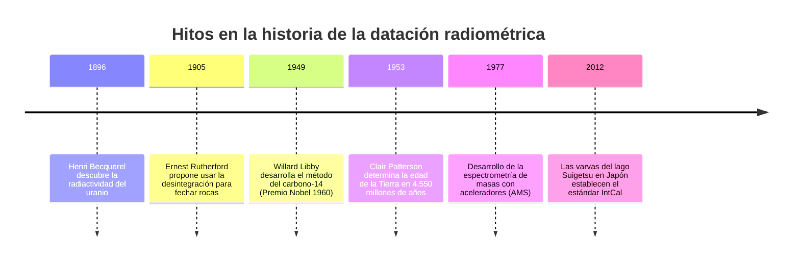
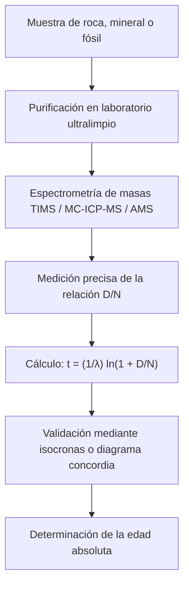

«¿Qué edad tiene este fósil?» «¿Cuándo cristalizó este granito a partir del magma incandescente?» «¿Cuál es la verdadera edad del planeta Tierra?»

Durante siglos, la humanidad careció de un método objetivo para medir el tiempo profundo. En el siglo XVII, el arzobispo James Ussher calculó mediante genealogías bíblicas que la Tierra fue creada en el 4004 a.C. A finales del siglo XIX, Lord Kelvin calculó mediante la termodinámica del enfriamiento que la edad del planeta oscilaba entre 20 y 40 millones de años.

Todo cambió a principios del siglo XX con el **descubrimiento de la radiactividad**. Los núcleos atómicos inestables se desintegran siguiendo leyes probabilísticas cuánticas inmutables, inmunes a la temperatura, la presión o los enlaces químicos. La física nuclear entregó a la ciencia **relojes atómicos naturales** que permitieron medir desde asentamientos arqueológicos de hace milenios hasta los 4.560 millones de años del sistema solar.



---

## 1. Leyes físicas del decaimiento radiactivo

La velocidad de desintegración de un número $N(t)$ de núcleos radiactivos padres es proporcional a la cantidad presente:

$$\frac{dN}{dt} = -\lambda N(t)$$

siendo $\lambda$ la **constante de desintegración**. Su integración genera la conocida **ley de decaimiento radiactivo**:

$$N(t) = N_0 e^{-\lambda t}$$

La vida media o periodo de semidesintegración ($t_{1/2}$) viene dada por:

$$t_{1/2} = \frac{\ln 2}{\lambda} \approx \frac{0{,}69315}{\lambda}$$

Despejando el tiempo a partir de la acumulación de núcleos hijos radiogénicos $D(t) = N_0 - N(t)$, se obtiene la **ecuación fundamental de la edad radiométrica**:

$$t = \frac{1}{\lambda} \ln\left(1 + \frac{D(t)}{N(t)}\right)$$



---

## 2. El carbono-14 y el registro milagroso del lago Suigetsu

El bombardeo de neutrones cósmicos en la alta atmósfera produce carbono-14:

$$n + {}^{14}_7N \rightarrow {}^{14}_6C + p$$

El $^{14}C$ se incorpora a las redes tróficas a través del dióxido de carbono asimilado en la fotosíntesis. Al morir el organismo, cesa el intercambio y el $^{14}C$ decae por emisión beta (vida media de 5.730 años).

Debido a que la concentración atmosférica fluctuó a lo largo de las eras, el **lago Suigetsu (Fukui, Japón)** proporcionó el patrón de calibración definitivo: más de 50.000 finas capas anuales alternadas de diatomeas y arcillas (*varvas*) que permitieron correlacionar con precisión astronómica la edad radiocarbónica y el tiempo real en la curva mundial **IntCal**.

---

## 3. Geocronología del tiempo profundo y el método de isocronas

| Sistema | Desintegración | Periodo de semidesintegración | Rango temporal | Minerales objetivo |
| :--- | :--- | :--- | :--- | :--- |
| **Carbono-14** | $^{14}C \rightarrow {}^{14}N$ | 5.730 años | 300 a 50.000 años | Madera, huesos, conchas, carbón vegetal |
| **K-Ar y Ar-Ar** | $^{40}K \rightarrow {}^{40}Ar$ | 1.250 Ma | 10.000 años a 4.500 Ma | Feldespatos, micas, tobas volcánicas |
| **U-Pb** | $^{238}U \rightarrow {}^{206}Pb$<br>$^{235}U \rightarrow {}^{207}Pb$ | 4.470 Ma<br>704 Ma | 1 Ma a 4.560 Ma | **Circones ($ZrSiO_4$)**, monacita |
| **Rb-Sr** | $^{87}Rb \rightarrow {}^{87}Sr$ | 48.800 Ma | 10 Ma a 4.500 Ma | Rocas ígneas y metamórficas |

### Demostración del método de isocronas:
Al normalizar la acumulación de hijos respecto a un isótopo de referencia estable ($^{86}Sr$):

$$\frac{{}^{87}Sr}{{}^{86}Sr} = \left(\frac{{}^{87}Sr}{{}^{86}Sr}\right)_0 + \frac{{}^{87}Rb}{{}^{86}Sr} (e^{\lambda t} - 1)$$

La pendiente de la recta $m = e^{\lambda t} - 1$ permite obtener la edad exacta $t = \frac{\ln(1+m)}{\lambda}$ sin necesidad de conocer a priori la cantidad inicial de estroncio hijo.

```mermaid
xychart-beta
    title "Diagrama de isocrona Rubidio-Estroncio"
    x-axis "87Rb / 86Sr" [0, 1, 2, 3, 4, 5]
    y-axis "87Sr / 86Sr" 0.69 to 0.76
    line [0.700, 0.710, 0.720, 0.730, 0.740, 0.750]
```

---

## 4. La edad de la Tierra y la gesta de Clair Patterson

Al no quedar rocas corticales primordiales en la Tierra debido a la tectónica de placas, **Clair Patterson** analizó en 1953 los isótopos de plomo en la troilita del meteorito de Canyon Diablo, demostrando que la Tierra y el sistema solar tienen **4.550 millones de años**.

Durante sus investigaciones, descubrió la grave contaminación por plomo originada por la gasolina con plomo, inventó las **salas limpias** y libró una batalla histórica que culminó con la prohibición mundial del combustible con plomo.
