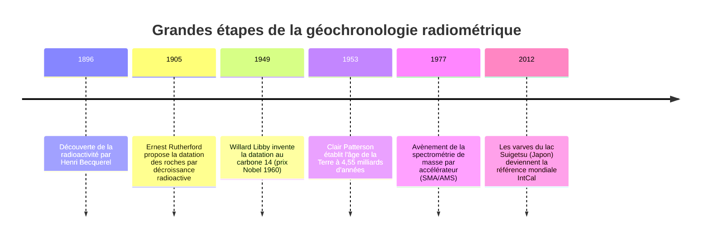
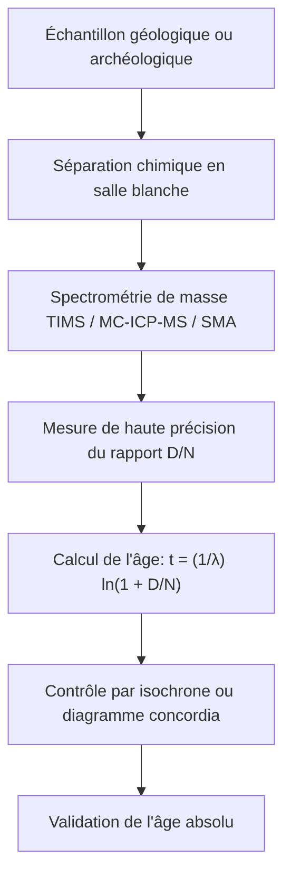

« Quel est l'âge de ce fossile ? » « Quand ce granite a-t-il cristallisé depuis le magma ? » « Quel est l'âge véritable de la Terre ? »

Pendant des millénaires, l'humanité fut incapable de calibrer la flèche du temps. Au XVIIe siècle, l'archevêque James Ussher déduisit de la Genèse que la Terre avait été créée en 4004 avant notre ère. À la fin du XIXe siècle, Lord Kelvin calcula par thermodynamique que le refroidissement de la Terre n'avait pu prendre que 20 à 40 millions d'années.

Ces estimations s'effondrèrent au début du XXe siècle avec **la découverte de la radioactivité** par Henri Becquerel, Pierre et Marie Curie, et Ernest Rutherford. La désintégration spontanée des noyaux atomiques obéit à des lois quantiques immuables, insensibles à la température, à la pression ou aux réactions chimiques. En découvrant ces **horloges atomiques naturelles**, la science a acquis le pouvoir de sonder les profondeurs du temps géologique (Deep Time).



---

## 1. Physique nucléaire et calcul de la désintégration

Le taux de désintégration d'un nombre $N(t)$ de noyaux pères radioactifs est strictement proportionnel à leur population :

$$\frac{dN}{dt} = -\lambda N(t)$$

où $\lambda$ est la **constante radioactive**. L'intégration directe donne la loi fondamentale de décroissance exponentielle :

$$N(t) = N_0 e^{-\lambda t}$$

La période radioactive (ou demi-vie $t_{1/2}$) s'exprime par :

$$t_{1/2} = \frac{\ln 2}{\lambda} \approx \frac{0{,}69315}{\lambda}$$

En mesurant le rapport entre les noyaux fils radiogéniques $D(t)$ accumulés et les pères restants $N(t)$, on en déduit l'**équation fondamentale de l'âge géologique** :

$$t = \frac{1}{\lambda} \ln\left(1 + \frac{D(t)}{N(t)}\right)$$



---

## 2. Le carbone 14 et les varves miraculeuses du lac Suigetsu

Les rayons cosmiques interagissent avec l'azote atmosphérique pour produire du carbone 14 :

$$n + {}^{14}_7N \rightarrow {}^{14}_6C + p$$

Absorbé par la photosynthèse, le $^{14}C$ est incorporé dans les tissus vivants. À la mort de l'organisme, les échanges cessent et le $^{14}C$ décroît avec une demi-vie de 5 730 ans.

Grâce aux carottes sédimentaires du **lac Suigetsu (Fukui, Japon)**, qui ont préservé plus de 50 000 feuillets annuels continus (varves de diatomées et d'argiles), les scientifiques ont corrélé des dizaines de milliers de datations radiocarbone avec les années civiles réelles, érigeant la courbe d'étalonnage internationale **IntCal**.

---

## 3. Les chronomètres du temps profond et la méthode isochrone

| Méthode | Système | Demi-vie | Plage temporelle | Minéraux cibles |
| :--- | :--- | :--- | :--- | :--- |
| **Carbone 14** | $^{14}C \rightarrow {}^{14}N$ | 5 730 ans | 300 à 50 000 ans | Matière organique, ossements, bois |
| **K-Ar et Ar-Ar** | $^{40}K \rightarrow {}^{40}Ar$ | 1,25 Ga | 10 000 ans à 4,5 Ga | Feldspaths, micas, cendres volcaniques |
| **U-Pb** | $^{238}U \rightarrow {}^{206}Pb$<br>$^{235}U \rightarrow {}^{207}Pb$ | 4,47 Ga<br>704 Ma | 1 Ma à 4,56 Ga | **Zircons ($ZrSiO_4$)**, monazites |
| **Rb-Sr** | $^{87}Rb \rightarrow {}^{87}Sr$ | 48,8 Ga | 10 Ma à 4,5 Ga | Roches magmatiques et métamorphiques |

### Démonstration mathématique de l'isochrone :
En présence d'un isotope fils initial inconnu ($D_0$), la normalisation par un isotope stable non radiogénique ($^{86}Sr$) donne :

$$\frac{{}^{87}Sr}{{}^{86}Sr} = \left(\frac{{}^{87}Sr}{{}^{86}Sr}\right)_0 + \frac{{}^{87}Rb}{{}^{86}Sr} (e^{\lambda t} - 1)$$

Cette équation de droite $y = b + mx$ possède une pente $m = e^{\lambda t} - 1$. L'âge s'obtient directement par $t = \frac{\ln(1+m)}{\lambda}$, sans avoir besoin de connaître la quantité initiale de strontium fils.

```mermaid
xychart-beta
    title "Diagramme isochrone Rubidium-Strontium"
    x-axis "87Rb / 86Sr" [0, 1, 2, 3, 4, 5]
    y-axis "87Sr / 86Sr" 0.69 to 0.76
    line [0.700, 0.710, 0.720, 0.730, 0.740, 0.750]
```

---

## 4. La détermination de l'âge de la Terre : le combat de Clair Patterson

En 1953, le géochimiste américain **Clair Patterson** mesura la composition isotopique du plomb dans la troïlite de la météorite de Canyon Diablo. Il fixa pour la première fois l'âge de la Terre et du système solaire à **4,55 milliards d'années**.

Au cours de ses expériences, Patterson découvrit l'extrême contamination atmosphérique causée par le plomb tétraéthyle des carburants. Il créa la première **salle blanche** et consacra le reste de sa vie à obtenir **l'interdiction totale de l'essence au plomb** à l'échelle mondiale.
