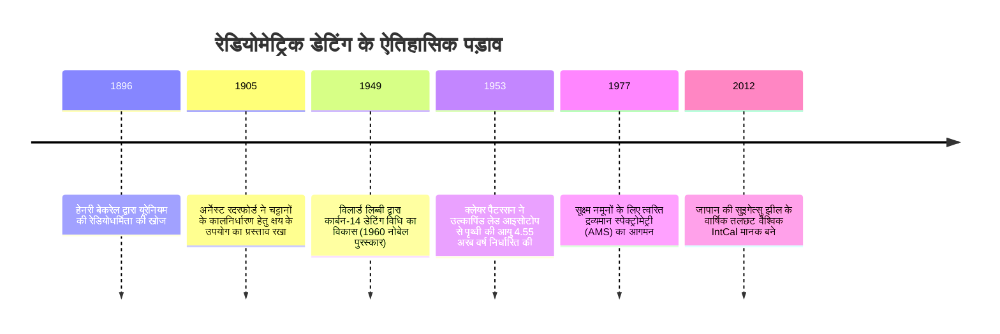

"यह जीवाश्म कितने हज़ार वर्ष पुराना है?" "यह ग्रेनाइट चट्टान मैग्मा से कब जमी थी?" "पृथ्वी की वास्तविक आयु कितनी है?"

शताब्दियों तक मानवता के पास 'समय के तीर' को मापने का कोई ठोस भौतिक साधन नहीं था। 17वीं सदी में आर्कबिशप जेम्स अशर ने बाइबिल की वंशावली के आधार पर पृथ्वी का निर्माण 4004 ईसा पूर्व में निर्धारित किया था। 19वीं सदी के अंत में लॉर्ड केल्विन ने ऊष्मागतिकी के शीतलन मॉडल से पृथ्वी की आयु केवल 2 से 4 करोड़ वर्ष आंकी थी।

ये सभी अनुमान 20वीं सदी के प्रारंभ में **रेडियोधर्मिता (Radioactivity) की खोज** के साथ ध्वस्त हो गए। परमाणु नाभिकों का स्वतः क्षय बाहरी तापमान, दबाव या रासायनिक बंधनों से अप्रभावित क्वांटम संभाव्यता नियमों का पालन करता है। इन **प्राकृतिक परमाणु घड़ियों** के माध्यम से मानवता ने पुरातात्विक स्थलों से लेकर 4.56 अरब वर्ष प्राचीन सौरमंडल के निर्माण तक 'गहन समय' (Deep Time) को मापने की वैज्ञानिक क्षमता प्राप्त की।



---

## 1. रेडियोधर्मी क्षय के भौतिकी और गणितीय सिद्धांत

अस्थिर मूल नाभिक $N(t)$ के क्षय होने की दर तात्कालिक नाभिकों की संख्या के समानुपाती होती है:

$$\frac{dN}{dt} = -\lambda N(t)$$

जहाँ $\lambda$ **क्षय स्थिरांक (Decay Constant)** है। इस अवकल समीकरण के समाकलन से **रेडियोधर्मी क्षय का मूलभूत नियम** प्राप्त होता है:

$$N(t) = N_0 e^{-\lambda t}$$

अर्ध-आयु ($t_{1/2}$) की गणना:

$$t_{1/2} = \frac{\ln 2}{\lambda} \approx \frac{0.69315}{\lambda}$$

क्षय से उत्पन्न संचित पुत्री नाभिकों $D(t) = N_0 - N(t) = N(t)(e^{\lambda t} - 1)$ से प्राथमिक **रेडियोमेट्रिक आयु समीकरण** व्युत्पन्न होता है:

$$t = \frac{1}{\lambda} \ln\left(1 + \frac{D(t)}{N(t)}\right)$$

```mermaid
flowchart TD
    नमूना[चट्टान/खनिज/जीवाश्म नमूना] --> शुद्धि[अल्ट्रा-क्लीन प्रयोगशाला में रासायनिक पृथक्करण]
    शुद्धि --> एमएस[उच्च विभेदन द्रव्यमान स्पेक्ट्रोमेट्री TIMS / AMS]
    एमएस --> अनुपात[पुत्री व मूल नाभिक अनुपात D/N का मापन]
    अनुपात --> गणना["आयु गणना: t = (1/λ) ln(1 + D/N)"]
     गणना --> सत्यापन[आइसोक्रोन विधि या कॉनकोर्डिया वक्र द्वारा सत्यापन]
    सत्यापन --> अंतिमआयु[सटीक निरपेक्ष आयु का निर्धारण]
```

---

## 2. कार्बन-14 डेटिंग और सुइगेत्सु झील का चमत्कार

अंतरिक्ष किरणों के न्यूट्रॉन वायुमंडलीय नाइट्रोजन-14 से टकराकर कार्बन-14 बनाते हैं:

$$n + {}^{14}_7N \rightarrow {}^{14}_6C + p$$

$^{14}C$ प्रकाश संश्लेषण द्वारा खाद्य श्रृंखला में प्रवेश करता है। मृत्यु के पश्चात उपापचय रुक जाता है और $^{14}C$ का क्षय 5,730 वर्ष की अर्ध-आयु के साथ होने लगता है।

वायुमंडल में $^{14}C$ की ऐतिहासिक सांद्रता में उतार-चढ़ाव को कैलिब्रेट करने के लिए **जापान की सुइगेत्सु झील** के 70,000 वर्षों के अनवरत वार्षिक तलछट (वार्ब्स) ने अंतरराष्ट्रीय अंशांकन वक्र **IntCal** की आधारशिला रखी।

---

## 3. गहन भूवैज्ञानिक काल के क्रोनोमीटर और आइसोक्रोन विधि

| विधि | क्षय प्रणाली | अर्ध-आयु | व्यावहारिक सीमा | मुख्य खनिज |
| :--- | :--- | :--- | :--- | :--- |
| **कार्बन-14** | $^{14}C \rightarrow {}^{14}N$ | 5,730 वर्ष | 300 - 50,000 वर्ष | लकड़ी, हड्डियाँ, कोयला |
| **K-Ar और Ar-Ar** | $^{40}K \rightarrow {}^{40}Ar$ | 1.25 अरब वर्ष | 10 हजार - 4.5 अरब वर्ष | फेल्डस्पार, अभ्रक, ज्वालामुखीय राख |
| **U-Pb विधि** | $^{238}U \rightarrow {}^{206}Pb$<br>$^{235}U \rightarrow {}^{207}Pb$ | 4.47 अरब वर्ष<br>7.04 करोड़ वर्ष | 10 लाख - 4.56 अरब वर्ष | **ज़िरकॉन ($ZrSiO_4$)**, मोनाजाइट |
| **Rb-Sr विधि** | $^{87}Rb \rightarrow {}^{87}Sr$ | 48.8 अरब वर्ष | 1 करोड़ - 4.5 अरब वर्ष | आग्नेय और कायांतरित चट्टानें |

### आइसोक्रोन विधि (Isochron Method) का गणितीय प्रमाण:
अज्ञात प्रारंभिक पुत्री समस्थानिक की उपस्थिति में स्थिर संदर्भ समस्थानिक ($^{86}Sr$) द्वारा सामान्यीकरण करने पर:

$$\frac{{}^{87}Sr}{{}^{86}Sr} = \left(\frac{{}^{87}Sr}{{}^{86}Sr}\right)_0 + \frac{{}^{87}Rb}{{}^{86}Sr} (e^{\lambda t} - 1)$$

सरल रेखा समीकरण की ढाल $m = e^{\lambda t} - 1$ से प्रारंभिक स्ट्रोंटियम अनुपात को जाने बिना सटीक आयु $t = \frac{\ln(1+m)}{\lambda}$ ज्ञात की जा सकती है।

```mermaid
xychart-beta
    title "रूबिडियम-स्ट्रोंटियम आइसोक्रोन आरेख"
    x-axis "87Rb / 86Sr" [0, 1, 2, 3, 4, 5]
    y-axis "87Sr / 86Sr" 0.69 to 0.76
    line [0.700, 0.710, 0.720, 0.730, 0.740, 0.750]
```

---

## 4. पृथ्वी की 4.55 अरब वर्ष आयु और क्लेयर पैटरसन का संघर्ष

प्लेट विवर्तनिकी के कारण पृथ्वी की प्रारंभिक चट्टानें नष्ट हो चुकी थीं। 1953 में अमेरिकी भू-रसायनज्ञ **क्लेयर पैटरसन** ने कैनियन डियाब्लो उल्कापिंड के यूरेनियम-मुक्त ट्रॉयलाइट खनिज में लेड समस्थानिकों का विश्लेषण कर पहली बार सिद्ध किया कि पृथ्वी और सौरमंडल की आयु **4.55 अरब वर्ष** है।

अपने प्रयोगों के दौरान वायुमंडलीय लेड संदूषण की गंभीरता को देखते हुए पैटरसन ने विश्व के पहले **अल्ट्रा-क्लीन रूम** का आविष्कार किया और बहुराष्ट्रीय तेल कंपनियों के भारी दबाव के बावजूद **सीसायुक्त पेट्रोल (Leaded Gasoline) पर वैश्विक प्रतिबंध** लगवाने में सफलता प्राप्त की।
