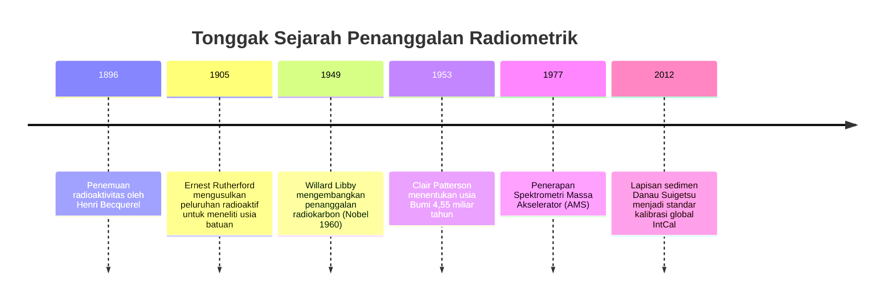
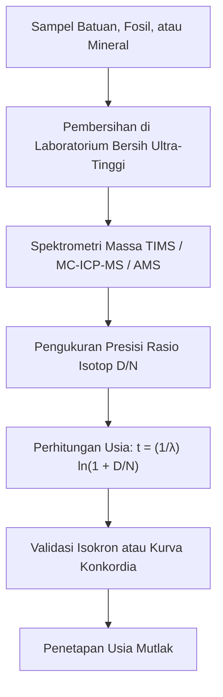

"Berapa ribu tahun usia fosil ini?" "Kapan granit ini membeku dari magma panas?" "Berapa sebenarnya usia planet Bumi?"

Selama berabad-abad, umat manusia tidak memiliki instrumen ilmiah yang objektif untuk mengukur "panah waktu". Pada abad ke-17, Uskup Agung James Ussher menghitung silsilah Alkitab dan menyimpulkan Bumi diciptakan pada 4004 SM. Pada akhir abad ke-19, Lord Kelvin menggunakan model pendinginan termodinamika untuk memperkirakan usia Bumi hanya 20 hingga 40 juta tahun.

Semua perkiraan tersebut gugur pada awal abad ke-20 dengan **penemuan radioaktivitas**. Peluruhan spontan inti atom mengikuti hukum probabilitas kuantum yang mutlak, bebas dari pengaruh suhu, tekanan, maupun ikatan kimiawi. Penemuan **jam atom alami** ini memberi manusia kemampuan untuk mengukur kedalaman waktu geologis (*Deep Time*).



---

## 1. Fisika dan Kalkulus Peluruhan Radioaktif

Jumlah inti induk tidak stabil $N(t)$ yang meluruh dalam interval waktu $dt$ sebanding dengan jumlah yang ada:

$$\frac{dN}{dt} = -\lambda N(t)$$

dengan $\lambda$ adalah **konstanta peluruhan**. Integrasinya menghasilkan **hukum peluruhan eksponensial**:

$$N(t) = N_0 e^{-\lambda t}$$

Waktu paruh ($t_{1/2}$) dirumuskan sebagai:

$$t_{1/2} = \frac{\ln 2}{\lambda} \approx \frac{0{,}69315}{\lambda}$$

Dengan menghitung akumulasi inti anak radiogenik $D(t) = N_0 - N(t)$, diperoleh **persamaan usia radiometrik**:

$$t = \frac{1}{\lambda} \ln\left(1 + \frac{D(t)}{N(t)}\right)$$



---

## 2. Karbon-14 dan Keajaiban Sedimen Danau Suigetsu

Sinar kosmik berinteraksi dengan nitrogen-14 di atmosfer membentuk karbon-14:

$$n + {}^{14}_7N \rightarrow {}^{14}_6C + p$$

$^{14}C$ diserap melalui fotosintesis tanaman. Saat makhluk hidup mati, pertukaran berhenti dan $^{14}C$ meluruh dengan waktu paruh 5.730 tahun.

Untuk mengalibrasi fluktuasi konsentrasi $^{14}C$ di masa lampau, **Danau Suigetsu di Jepang** menyediakan rekaman varve sempurna: lebih dari 50.000 lapisan sedimen tahunan yang tidak terganggu, menjadi dasar kurva kalibrasi internasional **IntCal**.

---

## 3. Kronometer Geologis dan Metode Isokron

| Metode | Sistem Peluruhan | Waktu Paruh | Rentang | Mineral Target |
| :--- | :--- | :--- | :--- | :--- |
| **Karbon-14** | $^{14}C \rightarrow {}^{14}N$ | 5.730 tahun | 300 – 50.000 tahun | Kayu, tulang, arang, gambut |
| **K-Ar dan Ar-Ar** | $^{40}K \rightarrow {}^{40}Ar$ | 1,25 Ga | 10.000 tahun – 4,5 Ga | Feldspar, mika, abu vulkanik |
| **U-Pb** | $^{238}U \rightarrow {}^{206}Pb$<br>$^{235}U \rightarrow {}^{207}Pb$ | 4,47 Ga<br>704 Ma | 1 Ma – 4,56 Ga | **Zirkon ($ZrSiO_4$)**, monasit |
| **Rb-Sr** | $^{87}Rb \rightarrow {}^{87}Sr$ | 48,8 Ga | 10 Ma – 4,5 Ga | Batuan beku dan metamorf |

### Pembuktian Matematis Metode Isokron:
Normalisasi terhadap isotop stabil non-radiogenik ($^{86}Sr$):

$$\frac{{}^{87}Sr}{{}^{86}Sr} = \left(\frac{{}^{87}Sr}{{}^{86}Sr}\right)_0 + \frac{{}^{87}Rb}{{}^{86}Sr} (e^{\lambda t} - 1)$$

Kemiringan garis $m = e^{\lambda t} - 1$ memungkinkan perhitungan usia $t = \frac{\ln(1+m)}{\lambda}$ tanpa perlu mengetahui rasio stronsium awal.

```mermaid
xychart-beta
    title "Diagram Isokron Rubidium-Stronsium"
    x-axis "87Rb / 86Sr" [0, 1, 2, 3, 4, 5]
    y-axis "87Sr / 86Sr" 0.69 to 0.76
    line [0.700, 0.710, 0.720, 0.730, 0.740, 0.750]
```

---

## 4. Usia Bumi dan Perjuangan Clair Patterson

Karena kerak Bumi didaur ulang secara aktif oleh lempeng tektonik, batuan tertua Bumi telah musnah. Pada tahun 1953, **Clair Patterson** menganalisis troilit meteorit Canyon Diablo yang bebas uranium, membuktikan usia Bumi dan Tata Surya adalah **4,55 miliar tahun**.

Patterson juga memelopori teknologi **ruang bersih (clean room)** dan memimpin perjuangan publik yang berhasil menghentikan peredaran **bensin bertimbal** di seluruh dunia demi menyelamatkan kesehatan generasi manusia.
