「この化石は何万年前のものか？」「この岩石は何億年前にマグマから固まったのか？」「そもそも地球は何歳なのか？」

人類が自らの歴史や宇宙の成り立ちを問うとき、常に突き当たるのが**「時間の矢をいかにして計測するか」**という根本的な課題でした。17世紀、聖書学者ジェームズ・アッシャーは旧約聖書の記述から「地球は紀元前4004年10月23日に創造された」と計算しました。19世紀後半、物理学者ケルヴィン卿は溶融状態の地球が現在の温度まで冷却する熱伝導速度から「地球の年齢は2000万年〜4000万年」と推計しました。

しかし、これらの見積もりはすべて20世紀初頭に覆されます。アンリ・ベクレル、ピエール＆マリ・キュリー夫妻、そしてアーネスト・ラザフォードによる**「放射能（Radioactivity）」の発見**です。

原子核が外部の温度や圧力、化学結合の影響を一切受けず、量子力学的な確率則に従って正確無比に崩壊していく性質――すなわち**「天然の原子時計」**を手に入れたことで、人類は数千年前の古代遺跡から45億年前の太陽系誕生に至る「深遠なる時間（Deep Time）」の全貌を正確に測定する能力を獲得したのです。

本稿では、放射年代測定の基礎理論から、考古学を一変させた炭素14法、福井県水月湖の年縞堆積物による世界標準較正、ジルコン結晶とウラン-鉛コンコーディア法、アイソクロン法の厳密な数学的証明、そして地球の年齢45.5億年を突き止めたクレア・パターソンの闘いまで、年代測定科学の全貌を数式と図解を交えて完全解説します。

---

## 1. 放射壊変の物理学と数学的基礎

### 1.1 原子核崩壊の確率論と指数関数的減衰則

放射性同位体（不安定な原子核）は、外部の環境（温度、圧力、磁場、化合物の形態）に左右されることなく、一定の確率で崩壊してより安定な核種へと遷移します。

ある微小時間 $dt$ の間に、存在する放射性親核種 $N(t)$ のうち崩壊する原子核の数 $dN$ は、その瞬間の親核種数 $N(t)$ に厳密に比例します。

$$\frac{dN}{dt} = -\lambda N(t)$$

ここで、比例定数 $\lambda$ は各核種に固有の**崩壊定数（Decay Constant）**であり、単位時間あたりに特定の原子核が崩壊する確率（単位: $\text{s}^{-1}$ または $\text{year}^{-1}$）を表します。

この微分方程式を変数分離して解きます。

$$\frac{dN}{N} = -\lambda dt$$

両辺を時刻 $t=0$ から $t$ まで積分します（$t=0$ における親核種数を $N_0$ とする）：

$$\int_{N_0}^{N(t)} \frac{dN}{N} = -\lambda \int_0^t dt$$

$$\ln\left(\frac{N(t)}{N_0}\right) = -\lambda t$$

指数関数をとることで、有名な**放射壊変の法則（Law of Radioactive Decay）**が得られます。

$$N(t) = N_0 e^{-\lambda t}$$

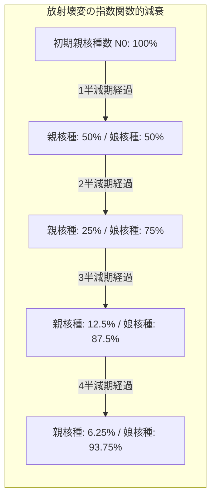

---

### 1.2 半減期（Half-life）の導出

親核種の数が初期値の半分（$N(t) = \frac{N_0}{2}$）になるまでの時間を**半減期（$t_{1/2}$）**と呼びます。

$$\frac{N_0}{2} = N_0 e^{-\lambda t_{1/2}} \implies \frac{1}{2} = e^{-\lambda t_{1/2}}$$

両辺の自然対数をとると：

$$\ln\left(\frac{1}{2}\right) = -\lambda t_{1/2} \implies -\ln 2 = -\lambda t_{1/2}$$

$$t_{1/2} = \frac{\ln 2}{\lambda} \approx \frac{0.69315}{\lambda}$$

半減期は原子核の物理的定数であり、宇宙のあらゆる場所で普遍的に成立します。

---

### 1.3 親核種から娘核種への変換と年代方程式

親核種 $P$ が崩壊して娘核種 $D$ になるとき、初期に娘核種が存在しなかった（$D_0 = 0$）と仮定すると、時刻 $t$ における娘核種の数 $D(t)$ は、崩壊した親核種の数に等しくなります。

$$D(t) = P_0 - P(t)$$

ここで $P_0 = P(t) e^{\lambda t}$ であるため、代入すると：

$$D(t) = P(t) e^{\lambda t} - P(t) = P(t) (e^{\lambda t} - 1)$$

両辺を $P(t)$ で割ると、現在の娘核種と親核種の比率が得られます：

$$\frac{D(t)}{P(t)} = e^{\lambda t} - 1$$

この式を時間 $t$ について解くと、**放射年代方程式（Radiometric Age Equation）**が得られます。

$$t = \frac{1}{\lambda} \ln\left(1 + \frac{D(t)}{P(t)}\right)$$

現在試料中に含まれる娘核種と親核種の比率 $\frac{D}{P}$ を高精度質量分析計で測定し、既知の崩壊定数 $\lambda$ を代入すれば、岩石や鉱物が結晶化（時計がスタート）してから経過した時間 $t$ を直接算出できます。

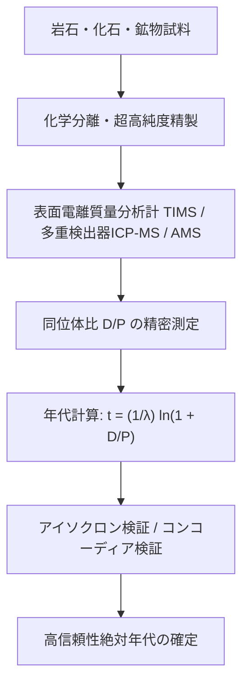

---

## 2. 炭素14年代測定法と考古学革命

### 2.1 大気上層での生成と食物網循環

1940年代後半、シカゴ大学のウィラード・リビー（Willard Libby、1960年ノーベル化学賞）は、宇宙線を利用した画期的な年代測定法を考案しました。それが**炭素14年代測定法（Radiocarbon Dating）**です。

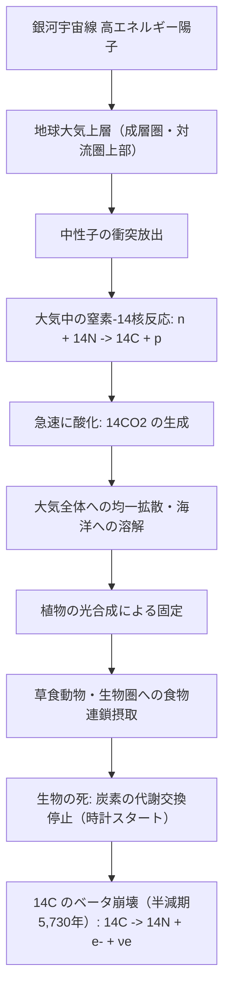

#### 核反応プロセス：
1. **生成**:
   地球大気に降り注ぐ宇宙線が窒素原子核（$^{14}N$）と衝突し、熱中性子捕獲反応によって炭素14（$^{14}C$）が生成されます。
   $$n + {}^{14}_7N \rightarrow {}^{14}_6C + p$$
2. **生体同化**:
   生成された $^{14}C$ は直ちに酸素と結合して二酸化炭素（$^{14}CO_2$）となり、植物の光合成を通じて生物圏全体に行き渡ります。生きている生物の体内における $^{14}C$ と通常の安定同位体 $^{12}C$ の比率は、大気中の比率（約 $1.2 \times 10^{-12}$、つまり1兆個に1個）と動的平衡を保ちます。
3. **死と崩壊時計の作動**:
   生物が死亡すると炭素の摂取が停止し、体内の $^{14}C$ は $\beta^-$ 崩壊によって窒素へと戻りながら指数関数的に減少していきます。
   $${}^{14}_6C \rightarrow {}^{14}_7N + e^- + \bar{\nu}_e \quad (t_{1/2} = 5,730 \pm 40\text{ 年})$$

---

### 2.2 測定技術の進化：放射能計測からAMS（加速器質量分析）へ

初期のリビーの方法は、試料をガス化または炭化させ、ガイガー＝ミュラー計数管で放出される $\beta$ 線（放射能）を直接カウントするものでした。しかし、炭素14は半減期が5,730年と比較的長いため、1グラムの炭素から1分間に放出される $\beta$ 線はわずか約15本にすぎず、数グラムの試料と数日間の計測時間を要しました。

1970年代後半に登場した**加速器質量分析計（AMS: Accelerator Mass Spectrometry）**は、この状況を一変させました。

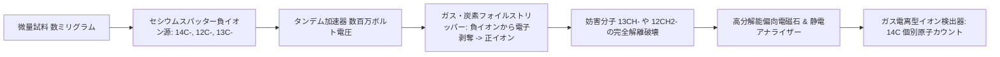

AMSの利点：
- **極微量測定**: わずか数ミリグラム（木炭の小片、布の単一繊維、骨粉、花粉粒）で測定可能。
- **超高感度**: $^{14}C/{}^{12}C \sim 10^{-15}$ という極限の同位体比を識別可能。
- **測定限界**: 約50,000年前（約9〜10半減期）まで適用可能。

---

## 3. 年輪年代学と水月湖の「奇跡の年縞」による較正革命

### 3.1 「放射性炭素年代」と「実年代」のズレ：IntCalの必要性

かつては「大気中の $^{14}C$ 濃度は過去数万年間常に一定であった」と仮定されていました。しかし、地球磁場の強度変化（磁場が弱いと宇宙線が多く侵入する）、太陽活動周期（黒点活動）、そして産業革命以降の化石燃料燃焼（$^{14}C$ を含まない太古の炭素の放出：スース効果）や大気圏内核実験（1950〜60年代の核実験ピークで $^{14}C$ が2倍に急増）により、**大気中の $^{14}C$ 濃度は時代によって大きく変動している**ことが判明しました。

そのため、測定された「放射性炭素年代（BP: Before Present、1950年を基準）」を「天文学的な実年代（cal BP / 西暦暦年）」に換算する**較正曲線（Calibration Curve）**が不可欠となったのです。

---

### 3.2 樹木年輪年代学（Dendrochronology）のクロスデーティング

樹木は1年に1本の年輪を形成します。気候変動（降水量や気温）によって年輪の幅は年ごとに異なるパターンを示します。

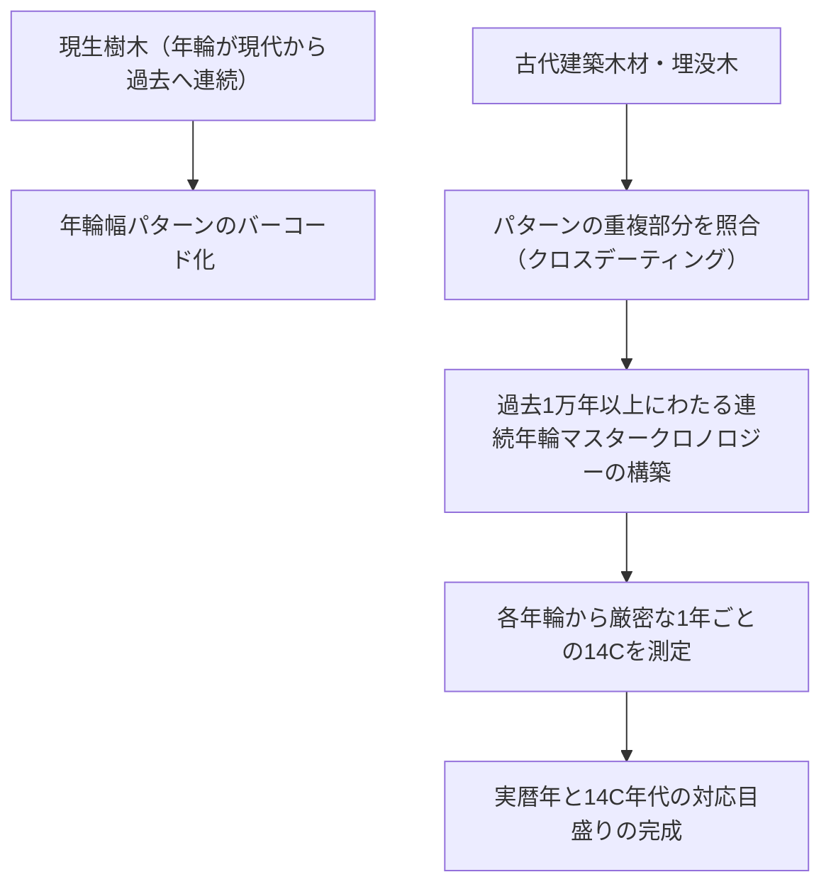

アメリカ南西部の高山に自生する樹齢4,000年を超えるブリストルコーンパイン（*Pinus longaeva*）や、ヨーロッパのオーク材の埋没木をつなぎ合わせることで、過去約1万4000年間の連続年輪年代目盛りが構築されました。

---

### 3.3 福井県水月湖の「奇跡の年縞（Varve）」：世界の時計の基準

樹木年輪では1万数千年前までしか遡れません。5万年前までの空白を埋めたのが、日本の福井県三方五湖の一つ、**水月湖（すいげつこ）の年縞堆積物**です。

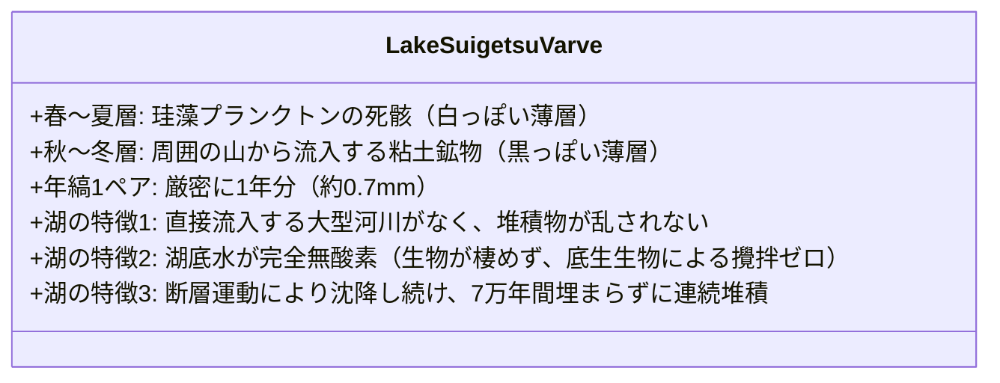

水月湖の湖底から掘削された長さ70mを超えるボーリングコアには、**過去約7万年間にわたる年縞が1枚の乱れもなく完全に保存**されていました。

中川毅教授（立命館大学）を中心とする国際共同研究チームは、水月湖コアに含まれる数万点におよぶ植物化石（木の葉や種子）のAMS放射性炭素測定を行い、年縞のカウント数と直接対比させました。この水月湖データが決定打となり、2012年以降、**国際標準放射性炭素較正曲線「IntCal」の骨格として世界中で公式採用**されています。

---

## 4. 地質時代を決定する主要放射年代測定法

炭素14の測定限界（約5万年）を超える地質学的スケール（数百万〜数十億年）の年代測定には、より半減期の長い長寿命放射性同位体が用いられます。

| 測定法 | 親核種 $\rightarrow$ 娘核種 | 半減期 $t_{1/2}$ | 適用可能年代範囲 | 主な対象鉱物・岩石 |
| :--- | :--- | :--- | :--- | :--- |
| **炭素14法** | $^{14}C \rightarrow {}^{14}N$ | 5,730年 | 300年 〜 50,000年 | 木炭、骨、貝殻、堆積物有機物 |
| **K-Ar / Ar-Ar法** | $^{40}K \rightarrow {}^{40}Ar$ | 12.5億年 | 1万年 〜 46億年 | 火山岩、雲母、角閃石、長石 |
| **U-Pb法** | $^{238}U \rightarrow {}^{206}Pb$<br>$^{235}U \rightarrow {}^{207}Pb$ | 44.7億年<br>7.04億年 | 100万年 〜 46億年 | **ジルコン（$ZrSiO_4$）**、モナザイト、バデレイ石 |
| **Rb-Sr法** | $^{87}Rb \rightarrow {}^{87}Sr$ | 488億年 | 1000万年 〜 46億年 | 変成岩、花崗岩、全岩・黒雲母 |
| **Sm-Nd法** | $^{147}Sm \rightarrow {}^{143}Nd$ | 1060億年 | 1億年 〜 46億年 | マントル捕獲岩、始原的苦鉄質岩 |

---

### 4.1 ウラン-鉛（U-Pb）法とコンコーディア図の幾何学

ウラン-鉛年代測定法は、地質年代測定における「黄金標準（Gold Standard）」です。自然界にはウランから鉛への2つの独立した崩壊系列が並行して存在します。

$$^{238}U \rightarrow {}^{206}Pb \quad (\lambda_{238} = 1.55125 \times 10^{-10}\text{ year}^{-1}, \quad t_{1/2} \approx 44.68\text{億年})$$

$$^{235}U \rightarrow {}^{207}Pb \quad (\lambda_{235} = 9.8485 \times 10^{-10}\text{ year}^{-1}, \quad t_{1/2} \approx 7.04\text{億年})$$

それぞれの崩壊式より：

$$\frac{{}^{206}Pb^*}{{}^{238}U} = e^{\lambda_{238} t} - 1$$

$$\frac{{}^{207}Pb^*}{{}^{235}U} = e^{\lambda_{235} t} - 1$$

（ここで $Pb^*$ は放射起源の鉛を表す）

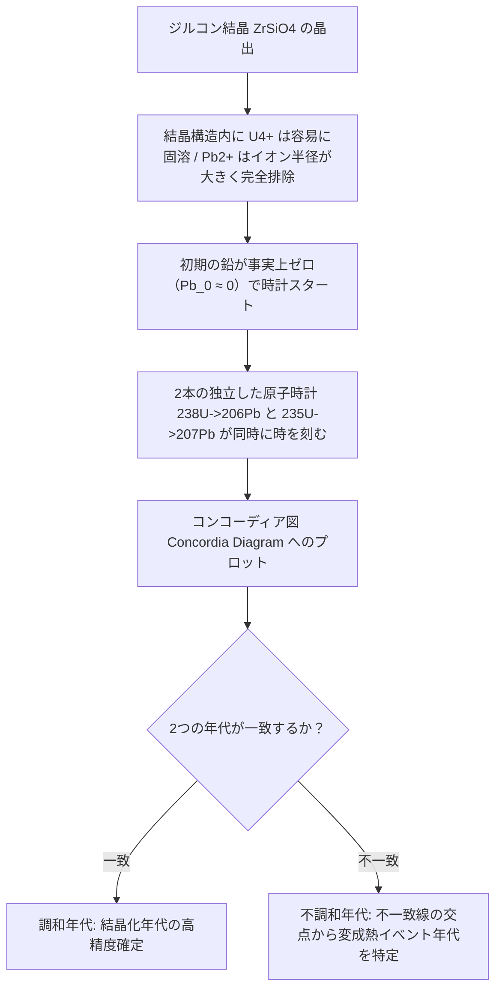

横軸に $\frac{{}^{207}Pb^*}{{}^{235}U}$、縦軸に $\frac{{}^{206}Pb^*}{{}^{238}U}$ をとると、両方の時計が完全に一致する場合の軌跡は1本の滑らかな曲線を描きます。これが**コンコーディア曲線（Concordia Curve）**です。

もしジルコンが後の地質学的加熱イベントで鉛を失った場合、分析データ点はコンコーディア曲線から直線的に逸脱します。この直線を**ディスコーディア線（不一致線）**と呼び、直線とコンコーディア曲線の**上部交点が「結晶化（形成）年代」**、**下部交点が「鉛損失（変成熱イベント）年代」**を同時に与えるという、驚異的な自己検証能力を持っています。

西オーストラリアのジャックヒルズから発見されたジルコン結晶微粒子は、コンコーディア法により**44億400万年前（4.404 Ga）**という値を示し、地球最古の物質として冥王代の海や地殻の存在を証明しました。

---

## 5. 等時線法（アイソクロン法）の数学的証明

岩石が結晶化した際、初期の娘核種（$D_0$）がゼロではない場合、単純な $D/P$ 比だけでは年代を決定できません。この問題を数学的・幾何学的にエレガントに解決したのが**等時線法（Isochron Method）**です。

ルビジウム-ストロンチウム（Rb-Sr）法を例に解説します。親核種 $^{87}Rb$ は $\beta^-$ 崩壊して $^{87}Sr$ になります。

$${}^{87}Sr = {}^{87}Sr_0 + {}^{87}Rb (e^{\lambda t} - 1)$$

ここで、初期のストロンチウム87の量 ${}^{87}Sr_0$ は未知数です。そこで、崩壊に関与しない安定同位体 **$^{86}Sr$（基準同位体）** で両辺を割ります。

$$\frac{{}^{87}Sr}{{}^{86}Sr} = \left(\frac{{}^{87}Sr}{{}^{86}Sr}\right)_0 + \frac{{}^{87}Rb}{{}^{86}Sr} (e^{\lambda t} - 1)$$

この式を直線の一般形 $y = b + m x$ と比較します：

- $y = \frac{{}^{87}Sr}{{}^{86}Sr}$ （現在のストロンチウム同位体比）
- $x = \frac{{}^{87}Rb}{{}^{86}Sr}$ （現在のルビジウム/ストロンチウム比）
- 切片 $b = \left(\frac{{}^{87}Sr}{{}^{86}Sr}\right)_0$ （結晶化時の初期ストロンチウム同位体比）
- 傾き $m = e^{\lambda t} - 1$

```mermaid
xychart-beta
    title "アイソクロン（等時線）ダイアグラム"
    x-axis "親/基準比 87Rb / 86Sr" [0, 1, 2, 3, 4, 5]
    y-axis "娘/基準比 87Sr / 86Sr" 0.69 to 0.76
    line [0.700, 0.710, 0.720, 0.730, 0.740, 0.750]
```

同一マグマから同時に晶出した複数の鉱物（長石、黒雲母、角閃石など）は、化学的性質の違いによりルビジウムとストロンチウムの取り込み比率（$x$ の値）が大きく異なりますが、**晶出時の初期ストロンチウム比 $b$ はすべての鉱物で完全に均一**です。

時間が経過するにつれて、各鉱物中の $^{87}Rb$ が $^{87}Sr$ へと壊変し、データ点は直線上を右上へと移動します。分析した複数の鉱物プロットが一直線上に並ぶとき、その直線を**アイソクロン（等時線）**と呼びます。

直線の傾き $m$ を求めることで、初期比 $b$ を知らなくても年代 $t$ が厳密に求まります。

$$m = e^{\lambda t} - 1 \implies e^{\lambda t} = 1 + m$$

$$t = \frac{\ln(1 + m)}{\lambda}$$

もし岩石が後に熱擾乱を受けて系が開いてしまっていれば、データ点は直線に乗らなくなり、測定者は即座に異常を検知できます。すなわち、アイソクロン法は**「測定結果が真の年代を示しているか否かをデータ自身が自己証明する」**という極めて高い堅牢性を備えています。

---

## 6. 地球の年齢45.5億年の決定：クレア・パターソンの戦い

地球自体の年齢を決定することは、地質学者にとって至難の業でした。なぜなら、地球はプレートテクトニクスや火山活動、浸食作用によって初期の岩石がすべて破壊・再溶融され、**「地球誕生時の初生岩石」が地上に残っていないから**です。

この難問を解いたのが、アメリカの地球化学者**クレア・パターソン（Clair Patterson、1922–1995）**でした。

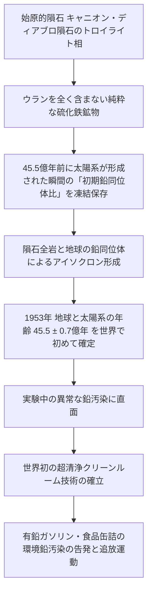

### 6.1 隕石を用いた地球年齢の導出
パターソンは、地球と同時に誕生し、地殻変動を経験していない太陽系のタイムカプセルである「隕石」に着目しました。アリゾナ州のバリンジャー・クレーターを作った**キャニオン・ディアブロ鉄隕石**のトロイライト（硫化鉄鉱物）相は、ウランを全く含まず、太陽系形成初期の鉛同位体比をそのまま保存していました。

パターソンは、地球の鉛と同位体進化曲線を結びつけることで、1953年、ついに**地球の年齢が $45.5 \pm 0.7$ 億年（現代の精査値は $45.4 \pm 0.5$ 億年）である**ことを突き止めたのです。

### 6.2 クリーンルームの発明と環境鉛との死闘
この研究の過程で、パターソンは測定室内の空気や器具から信じられないほど高濃度の鉛が混入する異常なバックグラウンドノイズに苦しめられました。彼は実験室を徹底的に密閉・陽圧換気し、酸で器具を極限まで洗浄する**世界初の「超清浄クリーンルーム（Clean Room）」**を考案しました。

そしてパターソンは、深海堆積物やグリーンランドの氷床コアを分析し、**現代の大気中鉛濃度が自然界の本来のレベルの数百倍に達している**事実を発見しました。原因は、自動車のノッキング防止剤としてガソリンに添加されていたテトラエチル鉛でした。

巨大石油資本や化学メーカーからの激しい妨害、研究資金の打ち切りという凄まじい圧力に晒されながらも、パターソンは信念を貫いて議会で証言を続け、ついに1970年代の米国大気浄化法（クリーンエア・アクト）改正、世界的な**有鉛ガソリンの全面禁止**を勝ち取りました。地球の年齢を測った科学者は、人類を鉛中毒の危機から救った英雄でもあったのです。

---

---

## 8. 初期人類化石の年代決定：オルドバイ渓谷とアルゴン-アルゴン（40Ar/39Ar）法の威力

人類進化の歴史（古人類学）において、化石そのものの年代を直接測定することは極めて困難です。なぜなら、数十万〜数百万年前の骨化石には炭素14は全く残っておらず、骨自体に含まれる無機成分は地下水による再結晶化や汚染を受けやすいからです。

この難題を打ち破ったのが、**火山灰層（凝灰岩層）の挟み撃ちによるアルゴン-アルゴン（$^{40}Ar/{}^{39}Ar$）法**です。

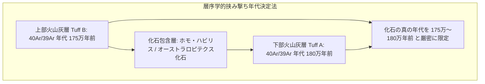

### 8.1 アルゴン-アルゴン法の物理原理
カリウム-アルゴン（K-Ar）法では、$^{40}K$ と $^{40}Ar$ の測定を別々の試料分取で行う必要があり、試料の不均質性が誤差要因となっていました。

$^{40}Ar/{}^{39}Ar$ 法では、試料（長石や黒雲母）を**研究用原子炉で高速中性子照射**します。これにより、試料中の安定なカリウム39が人工的にアルゴン39へと変換されます。

$${}^{39}_K(n, p) {}^{39}_Ar$$

その後、試料をレーザー段階加熱法（Step-Heating）で徐々に融解させ、放出されるアルゴンの同位体比（$^{40}Ar/{}^{39}Ar$）を希ガス質量分析計で一挙に同時測定します。この技術により、単一の鉱物粒子（直径数百ミクロン）から極めて高精度な年代プラトー（Plateau）を得ることが可能となり、タンザニアのオルドバイ渓谷やエチオピアのアファール盆地における「ルーシー（アファレンシス）」や「アルディ（ラミダス）」などの初期人類化石の層位年代が確定されたのです。

---

## 9. 放射年代以外の物理的年代測定フロンティア

放射壊変の親娘核種比を測る手法のほかにも、物質が受けた**放射線被ばくの累積効果（放射線損傷・捕獲電子）**を時計として利用する物理学的手法が存在します。

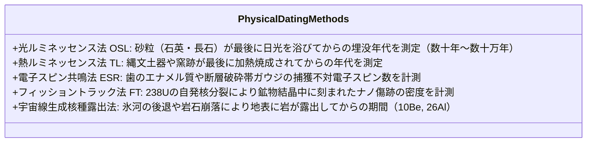

### 9.1 光刺激ルミネッセンス（OSL: Optically Stimulated Luminescence）法
砂漠の砂丘や地層中の石英・長石粒子は、周囲の放射性同位体（U, Th, K）から微量の放射線を受け続け、結晶格子の欠陥に電子が捕獲（トラップ）されていきます。

この砂粒が日光（紫外線・可視光）を浴びると、捕獲電子が一瞬で解放されて「時計がゼロにリセット（ブリーチング）」されます。地中に埋没して遮光されると、再び放射線による電子トラップが累積していきます。実験室で特定波長の光を照射した際に発光する蛍光（ルミネッセンス）の強度を測定することで、**「その砂粒が地中に埋まった瞬間（堆積年代）」**を直接決定できます。これは旧石器時代の遺跡や活断層の活動履歴解明に不可欠な武器となっています。

### 9.2 宇宙線生成核種露出年代法（$^{10}Be, {}^{26}Al$）
高エネルギー宇宙線が地表の岩石中の酸素やケイ素を直撃すると、ベリリウム10（$^{10}Be$）やアルミニウム26（$^{26}Al$）という極微量の長寿命核種が生成されます。岩石が地中深くにある間は宇宙線が遮蔽されるため生成されませんが、氷河の後退や地滑りによって岩石が地表に露出した瞬間から蓄積が始まります。AMSを用いてこの微量核種を測定することで、氷河期の後退年代や地震による断層変位の時期を正確に特定できます。

---

## 10. 統合年代層序学（Integrated Stratigraphy）：古地磁気と生層序の連携

現代の地球史解明において、放射年代測定は単独で用いられるだけでなく、**古地磁気層序（Magnetostratigraphy）**や**微化石生層序（Biostratigraphy）**と緊密に統合されています。

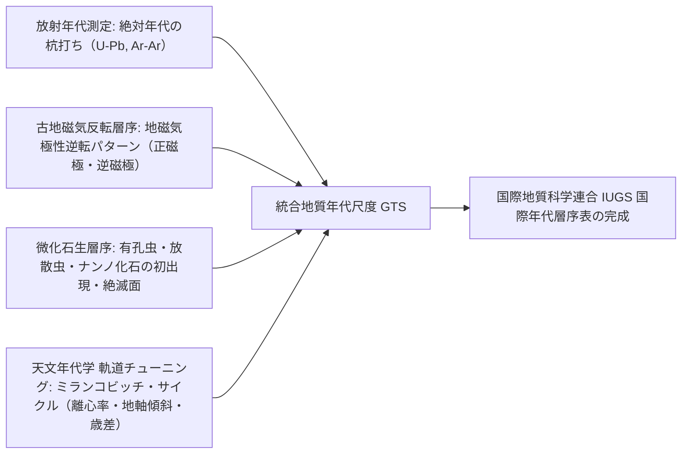

地球の地磁気は、過去に幾度も南北が逆転（地磁気逆転）を繰り返してきました。溶岩が冷え固まる際や堆積物が沈殿する際、当時の地球磁場の方位が磁性鉱物に「熱残留磁気」や「堆積残留磁気」として記録されます。

放射年代測定によって主要な磁気逆転境界（例えば約77万年前の松山‐ブルン逆転境界など）の絶対年代を正確に杭打ち（アンカー）することで、放射性鉱物を含まない広大な海洋堆積層や大陸堆積層全体に対しても、磁気縞模様の対比を通じて高精度な時間軸を網羅的に適用できるようになったのです。

## 11. まとめ：時間の矢を読み解く科学の到達点

年代測定学の進歩は、自然科学のあらゆる領域を根底から変革しました。

1. **歴史の絶対化**: 「古い」「新しい」という相対的な前後関係しか分からなかった地質学・考古学に、物理法則に裏付けられた「確固たる絶対年数」を与えた。
2. **地球観の変革**: 地球が46億年という長大な時間をかけてゆっくりと進化し、大陸が移動し、生命が幾度もの破局と再生を繰り返してきた壮大なドラマを立証した。
3. **自己検証の美学**: アイソクロン法やコンコーディア法に見られるように、分析誤差や後世の熱擾乱をデータ自身が露わにする厳密な数学的論理体系を構築した。

岩石の中に秘められた原子核の壊変を読み解く技術は、人類が獲得した最も精緻で美しい知性の結晶なのです。
