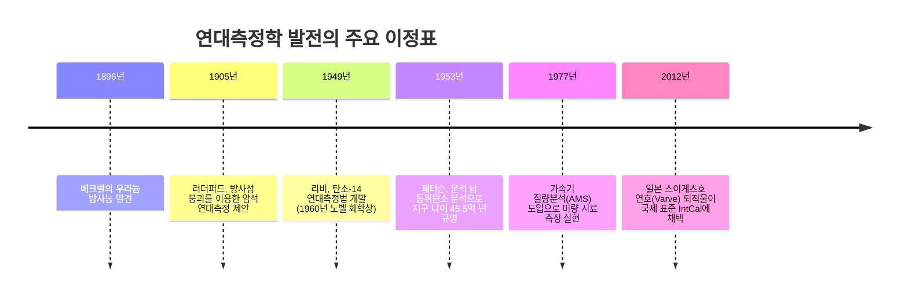
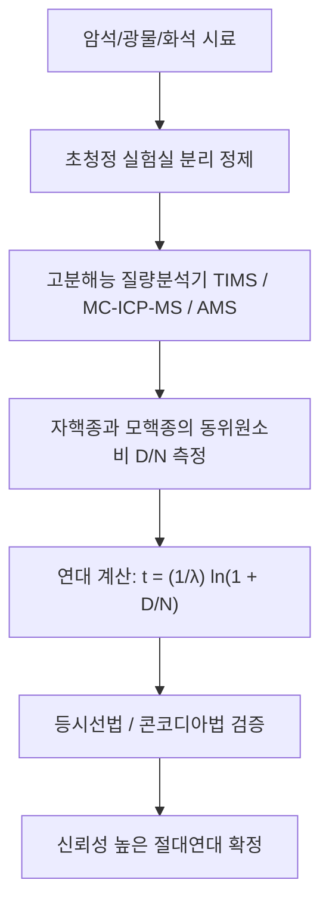

"이 화석은 몇만 년 전의 것인가?" "이 화강암은 언제 마그마로부터 굳어졌는가?" "지구의 진짜 나이는 몇 살인가?"

인류가 역사와 우주의 기원을 탐구할 때 언제나 마주했던 근본적인 한계는 '시간의 화살'을 객관적으로 측정할 수 있는 물리학적 도구의 부재였습니다. 17세기 제임스 어셔 주교는 성경 기록을 바탕으로 기원전 4004년에 지구가 창조되었다고 보았고, 19세기 켈빈 경은 열전도 냉각 계산을 통해 지구의 나이를 2천만~4천만 년으로 추정했습니다.

이 모든 추정은 20세기 초 **방사능(Radioactivity)의 발견**으로 뒤집혔습니다. 원자핵의 자발적 붕괴는 온도, 압력, 화학 결합의 영향을 받지 않는 엄밀한 양자역학적 확률 법칙을 따릅니다. 인류는 암석과 화석 속에 담긴 **'천연 원자시계'**를 확보함으로써 수천 년 전 고고학 유적부터 45.6억 년 전 태양계 탄생에 이르는 심원한 시간(Deep Time)의 비밀을 규명하게 되었습니다.



---

## 1. 방사성 붕괴의 미적분학과 물리 법칙

어떤 순간 방사성 모핵종 $N(t)$가 붕괴하는 비율 $\frac{dN}{dt}$은 그 순간 존재하는 모핵종의 수에 비례합니다.

$$\frac{dN}{dt} = -\lambda N(t)$$

여기서 $\lambda$는 핵종 고유의 **붕괴상수(Decay Constant)**입니다. 미분방정식을 풀면 지수함수적 **방사성 붕괴 법칙**을 얻습니다.

$$N(t) = N_0 e^{-\lambda t}$$

### 반감기($t_{1/2}$)와 연대측정 방정식:
모핵종이 절반으로 줄어드는 시간인 반감기는 다음과 같이 도출됩니다.

$$t_{1/2} = \frac{\ln 2}{\lambda} \approx \frac{0.69315}{\lambda}$$

초기에 자핵종이 없었다면($D_0 = 0$), 축적된 자핵종 $D(t) = N_0 - N(t) = N(t)(e^{\lambda t} - 1)$이 되며, 이를 시간 $t$에 대해 정리하면 기본 **연대측정 방정식**이 완성됩니다.

$$t = \frac{1}{\lambda} \ln\left(1 + \frac{D(t)}{N(t)}\right)$$



---

## 2. 탄소-14 연대측정법과 스이게츠호의 '기적의 연호'

### 2.1 탄소-14의 생성과 물질 순환
우주선이 대기 상층부의 질소-14와 충돌하여 생성된 탄소-14($^{14}C$)는 식물의 광합성을 통해 생태계로 흡수됩니다.

$$n + {}^{14}_7N \rightarrow {}^{14}_6C + p$$

생물이 살아있는 동안에는 대기와의 호흡과 섭취로 일정한 동위원소 비율($^{14}C/{}^{12}C \sim 10^{-12}$)을 유지하지만, 사망하면 물질대사가 중단되어 5,730년의 반감기로 $\beta^-$ 붕괴합니다.

$${}^{14}_6C \rightarrow {}^{14}_7N + e^- + \bar{\nu}_e$$

현대의 **가속기 질량분석기(AMS)**는 수 밀리그램의 극미량 시료에서 $^{14}C$ 원자를 직접 계수하여 약 5만 년 전까지의 연대를 측정합니다.

### 2.2 일본 스이게츠호의 연호(Varve) 퇴적층과 IntCal 교정
과거 대기 중 $^{14}C$ 농도는 지구 자기장과 태양 활동의 변화로 변동했습니다. 일본 후쿠이현의 **스이게츠호** 바닥에는 7만 년 동안 계절별 플랑크톤과 점토가 흐트러짐 없이 쌓인 '연호(Varve)'가 완벽히 보존되어 있었습니다. 수만 개의 잎 화석 연대와 연호의 나이테를 1년 단위로 완벽히 대조함으로써 전 세계 방사성 탄소 연대 교정의 글로벌 표준인 **IntCal**이 수립되었습니다.

---

## 3. 지질 시대를 측정하는 핵심 방법과 등시선법(Isochron)

| 방법 | 붕괴 계열 | 반감기 | 적용 연대 | 주요 대상 |
| :--- | :--- | :--- | :--- | :--- |
| **탄소-14법** | $^{14}C \rightarrow {}^{14}N$ | 5,730년 | 300년 ~ 5만 년 | 목탄, 뼈, 패각, 이탄 |
| **K-Ar / Ar-Ar법** | $^{40}K \rightarrow {}^{40}Ar$ | 12.5억 년 | 1만 년 ~ 45억 년 | 화산재 장석, 흑운모 |
| **U-Pb법** | $^{238}U \rightarrow {}^{206}Pb$<br>$^{235}U \rightarrow {}^{207}Pb$ | 44.7억 년<br>7.04억 년 | 100만 년 ~ 45.6억 년 | **지르콘($ZrSiO_4$)**, 모나자이트 |
| **Rb-Sr법** | $^{87}Rb \rightarrow {}^{87}Sr$ | 488억 년 | 1000만 년 ~ 45억 년 | 화강암 전암 등시선, 변성암 |

### 등시선법(Isochron Method)의 수학적 원리:
초기 자핵종($D_0$)이 존재할 때 비방사성 안정 동위원소($^{86}Sr$)로 양변을 정규화합니다.

$$\frac{{}^{87}Sr}{{}^{86}Sr} = \left(\frac{{}^{87}Sr}{{}^{86}Sr}\right)_0 + \frac{{}^{87}Rb}{{}^{86}Sr} (e^{\lambda t} - 1)$$

직선 방정식 $y = b + mx$에서 기울기 $m = e^{\lambda t} - 1$이므로 초기 비율을 몰라도 연대 $t = \frac{\ln(1+m)}{\lambda}$를 완벽히 도출할 수 있습니다.

```mermaid
xychart-beta
    title "루비듐-스트론튬 등시선도"
    x-axis "모핵종/기준비 87Rb / 86Sr" [0, 1, 2, 3, 4, 5]
    y-axis "자핵종/기준비 87Sr / 86Sr" 0.69 to 0.76
    line [0.700, 0.710, 0.720, 0.730, 0.740, 0.750]
```

---

## 4. 지구 나이 45.5억 년의 규명: 클레어 패터슨의 영웅적 승리

지구 표면의 암석은 판구조 운동으로 끊임없이 순환되어 원시 지구의 첫 암석이 남아있지 않습니다. 1953년 미국의 지구화학자 **클레어 패터슨(Clair Patterson)**은 우라늄이 전혀 없는 캐니언 디아블로 철운석의 트로일라이트(황화철 광물)를 분석하여 원시 태양계의 초기 납 동위원소 비를 확정하고, 지구의 나이가 **45.5억 년**임을 증명했습니다.

그 과정에서 대기 중 납 오염의 심각성을 간파한 패터슨은 세계 최초의 **초청정 클린룸(Clean Room)**을 발명하고, 거대 정유업계의 압박에 맞서 **유연 휘발유 금지**를 이끌어내며 인류를 납 중독의 재앙으로부터 구했습니다.
