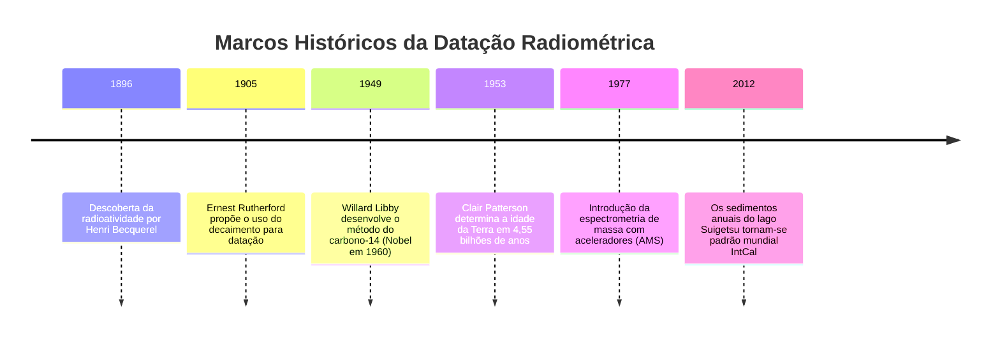
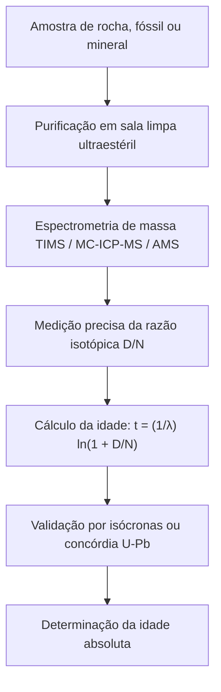

"Quantos milênios tem este fóssil?" "Quando este granito cristalizou a partir do magma?" "Qual é a verdadeira idade do planeta Terra?"

Durante a maior parte de sua história, a humanidade careceu de um método físico para medir o tempo geológico profundo. No século XVII, o arcebispo James Ussher calculou genealogias bíblicas e cravou a criação da Terra em 4004 a.C. No final do século XIX, Lord Kelvin utilizou modelos de perda de calor termodinâmico para estimar a idade da Terra entre 20 e 40 milhões de anos.

Todas essas teses foram superadas no início do século XX com a **descoberta da radioatividade**. O decaimento espontâneo de núcleos atômicos instáveis segue leis de probabilidade quântica inabaláveis, absolutamente insensíveis à temperatura, à pressão ou a reações químicas. Com esses **relógios atômicos naturais**, a ciência conquistou a capacidade de decifrar o tempo profundo.



---

## 1. Física e Cálculo do Decaimento Radioativo

O número de núcleos instáveis que decaem em um intervalo $dt$ é proporcional à quantidade presente de núcleos pais $N(t)$:

$$\frac{dN}{dt} = -\lambda N(t)$$

onde $\lambda$ é a **constante de decaimento**. A integração produz a lei fundamental do decaimento radioativo:

$$N(t) = N_0 e^{-\lambda t}$$

A meia-vida ($t_{1/2}$) corresponde a:

$$t_{1/2} = \frac{\ln 2}{\lambda} \approx \frac{0{,}69315}{\lambda}$$

A partir do acúmulo de núcleos filhos radiogênicos $D(t) = N_0 - N(t)$, deduz-se a **equação da idade radiométrica**:

$$t = \frac{1}{\lambda} \ln\left(1 + \frac{D(t)}{N(t)}\right)$$



---

## 2. Carbono-14 e a Calibração de Suigetsu

Nêutrons cósmicos colidem com o nitrogênio-14 na atmosfera superior gerando carbono-14:

$$n + {}^{14}_7N \rightarrow {}^{14}_6C + p$$

O $^{14}C$ é assimilado por fotossíntese. Com a morte biológica, as trocas cessam e o $^{14}C$ decai com meia-vida de 5.730 anos.

Como a taxa de produção de $^{14}C$ variou na história, o **Lago Suigetsu (Japão)** forneceu a escala de calibração definitiva: mais de 50.000 lâminas anuais ininterruptas de sedimentos lacustres (*varves*), estabelecendo a curva global **IntCal**.

---

## 3. Geocronômetros do Tempo Profundo e Método das Isócronas

| Método | Decaimento | Meia-vida | Alcance | Minerais Alvo |
| :--- | :--- | :--- | :--- | :--- |
| **Carbono-14** | $^{14}C \rightarrow {}^{14}N$ | 5.730 anos | 300 a 50.000 anos | Matéria orgânica, madeira, ossos |
| **K-Ar e Ar-Ar** | $^{40}K \rightarrow {}^{40}Ar$ | 1,25 Ga | 10.000 anos a 4,5 Ga | Feldspatos, micas, cinzas vulcânicas |
| **U-Pb** | $^{238}U \rightarrow {}^{206}Pb$<br>$^{235}U \rightarrow {}^{207}Pb$ | 4,47 Ga<br>704 Ma | 1 Ma a 4,56 Ga | **Zircões ($ZrSiO_4$)**, monazita |
| **Rb-Sr** | $^{87}Rb \rightarrow {}^{87}Sr$ | 48,8 Ga | 10 Ma a 4,5 Ga | Rochas ígneas e metamórficas |

### O Método das Isócronas:
Ao normalizar por um isótopo estável não-radiogênico ($^{86}Sr$):

$$\frac{{}^{87}Sr}{{}^{86}Sr} = \left(\frac{{}^{87}Sr}{{}^{86}Sr}\right)_0 + \frac{{}^{87}Rb}{{}^{86}Sr} (e^{\lambda t} - 1)$$

A inclinação $m = e^{\lambda t} - 1$ permite calcular a idade $t = \frac{\ln(1+m)}{\lambda}$ sem precisar adivinhar a razão isotópica inicial de estrôncio.

```mermaid
xychart-beta
    title "Diagrama de Isócrona Rubídio-Estrôncio"
    x-axis "87Rb / 86Sr" [0, 1, 2, 3, 4, 5]
    y-axis "87Sr / 86Sr" 0.69 to 0.76
    line [0.700, 0.710, 0.720, 0.730, 0.740, 0.750]
```

---

## 4. A Idade da Terra e a Luta de Clair Patterson

Como a Terra recicla sua crosta por tectônica de placas, não restam rochas da época de sua formação. Em 1953, **Clair Patterson** mediu os isótopos de chumbo na troilita livre de urânio do meteorito Canyon Diablo, provando que a Terra e o Sistema Solar têm **4,55 bilhões de anos**.

Para eliminar a contaminação em suas medições, Patterson criou as **salas limpas** e dedicou décadas a provar os malefícios do chumbo tetraetila, liderando o banimento mundial da **gasolina com chumbo**.
