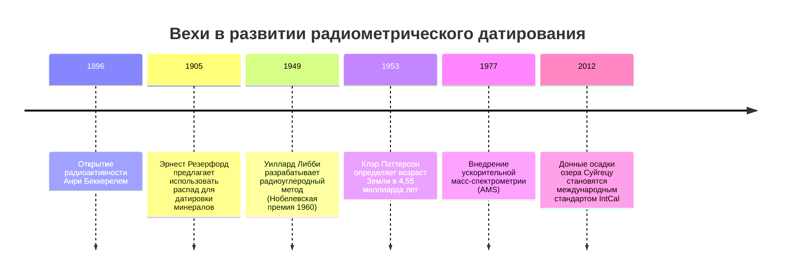
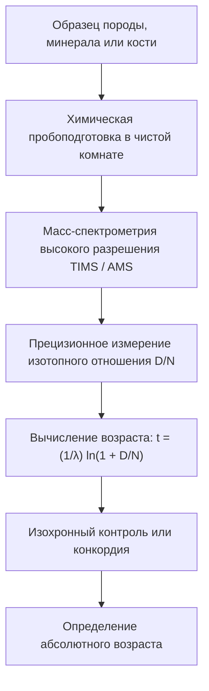

«Сколько тысяч лет этой окаменелости?» «Когда этот гранит закристаллизовался из магмы?» «Каков истинный возраст планеты Земля?»

Веками человечество было лишено физического инструмента для измерения «стрелы времени». В XVII веке архиепископ Джеймс Ашшер на основе библейских хронологий вычислил, что Земля была сотворена в 4004 году до н.э. В конце XIX века лорд Кельвин с помощью термодинамических расчетов остывания планеты оценил ее возраст всего в 20–40 миллионов лет.

Все эти предположения рухнули в начале XX века с **открытием радиоактивности**. Самопроизвольный распад атомных ядер подчиняется строгим законам квантовой вероятности, не зависящим от температуры, давления или химических реакций. Открыв эти **природные атомные часы**, наука смогла измерить геологическое время (Deep Time) вплоть до рождения Солнечной системы 4,56 миллиарда лет назад.



---

## 1. Физико-математические основы радиоактивного распада

Скорость распада нестабильных материнских ядер $N(t)$ строго пропорциональна их числу:

$$\frac{dN}{dt} = -\lambda N(t)$$

где $\lambda$ — **постоянная распада**. Интегрирование дает классический **закон радиоактивного распада**:

$$N(t) = N_0 e^{-\lambda t}$$

Период полураспада $t_{1/2}$ выражается как:

$$t_{1/2} = \frac{\ln 2}{\lambda} \approx \frac{0{,}69315}{\lambda}$$

Учитывая количество накопившихся радиогенных дочерних ядер $D(t) = N_0 - N(t) = N(t)(e^{\lambda t} - 1)$, получаем **основное уравнение геохронологии**:

$$t = \frac{1}{\lambda} \ln\left(1 + \frac{D(t)}{N(t)}\right)$$



---

## 2. Радиоуглеродный анализ и летопись озера Суйгецу

Космические лучи выбивают нейтроны, взаимодействующие с атмосферным азотом:

$$n + {}^{14}_7N \rightarrow {}^{14}_6C + p$$

Углерод-14 усваивается растениями при фотосинтезе. После гибели организма обмен прекращается, и $^{14}C$ распадается с периодом полураспада 5 730 лет.

Для калибровки колебаний концентрации $^{14}C$ в древней атмосфере ключевую роль сыграло **озеро Суйгецу в Японии**: в его донных отложениях сохранилось более 50 000 непрерывных годичных микрослоев (варв), что позволило создать всемирный калибровочный стандарт **IntCal**.

---

## 3. Геологические хронометры и метод изохрон

| Метод | Изотопная система | Период полураспада | Диапазон | Минералы |
| :--- | :--- | :--- | :--- | :--- |
| **Углерод-14** | $^{14}C \rightarrow {}^{14}N$ | 5 730 лет | 300 – 50 000 лет | Древесина, кости, уголь |
| **K-Ar и Ar-Ar** | $^{40}K \rightarrow {}^{40}Ar$ | 1,25 млрд лет | 10 тыс. – 4,5 млрд лет | Слюды, полевые шпаты, вулканический пепел |
| **U-Pb метод** | $^{238}U \rightarrow {}^{206}Pb$<br>$^{235}U \rightarrow {}^{207}Pb$ | 4,47 млрд лет<br>704 млн лет | 1 млн – 4,56 млрд лет | **Цирконы ($ZrSiO_4$)**, монацит |
| **Rb-Sr метод** | $^{87}Rb \rightarrow {}^{87}Sr$ | 48,8 млрд лет | 10 млн – 4,5 млрд лет | Граниты, метаморфические породы |

### Математика изохронного метода:
Нормируя уравнение на стабильный нерадиогенный изотоп $^{86}Sr$:

$$\frac{{}^{87}Sr}{{}^{86}Sr} = \left(\frac{{}^{87}Sr}{{}^{86}Sr}\right)_0 + \frac{{}^{87}Rb}{{}^{86}Sr} (e^{\lambda t} - 1)$$

Наклон прямой $m = e^{\lambda t} - 1$ позволяет рассчитать точный возраст $t = \frac{\ln(1+m)}{\lambda}$ без знания начального содержания радиогенного стронция.

```mermaid
xychart-beta
    title "Рубидий-стронциевая изохрона"
    x-axis "87Rb / 86Sr" [0, 1, 2, 3, 4, 5]
    y-axis "87Sr / 86Sr" 0.69 to 0.76
    line [0.700, 0.710, 0.720, 0.730, 0.740, 0.750]
```

---

## 4. Возраст Земли: подвиг Клэра Паттерсона

Из-за тектоники плит на Земле не уцелели первичные породы. В 1953 году геохимик **Клэр Паттерсон** проанализировал изотопы свинца в метеорите Каньон Дьябло и впервые доказал, что возраст Земли и Солнечной системы составляет **4,55 миллиарда лет**.

В ходе работы Паттерсон выявил глобальное загрязнение атмосферы соединениями свинца из этилированного бензина, создал первые **сверхчистые лаборатории (Clean Rooms)** и добился полного мирового запрета свинцовых присадок к топливу.
