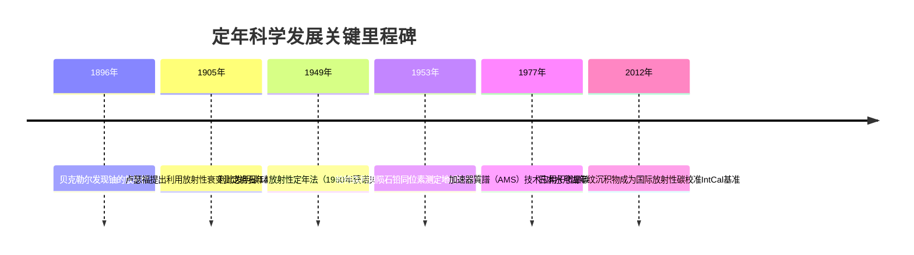
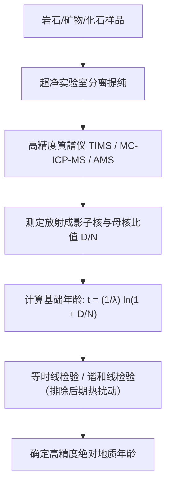

“这件化石距今多少万年？”“这块花岗岩何时从岩浆中冷凝结晶？”“地球到底有多少岁？”

千百年来，人类探索自身与宇宙历史的最大瓶颈，在于缺乏校准“时间之矢”的客观物理工具。17世纪，詹姆斯·烏雪主教根据圣经家谱计算出地球创造于公元前4004年；19世纪末，克爾文勋爵基于热力学冷却模型推算地球年龄仅为2000万至4000万年。

这些估算在20世纪初因**放射性（Radioactivity）的发现**而彻底成为历史。原子核自发衰变遵循恒定不变的量子概率定律，完全不受温度、压力和化学环境的影响。放射性同位素犹如散布在岩石与化石中的**“天然原子钟”**，使人类获得了丈量从万年考古遗址到45.6亿年太阳系起源的绝对时间标尺。



---

## 1. 放射性衰变的微积分与物理基础

放射性母核 $N(t)$ 在微小时间 $dt$ 内发生衰变的数量 $dN$，严格正比于当前存在的母核数目：

$$\frac{dN}{dt} = -\lambda N(t)$$

其中 $\lambda$ 为该核种特有的**衰变常数（Decay Constant）**。分离变量并从 $t=0$（母核初始数量 $N_0$）积分至时刻 $t$：

$$\int_{N_0}^{N(t)} \frac{dN}{N} = -\lambda \int_0^t dt \implies N(t) = N_0 e^{-\lambda t}$$

### 半衰期（$t_{1/2}$）与年代方程推导：
当母核消耗一半时（$N = N_0 / 2$），代入可得半衰期：

$$t_{1/2} = \frac{\ln 2}{\lambda} \approx \frac{0.69315}{\lambda}$$

假设封闭系统中子核初始量为零（$D_0 = 0$），当前积累的放射成影子核 $D(t) = N_0 - N(t) = N(t)(e^{\lambda t} - 1)$。两端除以母核数目 $N(t)$ 并求解时间 $t$，即可导出核心**放射性定年方程**：

$$t = \frac{1}{\lambda} \ln\left(1 + \frac{D(t)}{N(t)}\right)$$



---

## 2. 碳14定年与水月湖“奇迹年纹”

### 2.1 碳14的大气生成与食物网循环
宇宙线轰击高空大气中的氮-14（$^{14}N$）生成碳14（$^{14}C$）：

$$n + {}^{14}_7N \rightarrow {}^{14}_6C + p$$

$^{14}C$ 氧化为 $^{14}CO_2$ 并通过植物光合作用进入生物圈。生物生前与大气保持同位素动平衡（$^{14}C/{}^{12}C \sim 10^{-12}$）。死亡后代谢停止，体内 $^{14}C$ 发生 $\beta^-$ 衰变持续减少（半衰期5730年）：

$${}^{14}_6C \rightarrow {}^{14}_7N + e^- + \bar{\nu}_e$$

现代**加速器質譜计（AMS）**能够直接计数单个碳14原子，将测样量缩减至毫克级，定年极限达到约50,000年。

### 2.2 水月湖年纹（Varve）与国际IntCal校准曲线
由于太阳活动和地磁场波动，古代大气中的碳14浓度并非绝对恒定。日本福井县**水月湖**拥有连续沉积7万年、纹理极其清晰的“年纹”沉积层（暗层为冬季黏土，亮层为夏季硅藻）。通过精确统计5万多层年轮并测定数万枚树叶化石的碳14年龄，确立了全球公认的标准校准曲线**IntCal**，使放射性碳年代能够精准转化为真正的人类天文历法年份。

---

## 3. 地质时代的核心定年法与等时线数学证明

| 定年体系 | 母核 $\rightarrow$ 子核 | 半衰期 | 适用范围 | 典型测量矿物 |
| :--- | :--- | :--- | :--- | :--- |
| **碳14法** | $^{14}C \rightarrow {}^{14}N$ | 5,730年 | 300年 ～ 5万年 | 木炭、骨骼、泥炭、纺织物 |
| **K-Ar / Ar-Ar法** | $^{40}K \rightarrow {}^{40}Ar$ | 12.5亿年 | 1万年 ～ 45亿年 | 火山灰长石、黑云母、古人类地层 |
| **U-Pb法** | $^{238}U \rightarrow {}^{206}Pb$<br>$^{235}U \rightarrow {}^{207}Pb$ | 44.7亿年<br>7.04亿年 | 100万年 ～ 45.6亿年 | **鋯石（$ZrSiO_4$）**、独居石 |
| **Rb-Sr法** | $^{87}Rb \rightarrow {}^{87}Sr$ | 488亿年 | 1000万年 ～ 45亿年 | 全岩等时线、变质岩 |

### 等时线法（Isochron Method）的数学证明：
当岩石形成时子核初生含量 $D_0 \ne 0$ 时，引入同种元素的稳定非放射性核（如 $^{86}Sr$）对方程两端归一化：

$$\frac{{}^{87}Sr}{{}^{86}Sr} = \left(\frac{{}^{87}Sr}{{}^{86}Sr}\right)_0 + \frac{{}^{87}Rb}{{}^{86}Sr} (e^{\lambda t} - 1)$$

对比直线方程 $y = b + mx$：
- 斜率 $m = e^{\lambda t} - 1 \implies t = \frac{\ln(1+m)}{\lambda}$
- 截距 $b = ({}^{87}Sr/{}^{86}Sr)_0$

同一岩体内不同矿物的化学组成不同（$x$值分散），但形成时刻具有完全相同的初始同位素比值（截距$b$相同）。若数据点严格呈线性分布，其斜率即直观证明了体系的封闭性并严密解出地质年龄。

```mermaid
xychart-beta
    title "铷-锶等时线演化示意图"
    x-axis "母核/基准比 87Rb / 86Sr" [0, 1, 2, 3, 4, 5]
    y-axis "子核/基准比 87Sr / 86Sr" 0.69 to 0.76
    line [0.700, 0.710, 0.720, 0.730, 0.740, 0.750]
```

---

## 4. 地球45.5亿年年龄的最终确立：克莱尔·帕特森的斗争

由于地球地壳板块的持续消减与熔融，地表未保留任何最初形成的原始岩石。1953年，美国地球化学家**克莱尔·帕特森（Clair Patterson）**利用亚利桑那州代阿布洛峡谷陨石的陨硫铁矿物（不含铀，保留了太阳系形成初期的铅同位素组成），构建了全岩铅同位素等时线，首次测定出**地球与太阳系的真实年龄为45.5亿年（4.55 Ga）**。

在实验过程中，帕特森发现了全球环境中剧烈的铅污染，发明了现代科学通用的**超净实验室（Clean Room）**，并终其一生勇敢抗击石油化工巨头，推动了全球范围内**含铅汽油的全面取缔**。
