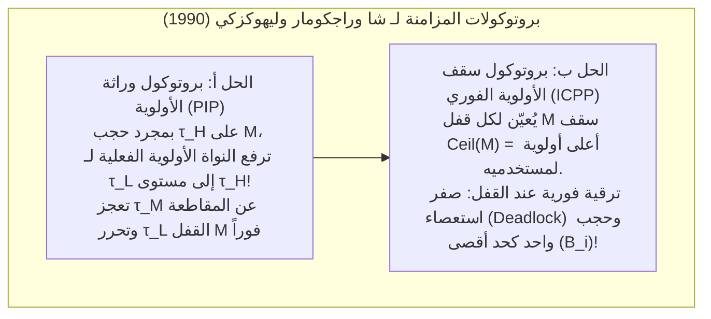

## 1. الفجوة الجوهرية بين «السريع» و«الوقت الفعلي (Real-Time)»

في الاستخدام الشائع، كثيراً ما يُخلط بين مصطلح «المعالجة في الوقت الفعلي» وبين «التنفيذ فائق السرعة». غير أنه حتى الخادم المزود بمعالج متعدد النوى يعمل بترددات جيجاهرتز ويستجيب للاستعلامات في متوسط مللي ثانية واحدة لا يُسمح له مطلقاً بالتحكم المباشر في نظام الطيران بالسلك (*Fly-by-Wire*) لطائرة ركاب، أو تفجير الوسادة الهوائية للسيارة، أو تنظيم ضربات القلب. لماذا؟ لأن الأنظمة عامة الأغراض تُحسّن <strong>متوسط الإنتاجية (Average Throughput)</strong>: فإذا استغرق الحساب $0.5\,\text{ms}$ في $99.999\%$ من المرات، لكنه تأخر مرة واحدة في المليون لمدة $200\,\text{ms}$ بسبب إخفاق ذاكرة التخزين المؤقت (Cache Miss) أو خطأ صفحة (Page Fault) أو جامع القمامة (GC)، فإن الطائرة ستسقط أو ستنفجر الوسادة الهوائية بعد ارتطام السائق بالمقود.

وفقاً للصياغة الكلاسيكية لدونالد جيليس وهيرمان كوبيتز، تنص <strong>موضوعة الحوسبة في الوقت الفعلي</strong> على أن صحة النظام لا تعتمد فقط على <strong>الصحة المنطقية والحسابية</strong> للنتيجة، بل تعتمد أيضاً على <strong>اللحظة الفيزيائية $t$</strong> التي تُنتج فيها النتيجة مقارنةً بالموعد النهائي (*Deadline* $d_i$). وبناءً على <strong>دالة المنفعة الزمنية $U(t)$</strong>، تنقسم الأنظمة إلى ثلاث فئات:

$$U_{\text{hard}}(t) = \begin{cases} V & (t \le d) \\ -\infty & (t > d) \end{cases}, \qquad U_{\text{firm}}(t) = \begin{cases} V & (t \le d) \\ 0 & (t > d) \end{cases}, \qquad U_{\text{soft}}(t) = \begin{cases} V & (t \le d) \\ V e^{-\alpha(t-d)} & (t > d) \end{cases}$$

* <strong>الوقت الفعلي الصارم (Hard Real-Time)</strong>: تجاوز موعد نهائي واحد ($t > d$) يؤدي إلى كارثة شاملة ($U = -\infty$، مثل التحكم في الطيران ومكابح ABS). يتطلب إثباتاً رياضياً ساكناً مسبقاً.
* <strong>الوقت الفعلي الحازم (Firm Real-Time)</strong>: النتيجة المتأخرة تفقد قيمتها تماماً ($U = 0$) وتُهمل فوراً (مثل الفرز البصري على خطوط الإنتاج السريعة وإلغاء أوامر التداول المالي عالي التردد HFT).
* <strong>الوقت الفعلي المرن (Soft Real-Time)</strong>: تتناقص المنفعة تدريجياً بعد $d$ (مثل بث الفيديو بسرعة 60 إطاراً في الثانية ومكالمات VoIP).

| البعد المعماري | نظام تشغيل عام (GPOS: Linux / Windows / macOS) | نظام تشغيل في الوقت الفعلي (RTOS: VxWorks / QNX / FreeRTOS / seL4) |
| :--- | :--- | :--- |
| <strong>هدف التحسين الأساسي</strong> | تعظيم متوسط الإنتاجية والعدالة (CFS / EEVDF) | ضمان <strong>الحتمية الزمنية</strong> وتقييد زمن الاستجابة الأسوأ (WCRT) |
| <strong>كمون المقاطعة والجدولة</strong> | ميكروثانية إلى عشرات المللي ثانية (توزيع ذيل طويل عشوائي) | مئات النانوثانية إلى بضع ميكروثوانٍ (حد أعلى ثابت $O(1)$) |
| <strong>قابلية مقاطعة النواة</strong> | نوى متجانسة تحتوي على أقسام حرجة غير قابلة للمقاطعة | نواة قابلة للمقاطعة بالكامل أو نواة مصغرة (QNX, seL4) |
| <strong>إدارة الذاكرة والعتاد</strong> | ذاكرة افتراضية مع أخطاء صفحات، `malloc`، GC، تنفيذ تخميني كامل | أقسام ساكنة، مجمعات $O(1)$، ذاكرة Scratchpad (TCM) وقفل الكاش |

---

## 2. كابوس تحليل زمن التنفيذ في الحالة الأسوأ (WCET)

تعتمد جميع نظريات الجدولة في الوقت الفعلي على المعرفة المسبقة بـ <strong>زمن التنفيذ في الحالة الأسوأ (Worst-Case Execution Time, $C_i$)</strong> لكل مهمة $\tau_i$. وهنا تكمن مفارقة عميقة في معمارية الحواسيب الحديثة: <strong>إن جميع الآليات العتادية تقريباً التي ابتُكرت لتسريع متوسط أداء المعالج (ذواكر التخزين المؤقت L1/L2/L3، توقع التفرع، التنفيذ خارج الترتيب OoO، مخزن TLB، تغيير التردد الديناميكي DVFS، ومقاطعات إدارة النظام غير القابلة للحجب SMI) تدمر إمكانية التنبؤ بزمن WCET.</strong>

بل إنه في خطوط الأنابيب خارج الترتيب (*Out-of-Order*) المقترنة بالكاش تظهر <strong>شذوذات زمنية (Timing Anomalies)</strong>: حيث يمكن أن يؤدي *إصابة* محلية في الكاش (Cache Hit) إلى تمكين مسار تخميني من حجز الناقل المشترك مبكراً، مما يجعل الزمن الكلي لتنفيذ البرنامج <strong>أطول</strong> مما لو حدث إخفاق في الكاش (Cache Miss)! لذلك تستخدم الأنظمة الحرجة (DO-178C المستوى A، وISO 26262 ASIL-D) ذواكر <strong>Scratchpad SRAM / TCM</strong> الحتمية وتقنية <strong>قفل الكاش (Cache Locking)</strong>، وتحسب الحد الأعلى لـ WCET ساكناً عبر <strong>التفسير المجرد</strong> و<strong>تقنية التعداد الضمني للمسارات (IPET)</strong> كمسألة برمجة خطية صحيحة (ILP) على مبيان تدفق التحكم (CFG):

$$\text{WCET} = \max \sum_{i=1}^{N} c_i x_i \quad \text{بشرط} \quad \sum_{j} d_{j \to i} = x_i = \sum_{k} d_{i \to k} \quad (\text{حفظ التدفق وحدود الحلقات})$$

---

## 3. ليو ولايلاند (1973): الجدولة الدورية (RMS مقابل EDF)

لنفترض وجود $n$ من المهام الدورية المستقلة $\Gamma = \{\tau_1, \dots, \tau_n\}$ حيث $\tau_i = (C_i, T_i, D_i)$ (زمن التنفيذ الأسوأ $C_i$، الدورة $T_i$، والموعد النهائي الضمني $D_i = T_i$). يُعرّف <strong>إجمالي استخدام المعالج</strong> بالعلاقة:

$$U = \sum_{i=1}^{n} \frac{C_i}{T_i}$$

في عام 1973، أثبت سي. إل. ليو وجيمس لايلاند المبرهنات التأسيسية التي تحكم الأولويات الساكنة والديناميكية:

### 3.1 الجدولة الرتيبة المعدل (RMS) وحد $\ln 2 \approx 69.3\%$

في <strong>الجدولة الاستباقية ذات الأولوية الثابتة</strong>، تنص قاعدة <strong>Rate Monotonic (RMS)</strong> على منح الأولويات الساكنة عكسياً مع طول الدورة: <strong>كلما قصرت دورة المهمة $T_i$ (زاد معدل تكرارها $1/T_i$)، ارتفعت أولويتها الساكنة</strong>. أثبت ليو ولايلاند <strong>مبرهنة اللحظة الحرجة</strong> (أسوأ زمن استجابة للمهمة $\tau_i$ يحدث عندما تنطلق في نفس اللحظة $t=0$ مع جميع المهام الأعلى أولوية)، كما أثبتا أمثلية RMS بين جميع خوارزميات الأولوية الثابتة، مع أصغر حد أعلى مضمون للاستخدام:

$$U = \sum_{i=1}^{n} \frac{C_i}{T_i} \le U_{\text{lub}}(n) = n\left(2^{1/n} - 1\right) \xrightarrow{n \to \infty} \ln 2 \approx 0.6931 \quad (69.3\%)$$

ملاحظة هامة: نسبة $69.3\%$ هي <strong>شرط كافٍ</strong> فقط وليست شرطاً لازماً! فإذا كانت الدورات <strong>توافقية (Harmonic)</strong> (كل دورة أطول هي مضاعف صحيح للدورات الأقصر، مثل $5\,\text{ms}, 10\,\text{ms}, 20\,\text{ms}$)، فإن RMS تحقق <strong>استخداماً بنسبة $100\%$</strong>. وللمجموعات العامة، يوفر <strong>تحليل زمن الاستجابة (RTA)</strong> لجوزيف وبانديا (1986) شرطاً لازماً وكافياً دقيقاً عبر تكرار النقطة الثابتة ($R_i \le D_i$):

$$R_i^{(k+1)} = C_i + \sum_{j \in hp(i)} \left\lceil \frac{R_i^{(k)}}{T_j} \right\rceil C_j$$

### 3.2 الموعد النهائي الأقرب أولاً (EDF) والأمثلية بنسبة $100\%$

في <strong>الجدولة الاستباقية ذات الأولوية الديناميكية</strong>، تمنح خوارزمية <strong>Earliest Deadline First (EDF)</strong> في كل لحظة الأولوية القصوى للعمل الجاهز الذي يكون <strong>موعده النهائي المطلق $d_{i,k} = r_{i,k} + D_i$ هو الأقرب</strong>. وعلى معالج أحادي، يصل <strong>الشرط اللازم والكافي</strong> لقابلية الجدولة تحت EDF إلى الحد الفيزيائي الأقصى:

$$U = \sum_{i=1}^{n} \frac{C_i}{T_i} \le 1.00 \quad (100\%)$$

مثال: مع $\tau_1 = (C_1=2, T_1=5)$ و $\tau_2 = (C_2=4, T_2=7)$، يكون الاستخدام $U = 97.14\%$. تحت RMS، وصول $\tau_{1,2}$ عند $t=5$ ($d=10$) يقاطع بشكل أعمى المهمة $\tau_{2,1}$ ($d=7$، التي لم يتبق لها سوى $1\,\text{ms}$)، مما يسبب $R_2 = 8 > 7$ (فشل الموعد النهائي!). أما تحت EDF، فعند $t=5$، وبما أن $d_{2,1}=7 < d_{1,2}=10$، تمنع EDF المقاطعة وتنهي $\tau_{2,1}$ في وقتها عند $t=6 \le 7$.

ومع ذلك، تفضل الصناعة (VxWorks، FreeRTOS، QNX، AUTOSAR) جدولة RMS/DMS لأن EDF عند حدوث <strong>حمل زائد عابر ($U > 1.0$)</strong> تعاني من <strong>تأثير الدومينو الكارثي</strong> حيث تحتكر المهمة المتأخرة المعالج وتُسقط جميع المهام اللاحقة بالتتابع، بينما تحمي RMS المهام الحرجة عالية الأولوية بنسبة $100\%$ وتُنفذ بتعقيد $O(1)$ عبر خريطة بتات وتعليمة `CLZ`.

| معيار المقارنة | Rate Monotonic (RMS: أولوية ثابتة) | Earliest Deadline First (EDF: أولوية ديناميكية) |
| :--- | :--- | :--- |
| <strong>تعيين الأولوية</strong> | ساكن: دورة $T_i$ أقصر $\implies$ أولوية أعلى | ديناميكي: موعد نهائي مطلق $d_{i,k}$ أقرب $\implies$ أولوية أعلى |
| <strong>حد استخدام المعالج</strong> | كافٍ: $n(2^{1/n}-1) \to 69.3\%$ ($100\%$ في الدورات التوافقية) | لازم وكافٍ: دائماً <strong>$100\%$</strong> ($\sum C_i/T_i \le 1$) |
| <strong>تعقيد المجدول في النواة</strong> | <strong>$O(1)$</strong> (خريطة بتات للأولويات + تعليمة `CLZ`) | <strong>$O(\log n)$</strong> (كومة صغرى أو شجرة حمراء-سوداء ديناميكية) |
| <strong>السلوك عند الحمل الزائد ($U > 1$)</strong> | <strong>تدهور آمن</strong>: بقاء المهام الحرجة عالية الأولوية مضمون $100\%$ | <strong>تأثير دومينو كارثي</strong>: انهيار متسلسل لجميع المهام |

---

## 4. حادثة مسبار مارس باثفايندر (1997) وعلاج انعكاس الأولوية

في يوليو 1997، وبعد هبوطه الناجح على سطح المريخ، بدأ مسبار <strong>Mars Pathfinder</strong> التابع لناسا (معالج IBM RAD6000 بنظام <strong>VxWorks</strong> RTOS) يعاني من عمليات إعادة تشغيل قسرية متكررة بواسطة مؤقت الحراسة (*Watchdog*)، مما أدى إلى ضياع بيانات علمية ثمينة.

كان السبب هو <strong>انعكاس الأولوية غير المحدود (Unbounded Priority Inversion)</strong> بين ثلاث مهام حول قفل استبعاد متبادل (Mutex $M$) يحمي «ناقل المعلومات» المشترك:
* <strong>مهمة الأرصاد الجوية منخفضة الأولوية $\tau_L$ (`ASI/MET`)</strong> تقفل الـ Mutex $M$؛
* <strong>مهمة إدارة الناقل الحرجة عالية الأولوية $\tau_H$ (`bc_dist`)</strong> تستيقظ وتطلب $M$ فتدخل في حالة الحجب (Blocked)؛
* وقبل أن تتمكن $\tau_L$ من تحرير $M$، تصل <strong>مهام اتصالات متوسطة الأولوية $\tau_M$</strong> (لا تستخدم $M$ إطلاقاً!). ولأن $\text{Priority}(\tau_M) > \text{Priority}(\tau_L)$، تقاطع $\tau_M$ المهمة $\tau_L$ وتحتكر المعالج لفترة طويلة، مانعةً $\tau_L$ من فتح القفل $M$ ومبقيةً $\tau_H$ محجوبة حتى ينفد وقت مؤقت الحراسة ويعيد تشغيل المركبة الفضائية!

وقد أثبت شا وراجكومار وليهوكزكي الحل الرياضي الجذري عام 1990 عبر بروتوكولين:
1. <strong>بروتوكول وراثة الأولوية (PIP: Priority Inheritance Protocol)</strong>: عندما تُحجب $\tau_H$ على قفل $M$ تملكه $\tau_L$، ترفع النواة مؤقتاً الأولوية الفعلية لـ $\tau_L$ إلى مستوى $\tau_H$، مما يمنع $\tau_M$ من التدخل. وبعد محاكاة الخلل على الأرض، أرسل مهندسو مختبر الدفع النفاث (JPL) عبر مسافة 190 مليون كيلومتر أمراً بلغة C إلى مفسر VxWorks لتعديل المتغير العام `SEM_INVERSION_SAFE` في الذاكرة الحية من `0` إلى `1`، منقذين المهمة بالكامل!
2. <strong>بروتوكول سقف الأولوية الفوري (PCP / ICPP: Immediate Priority Ceiling Protocol)</strong>: نظراً لأن PIP لا يمنع <strong>الحجب المتسلسل</strong> و<strong>الاستعصاء (Deadlock)</strong>، يعيّن بروتوكول ICPP (المعتمد في POSIX `PTHREAD_PRIO_PROTECT` وAUTOSAR OS) لكل قفل $M_k$ سقفاً ساكناً $\text{Ceil}(M_k) = \max\{\text{Priority}(\tau_i) \mid \tau_i \text{ تستخدم } M_k\}$ ويرفع أولوية أي مهمة <strong>في اللحظة التي تقفل فيها $M_k$ مباشرة</strong>. وهذا يضمن <strong>استحالة حدوث الاستعصاء بنسبة 100%</strong> ويقيد أقصى تأخير لأي مهمة بـ <strong>قسم حرج واحد فقط على الأكثر ($B_i$)</strong>:

$$R_i^{(k+1)} = C_i + B_i + \sum_{j \in hp(i)} \left\lceil \frac{R_i^{(k)}}{T_j} \right\rceil C_j$$
