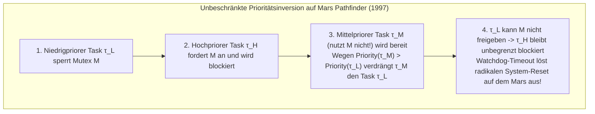
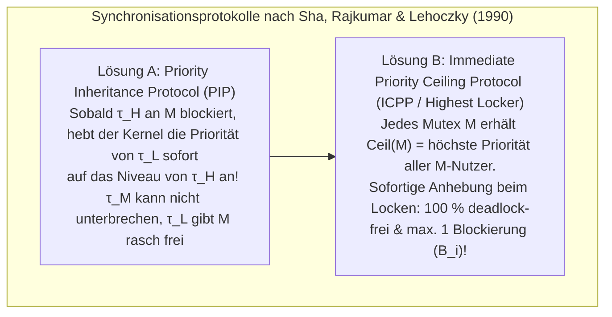

## 1. Der fundamentale Graben zwischen „schnell“ und „Echtzeit“

Im Alltag wird „Echtzeitverarbeitung“ oft mit „extrem schneller Ausführung“ gleichgesetzt. Doch selbst ein Hochleistungs-Server mit Gigahertz-Mehrkernprozessor und riesigem L3-Cache, der Datenbankabfragen im Schnitt in einer Millisekunde beantwortet, dürfte niemals die Fly-by-Wire-Flugsteuerung eines Verkehrsflugzeugs, einen Kfz-Airbag oder einen Herzschrittmacher steuern. Warum? Weil Universalrechner auf <strong>maximalen durchschnittlichen Durchsatz (Average Throughput)</strong> optimiert sind: Wenn die Berechnung in $99{,}999\,\%$ der Fälle $0{,}5\,\text{ms}$ dauert, aber einmal pro Million Aufrufe wegen eines Cache-Misses, Page-Faults oder Garbage-Collection-Laufs $200\,\text{ms}$ benötigt, stürzt das Flugzeug ab oder der Airbag zündet erst nach dem Aufprall.

Nach der klassischen Definition von Donald Gillies und Hermann Kopetz lautet das <strong>Axiom der Echtzeitverarbeitung</strong>: Die Korrektheit eines Echtzeitsystems hängt nicht nur vom <strong>logisch-arithmetischen Ergebnis</strong> ab, sondern zwingend auch vom <strong>physischen Zeitpunkt $t$</strong>, zu dem das Ergebnis vorliegt (relativ zur Deadline $d_i$). Anhand der <strong>Zeitnutzenfunktion (Time-Utility Function, $U(t)$)</strong> unterscheidet man drei Klassen:

$$U_{\text{hard}}(t) = \begin{cases} V & (t \le d) \\ -\infty & (t > d) \end{cases}, \qquad U_{\text{firm}}(t) = \begin{cases} V & (t \le d) \\ 0 & (t > d) \end{cases}, \qquad U_{\text{soft}}(t) = \begin{cases} V & (t \le d) \\ V e^{-\alpha(t-d)} & (t > d) \end{cases}$$

* <strong>Harte Echtzeit (Hard Real-Time)</strong>: Jedes Überschreiten der Deadline ($t > d$) führt zu einer Katastrophe ($U = -\infty$, z. B. Fluglageregelung, ABS). Erfordert formale mathematische Vorab-Garantien.
* <strong>Feste Echtzeit (Firm Real-Time)</strong>: Verspätete Ergebnisse sind wertlos ($U = 0$) und werden sofort verworfen (z. B. optische Aussortierung am Fließband, Hochfrequenzhandel).
* <strong>Weiche Echtzeit (Soft Real-Time)</strong>: Der Nutzen sinkt nach $d$ kontinuierlich ab (z. B. 60-fps-Videostreaming, VoIP-Audio).

| Architekturmerkmal | Universal-OS (GPOS: Linux / Windows / macOS) | Echtzeit-OS (RTOS: VxWorks / QNX / FreeRTOS / seL4) |
| :--- | :--- | :--- |
| <strong>Primäres Optimierungsziel</strong> | Maximaler Durchschnittsdurchsatz & Fairness (CFS / EEVDF) | <strong>Zeitlicher Determinismus</strong> & garantierte Worst-Case-Reaktionszeit (WCRT) |
| <strong>Interrupt- & Dispatch-Latenz</strong> | Mikrosekunden bis Dutzende Millisekunden (stochastischer Long-Tail) | Hunderte Nanosekunden bis wenige Mikrosekunden (strikte $O(1)$-Obergrenze) |
| <strong>Kernel-Präemptierbarkeit</strong> | Monolithische Kernel mit nicht-präemptierbaren Spinlock-Pfaden | Vollständig präemptierbarer Kernel oder minimaler Mikrokernel (QNX, seL4) |
| <strong>Speicher- & Hardware-Kontrolle</strong> | Virtueller Speicher mit Page-Faults, `malloc`, GC, volle Spekulation | Statische Partitionen, $O(1)$-Pools, Scratchpad-SRAM (TCM) & Cache-Locking |

---

## 2. Der Albtraum der Worst-Case Execution Time (WCET)

Jede Scheduling-Theorie setzt voraus, dass für jede Aufgabe $\tau_i$ ihre <strong>maximale Ausführungszeit im schlechtesten Fall (Worst-Case Execution Time, $C_i$)</strong> exakt bekannt ist. Hier zeigt sich ein tiefes Paradoxon der Rechnerarchitektur: <strong>Fast alle Hardware-Mechanismen, die moderne CPUs im Durchschnitt beschleunigen (L1/L2/L3-Caches, Sprungvorhersage, Out-of-Order-Ausführung, TLB, DVFS und nicht maskierbare System Management Interrupts SMI), zerstören die Vorhersagbarkeit der WCET.</strong>

In Out-of-Order-Pipelines mit Caches treten sogar <strong>Timing Anomalies</strong> auf: Ein lokaler Cache-<strong>Hit</strong> (lokale Beschleunigung) kann dazu führen, dass ein spekulativer Pfad frühzeitig den Bus blockiert und die Gesamtlaufzeit des Programms <strong>länger</strong> wird als bei einem Cache-<strong>Miss</strong>! Sicherheitskritische Systeme (DO-178C Level A, ISO 26262 ASIL-D) nutzen daher deterministischen On-Chip-<strong>Scratchpad-Speicher (TCM)</strong> sowie <strong>Cache-Locking</strong> und berechnen die obere WCET-Schranke statisch mittels <strong>Abstrakter Interpretation</strong> und der <strong>Implicit Path Enumeration Technique (IPET)</strong> als ganzzahliges lineares Optimierungsproblem (ILP) über dem Kontrollflussgraphen (CFG):

$$\text{WCET} = \max \sum_{i=1}^{N} c_i x_i \quad \text{unter den Nebenbedingungen} \quad \sum_{j} d_{j \to i} = x_i = \sum_{k} d_{i \to k} \quad (\text{Flusserhaltung \& Schleifenschranken})$$

---

## 3. Liu & Layland (1973): Periodisches Echtzeit-Scheduling (RMS vs. EDF)

Für $n$ unabhängige periodische Tasks $\Gamma = \{\tau_1, \dots, \tau_n\}$ mit $\tau_i = (C_i, T_i, D_i)$ (WCET $C_i$, Periode $T_i$, implizite Deadline $D_i = T_i$) ist die <strong>Gesamtprozessorauslastung (Total Utilization)</strong> definiert als:

$$U = \sum_{i=1}^{n} \frac{C_i}{T_i}$$

1973 veröffentlichten C. L. Liu und James W. Layland ihre bahnbrechende Arbeit zum Vergleich statischer und dynamischer Prioritäten:

### 3.1 Rate Monotonic Scheduling (RMS) und die $\ln 2 \approx 69{,}3\,\%$-Schranke

Beim <strong>präemptiven Scheduling mit festen Prioritäten</strong> vergibt RMS die Prioritäten umgekehrt proportional zur Periodendauer: <strong>Je kürzer die Periode $T_i$ (je höher die Rate $1/T_i$), desto höher die statische Priorität</strong>. Liu & Layland bewiesen das <strong>Critical Instant Theorem</strong> (die längste Antwortzeit von $\tau_i$ tritt auf, wenn $\tau_i$ gleichzeitig mit allen höherprioren Tasks bei $t=0$ startet) sowie die Optimalität von RMS unter allen statischen Verfahren mit der kleinsten oberen Auslastungsschranke (Least Upper Bound):

$$U = \sum_{i=1}^{n} \frac{C_i}{T_i} \le U_{\text{lub}}(n) = n\left(2^{1/n} - 1\right) \xrightarrow{n \to \infty} \ln 2 \approx 0{,}6931 \quad (69{,}3\,\%)$$

Wichtig: Die $69{,}3\,\%$ sind nur eine <strong>hinreichende Bedingung</strong>! Bei <strong>harmonischen Perioden</strong> (jede größere Periode ist ein ganzzahliges Vielfaches der kleineren, z. B. $5\,\text{ms}, 10\,\text{ms}, 20\,\text{ms}$) erreicht auch RMS <strong>$100\,\%$ Auslastung</strong>. Für allgemeine Task-Mengen liefert die <strong>Response-Time Analysis (RTA)</strong> von Joseph & Pandya (1986) über eine Fixpunktiteration einen exakten (notwendigen und hinreichenden) Test ($R_i \le D_i$):

$$R_i^{(k+1)} = C_i + \sum_{j \in hp(i)} \left\lceil \frac{R_i^{(k)}}{T_j} \right\rceil C_j$$

### 3.2 Earliest Deadline First (EDF) und die $100\,\%$-Optimalität

Beim <strong>dynamischen Scheduling</strong> weist EDF jederzeit demjenigen bereiten Job die höchste Priorität zu, dessen <strong>absolute Deadline $d_{i,k} = r_{i,k} + D_i$ am nächsten liegt</strong>. Auf einem Einzelprozessor ist ein Task-Set unter EDF <strong>genau dann einplanbar (notwendig und hinreichend)</strong>, wenn die Auslastung $100\,\%$ nicht überschreitet:

$$U = \sum_{i=1}^{n} \frac{C_i}{T_i} \le 1{,}00 \quad (100\,\%)$$

Beispiel: Sei $\tau_1 = (C_1=2, T_1=5)$ und $\tau_2 = (C_2=4, T_2=7)$, also $U = 2/5 + 4/7 = 97{,}14\,\%$. Unter RMS verdrängt der bei $t=5$ eintreffende Job $\tau_{1,2}$ ($d=10$) den fast fertigen Job $\tau_{2,1}$ ($d=7$, nur noch $1\,\text{ms}$ Restlaufzeit), sodass $\tau_{2,1}$ erst bei $R_2 = 8 > 7$ endet (Deadline Miss!). Unter EDF hingegen gilt bei $t=5$ wegen $d_{2,1}=7 < d_{1,2}=10$, dass $\tau_{2,1}$ weiterlaufen darf und bei $t=6 \le 7$ pünktlich fertig wird!

Trotzdem setzen fast alle industriellen RTOS (VxWorks, FreeRTOS, QNX, AUTOSAR) auf feste Prioritäten (RMS/DMS), weil EDF bei <strong>kurzzeitiger Überlast ($U > 1{,}0$)</strong> unter einem katastrophalen <strong>Domino-Effekt</strong> leidet: Ein verspäteter Job hat die älteste Deadline, blockiert die CPU und reißt sämtliche nachfolgenden Tasks in den Abgrund. RMS hingegen schützt hochpriore kritische Tasks bei Überlast vollständig und erlaubt einen extrem schnellen $O(1)$-Bitmap-Scheduler mittels `CLZ`-Befehl.

| Bewertungskriterium | Rate Monotonic (RMS: Statische Priorität) | Earliest Deadline First (EDF: Dynamische Priorität) |
| :--- | :--- | :--- |
| <strong>Prioritätsvergabe</strong> | Statisch fest: kürzere Periode $T_i \implies$ höhere Priorität | Dynamisch: frühere absolute Deadline $d_{i,k} \implies$ höhere Priorität |
| <strong>Auslastungsschranke</strong> | Hinreichend: $n(2^{1/n}-1) \to 69{,}3\,\%$ ($100\,\%$ bei harmonischen $T_i$) | Notwendig & hinreichend: immer <strong>$100\,\%$</strong> ($\sum C_i/T_i \le 1$) |
| <strong>Kernel-Scheduler-Aufwand</strong> | <strong>$O(1)$</strong> (Prioritäts-Bitmap + Hardware-`CLZ`-Instruktion) | <strong>$O(\log n)$</strong> (dynamischer Min-Heap / Rot-Schwarz-Baum) |
| <strong>Verhalten bei Überlast ($U > 1$)</strong> | <strong>Stabil & vorhersagbar</strong>: Kritische Tasks überleben zu $100\,\%$ | <strong>Katastrophaler Domino-Effekt</strong>: Kaskadierende Ausfälle aller Tasks |

---

## 4. Der NASA-Mars-Pathfinder-Vorfall (1997) und die Heilung der Prioritätsinversion

Im Juli 1997 erlitt die erfolgreich auf dem Mars gelandete NASA-Sonde <strong>Mars Pathfinder</strong> (IBM RAD6000 CPU mit <strong>VxWorks</strong> RTOS) plötzlich wiederholte System-Resets durch den Hardware-Watchdog, wodurch ganze Tagesrationen wissenschaftlicher Daten verloren gingen.

Die Ursache war eine <strong>unbeschränkte Prioritätsinversion (Unbounded Priority Inversion)</strong> zwischen drei Tasks um ein gemeinsames Mutex $M$ des internen Informationsbusses:
* Der <strong>niedrigpriore Wetter-Task $\tau_L$ (`ASI/MET`)</strong> sperrte das Bus-Mutex $M$;
* Der <strong>hochpriore Bus-Verteilungstask $\tau_H$ (`bc_dist`)</strong> wurde periodisch geweckt, forderte $M$ an und blockierte, da $\tau_L$ das Mutex hielt;
* Bevor $\tau_L$ das Mutex freigeben konnte, trafen <strong>mittelpriore Kommunikations-Tasks $\tau_M$</strong> ein, die das Mutex $M$ überhaupt nicht benötigten! Da $\text{Priority}(\tau_M) > \text{Priority}(\tau_L)$ galt, verdrängte $\tau_M$ den Task $\tau_L$ dauerhaft von der CPU. Dadurch konnte $\tau_L$ das Mutex $M$ nicht freigeben, der hochpriore Task $\tau_H$ verhungerte indirekt hinter $\tau_M$, und der Watchdog löste einen kompletten Neustart der Raumsonde aus!

Die mathematische Lösung hatten Lui Sha, Ragunathan Rajkumar und John P. Lehoczky bereits 1990 bewiesen:
1. <strong>Priority Inheritance Protocol (PIP)</strong>: Blockiert ein hochpriorer Task $\tau_H$ an einem von $\tau_L$ gehaltenen Mutex $M$, erbt $\tau_L$ sofort temporär die hohe Priorität von $\tau_H$, sodass $\tau_M$ nicht dazwischenfunken kann. Nachdem die JPL-Ingenieure den Fehler im Erd-Testlabor reproduziert hatten, sandten sie über 190 Millionen Kilometer hinweg einen einzeiligen C-Shell-Befehl zum Mars, der das globale Flag `SEM_INVERSION_SAFE` für `pipe`-Mutexe im laufenden RAM von `0` auf `1` setzte – und die Mission war gerettet!
2. <strong>Priority Ceiling Protocol (PCP / ICPP)</strong>: Da PIP weiterhin <strong>Chained Blocking</strong> und <strong>Deadlocks</strong> zulässt, weist ICPP (Standard in POSIX `PTHREAD_PRIO_PROTECT` und AUTOSAR OS) jedem Mutex $M_k$ statisch eine Obergrenze $\text{Ceil}(M_k) = \max\{\text{Priority}(\tau_i) \mid \tau_i \text{ nutzt } M_k\}$ zu und hebt die Priorität jedes Tasks <strong>sofort beim Sperren von $M_k$</strong> auf $\text{Ceil}(M_k)$ an. Dies garantiert mathematisch <strong>100 % Deadlock-Freiheit</strong> und begrenzt die Blockierungszeit jedes Tasks auf <strong>höchstens einen einzigen kritischen Abschnitt ($B_i$)</strong>:

$$R_i^{(k+1)} = C_i + B_i + \sum_{j \in hp(i)} \left\lceil \frac{R_i^{(k)}}{T_j} \right\rceil C_j$$
