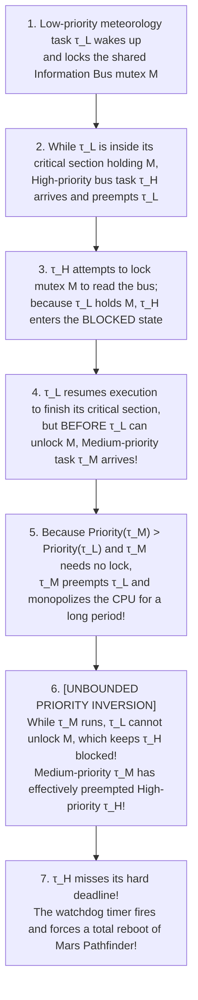
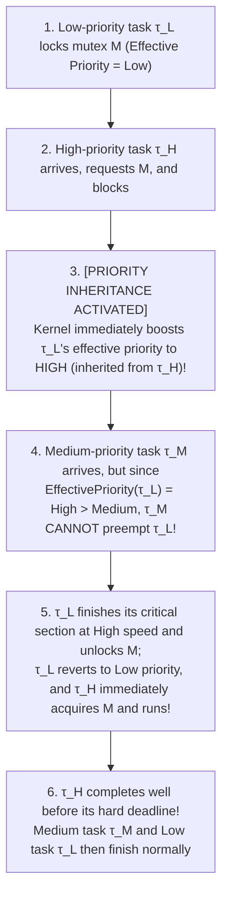

## 1. Introduction: The Fundamental Chasm Between "Fast" and "Real-Time"

In everyday conversation and across much of commercial software engineering, the phrase *"real-time processing"* is casually treated as a synonym for *"blisteringly fast execution"* or *"low-latency user interface responsiveness."* A modern workstation or cloud server powered by a multi-gigahertz superscalar processor with megabytes of L3 cache can crunch billions of floating-point operations per second (FLOPS) and answer database queries in an average of two milliseconds. Yet no aerospace or automotive safety engineer would ever permit that same high-throughput server operating system to directly actuate the fly-by-wire flight control surfaces of an airliner, trigger an automotive airbag and anti-lock braking system (ABS/ESP), or regulate a cardiac pacemaker.

Why? Because in safety-critical physical control loops, <strong>average speed is irrelevant; only the worst-case temporal guarantee matters</strong>. If an airbag deployment algorithm completes in $0.5\,\text{ms}$ on $99.999\%$ of invocations, but once in a million invocations stalls for $150\,\text{ms}$ due to an OS kernel page fault, a garbage collection pause, an L3 cache eviction storm, or an unpreemptible lock contention, the passenger has already collided with the steering column before the pyrotechnic igniter fires.

In computer science, the rigorous definition of a <strong>Real-Time System</strong>, formulated by Donald Gillies and Hermann Kopetz, rests on a foundational axiom:

> <strong>The Axiom of Real-Time Computing</strong>:  
> *"A real-time system is one in which the correctness of a computation depends not only on the <strong>logical and arithmetic correctness</strong> of the result, but also on the <strong>physical instant in time</strong> at which that result is produced."*

Even if a flight control computer calculates the required aileron deflection angle accurate to sixteen decimal places of IEEE-754 double precision, a logically spotless answer delivered $1\,\text{microsecond}$ after the physical control loop's <strong>deadline ($d_i$)</strong> is no longer a slightly late answer—it is a <strong>system failure</strong>, mathematically equivalent to (or worse than) outputting a completely wrong number.

### 1.1 General-Purpose Operating Systems (GPOS) vs. Real-Time Operating Systems (RTOS)

The operating systems we interact with daily—Linux, Windows, and macOS—are <strong>General-Purpose Operating Systems (GPOS)</strong>. By contrast, systems such as <strong>Wind River VxWorks</strong>, <strong>FreeRTOS</strong>, <strong>QNX Neutrino</strong>, <strong>Zephyr</strong>, <strong>RTEMS</strong>, and the formally verified microkernel <strong>seL4</strong> are <strong>Real-Time Operating Systems (RTOS)</strong>. These two families of operating systems are engineered around diametrically opposed mathematical objective functions:

* <strong>The GPOS Objective Function — Maximizing Average Throughput and Fairness</strong>:  
  A GPOS scheduler—such as the Linux Completely Fair Scheduler (CFS) or the Earliest Eligible Virtual Deadline First (EEVDF) scheduler—is designed to maximize aggregate system throughput (jobs completed per unit time), ensure equitable CPU time distribution across competing processes (fairness), and minimize average interactive response time. If a background disk flush or kernel spinlock temporarily delays an audio thread by $25\,\text{ms}$, that is an acceptable trade-off for higher overall system throughput.
* <strong>The RTOS Objective Function — Temporal Determinism and Bounded Worst-Case Latency</strong>:  
  An RTOS does not care how fast a task finishes *on average*, nor does it care about fairness toward low-priority background tasks. Its sole objective is <strong>temporal determinism</strong>: proving mathematically that under the worst possible coincidence of external hardware interrupts and simultaneous task releases, the <strong>Interrupt Latency</strong> (time from hardware pin assertion to ISR instruction execution), <strong>Dispatch Latency</strong> (time from task wake-up to context switch completion), and <strong>Worst-Case Response Time (WCRT, $R_i$)</strong> of every critical task remain strictly below a known, constant upper bound $100\%$ of the time. To guarantee this bound, an RTOS will gladly sacrifice aggregate throughput and starve low-priority tasks indefinitely.

| Architectural Dimension | General-Purpose OS (GPOS: Linux / Windows / macOS) | Real-Time OS (RTOS: VxWorks / QNX / FreeRTOS / seL4) |
| :--- | :--- | :--- |
| <strong>Primary Optimization Goal</strong> | Maximize average throughput, fairness, and average responsiveness | Guarantee <strong>Temporal Determinism</strong> and strict upper bounds on Worst-Case Response Time (WCRT) |
| <strong>Scheduling Paradigm</strong> | Time-sharing and proportional fair-share (e.g., Linux CFS / EEVDF) | Strict fixed-priority or deadline-driven preemptive scheduling (RMS / DM / EDF) |
| <strong>Interrupt & Dispatch Latency</strong> | Microseconds to tens of milliseconds (stochastic, heavy long-tail distribution) | Hundreds of nanoseconds to a few microseconds (strictly bounded $O(1)$ hardware ceiling) |
| <strong>Kernel Preemptibility</strong> | Monolithic kernels with non-preemptible critical sections and long spinlock paths | Fully preemptible kernel pathways or minimal message-passing microkernels (QNX, seL4) |
| <strong>Memory Management</strong> | Demand-paged virtual memory, page faults, dynamic `malloc`/`free`, Garbage Collection | Statically allocated partitions, $O(1)$ deterministic fixed-block pools, locked physical pages (`mlockall`) |
| <strong>Stance on Hardware Speculation</strong> | Exploits massive caches, out-of-order execution, and dynamic frequency scaling (DVFS) | Restricts or locks dynamic hardware features that inflate worst-case timing variance (jitter) |

---

## 2. Classifying Real-Time Systems via Time-Utility Functions (Hard, Firm, and Soft)

Not every real-time workload carries the same penalty when a deadline is missed. In 1985, E. Douglas Jensen introduced the <strong>Time-Utility Function (TUF)</strong> framework, which models the value or utility $U(t)$ delivered to the system as a function of the completion time $t$ relative to the task's absolute deadline $d$. Based on the behavior of $U(t)$ for $t > d$, real-time tasks fall into three rigorous categories:

### 2.1 Hard Real-Time Systems

In a <strong>Hard Real-Time</strong> system, missing a single deadline ($t > d$) constitutes a total, catastrophic system failure that can result in loss of human life, physical destruction of equipment, or mission loss. Mathematically, the utility function $U_{\text{hard}}(t)$ holds a positive constant value $V > 0$ up to the deadline $d$, and plunges discontinuously to $-\infty$ the instant $t$ exceeds $d$:

$$U_{\text{hard}}(t) = \begin{cases} V & (t \le d) \\ -\infty \quad (\text{Catastrophic System Failure}) & (t > d) \end{cases}$$

* <strong>Canonical Examples</strong>: Digital fly-by-wire flight control loops ($1\text{–}10\,\text{ms}$ period), automotive electronic stability control (ESC), airbag deployment, nuclear reactor emergency scram protection, implantable cardioverter-defibrillators (ICDs), and high-speed industrial robotic collision avoidance.
* <strong>Verification Requirement</strong>: Empirical testing (*"we ran the system on a test bench for 10,000 hours and observed zero deadline misses"*) is scientifically insufficient for hard real-time certification (such as DO-178C Level A in aviation or ISO 26262 ASIL-D in automotive engineering). Hard real-time guarantees require formal, offline mathematical proofs combining <strong>static Worst-Case Execution Time (WCET) analysis</strong> and <strong>schedulability analysis</strong>.

### 2.2 Firm Real-Time Systems

In a <strong>Firm Real-Time</strong> system, a computation that finishes after its deadline ($t > d$) yields <strong>zero utility</strong> ($U(t > d) = 0$) and is immediately <strong>discarded (aborted or dropped)</strong> because the physical state it pertains to has already passed. However, an isolated deadline miss does not cause physical catastrophe, provided that at least $m$ out of every $k$ consecutive invocations meet their deadlines—a constraint formalized by Hamdaoui and Ramanathan as <strong>$(m, k)$-firm real-time scheduling</strong>.

$$U_{\text{firm}}(t) = \begin{cases} V & (t \le d) \\ 0 \quad (\text{Result Discarded / Useless}) & (t > d) \end{cases}$$

* <strong>Canonical Examples</strong>: Machine-vision defect sorting on a high-speed factory conveyor belt (if image classification finishes after the defective bottle has already passed the pneumatic ejector nozzle, the result is useless and dropped), high-frequency algorithmic financial trading (HFT) order cancellation, and autonomous vehicle sensor-fusion frame updates where a newer LiDAR scan has already arrived.

### 2.3 Soft Real-Time Systems

In a <strong>Soft Real-Time</strong> system, the utility of a result does not drop instantaneously to $-\infty$ or $0$ at $t = d$; instead, it <strong>degrades continuously</strong> as a monotonically decreasing function of the tardiness $(t - d)$. Late results are still consumed, though user-perceived Quality of Service (QoS) or Quality of Experience (QoE) suffers proportionally.

$$U_{\text{soft}}(t) = \begin{cases} V & (t \le d) \\ V \cdot \exp\bigl(-\alpha (t - d)\bigr) & (t > d, \;\alpha > 0) \end{cases}$$

* <strong>Canonical Examples</strong>: $60\,\text{fps}$ / $120\,\text{fps}$ video decoding and game rendering ($16.67\,\text{ms}$ or $8.33\,\text{ms}$ frame budget, where a late frame causes a visible stutter), VoIP audio packet processing buffered by a jitter buffer, and VR head-mounted display motion-to-photon pipelines.

---

## 3. The Worst-Case Execution Time (WCET) Nightmare: How Modern CPUs Sabotage Determinism

Every mathematical scheduling theorem we will derive in Section 4 relies on one foundational prerequisite: for each task $\tau_i$, we must know beforehand its exact <strong>Worst-Case Execution Time (WCET, denoted $C_i$)</strong>—the absolute maximum CPU time the task could ever consume to execute a single job in isolation, across all possible input data and initial microarchitectural states.

Here lies one of the deepest paradoxes in modern computer architecture: <strong>virtually every hardware mechanism invented over the past forty years to make general-purpose CPUs faster on average actively destroys our ability to bound their Worst-Case Execution Time</strong>.

```
  Probability Density p(t)
    ▲
    │       [General-Purpose Superscalar CPU (Caches, Branch Prediction, OoO)]
    │         Extremely fast Mean Execution Time E[C], but massive variance (jitter)
    │         and a long tail force a huge, pessimistic Static WCET bound!
    │        ╭─╮
    │       ╱   ╲               [Deterministic Real-Time Processor (TCM, Locked Cache)]
    │      │     ╲                Slower average speed, but ultra-tight variance
    │      │      ╲               yields a provable, compact WCET bound C_i.
    │     ╱        ╲                    ╭──╮
    │    ╱          ╲                  ╱    ╲
    │   ╱            ╰────────────────╱──────╲────╮
    └──┴───────┴─────────────────────┴────────┴───┴──────► Execution Time t
             E[C] (Mean)             Observed Max  Provable Static WCET Bound C_i
```

### 3.1 Five Microarchitectural Sources of Temporal Jitter and Timing Anomalies

In 1970s and 1980s microprocessors (such as the Zilog Z80, Motorola 68000, or early in-order ARM7 cores), instruction execution times were deterministic constants documented directly in the manufacturer's datasheet: an `ADD` took $4$ cycles, a memory load took $8$ cycles, and computing the exact WCET of a function with bounded loops was a straightforward exercise in arithmetic. On a modern superscalar processor, that same memory load instruction might take <strong>$1\,\text{cycle}$</strong> (an L1 data cache hit) or <strong>$600+\,\text{cycles}$</strong> (an L1/L2/L3 cache miss compounded by a TLB miss page-table walk, a DRAM row-buffer conflict, a periodic DRAM capacitor refresh stall, and interconnect bus contention from sibling cores).

1. <strong>Set-Associative Caches and Cache-Related Preemption Delay (CRPD)</strong>:  
   Suppose task $\tau_i$ is executing a tight control loop whose instructions and working set are warm in the L1 cache. Suddenly, a higher-priority task $\tau_j$ preempts $\tau_i$. As $\tau_j$ executes, its memory accesses evict $\tau_i$'s cache lines under the cache's replacement policy (e.g., LRU or PLRU). When $\tau_i$ resumes execution, it suffers a storm of cold cache misses known as <strong>Cache-Related Preemption Delay (CRPD)</strong>, inflating its execution time far beyond its isolated timing.
2. <strong>Out-of-Order Execution (OoO), Speculative Branch Prediction, and Timing Anomalies</strong>:  
   Deeply pipelined out-of-order processors speculate past unresolved conditional branches. Worse still, as Reineke et al. and Lundqvist & Stenström proved, out-of-order pipelines coupled with caches exhibit <strong>Timing Anomalies</strong>: counter-intuitive states where a *local fast event* (such as an L1 cache <strong>hit</strong> instead of a miss) causes the global execution time of the program to become <strong>longer</strong> than if the instruction had missed! This happens because a fast cache hit can allow a speculative execution path or an out-of-order instruction to grab a shared functional unit or bus port early, delaying a critical-path instruction later. Because of timing anomalies, a static analyzer cannot simply assume "every memory access misses the cache" to find the worst case—it must explore the exponential state space of the pipeline!
3. <strong>TLB Misses, DRAM Refresh Cycles, and Shared Interconnect Contention</strong>:  
   A Translation Lookaside Buffer (TLB) miss triggers a multi-level hardware page table walk in physical RAM. Meanwhile, on multi-core System-on-Chips (SoCs), multiple cores competing for the same L3 cache bank or DDR memory controller can delay a real-time core by hundreds of cycles per memory transaction.
4. <strong>Dynamic Voltage and Frequency Scaling (DVFS) and System Management Interrupts (SMI)</strong>:  
   Modern x86 processors autonomously alter their clock frequency based on thermal headroom (Turbo Boost / thermal throttling). Even more insidious is the hardware <strong>System Management Interrupt (SMI)</strong> on x86 platforms: when triggered by BIOS/UEFI firmware for thermal or power management, the CPU silently traps into an opaque System Management Mode (SMM) that <strong>cannot be masked or disabled by the OS kernel (`CLI` has no effect)</strong>, freezing the RTOS for puluhan to ratusan microseconds.
5. <strong>Garbage Collection (GC) and Dynamic Memory Allocation (`malloc`/`free`)</strong>:  
   Standard heap allocators suffer from non-deterministic fragmentation searches, and tracing garbage collectors introduce unpredictable Stop-The-World or allocation-stall pauses. Consequently, hard real-time flight and automotive software (under MISRA-C, AUTOSAR, or Ada Ravenscar / SPARK profiles) strictly forbids dynamic heap allocation after initialization.

### 3.2 Engineering Bounded WCET: Scratchpad TCM, Cache Locking, and Static IPET Analysis

To tame microarchitectural chaos, safety-critical real-time systems combine deterministic hardware configurations with formal static program analysis:

* <strong>Deterministic Hardware Configuration</strong>: Dedicated real-time processors (such as the <strong>ARM Cortex-R</strong> series or <strong>Infineon AURIX TriCore</strong>) provide <strong>Tightly-Coupled Memory (TCM) / Scratchpad SRAM</strong>—on-chip single-cycle memory mapped directly into the physical address space under explicit compiler control, bypassing cache replacement uncertainty altogether. Where caches are used, RTOS kernels employ <strong>Cache Locking</strong> (pinning critical ISR and task code into specific cache ways) and <strong>Cache Partitioning / Page Coloring</strong> (isolating each task to disjoint cache sets so preempting tasks cannot evict each other's lines).
* <strong>Static WCET Analysis via Abstract Interpretation and IPET</strong>:  
  Because <strong>Measurement-Based Timing Analysis (MBTA)</strong>—running the code on hardware with test inputs and adding a safety margin to the high-water mark—can never guarantee that the true worst-case input path and pipeline state were exercised, safety standards require static verification tools (such as AbsInt's `aiT`). These tools reconstruct the binary's <strong>Control-Flow Graph (CFG)</strong>, bound the worst-case execution time $c_i$ of every basic block $B_i$ via <strong>Abstract Interpretation</strong> of the CPU's cache and pipeline states, and then solve an <strong>Integer Linear Programming (ILP)</strong> problem known as the <strong>Implicit Path Enumeration Technique (IPET)</strong>.

Let $x_i \in \mathbb{N}_0$ denote the execution count of basic block $B_i$, and let $d_{j \to i} \in \mathbb{N}_0$ denote the traversal count of control-flow edge $e_{j \to i}$. IPET computes the exact mathematical upper bound on WCET by maximizing the total cycle sum subject to structural flow conservation (Kirchhoff's current law on the CFG) and loop-bound constraints:

$$\text{WCET} = \max \sum_{i=1}^{N} c_i x_i \quad \text{subject to} \quad \forall i: \;\sum_{j \in \text{pred}(i)} d_{j \to i} = x_i = \sum_{k \in \text{succ}(i)} d_{i \to k}, \quad \text{plus loop bound inequalities.}$$

---

## 4. Liu & Layland (1973): The Mathematical Pillars of Periodic Real-Time Scheduling

Once static analysis has established a safe WCET bound $C_i$ for every task, we confront the central question of real-time operating systems: <strong>Given a set of $n$ periodic real-time tasks sharing a single processor, how can we mathematically prove offline that every single task will meet every single deadline from $t = 0$ to $t = \infty$?</strong>

This question was answered in 1973 by <strong>C. L. Liu</strong> and <strong>James W. Layland</strong> in their landmark *Journal of the ACM (JACM)* paper, *"Scheduling Algorithms for Multiprogramming in a Hard-Real-Time Environment"*—arguably the most influential paper in the history of real-time systems.

### 4.1 The Periodic Task Model and Processor Utilization ($U$)

Consider a system of $n$ independent, preemptible periodic tasks $\Gamma = \{\tau_1, \tau_2, \dots, \tau_n\}$. Each task $\tau_i$ releases an infinite sequence of jobs separated by a constant period and is characterized by the tuple:

$$\tau_i = (C_i, T_i, D_i)$$

* <strong>$C_i$ (Worst-Case Execution Time / Computation Time)</strong>: The maximum CPU time required by each job of $\tau_i$.
* <strong>$T_i$ (Period)</strong>: The exact time interval between consecutive job releases of $\tau_i$ (e.g., $T_i = 10\,\text{ms}$ for a $100\,\text{Hz}$ attitude control loop). The $k$-th job of $\tau_i$ arrives at release time $r_{i,k} = r_{i,0} + k T_i$.
* <strong>$D_i$ (Relative Deadline)</strong>: The maximum permissible elapsed time from a job's release $r_{i,k}$ to its completion. Its absolute deadline is $d_{i,k} = r_{i,k} + D_i$. In Liu & Layland's classical model, tasks have <strong>implicit deadlines</strong>, meaning each job must finish before the next job of the same task arrives ($D_i = T_i$).

The fraction of processor time consumed by task $\tau_i$ is its <strong>utilization factor</strong> $U_i = \frac{C_i}{T_i}$. Summing across all $n$ tasks yields the <strong>Total Processor Utilization ($U$)</strong>:

$$U = \sum_{i=1}^{n} U_i = \sum_{i=1}^{n} \frac{C_i}{T_i}$$

Clearly, $U \le 1.0$ ($100\%$) is a *necessary* condition for schedulability under any conceivable algorithm: if $U > 1.0$, the tasks collectively demand more than $1000\,\text{ms}$ of CPU time per second, making deadline misses unavoidable. The profound discovery of Liu & Layland lies in how the *sufficient* utilization bound depends on whether task priorities are <strong>static (fixed at design time)</strong> or <strong>dynamic (re-evaluated at runtime)</strong>.

---

### 4.2 Rate Monotonic Scheduling (RMS) and the $\ln 2 \approx 69.3\%$ Bound

First, consider <strong>Fixed-Priority Preemptive Scheduling</strong>, where each task $\tau_i$ is assigned a static priority level prior to execution, and at any instant the RTOS kernel dispatches the ready job with the highest static priority, immediately preempting any lower-priority running job.

How should we assign static priorities to $n$ periodic tasks? Intuition might suggest giving the highest priority to the "most semantically important" task or the task with the largest execution time $C_i$. Liu & Layland proved that both intuitions are wrong. Instead, the optimal static priority assignment is governed solely by task frequency:

> <strong>The Rate Monotonic Scheduling (RMS) Priority Assignment Rule</strong>:  
> Assign static priorities strictly in inverse order of task periods: <strong>the shorter a task's period $T_i$ (i.e., the higher its invocation rate $1/T_i$), the higher its static priority</strong>, completely independent of its execution time $C_i$:
> $$T_i < T_j \implies \text{Priority}(\tau_i) > \text{Priority}(\tau_j)$$

#### The Critical Instant Theorem and Optimality of RMS
To analyze Fixed-Priority scheduling, Liu & Layland established two foundational theorems:

1. <strong>Theorem 1 (The Critical Instant Theorem)</strong>:  
   For any fixed-priority preemptive task set, the worst-case (longest) response time of a task $\tau_i$ occurs when $\tau_i$ is released <strong>simultaneously at the exact same instant ($t = 0$)</strong> together with all tasks of higher priority $\tau_j \in hp(i)$. This simultaneous release alignment ($\forall j, \; r_{j,0} = 0$) is called the <strong>Critical Instant</strong>. If every task meets its first deadline when released at a critical instant, it is guaranteed to meet its deadlines for all possible phase offsets forever.
2. <strong>Theorem 2 (Optimality of RMS Among All Fixed-Priority Algorithms)</strong>:  
   Rate Monotonic Scheduling is <strong>optimal</strong> among all fixed-priority assignments for implicit-deadline ($D_i = T_i$) periodic tasks: if *any* static priority assignment can schedule a task set $\Gamma$ without deadline misses, then the Rate Monotonic priority assignment will also successfully schedule $\Gamma$. *(Note: When relative deadlines are constrained such that $D_i \le T_i$, assigning static priorities in inverse order of $D_i$—known as <strong>Deadline Monotonic Scheduling (DMS)</strong>, proven optimal by Leung & Whitehead in 1982—generalizes RMS).*

#### Derivation of the Liu & Layland Least Upper Bound: $U_{\text{lub}}(n) = n(2^{1/n} - 1) \to \ln 2$
By constructing the "most adversarial" combination of non-harmonic task periods—specifically, where the ratios of periods $T_2 / T_1, T_3 / T_2, \dots$ sit just below $2$ such that each higher-priority task $\tau_j$ squeezes in an extra preemption right before $\tau_n$'s deadline while leaving zero slack—Liu & Layland derived the exact <strong>Least Upper Bound on Processor Utilization ($U_{\text{lub}}(n)$)</strong> for $n$ tasks under RMS:

$$U = \sum_{i=1}^{n} \frac{C_i}{T_i} \le U_{\text{lub}}(n) = n\left(2^{1/n} - 1\right)$$

As the number of tasks $n$ grows toward infinity ($n \to \infty$), we can evaluate the limit by substituting $2^{1/n} = \exp\left(\frac{\ln 2}{n}\right)$ and expanding via Taylor series $\exp(x) = 1 + x + \frac{x^2}{2!} + \dots$:

$$\lim_{n \to \infty} n\left(2^{1/n} - 1\right) = \lim_{n \to \infty} n\left[\left(1 + \frac{\ln 2}{n} + \frac{(\ln 2)^2}{2n^2} + \cdots\right) - 1\right] = \ln 2 \approx 0.693147\dots \quad (69.31\%)$$

| Number of Tasks $n$ | Exact Liu-Layland Formula $U_{\text{lub}}(n) = n(2^{1/n}-1)$ | Guaranteed Schedulable Utilization |
| :---: | :---: | :---: |
| <strong>$n = 1$</strong> | $1 \cdot (2^{1/1} - 1) = 1.0000$ | <strong>$100.0\%$</strong> |
| <strong>$n = 2$</strong> | $2 \cdot (\sqrt{2} - 1) \approx 0.8284$ | <strong>$82.8\%$</strong> |
| <strong>$n = 3$</strong> | $3 \cdot (2^{1/3} - 1) \approx 0.7798$ | <strong>$78.0\%$</strong> |
| <strong>$n = 4$</strong> | $4 \cdot (2^{1/4} - 1) \approx 0.7568$ | <strong>$75.7\%$</strong> |
| <strong>$n = 5$</strong> | $5 \cdot (2^{1/5} - 1) \approx 0.7435$ | <strong>$74.3\%$</strong> |
| <strong>$n = 10$</strong> | $10 \cdot (2^{1/10} - 1) \approx 0.7177$ | <strong>$71.8\%$</strong> |
| <strong>$n \to \infty$</strong> | $\ln 2 \approx 0.6931$ | <strong>$69.3\%$</strong> |

#### Demystifying the 69.3% Bound: Harmonic Periods, the Hyperbolic Bound, and Exact Response-Time Analysis (RTA)
A widespread misconception among students is that *"RMS wastes $30.7\%$ ($1 - \ln 2$) of the CPU."* <strong>This is false.</strong> The Liu & Layland bound $U \le n(2^{1/n}-1)$ is merely a <strong>sufficient condition</strong>, not a necessary condition!

* <strong>Harmonic Task Sets Reach $100\%$ Utilization Under RMS</strong>:  
  If the task periods are <strong>harmonic</strong>—meaning every longer period is an exact integer multiple of every shorter period ($T_i \mid T_j$ whenever $T_i < T_j$, such as $T_1 = 5\,\text{ms}, T_2 = 10\,\text{ms}, T_3 = 20\,\text{ms}, T_4 = 100\,\text{ms}$)—then preemption boundaries align cleanly with deadlines, and <strong>RMS is guaranteed to schedule any task set up to $U \le 1.00$ ($100\%$ utilization)</strong>! This is why real-world avionics and automotive AUTOSAR control architectures deliberately choose harmonic task periods ($1\,\text{ms}, 2\,\text{ms}, 10\,\text{ms}, 20\,\text{ms}, 100\,\text{ms}$).
* <strong>Bini, Buttazzo & Buttazzo's Hyperbolic Bound (2001)</strong>:  
  Even for non-harmonic periods, a tighter utilization-only sufficient condition under RMS is the <strong>Hyperbolic Bound</strong>:
  $$\prod_{i=1}^{n} (U_i + 1) \le 2$$
* <strong>Joseph & Pandya's Exact Response-Time Analysis (RTA, 1986)</strong>:  
  When $U$ falls in the gray zone between $n(2^{1/n}-1)$ and $1.00$, how do we determine with <strong>exact necessary and sufficient precision</strong> whether a task set is schedulable under RMS or DMS? In 1986, Mathai Joseph and Paritosh Pandya proved that the exact Worst-Case Response Time $R_i$ of task $\tau_i$ released at the critical instant ($t = 0$) is the smallest positive fixed-point solution of the recurrence equation:

$$R_i = C_i + \sum_{j \in hp(i)} \left\lceil \frac{R_i}{T_j} \right\rceil C_j$$

Here, $hp(i) = \{\tau_j \mid \text{Priority}(\tau_j) > \text{Priority}(\tau_i)\}$ is the set of tasks with higher priority than $\tau_i$, and the ceiling term $\left\lceil \frac{R_i}{T_j} \right\rceil$ counts the exact number of times higher-priority task $\tau_j$ is released (and therefore preempts $\tau_i$) during the time window $[0, R_i)$. Because $\lceil \cdot \rceil$ is discontinuous, we solve this equation by fixed-point iteration starting from $R_i^{(0)} = C_i$:

$$R_i^{(k+1)} = C_i + \sum_{j \in hp(i)} \left\lceil \frac{R_i^{(k)}}{T_j} \right\rceil C_j$$

If the sequence converges such that $R_i^{(k+1)} = R_i^{(k)} \le D_i$, task $\tau_i$ is <strong>100% guaranteed to meet its deadline</strong>. If $R_i^{(k+1)} > D_i$ before convergence, task $\tau_i$ will miss its deadline at the critical instant.

---

### 4.3 Earliest Deadline First (EDF) and the $100\%$ Utilization Theorem

Why did RMS fail to achieve $100\%$ utilization for arbitrary non-harmonic periods? Because a fixed-priority scheduler is blind to the urgency of individual jobs: when a short-period task $\tau_1$ arrives, it blindly preempts a long-period task $\tau_2$, even if $\tau_2$'s absolute deadline is only $1\,\text{ms}$ away while $\tau_1$'s deadline is $5\,\text{ms}$ away!

In the second half of their 1973 paper, Liu & Layland analyzed <strong>Dynamic-Priority Preemptive Scheduling</strong>—specifically <strong>Earliest Deadline First (EDF)</strong> (also studied as Deadline-Driven Scheduling by Jackson in 1955 and Horn in 1974):

> <strong>The Earliest Deadline First (EDF) Scheduling Rule</strong>:  
> At any instant $t$, the scheduler dynamically assigns the highest priority to the ready job whose <strong>absolute deadline $d_{i,k} = r_{i,k} + D_i$ is closest to the current time $t$</strong>.

#### Optimality and 100% Schedulability of EDF on Uniprocessors
Using a processor-demand and time-slice swapping argument (Dertouzos, 1974), Liu & Layland proved that EDF is <strong>universally optimal</strong> among all uniprocessor scheduling algorithms:

> <strong>Theorem 3 (Necessary and Sufficient Schedulability Condition for EDF)</strong>:  
> A set of $n$ independent, preemptible periodic tasks with implicit deadlines ($D_i = T_i$) is schedulable by Earliest Deadline First (EDF) on a single processor <strong>if and only if</strong> the total processor utilization does not exceed $100\%$, regardless of whether the periods are harmonic or non-harmonic:
> $$U = \sum_{i=1}^{n} \frac{C_i}{T_i} \le 1.00 \quad (100\%)$$

#### Concrete Walkthrough: RMS Misses vs. EDF Succeeds at $U = 97.14\%$
Let us watch RMS and EDF go head-to-head on a concrete two-task system with non-harmonic periods $T_1 = 5\,\text{ms}$ and $T_2 = 7\,\text{ms}$:

* <strong>Task $\tau_1$</strong>: $C_1 = 2\,\text{ms}, \; T_1 = D_1 = 5\,\text{ms} \implies U_1 = \frac{2}{5} = 0.4000$ ($40.00\%$)
* <strong>Task $\tau_2$</strong>: $C_2 = 4\,\text{ms}, \; T_2 = D_2 = 7\,\text{ms} \implies U_2 = \frac{4}{7} \approx 0.5714$ ($57.14\%$)
* <strong>Total Utilization</strong>: $U = 0.4000 + 0.5714 = \mathbf{0.9714}$ (<strong>$97.14\%$</strong>). Notice that $0.8284 \; (U_{\text{lub}}(2)) < 0.9714 \le 1.0000$.

<strong>Case A — Under Rate Monotonic Scheduling (RMS)</strong>:  
Since $T_1 = 5 < T_2 = 7$, $\tau_1$ has permanently higher priority than $\tau_2$. Let us apply Joseph & Pandya's RTA recurrence to $\tau_2$:
1. $R_2^{(0)} = C_2 = 4\,\text{ms}$
2. $R_2^{(1)} = C_2 + \left\lceil \frac{4}{5} \right\rceil C_1 = 4 + 1 \times 2 = 6\,\text{ms}$
3. $R_2^{(2)} = C_2 + \left\lceil \frac{6}{5} \right\rceil C_1 = 4 + 2 \times 2 = \mathbf{8\,\text{ms}} > D_2 \; (= 7\,\text{ms})$ — <strong>DEADLINE MISS!</strong>

Tracing the timeline from the critical instant $t = 0$:
- <strong>$t = 0 \to 2\,\text{ms}$</strong>: Job $\tau_{1,1}$ (deadline $d_{1,1} = 5$) executes and completes.
- <strong>$t = 2 \to 5\,\text{ms}$</strong>: Job $\tau_{2,1}$ (deadline $d_{2,1} = 7$) executes for $3\,\text{ms}$. It needs <strong>only $1\,\text{ms}$ more</strong> to finish!
- <strong>$t = 5\,\text{ms}$</strong>: The second job of $\tau_1$, denoted $\tau_{1,2}$ (deadline $d_{1,2} = 10$), arrives. Even though $\tau_{2,1}$'s deadline is at $t = 7$ and $\tau_{1,2}$'s deadline is far off at $t = 10$, RMS has fixed priorities ($\tau_1 > \tau_2$)! Thus $\tau_{1,2}$ preempts $\tau_{2,1}$ and runs from $t = 5 \to 7\,\text{ms}$. At $t = 7\,\text{ms}$, $\tau_{2,1}$ still has $1\,\text{ms}$ of unfinished work and <strong>violates its hard deadline</strong>.

<strong>Case B — Under Earliest Deadline First (EDF)</strong>:  
- <strong>$t = 0 \to 2\,\text{ms}$</strong>: At $t = 0$, $d_{1,1} = 5 < d_{2,1} = 7$, so $\tau_{1,1}$ runs and completes at $t = 2$.
- <strong>$t = 2 \to 5\,\text{ms}$</strong>: $\tau_{2,1}$ runs for $3\,\text{ms}$.
- <strong>$t = 5\,\text{ms}$</strong>: Job $\tau_{1,2}$ arrives with absolute deadline $d_{1,2} = 5 + 5 = 10$. EDF compares the active absolute deadlines: $d_{2,1} = 7 < d_{1,2} = 10$. <strong>Because $\tau_{2,1}$ has the earlier deadline, EDF refuses to let $\tau_{1,2}$ preempt $\tau_{2,1}$!</strong>
- <strong>$t = 5 \to 6\,\text{ms}$</strong>: $\tau_{2,1}$ finishes its remaining $1\,\text{ms}$ at $t = 6 \le 7$ (<strong>Deadline Met!</strong>).
- <strong>$t = 6 \to 8\,\text{ms}$</strong>: $\tau_{1,2}$ executes for $2\,\text{ms}$ and finishes at $t = 8 \le 10$ (<strong>Deadline Met!</strong>). Every single job across the entire hyperperiod $\text{LCM}(5, 7) = 35\,\text{ms}$ meets its deadline!

### 4.4 Why Industrial RTOS Kernels Still Prefer Fixed-Priority (RMS/DMS) Over EDF

Given that EDF achieves $100\%$ utilization while RMS can fail above $69.3\%$, why do virtually all commercial and safety-certified RTOS kernels—<strong>VxWorks, FreeRTOS, QNX, Zephyr, RTEMS, and AUTOSAR OS</strong>—use Fixed-Priority Preemptive Scheduling (RMS/DMS) as their primary scheduler rather than EDF? There are three compelling systems-engineering reasons:

1. <strong>The Catastrophic "Domino Effect" Under Transient Overload ($U > 1.0$)</strong>:  
   EDF is optimal when $U \le 1.0$, but its behavior when an unexpected interrupt burst or slightly underestimated WCET pushes total demand above $100\%$ ($U > 1.0$) is catastrophic. Suppose job $J_1$ misses its deadline $d_1$ at time $t > d_1$, but still needs a bit more CPU time to finish. Under EDF, because $d_1$ is already in the past, $J_1$ has the *earliest* (oldest) deadline in the entire system! It therefore hogs the CPU, delaying job $J_2$ past $d_2$, which in turn delays $J_3$ past $d_3$, triggering a cascading <strong>Domino Effect</strong> (Buttazzo, *Hard Real-Time Computing Systems*) in which <strong>every single task in the system misses its deadline in rapid succession</strong>.  
   By contrast, Fixed-Priority Scheduling (RMS) exhibits <strong>predictable graceful degradation</strong>: if transient overload occurs ($U > 1.0$), the highest-priority safety-critical tasks ($\tau_1, \tau_2$) are completely insulated and continue to meet $100\%$ of their deadlines, while only the lowest-priority task ($\tau_n$) absorbs the overload!
2. <strong>$O(1)$ Bitmapped Kernel Scheduler Overhead vs. $O(\log n)$ Priority Queues</strong>:  
   A fixed-priority RTOS with $256$ priority levels represents ready tasks as a 256-bit bitmap plus an array of FIFO lists. Finding the highest-priority ready task takes a single hardware instruction (`BSR` / `LZCNT` / `CLZ`: Count Leading Zeros)—strictly <strong>$O(1)$ in a handful of clock cycles</strong>. An EDF scheduler must compute a new dynamic key $d_{i,k} = t + D_i$ on every job release and insert it into a sorted min-heap or red-black tree, incurring $O(\log n)$ pointer-manipulation and cache-footprint overhead inside the kernel tick handler.
3. <strong>POSIX / Ada / AUTOSAR Standard Compatibility</strong>:  
   Industrial safety standards (POSIX `SCHED_FIFO`, Ada Ravenscar, OSEK/VDX, and AUTOSAR OS) are architected around static priority levels and static priority ceiling synchronization protocols.

| Evaluation Dimension | Rate Monotonic / Deadline Monotonic (RMS / DMS) | Earliest Deadline First (EDF) |
| :--- | :--- | :--- |
| <strong>Priority Assignment</strong> | <strong>Static (Fixed offline)</strong>: Shorter $T_i$ (or $D_i$) $\implies$ Higher priority | <strong>Dynamic (Runtime)</strong>: Earlier absolute deadline $d_{i,k} \implies$ Higher priority |
| <strong>Schedulable Utilization Bound</strong> | Sufficient: $n(2^{1/n}-1) \to \ln 2 \approx 69.3\%$ (<strong>$100\%$ for harmonic periods</strong>) | Necessary & Sufficient: Always <strong>$100\%$</strong> ($\sum C_i/T_i \le 1$) |
| <strong>Kernel Dispatch Complexity</strong> | <strong>$O(1)$</strong> via fixed priority bitmap and hardware `CLZ` instruction | <strong>$O(\log n)$</strong> via dynamic min-heap / red-black tree insertion |
| <strong>Runtime Context Switches</strong> | Higher (short-period jobs always preempt long-period jobs) | <strong>Lower</strong> (fewer unnecessary preemptions when deadlines are far off) |
| <strong>Behavior Under Overload ($U > 1$)</strong> | <strong>Predictable & Graceful</strong>: High-priority tasks survive unscathed; only lowest priority misses | <strong>Catastrophic Domino Effect</strong>: One late job cascades deadline misses across all tasks |

---

## 5. The 1997 NASA Mars Pathfinder Incident and the Anatomy of Unbounded Priority Inversion

Up to this point, Liu & Layland's model assumed that tasks are completely independent. In real embedded systems, however, tasks must share hardware buses, sensor buffers, and state tables protected by <strong>mutual exclusion locks (mutexes / binary semaphores)</strong>. When preemptive priority scheduling collides with mutual exclusion, a pathological failure mode emerges that can shatter every real-time guarantee: <strong>Unbounded Priority Inversion</strong>.

Never was this hazard demonstrated more dramatically than in <strong>July 1997 on the surface of Mars</strong>, aboard NASA's <strong>Mars Pathfinder</strong> spacecraft.

### 5.1 Anomaly on Ares Vallis: Why Was Mars Pathfinder Resetting Myself?

On July 4, 1997, NASA's Mars Pathfinder lander bounced onto the rusty plains of Ares Vallis cushioned by giant airbags, deployed the <strong>Sojourner</strong> microrover, and began transmitting breathtaking panoramic images back to Earth.

Yet just days into surface operations, a terrifying anomaly struck. Pathfinder's flight computer—an <strong>IBM RAD6000</strong> radiation-hardened 32-bit PowerPC processor running the industry-standard <strong>Wind River VxWorks</strong> RTOS—began suffering <strong>repeated, uncommanded total system resets</strong>. Every time the spacecraft rebooted, ongoing telemetry transmissions were severed, the rover was halted, and an entire Martian sol's worth of meteorological and imaging science data was wiped from volatile RAM. Millions of miles away at NASA's Jet Propulsion Laboratory (JPL), flight software engineers raced to reproduce the mysterious reboots on an identical Pathfinder hardware testbed on Earth.

### 5.2 The Three Tasks and One Mutex Behind the Martian Resets

Pathfinder's flight software architecture centered on a shared memory region called the <strong>Information Bus</strong>, through which spacecraft subsystems exchanged telemetry and commands. Access to this shared bus was serialized by a VxWorks mutual exclusion semaphore (`mutex` $M$) inside a `pipe` abstraction. Three tasks of distinct static priorities were involved:

1. <strong>High-Priority Task $\tau_H$ (`bc_dist` — Bus Distribution Task)</strong>:  
   A hard real-time task running at high frequency ($8\,\text{Hz}$ / $125\,\text{ms}$ frame cycle) responsible for moving critical command and telemetry data into and out of the 1553B spacecraft bus. Its deadline was so vital that a hardware/software <strong>watchdog timer</strong> monitored `bc_dist`: if `bc_dist` ever failed to complete within its cycle window, the watchdog assumed the flight computer had suffered a radiation-induced lockup and immediately triggered a <strong>full hardware system reset</strong> of the spacecraft.
2. <strong>Low-Priority Task $\tau_L$ (`ASI/MET` — Atmospheric Structure Instrument / Meteorology Task)</strong>:  
   An infrequent, low-priority science task that gathered Martian temperature, pressure, and wind speed readings and published them to the Information Bus. While publishing its short message, $\tau_L$ acquired and held the shared Information Bus <strong>mutex $M$</strong>.
3. <strong>Medium-Priority Tasks $\tau_M$ (`comms`, `img`, etc. — Communications & Attitude Tasks)</strong>:  
   A set of medium-priority tasks that processed long radio communication packets and spacecraft operations. Crucially, <strong>$\tau_M$ did not touch the Information Bus mutex $M$ at all</strong>, yet its static priority lay strictly between $\tau_L$ and $\tau_H$:
   $$\text{Priority}(\tau_H) > \text{Priority}(\tau_M) > \text{Priority}(\tau_L)$$

Here is the exact sequence of events that unfolded on Mars:



Let us dissect why Step 5 and Step 6 are so lethal:
- When $\tau_H$ blocked on mutex $M$ in Step 3, waiting for $\tau_L$ to finish its tiny critical section of a few microseconds is normal <strong>direct blocking</strong>.
- However, in Step 4, while $\tau_L$ was running at its native <strong>Low</strong> priority to finish unlocking $M$, the <strong>Medium-priority</strong> communications task $\tau_M$ became ready.
- Because the OS scheduler saw $\tau_H$ as `BLOCKED` and compared only the runnable tasks ($\tau_M$ vs. $\tau_L$), it saw $\text{Priority}(\tau_M) > \text{Priority}(\tau_L)$ and immediately <strong>preempted $\tau_L$ in favor of $\tau_M$</strong>!
- As a result, $\tau_H$ (the highest-priority task on the spacecraft) was forced to wait not just for $\tau_L$'s brief critical section, but for the <strong>entire execution duration of every medium-priority task $\tau_M$ in the system</strong>! Because any number of medium-priority jobs can arrive back-to-back, the delay inflicted on $\tau_H$ is mathematically <strong>unbounded</strong> (<strong>Unbounded Priority Inversion</strong>). When `bc_dist` ($\tau_H$) remained stalled past its watchdog deadline, VxWorks logged an error and reset the spacecraft.

---

## 6. Sha, Rajkumar & Lehoczky (1990): Synchronization Protocols That Eradicate Priority Inversion

Seven years before Pathfinder landed on Mars, <strong>Lui Sha</strong>, <strong>Ragunathan Rajkumar</strong>, and <strong>John P. Lehoczky</strong> at Carnegie Mellon University published their seminal 1990 *IEEE Transactions on Computers* paper, *"Priority Inheritance Protocols: An Approach to Real-Time Synchronization,"* which provided the exact mathematical cure for priority inversion.

### 6.1 The Priority Inheritance Protocol (PIP) and the 190-Million-Kilometer Patch

The first protocol introduced by Sha et al. is the <strong>Priority Inheritance Protocol (PIP)</strong>:

> <strong>The Priority Inheritance Protocol (PIP) Rule</strong>:  
> Whenever a task $\tau_L$ holds a mutex $M$, and a higher-priority task $\tau_H$ blocks while attempting to acquire $M$, the operating system <strong>dynamically elevates $\tau_L$'s effective execution priority to the highest priority among all tasks currently blocked on any mutex held by $\tau_L$</strong>:
> $$\text{EffectivePriority}(\tau_L) = \max\Bigl(\text{BasePriority}(\tau_L), \;\max_{\tau_k \in \text{BlockedOn}(\tau_L)} \text{EffectivePriority}(\tau_k)\Bigr)$$
> The instant $\tau_L$ exits its critical section and unlocks $M$, its priority reverts to its original base priority (or to the highest priority among tasks blocked on any remaining locks it still holds), and $\tau_H$ is immediately dispatched.



#### How JPL Patched Mars Pathfinder Across Interplanetary Space
Ironically, Wind River VxWorks <strong>already had the Priority Inheritance Protocol built into its kernel</strong>! When creating a mutual exclusion semaphore in VxWorks via `semMCreate(options)`, passing the flag `SEM_Q_PRIORITY | SEM_INVERSION_SAFE` activates PIP. The JPL engineers had enabled `SEM_INVERSION_SAFE` on their explicit bus mutexes, but the offending mutex was buried inside a generic `pipe` library where the boolean configuration variable `select_mutex_options` had been left at its default value (`0`, PIP disabled) to save a few nanoseconds of semaphore lock overhead!

Because the JPL team had wisely left VxWorks's interactive C-language shell and global symbol table active in the flight build, they did not need to upload a massive new binary image across the slow deep-space radio link. Once they reproduced the bug on the Earth testbed after 18 hours of stress testing, they simply looked up the hexadecimal memory address of the global boolean variable governing `pipe` mutex creation, and <strong>beamed a single-line C command across 190 million kilometers to Mars to poke that byte in live RAM from `0` to `1`</strong>, flipping `SEM_INVERSION_SAFE` on! Mars Pathfinder never suffered another unplanned reset again.

---

### 6.2 Limitations of PIP (Chained Blocking & Deadlock) and the Priority Ceiling Protocol (PCP / ICPP)

While Priority Inheritance (PIP) prevents *unbounded* priority inversion by medium-priority tasks, Sha, Rajkumar, and Lehoczky proved that basic PIP still suffers from <strong>two severe theoretical vulnerabilities</strong> when tasks use multiple mutexes ($M_1, M_2, \dots, M_K$):

1. <strong>Chained Blocking</strong>:  
   Suppose $\tau_H$ needs to acquire $M_1$ and then $M_2$ sequentially. If low-priority task $\tau_{L1}$ holds $M_1$ and another low-priority task $\tau_{L2}$ holds $M_2$ when $\tau_H$ wakes up, $\tau_H$ must wait for $\tau_{L1}$ to finish $M_1$ (inheriting priority), and then *immediately block a second time* waiting for $\tau_{L2}$ to finish $M_2$! In general, under PIP, a high-priority task can be blocked up to $\min(N_{\text{low}}, K_{\text{locks}})$ times during a single job.
2. <strong>Susceptibility to Deadlock</strong>:  
   If task $\tau_1$ locks $M_1$ then requests $M_2$, while task $\tau_2$ locks $M_2$ then requests $M_1$, PIP does nothing to prevent $\tau_1$ and $\tau_2$ from deadlocking each other permanently.

To eliminate <strong>both</strong> chained blocking and deadlock in a single stroke, Sha et al. (1990) and Theodore Baker (1991, via the <strong>Stack Resource Policy, SRP</strong>) formulated the <strong>Priority Ceiling Protocol (PCP)</strong> and its practical industrial variant, the <strong>Immediate Priority Ceiling Protocol (ICPP)</strong> (also known as the <strong>Highest Locker Protocol</strong>, standardized in POSIX as `PTHREAD_PRIO_PROTECT`, in Ada as *Ceiling Locking*, and in OSEK / AUTOSAR OS):

> <strong>The Immediate Priority Ceiling Protocol (ICPP / Highest Locker) Rules</strong>:
> 1. <strong>Offline Ceiling Assignment</strong>: Every mutex $M_k$ is statically assigned a <strong>Priority Ceiling</strong>, denoted $\text{Ceil}(M_k)$, equal to the <strong>highest static priority of any task that may ever lock $M_k$</strong>:
>    $$\text{Ceil}(M_k) = \max\bigl\{\text{Priority}(\tau_i) \;\big|\; \tau_i \text{ uses } M_k\bigr\}$$
> 2. <strong>Runtime Immediate Boost</strong>: The exact instant any task $\tau_i$ acquires mutex $M_k$ (<strong>even if no other task is currently contending for $M_k$!</strong>), $\tau_i$'s effective priority is immediately raised to:
>    $$\text{EffectivePriority}(\tau_i) = \max\bigl(\text{EffectivePriority}(\tau_i), \;\text{Ceil}(M_k)\bigr)$$

By raising the lock holder's priority to $\text{Ceil}(M_k)$ immediately upon lock acquisition, ICPP guarantees <strong>three remarkable mathematical theorems simultaneously</strong>:

1. <strong>Theorem 4 (The Single-Blocking Property)</strong>:  
   Under PCP / ICPP, a high-priority task $\tau_i$ can be blocked by lower-priority tasks <strong>at most ONCE</strong> during its entire execution, and for a duration no longer than the <strong>single longest critical section</strong> $B_i$ of a lower-priority task accessing a mutex whose ceiling is $\ge \text{Priority}(\tau_i)$! Why? Because for $\tau_i$ to be blocked at all, a lower-priority task $\tau_L$ must already be inside a critical section when $\tau_i$ is released. No *second* lower-priority task could possibly hold another lock that $\tau_i$ needs, because the first $\tau_L$'s priority was immediately boosted to $\ge \text{Priority}(\tau_i)$ the moment it took its lock, preventing any other lower-priority task from running!
2. <strong>Theorem 5 (Complete Freedom from Mutual Deadlock)</strong>:  
   Deadlock among tasks sharing mutexes under PCP / ICPP is <strong>mathematically impossible</strong>. The moment $\tau_1$ locks $M_1$, its effective priority rises to $\text{Ceil}(M_1)$, which is at least as high as the priority of *every* other task $\tau_2$ that uses $M_1$. Therefore, $\tau_2$ cannot preempt $\tau_1$ to acquire a second lock $M_2$ and create a circular wait!
3. <strong>Theorem 6 (Schedulability Analysis with Bounded Blocking $B_i$)</strong>:  
   Because the maximum blocking time $B_i$ inflicted on task $\tau_i$ by all lower-priority tasks is strictly bounded to a single critical section, we can incorporate synchronization directly into both the Liu & Layland bound and Joseph & Pandya's exact Response-Time Analysis (RTA) simply by adding $B_i$:

$$\forall i \in \{1, \dots, n\}: \quad \sum_{j=1}^{i} \frac{C_j}{T_j} + \frac{B_i}{T_i} \le i\left(2^{1/i} - 1\right) \qquad \text{and} \qquad R_i^{(k+1)} = C_i + B_i + \sum_{j \in hp(i)} \left\lceil \frac{R_i^{(k)}}{T_j} \right\rceil C_j$$

| Synchronization Protocol | Unbounded Priority Inversion | Deadlock Prevention | Maximum Blocking Events per Job | Implementation & OS Adoption |
| :--- | :--- | :--- | :--- | :--- |
| <strong>Standard Mutex (No Protocol)</strong> | <strong>Vulnerable (Unbounded delay)</strong> | None | $\infty$ (Unbounded) | Unsafe for real-time systems |
| <strong>Priority Inheritance (PIP)</strong> | <strong>Eliminated</strong> | None (Requires lock ordering) | Up to $\min(N_{\text{low}}, K_{\text{locks}})$ (Chained blocking) | Transparent (no ceiling config needed); VxWorks `SEM_INVERSION_SAFE`, Linux `PTHREAD_PRIO_INHERIT`, FreeRTOS |
| <strong>Original Priority Ceiling (PCP)</strong> | <strong>Eliminated</strong> | <strong>100% Guaranteed</strong> | <strong>At most 1 critical section ($B_i$)</strong> | Boosts priority on contention via ceiling check |
| <strong>Immediate Priority Ceiling (ICPP / SRP)</strong> | <strong>Eliminated</strong> | <strong>100% Guaranteed</strong> | <strong>At most 1 critical section ($B_i$)</strong> (Zero context switch on block!) | Boosts priority immediately on lock; allows single shared stack. AUTOSAR OS, OSEK, Ada, POSIX `PTHREAD_PRIO_PROTECT` |

---

## 7. Conclusion: The Engineering Discipline of Temporal Certainty

When we step aboard a commercial aircraft, press the brake pedal on an icy highway, or watch a robotic rover traverse the craters of Mars, our lives and missions depend not on how many billion instructions per second a processor can execute in a best-case benchmark, but on <strong>mathematical invariants that hold under the worst conceivable coincidence of events</strong>.

From Turing-complete deterministic hardware configurations (scratchpad TCM and locked caches) and static IPET Worst-Case Execution Time analysis, through Liu & Layland's Rate Monotonic ($\ln 2 \approx 69.3\%$) and Earliest Deadline First ($100\%$) scheduling theorems, to Joseph & Pandya's fixed-point Response-Time Analysis and Sha, Rajkumar & Lehoczky's Priority Inheritance and Priority Ceiling Protocols, real-time systems engineering transforms physical time from an unpredictable runtime accident into a <strong>first-class, formally verifiable property of software</strong>.
