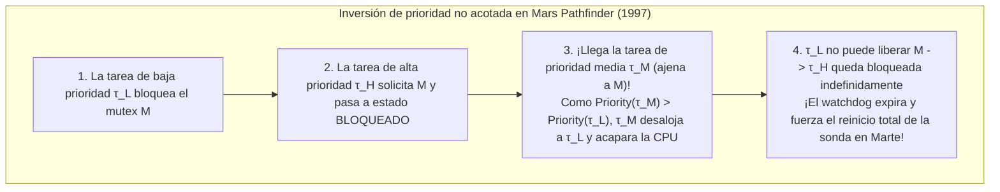
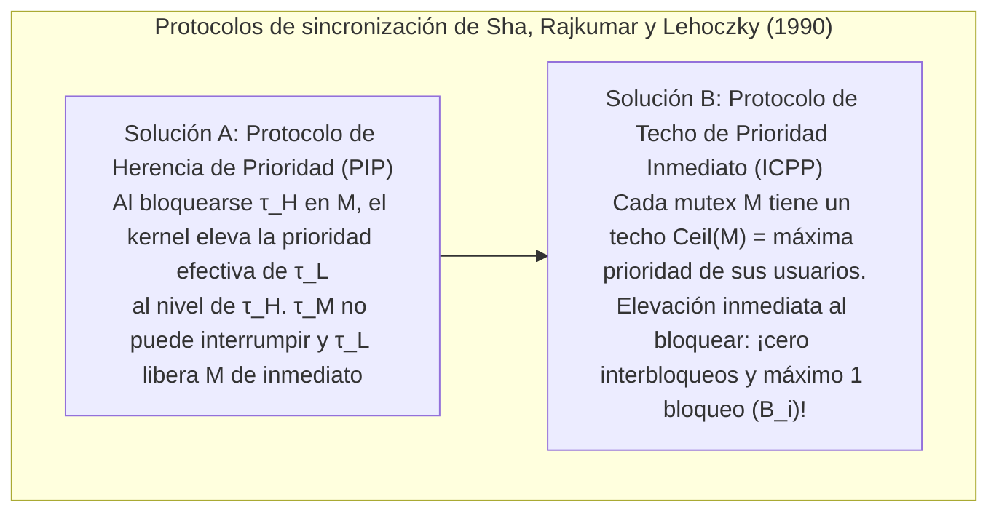

## 1. El abismo fundamental entre «rápido» y «tiempo real»

En el lenguaje cotidiano, «procesamiento en tiempo real» suele confundirse con «ejecución ultrarrápida». Sin embargo, ni siquiera un servidor con procesador superescalar multinúcleo a varios gigahercios capaz de responder consultas en un promedio de un milisegundo podría controlar jamás el sistema *Fly-by-Wire* de un avión comercial, el disparo de un airbag automotriz o un marcapasos cardíaco. ¿Por qué? Porque un sistema de propósito general optimiza el <strong>rendimiento promedio (Average Throughput)</strong>: si un cálculo tarda $0,5\,\text{ms}$ el $99,999\,\%$ de las veces, pero una vez en un millón se retrasa $200\,\text{ms}$ por un fallo de caché, un fallo de página o el recolector de basura (GC), el avión entra en pérdida o el airbag explota después del choque.

Según la formulación clásica de Donald Gillies y Hermann Kopetz, el <strong>axioma de la computación en tiempo real</strong> establece que la corrección de un sistema depende no solo de la <strong>exactitud lógica y aritmética</strong> del resultado, sino también del <strong>instante físico $t$</strong> en que se entrega respecto a su fecha límite (*deadline* $d_i$). Mediante la <strong>función de utilidad temporal $U(t)$</strong> se distinguen tres clases:

$$U_{\text{hard}}(t) = \begin{cases} V & (t \le d) \\ -\infty & (t > d) \end{cases}, \qquad U_{\text{firm}}(t) = \begin{cases} V & (t \le d) \\ 0 & (t > d) \end{cases}, \qquad U_{\text{soft}}(t) = \begin{cases} V & (t \le d) \\ V e^{-\alpha(t-d)} & (t > d) \end{cases}$$

* <strong>Tiempo real estricto o duro (Hard Real-Time)</strong>: Incumplir un solo plazo ($t > d$) provoca un fallo catastrófico ($U = -\infty$, ej. control de vuelo, frenos ABS). Exige demostración matemática estática fuera de línea.
* <strong>Tiempo real firme (Firm Real-Time)</strong>: Un resultado tardío carece de valor ($U = 0$) y se descarta al instante (ej. clasificación por visión artificial en cinta transportadora, trading algorítmico HFT).
* <strong>Tiempo real blando (Soft Real-Time)</strong>: La utilidad decae continuamente tras $d$ (ej. vídeo a 60 fps, llamadas VoIP).

| Dimensión arquitectónica | SO de propósito general (GPOS: Linux / Windows / macOS) | SO en tiempo real (RTOS: VxWorks / QNX / FreeRTOS / seL4) |
| :--- | :--- | :--- |
| <strong>Objetivo de optimización</strong> | Maximizar rendimiento medio y equidad (CFS / EEVDF) | Garantizar <strong>determinismo temporal</strong> y acotar el peor tiempo de respuesta (WCRT) |
| <strong>Latencia de interrupción</strong> | Microsegundos a decenas de milisegundos (cola larga estocástica) | Cientos de nanosegundos a pocos microsegundos (cota constante $O(1)$) |
| <strong>Preemptibilidad del kernel</strong> | Kernels monolíticos con secciones críticas no apropiativas | Kernel totalmente apropiativo o微kernel mínimo (QNX, seL4) |
| <strong>Memoria y hardware</strong> | Memoria virtual paginada, `malloc`, GC, máxima ejecución especulativa | Particiones estáticas, pools $O(1)$, SRAM acoplada (TCM) y bloqueo de caché |

---

## 2. La pesadilla del tiempo de ejecución en el peor caso (WCET)

Toda teoría de planificación en tiempo real presupone conocer de antemano el <strong>tiempo de ejecución en el peor caso (Worst-Case Execution Time, $C_i$)</strong> de cada tarea $\tau_i$. Aquí surge una profunda paradoja de la arquitectura de computadores: <strong>casi todos los mecanismos de hardware diseñados para acelerar la velocidad media de una CPU (cachés L1/L2/L3, predicción de saltos, ejecución fuera de orden OoO, TLB, DVFS e interrupciones de gestión del sistema SMI no enmascarables) destruyen la predecibilidad del WCET.</strong>

En tuberías *Out-of-Order* con cachés ocurren incluso <strong>anomalías temporales (Timing Anomalies)</strong>: ¡un *acierto* local de caché (Cache Hit) puede permitir que una ruta especulativa ocupe antes un bus compartido, haciendo que el tiempo total de ejecución del programa sea <strong>mayor</strong> que si hubiera ocurrido un fallo de caché (Cache Miss)! Por ello, los sistemas críticos (DO-178C Nivel A, ISO 26262 ASIL-D) emplean memoria <strong>Scratchpad SRAM / TCM</strong> determinista y <strong>bloqueo de caché (Cache Locking)</strong>, y calculan estáticamente la cota superior del WCET mediante <strong>interpretación abstracta</strong> y la <strong>técnica de enumeración implícita de caminos (IPET)</strong> resolviendo un problema de programación lineal entera (ILP) sobre el grafo de flujo de control (CFG):

$$\text{WCET} = \max \sum_{i=1}^{N} c_i x_i \quad \text{sujeto a} \quad \sum_{j} d_{j \to i} = x_i = \sum_{k} d_{i \to k} \quad (\text{conservación de flujo y cotas de bucle})$$

---

## 3. Liu y Layland (1973): Planificación periódica (RMS vs. EDF)

Sea un conjunto de $n$ tareas periódicas independientes $\Gamma = \{\tau_1, \dots, \tau_n\}$ con $\tau_i = (C_i, T_i, D_i)$ (WCET $C_i$, periodo $T_i$, plazo implícito $D_i = T_i$). La <strong>utilización total del procesador</strong> es:

$$U = \sum_{i=1}^{n} \frac{C_i}{T_i}$$

En 1973, C. L. Liu y James W. Layland demostraron los teoremas fundamentales que rigen las prioridades estáticas y dinámicas:

### 3.1 Planificación Monótona en Tasa (RMS) y la cota $\ln 2 \approx 69,3\,\%$

En <strong>planificación apropiativa de prioridad fija</strong>, la regla <strong>Rate Monotonic (RMS)</strong> asigna prioridades estáticas en orden inverso al periodo: <strong>cuanto más corto es el periodo $T_i$ (mayor frecuencia $1/T_i$), mayor es su prioridad estática</strong>. Liu y Layland demostraron el <strong>teorema del instante crítico</strong> (el peor tiempo de respuesta de $\tau_i$ ocurre cuando se libera simultáneamente con todas las tareas de mayor prioridad en $t=0$) y la optimalidad de RMS entre todos los algoritmos de prioridad fija, con la mínima cota superior de utilización:

$$U = \sum_{i=1}^{n} \frac{C_i}{T_i} \le U_{\text{lub}}(n) = n\left(2^{1/n} - 1\right) \xrightarrow{n \to \infty} \ln 2 \approx 0,6931 \quad (69,3\,\%)$$

Importante: ¡el $69,3\,\%$ es solo una <strong>condición suficiente</strong>, no necesaria! Si los periodos son <strong>armónicos</strong> (cada periodo es múltiplo entero de los menores, ej. $5\,\text{ms}, 10\,\text{ms}, 20\,\text{ms}$), RMS alcanza el <strong>100 % de utilización</strong>. Para conjuntos generales, el <strong>análisis de tiempo de respuesta (RTA)</strong> de Joseph y Pandya (1986) ofrece una condición necesaria y suficiente exacta por iteración de punto fijo ($R_i \le D_i$):

$$R_i^{(k+1)} = C_i + \sum_{j \in hp(i)} \left\lceil \frac{R_i^{(k)}}{T_j} \right\rceil C_j$$

### 3.2 Primero el Plazo Más Temprano (EDF) y la optimalidad del $100\,\%$

En <strong>planificación apropiativa de prioridad dinámica</strong>, <strong>Earliest Deadline First (EDF)</strong> otorga en todo momento la máxima prioridad al trabajo listo cuyo <strong>plazo absoluto $d_{i,k} = r_{i,k} + D_i$ esté más próximo</strong>. En un monoprocesador, la condición <strong>necesaria y suficiente</strong> de planificabilidad bajo EDF alcanza el límite físico:

$$U = \sum_{i=1}^{n} \frac{C_i}{T_i} \le 1,00 \quad (100\,\%)$$

Ejemplo: Con $\tau_1 = (C_1=2, T_1=5)$ y $\tau_2 = (C_2=4, T_2=7)$, la utilización es $U = 97,14\,\%$. Bajo RMS, la llegada de $\tau_{1,2}$ en $t=5$ ($d=10$) desaloja ciegamente a $\tau_{2,1}$ ($d=7$, a la que solo le falta $1\,\text{ms}$), causando $R_2 = 8 > 7$ (¡incumplimiento de plazo!). Bajo EDF, en $t=5$, como $d_{2,1}=7 < d_{1,2}=10$, EDF impide el desalojo y $\tau_{2,1}$ termina a tiempo en $t=6 \le 7$.

Sin embargo, la industria (VxWorks, FreeRTOS, QNX, AUTOSAR) prefiere RMS/DMS porque ante una <strong>sobrecarga transitoria ($U > 1,0$)</strong>, EDF sufre un <strong>efecto dominó catastrófico</strong> donde una tarea retrasada acapara la CPU y hace fallar en cadena a todas las demás, mientras que RMS protege al $100\,\%$ las tareas críticas de alta prioridad y se implementa en $O(1)$ con un mapa de bits y la instrucción `CLZ`.

| Criterio de comparación | Rate Monotonic (RMS: Prioridad fija) | Earliest Deadline First (EDF: Prioridad dinámica) |
| :--- | :--- | :--- |
| <strong>Asignación de prioridad</strong> | Estática: menor periodo $T_i \implies$ mayor prioridad | Dinámica: plazo absoluto $d_{i,k}$ más cercano $\implies$ mayor prioridad |
| <strong>Cota de utilización</strong> | Suficiente: $n(2^{1/n}-1) \to 69,3\,\%$ ($100\,\%$ en periodos armónicos) | Necesaria y suficiente: siempre <strong>$100\,\%$</strong> ($\sum C_i/T_i \le 1$) |
| <strong>Complejidad en el kernel</strong> | <strong>$O(1)$</strong> (bitmap de prioridades + instrucción `CLZ`) | <strong>$O(\log n)$</strong> (montículo mínimo o árbol rojo-negro dinámico) |
| <strong>Comportamiento en sobrecarga ($U > 1$)</strong> | <strong>Degradación elegante</strong>: las tareas de alta prioridad sobreviven siempre | <strong>Efecto dominó catastrófico</strong>: fallo en cascada de todas las tareas |

---

## 4. El incidente del Mars Pathfinder de la NASA (1997) y la inversión de prioridad

En julio de 1997, tras aterrizar con éxito en Marte, la sonda <strong>Mars Pathfinder</strong> de la NASA (CPU IBM RAD6000 con RTOS <strong>VxWorks</strong>) comenzó a sufrir reinicios completos forzados por su temporizador *watchdog*, perdiendo días enteros de datos meteorológicos e imágenes.

La causa fue una <strong>inversión de prioridad no acotada (Unbounded Priority Inversion)</strong> entre tres tareas en torno a un mutex $M$ que protegía el «bus de información» compartido:
* La <strong>tarea meteorológica de baja prioridad $\tau_L$ (`ASI/MET`)</strong> bloquea el mutex $M$;
* La <strong>tarea crítica de distribución del bus de alta prioridad $\tau_H$ (`bc_dist`)</strong> despierta, solicita $M$ y queda bloqueada;
* Antes de que $\tau_L$ libere $M$, llegan <strong>tareas de comunicación de prioridad media $\tau_M$</strong> (¡que no usan $M$!). Como $\text{Priority}(\tau_M) > \text{Priority}(\tau_L)$, $\tau_M$ desaloja a $\tau_L$ durante largo tiempo, impidiendo que $\tau_L$ desbloquee $M$ y manteniendo a $\tau_H$ bloqueada hasta que el *watchdog* reinicia la nave.

La cura matemática fue demostrada por Sha, Rajkumar y Lehoczky en 1990:
1. <strong>Protocolo de Herencia de Prioridad (PIP: Priority Inheritance Protocol)</strong>: Cuando $\tau_H$ se bloquea en un mutex $M$ retenido por $\tau_L$, el kernel eleva temporalmente la prioridad efectiva de $\tau_L$ al nivel de $\tau_H$, impidiendo que $\tau_M$ se interponga. Tras reproducir el fallo en Tierra, los ingenieros del JPL enviaron a 190 millones de kilómetros un comando C al intérprete de VxWorks para cambiar en RAM la variable global `SEM_INVERSION_SAFE` de `0` a `1`, ¡salvando la misión!
2. <strong>Protocolo de Techo de Prioridad (PCP / ICPP: Immediate Priority Ceiling Protocol)</strong>: Como PIP aún permite <strong>bloqueo encadenado</strong> e <strong>interbloqueo (Deadlock)</strong>, ICPP (estándar en POSIX `PTHREAD_PRIO_PROTECT` y AUTOSAR OS) asigna a cada mutex $M_k$ un techo estático $\text{Ceil}(M_k) = \max\{\text{Priority}(\tau_i) \mid \tau_i \text{ usa } M_k\}$ y eleva la prioridad de cualquier tarea <strong>en el instante mismo en que adquiere $M_k$</strong>. Esto garantiza <strong>ausencia total de deadlocks</strong> y acota el bloqueo máximo de cualquier tarea a <strong>como máximo una única sección crítica ($B_i$)</strong>:

$$R_i^{(k+1)} = C_i + B_i + \sum_{j \in hp(i)} \left\lceil \frac{R_i^{(k)}}{T_j} \right\rceil C_j$$
