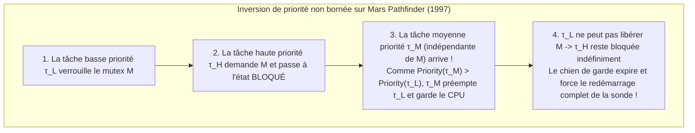
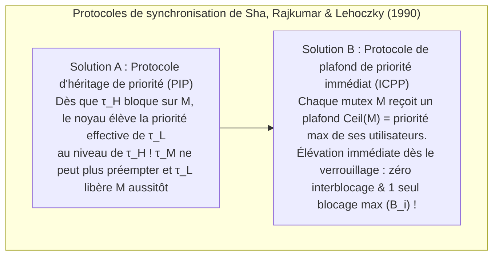

## 1. L'abîme fondamental entre « rapide » et « temps réel »

Dans le langage courant, « traitement en temps réel » est souvent confondu avec « exécution ultra-rapide ». Pourtant, même un serveur équipé d'un processeur multicœur superscalaire à plusieurs gigahertz répondant en moyenne en une milliseconde ne pourrait jamais piloter les commandes de vol électriques (*Fly-by-Wire*) d'un avion de ligne, déclencher un airbag automobile ou réguler un stimulateur cardiaque. Pourquoi ? Parce qu'un système généraliste optimise le <strong>débit moyen (Average Throughput)</strong> : si un calcul prend $0,5\,\text{ms}$ dans $99,999\,\%$ des cas, mais bloque pendant $200\,\text{ms}$ une fois sur un million à cause d'un défaut de cache, d'une faute de page ou d'un ramasse-miettes (GC), l'avion décroche ou l'airbag explose après l'impact.

Selon la définition classique de Donald Gillies et Hermann Kopetz, l'<strong>axiome de l'informatique temps réel</strong> stipule que la justesse d'un calcul dépend non seulement de son <strong>exactitude logique et arithmétique</strong>, mais aussi de l'<strong>instant physique $t$</strong> auquel le résultat est produit par rapport à son échéance (*deadline* $d_i$). La <strong>fonction d'utilité temporelle $U(t)$</strong> distingue trois classes :

$$U_{\text{hard}}(t) = \begin{cases} V & (t \le d) \\ -\infty & (t > d) \end{cases}, \qquad U_{\text{firm}}(t) = \begin{cases} V & (t \le d) \\ 0 & (t > d) \end{cases}, \qquad U_{\text{soft}}(t) = \begin{cases} V & (t \le d) \\ V e^{-\alpha(t-d)} & (t > d) \end{cases}$$

* <strong>Temps réel dur (Hard Real-Time)</strong> : Tout dépassement d'échéance ($t > d$) provoque une défaillance catastrophique ($U = -\infty$, ex. avionique, freinage ABS). Exige une preuve mathématique statique hors ligne.
* <strong>Temps réel ferme (Firm Real-Time)</strong> : Un résultat tardif a une valeur nulle ($U = 0$) et est immédiatement abandonné (ex. tri optique sur convoyeur rapide, annulation d'ordre financier HFT).
* <strong>Temps réel mou (Soft Real-Time)</strong> : L'utilité décroît progressivement après $d$ (ex. décodage vidéo 60 fps, téléphonie VoIP).

| Dimension architecturale | OS généraliste (GPOS : Linux / Windows / macOS) | OS temps réel (RTOS : VxWorks / QNX / FreeRTOS / seL4) |
| :--- | :--- | :--- |
| <strong>Objectif d'optimisation</strong> | Maximiser le débit moyen et l'équité (CFS / EEVDF) | Garantir le <strong>déterminisme temporel</strong> et borner le pire temps de réponse (WCRT) |
| <strong>Latence d'interruption</strong> | Microsecondes à dizaines de millisecondes (distribution à longue traîne) | Centaines de nanosecondes à quelques microsecondes (borne constante $O(1)$) |
| <strong>Préemptibilité du noyau</strong> | Noyau monolithique avec sections critiques non préemptibles | Noyau entièrement préemptible ou micro-noyau minimal (QNX, seL4) |
| <strong>Gestion mémoire & matériel</strong> | Mémoire virtuelle paginée, `malloc`, GC, exécution spéculative maximale | Partitions statiques, pools $O(1)$, SRAM couplée (TCM) et verrouillage de cache |

---

## 2. Le cauchemar du temps d'exécution au pire cas (WCET)

Toute théorie d'ordonnancement temps réel suppose connu à l'avance le <strong>temps d'exécution au pire cas (Worst-Case Execution Time, $C_i$)</strong> de chaque tâche $\tau_i$. Or, l'architecture des processeurs modernes recèle un paradoxe redoutable : <strong>presque tous les mécanismes matériels conçus pour accélérer la vitesse moyenne d'un CPU (caches L1/L2/L3, prédiction de branchement, exécution dans le désordre OoO, TLB, DVFS et interruptions système non masquables SMI) détruisent la prévisibilité du WCET.</strong>

Sur les pipelines *Out-of-Order* dotés de caches apparaissent même des <strong>anomalies temporelles (Timing Anomalies)</strong> : un *succès* de cache local (Cache Hit) peut permettre à une instruction spéculative de monopoliser un bus plus tôt, rendant le temps d'exécution global du programme <strong>plus long</strong> que lors d'un défaut de cache (Cache Miss) ! Les systèmes certifiés (DO-178C niveau A, ISO 26262 ASIL-D) utilisent donc de la mémoire <strong>Scratchpad SRAM / TCM</strong> déterministe et le <strong>verrouillage de cache (Cache Locking)</strong>, tout en calculant la borne supérieure du WCET par <strong>interprétation abstraite</strong> et <strong>énumération implicite des chemins (IPET)</strong> via un programme linéaire en nombres entiers (ILP) sur le graphe de flot de contrôle (CFG) :

$$\text{WCET} = \max \sum_{i=1}^{N} c_i x_i \quad \text{sous contraintes} \quad \sum_{j} d_{j \to i} = x_i = \sum_{k} d_{i \to k} \quad (\text{conservation du flot \& bornes de boucles})$$

---

## 3. Liu & Layland (1973) : Ordonnancement périodique (RMS vs EDF)

Soit un ensemble de $n$ tâches périodiques indépendantes $\Gamma = \{\tau_1, \dots, \tau_n\}$ définies par $\tau_i = (C_i, T_i, D_i)$ (WCET $C_i$, période $T_i$, échéance implicite $D_i = T_i$). Le <strong>taux d'utilisation global du processeur</strong> est :

$$U = \sum_{i=1}^{n} \frac{C_i}{T_i}$$

En 1973, C. L. Liu et James W. Layland ont établi les théorèmes fondamentaux opposant priorités statiques et priorités dynamiques :

### 3.1 Ordonnancement à vitesse monotone (RMS) et la borne $\ln 2 \approx 69,3\,\%$

En <strong>ordonnancement préemptif à priorités fixes</strong>, la règle <strong>Rate Monotonic (RMS)</strong> attribue une priorité statique inversement proportionnelle à la période : <strong>plus la période $T_i$ est courte (fréquence $1/T_i$ élevée), plus la priorité est haute</strong>. Liu & Layland ont prouvé le <strong>théorème de l'instant critique</strong> (le pire temps de réponse de $\tau_i$ survient lorsqu'elle est activée simultanément avec toutes les tâches plus prioritaires à $t=0$), ainsi que l'optimalité de RMS parmi les algorithmes à priorités fixes, avec pour plus petite borne supérieure d'utilisation :

$$U = \sum_{i=1}^{n} \frac{C_i}{T_i} \le U_{\text{lub}}(n) = n\left(2^{1/n} - 1\right) \xrightarrow{n \to \infty} \ln 2 \approx 0,6931 \quad (69,3\,\%)$$

Attention : $69,3\,\%$ n'est qu'une <strong>condition suffisante</strong> ! Si les périodes sont <strong>harmoniques</strong> (chaque période est un multiple entier des périodes plus courtes, ex. $5\,\text{ms}, 10\,\text{ms}, 20\,\text{ms}$), RMS atteint <strong>100 % d'utilisation</strong>. Pour un système quelconque, l'<strong>analyse du temps de réponse (RTA)</strong> de Joseph & Pandya (1986) fournit une condition nécessaire et suffisante exacte par itération de point fixe ($R_i \le D_i$) :

$$R_i^{(k+1)} = C_i + \sum_{j \in hp(i)} \left\lceil \frac{R_i^{(k)}}{T_j} \right\rceil C_j$$

### 3.2 Échéance la plus proche d'abord (EDF) et l'optimalité à $100\,\%$

En <strong>ordonnancement préemptif à priorités dynamiques</strong>, <strong>Earliest Deadline First (EDF)</strong> accorde à tout instant la priorité maximale au travail prêt dont l'<strong>échéance absolue $d_{i,k} = r_{i,k} + D_i$ est la plus proche</strong>. Sur monoprocesseur, la condition <strong>nécessaire et suffisante</strong> d'ordonnançabilité d'EDF atteint la limite physique :

$$U = \sum_{i=1}^{n} \frac{C_i}{T_i} \le 1,00 \quad (100\,\%)$$

Exemple : Pour $\tau_1 = (C_1=2, T_1=5)$ et $\tau_2 = (C_2=4, T_2=7)$, l'utilisation vaut $U = 97,14\,\%$. Sous RMS, l'arrivée de $\tau_{1,2}$ à $t=5$ ($d=10$) préempte aveuglément $\tau_{2,1}$ ($d=7$, à qui il ne reste que $1\,\text{ms}$), entraînant $R_2 = 8 > 7$ (violation d'échéance !). Sous EDF, à $t=5$, comme $d_{2,1}=7 < d_{1,2}=10$, EDF interdit la préemption, permettant à $\tau_{2,1}$ de terminer à $t=6 \le 7$ !

Pourtant, l'industrie (VxWorks, FreeRTOS, QNX, AUTOSAR) préfère toujours RMS/DMS car, en cas de <strong>surcharge transitoire ($U > 1,0$)</strong>, EDF subit un <strong>effet domino catastrophique</strong> où une tâche en retard monopolise le CPU et fait échouer toutes les tâches suivantes, tandis que RMS protège totalement les tâches critiques de haute priorité et s'implémente en temps $O(1)$ via un bitmap et l'instruction matérielle `CLZ`.

| Critère d'évaluation | Rate Monotonic (RMS : Priorité fixe) | Earliest Deadline First (EDF : Priorité dynamique) |
| :--- | :--- | :--- |
| <strong>Attribution des priorités</strong> | Statique : période $T_i$ plus courte $\implies$ priorité plus haute | Dynamique : échéance absolue $d_{i,k}$ plus proche $\implies$ priorité plus haute |
| <strong>Borne d'utilisation</strong> | Suffisante : $n(2^{1/n}-1) \to 69,3\,\%$ ($100\,\%$ si périodes harmoniques) | Nécessaire et suffisante : toujours <strong>$100\,\%$</strong> ($\sum C_i/T_i \le 1$) |
| <strong>Complexité dans le noyau</strong> | <strong>$O(1)$</strong> (bitmap de priorités + instruction `CLZ`) | <strong>$O(\log n)$</strong> (tas binaire min ou arbre rouge-noir dynamique) |
| <strong>Comportement en surcharge ($U > 1$)</strong> | <strong>Dégradation gracieuse</strong> : survie garantie des tâches haute priorité | <strong>Effet domino catastrophique</strong> : échec en chaîne de toutes les tâches |

---

## 4. L'incident de la sonde NASA Mars Pathfinder (1997) et l'inversion de priorité

En juillet 1997, peu après son atterrissage sur Mars, la sonde <strong>Mars Pathfinder</strong> de la NASA (processeur IBM RAD6000 sous RTOS <strong>VxWorks</strong>) a subi des réinitialisations matérielles répétées déclenchées par son chien de garde (*watchdog*), effaçant chaque jour de précieuses données scientifiques.

Le coupable était une <strong>inversion de priorité non bornée (Unbounded Priority Inversion)</strong> impliquant trois tâches autour d'un mutex $M$ protégeant le « bus d'information » partagé :
* La <strong>tâche météorologique de basse priorité $\tau_L$ (`ASI/MET`)</strong> verrouille le mutex $M$ ;
* La <strong>tâche critique de gestion du bus de haute priorité $\tau_H$ (`bc_dist`)</strong> se réveille, demande $M$ et se bloque ;
* Avant que $\tau_L$ ne libère $M$, des <strong>tâches de communication de priorité moyenne $\tau_M$</strong> (qui n'utilisent pas $M$ !) deviennent prêtes. Comme $\text{Priority}(\tau_M) > \text{Priority}(\tau_L)$, $\tau_M$ préempte $\tau_L$ pendant une longue durée, empêchant $\tau_L$ de déverrouiller $M$ et bloquant indirectement $\tau_H$ jusqu'à l'expiration du chien de garde !

Deux protocoles formulés par Sha, Rajkumar et Lehoczky dès 1990 éliminent ce phénomène :
1. <strong>Protocole d'héritage de priorité (PIP : Priority Inheritance Protocol)</strong> : Dès que $\tau_H$ bloque sur le mutex $M$ détenu par $\tau_L$, le noyau élève temporairement la priorité effective de $\tau_L$ au niveau de $\tau_H$, interdisant toute préemption par $\tau_M$. Après avoir reproduit le bogue au sol, les ingénieurs du JPL ont envoyé à 190 millions de kilomètres une commande C via l'interpréteur VxWorks pour basculer la variable globale `SEM_INVERSION_SAFE` de `0` à `1` directement en RAM, sauvant ainsi la mission !
2. <strong>Protocole de plafond de priorité (PCP / ICPP : Immediate Priority Ceiling Protocol)</strong> : Le PIP laisse subsister le <strong>blocage en chaîne</strong> et le risque d'<strong>interblocage (Deadlock)</strong>. L'ICPP (norme POSIX `PTHREAD_PRIO_PROTECT` et AUTOSAR OS) attribue à chaque mutex $M_k$ un plafond statique $\text{Ceil}(M_k) = \max\{\text{Priority}(\tau_i) \mid \tau_i \text{ utilise } M_k\}$ et élève la priorité de toute tâche <strong>dès l'instant où elle verrouille $M_k$</strong>. Cela garantit <strong>l'absence totale de deadlock</strong> et limite le retard maximal de toute tâche à <strong>une seule section critique ($B_i$)</strong> :

$$R_i^{(k+1)} = C_i + B_i + \sum_{j \in hp(i)} \left\lceil \frac{R_i^{(k)}}{T_j} \right\rceil C_j$$
