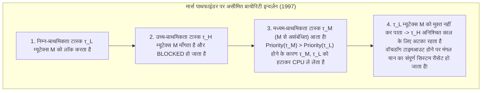
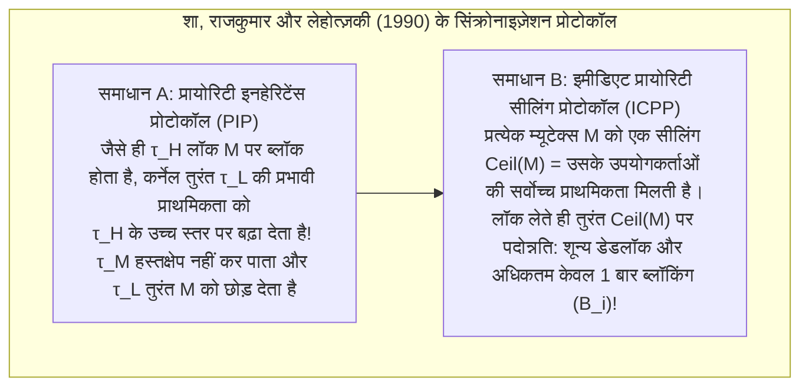

## 1. 'तेज़ (Fast)' और 'रीयल-टाइम (Real-Time)' के बीच की मौलिक खाई

आम बोलचाल में 'रीयल-टाइम प्रोसेसिंग' को अक्सर 'अत्यंत तेज़ निष्पादन' का पर्याय मान लिया जाता है। परंतु कई गीगाहर्ट्ज़ के मल्टी-कोर सुपरस्केलर प्रोसेसर से लैस कोई आधुनिक सर्वर, जो औसतन 1 मिलीसेकंड में क्वेरी का उत्तर देता है, किसी यात्री विमान के *Fly-by-Wire* उड़ान नियंत्रण, कार के एयरबैग या हृदय के पेसमेकर को नियंत्रित करने के लिए कभी उपयोग नहीं किया जा सकता। क्यों? क्योंकि सामान्य प्रयोजन के कंप्यूटर <strong>औसत थ्रूपुट (Average Throughput)</strong> को अधिकतम करते हैं: यदि कोई गणना $99.999\%$ बार $0.5\,\text{ms}$ में पूरी होती है, किंतु दस लाख में से एक बार कैश मिस, पेज फ़ॉल्ट या गार्बेज कलेक्शन (GC) के कारण $200\,\text{ms}$ विलंबित हो जाती है, तो विमान दुर्घटनाग्रस्त हो जाएगा या एयरबैग यात्री के टकराने के बाद खुलेगा।

डोनाल्ड गिलीज़ और हरमन कोपेट्ज़ के शास्त्रीय सूत्रानुसार, <strong>रीयल-टाइम कंप्यूटिंग का स्वयंसिद्ध सिद्धांत</strong> कहता है कि किसी प्रणाली की शुद्धता केवल परिणाम की <strong>तार्किक और अंकगणितीय शुद्धता</strong> पर ही नहीं, बल्कि उस <strong>भौतिक समय $t$</strong> पर भी निर्भर करती है जिस पर वह परिणाम अपनी समय-सीमा (*Deadline* $d_i$) के सापेक्ष उत्पन्न होता है। <strong>समय-उपयोगिता फलन (Time-Utility Function, $U(t)$)</strong> के आधार पर इन्हें तीन वर्गों में बाँटा जाता है:

$$U_{\text{hard}}(t) = \begin{cases} V & (t \le d) \\ -\infty & (t > d) \end{cases}, \qquad U_{\text{firm}}(t) = \begin{cases} V & (t \le d) \\ 0 & (t > d) \end{cases}, \qquad U_{\text{soft}}(t) = \begin{cases} V & (t \le d) \\ V e^{-\alpha(t-d)} & (t > d) \end{cases}$$

* <strong>हार्ड रीयल-टाइम (Hard Real-Time)</strong>: एक भी डेडलाइन चूकना ($t > d$) विनाशकारी विफलता ($U = -\infty$, जैसे उड़ान नियंत्रण, ABS ब्रेक) का कारण बनता है। इसके लिए ऑफ़लाइन गणितीय प्रमाण अनिवार्य है।
* <strong>फर्म रीयल-टाइम (Firm Real-Time)</strong>: देरी से प्राप्त परिणाम का मूल्य शून्य ($U = 0$) होता है और उसे तुरंत त्याग दिया जाता है (जैसे तेज़ कन्वेयर बेल्ट पर विज़न सॉर्टिंग, HFT ऑर्डर निरस्तीकरण)।
* <strong>सॉफ्ट रीयल-टाइम (Soft Real-Time)</strong>: डेडलाइन $d$ के बाद उपयोगिता धीरे-धीरे घटती है (जैसे 60 fps वीडियो स्ट्रीमिंग, VoIP कॉल)।

| वास्तुशिल्प आयाम | सामान्य प्रयोजन OS (GPOS: Linux / Windows / macOS) | रीयल-टाइम OS (RTOS: VxWorks / QNX / FreeRTOS / seL4) |
| :--- | :--- | :--- |
| <strong>प्राथमिक अनुकूलन लक्ष्य</strong> | औसत थ्रूपुट और निष्पक्षता (CFS / EEVDF) को अधिकतम करना | <strong>कालिक नियतात्मकता (Determinism)</strong> और वर्स्ट-केस रिस्पॉन्स टाइम (WCRT) की गारंटी |
| <strong>इंटरप्ट और डिस्पैच विलंब</strong> | माइक्रोसेकंड से दसियों मिलीसेकंड (अनिश्चित लंबी-पूंछ वितरण) | सैकड़ों नैनोसेकंड से कुछ माइक्रोसेकंड (सख्त $O(1)$ हार्डवेयर सीमा) |
| <strong>कर्नेल प्रीएम्प्टिबिलिटी</strong> | नॉन-प्रीएम्प्टिबल स्पिनलॉक पथों वाला मोनोलिथिक कर्नेल | पूर्णतः प्रीएम्प्टिबल कर्नेल या न्यूनतम माइक्रोकर्नेल (QNX, seL4) |
| <strong>मेमोरी और हार्डवेयर नियंत्रण</strong> | पेज फ़ॉल्ट के साथ वर्चुअल मेमोरी, `malloc`, GC, पूर्ण सट्टा निष्पादन | स्थैतिक विभाजन, $O(1)$ पूल, ऑन-चिप स्क्रैचपैड (TCM) और कैश लॉकिंग |

---

## 2. वर्स्ट-केस एग्जीक्यूशन टाइम (WCET) विश्लेषण का दुःस्वप्न

प्रत्येक रीयल-टाइम शेड्यूलिंग सिद्धांत यह मानकर चलता है कि हमें प्रत्येक टास्क $\tau_i$ का <strong>अधिकतम संभावित निष्पादन समय (Worst-Case Execution Time, $C_i$)</strong> पहले से ज्ञात है। यहीं आधुनिक कंप्यूटर आर्किटेक्चर का सबसे बड़ा विरोधाभास सामने आता है: <strong>CPU की औसत गति बढ़ाने के लिए बनाई गई लगभग सभी हार्डवेयर तकनीकें (L1/L2/L3 कैश, ब्रांच प्रेडिक्शन, आउट-ऑफ़-ऑर्डर निष्पादन OoO, TLB, DVFS और नॉन-मास्केबल सिस्टम मैनेजमेंट इंटरप्ट SMI) WCET की पूर्वानुमेयता को पूरी तरह नष्ट कर देती हैं।</strong>

कैश से युक्त *Out-of-Order* पाइपलाइनों में तो <strong>टाइमिंग एनोमली (Timing Anomalies)</strong> तक देखी जाती है: किसी निर्देश का स्थानीय *कैश हिट* होना सट्टा पथ को साझा बस पर पहले कब्ज़ा करने दे सकता है, जिससे प्रोग्राम का कुल निष्पादन समय *कैश मिस* होने की तुलना में <strong>अधिक लंबा</strong> हो जाता है! इसीलिए सुरक्षा-महत्वपूर्ण प्रणालियाँ (DO-178C Level A, ISO 26262 ASIL-D) नियतात्मक <strong>स्क्रैचपैड SRAM / TCM</strong> और <strong>कैश लॉकिंग (Cache Locking)</strong> का उपयोग करती हैं, तथा कंट्रोल-फ़्लो ग्राफ़ (CFG) पर <strong>एब्स्ट्रैक्ट इंटरप्रिटेशन</strong> और <strong>इम्प्लिसिट पाथ एनुमरेशन तकनीक (IPET)</strong> द्वारा पूर्णांक रैखिक प्रोग्रामिंग (ILP) हल करके WCET की सख्त ऊपरी सीमा निकालती हैं:

$$\text{WCET} = \max \sum_{i=1}^{N} c_i x_i \quad \text{प्रतिबंध:} \quad \sum_{j} d_{j \to i} = x_i = \sum_{k} d_{i \to k} \quad (\text{प्रवाह संरक्षण और लूप सीमाएँ})$$

---

## 3. लियू और लेलैंड (1973): आवधिक शेड्यूलिंग प्रमेय (RMS बनाम EDF)

मान लीजिए एकल प्रोसेसर पर $n$ स्वतंत्र आवधिक टास्क $\Gamma = \{\tau_1, \dots, \tau_n\}$ हैं, जहाँ प्रत्येक टास्क $\tau_i = (C_i, T_i, D_i)$ (WCET $C_i$, आवर्तकाल $T_i$, अंतर्निहित डेडलाइन $D_i = T_i$) द्वारा परिभाषित है। <strong>कुल प्रोसेसर उपयोगिता (Total Utilization)</strong> है:

$$U = \sum_{i=1}^{n} \frac{C_i}{T_i}$$

1973 में सी. एल. लियू और जेम्स डब्ल्यू. लेलैंड ने स्थैतिक और गतिशील प्राथमिकताओं के ऐतिहासिक प्रमेय सिद्ध किए:

### 3.1 रेट मोनोटोनिक शेड्यूलिंग (RMS) और $\ln 2 \approx 69.3\%$ की सीमा

<strong>स्थिर-प्राथमिकता प्रीएम्प्टिव शेड्यूलिंग</strong> में, <strong>Rate Monotonic (RMS)</strong> नियम आवर्तकाल के व्युत्क्रमानुपात में प्राथमिकता देता है: <strong>जिस टास्क का आवर्तकाल $T_i$ जितना छोटा होगा (आवृत्ति $1/T_i$ जितनी अधिक होगी), उसकी स्थैतिक प्राथमिकता उतनी ही उच्च होगी</strong>। लियू और लेलैंड ने <strong>क्रिटिकल इंस्टेंट प्रमेय</strong> (टास्क $\tau_i$ का सबसे खराब रिस्पॉन्स टाइम तब होता है जब वह सभी उच्च-प्राथमिकता वाले टास्क के साथ $t=0$ पर एक साथ रिलीज़ होता है) और सभी स्थिर-प्राथमिकता एल्गोरिदम में RMS की इष्टतमता सिद्ध की, जिसकी न्यूनतम ऊपरी उपयोगिता सीमा है:

$$U = \sum_{i=1}^{n} \frac{C_i}{T_i} \le U_{\text{lub}}(n) = n\left(2^{1/n} - 1\right) \xrightarrow{n \to \infty} \ln 2 \approx 0.6931 \quad (69.3\%)$$

ध्यान दें: $69.3\%$ केवल एक <strong>पर्याप्त शर्त (Sufficient Condition)</strong> है, आवश्यक शर्त नहीं! यदि आवर्तकाल <strong>हार्मोनिक (Harmonic)</strong> हैं (प्रत्येक बड़ा आवर्तकाल छोटे आवर्तकाल का पूर्णांक गुणज है, जैसे $5\,\text{ms}, 10\,\text{ms}, 20\,\text{ms}$), तो RMS भी <strong>100% उपयोगिता</strong> तक शेड्यूल कर सकता है। सामान्य टास्क समूहों के लिए जोसेफ और पांड्या (1986) का <strong>रिस्पॉन्स-टाइम विश्लेषण (RTA)</strong> फ़िक्स्ड-पॉइंट पुनरावृत्ति द्वारा सटीक आवश्यक और पर्याप्त परीक्षण ($R_i \le D_i$) प्रदान करता है:

$$R_i^{(k+1)} = C_i + \sum_{j \in hp(i)} \left\lceil \frac{R_i^{(k)}}{T_j} \right\rceil C_j$$

### 3.2 अर्लिएस्ट डेडलाइन फर्स्ट (EDF) और $100\%$ इष्टतमता

<strong>गतिशील-प्राथमिकता प्रीएम्प्टिव शेड्यूलिंग</strong> में, <strong>Earliest Deadline First (EDF)</strong> हर क्षण उस तैयार जॉब को सर्वोच्च प्राथमिकता देता है जिसकी <strong>निरपेक्ष डेडलाइन $d_{i,k} = r_{i,k} + D_i$ सबसे निकट है</strong>। एकल प्रोसेसर पर EDF द्वारा शेड्यूल किए जाने की <strong>आवश्यक और पर्याप्त शर्त</strong> भौतिक सीमा तक पहुँचती है:

$$U = \sum_{i=1}^{n} \frac{C_i}{T_i} \le 1.00 \quad (100\%)$$

उदाहरण: $\tau_1 = (C_1=2, T_1=5)$ और $\tau_2 = (C_2=4, T_2=7)$ के लिए कुल उपयोगिता $U = 97.14\%$ है। RMS के तहत $t=5$ पर आने वाला $\tau_{1,2}$ ($d=10$) केवल $1\,\text{ms}$ शेष बचे $\tau_{2,1}$ ($d=7$) को प्रीएम्प्ट कर देता है, जिससे $R_2 = 8 > 7$ (डेडलाइन मिस!) हो जाता है। इसके विपरीत EDF $t=5$ पर देखता है कि $d_{2,1}=7 < d_{1,2}=10$, इसलिए वह प्रीएम्पशन रोककर $\tau_{2,1}$ को $t=6 \le 7$ पर सुरक्षित पूरा कराता है!

फिर भी औद्योगिक RTOS (VxWorks, FreeRTOS, QNX, AUTOSAR) RMS/DMS को चुनते हैं क्योंकि <strong>क्षणिक ओवरलोड ($U > 1.0$)</strong> की स्थिति में EDF में विनाशकारी <strong>डोमिनो प्रभाव (Domino Effect)</strong> उत्पन्न होता है जहाँ एक लेट जॉब CPU पर कब्ज़ा कर सभी आगामी टास्क को क्रमिक रूप से विफल कर देता है, जबकि RMS ओवरलोड में भी उच्च-प्राथमिकता वाले टास्क को $100\%$ सुरक्षित रखता है और बिटमैप व `CLZ` निर्देश द्वारा $O(1)$ समय में चलता है।

| तुलना मानदंड | Rate Monotonic (RMS: स्थिर प्राथमिकता) | Earliest Deadline First (EDF: गतिशील प्राथमिकता) |
| :--- | :--- | :--- |
| <strong>प्राथमिकता निर्धारण</strong> | स्थैतिक: छोटा आवर्तकाल $T_i \implies$ उच्च प्राथमिकता | गतिशील: निकटतम निरपेक्ष डेडलाइन $d_{i,k} \implies$ उच्च प्राथमिकता |
| <strong>उपयोगिता सीमा</strong> | पर्याप्त: $n(2^{1/n}-1) \to 69.3\%$ (हार्मोनिक आवर्तकाल में $100\%$) | आवश्यक और पर्याप्त: सदैव <strong>$100\%$</strong> ($\sum C_i/T_i \le 1$) |
| <strong>कर्नेल डिस्पैच जटिलता</strong> | <strong>$O(1)$</strong> (प्राथमिकता बिटमैप + हार्डवेयर `CLZ` निर्देश) | <strong>$O(\log n)$</strong> (गतिशील मिन-हीप या रेड-ब्लैक ट्री आवश्यक) |
| <strong>ओवरलोड ($U > 1$) में व्यवहार</strong> | <strong>स्थिर और सुरक्षित</strong>: उच्च-प्राथमिकता वाले मुख्य टास्क $100\%$ सुरक्षित | <strong>विनाशकारी डोमिनो प्रभाव</strong>: सभी टास्क की श्रृंखलाबद्ध विफलता |

---

## 4. 1997 नासा मार्स पाथफाइंडर घटना और 'प्रायोरिटी इन्वर्ज़न' का निदान

जुलाई 1997 में मंगल ग्रह पर सफलतापूर्वक उतरने के बाद, नासा के <strong>Mars Pathfinder</strong> यान (IBM RAD6000 CPU और <strong>VxWorks</strong> RTOS) में अचानक वॉचडॉग टाइमर के कारण बार-बार पूरे सिस्टम का रीसेट होने लगा, जिससे बहुमूल्य वैज्ञानिक डेटा नष्ट होने लगा।

इसका कारण साझा 'इन्फॉर्मेशन बस' म्यूटेक्स $M$ के इर्द-गिर्द तीन टास्क के बीच हुआ <strong>असीमित प्राथमिकता उत्क्रमण (Unbounded Priority Inversion)</strong> था:
* <strong>निम्न-प्राथमिकता वाले मौसम टास्क $\tau_L$ (`ASI/MET`)</strong> ने साझा म्यूटेक्स $M$ को लॉक किया;
* <strong>उच्च-प्राथमिकता वाले बस प्रबंधन टास्क $\tau_H$ (`bc_dist`)</strong> ने जागकर $M$ की माँग की और ब्लॉक (Blocked) हो गया;
* इससे पहले कि $\tau_L$ म्यूटेक्स $M$ को अनलॉक कर पाता, <strong>मध्यम-प्राथमिकता वाले संचार टास्क $\tau_M$</strong> (जिन्हें $M$ की कोई आवश्यकता नहीं थी!) आ गए। चूँकि $\text{Priority}(\tau_M) > \text{Priority}(\tau_L)$, इसलिए $\tau_M$ ने $\tau_L$ को प्रीएम्प्ट कर लंबे समय तक CPU पर कब्ज़ा कर लिया, जिससे $\tau_L$ लॉक नहीं खोल सका और सर्वोच्च प्राथमिकता वाला $\tau_H$ अनिश्चित काल के लिए अटका रह गया जब तक कि वॉचडॉग ने पूरे यान को रीबूट नहीं कर दिया!

इसका सटीक गणितीय समाधान शा, राजकुमार और लेहोत्ज़की ने 1990 में ही सिद्ध कर दिया था:
1. <strong>प्रायोरिटी इनहेरिटेंस प्रोटोकॉल (PIP: Priority Inheritance Protocol)</strong>: जब उच्च-प्राथमिकता वाला $\tau_H$ किसी निम्न-प्राथमिकता वाले $\tau_L$ द्वारा धारित म्यूटेक्स $M$ पर ब्लॉक होता है, तो कर्नेल अस्थायी रूप से $\tau_L$ की प्रभावी प्राथमिकता को बढ़ाकर $\tau_H$ के बराबर कर देता है, जिससे मध्यम टास्क $\tau_M$ उसे प्रीएम्प्ट नहीं कर सकता। पृथ्वी पर बग को पुनरुत्पादित करने के बाद JPL इंजीनियरों ने 19 करोड़ किलोमीटर दूर मंगल ग्रह पर VxWorks के C शेल में एक कमांड भेजकर लाइव RAM में ग्लोबल वेरिएबल `SEM_INVERSION_SAFE` को `0` से `1` में बदल दिया और मिशन को बचा लिया!
2. <strong>प्रायोरिटी सीलिंग प्रोटोकॉल (PCP / ICPP: Immediate Priority Ceiling Protocol)</strong>: चूँकि PIP में अभी भी <strong>चेन्ड ब्लॉकिंग (Chained Blocking)</strong> और <strong>डेडलॉक</strong> संभव है, इसलिए ICPP (POSIX `PTHREAD_PRIO_PROTECT` और AUTOSAR OS मानक) प्रत्येक म्यूटेक्स $M_k$ को एक स्थैतिक सीलिंग $\text{Ceil}(M_k) = \max\{\text{Priority}(\tau_i) \mid \tau_i \text{ उपयोग करता है } M_k\}$ प्रदान करता है और किसी भी टास्क द्वारा $M_k$ को लॉक करते ही <strong>उसी क्षण उसकी प्राथमिकता को $\text{Ceil}(M_k)$ तक बढ़ा देता है</strong>। यह गणितीय रूप से <strong>100% डेडलॉक-मुक्ति</strong> की गारंटी देता है और अधिकतम ब्लॉकिंग समय को <strong>अधिकतम एक क्रिटिकल सेक्शन ($B_i$)</strong> तक सीमित रखता है:

$$R_i^{(k+1)} = C_i + B_i + \sum_{j \in hp(i)} \left\lceil \frac{R_i^{(k)}}{T_j} \right\rceil C_j$$
