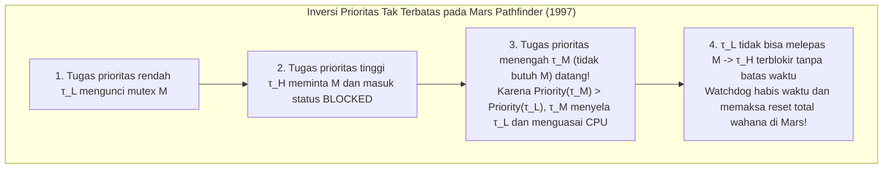
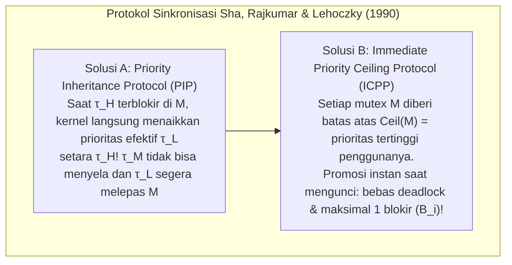

## 1. Jurang Fundamental Antara "Cepat" dan "Waktu-Nyata (Real-Time)"

Dalam percakapan sehari-hari, "pemrosesan waktu-nyata" sering disalahartikan sebagai "eksekusi super cepat". Namun, bahkan server dengan prosesor superskalar multi-inti bergigahertz yang rata-rata merespons dalam satu milidetik tidak akan pernah diizinkan mengendalikan sistem *Fly-by-Wire* pesawat komersial, pemicu kantung udara (*airbag*) mobil, atau alat pacu jantung. Mengapa? Karena sistem tujuan umum mengoptimalkan <strong>throughput rata-rata (Average Throughput)</strong>: jika perhitungan selesai dalam $0,5\,\text{ms}$ pada $99,999\,\%$ kasus, tetapi sekali dalam sejuta panggilan tertunda $200\,\text{ms}$ akibat *cache miss*, *page fault*, atau *Garbage Collection* (GC), pesawat akan jatuh atau kantung udara baru meledak setelah benturan.

Menurut formulasi klasik Donald Gillies dan Hermann Kopetz, <strong>aksioma komputasi waktu-nyata</strong> menyatakan bahwa kebenaran suatu sistem tidak hanya bergantung pada <strong>kebenaran logis dan aritmetis</strong> hasilnya, tetapi juga pada <strong>waktu fisik $t$</strong> saat hasil tersebut diberikan relatif terhadap tenggat waktunya (*deadline* $d_i$). Berdasarkan <strong>fungsi utilitas waktu $U(t)$</strong>, sistem dibagi menjadi tiga kelas:

$$U_{\text{hard}}(t) = \begin{cases} V & (t \le d) \\ -\infty & (t > d) \end{cases}, \qquad U_{\text{firm}}(t) = \begin{cases} V & (t \le d) \\ 0 & (t > d) \end{cases}, \qquad U_{\text{soft}}(t) = \begin{cases} V & (t \le d) \\ V e^{-\alpha(t-d)} & (t > d) \end{cases}$$

* <strong>Hard Real-Time</strong>: Melewatkan satu tenggat waktu ($t > d$) menyebabkan kegagalan katastropik ($U = -\infty$, mis. kendali penerbangan, rem ABS). Wajib dibuktikan secara matematis sebelum dijalankan.
* <strong>Firm Real-Time</strong>: Hasil yang terlambat bernilai nol ($U = 0$) dan langsung dibuang (mis. penyortiran visual di ban berjalan cepat, pembatalan order HFT).
* <strong>Soft Real-Time</strong>: Utilitas menurun secara kontinu setelah $d$ (mis. video 60 fps, panggilan VoIP).

| Dimensi Arsitektur | OS Tujuan Umum (GPOS: Linux / Windows / macOS) | OS Waktu-Nyata (RTOS: VxWorks / QNX / FreeRTOS / seL4) |
| :--- | :--- | :--- |
| <strong>Tujuan Optimasi Utama</strong> | Memaksimalkan throughput rata-rata & keadilan (CFS / EEVDF) | Menjamin <strong>determinisme waktu</strong> & batas atas waktu respons terburuk (WCRT) |
| <strong>Latensi Interupsi</strong> | Mikrodetik hingga puluhan milidetik (distribusi ekor panjang) | Ratusan nanodetik hingga beberapa mikrodetik (batas konstan $O(1)$) |
| <strong>Preemptibilitas Kernel</strong> | Kernel monolitik dengan bagian kritis non-preemptif | Kernel sepenuhnya preemptif atau mikrokernel minimal (QNX, seL4) |
| <strong>Memori & Perangkat Keras</strong> | Memori virtual dengan page fault, `malloc`, GC, спекуlasi penuh | Partisi statis, pool $O(1)$, Scratchpad SRAM (TCM) & penguncian cache |

---

## 2. Mimpi Buruk Analisis Waktu Eksekusi Terburuk (WCET)

Semua teori penjadwalan waktu-nyata mengasumsikan bahwa kita mengetahui <strong>Waktu Eksekusi Terburuk (Worst-Case Execution Time, $C_i$)</strong> dari setiap tugas $\tau_i$. Di sinilah muncul paradoks besar arsitektur komputer modern: <strong>hampir semua mekanisme perangkat keras yang dirancang untuk mempercepat rata-rata CPU (cache L1/L2/L3, prediksi percabangan, eksekusi Out-of-Order, TLB, DVFS, dan interupsi manajemen sistem SMI yang tak dapat ditutup) menghancurkan prediktabilitas WCET.</strong>

Pada pipa *Out-of-Order* dengan cache bahkan terjadi <strong>anomali waktu (Timing Anomalies)</strong>: sebuah *cache hit* lokal justru dapat membuat jalur spekulatif merebut bus bersama lebih awal, sehingga total waktu eksekusi program menjadi <strong>lebih lama</strong> daripada saat terjadi *cache miss*! Oleh karena itu, sistem kritis (DO-178C Level A, ISO 26262 ASIL-D) menggunakan memori <strong>Scratchpad SRAM / TCM</strong> deterministik serta <strong>penguncian cache (Cache Locking)</strong>, dan menghitung batas atas WCET secara statis melalui <strong>interpretasi abstrak</strong> dan <strong>Implicit Path Enumeration Technique (IPET)</strong> sebagai masalah pemrograman linier bulat (ILP) pada graf aliran kendali (CFG):

$$\text{WCET} = \max \sum_{i=1}^{N} c_i x_i \quad \text{dengan syarat} \quad \sum_{j} d_{j \to i} = x_i = \sum_{k} d_{i \to k} \quad (\text{kekekalan aliran \& batas perulangan})$$

---

## 3. Liu & Layland (1973): Penjadwalan Periodik (RMS vs. EDF)

Misalkan terdapat $n$ tugas periodik independen $\Gamma = \{\tau_1, \dots, \tau_n\}$ dengan $\tau_i = (C_i, T_i, D_i)$ (WCET $C_i$, periode $T_i$, tenggat implisit $D_i = T_i$). <strong>Total utilisasi prosesor</strong> adalah:

$$U = \sum_{i=1}^{n} \frac{C_i}{T_i}$$

Pada tahun 1973, C. L. Liu dan James W. Layland membuktikan teorema fundamental yang membandingkan prioritas statis dan dinamis:

### 3.1 Rate Monotonic Scheduling (RMS) dan Batas $\ln 2 \approx 69,3\,\%$

Dalam <strong>penjadwalan preemptif prioritas tetap</strong>, aturan <strong>Rate Monotonic (RMS)</strong> memberikan prioritas statis berbanding terbalik dengan periode: <strong>semakin pendek periode $T_i$ (semakin tinggi frekuensi $1/T_i$), semakin tinggi prioritas statisnya</strong>. Liu & Layland membuktikan <strong>teorema instan kritis</strong> (waktu respons terburuk $\tau_i$ terjadi saat ia dirilis bersamaan dengan semua tugas berprioritas lebih tinggi pada $t=0$) serta keoptimalan RMS di antara semua algoritma prioritas tetap, dengan batas atas utilisasi terkecil:

$$U = \sum_{i=1}^{n} \frac{C_i}{T_i} \le U_{\text{lub}}(n) = n\left(2^{1/n} - 1\right) \xrightarrow{n \to \infty} \ln 2 \approx 0,6931 \quad (69,3\,\%)$$

Penting: $69,3\,\%$ hanyalah <strong>syarat cukup</strong>, bukan syarat perlu! Jika periode bersifat <strong>harmonis</strong> (setiap periode merupakan kelipatan bulat dari periode yang lebih kecil, mis. $5\,\text{ms}, 10\,\text{ms}, 20\,\text{ms}$), RMS mampu mencapai <strong>100% utilisasi</strong>. Untuk himpunan tugas umum, <strong>analisis waktu respons (RTA)</strong> dari Joseph & Pandya (1986) memberikan syarat perlu dan cukup yang eksak melalui iterasi titik tetap ($R_i \le D_i$):

$$R_i^{(k+1)} = C_i + \sum_{j \in hp(i)} \left\lceil \frac{R_i^{(k)}}{T_j} \right\rceil C_j$$

### 3.2 Earliest Deadline First (EDF) dan Keoptimalan $100\,\%$

Dalam <strong>penjadwalan preemptif prioritas dinamis</strong>, <strong>Earliest Deadline First (EDF)</strong> setiap saat memberikan prioritas tertinggi kepada pekerjaan siap yang <strong>tenggat absolutnya $d_{i,k} = r_{i,k} + D_i$ paling dekat</strong>. Pada prosesor tunggal, <strong>syarat perlu dan cukup</strong> agar EDF dapat dijadwalkan mencapai batas fisik:

$$U = \sum_{i=1}^{n} \frac{C_i}{T_i} \le 1,00 \quad (100\,\%)$$

Contoh: Dengan $\tau_1 = (C_1=2, T_1=5)$ dan $\tau_2 = (C_2=4, T_2=7)$, utilisasinya adalah $U = 97,14\,\%$. Di bawah RMS, kedatangan $\tau_{1,2}$ pada $t=5$ ($d=10$) secara membabi buta menyela $\tau_{2,1}$ ($d=7$, yang tinggal menyisakan $1\,\text{ms}$), menyebabkan $R_2 = 8 > 7$ (gagal tenggat!). Di bawah EDF, pada $t=5$, karena $d_{2,1}=7 < d_{1,2}=10$, EDF mencegah penyelaan sehingga $\tau_{2,1}$ selesai tepat waktu pada $t=6 \le 7$.

Meski demikian, industri (VxWorks, FreeRTOS, QNX, AUTOSAR) tetap memilih RMS/DMS karena saat terjadi <strong>bebanไฟ lebih transien ($U > 1,0$)</strong>, EDF mengalami <strong>efek domino katastropik</strong> di mana satu tugas yang terlambat memonopoli CPU dan menggagalkan seluruh tugas berikutnya secara beruntun, sedangkan RMS melindungi $100\,\%$ tugas kritis berprioritas tinggi dan dapat diimplementasikan dalam $O(1)$ menggunakan bitmap serta instruksi `CLZ`.

| Kriteria Perbandingan | Rate Monotonic (RMS: Prioritas Tetap) | Earliest Deadline First (EDF: Prioritas Dinamis) |
| :--- | :--- | :--- |
| <strong>Penentuan Prioritas</strong> | Statis: periode $T_i$ lebih pendek $\implies$ prioritas lebih tinggi | Dinamis: tenggat absolut $d_{i,k}$ lebih dekat $\implies$ prioritas lebih tinggi |
| <strong>Batas Utilisasi CPU</strong> | Cukup: $n(2^{1/n}-1) \to 69,3\,\%$ ($100\,\%$ pada periode harmonis) | Perlu & cukup: selalu <strong>$100\,\%$</strong> ($\sum C_i/T_i \le 1$) |
| <strong>Kompleksitas Kernel</strong> | <strong>$O(1)$</strong> (bitmap prioritas + instruksi perangkat keras `CLZ`) | <strong>$O(\log n)$</strong> (min-heap atau pohon merah-hitam dinamis) |
| <strong>Perilaku Saat Overload ($U > 1$)</strong> | <strong>Degradasi anggun</strong>: tugas prioritas tinggi dijamin selamat | <strong>Efek domino katastropik</strong>: kegagalan beruntun pada semua tugas |

---

## 4. Insiden NASA Mars Pathfinder (1997) dan Inversi Prioritas

Pada Juli 1997, setelah mendarat di Mars, wahana <strong>Mars Pathfinder</strong> milik NASA (CPU IBM RAD6000 dengan RTOS <strong>VxWorks</strong>) tiba-tiba mengalami *reset* sistem berulang kali yang dipicu oleh *watchdog timer*, menghilangkan data ilmiah berharga.

Penyebabnya adalah <strong>inversi prioritas tak terbatas (Unbounded Priority Inversion)</strong> antara tiga tugas di sekitar mutex $M$ yang melindungi "bus informasi" bersama:
* <strong>Tugas meteorologi berprioritas rendah $\tau_L$ (`ASI/MET`)</strong> mengunci mutex $M$;
* <strong>Tugas distribusi bus kritis berprioritas tinggi $\tau_H$ (`bc_dist`)</strong> bangun, meminta $M$, dan terblokir;
* Sebelum $\tau_L$ sempat melepas $M$, datang <strong>tugas komunikasi berprioritas menengah $\tau_M$</strong> (yang sama sekali tidak memakai $M$!). Karena $\text{Priority}(\tau_M) > \text{Priority}(\tau_L)$, $\tau_M$ menyela $\tau_L$ dalam waktu lama, mencegah $\tau_L$ membuka kunci $M$ dan menahan $\tau_H$ tetap terblokir hingga *watchdog* me-reset wahana antariksa tersebut!

Solusi matematisnya telah dibuktikan oleh Sha, Rajkumar, dan Lehoczky pada tahun 1990:
1. <strong>Priority Inheritance Protocol (PIP)</strong>: Ketika $\tau_H$ terblokir pada mutex $M$ yang dipegang oleh $\tau_L$, kernel untuk sementara menaikkan prioritas efektif $\tau_L$ ke tingkat $\tau_H$, mencegah $\tau_M$ menyela. Setelah mereproduksi bug tersebut di Bumi, para insinyur JPL mengirimkan perintah C sejauh 190 juta kilometer ke shell VxWorks di Mars untuk mengubah variabel global `SEM_INVERSION_SAFE` dari `0` menjadi `1` langsung di RAM, menyelamatkan misi tersebut!
2. <strong>Priority Ceiling Protocol (PCP / ICPP: Immediate Priority Ceiling Protocol)</strong>: Karena PIP masih memungkinkan <strong>blokir berantai (Chained Blocking)</strong> dan <strong>deadlock</strong>, ICPP (standar POSIX `PTHREAD_PRIO_PROTECT` dan AUTOSAR OS) menetapkan batas atas statis $\text{Ceil}(M_k) = \max\{\text{Priority}(\tau_i) \mid \tau_i \text{ memakai } M_k\}$ untuk setiap mutex $M_k$ dan menaikkan prioritas tugas <strong>tepat pada saat ia mengunci $M_k$</strong>. Ini menjamin <strong>100% bebas deadlock</strong> dan membatasi penundaan maksimal setiap tugas menjadi <strong>paling banyak satu bagian kritis tunggal ($B_i$)</strong>:

$$R_i^{(k+1)} = C_i + B_i + \sum_{j \in hp(i)} \left\lceil \frac{R_i^{(k)}}{T_j} \right\rceil C_j$$
