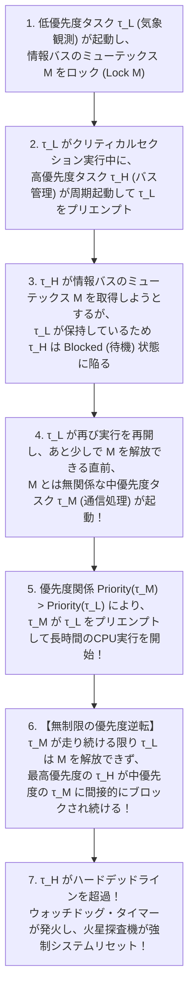
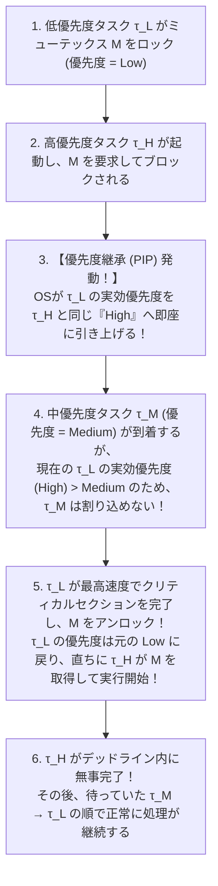

## 1. 序論：「速い（Fast）」と「リアルタイム（Real-Time）」の決定的な断絶

日常会話や一般的なIT業界の文脈において、「リアルタイム処理」という言葉はしばしば「極めて高速な処理」や「画面が瞬時に更新される低遅延なレスポンス」と同義であるかのように誤用されている。最新の数ギガヘルツで駆動するマルチコアプロセッサと大容量キャッシュを搭載したゲーミングPCやクラウドサーバは、毎秒数十億回の浮動小数点演算（FLOPS）を叩き出し、Webページやデータベースのクエリを平均数ミリ秒で処理することができる。しかし、そのような「平均的にどれほど高速な汎用コンピュータ」であっても、航空機のフライ・バイ・ワイヤ（Fly-by-Wire）姿勢制御システムや、自動車のエアバッグ展開・アンチロックブレーキ（ABS/ESP）、あるいは心臓ペースメーカーの制御回路としてそのまま流用することは<strong>絶対に許されない</strong>。なぜなら、平均して1ミリ秒で終わる処理が、100万回に1回だけキャッシュミスやOSのバックグラウンド処理、ガベージコレクション（GC）の介入によって500ミリ秒遅延した瞬間、航空機は失速して墜落し、エアバッグは乗員がステアリングに激突した「後」に爆発するからである。

計算機科学（Computer Science）における<strong>リアルタイムシステム（Real-Time System）</strong>の厳密な定義は、ドナルド・ギリーズ（Donald Gillies）およびヘルマン・コペッツ（Hermann Kopetz）の古典的定式化によって次のように与えられる。

> <strong>リアルタイム計算の公理（Axiom of Real-Time Computing）</strong>:  
> 「リアルタイムシステムとは、計算の正当性（Correctness）が、算出された計算結果の<strong>論理的・算術的な正しさ（Logical Correctness）</strong>だけでなく、その結果が出力される<strong>物理的な時刻（Physical Time / Temporal Correctness）</strong>にも依存するシステムである。」

どれほど小数点以下100桁まで正確にエアバッグの点火タイミングや翼のエルロン角度を計算できたとしても、あらかじめ定められた<strong>デッドライン（Deadline：締切時刻 $d_i$）</strong>を1マイクロ秒でも過ぎてから出力された正しい答えは、システム全体にとっては「論理的な誤答」と全く同じ、あるいはそれ以上に致命的な<strong>システム障害（Failure）</strong>なのである。

### 1.1 汎用OS（GPOS）とリアルタイムOS（RTOS）の設計哲学の対立

私たちが普段利用しているLinux、Windows、macOSなどの<strong>汎用オペレーティングシステム（GPOS: General-Purpose Operating System）</strong>と、VxWorks、FreeRTOS、QNX Neutrino、Zephyr、seL4などの<strong>リアルタイムオペレーティングシステム（RTOS: Real-Time Operating System）</strong>は、そもそも最適化しようとしている目的関数（Objective Function）が正反対である。

* <strong>汎用OS（GPOS）の目的関数＝平均スループットの最大化と公平性（Fairness）</strong>:  
  LinuxのCFS（Completely Fair Scheduler）やEEVDF（Earliest Eligible Virtual Deadline First）に代表される汎用スケジューラは、システム全体で単位時間あたりに処理できるジョブの総量（Throughput）を最大化し、すべてのプロセスに対してCPU時間を「公平に」配分し、人間のユーザーが感じる「平均応答時間（Average Response Time）」を短縮することを目指す。たとえ特定のスレッドがディスクI/Oのフラッシュやカーネルのロック競合によって一時的に数十ミリ秒待たされたとしても、他の99%のケースで高速に動作していれば優秀なOSと評価される。
* <strong>リアルタイムOS（RTOS）の目的関数＝時間的決定論（Temporal Determinism）と最悪遅延の上界保証</strong>:  
  RTOSは「平均してどれだけ速いか」には一切関心を持たない。RTOSが追求するのは、いかなる過酷な割り込みの集中やタスクの同時到着が発生したとしても、最高優先度のクリティカルなタスクが起床してから実行を開始するまでの遅延（Dispatch Latency / Interrupt Latency）と、処理が完了するまでの応答時間（Response Time）が、数学的に証明可能な<strong>厳密な上界（Bounded Latency）</strong>の中に100%の確率で収まること——すなわち<strong>時間的決定論（Temporal Determinism）</strong>である。そのためなら、システム全体の平均スループットを犠牲にし、低優先度タスクを完全に飢餓状態（Starvation）に追い込むことすら厭わない。

| 比較軸 | 汎用OS（GPOS: Linux / Windows / macOS） | リアルタイムOS（RTOS: VxWorks / QNX / FreeRTOS / seL4） |
| :--- | :--- | :--- |
| <strong>最優先の設計目標</strong> | 平均スループットの最大化・平均応答時間の短縮・公平性 | <strong>時間的決定論（Determinism）</strong>・最悪応答時間（WCRT）の厳密な上界保証 |
| <strong>スケジューリング原則</strong> | タイムシェアリング・仮想実行時間に基づく公平配分（CFS / EEVDF） | 厳格な優先度ベース・プリエンプティブ（RMS / DM / EDF） |
| <strong>割り込み遅延（Interrupt Latency）</strong> | 数マイクロ秒〜数十ミリ秒（非決定的、ロングテールが発生） | 数百ナノ秒〜数マイクロ秒（ハードウェア限界に近い厳格な定数上界） |
| <strong>カーネル構造とプリエンプション</strong> | 巨大なモノリシックカーネル（スピンロック区間など非プリエンプティブ領域が存在） | 完全プリエンプティブカーネル、または最小マイクロカーネル（QNX, seL4） |
| <strong>動的メモリ管理</strong> | `malloc`/`free` やページフォルトを伴う仮想メモリ、GC（所要時間が非決定的） | 静的メモリ割り当て、固定長メモリプール（O(1)決定論的アロケータ）、ページロック |
| <strong>ハードウェア機能への態度</strong> | 投機的実行・巨大キャッシュ・動的周波数制御（DVFS）をフル活用 | ワーストケース解析を狂わせる動的機能を制限・ロックし、予測可能性を優先 |

---

## 2. ハード・ファーム・ソフトリアルタイムの効用関数（Utility Function）による分類

すべてのリアルタイムシステムが同じ厳格さを要求するわけではない。1985年に E. Douglas Jensen らが提唱した<strong>タイム・ユーティリティ関数（Time-Utility Function: TUF）</strong>を用いると、タスク完了時刻 $t$ とデッドライン $d$ の関係における「結果の価値（Utility $U(t)$）」の減衰特性によって、リアルタイム性は明確に3つのクラスに分類される。

### 2.1 ハードリアルタイム（Hard Real-Time）

デッドライン $d$ を1回でも超過すること（$t > d$）が、物理的な破壊、人命の喪失、またはシステムの完全な破綻に直結するシステムである。効用関数 $U(t)$ は $t \le d$ において正の定数 $V > 0$ をとるが、$t > d$ となった瞬間にステップ関数的に $-\infty$（破局的損失）へと墜落する。

$$U_{\text{hard}}(t) = \begin{cases} V & (t \le d) \\ -\infty \quad (\text{Catastrophic Failure}) & (t > d) \end{cases}$$

* <strong>代表例</strong>: 航空宇宙のフライ・バイ・ワイヤ姿勢制御（周期 $1\sim 10\,\text{ms}$）、自動車のエンジン燃料噴射・ABS・エアバッグ展開制御、原子炉の緊急停止（スクラム）監視システム、医療用植え込み型除細動器（ICD）・ペースメーカー、産業用高出力レーザーや多関節ロボットの衝突回避制御。
* <strong>工学的要件</strong>: 統計的なテスト（「1000時間動かして一度も落ちなかった」）だけでは不十分であり、オフラインでの静的な<strong>最悪実行時間（WCET）解析</strong>と<strong>スケジューラビリティ解析（Schedulability Analysis）</strong>による数学的証明が必須となる。

### 2.2 ファームリアルタイム（Firm Real-Time）

デッドライン $d$ を過ぎた計算結果の利用価値は完全にゼロ（$U(t > d) = 0$）となるため、遅れた結果はその場で<strong>破棄（Drop / Abort）</strong>されるが、1回のデッドラインミスが即座にシステム全体の物理的崩壊を引き起こすわけではないシステムである。ただし、破棄されるタスクの割合（Dynamic Failure / 連続ミス回数）が一定の閾値を超えるとシステム品質が破綻する（これを $(m, k)$-firm デッドライン制約と呼び、連続する $k$ 回のジョブのうち最低 $m$ 回はデッドラインを守ることを要求する）。

$$U_{\text{firm}}(t) = \begin{cases} V & (t \le d) \\ 0 \quad (\text{Result Discarded}) & (t > d) \end{cases}$$

* <strong>代表例</strong>: ベルトコンベア上を高速移動する製品のカメラ画像認識による不良品ピッキング（製品がロボットアームの前を通り過ぎてから画像認識が完了しても意味がないため破棄される）、金融のアルゴリズム高速取引（HFT）における指値注文・キャンセル発注、気象レーダーや自動運転センサーフュージョンの単一フレーム更新（次の最新センサーデータが到着していれば古いフレームの計算を続けるより捨てた方がよい）。

### 2.3 ソフトリアルタイム（Soft Real-Time）

デッドライン $d$ を超過した後も、計算結果の価値 $U(t)$ が即座にゼロや $-\infty$ になるのではなく、遅延時間 $(t - d)$ の増大に伴って<strong>連続的に減衰（Degrade）</strong>していくシステムである。ユーザー体験（QoS / QoE）は低下するものの、遅延した結果であっても処理・表示する価値が残っている。

$$U_{\text{soft}}(t) = \begin{cases} V & (t \le d) \\ V \cdot \exp\bigl(-\alpha (t - d)\bigr) & (t > d, \;\alpha > 0) \end{cases}$$

* <strong>代表例</strong>: 60fps / 120fps のビデオストリーミング再生やゲーム描画（16.67ms のフレームデッドラインを数ミリ秒過ぎても、フレーム落ち・カクつきとして知覚されるだけでシステムは継続する）、VoIP音声通話・Web会議システム（ジッタバッファによる吸収）、VR/ARヘッドセットのMotion-to-Photon遅延制御。

---

## 3. 最悪実行時間（WCET: Worst-Case Execution Time）解析の悪夢

これから紹介するリアルタイム・スケジューリング理論（RMSやEDFなど）はすべて、各タスク $\tau_i$ がCPU上で単独で実行された場合に絶対にこれ以上は時間がかからないという上界——<strong>最悪実行時間（WCET: Worst-Case Execution Time, $C_i$）</strong>が事前に既知であることを大前提としている。

しかし、現代のコンピュータ・アーキテクチャにおいて、あるプログラムの正確な $C_i$ を求めることは、計算機科学で最も困難な問題の一つとなっている。なぜなら、<strong>「現代のCPUを平均的に高速化しているすべてのハードウェア機構が、最悪実行時間（WCET）の予測可能性を徹底的に破壊している」</strong>という深刻なパラドックスが存在するからである。

```
  実行時間の確率密度分布 p(t)
    ▲
    │       【汎用CPU (キャッシュ・分岐予測・OoO)】
    │         平均実行時間 E[C] は極めて速いが、
    │         長大なロングテールが伸び、静的 WCET は巨大化する
    │        ╭─╮
    │       ╱   ╲               【リアルタイム向け決定論的構成】
    │      │     ╲                平均はやや遅いが分散が極小で、
    │      │      ╲               タイトで確実な WCET 上界を保証できる
    │     ╱        ╲                    ╭──╮
    │    ╱          ╲                  ╱    ╲
    │   ╱            ╰────────────────╱──────╲────╮
    └──┴───────┴─────────────────────┴────────┴───┴──────► 実行時間 t
             E[C] (平均)                        実際の最大観測値  静的WCET保証値 C_i
```

### 3.1 なぜ高速化ハードウェアがWCETを破壊するのか？

1970年代〜80年代の単純なマイクロプロセッサ（Z80、68000、初期のARMなど）では、機械語の各命令（`ADD`, `LDR`, `MUL`）が消費するクロックサイクル数はデータシートに固定値として記載されており、ループの最大反復回数さえ分かれば、足し算だけで正確なWCETを手計算できた。ところが現代のプロセッサでは、同じ1つのメモリアクセス命令が「1サイクル（L1キャッシュヒット）」で終わることもあれば、「数百サイクル（L1/L2/L3すべてミス＋TLBミスによるページテーブルウォーク＋DRAMリフレッシュ衝突＋他コアとのバス競合）」かかることもある。

1. <strong>セットアソシアティブ・キャッシュ（L1/L2/L3 Cache）とプリエンプションの相互作用</strong>:  
   タスク $\tau_i$ がループ処理を行い、命令とデータをL1キャッシュに載せて高速に走っている最中に、より優先度の高いタスク $\tau_j$ の割り込みが入ってプリエンプション（横取り）が発生したとする。$\tau_j$ が自身の処理でメモリアクセスを行うと、LRU（Least Recently Used）等の置換アルゴリズムによって、$\tau_i$ がせっかく温めたキャッシュラインが次々と追い出される（Cache Eviction）。その後 $\tau_i$ に処理が戻ったとき、大量の<strong>キャッシュ再充填ミス（Cache-Related Preemption Delay: CRPD）</strong>が発生する。
2. <strong>投機的分岐予測（Speculative Branch Prediction）とアウトオブオーダー実行（Out-of-Order Execution）</strong>:  
   深いパイプラインを持つCPUは、条件分岐の結果が確定する前に分岐先を予測して投機的に命令を実行する。予測が当たれば超高速だが、ワーストケースの入力パターンで分岐予測ミス（Branch Misprediction）が連続すると、パイプライン全体のフラッシュと再充填ペナルティが発生する。さらに恐ろしいことに、アウトオブオーダー実行とキャッシュが組み合わさると、<strong>タイミング異常（Timing Anomaly）</strong>と呼ばれる逆転現象すら起きる。これは「ある命令がキャッシュ<strong>ヒット</strong>した（局所的に速くなった）結果として、後続の投機的命令が誤ったパスを深く進んでバスを占有し、プログラム全体の実行時間がキャッシュ<strong>ミス</strong>したときよりも逆に長くなる」という悪魔的な現象である。タイミング異常が存在するCPUでは、「すべての命令がキャッシュミスすると仮定すれば安全側（Worst-Case）になる」という単純な単調性（Monotonicity）の仮定すら崩壊する。
3. <strong>TLB（Translation Lookaside Buffer）ミスとDRAMリフレッシュ、DMA競合</strong>:  
   仮想アドレスから物理アドレスへの変換キャッシュであるTLBがミスすると、ハードウェアまたはOSが複数段のページテーブルをメモリ上で辿る（Page Table Walk）必要が生じる。さらにDRAMはコンデンサの電荷を保持するために周期的なリフレッシュ動作を行っており、その瞬間はメモリアクセスがブロックされる。
4. <strong>動的周波数・電圧スケーリング（DVFS）とシステム管理割り込み（SMI）</strong>:  
   現代のx86プロセッサ等では、発熱や電力制限に応じてクロック周波数が勝手に変動する（Turbo Boost / Throttling）。特に致命的なのがBIOS/UEFIファームウェアがOSの知らないところでCPUを横取りする<strong>SMI（System Management Interrupt）</strong>であり、RTOSがどれほど割り込みを禁止していても、ハードウェアレベルで数百マイクロ秒間にわたりCPUを凍結させてしまう。
5. <strong>ガベージコレクション（GC: Garbage Collection）</strong>:  
   JavaやGo、C#などの一般的なマネージド言語におけるStop-The-World型（あるいは並行型であってもアロケーションストールを伴う）GCは、ヒープの状態に依存して予測不能なタイミングでミリ秒オーダーの休止を引き起こすため、ハードリアルタイム領域ではそのままでは使用できない（リアルタイムJava仕様 RTSJ や、決定論的メモリ管理を行える Rust / C / Ada SPARK 等が用いられる理由がここにある）。

### 3.2 WCETを厳密に決定するためのハードウェア＆ソフトウェア技術

航空機（DO-178C Level A）や自動車（ISO 26262 ASIL-D）のハードリアルタイムシステムでは、このWCETの暴走を抑え込むために以下の徹底した対策が講じられる。

* <strong>スクラッチパッドメモリ（Scratchpad SRAM / Tightly-Coupled Memory: TCM）とキャッシュロッキング（Cache Locking）</strong>:  
  ハードウェアが勝手に中身を入れ替えるキャッシュの代わりに、ソフトウェア（コンパイラやプログラマ）が物理アドレスを指定して直接配置を制御できる高速なオンチップSRAM（ARM Cortex-RシリーズのTCMなど）を使用する。あるいは、最重要なリアルタイムタスクのコードとデータをキャッシュに読み込んだ後、そのキャッシュウェイを置換対象から除外して固定する<strong>キャッシュロッキング</strong>や、タスクごとに異なるキャッシュ領域を割り当てる<strong>キャッシュパーティショニング（Cache Coloring）</strong>を適用する。
* <strong>測定ベース解析（Measurement-Based Timing Analysis）の限界と静的WCET解析（IPET）</strong>:  
  プログラムを実機で何万回も走らせて最長時間を測るだけでは、真の最悪入力パターン（Worst-Case Input）を通った保証がないため、観測された最大値に安全マージンを掛けただけでは真のWCETを下回る（Unsafeになる）危険がある。そこで、産業界（AbsInt社の `aiT` など）では、バイナリコードから<strong>制御フローグラフ（CFG: Control-Flow Graph）</strong>を抽出し、マイクロアーキテクチャの抽象解釈（Abstract Interpretation）によって各基本ブロック（Basic Block）$B_i$ の最悪実行時間 $c_i$ を求めた上で、<strong>IPET（Implicit Path Enumeration Technique：暗黙的パス列挙法）</strong>と呼ばれる整数線形計画問題（ILP: Integer Linear Programming）を解くことで、全実行パスを列挙することなく数学的なWCET上界を算出する。

基本ブロック $B_i$ の実行回数を変数 $x_i$、ブロック間の遷移枝 $e_{i \to j}$ の通過回数を $d_{i \to j}$ とすると、IPETは以下の目的関数を最大化するILPとして定式化される。

$$\text{WCET} = \max \sum_{i=1}^{N} c_i x_i \quad \text{subject to} \quad \sum_{j} d_{j \to i} = x_i = \sum_{k} d_{i \to k} \quad (\text{キルヒホッフの流量保存則}) \;\text{and Loop Bound Constraints}$$

---

## 4. Liu & Layland（1973）の金字塔：周期的タスクのスケジューリング理論

各タスクの安全な最悪実行時間 $C_i$ が確定したとしよう。次なる核心的問いは、<strong>「単一のプロセッサ（Uniprocessor）上で複数のリアルタイムタスクを同時に走らせたとき、すべてのタスクが未来永劫、絶対にデッドラインを破らない（Schedulableである）ことを、どうやって数学的に証明するのか？」</strong>である。

この問いに対して、リアルタイムシステム理論の歴史における最大の金字塔を打ち立てたのが、1973年に C. L. Liu と James W. Layland が『Journal of the ACM (JACM)』に発表した伝説的論文 <strong>*"Scheduling Algorithms for Multiprogramming in a Hard-Real-Time Environment"</strong>* である。

### 4.1 周期的タスクモデルとCPU利用率（Utilization）

Liu & Layland は、システム内で独立に動く $n$ 個の周期的タスクの集合 $\Gamma = \{\tau_1, \tau_2, \dots, \tau_n\}$ を以下の3つ組（または暗黙的デッドラインの場合は2つ組）でモデル化した。

$$\tau_i = (C_i, T_i, D_i)$$

* <strong>$C_i$（Computation Time / WCET）</strong>: タスク $\tau_i$ が1回の起動（ジョブ）あたりに必要とする最悪CPU実行時間。
* <strong>$T_i$（Period：周期）</strong>: タスク $\tau_i$ のジョブが到着（Release）する時間間隔。例えば $100\,\text{Hz}$ の姿勢制御ループなら $T_i = 10\,\text{ms}$ である。
* <strong>$D_i$（Relative Deadline：相対デッドライン）</strong>: ジョブが到着した時刻 $r_{i,k}$ から、処理が完了しなければならない相対的な制限時間（絶対デッドラインは $d_{i,k} = r_{i,k} + D_i$）。Liu & Layland の基本モデルでは、次の周期のジョブが到着するまでに現在のジョブが終わればよいという<strong>暗黙的デッドライン（Implicit Deadline: $D_i = T_i$）</strong>を仮定する。

このとき、タスク $\tau_i$ がプロセッサの能力を消費する割合（利用率）は $U_i = \frac{C_i}{T_i}$ であり、システム全体の<strong>総CPU利用率（Total Processor Utilization）</strong> $U$ は次式で定義される。

$$U = \sum_{i=1}^{n} U_i = \sum_{i=1}^{n} \frac{C_i}{T_i}$$

明らかに、もし $U > 1.0$（100%超）であれば、どのような神業のスケジューラを用いてもCPUの処理能力自体が不足しているため、必ずどこかのタスクがデッドラインを破る。では、$U \le 1.0$ であれば常に全タスクのデッドラインを守れるのだろうか？ 答えは<strong>「選ぶスケジューリング・アルゴリズムに依存する」</strong>である。

---

### 4.2 レートモノトニック・スケジューリング（RMS: Rate Monotonic Scheduling）

まず、タスクの優先度（Priority）をシステム設計時に静的に決定し、実行中は一切変更しない<strong>固定優先度プリエンプティブ・スケジューリング（Fixed-Priority Preemptive Scheduling）</strong>を考える。このクラスにおいて、どのタスクに高い優先度を割り当てるべきか？

直感的には「業務上もっとも重要そうなタスク」に最高優先度を与えたくなるかもしれない。しかし、Liu & Layland が発見した<strong>レートモノトニック（Rate Monotonic: RM）規則</strong>は驚くほどシンプルかつ非直観的である。

> <strong>レートモノトニック（RMS）の優先度割当規則</strong>:  
> タスクの意味的な重要度や実行時間 $C_i$ の長短には一切関わらず、<strong>「起動周期 $T_i$ が短い（＝起動レート $1/T_i$ が高い）タスクほど、高い静的優先度を割り当てる」</strong>（$T_i < T_j \implies \text{Priority}(\tau_i) > \text{Priority}(\tau_j)$）。

#### クリティカル・インスタント定理（Critical Instant Theorem）と最適性
Liu & Layland はまず、次の2つの極めて強力な定理を証明した。

1. <strong>定理1（クリティカル・インスタント定理）</strong>:  
   固定優先度スケジューリングにおいて、あるタスク $\tau_i$ の応答時間（到着から完了までの時間）が最悪（最長）となるのは、<strong>$\tau_i$ が、それより優先度の高いすべてのタスク $\tau_j \in hp(i)$ と全く同じ時刻（$t = 0$）に同時に起動（Release）された瞬間（Critical Instant）</strong>である。
2. <strong>定理2（RMSの固定優先度最適性）</strong>:  
   暗黙的デッドライン（$D_i = T_i$）を持つ任意の周期的タスク集合について、もし<strong>他の何らかの固定優先度割当法</strong>でデッドラインを守ってスケジュール可能であるならば、<strong>レートモノトニック（RMS）割当でも必ずスケジュール可能である</strong>。すなわち、RMSはすべての固定優先度アルゴリズムの中で数学的に<strong>最適（Optimal）</strong>である。（※なお、$D_i \le T_i$ の制約付きデッドラインの場合は、相対デッドライン $D_i$ が短い順に優先度を付ける <strong>Deadline Monotonic: DM</strong> が最適となる）。

#### Liu & Layland の最小上界（Least Upper Bound: $\ln 2 \approx 69.3\%$）
さらに Liu & Layland は、タスクの周期の組み合わせがどれほど意地悪な（互いに素に近い最悪の位相を持つ）ものであっても、総CPU利用率 $U$ が以下の上限式（Liu-Layland Bound）以下であれば、RMSによって<strong>無条件で100%すべてのデッドラインが守られる</strong>という十分条件（Sufficient Condition）を導出した。

$$U = \sum_{i=1}^{n} \frac{C_i}{T_i} \le U_{\text{lub}}(n) = n\left(2^{1/n} - 1\right)$$

タスク数 $n$ を増やしていくと、この上限値 $U_{\text{lub}}(n)$ は単調に減少し、$n \to \infty$ の極限において自然対数 $\ln 2$ に収束する！（ロピタルの定理または $2^{1/n} = e^{(\ln 2)/n} = 1 + \frac{\ln 2}{n} + O(n^{-2})$ のテイラー展開から直ちに導かれる）。

$$\lim_{n \to \infty} n\left(2^{1/n} - 1\right) = \ln 2 \approx 0.693147\dots \quad (69.3\%)$$

| タスク数 $n$ | Liu-Layland 上限 $U_{\text{lub}}(n) = n(2^{1/n}-1)$ | 百分率（%） |
| :---: | :---: | :---: |
| <strong>$n = 1$</strong> | $1 \cdot (2^1 - 1) = 1.0000$ | <strong>100.0%</strong> |
| <strong>$n = 2$</strong> | $2 \cdot (\sqrt{2} - 1) \approx 0.8284$ | <strong>82.8%</strong> |
| <strong>$n = 3$</strong> | $3 \cdot (2^{1/3} - 1) \approx 0.7798$ | <strong>78.0%</strong> |
| <strong>$n = 4$</strong> | $4 \cdot (2^{1/4} - 1) \approx 0.7568$ | <strong>75.7%</strong> |
| <strong>$n = 5$</strong> | $5 \cdot (2^{1/5} - 1) \approx 0.7435$ | <strong>74.3%</strong> |
| <strong>$n = 10$</strong> | $10 \cdot (2^{1/10} - 1) \approx 0.7177$ | <strong>71.8%</strong> |
| <strong>$n \to \infty$</strong> | $\ln 2 \approx 0.6931$ | <strong>69.3%</strong> |

#### 69.3%の壁の正しい解釈と、Joseph & Pandya の厳密応答時間解析（RTA）
ここで初学者が最も陥りやすい誤解を解いておこう。「RMSを使うと、CPUの残り30.7%（$1 - \ln 2$）は絶対に無駄になるのか？」——<strong>答えはNOである</strong>。

Liu & Layland の $n(2^{1/n}-1)$ という式は、あくまで「周期 $T_i$ の具体的な数値を見ずに、総利用率 $U$ の合計値だけで判定できる<strong>十分条件（Sufficient Condition）</strong>」にすぎない。実際、タスクの周期同士が整数倍の関係にある<strong>調和的タスク集合（Harmonic Task Set / 例えば $T_1 = 10\,\text{ms}, T_2 = 20\,\text{ms}, T_3 = 40\,\text{ms}, T_4 = 80\,\text{ms}$）</strong>であれば、RMSであっても <strong>$U = 1.00$（100%利用率）まで完全にデッドラインを守ってスケジュール可能</strong>である！実際の組込み制御システム（自動車エンジン制御やフライトコントローラ）で、周期を $1\,\text{ms}, 2\,\text{ms}, 5\,\text{ms}, 10\,\text{ms}, 20\,\text{ms}, 100\,\text{ms}$ のように綺麗に倍々（あるいは約数関係）で設計するのは、この調和性を利用してCPU利用率を90%〜100%近くまで引き上げるための高度な実践テクニックなのである。

また、周期が調和的でない一般のタスク集合であっても、利用率 $U$ が $69.3\%$ を超えた場合（例えば $U = 85\%$）に本当にスケジュール可能かどうかを<strong>必要十分条件（Exact Necessary and Sufficient Condition）</strong>として判定する手法が、1986年に Mathai Joseph と Paritosh Pandya によって確立された<strong>応答時間解析（RTA: Response-Time Analysis）</strong>である。

タスク $\tau_i$ が時刻 $t=0$ のクリティカル・インスタントで起動されてから完了するまでの最悪応答時間 $R_i$ は、自身の実行時間 $C_i$ と、その間に割り込んでくる全ての高優先度タスク $\tau_j \in hp(i)$ の干渉時間（Interference）の和として、以下の天井関数（Ceiling Function $\lceil \cdot \rceil$）を含む不動点方程式（Fixed-Point Equation）を満たす。

$$R_i = C_i + \sum_{j \in hp(i)} \left\lceil \frac{R_i}{T_j} \right\rceil C_j$$

この方程式は解析的には解けないため、初期値 $R_i^{(0)} = C_i$ から始めて以下の漸化式を反復計算する。

$$R_i^{(k+1)} = C_i + \sum_{j \in hp(i)} \left\lceil \frac{R_i^{(k)}}{T_j} \right\rceil C_j$$

もしあるステップ $k$ で $R_i^{(k+1)} = R_i^{(k)} \le D_i$ に収束すれば、タスク $\tau_i$ は100%確実にデッドラインを守る！逆に、収束する前に $R_i^{(k+1)} > D_i$ を超えてしまえば、そのタスクはデッドラインミスを起こすことが数学的に確定する。

---

### 4.3 最早デッドライン優先（EDF: Earliest Deadline First）

固定優先度（RMS）では、最悪の周期の組み合わせにおいて約 $69.3\%$ でデッドラインミスが発生し得た。では、実行中に各ジョブの優先度を動的に変化させる<strong>動的優先度プリエンプティブ・スケジューリング（Dynamic-Priority Preemptive Scheduling）</strong>を許せばどうなるか？

Liu & Layland は同じ1973年の論文で、<strong>最早デッドライン優先（EDF: Earliest Deadline First / Deadline Driven Scheduling）</strong>を解析した。EDFのルールも極めて明快である。

> <strong>EDFの優先度割当規則</strong>:  
> 任意の時点 $t$ において、実行待ち状態（Ready Queue）にあるすべてのジョブの中で、<strong>「絶対デッドライン時刻 $d_{i,k} = r_{i,k} + D_i$ が現在時刻に最も近い（最も早く締め切りが迫っている）ジョブ」</strong>に最高の優先度を与えてCPUを割り当てる。

#### EDFの100%スケジューラビリティ定理
Liu & Layland（および Dertouzos 1974）は、単一プロセッサ上のプリエンプティブEDFについて、以下の驚異的な<strong>必要十分条件</strong>を証明した。

> <strong>定理3（EDFの最適性と100%利用率限界）</strong>:  
> 暗黙的デッドライン（$D_i = T_i$）を持つ任意の $n$ 個の周期的タスク集合 $\Gamma$ が、単一プロセッサ上でEDFによってすべてのデッドラインを守ってスケジュール可能であるための<strong>必要十分条件（Necessary and Sufficient Condition）</strong>は、周期の組み合わせに一切関係なく、総CPU利用率が100%以下であることである。
> $$U = \sum_{i=1}^{n} \frac{C_i}{T_i} \le 1.00 \quad (100\%)$$

つまり、プロセッサの物理的な計算容量（100%）を超えない限り、EDFはどんな意地悪な周期の組み合わせであっても、アイドル時間を一滴も無駄にすることなく全タスクのデッドラインを守り切る<strong>理論上最強の最適スケジューラ</strong>なのである。

#### 実例で比較する RMS vs. EDF：なぜRMSが負け、EDFが勝つのか？
具体的な2つのタスク $\tau_1, \tau_2$ の数値例で、RMSの壁とEDFの100%達成能力を比較してみよう。

* <strong>タスク $\tau_1$</strong>: 実行時間 $C_1 = 2\,\text{ms}$, 周期 $T_1 = 5\,\text{ms}$ （利用率 $U_1 = 2/5 = 0.40$）
* <strong>タスク $\tau_2$</strong>: 実行時間 $C_2 = 4\,\text{ms}$, 周期 $T_2 = 7\,\text{ms}$ （利用率 $U_2 = 4/7 \approx 0.5714$）
* <strong>総CPU利用率</strong>: $U = 0.40 + 0.5714 = 0.9714$ （<strong>97.14%</strong> $\le 100\%$）

まず <strong>RMS（固定優先度）</strong>で動かしてみる。周期が短い $\tau_1$（$T_1=5$）が常に高優先度、$\tau_2$（$T_2=7$）が常に低優先度となる。
Joseph & Pandya の応答時間解析（RTA）で $\tau_2$ の最悪応答時間 $R_2$ を計算してみよう。
1. $R_2^{(0)} = C_2 = 4$
2. $R_2^{(1)} = 4 + \lceil 4 / 5 \rceil \times 2 = 4 + 1 \times 2 = 6$
3. $R_2^{(2)} = 4 + \lceil 6 / 5 \rceil \times 2 = 4 + 2 \times 2 = 8 > D_2 (= 7)$ ！！

時刻 $t=0$ から追跡すると、$t=0\sim 2$ で $\tau_1$（第1回）が実行され、$t=2\sim 5$ で $\tau_2$ が $3\,\text{ms}$ 分だけ実行される（残り $1\,\text{ms}$）。ところが $t=5$ になった瞬間、$\tau_1$ の第2回ジョブ（絶対デッドライン $d_{1,2} = 10$）が到着する！実は $\tau_2$ のデッドライン（$d_{2,1} = 7$）の方が目の前に迫っているにもかかわらず、RMSは「常に $\tau_1$ が優先」という固定ルールに縛られているため、$t=5\sim 7$ の間 $\tau_1$ にCPUを奪われ、$\tau_2$ は残り $1\,\text{ms}$ を実行できないまま時刻 $t=7$ で<strong>デッドラインミス</strong>を起こすのである。

一方、<strong>EDF（動的優先度）</strong>ではどうなるか？
時刻 $t=5$ において、新たに到着した $\tau_1$（第2回）の絶対デッドラインは $d_{1,2} = 10$ であり、実行中の $\tau_2$（第1回）の絶対デッドラインは $d_{2,1} = 7$ である。EDFは $d_{2,1} = 7 < d_{1,2} = 10$ を比較し、<strong>あえて $\tau_1$ によるプリエンプションを抑止して $\tau_2$ の実行を継続させる！</strong> その結果、$\tau_2$ は $t=6$ で無事に完了し（$6 \le 7$）、続いて $\tau_1$（第2回）が $t=6\sim 8$ で実行されて完了する（$8 \le 10$）。こうしてEDFは $97.14\%$ という極限の高負荷を見事にさばき切るのである。

### 4.4 それでも産業界のRTOSがEDFではなくRMS（固定優先度）を愛用する理由

「EDFが利用率100%まで使えて理論上最強なら、世の中のRTOSはすべてEDFを採用しているはずだ」と思うだろう。ところが現実には、VxWorks、FreeRTOS、QNX、Zephyr、AUTOSAR OSなど、産業界の主要なハードリアルタイムOSのほぼすべてが、標準の基本スケジューラとして<strong>固定優先度プリエンプティブ（RMS / DM）</strong>を採用している（Linuxカーネルの `SCHED_DEADLINE` など一部でEDFが実装されているに留まる）。なぜなのか？そこには3つの極めて重大な工学的理由が存在する。

1. <strong>過負荷時（Transient Overload: $U > 1.0$）におけるEDFの「ドミノ効果（Domino Effect）」の恐怖</strong>:  
   EDFは $U \le 1.0$ の範囲では完璧だが、もし想定外の割り込みバーストやWCETの見積もり誤差によって一時的にでも総負荷が100%を超えた（$U > 1.0$ となった）瞬間、<strong>壊滅的な崩壊</strong>を引き起こす。あるジョブ $\tau_a$ がデッドラインを過ぎて完了していない状態になると、そのジョブは「すでにデッドラインを過ぎている＝現在時刻に対して最も締切が古い（最も優先度が高い）」と判定され続け、後続のジョブ $\tau_b$ のCPU時間を奪う。すると今度は $\tau_b$ もデッドラインをわずかに遅れ、それがさらに $\tau_c, \tau_d \dots$ を遅らせるという連鎖反応——<strong>ドミノ効果（Domino Effect）</strong>が発生し、<strong>システム内のすべてのタスクが雪崩を打って次々とデッドラインミスを起こす</strong>のである。しかも、どのタスクが落ちるかを事前に予測することができない。  
   対照的に、<strong>RMS（固定優先度）</strong>では、たとえシステム全体が $U > 1.0$ の過負荷に陥ったとしても、その被害は必ず「優先度の低いタスク（周期の長い非クリティカルなタスク）」に押し付けられ、<strong>高優先度の最重要タスクは過負荷の影響を一切受けずにデッドラインを守り続ける</strong>という抜群の安定性（Graceful Degradation / Predictability under Overload）を持っている！
2. <strong>OSカーネルの実装オーバーヘッド</strong>:  
   固定優先度（RMS）では、優先度数が例えば256段階に固定されていれば、ビットマップと配列を用いた $O(1)$ スケジューラ（CPUの `CLZ`: Count Leading Zeros 命令1発で最高優先度タスクを特定）を数クロックで実装できる。一方、EDFはジョブが到着するたびに絶対デッドライン $d_{i,k}$ を計算し、優先度付きキュー（ヒープ木や赤黒木）への挿入・削除を行うため、$O(\log n)$ のスケジューリング・オーバーヘッドが生じる。
3. <strong>周期と重要度の不一致（Period vs. Criticality Mismatch）への対処法</strong>:  
   RMSの唯一の弱点に見える「周期は長い（例：$T_k = 1000\,\text{ms}$）が、意味的に超重要なタスク（例：緊急異常監視タスク）の優先度が低くなってしまう」という問題も、<strong>Period Transformation（周期変換：実行時間 $C_k$ と周期 $T_k$ をともに $1/m$ に分割して仮想的に短い周期のタスクとして扱う）</strong>や、Joseph & Pandya のRTAを用いて安全性を確認した上でそのタスクに意図的に最高優先度を割り当てる手法によって、実務上完全に解決できるからである。

| 比較項目 | レートモノトニック（RMS: 固定優先度） | 最早デッドライン優先（EDF: 動的優先度） |
| :--- | :--- | :--- |
| <strong>優先度の決定方法</strong> | <strong>静的（Static）</strong>：周期 $T_i$ が短いほど高優先度 | <strong>動的（Dynamic）</strong>：絶対デッドライン $d_{i,k}$ が近いほど高優先度 |
| <strong>スケジューラビリティ上限</strong> | 十分条件：$n(2^{1/n}-1) \to \ln 2 \approx 69.3\%$（調和周期なら100%） | 必要十分条件：常に <strong>$100\%$</strong>（$\sum C_i / T_i \le 1$） |
| <strong>カーネル実装計算量</strong> | <strong>$O(1)$</strong>（固定長ビットマップ＋`CLZ`命令で超高速） | <strong>$O(\log n)$</strong>（動的ヒープキュー管理が必要） |
| <strong>実行中のコンテキストスイッチ回数</strong> | やや多い（高頻度タスクが常に割り込むため） | <strong>少ない</strong>（デッドラインに余裕があれば割り込まない） |
| <strong>一時的過負荷（$U > 1$）時の挙動</strong> | <strong>極めて安定</strong>：低優先度タスクのみが遅延し、高優先度タスクは完全に生存 | <strong>破滅的（ドミノ効果）</strong>：全タスクが連鎖的にデッドラインミスを起こす危険 |

---

## 5. 1997年NASAマーズ・パスファインダー事件と「優先度逆転（Priority Inversion）」の怪異

ここまでのLiu & Laylandの理論では、すべてのタスクが互いに独立しており、共有リソース（メモリ上の共有データ構造、I/Oバス、SPI/I2C通信ポートなど）を一切奪い合わないという理想的な仮定を置いていた。しかし現実の組込みシステムでは、複数のタスクがミューテックス（Mutex：相互排他ロック）やセマフォを用いて共有リソースにアクセスする。

この「優先度スケジューリング」と「ミューテックスによる排他制御」が交差したとき、リアルタイムシステムを根底から破壊する最悪のバグ——<strong>優先度逆転（Priority Inversion）</strong>が牙を剥く。そしてこのバグが人類の歴史上もっとも劇的な形で世界の注目を集めたのが、<strong>1997年7月のNASA火星探査機「マーズ・パスファインダー（Mars Pathfinder）」の連続システムリセット事件</strong>である。

### 5.1 火星からのSOS：Sojournerローバーを凍りつかせた謎のリセット

1997年7月4日、NASAジェット推進研究所（JPL）が送り出した探査機マーズ・パスファインダーは、エアバッグを用いた画期的な着陸方式で火星の「アレスの谷（Ares Vallis）」への着陸に大成功し、小型探査車「ソジャーナ（Sojourner）」を展開して世界中を熱狂させた。

ところが、着陸から数日が経過し、本格的な気象データの収集とパノラマ画像の地球への送信を開始した途端、戦慄すべき異常事態が発生した。探査機の中枢である <strong>IBM RAD6000</strong>（PowerPCベースの放射線耐性CPU）上で稼働していた業界標準のリアルタイムOS <strong>Wind River VxWorks</strong> が、前触れもなく突然<strong>システム全体のリセット（再起動）</strong>を繰り返し始めたのである！リセットが起きるたびに、進行中だった地球との通信セッションは切断され、収集していた科学データは失われた。1日になんども発生するこの原因不明のリセットに、地球から約1億9000万キロメートル離れたJPLの地上管制室はパニックに陥った。

### 5.2 事件の真犯人：3つのタスクと1つのミューテックスが織りなす「無制限の優先度逆転」

パスファインダーのフライトソフトウェアは、中心となる共有メモリ構造<strong>「情報バス（Information Bus）」</strong>を介して各サブシステムがデータをやり取りするアーキテクチャを採用していた。この情報バスへのアクセスは、`pipe` ドライバ内部のミューテックス（相互排他セマフォ）によって保護されていた。そこに関与していた以下の<strong>3つのタスク</strong>の優先度関係こそが、悲劇の引き金であった。

1. <strong>高優先度タスク $\tau_H$（`bc_dist`：バス管理・配布タスク）</strong>:  
   情報バスからデータを回収・配布する、システム内で最も重要なハードリアルタイム制御タスク。非常に高い周波数で周期的に起動され、もしこのタスクが一定のデッドラインまでに完了しなければ、ハードウェアの<strong>ウォッチドッグ・タイマー（Watchdog Timer）</strong>が「フライトコンピュータが致命的なハングアップ（暴走）を起こした！」と判定し、機体を守るためにシステム全体を強制ハードウェアリセットする設計になっていた。
2. <strong>低優先度タスク $\tau_L$（`ASI/MET`：大気構造・気象観測タスク）</strong>:  
   気温・気圧・風速データを収集し、不定期に情報バスへ書き込むタスク。緊急性が低いため、<strong>最も低い優先度</strong>が割り当てられていた。ただし、情報バスへ短いデータを書き込む瞬間だけは、共有バスのミューテックス $M$ をロックする必要があった。
3. <strong>中優先度タスク $\tau_M$（`comms` 等の通信・画像処理タスク群）</strong>:  
   地球との長大な無線通信パケット処理などを担うタスク。$\tau_L$（気象タスク）よりは高いが、$\tau_H$（バス管理タスク）よりは低い<strong>中間の優先度</strong>を持っていた。<strong>極めて重要な点として、この中優先度タスク $\tau_M$ は問題のミューテックス $M$ を一切使用していなかった！</strong>

そして火星の地表で、以下の悪魔的なタイミングの連鎖（Unbounded Priority Inversion）が発生したのである。



時系列に沿ってこの怪異を解剖しよう。

* <strong>ステップ1</strong>: 低優先度の気象タスク $\tau_L$ が走り、情報バスにデータを書き込むためにミューテックス $M$ をロックする。
* <strong>ステップ2</strong>: $\tau_L$ がまだ $M$ を保持している最中に、最高優先度のバス管理タスク $\tau_H$ が起動する。$\tau_H > \tau_L$ なので、CPUは即座に $\tau_H$ に切り替わる（プリエンプション）。
* <strong>ステップ3</strong>: ところが、$\tau_H$ も情報バスにアクセスするためにミューテックス $M$ をロックしようとする。$M$ はまだ $\tau_L$ が握っているため、$\tau_H$ はロック解放待ち（Blocked）となって眠りにつき、CPUは再び $\tau_L$ に戻される。（※ここまでの「$\tau_L$ がクリティカルセクションを抜けるまでの短い時間だけ $\tau_H$ が待たされる現象」は通常の直接ブロッキングであり、数百マイクロ秒で終わるため本来は何の問題もなかった）。
* <strong>ステップ4（悪夢の始まり）</strong>: $\tau_L$ が残りの書き込みを終えて $M$ をアンロックする<strong>前</strong>に、ミューテックス $M$ とは何の関係もない<strong>中優先度の通信タスク $\tau_M$</strong> が起動した！
* <strong>ステップ5</strong>: OSのスケジューラは現在実行可能なタスクである $\tau_M$ と $\tau_L$ の優先度を比較する。当然 $\text{Priority}(\tau_M) > \text{Priority}(\tau_L)$ であるため、<strong>$\tau_M$ が $\tau_L$ をプリエンプトしてCPUを完全に奪い取ってしまう！</strong>
* <strong>ステップ6（無制限の優先度逆転：Unbounded Priority Inversion）</strong>:  
  いま何が起きているか見てほしい。最高優先度の $\tau_H$ は、$\tau_L$ が $M$ を手放すのを待っている。しかしその $\tau_L$ は、中優先度の $\tau_M$ にCPUを奪われて一歩も進めない。結果として、<strong>「共有リソースを一切使っていない中優先度タスク $\tau_M$ が、システム内で最も優先度が高いはずの $\tau_H$ を実質的にブロックして後から後から割り込み続ける」</strong>という、優先度の完全な逆転現象が発生したのである！$\tau_M$ のような中優先度タスクが次々と到着すれば、$\tau_H$ が待たされる時間は理論上<strong>無制限（Unbounded）</strong>に引き伸ばされる。
* <strong>ステップ7（カタストロフィ）</strong>: $\tau_M$ の長い通信処理が終わるのを待っている間に、$\tau_H$ のハードデッドラインが到来した。スケジュールが破綻したことを検知したウォッチドッグ・タイマーが作動し、マーズ・パスファインダーは火星の大地の上で強制リセットされたのである。

---

## 6. Sha, Rajkumar & Lehoczky（1990）の同期プロトコルによる解決と1億9000万km彼方へのパッチ

JPLのエンジニアたちは、地上にあるパスファインダーの全く同じレプリカ機（テストベッド）にVxWorksのトレースログ機能をオンにして火星と同じ通信・気象負荷をかけ続け、ついに数十時間後にこの「優先度逆転」の瞬間を捉えることに成功した。

では、どうすればこの優先度逆転を数学的に根絶できるのか？実はこの事件の7年前、1990年にカーネギーメロン大学（CMU）の Lui Sha、Ragunathan Rajkumar、John P. Lehoczky の3名が発表した記念碑的論文 <strong>*"Priority Inheritance Protocols: An Approach to Real-Time Synchronization"</strong>* において、その完璧な解決策がすでに証明され、さらにはVxWorksカーネルの内部機能としてすでに実装されていたのである！

### 6.1 優先度継承プロトコル（PIP: Priority Inheritance Protocol）

Sha らが提案した第1の解決策が<strong>優先度継承プロトコル（PIP: Priority Inheritance Protocol）</strong>である。

> <strong>優先度継承プロトコル（PIP）の規則</strong>:  
> 低優先度タスク $\tau_L$ が保持しているミューテックス $M$ に対して、より高い優先度を持つタスク $\tau_H$ がロック要求を行ってブロックされた瞬間、<strong>$\tau_L$ の実行優先度を、ブロックされているタスクの中で最高の優先度（すなわち $\tau_H$ の優先度）へと一時的に引き上げる（Inheritさせる）</strong>。そして $\tau_L$ がクリティカルセクションを完了してミューテックス $M$ をアンロックした瞬間に、$\tau_L$ の優先度を元の低い優先度へと戻す。



PIPが有効であれば、ステップ3で $\tau_H$ がブロックされた瞬間に $\tau_L$ の実効優先度が「高（$\tau_H$ と同等）」に昇格するため、ステップ4で中優先度タスク $\tau_M$ が到着しても、$\tau_M$ は $\tau_L$ をプリエンプトすることができない！$\tau_L$ は邪魔されることなく即座にミューテックス $M$ を解放し、$\tau_H$ は最小限の直接ブロッキング時間だけで処理を再開できる。

#### なぜパスファインダーでは最初PIPがオフだったのか？そして伝説の遠隔パッチへ
実は、パスファインダーのソフトウェア開発時、JPLのエンジニアたちは主要な通信バスにはPIPを有効にしていたのだが、問題の気象タスクが使っていた汎用の `pipe` ライブラリ内部で生成される `select` 用ミューテックスについては、VxWorksの `semMCreate()` 関数に渡すオプションフラグ（`SEM_INVERSION_SAFE`）が、ほんのわずかな実行速度の最適化のためにデフォルトの `FALSE`（無効）のままになっていたのである。

原因を特定したJPLチームは、驚くべき方法で1億9000万km彼方の探査機を救った。VxWorksにはC言語のシンボルテーブルとインタプリタ（シェル）がそのまま搭載されており、実行中のメモリ上のグローバル変数を外部から直接書き換えるデバッグ機能が残されていた。JPLのエンジニアは、`pipe` 生成時に優先度継承を有効にするかどうかの大域ブール変数 `mutex_options` のメモリアドレスを特定し、地球から火星へ向けてその変数を `0` から `1` に書き換える短いC言語コマンドを送信してパッチを当てたのである！その日以来、マーズ・パスファインダーは二度とシステムリセットを起こすことなく、当初の設計寿命を大幅に超えて歴史的な探査ミッションを完遂した。

---

### 6.2 PIPの限界（連鎖ブロッキングとデッドロック）と「優先度上限プロトコル（PCP / ICPP）」

優先度継承プロトコル（PIP）はマーズ・パスファインダーを救ったが、リアルタイム理論の観点からは、PIPにはまだ<strong>2つの重大な弱点</strong>が残されている。

1. <strong>連鎖ブロッキング（Chained Blocking）</strong>:  
   高優先度タスク $\tau_H$ が実行中に2つのミューテックス $M_1, M_2$ を順番に必要とし、たまたま低優先度タスク $\tau_{L1}$ が $M_1$ を、別の低優先度タスク $\tau_{L2}$ が $M_2$ を保持していた場合、$\tau_H$ は $M_1$ で1回ブロックされ、さらに $M_2$ でもう1回ブロックされる。つまり、$K$ 個のミューテックスを使う場合、最悪で $K$ 回分のクリティカルセクションの合計時間だけブロックされる可能性がある。
2. <strong>デッドロック（Deadlock）を防止できない</strong>:  
   タスク $\tau_1$ が $M_1 \to M_2$ の順でロックし、タスク $\tau_2$ が $M_2 \to M_1$ の順でロックするようなプログラムを書いた場合、PIPを使っていても両者が互いのロック解放を永久に待ち続ける<strong>デッドロック</strong>が発生する。

この2つの問題を同時に、かつ完全に解決するために Sha, Rajkumar & Lehoczky（1990）および Baker（1991: Stack Resource Policy）が考案した究極のプロトコルが、<strong>優先度上限プロトコル（PCP: Priority Ceiling Protocol）</strong>およびその実用化形態である<strong>即時優先度上限プロトコル（ICPP: Immediate Priority Ceiling Protocol / Highest Locker Protocol）</strong>である。POSIXスレッド（`PTHREAD_PRIO_PROTECT`）やOSEK/AUTOSAR OS、AdaのProtected Objectで標準採用されているICPPの仕組みは驚くほどエレガントである。

> <strong>即時優先度上限プロトコル（ICPP / SRP）の規則</strong>:
> 1. <strong>オフライン定義（リソースの優先度上限 $Ceil(M)$）</strong>: 各ミューテックス $M_k$ に対して、そのミューテックスを将来使用する可能性のあるすべてのタスクの中で<strong>最も高い優先度</strong>を調べ、それをそのミューテックス固有の<strong>「優先度上限（Priority Ceiling: $Ceil(M_k)$）」</strong>として事前に登録しておく。
> 2. <strong>オンライン規則（即時昇格）</strong>: あるタスク $\tau_i$ がミューテックス $M_k$ をロックした<strong>その瞬間</strong>（他の誰かがブロックされるのを待つのではなく即座に！）、$\tau_i$ の実効優先度を $\max\bigl(\text{Priority}(\tau_i), Ceil(M_k)\bigr)$ へと引き上げる。

ICPPを導入すると、驚くべきことに以下の<strong>3大定理</strong>が同時に成立する！

1. <strong>単一ブロッキング保証（Single-Blocking Property）</strong>:  
   高優先度タスク $\tau_H$ がどれほど多数のミューテックスを使用しようとも、$\tau_H$ が低優先度タスクによって待たされる（ブロックされる）のは、$\tau_H$ が起床した瞬間にたまたま既にクリティカルセクションに入っていた<strong>高々1個の低優先度タスクの、高々1つのクリティカルセクション実行時間 $B_i$ だけ</strong>である！（なぜなら、その1個が終わって $\tau_H$ が一度でも走り始めれば、他の低優先度タスクは最初からCPUを得られないため、2つ目のロックを奪うこと自体が物理的に不可能だからである）。
2. <strong>デッドロックの完全な数学的排除（Deadlock Freedom）</strong>:  
   すでに $M_1$ をロックしたタスクの実効優先度は、$M_1$ を使う全タスクの最高優先度まで引き上げられているため、同じく $M_1$ を必要とする別のタスクが割り込んで $M_2$ をロックすること自体が起こり得ない。つまり、循環待ち（Circular Wait）が構造的に発生せず、<strong>デッドロックは100%絶対に発生しない</strong>！
3. <strong>ブロッキング項 $B_i$ を組み込んだ拡張スケジューラビリティ解析</strong>:  
   最大ブロッキング時間 $B_i$ が厳密に1回分に抑えられるため、先ほどの Liu & Layland の上限式および Joseph & Pandya の応答時間解析（RTA）に $B_i$ をそのまま足し込むだけで、ロック競合を含めたハードリアルタイム保証が完結する。

$$\forall i \in \{1, \dots, n\}: \quad \sum_{j=1}^{i} \frac{C_j}{T_j} + \frac{B_i}{T_i} \le i\left(2^{1/i} - 1\right) \qquad \text{or} \qquad R_i^{(k+1)} = C_i + B_i + \sum_{j \in hp(i)} \left\lceil \frac{R_i^{(k)}}{T_j} \right\rceil C_j$$

| 同期プロトコル | 無制限の優先度逆転 | デッドロック防止 | 最大ブロッキング回数 | 特徴と採用OS |
| :--- | :--- | :--- | :--- | :--- |
| <strong>通常のミューテックス（対策なし）</strong> | <strong>発生する（危険）</strong> | 不可 | $\infty$（無制限） | リアルタイムシステムでは使用厳禁 |
| <strong>優先度継承（PIP）</strong> | <strong>防止できる</strong> | 不可（別途順序規律が必要） | 最大 $\min(N_{\text{low}}, K_{\text{locks}})$ 回（連鎖ブロッキングあり） | 設定が容易（リソース使用宣言が不要）。VxWorks, FreeRTOS, Linux `FUTEX_LOCK_PI` |
| <strong>優先度上限（PCP / ICPP / SRP）</strong> | <strong>防止できる</strong> | <strong>100%自動的に防止</strong> | <strong>高々1回のみ（Single Blocking）</strong> | 事前に各ロックを使う最高優先度の設定が必要。単一スタック共有も可能。AUTOSAR OS, OSEK, Ada, POSIX `PRIO_PROTECT` |

---

## 7. 結論：「時間に間に合う」を支える数理の美しさ

私たちが飛行機に乗り、高速道路で自動車のブレーキを踏み、あるいは火星の地表から送られてくる探査ローバーの映像を目にするとき、その背後では「平均して速い」ことではなく<strong>「最悪の事態が重なっても絶対にデッドラインを1マイクロ秒たりとも破らない」</strong>ための厳密な数理体系が静かに脈動している。

キャッシュや投機的実行が生み出すカオスを静的プログラム解析（IPET）とスクラッチパッドメモリによって手懐け、最悪実行時間（WCET: $C_i$）という確定的な礎石を切り出すこと。その礎石の上に、Liu & Layland が打ち立てたレートモノトニック（$\ln 2 \approx 69.3\%$）とEDF（$100\%$）のスケジューリング理論、そして Joseph & Pandya の不動点反復による応答時間解析を築き上げること。さらに、タスク間の排他制御が引き起こす「優先度逆転」という見えざる罠を、優先度継承（PIP）と優先度上限プロトコル（PCP/ICPP）によって完全に封じ込めること。

コンピュータ科学におけるリアルタイムシステム理論とは、物理世界の冷徹な「時間の矢」と、離散的なソフトウェアの論理を結びつける<strong>時間的契約（Temporal Contract）の科学</strong>にほかならないのである。

---

## 参考文献（References）

1. <strong>Liu, C. L., & Layland, J. W. (1973)</strong>. "Scheduling Algorithms for Multiprogramming in a Hard-Real-Time Environment." *Journal of the ACM (JACM)*, 20(1), 46–61.
2. <strong>Sha, L., Rajkumar, R., & Lehoczky, J. P. (1990)</strong>. "Priority Inheritance Protocols: An Approach to Real-Time Synchronization." *IEEE Transactions on Computers*, 39(9), 1175–1185.
3. <strong>Joseph, M., & Pandya, P. (1986)</strong>. "Finding Response Times in a Real-Time System." *The Computer Journal*, 29(5), 390–395.
4. <strong>Baker, T. P. (1991)</strong>. "Stack-Based Scheduling of Realtime Processes." *Real-Time Systems*, 3(1), 67–99.
5. <strong>Wilhelm, R., et al. (2008)</strong>. "The Worst-Case Execution-Time Problem—Overview of Methods and Survey of Tools." *ACM Transactions on Embedded Computing Systems (TECS)*, 7(3), Article 36.
6. <strong>Jones, M. B. (1997)</strong>. "What Really Happened on Mars Rover Pathfinder." *Microsoft Research / IEEE Real-Time Systems Mailing List Archive*.
7. <strong>Kopetz, H. (2011)</strong>. *Real-Time Systems: Design Principles for Distributed Embedded Applications* (2nd ed.). Springer.
8. <strong>Buttazzo, G. C. (2011)</strong>. *Hard Real-Time Computing Systems: Predictable Scheduling Algorithms and Applications* (3rd ed.). Springer.
