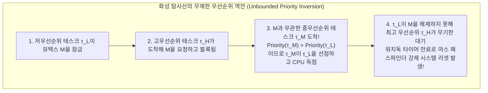
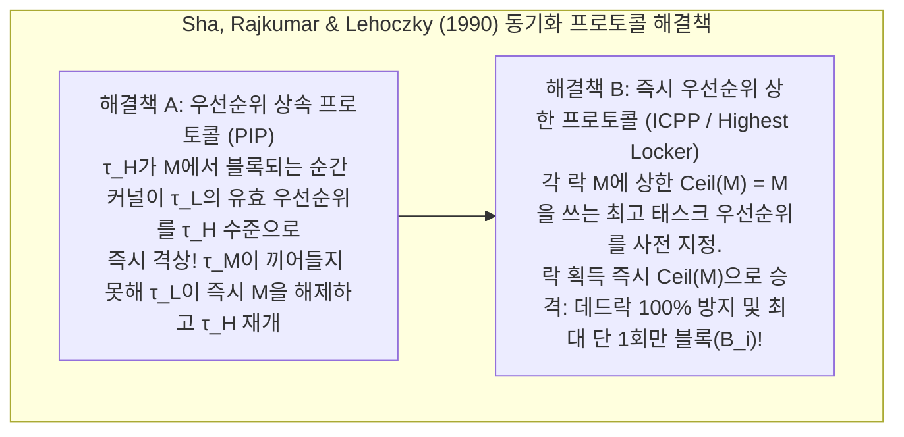

## 1. '빠름(Fast)'과 '실시간(Real-Time)'의 결정적 차이

일상적인 IT 용어에서 '실시간 처리'는 흔히 '매우 빠른 처리'와 동의어로 오용된다. 그러나 수 기가헤르츠의 멀티코어 프로세서와 대용량 캐시를 탑재한 최신 게이밍 PC나 클라우드 서버가 평균 1밀리초 만에 응답하더라도, 이를 항공기 플라이 바이 와이어(Fly-by-Wire) 비행 제어, 자동차 에어백 전개, 심장 박동기 제어에 그대로 사용할 수는 없다. 범용 컴퓨터는 <strong>평균 처리량(Throughput) 극대화</strong>를 목표로 설계되었기 때문에 백만 번 중 단 한 번이라도 캐시 미스나 가비지 컬렉션(GC), 커널 락 경합으로 200밀리초 지연되는 순간 항공기는 추락하고 에어백은 승객이 핸들에 충돌한 뒤에 터지기 때문이다.

Donald Gillies와 Hermann Kopetz가 정립한 <strong>실시간 컴퓨팅의 공리</strong>에 따르면, 실시간 시스템의 정확성은 연산 결과의 <strong>논리적·산술적 올바름</strong>뿐만 아니라 그 결과가 출력되는 <strong>물리적 시각(데드라인 $d_i$ 준수 여부)</strong>에 의해 결정된다. 완료 시각 $t$가 데드라인 $d$를 넘겼을 때 <strong>시간 효용 함수 $U(t)$</strong>의 변화에 따라 실시간 시스템은 세 가지로 분류된다:

$$U_{\text{hard}}(t) = \begin{cases} V & (t \le d) \\ -\infty & (t > d) \end{cases}, \qquad U_{\text{firm}}(t) = \begin{cases} V & (t \le d) \\ 0 & (t > d) \end{cases}, \qquad U_{\text{soft}}(t) = \begin{cases} V & (t \le d) \\ V e^{-\alpha(t-d)} & (t > d) \end{cases}$$

* <strong>경성 실시간(Hard Real-Time)</strong>: 단 한 번의 데드라인 미스($t > d$)가 인명 피해나 시스템 붕괴($U = -\infty$)로 직결되는 시스템(비행 제어, ABS, 원자로 제어)으로, 정적 수학적 증명이 필수다.
* <strong>펌 실시간(Firm Real-Time)</strong>: 데드라인을 넘긴 결과의 가치가 즉시 $0$이 되어 폐기(Drop)되는 시스템(고속 컨베이어 비전 검사, 고빈도 매매 주문 취소).
* <strong>연성 실시간(Soft Real-Time)</strong>: 데드라인 초과 후 효용이 연속적으로 감소하는 시스템(60fps 영상 재생, VoIP 통화).

| 비교 기준 | 범용 운영체제 (GPOS: Linux / Windows / macOS) | 실시간 운영체제 (RTOS: VxWorks / QNX / FreeRTOS / seL4) |
| :--- | :--- | :--- |
| <strong>최우선 설계 목표</strong> | 평균 처리량 극대화, 공정성(CFS / EEVDF), 평균 응답 시간 단축 | <strong>시간적 결정론(Determinism)</strong> 및 최악 응답 시간(WCRT) 상한 보증 |
| <strong>인터럽트 및 스케줄링 지연</strong> | 마이크로초~수십 밀리초 (비결정적, 긴 꼬리 분포 발생) | 수백 나노초~수 마이크로초 (엄격히 제한된 $O(1)$ 하드웨어 상한) |
| <strong>커널 선점 가능성</strong> | 비선점형 스핀락 구간이 존재하는 거대 모놀리식 커널 | 완전 선점형 커널 또는 최소 마이크로커널 (QNX, seL4) |
| <strong>메모리 및 하드웨어 관리</strong> | 가상 메모리 페이지 폴트, 동적 `malloc`, GC, 투기적 실행 적극 활용 | 정적 메모리 파티션, $O(1)$ 메모리 풀, 온칩 스크래치패드(TCM) 및 캐시 락킹 |

---

## 2. 최악 실행 시간(WCET) 분석의 악몽

모든 실시간 스케줄링 이론은 각 태스크 $\tau_i$의 <strong>최악 실행 시간(Worst-Case Execution Time, $C_i$)</strong>이 사전에 알려져 있음을 전제로 한다. 그러나 현대 컴퓨터 구조에는 <strong>"평균 속도를 높이는 모든 하드웨어 기법(캐시, 분기 예측, 비순차 실행 OoO, TLB, 동적 주파수 조절 DVFS, 시스템 관리 인터럽트 SMI)이 최악 실행 시간의 예측 가능성을 철저히 파괴한다"</strong>는 역설이 존재한다.

특히 비순차 실행과 캐시가 결합된 CPU에서는 <strong>타이밍 이상(Timing Anomaly)</strong> 현상까지 발생한다. 특정 명령어가 캐시 <strong>히트</strong>(국소적 가속)한 결과 투기적 경로가 버스를 먼저 점유하여, 프로그램 전체 실행 시간이 캐시 <strong>미스</strong>가 났을 때보다 오히려 더 길어지는 현상이다! 따라서 항공(DO-178C Level A) 및 자동차(ISO 26262 ASIL-D) 시스템은 하드웨어적으로 캐시 대신 <strong>온칩 스크래치패드 메모리(TCM)</strong>와 <strong>캐시 락킹(Cache Locking)</strong>을 사용하고, 소프트웨어적으로는 제어 흐름 그래프(CFG) 상에서 기본 블록의 최악 비용 $c_i$와 실행 횟수 $x_i$를 정수 선형 계획법(ILP)으로 푸는 <strong>암묵적 경로 열거 기법(IPET)</strong>을 통해 정적 WCET 상한을 수학적으로 도출한다:

$$\text{WCET} = \max \sum_{i=1}^{N} c_i x_i \quad \text{subject to} \quad \sum_{j} d_{j \to i} = x_i = \sum_{k} d_{i \to k} \quad (\text{키르히호프 유량 보존 및 루프 상한 제약})$$

---

## 3. Liu & Layland(1973): 주기적 실시간 스케줄링 정리 (RMS vs. EDF)

단일 프로세서에서 실행되는 $n$개의 독립적인 주기적 태스크 집합 $\Gamma = \{\tau_1, \dots, \tau_n\}$, $\tau_i = (C_i, T_i, D_i)$ ($D_i = T_i$)에 대해 <strong>총 CPU 이용률(Total Utilization)</strong>은 다음과 같다:

$$U = \sum_{i=1}^{n} \frac{C_i}{T_i}$$

1973년 C. L. Liu와 James W. Layland는 역사적인 논문을 통해 고정 우선순위와 동적 우선순위 스케줄링의 한계를 규명했다.

### 3.1 비율 단조 스케줄링(RMS: Rate Monotonic Scheduling)과 $\ln 2 \approx 69.3\%$ 상한

<strong>고정 우선순위 선점형 스케줄링</strong>에서 RMS 규칙은 <strong>"주기 $T_i$가 짧은(발생 빈도 $1/T_i$가 높은) 태스크일수록 높은 정적 우선순위를 부여한다"</strong>는 것이다. Liu & Layland는 모든 상위 우선순위 태스크와 동시에($t=0$) 깨어날 때 최악 응답 시간이 발생한다는 <strong>임계 순간 정리(Critical Instant Theorem)</strong>와 함께, RMS가 모든 고정 우선순위 알고리즘 중 최적이며 무조건 스케줄 가능한 최소 상한(Least Upper Bound)이 다음과 같음을 증명했다:

$$U = \sum_{i=1}^{n} \frac{C_i}{T_i} \le U_{\text{lub}}(n) = n\left(2^{1/n} - 1\right) \xrightarrow{n \to \infty} \ln 2 \approx 0.6931 \quad (69.3\%)$$

주의할 점은 $69.3\%$가 <strong>충분조건</strong>일 뿐 필요조건이 아니라는 사실이다! 만약 모든 주기가 정수배 관계인 <strong>조화 주기(Harmonic Task Set, 예: $5\,\text{ms}, 10\,\text{ms}, 20\,\text{ms}$)</strong>라면 RMS로도 <strong>$100\%$ 이용률까지 완벽히 스케줄 가능</strong>하다. 일반적인 비조화 태스크 집합의 정확한 스케줄 가능 여부는 Joseph & Pandya(1986)의 <strong>응답 시간 분석(RTA) 고정점 반복 방정식</strong>($R_i \le D_i$ 수렴 확인)으로 판정한다:

$$R_i^{(k+1)} = C_i + \sum_{j \in hp(i)} \left\lceil \frac{R_i^{(k)}}{T_j} \right\rceil C_j$$

### 3.2 최소 마감 우선(EDF: Earliest Deadline First)과 $100\%$ 최적성

<strong>동적 우선순위 선점형 스케줄링</strong>인 EDF는 매 순간 <strong>절대 데드라인 $d_{i,k} = r_{i,k} + D_i$가 가장 임박한 작업</strong>에 최고 우선순위를 부여한다. 단일 프로세서에서 EDF가 모든 데드라인을 지킬 <strong>필요충분조건</strong>은 주기 조합에 상관없이 다음과 같다:

$$U = \sum_{i=1}^{n} \frac{C_i}{T_i} \le 1.00 \quad (100\%)$$

예를 들어 $\tau_1 = (C_1=2, T_1=5)$, $\tau_2 = (C_2=4, T_2=7)$일 때 총 이용률은 $U = 97.14\%$다. RMS에서는 $t=5$에 도착한 $\tau_{1,2}$($d=10$)가 불과 $1\,\text{ms}$만 남긴 $\tau_{2,1}$($d=7$)을 선점해버려 $R_2 = 8 > 7$로 데드라인 미스가 발생한다. 반면 EDF는 $t=5$에서 $d_{2,1}=7 < d_{1,2}=10$을 비교하여 선점을 막고 $\tau_{2,1}$을 $t=6$에 먼저 완수시킨다!

그럼에도 산업계 RTOS(VxWorks, FreeRTOS, QNX, AUTOSAR)가 고정 우선순위(RMS)를 선호하는 이유는 <strong>일시적 과부하($U > 1.0$) 시 EDF에서 발생하는 치명적인 '도미노 효과(Domino Effect)'</strong> 때문이다. EDF에서는 데드라인을 넘긴 작업이 가장 오래된 데드라인을 가진 것으로 판정되어 CPU를 독점하면서 후속 작업들을 연쇄적으로 전부 데드라인 미스에 빠뜨리지만, RMS는 과부하 시에도 고우선순위 핵심 태스크의 생존을 100% 보장하고 $O(1)$ 비트맵 스케줄러로 구현할 수 있기 때문이다.

| 비교 항목 | 비율 단조 스케줄링 (RMS: 고정 우선순위) | 최소 마감 우선 (EDF: 동적 우선순위) |
| :--- | :--- | :--- |
| <strong>우선순위 결정 방식</strong> | 정적(Static): 주기 $T_i$가 짧을수록 고우선순위 | 동적(Dynamic): 절대 데드라인 $d_{i,k}$가 가까울수록 고우선순위 |
| <strong>스케줄 가능 이용률 상한</strong> | 충분조건: $n(2^{1/n}-1) \to 69.3\%$ (조화 주기 시 $100\%$) | 필요충분조건: 항상 <strong>$100\%$</strong> ($\sum C_i/T_i \le 1$) |
| <strong>커널 디스패치 복잡도</strong> | <strong>$O(1)$</strong> (고정 비트맵 + 하드웨어 `CLZ` 명령어) | <strong>$O(\log n)$</strong> (데드라인 정렬 최소 힙/레드-블랙 트리 필요) |
| <strong>일시적 과부하($U > 1$) 거동</strong> | <strong>안정적(우아한 성능 저하)</strong>: 최고 우선순위 태스크는 완벽히 생존 | <strong>파괴적(도미노 효과)</strong>: 모든 태스크가 연쇄적으로 데드라인 미스 |

---

## 4. 1997년 NASA 마스 패스파인더 사고와 '우선순위 역전'의 해결

1997년 7월 화성에 착륙한 NASA의 <strong>마스 패스파인더(Mars Pathfinder)</strong> 탐사선은 <strong>VxWorks</strong> RTOS 위에서 동작하던 중 원인 불명의 워치독(Watchdog) 강제 시스템 리셋을 반복하며 귀중한 관측 데이터를 잃기 시작했다.

원인은 공유 '정보 버스' 뮤텍스 $M$을 둘러싼 세 태스크 간의 <strong>무제한 우선순위 역전(Unbounded Priority Inversion)</strong>이었다:
* <strong>저우선순위 기상 관측 태스크 $\tau_L$(`ASI/MET`)</strong>이 공유 버스 뮤텍스 $M$을 잠갔다.
* <strong>고우선순위 버스 관리 태스크 $\tau_H$(`bc_dist`)</strong>가 깨어나 $M$을 요청했으나 $\tau_L$이 보유 중이므로 블록(Blocked)되었다.
* 직후 <strong>뮤텍스 $M$과 전혀 무관한 중우선순위 통신 태스크 $\tau_M$</strong>이 깨어났다! $\text{Priority}(\tau_M) > \text{Priority}(\tau_L)$이므로 $\tau_M$이 $\tau_L$을 선점하여 CPU를 장시간 독점했고, 그 결과 $\tau_L$이 $M$을 풀지 못해 최고 우선순위인 $\tau_H$가 중우선순위 $\tau_M$에게 무기한 차단되어 워치독 리셋이 폭발한 것이다!

이 문제를 해결하는 두 가지 핵심 프로토콜은 Sha, Rajkumar, Lehoczky(1990)에 의해 정립되었다:
1. <strong>우선순위 상속 프로토콜(PIP: Priority Inheritance Protocol)</strong>: 고우선순위 태스크 $\tau_H$가 $\tau_L$이 쥔 뮤텍스 $M$에서 블록되는 즉시, 커널이 $\tau_L$의 유효 우선순위를 $\tau_H$와 동일한 등급으로 일시 승격시켜 중우선순위 $\tau_M$의 선점을 차단한다. JPL 엔지니어들은 지상 테스트베드에서 버그를 재현한 뒤, 1억 9천만 km 떨어진 화성으로 C 쉘 명령어를 전송해 VxWorks `pipe` 뮤텍스 생성 플래그(`SEM_INVERSION_SAFE`) 변수를 라이브 RAM 상에서 `0`에서 `1`로 패치하여 탐사선을 구해냈다!
2. <strong>우선순위 상한 프로토콜(PCP / ICPP: Immediate Priority Ceiling Protocol)</strong>: PIP는 여전히 <strong>연쇄 블로킹(Chained Blocking)</strong>과 <strong>데드락</strong>에 취약하다. ICPP(POSIX `PTHREAD_PRIO_PROTECT`, AUTOSAR OS 표준)는 각 뮤텍스 $M_k$에 그 락을 사용하는 태스크들의 최고 우선순위인 $\text{Ceil}(M_k)$를 부여하고, 태스크가 $M_k$를 획득하는 <strong>즉시 유효 우선순위를 $\text{Ceil}(M_k)$로 끌어올린다</strong>. 이로써 <strong>데드락이 수학적으로 100% 제거</strong>되며, 고우선순위 태스크의 최대 블로킹 횟수가 <strong>단 1회의 임계 구역($B_i$)</strong>으로 엄격히 제한된다:

$$R_i^{(k+1)} = C_i + B_i + \sum_{j \in hp(i)} \left\lceil \frac{R_i^{(k)}}{T_j} \right\rceil C_j$$
