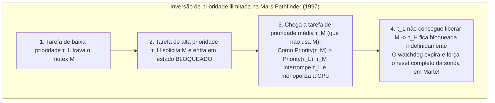
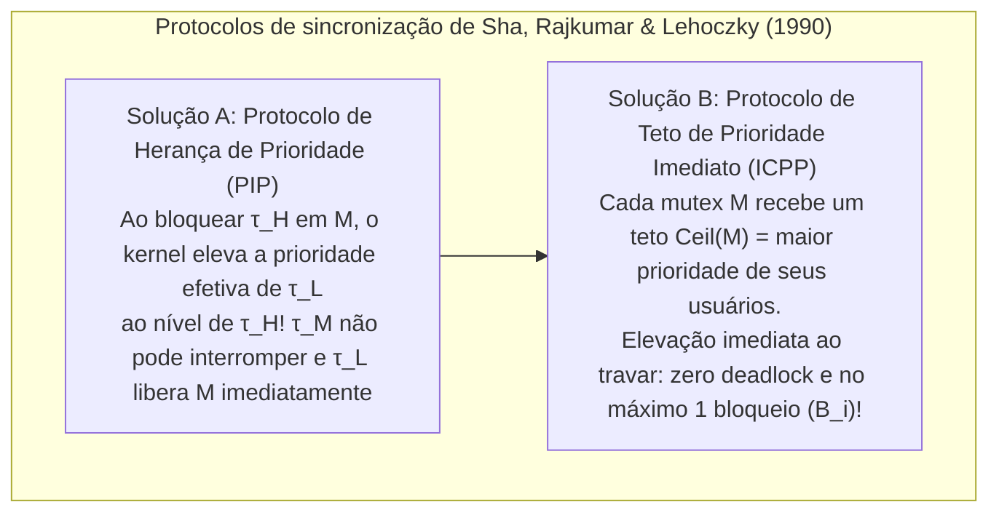

## 1. O abismo fundamental entre "rápido" e "tempo real"

Na linguagem cotidiana, "processamento em tempo real" é frequentemente confundido com "execução ultrarrápida". Contudo, nem mesmo um servidor com processador superescalar multicore de vários gigahertz, capaz de responder consultas em média em um milissegundo, jamais poderia controlar o sistema *Fly-by-Wire* de um avião comercial, o acionamento de um airbag automotivo ou um marca-passo cardíaco. Por quê? Porque sistemas de propósito geral otimizam a <strong>vazão média (Average Throughput)</strong>: se um cálculo leva $0,5\,\text{ms}$ em $99,999\,\%$ das vezes, mas uma vez em um milhão atrasa $200\,\text{ms}$ devido a um cache miss, page fault ou pausa do Garbage Collector (GC), o avião perde sustentação ou o airbag explode após a colisão.

Segundo a formulação clássica de Donald Gillies e Hermann Kopetz, o <strong>axioma da computação em tempo real</strong> estabelece que a corretude de um sistema depende não apenas da <strong>exatidão lógica e aritmética</strong> do resultado, mas também do <strong>instante físico $t$</strong> em que ele é entregue em relação ao seu prazo final (*deadline* $d_i$). Pela <strong>função de utilidade temporal $U(t)$</strong>, distinguem-se três classes:

$$U_{\text{hard}}(t) = \begin{cases} V & (t \le d) \\ -\infty & (t > d) \end{cases}, \qquad U_{\text{firm}}(t) = \begin{cases} V & (t \le d) \\ 0 & (t > d) \end{cases}, \qquad U_{\text{soft}}(t) = \begin{cases} V & (t \le d) \\ V e^{-\alpha(t-d)} & (t > d) \end{cases}$$

* <strong>Tempo real rígido (Hard Real-Time)</strong>: Perder um único prazo ($t > d$) causa falha catastrófica ($U = -\infty$, ex.: controle de voo, freios ABS). Exige prova matemática estática offline.
* <strong>Tempo real firme (Firm Real-Time)</strong>: Um resultado atrasado tem valor zero ($U = 0$) e é descartado imediatamente (ex.: inspeção visual em esteira de alta velocidade, cancelamento de ordens em HFT).
* <strong>Tempo real brando (Soft Real-Time)</strong>: A utilidade decai continuamente após $d$ (ex.: streaming de vídeo a 60 fps, chamadas VoIP).

| Dimensão arquitetural | SO de propósito geral (GPOS: Linux / Windows / macOS) | SO de tempo real (RTOS: VxWorks / QNX / FreeRTOS / seL4) |
| :--- | :--- | :--- |
| <strong>Objetivo de otimização</strong> | Maximizar vazão média e justiça (CFS / EEVDF) | Garantir <strong>determinismo temporal</strong> e limitar o pior tempo de resposta (WCRT) |
| <strong>Latência de interrupção</strong> | Microssegundos a dezenas de milissegundos (cauda longa estocástica) | Centenas de nanossegundos a poucos microssegundos (limite constante $O(1)$) |
| <strong>Preemptibilidade do kernel</strong> | Kernels monolíticos com seções críticas não preemptivas | Kernel totalmente preemptivo ou microkernel mínimo (QNX, seL4) |
| <strong>Memória e hardware</strong> | Memória virtual paginada, `malloc`, GC, máxima execução especulativa | Partições estáticas, pools $O(1)$, SRAM acoplada (TCM) e travamento de cache |

---

## 2. O pesadelo do tempo de execução no pior caso (WCET)

Toda teoria de escalonamento em tempo real pressupõe conhecer previamente o <strong>tempo de execução no pior caso (Worst-Case Execution Time, $C_i$)</strong> de cada tarefa $\tau_i$. Aqui reside um profundo paradoxo da arquitetura de computadores: <strong>quase todos os mecanismos de hardware criados para acelerar a velocidade média de uma CPU (caches L1/L2/L3, predição de desvio, execução fora de ordem OoO, TLB, DVFS e interrupções de gerenciamento do sistema SMI não mascaráveis) destroem a previsibilidade do WCET.</strong>

Em pipelines *Out-of-Order* com caches ocorrem inclusive <strong>anomalias temporais (Timing Anomalies)</strong>: um *acerto* local de cache (Cache Hit) pode permitir que um caminho especulativo ocupe antes um barramento compartilhado, tornando o tempo total de execução do programa <strong>maior</strong> do que se tivesse ocorrido um erro de cache (Cache Miss)! Por isso, sistemas críticos (DO-178C Nível A, ISO 26262 ASIL-D) utilizam memória <strong>Scratchpad SRAM / TCM</strong> determinística e <strong>travamento de cache (Cache Locking)</strong>, calculando estaticamente o limite superior do WCET via <strong>interpretação abstrata</strong> e a <strong>técnica de enumeração implícita de caminhos (IPET)</strong> como um problema de programação linear inteira (ILP) sobre o grafo de fluxo de controle (CFG):

$$\text{WCET} = \max \sum_{i=1}^{N} c_i x_i \quad \text{sujeito a} \quad \sum_{j} d_{j \to i} = x_i = \sum_{k} d_{i \to k} \quad (\text{conservação de fluxo e limites de laço})$$

---

## 3. Liu & Layland (1973): Escalonamento periódico (RMS vs. EDF)

Seja um conjunto de $n$ tarefas periódicas independentes $\Gamma = \{\tau_1, \dots, \tau_n\}$ com $\tau_i = (C_i, T_i, D_i)$ (WCET $C_i$, período $T_i$, prazo implícito $D_i = T_i$). A <strong>utilização total do processador</strong> é:

$$U = \sum_{i=1}^{n} \frac{C_i}{T_i}$$

Em 1973, C. L. Liu e James W. Layland demonstraram os teoremas fundamentais que regem prioridades estáticas e dinâmicas:

### 3.1 Escalonamento Monotônico em Taxa (RMS) e o limite $\ln 2 \approx 69,3\,\%$

No <strong>escalonamento preemptivo de prioridade fixa</strong>, a regra <strong>Rate Monotonic (RMS)</strong> atribui prioridades estáticas em ordem inversa ao período: <strong>quanto menor o período $T_i$ (maior a frequência $1/T_i$), maior a prioridade estática</strong>. Liu & Layland provaram o <strong>teorema do instante crítico</strong> (o pior tempo de resposta de $\tau_i$ ocorre quando ela é liberada simultaneamente com todas as tarefas de maior prioridade em $t=0$) e a otimalidade do RMS entre todos os algoritmos de prioridade fixa, com o menor limite superior de utilização:

$$U = \sum_{i=1}^{n} \frac{C_i}{T_i} \le U_{\text{lub}}(n) = n\left(2^{1/n} - 1\right) \xrightarrow{n \to \infty} \ln 2 \approx 0,6931 \quad (69,3\,\%)$$

Importante: $69,3\,\%$ é apenas uma <strong>condição suficiente</strong>, não necessária! Se os períodos forem <strong>harmônicos</strong> (cada período é múltiplo inteiro dos menores, ex.: $5\,\text{ms}, 10\,\text{ms}, 20\,\text{ms}$), o RMS atinge <strong>100% de utilização</strong>. Para conjuntos gerais, a <strong>análise de tempo de resposta (RTA)</strong> de Joseph & Pandya (1986) fornece uma condição necessária e suficiente exata por iteração de ponto fixo ($R_i \le D_i$):

$$R_i^{(k+1)} = C_i + \sum_{j \in hp(i)} \left\lceil \frac{R_i^{(k)}}{T_j} \right\rceil C_j$$

### 3.2 Primeiro o Prazo Mais Cedo (EDF) e a otimalidade de $100\,\%$

No <strong>escalonamento preemptivo de prioridade dinâmica</strong>, o <strong>Earliest Deadline First (EDF)</strong> concede a cada instante a prioridade máxima ao trabalho pronto cujo <strong>prazo absoluto $d_{i,k} = r_{i,k} + D_i$ esteja mais próximo</strong>. Em um monoprocessador, a condição <strong>necessária e suficiente</strong> de escalonabilidade sob EDF atinge o limite físico:

$$U = \sum_{i=1}^{n} \frac{C_i}{T_i} \le 1,00 \quad (100\,\%)$$

Exemplo: Com $\tau_1 = (C_1=2, T_1=5)$ e $\tau_2 = (C_2=4, T_2=7)$, a utilização é $U = 97,14\,\%$. Sob RMS, a chegada de $\tau_{1,2}$ em $t=5$ ($d=10$) interrompe cegamente $\tau_{2,1}$ ($d=7$, faltando apenas $1\,\text{ms}$), causando $R_2 = 8 > 7$ (perda de prazo!). Sob EDF, em $t=5$, como $d_{2,1}=7 < d_{1,2}=10$, o EDF impede a preempção e $\tau_{2,1}$ termina a tempo em $t=6 \le 7$.

Ainda assim, a indústria (VxWorks, FreeRTOS, QNX, AUTOSAR) prefere RMS/DMS porque, sob <strong>sobrecarga transitória ($U > 1,0$)</strong>, o EDF sofre um <strong>efeito dominó catastrófico</strong> onde uma tarefa atrasada monopoliza a CPU e faz todas as seguintes falharem em cadeia, enquanto o RMS protege $100\,\%$ as tarefas críticas de alta prioridade e é implementado em $O(1)$ com bitmap e instrução `CLZ`.

| Critério de comparação | Rate Monotonic (RMS: Prioridade fixa) | Earliest Deadline First (EDF: Prioridade dinâmica) |
| :--- | :--- | :--- |
| <strong>Atribuição de prioridade</strong> | Estática: menor período $T_i \implies$ maior prioridade | Dinâmica: prazo absoluto $d_{i,k}$ mais próximo $\implies$ maior prioridade |
| <strong>Limite de utilização</strong> | Suficiente: $n(2^{1/n}-1) \to 69,3\,\%$ ($100\,\%$ em períodos harmônicos) | Necessária e suficiente: sempre <strong>$100\,\%$</strong> ($\sum C_i/T_i \le 1$) |
| <strong>Complexidade no kernel</strong> | <strong>$O(1)$</strong> (bitmap de prioridades + instrução `CLZ`) | <strong>$O(\log n)$</strong> (heap mínimo ou árvore rubro-negra dinâmica) |
| <strong>Comportamento em sobrecarga ($U > 1$)</strong> | <strong>Degradação graciosa</strong>: tarefas de alta prioridade sobrevivem sempre | <strong>Efeito dominó catastrófico</strong>: falha em cascata de todas as tarefas |

---

## 4. O incidente da Mars Pathfinder da NASA (1997) e a inversão de prioridade

Em julho de 1997, após pousar em Marte, a sonda <strong>Mars Pathfinder</strong> da NASA (CPU IBM RAD6000 rodando o RTOS <strong>VxWorks</strong>) começou a sofrer reinicializações completas forçadas pelo seu *watchdog*, perdendo dias inteiros de dados científicos.

A causa foi uma <strong>inversão de prioridade ilimitada (Unbounded Priority Inversion)</strong> entre três tarefas disputando um mutex $M$ que protegia o "barramento de informações" compartilhado:
* A <strong>tarefa meteorológica de baixa prioridade $\tau_L$ (`ASI/MET`)</strong> trava o mutex $M$;
* A <strong>tarefa crítica de distribuição do barramento de alta prioridade $\tau_H$ (`bc_dist`)</strong> acorda, solicita $M$ e fica bloqueada;
* Antes que $\tau_L$ libere $M$, chegam <strong>tarefas de comunicação de prioridade média $\tau_M$</strong> (que não usam $M$!). Como $\text{Priority}(\tau_M) > \text{Priority}(\tau_L)$, $\tau_M$ interrompe $\tau_L$ por longo tempo, impedindo que $\tau_L$ destrave $M$ e mantendo $\tau_H$ bloqueada até o *watchdog* reiniciar a espaçonave.

A solução matemática foi provada por Sha, Rajkumar e Lehoczky em 1990:
1. <strong>Protocolo de Herança de Prioridade (PIP: Priority Inheritance Protocol)</strong>: Quando $\tau_H$ bloqueia em um mutex $M$ mantido por $\tau_L$, o kernel eleva temporariamente a prioridade efetiva de $\tau_L$ ao nível de $\tau_H$, impedindo que $\tau_M$ interrompa. Após reproduzir o bug na Terra, os engenheiros do JPL enviaram a 190 milhões de quilômetros um comando C ao shell do VxWorks alterando na RAM a variável global `SEM_INVERSION_SAFE` de `0` para `1`, salvando a missão!
2. <strong>Protocolo de Teto de Prioridade (PCP / ICPP: Immediate Priority Ceiling Protocol)</strong>: Como o PIP ainda permite <strong>bloqueio encadeado</strong> e <strong>deadlock</strong>, o ICPP (padrão em POSIX `PTHREAD_PRIO_PROTECT` e AUTOSAR OS) atribui a cada mutex $M_k$ um teto estático $\text{Ceil}(M_k) = \max\{\text{Priority}(\tau_i) \mid \tau_i \text{ usa } M_k\}$ e eleva a prioridade de qualquer tarefa <strong>no exato instante em que ela adquire $M_k$</strong>. Isso garante <strong>ausência total de deadlocks</strong> e limita o bloqueio máximo de qualquer tarefa a <strong>no máximo uma única seção crítica ($B_i$)</strong>:

$$R_i^{(k+1)} = C_i + B_i + \sum_{j \in hp(i)} \left\lceil \frac{R_i^{(k)}}{T_j} \right\rceil C_j$$
