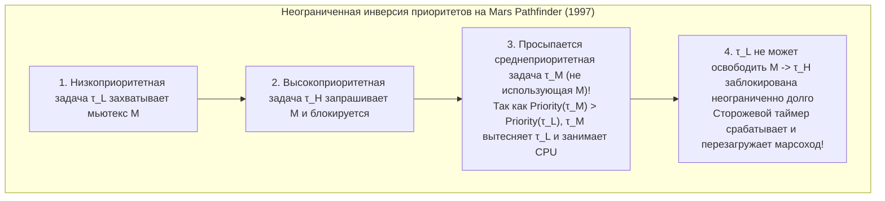
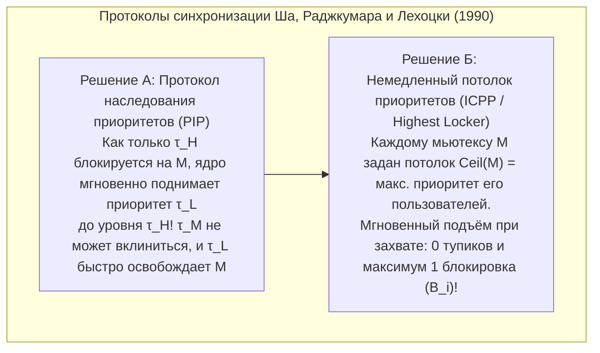

## 1. Пропасть между «быстро» и «в реальном времени»

В повседневной речи «обработка в реальном времени» часто отождествляется с «молниеносным быстродействием». Однако даже сервер с многоядерным суперскалярным процессором, обрабатывающий запросы в среднем за 1 миллисекунду, категорически нельзя использовать для электродистанционного управления полётом (*Fly-by-Wire*), подрыва пиропатрона подушки безопасности автомобиля или кардиостимулятора. Почему? Потому что системы общего назначения оптимизируют <strong>среднюю пропускную способность (Average Throughput)</strong>: если алгоритм срабатывает за $0{,}5\,\text{мс}$ в $99{,}999\,\%$ случаев, но один раз на миллион задерживается на $200\,\text{мс}$ из-за промаха кэша, страничного прерывания или сборки мусора (GC), самолёт свалится в штопор, а подушка безопасности раскроется уже после удара.

Согласно формулировке Дональда Гиллиса и Германа Копетца, <strong>аксиома вычислений в реальном времени</strong> гласит: корректность системы зависит не только от <strong>логической и арифметической правильности</strong> результата, но и от <strong>физического момента времени $t$</strong> его получения относительно директивного срока (*дедлайна* $d_i$). По поведению <strong>функции временной полезности $U(t)$</strong> выделяют три класса систем:

$$U_{\text{hard}}(t) = \begin{cases} V & (t \le d) \\ -\infty & (t > d) \end{cases}, \qquad U_{\text{firm}}(t) = \begin{cases} V & (t \le d) \\ 0 & (t > d) \end{cases}, \qquad U_{\text{soft}}(t) = \begin{cases} V & (t \le d) \\ V e^{-\alpha(t-d)} & (t > d) \end{cases}$$

* <strong>Жёсткое реальное время (Hard Real-Time)</strong>: Единственное нарушение дедлайна ($t > d$) ведёт к катастрофе ($U = -\infty$, например авионика, тормоза ABS). Требует строгого математического доказательства до запуска.
* <strong>Твёрдое реальное время (Firm Real-Time)</strong>: Опоздавший результат полностью обесценивается ($U = 0$) и отбрасывается (например отбраковка деталей на конвейере, биржевая торговля HFT).
* <strong>Мягкое реальное время (Soft Real-Time)</strong>: Полезность плавно убывает после $d$ (видео 60 fps, телефония VoIP).

| Архитектурный критерий | ОС общего назначения (GPOS: Linux / Windows / macOS) | ОС реального времени (RTOS: VxWorks / QNX / FreeRTOS / seL4) |
| :--- | :--- | :--- |
| <strong>Цель оптимизации</strong> | Максимизация среднего потока и справедливости (CFS / EEVDF) | <strong>Временной детерминизм</strong> и строгая граница наихудшего времени отклика (WCRT) |
| <strong>Задержка прерывания</strong> | От микросекунд до десятков миллисекунд (длинный стохастический хвост) | Сотни наносекунд — единицы микросекунд (строгая константа $O(1)$) |
| <strong>Вытесняемость ядра</strong> | Монолитное ядро с невытесняемыми секциями и спинлоками | Полностью вытесняемое ядро или минимальное микроядро (QNX, seL4) |
| <strong>Память и аппаратура</strong> | Виртуальная память с page faults, `malloc`, GC, спекулятивное исполнение | Статические разделы, пулы $O(1)$, память Scratchpad (TCM) и блокировка кэша |

---

## 2. Кошмар анализа наихудшего времени выполнения (WCET)

Любая теория планирования опирается на заранее известное <strong>наихудшее время выполнения (Worst-Case Execution Time, $C_i$)</strong> каждой задачи $\tau_i$. Здесь кроется фундаментальный парадокс современной архитектуры ЭВМ: <strong>почти все аппаратные механизмы, ускоряющие процессор в среднем (кэши L1/L2/L3, предсказание ветвлений, внеочередное исполнение OoO, TLB, динамическое масштабирование частоты DVFS и немаскируемые прерывания SMI), разрушают предсказуемость WCET.</strong>

В конвейерах *Out-of-Order* с кэшем возникают даже <strong>временные аномалии (Timing Anomalies)</strong>: локальное *попадание* в кэш (Cache Hit) может позволить спекулятивной ветке раньше занять общую шину, в результате чего общее время работы программы окажется <strong>длиннее</strong>, чем при промахе кэша (Cache Miss)! Поэтому в критических системах (DO-178C Level A, ISO 26262 ASIL-D) применяют детерминированную память <strong>Scratchpad SRAM / TCM</strong> и <strong>блокировку кэша (Cache Locking)</strong>, а верхнюю границу WCET вычисляют статически методами <strong>абстрактной интерпретации</strong> и <strong>неявного перечисления путей (IPET)</strong> через задачу целочисленного линейного программирования (ILP) на графе потока управления (CFG):

$$\text{WCET} = \max \sum_{i=1}^{N} c_i x_i \quad \text{при условии} \quad \sum_{j} d_{j \to i} = x_i = \sum_{k} d_{i \to k} \quad (\text{сохранение потока и границы циклов})$$

---

## 3. Лю и Лейленд (1973): Периодическое планирование (RMS против EDF)

Пусть на одном процессоре выполняются $n$ независимых периодических задач $\Gamma = \{\tau_1, \dots, \tau_n\}$, где $\tau_i = (C_i, T_i, D_i)$ (WCET $C_i$, период $T_i$, неявный дедлайн $D_i = T_i$). <strong>Суммарная загрузка процессора</strong> равна:

$$U = \sum_{i=1}^{n} \frac{C_i}{T_i}$$

В 1973 году Си Л. Лю и Джеймс Лейленд доказали фундаментальные теоремы для статических и динамических приоритетов:

### 3.1 Монотонное по частоте планирование (RMS) и предел $\ln 2 \approx 69{,}3\,\%$

При <strong>вытесняющем планировании с фиксированными приоритетами</strong> правило <strong>Rate Monotonic (RMS)</strong> назначает статический приоритет обратно пропорционально периоду: <strong>чем короче период $T_i$ (выше частота $1/T_i$), тем выше приоритет</strong>. Лю и Лейленд доказали <strong>теорему о критическом моменте</strong> (наихудшее время отклика $\tau_i$ возникает при одновременном запуске со всеми более приоритетными задачами в момент $t=0$) и оптимальность RMS среди всех статических алгоритмов с точной верхней гранью гарантированной загрузки:

$$U = \sum_{i=1}^{n} \frac{C_i}{T_i} \le U_{\text{lub}}(n) = n\left(2^{1/n} - 1\right) \xrightarrow{n \to \infty} \ln 2 \approx 0{,}6931 \quad (69{,}3\,\%)$$

Важно: $69{,}3\,\%$ — это лишь <strong>достаточное условие</strong>! Если периоды <strong>гармонические</strong> (каждый больший период кратен меньшему, например $5\,\text{мс}, 10\,\text{мс}, 20\,\text{мс}$), RMS гарантирует планируемость вплоть до <strong>$100\,\%$ загрузки</strong>. Для произвольных периодов <strong>анализ времени отклика (RTA)</strong> Джозефа и Пандьи (1986) даёт точное необходимое и достаточное условие через итерацию неподвижной точки ($R_i \le D_i$):

$$R_i^{(k+1)} = C_i + \sum_{j \in hp(i)} \left\lceil \frac{R_i^{(k)}}{T_j} \right\rceil C_j$$

### 3.2 Первым — ближайший дедлайн (EDF) и $100\,\%$-ная оптимальность

При <strong>динамическом планировании</strong> алгоритм <strong>Earliest Deadline First (EDF)</strong> в каждый момент отдаёт процессор задаче с <strong>ближайшим абсолютным дедлайном $d_{i,k} = r_{i,k} + D_i$</strong>. На одном процессоре <strong>необходимое и достаточное условие</strong> планируемости EDF достигает физического предела:

$$U = \sum_{i=1}^{n} \frac{C_i}{T_i} \le 1{,}00 \quad (100\,\%)$$

Пример: Для $\tau_1 = (C_1=2, T_1=5)$ и $\tau_2 = (C_2=4, T_2=7)$ загрузка равна $U = 97{,}14\,\%$. При RMS поступивший в $t=5$ экземпляр $\tau_{1,2}$ ($d=10$) вытесняет почти завершённый $\tau_{2,1}$ ($d=7$, осталось всего $1\,\text{мс}$), приводя к срыву дедлайна ($R_2 = 8 > 7$). При EDF в момент $t=5$ сравниваются $d_{2,1}=7 < d_{1,2}=10$, вытеснение запрещается, и $\tau_{2,1}$ успешно завершается в $t=6 \le 7$!

Тем не менее промышленные RTOS (VxWorks, FreeRTOS, QNX, AUTOSAR) предпочитают RMS/DMS, так как при <strong>кратковременной перегрузке ($U > 1{,}0$)</strong> в EDF возникает катастрофический <strong>эффект домино</strong> (просроченная задача имеет самый старый дедлайн, захватывает CPU и обрушивает все последующие задачи), тогда как RMS на $100\,\%$ защищает высокоприоритетные задачи и реализуется за $O(1)$ через битовую карту и команду `CLZ`.

| Критерий сравнения | Rate Monotonic (RMS: Фиксированный приоритет) | Earliest Deadline First (EDF: Динамический приоритет) |
| :--- | :--- | :--- |
| <strong>Назначение приоритетов</strong> | Статическое: меньше период $T_i \implies$ выше приоритет | Динамическое: ближе абсолютный дедлайн $d_{i,k} \implies$ выше приоритет |
| <strong>Граница загрузки CPU</strong> | Достаточная: $n(2^{1/n}-1) \to 69{,}3\,\%$ ($100\,\%$ для гармонических $T_i$) | Необходимая и достаточная: всегда <strong>$100\,\%$</strong> ($\sum C_i/T_i \le 1$) |
| <strong>Сложность планировщика</strong> | <strong>$O(1)$</strong> (битовая шкала + аппаратная инструкция `CLZ`) | <strong>$O(\log n)$</strong> (динамическая куча или красно-чёрное дерево) |
| <strong>Поведение при перегрузке ($U > 1$)</strong> | <strong>Предсказуемая деградация</strong>: критические задачи выживают на $100\,\%$ | <strong>Катастрофический эффект домино</strong>: каскадный срыв всех задач |

---

## 4. Авария NASA Mars Pathfinder (1997) и устранение инверсии приоритетов

В июле 1997 года после успешной посадки на Марс станция NASA <strong>Mars Pathfinder</strong> (процессор IBM RAD6000 под управлением RTOS <strong>VxWorks</strong>) начала внезапно перезагружаться по сигналу сторожевого таймера (*watchdog*), теряя суточные объёмы научных данных.

Причиной стала <strong>неограниченная инверсия приоритетов (Unbounded Priority Inversion)</strong> трёх задач вокруг мьютекса $M$ общей «информационной шины»:
* <strong>Низкоприоритетная метеозадача $\tau_L$ (`ASI/MET`)</strong> захватила мьютекс $M$;
* <strong>Высокоприоритетная задача управления шиной $\tau_H$ (`bc_dist`)</strong> проснулась, запросила $M$ и заблокировалась;
* До того как $\tau_L$ освободила $M$, активизировались <strong>среднеприоритетные задачи связи $\tau_M$</strong> (вообще не использующие $M$!). Так как $\text{Priority}(\tau_M) > \text{Priority}(\tau_L)$, задача $\tau_M$ вытеснила $\tau_L$ и надолго заняла процессор, не давая $\tau_L$ освободить мьютекс $M$ и косвенно блокируя важнейшую задачу $\tau_H$ вплоть до аппаратного сброса!

Математическое решение было найдено Луи Ша, Рагунатханом Раджкумаром и Джоном Лехоцки ещё в 1990 году:
1. <strong>Протокол наследования приоритетов (PIP: Priority Inheritance Protocol)</strong>: Когда $\tau_H$ блокируется на мьютексе $M$, удерживаемом $\tau_L$, ядро временно повышает эффективный приоритет $\tau_L$ до уровня $\tau_H$, не позволяя $\tau_M$ вытеснить её. Воспроизведя сбой на наземном стенде, инженеры JPL передали за 190 миллионов километров на Марс однострочную C-команду оболочке VxWorks, изменив в ОЗУ глобальный флаг `SEM_INVERSION_SAFE` с `0` на `1`, чем полностью спасли миссию!
2. <strong>Протокол потолка приоритетов (PCP / ICPP: Immediate Priority Ceiling Protocol)</strong>: Поскольку PIP не защищает от <strong>цепочечной блокировки</strong> и <strong>взаимных блокировок (Deadlock)</strong>, протокол ICPP (стандарт POSIX `PTHREAD_PRIO_PROTECT` и AUTOSAR OS) назначает каждому мьютексу $M_k$ статический потолок $\text{Ceil}(M_k) = \max\{\text{Priority}(\tau_i) \mid \tau_i \text{ использует } M_k\}$ и поднимает приоритет задачи <strong>в самый момент захвата $M_k$</strong>. Это гарантирует <strong>полное отсутствие дедлоков</strong> и ограничивает задержку любой задачи <strong>максимум одной критической секцией ($B_i$)</strong>:

$$R_i^{(k+1)} = C_i + B_i + \sum_{j \in hp(i)} \left\lceil \frac{R_i^{(k)}}{T_j} \right\rceil C_j$$
