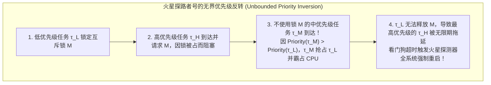
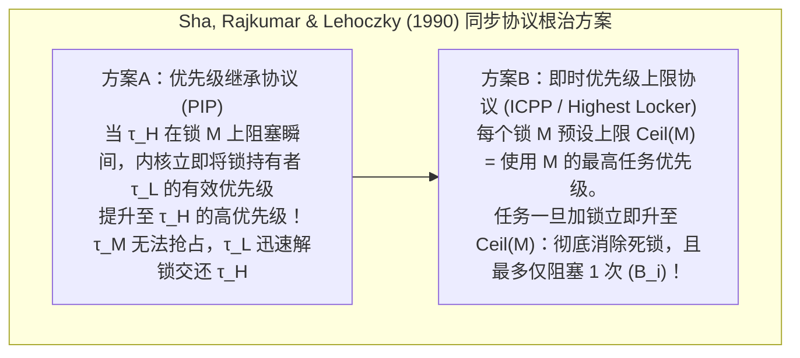

## 1. “快（Fast）”与“实时（Real-Time）”的本质鸿沟

在日常语境中，“实时处理”常被误解为“速度极快”。然而，一台配备多核超标量 CPU 与大容量缓存的顶级游戏 PC 或云服务器，即便平均响应时间低至 1 毫秒，也绝不能直接用于控制客机电传操纵系统（Fly-by-Wire）、汽车安全气囊点火或心脏起搏器。因为通用计算机追求的是<strong>平均吞吐量最大化（Average Throughput）</strong>，若百万次操作中有一次因缓存未命中、页面错误或垃圾回收（GC）而延迟了 200 毫秒，飞机就会失速坠毁，气囊就会在碰撞发生后才引爆。

根据 Donald Gillies 与 Hermann Kopetz 的经典定义，<strong>实时计算的公理</strong>指出：系统的正确性不仅取决于计算结果的<strong>逻辑/算术正确性</strong>，更取决于结果产出的<strong>物理时刻（是否在截止期 $d_i$ 之前）</strong>。根据任务完成时刻 $t$ 超过截止期 $d$ 后<strong>时间效用函数 $U(t)$</strong> 的衰减特征，实时系统严格分为三类：

$$U_{\text{hard}}(t) = \begin{cases} V & (t \le d) \\ -\infty & (t > d) \end{cases}, \qquad U_{\text{firm}}(t) = \begin{cases} V & (t \le d) \\ 0 & (t > d) \end{cases}, \qquad U_{\text{soft}}(t) = \begin{cases} V & (t \le d) \\ V e^{-\alpha(t-d)} & (t > d) \end{cases}$$

* <strong>硬实时（Hard Real-Time）</strong>：单次超时（$t > d$）即导致灾难性后果（$U = -\infty$），如飞行控制、ABS 制动，必须通过离线静态数学证明确保 $100\%$ 满足截止期。
* <strong>固实时（Firm Real-Time）</strong>：超时结果毫无价值并被立即丢弃（$U = 0$），如高速流水线视觉分拣、高频交易撤单，通常受 $(m,k)$-firm 约束。
* <strong>软实时（Soft Real-Time）</strong>：超时后价值连续衰减，如 60fps 视频播放或 VoIP 通话，仅表现为偶发卡顿。

| 对比维度 | 通用操作系统 (GPOS: Linux / Windows / macOS) | 实时操作系统 (RTOS: VxWorks / QNX / FreeRTOS / seL4) |
| :--- | :--- | :--- |
| <strong>核心优化目标</strong> | 最大化平均吞吐量、公平性（CFS / EEVDF）与平均响应速度 | 保证<strong>时间确定性（Determinism）</strong>与最坏响应时间（WCRT）的严格上界 |
| <strong>中断与调度延迟</strong> | 微秒至数十毫秒（随机波动大，存在长尾分布） | 数百纳秒至数微秒（严格受界的 $O(1)$ 硬件级常数上限） |
| <strong>内核可抢占性</strong> | 宏内核中存在较长的不可抢占临界区与自旋锁路径 | 完全可抢占内核或极小微内核架构（如 QNX, seL4） |
| <strong>内存与硬件管理</strong> | 虚拟内存缺页中断、动态 `malloc`、垃圾回收；全面启用投机执行 | 静态内存分区、$O(1)$ 内存池、锁页；采用片上紧耦合内存（TCM）与缓存锁定 |

---

## 2. 最坏执行时间（WCET）分析的噩梦

所有实时调度理论都依赖于预先获知每个任务 $\tau_i$ 的<strong>最坏执行时间（Worst-Case Execution Time, $C_i$）</strong>。然而现代计算机体系结构中存在一个深刻悖论：<strong>几乎所有提高 CPU 平均速度的微架构特性（L1/L2/L3 缓存、动态分支预测、乱序执行 OoO、TLB、动态调频 DVFS 以及不可屏蔽的系统管理中断 SMI）都在彻底摧毁最坏执行时间的可预测性。</strong>

在乱序执行与缓存耦合的处理器上，甚至会出现<strong>时序反常（Timing Anomaly）</strong>：某条指令发生缓存<strong>命中</strong>（局部变快）反而导致投机路径提前抢占总线，使程序整体执行时间比缓存<strong>未命中</strong>时更长！因此，航空（DO-178C Level A）与汽车（ISO 26262 ASIL-D）硬实时系统一方面在硬件上采用无抖动的<strong>紧耦合片上 SRAM（Scratchpad / TCM）</strong>和<strong>缓存锁定（Cache Locking）</strong>；另一方面在软件上采用<strong>隐式路径枚举技术（IPET）</strong>——将控制流图（CFG）上的基本块最坏耗时 $c_i$ 与执行次数 $x_i$ 构建为整数线性规划（ILP）求最大值，从而在不遍历天文数字路径的前提下给出严格的数学 WCET 上界：

$$\text{WCET} = \max \sum_{i=1}^{N} c_i x_i \quad \text{subject to} \quad \sum_{j} d_{j \to i} = x_i = \sum_{k} d_{i \to k} \quad (\text{基尔霍夫流量守恒与循环上界约束})$$

---

## 3. Liu & Layland（1973）：周期性实时调度定理（RMS vs. EDF）

设单处理器上有 $n$ 个独立的周期性任务 $\Gamma = \{\tau_1, \dots, \tau_n\}$，每个任务由三元组 $\tau_i = (C_i, T_i, D_i)$ 定义（最坏执行时间 $C_i$、释放周期 $T_i$、相对截止期 $D_i = T_i$）。系统的<strong>总处理器利用率（Total Utilization）</strong>为：

$$U = \sum_{i=1}^{n} \frac{C_i}{T_i}$$

1973年，刘炯朗（C. L. Liu）与 James W. Layland 发表了实时系统领域的奠基之作，严格对比了静态优先级与动态优先级调度：

### 3.1 单调速率调度（RMS: Rate Monotonic Scheduling）与 $\ln 2 \approx 69.3\%$ 界限

在<strong>固定优先级抢占式调度</strong>中，RMS 规则规定：<strong>任务的周期 $T_i$ 越短（频率 $1/T_i$ 越高），赋予的静态优先级越高</strong>（与 $C_i$ 无关）。Liu & Layland 证明了<strong>临界瞬刻定理（Critical Instant Theorem）</strong>：任务 $\tau_i$ 的最坏响应时间发生在它与所有更高优先级任务在同一时刻（$t=0$）同时释放的瞬间；并证明了 RMS 在所有固定优先级算法中是<strong>最优的</strong>，其无条件可调度的最小上界（Least Upper Bound）为：

$$U = \sum_{i=1}^{n} \frac{C_i}{T_i} \le U_{\text{lub}}(n) = n\left(2^{1/n} - 1\right) \xrightarrow{n \to \infty} \ln 2 \approx 0.6931 \quad (69.3\%)$$

注意：$69.3\%$ 只是<strong>充分条件</strong>而非必要条件！若所有周期互为整数倍（<strong>谐波周期任务集，Harmonic Task Set</strong>，如 $5\,\text{ms}, 10\,\text{ms}, 20\,\text{ms}$），RMS 同样能达到 <strong>$100\%$ 的利用率</strong>。对于一般任务集，可通过 Joseph & Pandya（1986）提出的<strong>响应时间分析（RTA）不动点迭代方程</strong>进行充要判定（收敛于 $R_i \le D_i$ 即安全）：

$$R_i^{(k+1)} = C_i + \sum_{j \in hp(i)} \left\lceil \frac{R_i^{(k)}}{T_j} \right\rceil C_j$$

### 3.2 最早截止期优先（EDF: Earliest Deadline First）与 $100\%$ 最优性

在<strong>动态优先级抢占式调度</strong>中，EDF 随时将最高优先级赋予<strong>绝对截止期 $d_{i,k} = r_{i,k} + D_i$ 距离当前时刻最近</strong>的就绪作业。Liu & Layland 证明了在单处理器上，EDF 可调度的<strong>充分必要条件</strong>直接达到物理极限：

$$U = \sum_{i=1}^{n} \frac{C_i}{T_i} \le 1.00 \quad (100\%)$$

例如，给定 $\tau_1 = (C_1=2, T_1=5)$ 与 $\tau_2 = (C_2=4, T_2=7)$，总利用率 $U = 2/5 + 4/7 = 97.14\%$。在 RMS 下，第 $t=5\,\text{ms}$ 到达的 $\tau_{1,2}$（截止期 $10$）会强行抢占还剩 $1\,\text{ms}$ 就能完成的 $\tau_{2,1}$（截止期 $7$），导致 $R_2 = 8 > 7$ 超时失败；而在 EDF 下，由于 $d_{2,1} = 7 < d_{1,2} = 10$，EDF 禁止 $\tau_{1,2}$ 抢占，使 $\tau_{2,1}$ 在 $t=6$ 顺利完成，所有截止期完美达成！

然而，工业界主流 RTOS（VxWorks, FreeRTOS, QNX, AUTOSAR）依然首选固定优先级（RMS/DMS），原因在于：当发生<strong>瞬时过载（$U > 1.0$）</strong>时，EDF 会引发灾难性的<strong>多米诺骨牌效应（Domino Effect）</strong>——已超时作业因截止期最老而霸占 CPU，拖垮后续所有任务；而 RMS 能保证高优先级关键任务完全不受过载影响，仅牺牲最低优先级任务，且内核可通过位图与 `CLZ` 指令实现极速 $O(1)$ 调度。

| 评估维度 | 单调速率调度 (RMS: 静态固定优先级) | 最早截止期优先 (EDF: 动态优先级) |
| :--- | :--- | :--- |
| <strong>优先级分配规则</strong> | 静态固定：周期 $T_i$ 越短，优先级越高 | 动态更新：绝对截止期 $d_{i,k}$ 越近，优先级越高 |
| <strong>可调度利用率上界</strong> | 充分条件：$n(2^{1/n}-1) \to 69.3\%$（谐波周期可达 $100\%$） | 充要条件：恒为 <strong>$100\%$</strong>（$\sum C_i/T_i \le 1$） |
| <strong>内核调度时间复杂度</strong> | <strong>$O(1)$</strong>（固定长度位图 + 硬件 `CLZ` 前导零指令） | <strong>$O(\log n)$</strong>（需维护按截止期排序的最小堆/红黑树） |
| <strong>瞬时过载（$U > 1$）表现</strong> | <strong>优雅降级</strong>：高优先级关键任务 100% 存活，仅低优先级延迟 | <strong>多米诺崩溃</strong>：骨牌式连锁反应导致全部任务接连超时 |

---

## 4. 1997年 NASA 火星探路者号事故与“优先级反转”的根治

1997年7月，成功登陆火星的 NASA <strong>火星探路者号（Mars Pathfinder）</strong>在运行 Wind River <strong>VxWorks</strong> 实时系统时，突然频繁发生神秘的硬件看门狗强制重启，导致探测数据不断丢失。

事故元凶是三个不同优先级的任务围绕共享“信息总线”互斥锁 $M$ 发生的<strong>无界优先级反转（Unbounded Priority Inversion）</strong>：
* <strong>低优先级气象任务 $\tau_L$（`ASI/MET`）</strong>锁定了共享总线互斥锁 $M$；
* <strong>高优先级总线管理任务 $\tau_H$（`bc_dist`）</strong>周期性唤醒并请求锁 $M$，因 $M$ 被 $\tau_L$ 持有而进入阻塞（Blocked）等待；
* 此时，<strong>与锁 $M$ 毫无关系的多个中优先级通信任务 $\tau_M$</strong> 到达！由于 $\text{Priority}(\tau_M) > \text{Priority}(\tau_L)$，$\tau_M$ 强行抢占了 $\tau_L$ 的 CPU 并长时间运行，导致 $\tau_L$ 迟迟无法释放锁 $M$，进而使最高优先级的 $\tau_H$ 被中优先级的 $\tau_M$ 无限期阻塞，最终触发看门狗超时重启！

事实上，Sha、Rajkumar 与 Lehoczky 早在1990年就提出了两大根治协议：
1. <strong>优先级继承协议（PIP: Priority Inheritance Protocol）</strong>：当高优先级任务 $\tau_H$ 在低优先级任务 $\tau_L$ 持有的锁 $M$ 上阻塞时，内核立即将 $\tau_L$ 的有效优先级临时提升至 $\tau_H$ 的级别，阻止中优先级任务 $\tau_M$ 插队。JPL 工程师正是通过地球测试台复现该漏洞后，跨越 1.9 亿公里向火星发送了一行 C 语言指令，将 VxWorks 内核中 `pipe` 互斥锁的全局变量 `SEM_INVERSION_SAFE` 从 `0` 改为 `1` 启用 PIP，彻底拯救了火星探路者号！
2. <strong>优先级上限协议（PCP / ICPP: Immediate Priority Ceiling Protocol）</strong>：PIP 仍可能出现<strong>链式阻塞（Chained Blocking）</strong>与<strong>死锁</strong>。ICPP（POSIX `PTHREAD_PRIO_PROTECT` 与 AUTOSAR OS 标准）为每个互斥锁 $M_k$ 静态指定一个上限 $\text{Ceil}(M_k) = \max\{\text{Priority}(\tau_i) \mid \tau_i \text{ 使用 } M_k\}$；任何任务一旦获取 $M_k$，其有效优先级<strong>立即提升至 $\text{Ceil}(M_k)$</strong>。ICPP 从数学上同时保证了<strong>完全无死锁</strong>，且任何高优先级任务最多只会被低优先级临界区<strong>阻塞唯一一次（最大阻塞时间 $B_i$）</strong>：

$$R_i^{(k+1)} = C_i + B_i + \sum_{j \in hp(i)} \left\lceil \frac{R_i^{(k)}}{T_j} \right\rceil C_j$$
