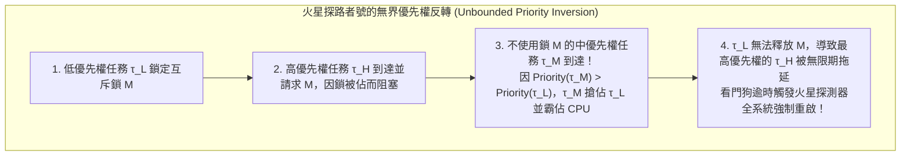
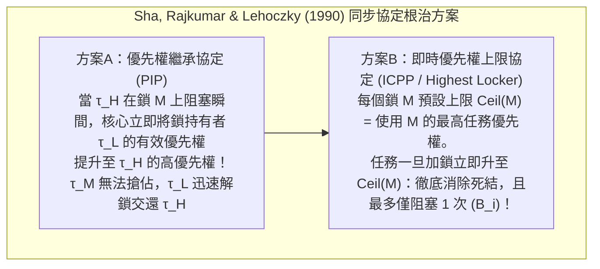

## 1. 「快（Fast）」與「即時（Real-Time）」的本質鴻溝

在日常語境中，「即時處理」常被誤解為「速度極快」。然而，一台配備多核心超純量 CPU 與大容量快取的頂級電競 PC 或雲端伺服器，即便平均回應時間低至 1 毫秒，也絕不能直接用於控制客機線傳飛控系統（Fly-by-Wire）、汽車安全氣囊點火或心律調節器。因為通用電腦追求的是<strong>平均吞吐量最大化（Average Throughput）</strong>，若百萬次操作中有一次因快取未命中、分頁錯誤或垃圾回收（GC）而延遲了 200 毫秒，飛機就會失速墜毀，氣囊就會在碰撞發生後才引爆。

根據 Donald Gillies 與 Hermann Kopetz 的經典定義，<strong>即時計算的公理</strong>指出：系統的正確性不僅取決於計算結果的<strong>邏輯/算術正確性</strong>，更取決於結果產出的<strong>物理時刻（是否在截止期 $d_i$ 之前）</strong>。根據任務完成時刻 $t$ 超過截止期 $d$ 後<strong>時間效用函數 $U(t)$</strong> 的衰減特徵，即時系統嚴格分為三類：

$$U_{\text{hard}}(t) = \begin{cases} V & (t \le d) \\ -\infty & (t > d) \end{cases}, \qquad U_{\text{firm}}(t) = \begin{cases} V & (t \le d) \\ 0 & (t > d) \end{cases}, \qquad U_{\text{soft}}(t) = \begin{cases} V & (t \le d) \\ V e^{-\alpha(t-d)} & (t > d) \end{cases}$$

* <strong>硬即時（Hard Real-Time）</strong>：單次逾時（$t > d$）即導致災難性後果（$U = -\infty$），如飛行控制、ABS 煞車，必須透過離線靜態數學證明確保 $100\%$ 滿足截止期。
* <strong>固即時（Firm Real-Time）</strong>：逾時結果毫無價值並被立即丟棄（$U = 0$），如高速產線視覺分揀、高頻交易撤單，通常受 $(m,k)$-firm 約束。
* <strong>軟即時（Soft Real-Time）</strong>：逾時後價值連續衰減，如 60fps 影片播放或 VoIP 通話，僅表現為偶發卡頓。

| 對比維度 | 通用作業系統 (GPOS: Linux / Windows / macOS) | 即時作業系統 (RTOS: VxWorks / QNX / FreeRTOS / seL4) |
| :--- | :--- | :--- |
| <strong>核心最佳化目標</strong> | 最大化平均吞吐量、公平性（CFS / EEVDF）與平均回應速度 | 保證<strong>時間確定性（Determinism）</strong>與最壞回應時間（WCRT）的嚴格上界 |
| <strong>中斷與排程延遲</strong> | 微秒至數十毫秒（隨機波動大，存在長尾分佈） | 數百奈秒至數微秒（嚴格受界的 $O(1)$ 硬體級常數上限） |
| <strong>核心可搶佔性</strong> | 巨核心中存在較長的不可搶佔臨界區與自旋鎖路徑 | 完全可搶佔核心或極小微核心架構（如 QNX, seL4） |
| <strong>記憶體與硬體管理</strong> | 虛擬記憶體分頁錯誤、動態 `malloc`、垃圾回收；全面啟用投機執行 | 靜態記憶體分割區、$O(1)$ 記憶體池、鎖頁；採用片上緊耦合記憶體（TCM）與快取鎖定 |

---

## 2. 最壞執行時間（WCET）分析的噩夢

所有即時排程理論都依賴於預先獲知每個任務 $\tau_i$ 的<strong>最壞執行時間（Worst-Case Execution Time, $C_i$）</strong>。然而現代電腦體系結構中存在一個深刻悖論：<strong>幾乎所有提高 CPU 平均速度的微架構特性（L1/L2/L3 快取、動態分支預測、亂序執行 OoO、TLB、動態調頻 DVFS 以及不可遮罩的系統管理中斷 SMI）都在徹底摧毀最壞執行時間的可預測性。</strong>

在亂序執行與快取耦合的處理器上，甚至會出現<strong>時序反常（Timing Anomaly）</strong>：某條指令發生快取<strong>命中</strong>（局部變快）反而導致投機路徑提前搶佔匯流排，使程式整體執行時間比快取<strong>未命中</strong>時更長！因此，航太（DO-178C Level A）與汽車（ISO 26262 ASIL-D）硬即時系統一方面在硬體上採用無抖動的<strong>緊耦合片上 SRAM（Scratchpad / TCM）</strong>和<strong>快取鎖定（Cache Locking）</strong>；另一方面在軟體上採用<strong>隱式路徑枚舉技術（IPET）</strong>——將控制流圖（CFG）上的基本區塊最壞耗時 $c_i$ 與執行次數 $x_i$ 建構為整數線性規劃（ILP）求最大值，從而在不遍歷天文數字路徑的前提下給出嚴格的數學 WCET 上界：

$$\text{WCET} = \max \sum_{i=1}^{N} c_i x_i \quad \text{subject to} \quad \sum_{j} d_{j \to i} = x_i = \sum_{k} d_{i \to k} \quad (\text{克希荷夫流量守恆與迴圈上界約束})$$

---

## 3. Liu & Layland（1973）：週期性即時排程定理（RMS vs. EDF）

設單處理器上有 $n$ 個獨立的週期性任務 $\Gamma = \{\tau_1, \dots, \tau_n\}$，每個任務由三元組 $\tau_i = (C_i, T_i, D_i)$ 定義（最壞執行時間 $C_i$、釋放週期 $T_i$、相對截止期 $D_i = T_i$）。系統的<strong>總處理器使用率（Total Utilization）</strong>為：

$$U = \sum_{i=1}^{n} \frac{C_i}{T_i}$$

1973年，劉炯朗（C. L. Liu）與 James W. Layland 發表了即時系統領域的奠基之作，嚴格對比了靜態優先權與動態優先權排程：

### 3.1 單調速率排程（RMS: Rate Monotonic Scheduling）與 $\ln 2 \approx 69.3\%$ 界限

在<strong>固定優先權搶佔式排程</strong>中，RMS 規則規定：<strong>任務的週期 $T_i$ 越短（頻率 $1/T_i$ 越高），賦予的靜態優先權越高</strong>（與 $C_i$ 無關）。Liu & Layland 證明了<strong>臨界瞬刻定理（Critical Instant Theorem）</strong>：任務 $\tau_i$ 的最壞回應時間發生在它與所有更高優先權任務在同一時刻（$t=0$）同時釋放的瞬間；並證明了 RMS 在所有固定優先權演算法中是<strong>最優的</strong>，其無條件可排程的最小上界（Least Upper Bound）為：

$$U = \sum_{i=1}^{n} \frac{C_i}{T_i} \le U_{\text{lub}}(n) = n\left(2^{1/n} - 1\right) \xrightarrow{n \to \infty} \ln 2 \approx 0.6931 \quad (69.3\%)$$

注意：$69.3\%$ 只是<strong>充分條件</strong>而非必要條件！若所有週期互為整數倍（<strong>諧波週期任務集，Harmonic Task Set</strong>，如 $5\,\text{ms}, 10\,\text{ms}, 20\,\text{ms}$），RMS 同樣能達到 <strong>$100\%$ 的使用率</strong>。對於一般任務集，可透過 Joseph & Pandya（1986）提出的<strong>回應時間分析（RTA）不動點迭代方程</strong>進行充要判定（收斂於 $R_i \le D_i$ 即安全）：

$$R_i^{(k+1)} = C_i + \sum_{j \in hp(i)} \left\lceil \frac{R_i^{(k)}}{T_j} \right\rceil C_j$$

### 3.2 最早截止期優先（EDF: Earliest Deadline First）與 $100\%$ 最優性

在<strong>動態優先權搶佔式排程</strong>中，EDF 隨時將最高優先權賦予<strong>絕對截止期 $d_{i,k} = r_{i,k} + D_i$ 距離當前時刻最近</strong>的就緒作業。Liu & Layland 證明了在單處理器上，EDF 可排程的<strong>充分必要條件</strong>直接達到物理極限：

$$U = \sum_{i=1}^{n} \frac{C_i}{T_i} \le 1.00 \quad (100\%)$$

例如，給定 $\tau_1 = (C_1=2, T_1=5)$ 與 $\tau_2 = (C_2=4, T_2=7)$，總使用率 $U = 2/5 + 4/7 = 97.14\%$。在 RMS 下，第 $t=5\,\text{ms}$ 到達的 $\tau_{1,2}$（截止期 $10$）會強行搶佔還剩 $1\,\text{ms}$ 就能完成的 $\tau_{2,1}$（截止期 $7$），導致 $R_2 = 8 > 7$ 逾時失敗；而在 EDF 下，由於 $d_{2,1} = 7 < d_{1,2} = 10$，EDF 禁止 $\tau_{1,2}$ 搶佔，使 $\tau_{2,1}$ 在 $t=6$ 順利完成，所有截止期完美達成！

然而，工業界主流 RTOS（VxWorks, FreeRTOS, QNX, AUTOSAR）依然首選固定優先權（RMS/DMS），原因在於：當發生<strong>瞬時過載（$U > 1.0$）</strong>時，EDF 會引發災難性的<strong>骨牌效應（Domino Effect）</strong>——已逾時作業因截止期最老而霸佔 CPU，拖垮後續所有任務；而 RMS 能保證高優先權關鍵任務完全不受過載影響，僅犧牲最低優先權任務，且核心可透過位元圖與 `CLZ` 指令實現極速 $O(1)$ 排程。

| 評估維度 | 單調速率排程 (RMS: 靜態固定優先權) | 最早截止期優先 (EDF: 動態優先權) |
| :--- | :--- | :--- |
| <strong>優先權分配規則</strong> | 靜態固定：週期 $T_i$ 越短，優先權越高 | 動態更新：絕對截止期 $d_{i,k}$ 越近，優先權越高 |
| <strong>可排程使用率上界</strong> | 充分條件：$n(2^{1/n}-1) \to 69.3\%$（諧波週期可達 $100\%$） | 充要條件：恆為 <strong>$100\%$</strong>（$\sum C_i/T_i \le 1$） |
| <strong>核心排程時間複雜度</strong> | <strong>$O(1)$</strong>（固定長度位元圖 + 硬體 `CLZ` 前導零指令） | <strong>$O(\log n)$</strong>（需維護按截止期排序的最小堆積/紅黑樹） |
| <strong>瞬時過載（$U > 1$）表現</strong> | <strong>優雅降級</strong>：高優先權關鍵任務 100% 存活，僅低優先權延遲 | <strong>骨牌崩潰</strong>：連鎖反應導致全部任務接連逾時 |

---

## 4. 1997年 NASA 火星探路者號事故與「優先權反轉」的根治

1997年7月，成功登陸火星的 NASA <strong>火星探路者號（Mars Pathfinder）</strong>在執行 Wind River <strong>VxWorks</strong> 即時系統時，突然頻繁發生神秘的硬體看門狗強制重啟，導致探測資料不斷遺失。

事故元兇是三個不同優先權的任務圍繞共享「資訊匯流排」互斥鎖 $M$ 發生的<strong>無界優先權反轉（Unbounded Priority Inversion）</strong>：
* <strong>低優先權氣象任務 $\tau_L$（`ASI/MET`）</strong>鎖定了共享匯流排互斥鎖 $M$；
* <strong>高優先權匯流排管理任務 $\tau_H$（`bc_dist`）</strong>週期性喚醒並請求鎖 $M$，因 $M$ 被 $\tau_L$ 持有而進入阻塞（Blocked）等待；
* 此時，<strong>與鎖 $M$ 毫無關係的多個中優先權通訊任務 $\tau_M$</strong> 到達！由於 $\text{Priority}(\tau_M) > \text{Priority}(\tau_L)$，$\tau_M$ 強行搶佔了 $\tau_L$ 的 CPU 並長時間執行，導致 $\tau_L$ 遲遲無法釋放鎖 $M$，進而使最高優先權的 $\tau_H$ 被中優先權的 $\tau_M$ 無限期阻塞，最終觸發看門狗逾時重啟！

事實上，Sha、Rajkumar 與 Lehoczky 早在1990年就提出了兩大根治協定：
1. <strong>優先權繼承協定（PIP: Priority Inheritance Protocol）</strong>：當高優先權任務 $\tau_H$ 在低優先權任務 $\tau_L$ 持有的鎖 $M$ 上阻塞時，核心立即將 $\tau_L$ 的有效優先權臨時提升至 $\tau_H$ 的級別，阻止中優先權任務 $\tau_M$ 插隊。JPL 工程師正是透過地球測試台重現該漏洞後，跨越 1.9 億公里向火星發送了一行 C 語言指令，將 VxWorks 核心中 `pipe` 互斥鎖的全域變數 `SEM_INVERSION_SAFE` 從 `0` 改為 `1` 啟用 PIP，徹底拯救了火星探路者號！
2. <strong>優先權上限協定（PCP / ICPP: Immediate Priority Ceiling Protocol）</strong>：PIP 仍可能出現<strong>鏈式阻塞（Chained Blocking）</strong>與<strong>死結</strong>。ICPP（POSIX `PTHREAD_PRIO_PROTECT` 與 AUTOSAR OS 標準）為每個互斥鎖 $M_k$ 靜態指定一個上限 $\text{Ceil}(M_k) = \max\{\text{Priority}(\tau_i) \mid \tau_i \text{ 使用 } M_k\}$；任何任務一旦取得 $M_k$，其有效優先權<strong>立即提升至 $\text{Ceil}(M_k)$</strong>。ICPP 從數學上同時保證了<strong>完全無死結</strong>，且任何高優先權任務最多只會被低優先權臨界區<strong>阻塞唯一一次（最大阻塞時間 $B_i$）</strong>：

$$R_i^{(k+1)} = C_i + B_i + \sum_{j \in hp(i)} \left\lceil \frac{R_i^{(k)}}{T_j} \right\rceil C_j$$
