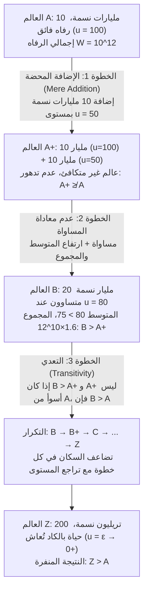

## مقدمة: حين يصبح «حجم السكان $N$» نفسه متغيراً أخلاقياً

في معظم النقاشات الكلاسيكية للأخلاقيات المعيارية واقتصاديات الرفاه، نفكر ضمنياً تحت افتراض <strong>ثبات حجم السكان (Fixed-Population)</strong>: إذ يوجد بالفعل عدد محدد $N$ من الأفراد في العالم، وتتمثل مهمة الفلسفة الأخلاقية في توزيع الموارد بعدالة بين هؤلاء الأفراد الـ $N$ أو تعظيم رفاههم الإجمالي. غير أننا بمجرد أن نوسع أفقنا ليشمل سياسات تغير المناخ، واستنزاف موارد الكوكب، وأخلاقيات الإنجاب، أو <strong>المدى الطويل / اللونغتيرميزم (Longtermism)</strong> والمخاطر الوجودية (Existential Risks) التي ترسم مصير البشرية لآلاف السنين القادمة، ينهار هذا الافتراض تماماً: فقوانيننا وقراراتنا الحالية لا تحدد فقط <em>مدى جودة</em> حياة البشر المستقبليين (جودة الحياة $u_i$)، بل تحدد أيضاً <em>كم عدد</em> البشر الذين سيوجدون أصلاً (حجم السكان $N$)، بل وحتى <em>أيّ أفراد بعينهم</em> سيولدون.

هذا هو ميدان <strong>أخلاقيات السكان (Population Ethics)</strong> و<strong>أكسيولوجيا السكان المتغيرين (Variable-Population Axiology)</strong>. في عام 1984، نشر الفيلسوف البريطاني الكبير <strong>ديريك بارفيت (Derek Parfit, 1942–2017)</strong> رائعته <em>Reasons and Persons</em> («الأسباب والأشخاص»، الجزء الرابع)، محدثاً زلزالاً فكرياً في الفلسفة المعاصرة. أثبت بارفيت أننا إذا تبنينا <strong>النفعية الكلية (Total Utilitarianism)</strong> — الصياغة الكلاسيكية للنفعية منذ هنري سيدجويك — فسوف نُساق حتماً إلى قضية مروعة للحدس الأخلاقي أسماها <strong>«النتيجة المنفِّرة» (The Repugnant Conclusion)</strong>. والأكثر إثارة للدهشة أن الأبحاث الأكسيوماتية في العقود اللاحقة أثبتت أن أي محاولة لتعديل النفعية الكلية للهروب من هذه النتيجة تقذف بالنظرية في مفارقات أخرى أشد هولاً.

---

## الفصل الأول: من السكان الثابتين إلى السكان المتغيرين: مفترق طرق سيدجويك

### 1.1 التعريف الصوري لدوال الرفاه الاجتماعي

ليكن لدينا عالم ممكن (أو حالة سكانية) $X$ يتألف من $N(X) \in \mathbb{N}^+$ من الأفراد، ويمثله متجه مستويات الرفاه الصافي مدى الحياة $X = (u_1, u_2, \dots, u_N) \in \mathbb{R}^N$. في أخلاقيات السكان، نضع خط أساس مرجعياً جوهرياً هو <strong>المستوى المحايد للرفاه (Neutral Level)</strong> $u = 0$:
* عندما يكون $u_i > 0$، فإن حياة الفرد $i$ هي إجمالاً <strong>حياة تستحق أن تُعاش (A life worth living)</strong>؛
* عندما يكون $u_i = 0$، تكون الحياة محايدة تماماً (مكافئة قيمياً للعدم)؛
* عندما يكون $u_i < 0$، تطغى المعاناة على الحياة وتكون إجمالاً <strong>حياة لا تستحق أن تُعاش (A life not worth living)</strong>.

طالما كان لعالمين نفس حجم السكان تماماً ($N(X) = N(Y) = N$)، فإن <strong>النفعية الكلية (Total Utilitarianism)</strong> و<strong>نفعية المتوسط (Average Utilitarianism)</strong> تنتجان نفس الترتيب القيمي بالضبط:

$$W_{\text{total}}(X) = \sum_{i=1}^{N} u_i = N \cdot \bar{u}, \qquad W_{\text{avg}}(X) = \frac{1}{N} \sum_{i=1}^{N} u_i = \bar{u}$$

### 1.2 اختيار هنري سيدجويك

أما حين يصبح $N$ قابلاً للتغير، يفترق المعياران افتراقاً جذرياً. فبينما مال اقتصاديون مثل جون ستيوارت ميل أو كنوت فيكسل إلى متوسط الرفاه للفرد $\bar{u}$، حسم مُنظّر النفعية الكلاسيكية الكبير <strong>هنري سيدجويك (Henry Sidgwick)</strong> الأمر في كتابه «مناهج الأخلاق» (<em>The Methods of Ethics</em>, 1874): إذا كان الخير الأسمى هو الفائض الصافي للسعادة في الكون، فيجب علينا تعظيم حاصل ضرب متوسط السعادة في عدد الكائنات القادرة على التمتع بها، أي $W_{\text{total}}(X) = N \cdot \bar{u}$. وهذا الاختيار الرياضي البديهي ظاهرياً هو الذي أشعل فتيل مفارقة بارفيت.

---

## الفصل الثاني: ديريك بارفيت و«النتيجة المنفِّرة» (The Repugnant Conclusion)

### 2.1 العالم $A$ مقابل العالم $Z$: موزارت والفلسفة ضد موسيقى المصاعد والبطاطس

في الفقرة 142 من كتاب «الأسباب والأشخاص»، يدعونا بارفيت إلى مقارنة عالمين ممكنين متساويين داخلياً ولكنهما مختلفان في الحجم السكاني:

* <strong>العالم $A$ (عالم الرفاه الفائق)</strong>: يضم $N_A = 10\text{ مليارات} = 10^{10}$ نسمة. يتمتع كل شخص فيه بجودة حياة عالية للغاية ($u_A = 100$) — صحة تامة، حرية، محبة عميقة، إبداع علمي، وما يلخصه بارفيت بعبارة <strong>«موزارت والفلسفة (Mozart and philosophy)»</strong>. يبلغ إجمالي الرفاه في العالم $A$:
  $$W_{\text{total}}(A) = N_A \cdot u_A = 10^{10} \times 100 = 10^{12}$$
* <strong>العالم $Z$ (العالم المكتظ ذو البقاء الهامشي)</strong>: يؤوي سكاناً هائلين عدداً يبلغون $N_Z = 200\text{ تريليون} = 2 \times 10^{14}$ فرد. لا تتجاوز جودة حياة كل فرد فيه نقطة الصفر المحايدة إلا بمقدار ضئيل جداً ($u_Z = \varepsilon = 0.01 > 0$). حياتهم رتيبة وشحيحة، خالية من أي ثقافة رفيعة أو بهجة عميقة، ولا عزاء فيها سوى ما يسميه بارفيت <strong>«موسيقى الخلفية الرخيصة (Muzak) والبطاطس (Muzak and potatoes)»</strong>. ومع ذلك، وبسبب ضخامة $N_Z$، يصل إجمالي الرفاه في العالم $Z$ إلى:
  $$W_{\text{total}}(Z) = N_Z \cdot u_Z = (2 \times 10^{14}) \times 0.01 = 2 \times 10^{12}$$

وبما أن $W_{\text{total}}(Z) = 2 \times 10^{12} > 10^{12} = W_{\text{total}}(A)$، تحكم النفعية الكلية بأن <strong>العالم $Z$ أفضل أخلاقياً بصورة قاطعة من العالم $A$ ($Z \succ A$)</strong>. أطلق بارفيت على هذه النتيجة اسم <strong>«النتيجة المنفِّرة» (The Repugnant Conclusion)</strong>:

> <strong>تعريف النتيجة المنفرة</strong>: لأي تجمع سكاني ممكن يضم عشرة مليارات شخص على الأقل يتمتعون بجودة حياة عالية جداً، يوجد تجمع سكاني ممكن آخر أكبر منه بكثير يكون وجوده — مع ثبات باقي العوامل — أفضل، على الرغم من أن أفراده يعيشون حياة بالكاد تستحق أن تُعاش ($u_i = \varepsilon \to 0^+$).

### 2.2 لماذا تبدو هذه النتيجة منفرة إلى هذا الحد؟

تصطدم هذه النتيجة بحدسنا الأخلاقي العميق لأنها تعني أن <strong>الكمّ المحض (Quantity) يمكنه أن يحل محل الكيف (Quality) بلا حدود</strong>. فأسمى ذرى الروح البشرية والسعادة (موزارت والفلسفة) تنهزم في الحساب النفعي أمام حشد لا متناهٍ من الوجود شبه النباتي.

---

## الفصل الثالث: مفارقة الإضافة المحضة (The Mere Addition Paradox)

هل يمكننا تجنب النتيجة المنفرة بمجرد رفض النفعية الكلية؟ صمم بارفيت <strong>مفارقة الإضافة المحضة (The Mere Addition Paradox)</strong> ليثبت أن ثلاثة مبادئ حدسية معتدلة للغاية ومستقلة تماماً عن النفعية الكلية تكفي لدفعنا عبر منحدر زلق مباشرة إلى العالم $Z$.

لنتأمل الخطوات الثلاث لحجة بارفيت:

1. <strong>من العالم $A$ إلى العالم $A^+$ (مبدأ الإضافة المحضة / Mere Addition Principle)</strong>:
   إلى العالم $A$ (10 مليارات شخص عند $u=100$) نضيف في قارة منفصلة — دون التأثير مطلقاً على السكان الأصليين — 10 مليارات شخص آخرين يعيشون حياة سعيدة عند $u=50$. نحصل بذلك على العالم $A^+$.
   وفق <strong>مبدأ الإضافة المحضة</strong>، فإن إضافة أشخاص تستحق حياتهم بوضوح أن تُعاش ($u > 0$) دون الإضرار بأحد لا تجعل العالم <strong>أسوأ</strong>. إذن $A^+$ <strong>ليس أسوأ من $A$</strong> ($A^+ \not\prec A$).
2. <strong>من العالم $A^+$ إلى العالم $B$ (مبدأ عدم معاداة المساواة / الهيمنة المساواتية)</strong>:
   ينطوي العالم $A^+$ على تفاوت طبقي بين 10 مليارات عند $u=100$ و10 مليارات عند $u=50$ (المتوسط: $75$، المجموع: $1{,}5 \times 10^{12}$). لنقارنه <strong>بالعالم $B$</strong>، حيث يتمتع نفس الـ 20 مليار شخص جميعاً بالتساوي بمستوى $u = 80$ (المتوسط: $80$، المجموع: $1{,}6 \times 10^{12}$).
   يمتلك العالم $B$ مجموع رفاه أعلى، ومتوسط رفاه أعلى، <em>ومساواة تامة</em>: وبالتالي فإن <strong>العالم $B$ أفضل قطعاً من العالم $A^+$ ($B \succ A^+$)</strong>.
3. <strong>التعدي (Transitivity) والانحدار التكراري</strong>:
   إذا كان $B$ أفضل من $A^+$ وكان $A^+$ ليس أسوأ من $A$، فإن علاقة <strong>التعدي</strong> تقتضي أن يكون <strong>العالم $B$ (20 ملياراً، $u=80$) أفضل من العالم $A$ (10 مليارات، $u=100$)</strong>! وبتكرار هذه العملية ($B \to B^+ \to C \to \dots \to Z$)، نصل حتماً إلى $Z \succ A$.

---

## الفصل الرابع: محاولات الهروب وإفلاسها: من النتيجة السادية إلى مشكلة عدم الهوية

جميع الأكسيولوجيات البديلة المقترحة للالتفاف على النتيجة المنفرة تنتهي إلى مفارقات مضادة مدمرة:

| النموذج الأكسيولوجي | دالة الرفاه الاجتماعي $W(X)$ | هل يتجنب النتيجة المنفرة؟ | التكلفة النظرية القاتلة والمفارقة الناجمة |
| :--- | :--- | :--- | :--- |
| <strong>النفعية الكلية</strong> | $W_{\text{total}} = \sum_{i=1}^{N} u_i = N \cdot \bar{u}$ | <strong>لا</strong> (تقتضي $Z \succ A$) | استبدال غير محدود للكيف بالكم |
| <strong>نفعية المتوسط</strong> | $W_{\text{avg}} = \frac{1}{N} \sum_{i=1}^{N} u_i = \bar{u}$ | <strong>نعم</strong> ($\bar{u}_A = 100 > \varepsilon = \bar{u}_Z$) | «الإضافة إلى الجحيم» و<strong>النتيجة السادية (Sadistic Conclusion)</strong> |
| <strong>القيمة المتغيرة (Hurka / Ng)</strong> | $W_{\text{var}} = f(N) \cdot \bar{u}, \ \lim_{N \to \infty} f(N) = M$ | <strong>نعم</strong> (سقف تقاربي $M$) | تنتهك الإضافة المحضة عند $N$ الكبير وتولد النتيجة السادية |
| <strong>نفعية المستوى الحرج (CLU)</strong> | $W_{\text{CL}} = \sum_{i=1}^{N} (u_i - \alpha) \ (\alpha > 0)$ | <strong>نعم</strong> (مساهمة سالبة إذا كان $\varepsilon < \alpha$) | <strong>النتيجة السادية القصوى (Very Sadistic Conclusion)</strong> |
| <strong>المنظور المؤثر في الأشخاص (Narveson)</strong> | يقيّم فقط الأثر على أشخاص محددين | <strong>مشروط</strong> | يصطدم <strong>باللاتماثل</strong> (ماكماهان) و<strong>مشكلة عدم الهوية</strong> (بارفيت) |

### 4.1 نفعية المتوسط و«النتيجة السادية» (The Sadistic Conclusion)

تفضل <strong>نفعية المتوسط</strong> ($W_{\text{avg}} = \bar{u}$) العالم $A$ على $Z$، لكنها تولد نتائج عبثية:
* <strong>الإضافة إلى الجحيم (Addition to Hell)</strong>: في عالم يضم 100 شخص يتعرضون للتعذيب عند $u = -100$، فإن ولادة شخص آخر يتعرض للتعذيب عند $u = -90$ «ترفع» المتوسط إلى $-99{,}91$ — أي أن خلق حياة من العذاب الجحيمي يُعد تحسناً أخلاقياً!
* <strong>النتيجة السادية (The Sadistic Conclusion)</strong>: أثبتها الفيلسوف السويدي <strong>غوستاف أرينيوس (Gustaf Arrhenius)</strong>، وتكشف أنه عند الإضافة إلى مجتمع سعيد جداً، تفضل نفعية المتوسط غالباً <strong>إضافة عدد قليل من الأشخاص المعذبين بوحشية ($u < 0$) بدلاً من إضافة عدد كبير من الأشخاص السعداء ($u > 0$، ولكن دون المتوسط السابق)</strong>، لأن قلة معذبة تخفض المتوسط العام بدرجة أقل مما يخفضه جمع غفير من السعداء باعتدال!

### 4.2 القيمة المتغيرة ونفعية المستوى الحرج (Critical-Level Utilitarianism)

1. <strong>نماذج القيمة المتغيرة (توماس هوركا، يو-كوانغ نغ)</strong>: تكبح $N$ عبر دالة مقعرة محدودة $\lim_{N \to \infty} f(N) = M < \infty$.
2. <strong>نفعية المستوى الحرج (بلاكوربي، بوسرت، ودونالدسون)</strong>: تدخل عتبة موجبة $\alpha > 0$:
   $$W_{\text{CL}}(X) = \sum_{i=1}^{N} (u_i - \alpha) = N \cdot (\bar{u} - \alpha) \quad (\alpha > 0)$$
   كل حياة تقع بين $0 < u_i < \alpha$ تخصم من القيمة الاجتماعية الكلية.

<strong>الثمن القاتل — النتيجة السادية القصوى (The Very Sadistic Conclusion)</strong>: بالنسبة لعالم $Z$ كبير بما يكفي مع $0 < \varepsilon < \alpha$، تؤول القيمة $W_{\text{CL}}(Z) = N_Z(\varepsilon - \alpha)$ إلى $-\infty$. ونتيجة لذلك، تحكم نفعية المستوى الحرج بأن <strong>جحيماً صغيراً يضم آلاف الأشخاص الذين يُعذبون باستمرار ($u = -1000$) هو أفضل أخلاقياً بصورة قاطعة من عالم مسالم $Z$ يعيش فيه مئات التريليونات حياة إيجابية!</strong>

### 4.3 المنظور المؤثر في الأشخاص، اللاتماثل، ومشكلة عدم الهوية

في عام 1967، صاغ <strong>يان نارفيسون (Jan Narveson)</strong> شعار <strong>المنظور المؤثر في الأشخاص (Person-Affecting Views)</strong>: <strong>«نحن نؤيد إسعاد الناس، لا صناعة ناس سعداء (We are in favor of making people happy, not of making happy people).»</strong>

غير أن هذا الموقف يصطدم بعقبتين كؤودين:
1. <strong>لاتماثل الإنجاب عند جيف ماكماهان (1981)</strong>: علينا واجب أخلاقي صارم بعدم إنجاب طفل محكوم عليه بحياة من العذاب ($u < 0$)، ولكن ليس علينا أي واجب بإنجاب طفل لأنه سيكون سعيداً ($u > 0$).
2. <strong>مشكلة عدم الهوية عند بارفيت (The Non-Identity Problem)</strong>: إذا اختارت البشرية اليوم سياسة <strong>استنزاف الموارد (Depletion)</strong> بدلاً من <strong>الحفاظ عليها (Conservation)</strong>، فإن ذلك يغير مجرى الحياة اليومية ومواعيد التزاوج والإخصاب. وبالتالي، بعد 300 عام، سيكون الـ 10 مليارات إنسان الذين سيولدون في ظل سياسة الاستنزاف على كوكب ملوث ($u = 20 > 0$) <strong>أفراداً مختلفين تماماً جينياً وعددياً</strong> عن أولئك الذين كانوا سيولدون في ظل سياسة الحفاظ ($u = 100$) ($\text{Pop}_{\text{deplete}} \cap \text{Pop}_{\text{conserve}} = \emptyset$). وبما أنه لولا سياسة الاستنزاف لما وُجد هؤلاء الأشخاص أصلاً وحياتهم لا تزال تستحق أن تُعاش ($u = 20 > 0$)، فإن سياسة الاستنزاف <strong>لم تلحق الضرر بأي شخص بعينه</strong>! ولكي ندين التدمير البيئي، نحتاج حتماً إلى مبادئ غير شخصية (Impersonal)، مما يعيدنا مجدداً إلى النتيجة المنفرة.

---

## الفصل الخامس: مبرهنة الاستحالة لأرينيوس وتحول نموذج المدى الطويل (Longtermism)

### 5.1 مبرهنة الاستحالة في أخلاقيات السكان (غوستاف أرينيوس)

بتعميم المنهج الأكسيوماتي لكينيث آرو، أثبت <strong>غوستاف أرينيوس</strong> رياضياً أنه <strong>لا توجد أي علاقة ترتيب متعدية $\succeq$ يمكنها تحقيق المسلمات الأربع التالية في آن واحد</strong>:
1. <strong>الهيمنة المساواتية (Egalitarian Dominance)</strong>: عند تساوي السكان، يكون العالم ذو الرفاه الإجمالي الأعلى والمساواة التامة أفضل.
2. <strong>شرط الجودة (تجنب النتيجة المنفرة)</strong>: عالم الرفاه الفائق $A$ أفضل من عالم البقاء الهامشي $Z$.
3. <strong>شرط الكمية (الإضافة المحضة)</strong>: إضافة حيوات إيجابية لا تجعل العالم أسوأ.
4. <strong>عدم السادية (Non-Sadism)</strong>: إضافة حيوات معذبة ($u < 0$) ليست أبداً أفضل من إضافة حيوات سعيدة ($u > 0$).

### 5.2 البيان المشترك لعام 2021 وفلسفة المدى الطويل المعاصرة

في عام 2021، نشر 29 من كبار الفلاسفة والاقتصاديين — من بينهم بيتر سينغر، هيلاري غريفز، توبي أورد، ويليام ماكاسكيل، ويو-كوانغ نغ — في مجلة <em>Journal of Political Philosophy</em> بياناً بعنوان <em>Overcoming the Repugnant Conclusion</em>. وأوضحوا أن الهوس بتجنب النتيجة المنفرة بأي ثمن قد دفع الأخلاقيات إلى مآزق أسوأ بكثير (مثل النتيجة السادية)، وأن نفورنا الحدسي من العالم $Z$ يعود في معظمه إلى <strong>عدم الحساسية للمقياس (Scope Insensitivity)</strong> تجاه الأعداد الفلكية مثل $2 \times 10^{14}$. وبالنسبة لفلسفة <strong>المدى الطويل (Longtermism)</strong> المعاصرة، فإن تقليل المخاطر الوجودية ودفع التقدم المستدام يتيحان لنا السعي نحو مستقبل يجمع بين <strong>حجم سكاني كبير للأجيال القادمة ($N$ كبير) وجودة حياة رفيعة ومزدهرة ($\bar{u}$ مرتفع)</strong> في آن واحد.
