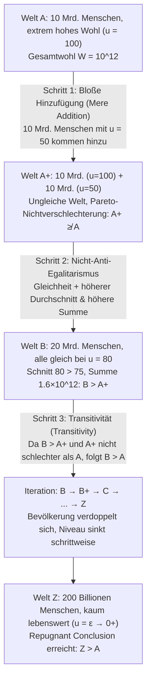

## Einleitung: Wenn die „Bevölkerungsgröße $N$“ selbst zur moralischen Variable wird

In den meisten klassischen Debatten der normativen Ethik und der Wohlfahrtsökonomik bewegen wir uns stillschweigend in einem Rahmen <strong>fixer Bevölkerungsgrößen (Fixed-Population)</strong>: Es existiert bereits eine feststehende Anzahl von $N$ Individuen, und die Aufgabe der Moralphilosophie besteht darin, Güter gerecht unter diesen $N$ Personen zu verteilen oder ihr Gesamtwohlbefinden zu maximieren. Sobald wir unseren Blick jedoch auf die Klimapolitik, die Erschöpfung globaler Ressourcen, Fortpflanzungsethik oder den <strong>Longtermismus (Longtermism)</strong> und existenzielle Risiken (Existential Risks) richten, bricht diese Grundannahme in sich zusammen: Unsere heutigen Entscheidungen bestimmen nicht nur, <em>wie gut</em> zukünftige Menschen leben werden (Lebensqualität $u_i$), sondern auch, <em>wie viele</em> Menschen überhaupt existieren werden (Bevölkerungsgröße $N$) – und sogar, <em>welche spezifischen Individuen</em> geboren werden.

Dies ist das Forschungsfeld der <strong>Populationsethik (Population Ethics)</strong> und der <strong>Axiologie variabler Populationen (Variable-Population Axiology)</strong>. Im Jahr 1984 veröffentlichte der britische Philosoph <strong>Derek Parfit (1942–2017)</strong> sein monumentales Werk <em>Reasons and Persons</em> (Teil IV), das die moderne Ethik in ihren Grundfesten erschütterte. Parfit zeigte, dass der seit Henry Sidgwick als Standard geltende <strong>Totalutilitarismus (Total Utilitarianism)</strong> unweigerlich zu einer moralisch zutiefst verstörenden Konsequenz führt, die er als <strong>„die abstoßende Schlussfolgerung“ (The Repugnant Conclusion)</strong> bezeichnete. Noch dramatischer war die Erkenntnis der darauffolgenden Jahrzehnte: Jeder Versuch, den Totalutilitarismus abzuwandeln, um dieser Schlussfolgerung zu entgehen, stürzt uns in andere, oft noch weitaus schlimmere ethische Paradoxien.

---

## Kapitel 1: Von fixen zu variablen Populationen: Henry Sidgwicks Scheideweg

### 1.1 Formale Definition sozialer Wohlfahrtsfunktionen

Sei $X$ eine mögliche Welt (oder Population) mit $N(X) \in \mathbb{N}^+$ Individuen und dem Vektor lebenslanger Nettowohlfahrtswerte $X = (u_1, u_2, \dots, u_N) \in \mathbb{R}^N$. In der Populationsethik definieren wir eine fundamentale Referenzlinie – das <strong>neutrale Wohlfahrtsniveau (Neutral Level)</strong> $u = 0$:
* Gilt $u_i > 0$, so ist das Leben von Individuum $i$ insgesamt <strong>lebenswert (A life worth living)</strong>;
* Gilt $u_i = 0$, befindet sich das Leben auf einem exakt neutralen Punkt (axiologisch äquivalent zur Nichtexistenz);
* Gilt $u_i < 0$, ist das Leben von schwerem Leid geprägt und insgesamt <strong>nicht lebenswert (A life not worth living)</strong>.

Solange zwei Welten dieselbe Bevölkerungsgröße aufweisen ($N(X) = N(Y) = N$), liefern der <strong>Totalutilitarismus (Total Utilitarianism)</strong> und der <strong>Durchschnittsutilitarismus (Average Utilitarianism)</strong> exakt dieselbe Rangordnung:

$$W_{\text{total}}(X) = \sum_{i=1}^{N} u_i = N \cdot \bar{u}, \qquad W_{\text{avg}}(X) = \frac{1}{N} \sum_{i=1}^{N} u_i = \bar{u}$$

### 1.2 Henry Sidgwicks Entscheidung

Sobald $N$ jedoch variabel wird, trennen sich die Wege radikal. Während Ökonomen wie John Stuart Mill oder Knut Wicksell das Pro-Kopf-Wohlbefinden $\bar{u}$ betonten, stellte der klassische Utilitarist <strong>Henry Sidgwick</strong> in <em>The Methods of Ethics</em> (1874) klar: Wenn das höchste Gut des Utilitarismus der Nettoüberschuss von Lust über Unlust im gesamten Universum ist, dann müssen wir nicht nur das durchschnittliche Glück bestehender Menschen steigern, sondern – solange das Leben positiv bleibt – auch die Anzahl glücklicher Wesen maximieren. Sidgwick entschied sich explizit für das Produkt $W_{\text{total}}(X) = N \cdot \bar{u}$ – und legte damit die Lunte für Parfits Paradoxon.

---

## Kapitel 2: Derek Parfit und die „abstoßende Schlussfolgerung“ (The Repugnant Conclusion)

### 2.1 Welt $A$ vs. Welt $Z$: Mozart und Philosophie gegen Muzak und Kartoffeln

In Kapitel 17 (§ 142) von <em>Reasons and Persons</em> entwirft Parfit ein berühmtes Gedankenexperiment. Vergleichen wir zwei intern vollkommen egalitäre Welten unterschiedlicher Bevölkerungsgröße:

* <strong>Welt $A$ (Hochwohlfahrts-Welt)</strong>: Es existieren $N_A = 10\text{ Milliarden} = 10^{10}$ Menschen. Jede Person genießt eine herausragend hohe Lebensqualität ($u_A = 100$) – völlige Gesundheit, tiefe zwischenmenschliche Beziehungen, kreative Entfaltung sowie das, was Parfit <strong>„Mozart und Philosophie (Mozart and philosophy)“</strong> nennt. Die Gesamtwohlfahrt von Welt $A$ beträgt:
  $$W_{\text{total}}(A) = N_A \cdot u_A = 10^{10} \times 100 = 10^{12}$$
* <strong>Welt $Z$ (Extrem überbevölkerte Grenz-Existenz-Welt)</strong>: Es existiert eine gigantische Population von $N_Z = 200\text{ Billionen} = 2 \times 10^{14}$ Menschen. Das Leben jedes Einzelnen liegt nur einen winzigen Bruchteil über dem neutralen Nullpunkt ($u_Z = \varepsilon = 0.01 > 0$). Ihr Dasein ist eintönig und karg; es gibt weder hohe Kunst noch intellektuelle Tiefe, sondern lediglich das, was Parfit pointiert <strong>„Muzak (Kaufhausmusik) und Kartoffeln (Muzak and potatoes)“</strong> nennt. Da $N_Z$ jedoch gewaltig ist, erreicht die Gesamtsumme des Wohlbefindens in Welt $Z$:
  $$W_{\text{total}}(Z) = N_Z \cdot u_Z = (2 \times 10^{14}) \times 0.01 = 2 \times 10^{12}$$

Da $W_{\text{total}}(Z) = 2 \times 10^{12} > 10^{12} = W_{\text{total}}(A)$ gilt, muss der Totalutilitarismus urteilen, dass <strong>Welt $Z$ moralisch strikt besser ist als Welt $A$ ($Z \succ A$)</strong>. Parfit nannte dies <strong>„die abstoßende Schlussfolgerung“ (The Repugnant Conclusion)</strong>:

> <strong>Definition der Repugnant Conclusion</strong>: Für jede mögliche Population von mindestens zehn Milliarden Menschen mit einer sehr hohen Lebensqualität gibt es eine andere mögliche, sehr viel größere Population, deren Existenz unter sonst gleichen Umständen besser wäre, obwohl ihre Mitglieder jeweils ein Leben führen, das kaum lebenswert ist ($u_i = \varepsilon \to 0^+$).

### 2.2 Warum wirkt diese Schlussfolgerung so abstoßend?

Die Schlussfolgerung widerspricht unserer tiefen Intuition, weil sie besagt, dass <strong>bloße Quantität (Quantity) jede noch so hohe Qualität (Quality) restlos substituieren kann</strong>. Die höchsten Errungenschaften menschlicher Kultur, Liebe und Erkenntnis werden in der totalutilitaristischen Bilanz durch eine schier endlose Masse monotoner Grenzexistenzen übertrumpft.

---

## Kapitel 3: Das Paradoxon der bloßen Hinzufügung (The Mere Addition Paradox)

Können wir der abstoßenden Schlussfolgerung einfach dadurch entgehen, dass wir den Totalutilitarismus verwerfen? Parfit konstruierte das noch schärfere <strong>Paradoxon der bloßen Hinzufügung (The Mere Addition Paradox)</strong>, um zu beweisen, dass uns drei völlig harmlos wirkende, vom Totalutilitarismus unabhängige Intuitionen über eine schiefe Ebene direkt nach Welt $Z$ treiben.

Betrachten wir die drei Schritte im Detail:

1. <strong>Von Welt $A$ zu Welt $A^+$ (Prinzip der bloßen Hinzufügung / Mere Addition Principle)</strong>:
   Zu den 10 Milliarden Menschen in Welt $A$ ($u=100$) fügen wir auf einem getrennten Kontinent – ohne das Leben der ursprünglichen Gruppe im Geringsten zu beeinträchtigen – weitere 10 Milliarden Menschen hinzu, die ein gutes, klar lebenswertes Leben auf dem Niveau $u=50$ führen. Dies ergibt Welt $A^+$.
   Nach dem <strong>Mere Addition Principle</strong> macht die bloße Hinzufügung glücklicher Menschen ($u > 0$), die niemandem schadet, eine Welt <strong>nicht schlechter</strong>. Also ist $A^+$ mindestens <strong>nicht schlechter als $A$</strong> ($A^+ \not\prec A$).
2. <strong>Von Welt $A^+$ zu Welt $B$ (Nicht-Anti-Egalitarismus / Egalitäre Dominanz)</strong>:
   Welt $A^+$ ist durch soziale Ungleichheit zwischen der Gruppe mit $u=100$ und jener mit $u=50$ geprägt (Durchschnitt: $75$, Summe: $1{,}5 \times 10^{12}$). In <strong>Welt $B$</strong> leben genau dieselben 20 Milliarden Menschen, aber alle genießen gleichermaßen ein Wohlfahrtsniveau von $u = 80$ (Durchschnitt: $80$, Summe: $1{,}6 \times 10^{12}$).
   Da Welt $B$ sowohl eine höhere Gesamtwohlfahrt als auch einen höheren Durchschnitt <em>und</em> vollkommene Gleichheit aufweist, gilt zwingend: <strong>Welt $B$ ist strikt besser als Welt $A^+$ ($B \succ A^+$)</strong>.
3. <strong>Transitivität (Transitivity) und Iteration</strong>:
   Wenn $B$ besser ist als $A^+$ und $A^+$ nicht schlechter als $A$, verlangt die <strong>Transitivität</strong> der Relation „besser als“, dass <strong>Welt $B$ (20 Mrd., $u=80$) besser ist als Welt $A$ (10 Mrd., $u=100$)</strong>! Wiederholt man dieses Argument ($B \to B^+ \to C \to \dots \to Z$), landet man unweigerlich bei $Z \succ A$.

---

## Kapitel 4: Gescheiterte Fluchtversuche: Von der Sadistic Conclusion zum Nicht-Identitätsproblem

Alle Versuche, alternative Wohlfahrtsfunktionen zu konstruieren, um die Repugnant Conclusion zu vermeiden, führen in gravierende Gegenparadoxien:

| Axiologisches Modell | Mathematische Wohlfahrtsfunktion $W(X)$ | Vermeidet Repugnant Conclusion? | Fataler theoretischer Preis & Gegenparadoxon |
| :--- | :--- | :--- | :--- |
| <strong>Totalutilitarismus</strong> | $W_{\text{total}} = \sum_{i=1}^{N} u_i = N \cdot \bar{u}$ | <strong>Nein</strong> (impliziert $Z \succ A$) | Quantität ersetzt Qualität unbegrenzt („Muzak & Kartoffeln“) |
| <strong>Durchschnittsutilitarismus</strong> | $W_{\text{avg}} = \frac{1}{N} \sum_{i=1}^{N} u_i = \bar{u}$ | <strong>Ja</strong> ($\bar{u}_A = 100 > \varepsilon = \bar{u}_Z$) | „Hinzufügung zur Hölle“ & <strong>Sadistic Conclusion</strong> |
| <strong>Variable Value View (Hurka / Ng)</strong> | $W_{\text{var}} = f(N) \cdot \bar{u}, \ \lim_{N \to \infty} f(N) = M$ | <strong>Ja</strong> (asymptotische Obergrenze $M$) | Verletzt Mere Addition bei großem $N$, impliziert Sadistic Conclusion |
| <strong>Critical-Level Utilitarianism (CLU)</strong> | $W_{\text{CL}} = \sum_{i=1}^{N} (u_i - \alpha) \ (\alpha > 0)$ | <strong>Ja</strong> (negativer Beitrag für $\varepsilon < \alpha$) | <strong>Very Sadistic Conclusion</strong>: Folter-Hölle gilt als besser als Welt $Z$ |
| <strong>Person-Affecting View (Narveson)</strong> | Bewertet nur Folgen für konkret existierende Personen | <strong>Bedingt</strong> | Scheitert an <strong>Asymmetrie</strong> (McMahan) & <strong>Nicht-Identitätsproblem</strong> |

### 4.1 Durchschnittsutilitarismus und die „sadistische Schlussfolgerung“ (The Sadistic Conclusion)

Der <strong>Durchschnittsutilitarismus</strong> ($W_{\text{avg}} = \bar{u}$) vermeidet zwar $Z \succ A$, erzeugt aber absurde Konsequenzen:
* <strong>Hinzufügung zur Hölle (Addition to Hell)</strong>: Besteht eine Welt aus 100 gequälten Menschen mit $u = -100$, so hebt die Geburt einer weiteren schwer leidenden Person mit $u = -90$ den Durchschnitt auf $-99{,}91$ an – das Schaffen eines qualvollen Lebens wäre demnach moralisch geboten!
* <strong>Die sadistische Schlussfolgerung (The Sadistic Conclusion)</strong>: Wie der schwedische Philosoph <strong>Gustaf Arrhenius</strong> zeigte, zieht der Durchschnittsutilitarismus es bei einer bestehenden sehr glücklichen Bevölkerung oft vor, <strong>eine kleine Anzahl grausam gefolterter Menschen ($u < 0$) hinzuzufügen, statt einer großen Anzahl durchaus glücklicher Menschen ($u > 0$, aber unter dem bisherigen Schnitt)</strong>, weil wenige Gefolterte den Gesamtdurchschnitt weniger stark senken als viele mäßig Glückliche!

### 4.2 Variable Value Views und Critical-Level Utilitarianism (CLU)

1. <strong>Variable Value Views (Thomas Hurka, Yew-Kwang Ng)</strong>: Dämpfen den Faktor $N$ durch eine streng konkave Funktion $f(N)$ mit asymptotischer Obergrenze $\lim_{N \to \infty} f(N) = M < \infty$.
2. <strong>Critical-Level Utilitarianism (Blackorby, Bossert und Donaldson)</strong>: Setzt eine positive kritische Schwelle $\alpha > 0$ (z. B. $\alpha = 10$) an:
   $$W_{\text{CL}}(X) = \sum_{i=1}^{N} (u_i - \alpha) = N \cdot (\bar{u} - \alpha) \quad (\alpha > 0)$$
   Jedes Leben mit $0 < u_i < \alpha$ wird hier als <em>negativer</em> Beitrag zur Weltwertung gezählt.

<strong>Der Preis – Die extrem sadistische Schlussfolgerung (The Very Sadistic Conclusion)</strong>: Für eine hinreichend große Welt $Z$ mit $0 < \varepsilon < \alpha$ strebt $W_{\text{CL}}(Z) = N_Z(\varepsilon - \alpha)$ gegen $-\infty$. Folglich bewertet der Critical-Level-Utilitarismus eine kleine Hölle aus tausend permanent gefolterten Menschen ($u = -1000$) als <strong>moralisch besser</strong> als eine friedliche Welt $Z$, in der Billionen Menschen ein positiv lebenswertes Leben führen!

### 4.3 Person-Affecting Views, Asymmetrie und das Nicht-Identitätsproblem

<strong>Jan Narveson</strong> prägte 1967 das Motto der <strong>personenbezogenen Ethik (Person-Affecting View)</strong>: <strong>„Wir sind dafür, Menschen glücklich zu machen, nicht dafür, glückliche Menschen zu machen (We are in favor of making people happy, not of making happy people).“</strong>

Doch dieser Ansatz scheitert an zwei fundamentalen Hürden:
1. <strong>Jeff McMahans prokreative Asymmetrie (The Asymmetry, 1981)</strong>: Es besteht eine starke moralische Pflicht, kein Kind zu zeugen, dessen Leben voller Qualen wäre ($u < 0$), aber keine Pflicht, ein Kind zu zeugen, weil es glücklich wäre ($u > 0$).
2. <strong>Parfits Nicht-Identitätsproblem (The Non-Identity Problem)</strong>: Wählt die Menschheit heute eine rücksichtslose <strong>Raubbaupolitik (Depletion)</strong> statt einer <strong>Nachhaltigkeitspolitik (Conservation)</strong>, verändert dies über 300 Jahre hinweg sämtliche Alltagsabläufe, Partnerschaften und Zeugungszeitpunkte. Folglich sind die Menschen, die in 300 Jahren unter der Raubbaupolitik in einer verschmutzten Welt ($u = 20 > 0$) leben, <strong>genetisch und numerisch völlig andere Individuen</strong> als jene, die unter der Nachhaltigkeitspolitik ($u = 100$) geboren worden wären ($\text{Pop}_{\text{deplete}} \cap \text{Pop}_{\text{conserve}} = \emptyset$). Da die Menschen der Raubbau-Welt ohne diese Politik niemals existiert hätten und ihr Leben immer noch lebenswert ist ($u = 20 > 0$), hat die Raubbaupolitik <strong>keiner einzigen konkreten Person geschadet</strong>! Um Klimaschutz und Generationengerechtigkeit begründen zu können, sind wir auf unpersönliche (Impersonal) Wertprinzipien angewiesen – womit das Problem der Repugnant Conclusion unausweichlich zurückkehrt.

---

## Kapitel 5: Arrhenius’ Unmöglichkeitstheorem und der Paradigmenwechsel im Longtermismus

### 5.1 Das Unmöglichkeitstheorem der Populationsethik (Gustaf Arrhenius)

In Anlehnung an Kenneth Arrows Unmöglichkeitstheorem der Sozialwahltheorie bewies <strong>Gustaf Arrhenius</strong> mathematisch, dass <strong>keine transitive Wertrelation $\succeq$ existieren kann, die gleichzeitig folgende vier Grundaxiome erfüllt</strong>:
1. <strong>Egalitäre Dominanz (Egalitarian Dominance)</strong>: Bei gleicher Bevölkerungsgröße ist eine Welt mit höherer Gesamtwohlfahrt und perfekter Gleichheit strikt besser.
2. <strong>Qualitätsbedingung (Avoidance of the Repugnant Conclusion)</strong>: Eine Hochwohlfahrtswelt $A$ ist besser als eine Grenzexistenzwelt $Z$.
3. <strong>Quantitätsbedingung (Mere Addition)</strong>: Das Hinzufügen lebenswerter Existenzen verschlechtert die Welt nicht.
4. <strong>Nicht-Sadismus (Non-Sadism)</strong>: Das Hinzufügen gequälter Leben ($u < 0$) ist niemals besser als das Hinzufügen glücklicher Leben ($u > 0$).

### 5.2 Die gemeinsame Erklärung von 2021 und der moderne Longtermismus

Im Jahr 2021 veröffentlichten 29 führende Philosophinnen, Philosophen und Ökonomen – darunter Peter Singer, Hilary Greaves, Toby Ord, William MacAskill und Yew-Kwang Ng – im <em>Journal of Political Philosophy</em> das Manifest <em>Overcoming the Repugnant Conclusion</em>. Sie argumentierten, dass die jahrzehntelange Fixierung darauf, die Repugnant Conclusion um jeden Preis zu vermeiden, die Ethik in weitaus schlimmere Sackgassen (wie die Sadistic Conclusion) geführt hat. Unsere intuitive Abneigung gegen Welt $Z$ beruht maßgeblich auf <strong>Scope Insensitivity</strong> (der Unfähigkeit des menschlichen Gehirns, sich gigantische Zahlen wie $2 \times 10^{14}$ vorzustellen) sowie auf der Fehlvorstellung, ein Leben mit $u = \varepsilon > 0$ sei voller Leid. Für den modernen <strong>Longtermismus</strong> bedeutet dies: Durch die Verhinderung existenzieller Katastrophen und nachhaltigen Fortschritt können und sollten wir eine Zukunft anstreben, die <strong>sowohl eine große Anzahl zukünftiger Generationen (großes $N$) als auch höchste Lebensqualität (hohes $\bar{u}$)</strong> vereint.
