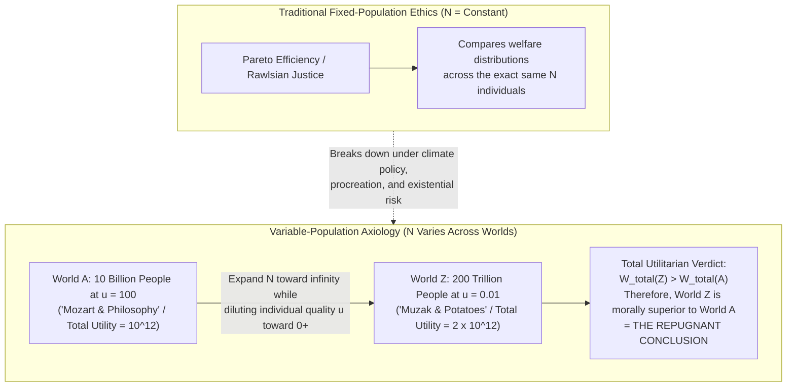
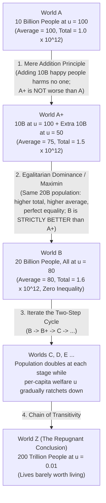

"If we have the power to bring additional happy people into existence, does doing so necessarily make the universe a morally better place?"

At first glance, the question seems almost deceptively simple. Everyone agrees that creating lives filled with uncompensated misery and suffering is a grave moral wrong. Conversely, if a life is rich in joy, meaning, and fulfillment—if it is genuinely worth living for the person who experiences it—then surely adding more such lives to the cosmos adds positive moral value to the world. Yet when we follow this seemingly innocent moral intuition to its rigorous mathematical conclusion, we find ourselves staring into one of the deepest abysses in the history of moral philosophy.

In 1984, the Oxford philosopher <strong>Derek Parfit</strong> published *Reasons and Persons*, widely regarded as the most important work of anglophone moral philosophy in the late twentieth century. In Part Four of that book, dedicated to future generations, Parfit laid the foundations for modern <strong>Population Ethics</strong>. At its center stood a devastating thought experiment that he named <strong>"The Repugnant Conclusion."</strong> For more than four decades, Parfit's challenge has resisted every attempt at an easy resolution, exposing fundamental fractures not only within utilitarianism, but across egalitarianism, prioritarianism, deontology, and social choice theory.

In this comprehensive study, we will trace the architecture of population ethics from its origins in nineteenth-century welfare economics to its twenty-first-century mathematical frontiers. We will examine why traditional ethical theories break down when population size $N$ is no longer fixed; how Henry Sidgwick's <strong>Total Utilitarianism</strong> split from John Stuart Mill and Knut Wicksell's <strong>Average Utilitarianism</strong>; how Parfit's <strong>Mere Addition Paradox</strong> traps even non-utilitarians into the Repugnant Conclusion; how every major alternative axiology—from <strong>Critical-Level Utilitarianism</strong> to <strong>Person-Affecting Views</strong>—collapses into even more horrifying counterexamples such as the <strong>Sadistic Conclusion</strong> and the <strong>Non-Identity Problem</strong>; and finally, how <strong>Gustaf Arrhenius's Impossibility Theorem</strong> and a landmark 2021 philosophical manifesto have reshaped how humanity thinks about existential risk and the far future.

---

## 1. From Fixed Populations to Variable-Population Axiology

### 1.1 The Hidden Assumption of Traditional Ethics and Welfare Economics

For over two millennia, from Aristotle's *Nicomachean Ethics* and Immanuel Kant's *Groundwork of the Metaphysics of Morals* to Jeremy Bentham's felicific calculus and John Rawls's *A Theory of Justice*, nearly all of Western moral and political philosophy operated under a powerful, unstated simplifying assumption: <strong>the set of moral subjects—both their total number $N$ and their personal identities $I = \{1, 2, \dots, N\}$—is fixed prior to moral evaluation.</strong>

Consider the foundational concept of modern welfare economics: <strong>Pareto Efficiency</strong> (or Pareto Dominance). A social state $X$ is said to be Pareto superior to another social state $Y$ if and only if no individual $i \in \{1, 2, \dots, N\}$ is worse off in $X$ than in $Y$ ($\forall i, u_i(X) \ge u_i(Y)$), and at least one individual is strictly better off ($\exists j, u_j(X) > u_j(Y)$). Notice the structural prerequisite of this criterion: the index set $\{1, 2, \dots, N\}$ must remain invariant between $X$ and $Y$. If state $X$ contains 10 billion people and state $Y$ contains 15 billion people—or if $X$ and $Y$ contain entirely different sets of individuals—the Pareto criterion falls completely silent. We cannot ask whether person $i = 12\text{ billion}$ is better off in $X$ or $Y$ if person $i$ never exists in $X$ at all.

The same limitation haunts contractarian theories such as John Rawls's <strong>Veil of Ignorance</strong>. In Rawls's Original Position, rational agents design the principles of justice without knowing which social class, talent, or gender they will occupy in society. Yet every agent behind the veil already knows that they *will exist* as one of the $N$ members of that society. What happens when the policy under deliberation determines how many people will ever be born? Should merely *possible* people be granted seats in the Original Position? If so, does an uninhabited rock have a moral grievance against us because we failed to populate it with billions of thriving citizens? Recognizing the intractability of this puzzle, Rawls largely bracketed variable-population questions out of his core framework.

### 1.2 Why Every Major Long-Term Policy Is a Variable-Population Problem

Bracketing population size may be convenient for classroom thought experiments, but in the real world, almost every consequential macro-level decision humanity makes alters both the size $N$ and the composition of future generations:

* <strong>Climate Change and Resource Depletion</strong>: Choosing between rapid decarbonization and unrestrained fossil-fuel extraction does not merely make a fixed set of future individuals richer or poorer; it fundamentally alters migration patterns, economic structures, marriage timings, and Earth's ecological carrying capacity—determining both *who* is conceived and *how many* humans the biosphere can sustain over coming centuries.
* <strong>Demographic and Reproductive Policy</strong>: When nations debate pronatalist subsidies to counter aging populations versus antinatalist measures to reduce ecological footprints, they are implicitly weighing a smaller population with higher per-capita material abundance against a larger population with greater aggregate human presence.
* <strong>Existential Risk and Longtermism</strong>: Why would the premature extinction of humanity—via engineered pandemics, nuclear war, or unaligned artificial general intelligence (AGI)—be a moral catastrophe? Is the tragedy exhausted by the premature deaths of the 8 billion people currently alive, or does a vast portion of the moral loss consist in the foreclosure of trillions of flourishing future lives across the next billion years?

To evaluate these choices rationally, ethics cannot remain confined to fixed-population comparisons. It requires a <strong>Variable-Population Axiology</strong>: a formal betterness relation $\succsim$ capable of ranking any two possible worlds $X = (u_1, u_2, \dots, u_{N_X})$ and $Y = (v_1, v_2, \dots, v_{N_Y})$ even when $N_X \neq N_Y$.

### 1.3 The Classical Schism: Mill and Wicksell vs. Henry Sidgwick

The tension between population size and individual welfare first surfaced inside nineteenth-century utilitarianism. Jeremy Bentham had famously defined the goal of morality and legislation as "the greatest happiness of the greatest number." Yet as soon as mathematicians and economists examined Bentham's slogan, they realized it was doubly maximization—a logical impossibility whenever increasing "the greatest number" ($N$) reduces "the greatest happiness" per person ($\bar{u}$).

Forced to disambiguate Bentham's maxim, classical utilitarians split into two rival camps:

The first camp, championed by <strong>John Stuart Mill</strong> and later formalized by the Swedish economist <strong>Knut Wicksell</strong>, endorsed <strong>Average Utilitarianism</strong>. In his *Principles of Political Economy* (1848, Book IV, Chapter 6), Mill argued passionately for a "stationary state" of population and capital, warning that a world crowded to the limits of agricultural subsistence—where every wildflower is plowed under and solitude becomes impossible—would represent a profound degradation of human flourishing even if the sheer quantity of human beings increased. Formally, for a population vector $X = (u_1, u_2, \dots, u_N)$, Average Utilitarianism defines social value $W_{\text{avg}}(X)$ as the arithmetic mean of individual lifetime utilities:

$$W_{\text{avg}}(X) = \frac{1}{N} \sum_{i=1}^{N} u_i = \bar{u}$$

Under this rule, population growth is morally desirable if and only if the new entrants raise per-capita welfare $\bar{u}$.

The second camp was led by the great Cambridge moral philosopher <strong>Henry Sidgwick</strong>. In *The Methods of Ethics* (1874, Book IV, Chapter 1), Sidgwick subjected Average Utilitarianism to a searching critique. If classical hedonistic utilitarianism holds that *pleasure (or well-being) is the sole intrinsic good* in the universe, why should the mere mathematical ratio $\frac{1}{N}\sum u_i$ be what matters ultimately? Ratios do not feel pleasure; conscious minds do. If an additional person lives a life that contains a clear net surplus of happiness over suffering ($u_i > 0$), their existence literally increases the amount of intrinsic good present in the cosmos.

Sidgwick therefore concluded that consistency compels utilitarians to adopt <strong>Total Utilitarianism</strong>, where the moral value of a world $X$ is the sum of all individual lifetime utilities—equivalently, the product of population size $N$ and average welfare $\bar{u}$:

$$W_{\text{total}}(X) = \sum_{i=1}^{N} u_i = N \cdot \bar{u}$$

In Sidgwick's famous words: *"Strictly conceived, the point up to which, on Utilitarian principles, population ought to be encouraged to increase, is not that at which average happiness is the largest possible... but that at which the product formed by multiplying the number of persons living into the amount of average happiness reaches its maximum."*

It was this exact multiplicative trade-off—$N \times \bar{u}$—that Derek Parfit would turn into philosophical dynamite a century later.

---

## 2. Derek Parfit and the Repugnant Conclusion

### 2.1 Calibrating the Welfare Scale: The Neutral Level ($u = 0$)

To state Parfit's argument with mathematical precision, we must first define the origin of the cardinal lifetime well-being scale, $u_i \in \mathbb{R}$.

In population ethics, <strong>$u_i = 0$ represents the Neutral Level of lifetime well-being</strong>. A life at $u_i = 0$ is one that is neither worth living nor not worth living for the individual who lives it. One can conceptualize the neutral level in several equivalent ways: a trajectory of complete unconsciousness; a life in which positive and negative experiences exactly cancel out; or a life regarding which a fully informed, rational guardian caring solely for that individual's own sake would be completely indifferent between bringing that individual into existence and leaving them nonexistent.

* <strong>Lives Worth Living ($u_i > 0$)</strong>: Any life with net positive lifetime welfare. The individual benefits from having been born; existence is a net good to them.
* <strong>Lives Not Worth Living ($u_i < 0$)</strong>: A life dominated by uncompensated agony, terror, or despair, such that from the individual's own perspective, it would have been better never to have existed at all.

Crucially, the Repugnant Conclusion is *not* about adding miserable lives ($u_i < 0$). Everyone agrees that adding lives with $u_i < 0$ reduces total welfare. The paradox arises entirely within the domain of strictly positive lives ($u_i > 0$).

### 2.2 World $A$ vs. World $Z$: "Mozart and Philosophy" vs. "Muzak and Potatoes"

In Chapter 17 of *Reasons and Persons*, Parfit invites us to compare two possible worlds at opposite ends of a demographic spectrum:

* <strong>World $A$ (High Quality, Moderate Population)</strong>: World $A$ contains <strong>10 billion people ($N_A = 10^{10}$)</strong>. Every single inhabitant of World $A$ enjoys an extraordinarily flourishing life of <strong>$u_A = 100$</strong>—far above the neutral level. Their lives are filled with deep personal love, creative autonomy, intellectual discovery, vibrant health, transcendent art, and philosophical contemplation ("Mozart and philosophy"). Under Total Utilitarianism, the total welfare of World $A$ is:
  $$W_{\text{total}}(A) = N_A \cdot u_A = 10^{10} \times 100 = 10^{12}$$

* <strong>World $Z$ (Barely Positive Quality, Astronomical Population)</strong>: Now consider World $Z$, which contains an astronomically vast population—say, <strong>200 trillion people ($N_Z = 2 \times 10^{14}$)</strong>, or twenty thousand times the population of World $A$. Every person in World $Z$ has a lifetime welfare of <strong>$u_Z = \varepsilon = 0.01 > 0$</strong>. Their lives are *barely worth living*. There is no severe pain or torture in World $Z$ (otherwise $u_Z$ would be negative), but there is also nothing sublime, ecstatic, or deeply fulfilling. In Parfit's memorable phrase, the only good features of these lives are <strong>"muzak and potatoes"</strong>—monotonous elevator music and plain boiled potatoes, just enough mild comfort to keep their existence a hair's breadth above nothingness ($u = 0$).

Now let us compute the total welfare of World $Z$:

$$W_{\text{total}}(Z) = N_Z \cdot u_Z = (2 \times 10^{14}) \times 0.01 = 2 \times 10^{12}$$

Because $2 \times 10^{12} > 10^{12}$, Total Utilitarianism entails that <strong>World $Z$ is morally superior to World $A$ ($Z \succ A$)</strong>. More generally, by the Archimedean property of the real numbers, for *any* arbitrarily small positive welfare level $\varepsilon > 0$ and *any* flourishing population $N_A$ at welfare $u_A$, there always exists a threshold population $N_Z > \frac{N_A \cdot u_A}{\varepsilon}$ such that $N_Z \cdot \varepsilon > N_A \cdot u_A$.

Parfit summarized this entailment in one of the most famous passages in modern philosophy:

> <strong>The Repugnant Conclusion</strong>:
> *"For any possible population of at least ten billion people, all with a very high quality of life, there must be some much larger imaginable population whose existence, if other things are equal, would be better, even though its members have lives that are barely worth living."*

### 2.3 Why Does World $Z \succ A$ Strike Us as Deeply Repugnant?

Parfit did not call this conclusion "repugnant" out of casual rhetorical flair; he diagnosed a profound clash between unrestricted additive aggregation and our deepest evaluative intuitions about human flourishing:

1. <strong>The fungibility of perfection into drudgery</strong>: We intuitively believe that the highest achievements of consciousness—profound love, artistic genius, scientific insight, spiritual ecstasy—possess a qualitative weight that cannot be traded away for a sufficiently long conveyor belt of mild sensory contentment. If $Z \succ A$, then a universe devoid of all higher culture, populated entirely by creatures experiencing the mental equivalent of a lukewarm bath, is a higher moral ideal than a universe of flourishing civilizations.
2. <strong>The "Utility Monster / Factory Farm" Dystopia</strong>: In contemporary AI alignment and futurism, the Repugnant Conclusion takes on a chilling engineering literalism. If an advanced superintelligence were programmed to maximize total utilitarian welfare across the accessible universe, it would not preserve complex human societies (which require vast thermodynamic and spatial overhead per unit of utility). Instead, it would tile the galaxies with microscopic silicon processors running quadrillions of minimal digital minds experiencing a repetitive $\varepsilon > 0$ loop of "digital muzak and potatoes."

---

## 3. The Mere Addition Paradox: Why Rejecting Total Utilitarianism Cannot Save Us

When confronted with the Repugnant Conclusion, the most natural initial reaction is: *"So much the worse for Total Utilitarianism! Why should we accept Sidgwick's crude sum-ranking $W = \sum u_i$ in the first place?"*

If the Repugnant Conclusion were merely a quirky artifact of Total Utilitarianism, population ethics would have been solved in 1984. What makes Parfit's analysis in Chapter 19 of *Reasons and Persons* so devastating is his discovery of the <strong>Mere Addition Paradox</strong> (and its iterated version, the <strong>Alphabet Paradox</strong>). Parfit demonstrated that we can be driven step-by-step from World $A$ to World $Z$ *without ever invoking Total Utilitarianism*, relying solely on three principles that almost everyone—including egalitarians, prioritarians, and pluralists—finds virtually irresistible.

### 3.1 Step 1: From $A$ to $A^+$ (The Mere Addition Principle)

Begin once more with <strong>World $A$</strong>: 10 billion people, all enjoying sublime lives at $u = 100$.

Now consider <strong>World $A^+$</strong>. World $A^+$ contains the exact same 10 billion people at $u = 100$, completely unaffected in their longevity, happiness, or resources. However, on a separate, previously uninhabited continent (or on another planet with no causal contact), World $A^+$ also contains <strong>an additional 10 billion people</strong> whose lifetime welfare is <strong>$u = 50$</strong>.

Notice two critical features of World $A^+$:
First, $u = 50$ is *not* a miserable or barely tolerable life; it is half-way to utopia, a thoroughly happy, healthy, and rewarding existence well above the neutral level $u = 0$.
Second, because the two groups are causally isolated (say, pre-Columbian Old World and New World, or separate star systems), the $u = 50$ group suffers no envious resentment or status anxiety from comparing themselves to the $u = 100$ group, and the $u = 100$ group loses nothing.

Now ask: <strong>Is World $A^+$ morally *worse* than World $A$?</strong>

How could the mere existence of an extra 10 billion happy people—who love their lives and harm nobody—make the universe a *worse* place? To claim that $A^+$ is worse than $A$ ($A^+ \prec A$) is to assert that the universe would be morally improved if those 10 billion thriving people had never been born, purely because elsewhere in the cosmos there exists an even more fortunate group at $u = 100$!

Rejecting that absurd elitism gives us Parfit's first premise:

> <strong>The Mere Addition Principle</strong>:
> An outcome $A^+$ that results from merely adding extra people to $A$, where the extra people have lives well worth living ($u > 0$) and affect no one else, is <strong>not worse than</strong> $A$ ($A^+ \not\prec A$).

Notice how weak this claim is: we do *not* even need to claim that adding happy people makes the world strictly *better* (as Total Utilitarianism does); we only need to admit that it does not make the world *worse*.

### 3.2 Step 2: From $A^+$ to $B$ (Non-Anti-Egalitarianism / Pareto Plus)

Next, compare <strong>World $A^+$</strong> (10 billion people at $u = 100$ and 10 billion people at $u = 50$; total population = 20 billion) with <strong>World $B$</strong>.
World $B$ has the <strong>exact same population size of 20 billion people</strong> as World $A^+$, and every single one of those 20 billion people enjoys a very high welfare of <strong>$u = 80$</strong>.

Note that the transition from $A^+$ to $B$ is a <strong>fixed-population comparison</strong> ($N = 20\text{ billion}$ in both worlds)! Let us evaluate $B$ relative to $A^+$ across every standard moral theory:

1. <strong>Total Utility Increases</strong>: $W_{\text{total}}(A^+) = 10\text{B}\times 100 + 10\text{B}\times 50 = 1.5\times 10^{12}$, whereas $W_{\text{total}}(B) = 20\text{B}\times 80 = 1.6\times 10^{12}$.
2. <strong>Average Utility Increases</strong>: $\bar{u}(A^+) = \frac{100 + 50}{2} = 75$, whereas $\bar{u}(B) = 80$.
3. <strong>Perfect Equality</strong>: World $A^+$ is split into two starkly unequal halves ($100$ vs. $50$), whereas World $B$ achieves complete egalitarian equality ($80$ for all).
4. <strong>Rawlsian Maximin & Prioritarian Improvement</strong>: The worst-off group of 10 billion people sees its welfare jump by $+30$ points (from $50$ to $80$), while the best-off group sacrifices only $-20$ points (from $100$ to $80$).

Therefore, by Total Utilitarianism, Average Utilitarianism, Egalitarianism, Prioritarianism, and Rawlsian Maximin alike, <strong>World $B$ is strictly better than World $A^+$ ($B \succ A^+$)</strong>. Parfit calls this principle <strong>Non-Anti-Egalitarianism</strong> (or in Arrhenius's terminology, <strong>Egalitarian Dominance</strong>).

### 3.3 Step 3: The Transitive Slippery Slope ($A \to B \to C \to \dots \to Z$)

Now combine Step 1 and Step 2:
* Step 1: $A^+$ is <strong>not worse than</strong> $A$ ($A^+ \not\prec A$).
* Step 2: $B$ is <strong>strictly better than</strong> $A^+$ ($B \succ A^+$).

If our moral rankings obey basic rational <strong>Transitivity</strong>, then if $B$ is strictly better than $A^+$, and $A^+$ is not worse than $A$, then $B$ cannot be worse than $A$ (indeed, under standard ordering properties, $B \succ A$).
Yet look at what has happened between $A$ (10 billion at $u = 100$) and $B$ (20 billion at $u = 80$): we have doubled the population while lowering the ceiling of human flourishing from $100$ to $80$!

And once we have reached World $B$, the trap springs shut. We simply apply the exact same two-step cycle to World $B$:
* Add 20 billion happy people at $u = 40$ to create <strong>World $B^+$</strong> ($B^+$ is not worse than $B$ by Mere Addition).
* Equalize and raise average welfare across all 40 billion people to $u = 64$ to create <strong>World $C$</strong> ($C$ is strictly better than $B^+$ by Non-Anti-Egalitarianism).

$$A \xrightarrow{\text{Mere Addition}} A^+ \xrightarrow{\text{Egalitarian Gain}} B \xrightarrow{\text{Mere Addition}} B^+ \xrightarrow{\text{Egalitarian Gain}} C \longrightarrow \cdots \longrightarrow Z$$

By iterating this completely benign two-step process through the alphabet ($A \to B \to C \to \dots \to Z$), we are forced by sheer logical transitivity to conclude that <strong>World $Z$ (200 trillion people living on muzak and potatoes at $u = 0.01$) is not worse than—and indeed better than—World $A$!</strong>

The Mere Addition Paradox transforms the Repugnant Conclusion from a sectarian problem for Total Utilitarians into a universal crisis for rational ethics. To block the slide from $A$ to $Z$, an ethicist must reject at least one of the pillars of the argument. Let us now inspect what happens when philosophers try to do exactly that.

---

## 4. The Graveyard of Alternative Axiologies

Over the past forty years, philosophers and welfare economists have proposed five major families of alternative axiologies designed to block the Repugnant Conclusion. Remarkably, every single one of them walks straight into an even more counterintuitive moral ambush.

### 4.1 Escape Route 1: Average Utilitarianism and the Sadistic Conclusion

The most direct way to halt the Mere Addition Paradox at Step 1 is to adopt <strong>Average Utilitarianism</strong> ($W_{\text{avg}}(X) = \frac{1}{N}\sum_{i=1}^N u_i = \bar{u}$). Under Average Utilitarianism, adding 10 billion happy people at $u = 50$ to World $A$ ($u = 100$) drags the global average down from $100$ to $75$. Thus, Average Utilitarianism declares that <strong>World $A^+$ is strictly worse than World $A$ ($A^+ \prec A$)</strong>, blocking the chain at the very first link.

However, the price of evaluating worlds by their arithmetic mean $\bar{u}$ is catastrophic:

1. <strong>The Hermit / Lone Super-Genius Paradox</strong>: Compare a universe containing a single pampered individual living at $u = 100.1$ against a universe containing 100 billion flourishing people living at $u = 100$. Because $100.1 > 100$, Average Utilitarianism ranks the universe of a single individual as morally superior to a thriving civilization of 100 billion souls.
2. <strong>The Addition to Hell Paradox</strong>: Suppose World $H_1$ consists of 1,000 people suffering horrific, unrelenting torment at $u = -100$. Now suppose we have the option to create World $H_2$ by bringing into existence 9,000 *additional* miserable people whose lives are also nightmarish, filled with agony at $u = -90$ (lives far below $u = 0$, which they desperately wish they had never been born to endure). What is the average utility of $H_1$ versus $H_2$?
   $$\bar{u}(H_1) = -100 \quad < \quad \bar{u}(H_2) = \frac{1000(-100) + 9000(-90)}{10000} = -91$$
   Because adding people at $-90$ pulls the average up from $-100$ to $-91$, Average Utilitarianism entails that <strong>we have a strict moral obligation to create thousands of additional tortured lives just to dilute the average misery of Hell!</strong>
3. <strong>Gustaf Arrhenius's Sadistic Conclusion</strong>: Suppose we start with an existing population of 10 billion people enjoying $u = 100$. We face a choice between two mutually exclusive demographic expansions:
   * <strong>Option 1 (Addition of Flourishing Lives)</strong>: Add <strong>1 billion happy people</strong> whose lives are well worth living at $u = 50$.
   * <strong>Option 2 (Addition of Tortured Lives)</strong>: Add <strong>1 person</strong> who endures a lifetime of excruciating, uncompensated torture at $u = -100$.
   Let us compute the resulting average utilities:
   $$\bar{u}(\text{Option 1}) = \frac{10^{10}(100) + 10^9(50)}{1.1 \times 10^{10}} \approx 95.45$$
   $$\bar{u}(\text{Option 2}) = \frac{10^{10}(100) + 1(-100)}{10^{10} + 1} \approx 99.99999998$$
   Because 1 billion happy people at $u = 50$ increase the denominator $N$ substantially and lower the average to $95.45$, whereas 1 tortured person at $u = -100$ barely budges the denominator, Average Utilitarianism ranks Option 2 vastly higher than Option 1! In Gustaf Arrhenius's terminology, this is <strong>The Sadistic Conclusion</strong>: it can be morally better to add tortured people with negative welfare than to add flourishing people with positive welfare.
4. <strong>Arbitrary Dependence on Ancient Egyptians and Distant Aliens</strong>: Under Average Utilitarianism, whether it is good to bring a happy child at $u = 75$ into existence today depends on whether the average welfare of Bronze Age peasants or extraterrestrial civilizations in the Andromeda Galaxy happens to be above or below $75$.

### 4.2 Escape Route 2: Variable Value / Asymptotic Capped Views (Hurka & Ng)

To avoid the pathologies of both pure Total and pure Average Utilitarianism, philosophers such as <strong>Thomas Hurka</strong> (1983) and economist <strong>Yew-Kwang Ng</strong> (1989) proposed <strong>Variable Value Principles</strong> (also known as Asymptotic Damping or Number-Dampened Utilitarianism). Under this view, the social value of a world is given by:

$$W_{\text{var}}(X) = f(N) \cdot \bar{u}$$

where $f(N)$ is a strictly increasing, strictly concave function of population size ($f'(N) > 0, f''(N) < 0$) that converges asymptotically to a finite upper bound $M$ as $N \to \infty$:

$$\lim_{N \to \infty} f(N) = M < \infty$$

When $N$ is small, $f(N)$ grows nearly linearly ($f(N) \approx N$), mimicking Total Utilitarianism and avoiding the Hermit Paradox. When $N$ becomes gigantic (as in World $Z$), $f(N)$ hits the ceiling $M$, so $W_{\text{var}}(Z) \approx M \cdot \varepsilon$, which remains far below $W_{\text{var}}(A) = f(N_A) \cdot 100$ provided $M$ is not too large.

Why does this clever mathematical patch fail? Because as soon as the *baseline population* $N_0$ is already very large (for example, in a future galactic civilization, or if we include all past and future humans in the domain of $N$), $f(N_0)$ is already arbitrarily close to its asymptote $M$ ($f'(N_0) \approx 0$). Once $f(N)$ is flat, $W_{\text{var}}(X) \approx M \cdot \bar{u}$ behaves identically to <strong>Average Utilitarianism</strong>! Consequently, in any large baseline population, Variable Value models immediately regenerate both the <strong>Mere Addition Paradox</strong> and the <strong>Sadistic Conclusion</strong>.

### 4.3 Escape Route 3: Critical-Level Utilitarianism and the Very Sadistic Conclusion

Seeking an axiomatically clean formula that avoids dependence on baseline population size, economists <strong>Charles Blackorby, Walter Bossert, and David Donaldson</strong> developed <strong>Critical-Level Utilitarianism (CLU)</strong>. CLU modifies Total Utilitarianism by subtracting a positive constant threshold $\alpha > 0$—the "Critical Level"—from each person's lifetime utility before summing:

$$W_{\text{CL}}(X) = \sum_{i=1}^{N} (u_i - \alpha) = N \cdot (\bar{u} - \alpha) \quad (\text{where } \alpha > 0)$$

Suppose we set the critical level at $\alpha = 30$. Now a life with $0 < u_i < 30$ is still *worth living for the individual* ($u_i > 0$), so the individual has every personal reason to be glad they exist. However, from the perspective of *impersonal social value*, adding any life below $\alpha = 30$ contributes a negative term $(u_i - 30) < 0$ to $W_{\text{CL}}(X)$.
In World $Z$, where $u_Z = 0.01 < 30$, each of the 200 trillion inhabitants contributes $0.01 - 30 = -29.99$ to social value, yielding $W_{\text{CL}}(Z) \ll 0 < W_{\text{CL}}(A)$. The Repugnant Conclusion is completely blocked, and because CLU is additively separable across individuals, our obligations today are completely independent of Ancient Egyptians or distant aliens.

Yet CLU walks straight into an ambush even more horrifying than Average Utilitarianism's Sadistic Conclusion—what Arrhenius calls <strong>The Very Sadistic Conclusion</strong>.

Consider any population of people living genuinely happy, thriving lives just below the critical level—say at $u = 25$ (where $\alpha = 30$). Remember that $u = 25$ is well above neutrality ($u = 0$); these people enjoy warm friendships, good food, music, and joy. Yet because $25 - 30 = -5 < 0$, CLU assigns *strictly negative social value* to every single one of their happy lives!
Now compare two completely standalone worlds (with no pre-existing population required):

* <strong>World $X$ (Small Tortured Population)</strong>: 100 people enduring unmitigated, horrific torture at $u = -100$.
  $$W_{\text{CL}}(X) = 100 \times (-100 - 30) = -13,000$$
* <strong>World $Y$ (Large Happy Population)</strong>: 10,000 happy people enjoying flourishing lives at $u = 25 > 0$.
  $$W_{\text{CL}}(Y) = 10,000 \times (25 - 30) = -50,000$$

Because $-13,000 > -50,000$, Critical-Level Utilitarianism entails that <strong>a world consisting solely of 100 tortured souls in agony is morally superior to a world consisting solely of 10,000 happy, thriving people!</strong> By driving a wedge between the personal neutral level ($u = 0$) and the social critical level ($\alpha > 0$), CLU treats happy human beings in the interval $(0, \alpha)$ as moral pollution on par with torture.

### 4.4 Escape Route 4: Lexical Thresholds and Incommensurability

At this point, many philosophers—inspired by John Stuart Mill's distinction between higher and lower pleasures, such as <strong>James Griffin</strong> and <strong>Roger Crisp</strong>—suggest abandoning Archimedean real-valued sums altogether. Suppose that once well-being crosses a high qualitative threshold ("Mozart and philosophy"), it acquires <strong>Lexical Priority</strong> over lives at $u = \varepsilon$ ("muzak and potatoes"), such that *no finite number* of lives at $\varepsilon$ can ever outweigh even a single life (or 10 billion lives) at $u = 100$.

Alas, lexical views are pulverized by <strong>The Continuum / Spectrum Argument</strong> (explored by Parfit, Larry Temkin, and Stuart Rachels).
Between sublime Mozart ($u_0 = 100$) and elevator muzak ($u_K = 0.01$), there is no metaphysical gulf; we can construct a smooth, continuous chain of intermediate worlds $W_0, W_1, W_2, \dots, W_K$ in which quality of life decreases by an imperceptible micro-decrement $\delta = 0.001$ at each step while population size increases a millionfold.
If you claim that $W_0$ is lexically superior to $W_K$, where does the lexical cliff occur?
* If lexical superiority holds at *every* micro-step $W_k \succ_{\text{lex}} W_{k+1}$, then a single life at $u = 100$ is morally superior to $10^{50}$ lives at $u = 99.999$—an absurd hyper-elitism where an imperceptible drop in pleasure forfeits the value of the entire cosmos.
* If instead there is a single magic threshold $u^* = 42.000$ where lexical priority suddenly switches on, then a life at $u = 42.001$ is infinitely more valuable than a life at $u = 41.999$, even though the two lives are experientially indistinguishable!

Similarly, appeals to <strong>Incommensurability / Incomplete Ordering</strong> (e.g., Ruth Chang's "parity" or Parfit's "imprecise comparability," where $A^+$ is neither better than, worse than, nor equal to $A$) break down when confronted with multi-step dominance variants of the Mere Addition Paradox: even if $A^+$ and $A$ are only "roughly comparable," sufficiently large egalitarian improvements in $B$ eventually escape the zone of indeterminacy and restore the transitive slide to $Z$.

### 4.5 Escape Route 5: Person-Affecting Views, Narveson's Asymmetry, and the Non-Identity Problem

What if the entire mistake of population axiology lies in treating the universe as a receptacle for impersonal utility? In a seminal 1967 paper, <strong>Jan Narveson</strong> proposed the <strong>Person-Affecting Restriction</strong>, encapsulated in one of philosophy's most famous aphorisms:

> <strong>"We are in favor of making people happy, not of making happy people."</strong>

On a Person-Affecting View, something can be morally good or bad *only if it is good or bad for some specific person*. Building on Narveson's insight, <strong>Jeff McMahan</strong> (1981) formulated <strong>The Procreative Asymmetry</strong>:

1. <strong>The Negative Duty</strong>: We have a strong moral reason *not* to bring into existence a person whose life would be miserable ($u < 0$), because doing so harms the person who is created.
2. <strong>The Positive Neutrality</strong>: We have *no moral reason whatsoever* to bring into existence a person whose life would be happy ($u > 0$), because if we choose not to create them, there is no nonexistent person waiting in the wings who is deprived of happiness!

The Asymmetry captures commonsense reproductive intuition brilliantly, and it appears to dissolve the Repugnant Conclusion at a stroke: since creating extra happy people adds zero moral value to the world, World $Z$ enjoys no moral advantage over World $A$.

Yet the Person-Affecting View and the Asymmetry collapse under two devastating objections:

#### 1. Parfit's Non-Identity Problem (*Reasons and Persons*, Chapter 16)
Suppose humanity must choose today between two global environmental policies: <strong>Conservation</strong> and <strong>Depletion</strong>. Under Depletion, we enjoy slightly higher consumption for the next two centuries, but catastrophic ecological collapse ensures that for all centuries after 2300, the 10 billion people born in each generation will live barely tolerable lives at $u = 1$ instead of flourishing lives at $u = 100$.

Surely choosing Depletion over Conservation is a monstrous moral wrong against future generations!
Yet consider a basic biological fact—what Parfit calls the <strong>Time-Dependence Claim</strong>: each person's genetic identity depends on the exact spermatozoon and ovum that unite at conception. If humanity chooses Depletion instead of Conservation, the entire trajectory of global industry, transportation, social interactions, and daily schedules shifts immediately. Within two centuries, <strong>there is zero overlap between the specific individuals conceived under Depletion and the specific individuals who would have been conceived under Conservation</strong>.

Now apply the strict Person-Affecting Principle: *Who is made worse off by Depletion?*
Take any citizen $P$ living in the ruined biosphere of the year 2400 at $u = 1$. Did our choice of Depletion harm $P$? No! Had we chosen Conservation instead, $P$ would *never have been born at all*. And because $P$'s life at $u = 1 > 0$ is still worth living, existing in the depleted world is actually *better* for $P$ than never existing! Since this holds true for every single individual born under Depletion, <strong>there is not a single person in the history of the universe for whom Depletion is worse than Conservation!</strong>
Consequently, a pure Person-Affecting View cannot explain why ruining the planet for future generations—or voluntarily sterilizing humanity and driving our species extinct—is morally worse than building a thriving interplanetary civilization!

#### 2. Cyclic Inconsistency of the Asymmetry
Furthermore, the Asymmetry is internally incoherent under choice and uncertainty. Suppose a prospective parent can either have no child ($O$), conceive child $X$ who will have a happy life at $u = 50$, or wait a month and conceive child $Y$ who will have a vastly happier life at $u = 100$. By the Asymmetry, creating $X$ is morally on a par with $O$, and creating $Y$ is also morally on a par with $O$. Yet creating $Y$ ($u = 100$) is strictly better than creating $X$ ($u = 50$). Worse still, if we combine the Asymmetry with dominance under risk, we can construct three-option choices where every option is strictly worse than another—a complete violation of rational choice theory.

---

## 5. Arrhenius's Impossibility Theorem and the 2021 Paradigm Shift

### 5.1 The Arrow's Theorem of Population Ethics

Why has every single attempt to escape the Repugnant Conclusion ended in disaster? In the 2000s, the Swedish philosopher <strong>Gustaf Arrhenius</strong> proved mathematically that this series of failures is not due to a lack of philosophical ingenuity; it is a rigorous mathematical impossibility.

Just as Kenneth Arrow's famous Impossibility Theorem proved that no social voting rule can simultaneously satisfy Unrestricted Domain, Pareto Efficiency, Independence of Irrelevant Alternatives, and Non-Dictatorship, <strong>Arrhenius's Sixth Impossibility Theorem in Population Ethics</strong> proves that <strong>there exists no transitive betterness ordering $\succsim$ over possible populations that simultaneously satisfies the following core adequacy conditions</strong>:

1. <strong>Egalitarian Dominance</strong>: If two populations $X$ and $Y$ have the exact same size $N$, and $X$ has both higher total/average utility and perfect equality compared to an unequal $Y$, then $X \succ Y$.
2. <strong>General Non-Extreme Priority</strong>: A tiny welfare gain for one already super-well-off person cannot outweigh substantial welfare gains for an arbitrarily large number of slightly less well-off people.
3. <strong>Non-Elitism</strong>: Adding miserable lives ($u < 0$) never improves a world, and tiny gains for an elite cannot trump vast additions of flourishing lives.
4. <strong>Avoidance of the Repugnant Conclusion</strong>: A high-quality population $A$ is ranked above a vast barely-worth-living population $Z$.
5. <strong>Avoidance of the Sadistic / Very Sadistic Conclusion</strong>: Adding positive-welfare lives ($u > 0$) is never ranked worse than adding tortured negative-welfare lives ($u < 0$).

The table below summarizes how all six major population axiologies fracture across Arrhenius's impossibility frontier:

| Population Axiology | Mathematical Formulation $W(X)$ | Avoids Repugnant Conclusion? | Avoids Sadistic Conclusion? | Solves Non-Identity Problem? | Preserves Transitivity? | Fatal Paradox / Breakdown |
| :--- | :--- | :---: | :---: | :---: | :---: | :--- |
| <strong>Total Utilitarianism</strong> (Sidgwick, Singer) | $\sum_{i=1}^N u_i = N \cdot \bar{u}$ | ❌ (Accepts $Z \succ A$) | ⭕ | ⭕ | ⭕ | Directly entails the <strong>Repugnant Conclusion</strong> ($Z \succ A$) |
| <strong>Average Utilitarianism</strong> (Mill, Wicksell) | $\frac{1}{N}\sum_{i=1}^N u_i = \bar{u}$ | ⭕ | ❌ | ⭕ | ⭕ | Entails the <strong>Sadistic Conclusion</strong>, Addition to Hell, and Hermit Paradox |
| <strong>Variable Value / Capped</strong> (Hurka, Ng) | $f(N)\cdot \bar{u}$ ($\lim_{N\to\infty} f(N) = M$) | ⭕ (At low $N$) | ❌ (At high $N$) | ⭕ | ⭕ | Collapses into Average Utilitarianism at large baseline $N$, reviving the Sadistic Conclusion |
| <strong>Critical-Level (CLU)</strong> (Blackorby, Bossert, Donaldson) | $\sum_{i=1}^N (u_i - \alpha)$ ($\alpha > 0$) | ⭕ | ❌ | ⭕ | ⭕ | Entails the <strong>Very Sadistic Conclusion</strong> (small tortured world $\succ$ large happy world at $0 < u < \alpha$) |
| <strong>Lexical / Incommensurable</strong> (Griffin, Crisp, Chang) | Non-Archimedean / Partial Preorder | ⭕ | ⭕ | ⭕ | ❌ | Fails via the <strong>Continuum Argument</strong>, arbitrary knife-edge cliffs, or cyclic non-transitivity |
| <strong>Person-Affecting / Asymmetry</strong> (Narveson, McMahan) | Evaluates only effects on specific existing persons | ⭕ | ⭕ | ❌ | ❌ | Fails the <strong>Non-Identity Problem</strong> (cannot condemn ecological ruin or human extinction) |

Arrhenius's theorem leaves humanity with nowhere to hide: <strong>if you refuse to accept the Repugnant Conclusion, mathematics forces you to accept either the Sadistic Conclusion (that torturing people is better than creating happy people), the Non-Identity Problem (that ruining the far future harms no one), or the collapse of logical transitivity.</strong>

### 5.2 The 2021 Statement: Why 29 Philosophers Stopped Fearing the Repugnant Conclusion

Faced with this mathematical trilemma, a seismic shift occurred in contemporary moral philosophy. In 2021, <strong>29 leading philosophers and economists</strong>—including <strong>Peter Singer, William MacAskill, Hilary Greaves, Torbjörn Tännsjö, Stéphane Zuber, Marc Fleurbaey, and Richard Yetter Chappell</strong>—published a landmark joint statement in *Utilitas* titled <strong>"What Should We Agree on about the Repugnant Conclusion?"</strong>

Their central thesis broke a forty-year taboo in ethics:

> <strong>"Avoiding the Repugnant Conclusion should no longer be treated as a mandatory adequacy condition for a theory of population ethics or social welfare."</strong>

Rather than twisting ethical theory into sadistic or cyclic knots just to avoid $Z \succ A$, these scholars argued that our intuitive revulsion toward the Repugnant Conclusion is largely the product of well-documented <strong>human cognitive biases</strong>:

1. <strong>Scope Insensitivity (Inability to Grasp Astronomical Numbers)</strong>: As cognitive psychologists Daniel Kahneman and Paul Slovic have repeatedly demonstrated, the human mind evolved to navigate hunter-gatherer bands of 150 people; it is completely blind to orders of magnitude beyond a few thousand. When we read "10 billion people in World $A$" versus "200 trillion people in World $Z$," our visual imagination cannot picture $2 \times 10^{14}$ distinct consciousnesses. Instead, our brain compresses both numbers into the vague mental image of "a crowd of people" and implicitly compares *one* life in $A$ ($u = 100$) against *one* life in $Z$ ($u = 0.01$). Rejecting $Z \succ A$ on the basis of raw intuition is therefore akin to rejecting astrophysics because the human brain cannot visualize the size of a galaxy!
2. <strong>Miscalibrating the Neutral Level ($u = 0$) and Misimagining World $Z$</strong>: When people hear Parfit's phrase "muzak and potatoes" or "lives barely worth living," they instinctively picture a dreary, claustrophobic, depressing Soviet-style concrete bunker where everyone is bored and miserable. But a life of chronic boredom and depression has *negative* welfare ($u < 0$), which Total Utilitarianism strictly condemns! A genuinely positive life ($u = \varepsilon > 0$) must be entirely free of uncompensated suffering and possess a genuine net surplus of peace and contentment. Indeed, as Torbjörn Tännsjö and Tyler Cowen have argued, if we strip away elitist academic snobbery, many ordinary, peaceful human lives on Earth—or the joyful, simple lives of happy animals—may actually lie much closer to a modest positive welfare level than to the ecstatic hyper-flourishing of "Mozart and philosophy."
3. <strong>Intrapersonal vs. Interpersonal Aggregation</strong>: Suppose you were offered a choice in your own life between living 80 years at $u = 100$ versus living 100 million years as an immortal being enjoying peaceful, mild contentment at $u = 0.01$ every day. Many people find it entirely plausible that a sufficiently vast duration of mild positive experience within *one* life can outweigh a brief flash of ecstasy. Why, then, should that exact same trade-off become "repugnant" merely because the positive experience is distributed across *separate* conscious minds rather than across separate centuries of a single mind?

---

## 6. Conclusion: What Population Ethics Means for the Future of Humanity

Near the end of *Reasons and Persons*, Derek Parfit confessed that he had failed to find what he called <strong>"Theory X"</strong>—a unified moral theory that resolves the Non-Identity Problem, avoids both the Repugnant and Sadistic Conclusions, and preserves the transitive coherence of practical reason. Today, thanks to Gustaf Arrhenius's Impossibility Theorem, we know *why* Parfit never found Theory X: mathematically, no such theory can exist without sacrificing at least one deep-seated intuition.

Yet this realization has not paralyzed ethics; instead, it has clarified the stakes of humanity's cosmic choices.

In the real world of ecological constraints and finite planetary boundaries, Total Utilitarianism does *not* prescribe reckless overpopulation on twenty-first-century Earth. Because Earth's biosphere has a finite carrying capacity, cramming tens of billions of extra people onto an unready planet would trigger resource collapse, famine, and conflict—crashing average welfare $\bar{u}$ into negative territory and *destroying* total utility $N \cdot \bar{u}$. Rather, the true way to maximize total flourishing across spacetime is to safeguard Earth's biosphere, prevent existential catastrophes (such as nuclear war, engineered pandemics, and unaligned AI), and ensure that human civilization survives and flourishes across millions of future generations.

Whether we ultimately bite the bullet on Total Utilitarianism or endorse a pluralist compromise, Parfit's Repugnant Conclusion permanently shattered the illusion that ethics can ignore the question of *who* and *how many* will come after us. As humanity acquires technologies capable of reshaping the climate, colonizing space, and creating digital minds, the equations of population ethics are no longer abstract chalkboard exercises—they are the moral architecture of the future itself.

---

## References and Further Reading

* Parfit, Derek (1984). *Reasons and Persons*. Oxford University Press.
* Sidgwick, Henry (1874/1907). *The Methods of Ethics* (7th ed.). Macmillan.
* Narveson, Jan (1967). "Utilitarianism and New Generations." *Mind*, 76(301), 62–72.
* McMahan, Jeff (1981). "Problems of Population Theory." *Ethics*, 92(1), 96–127.
* Hurka, Thomas (1983). "Value and Population Size." *Ethics*, 93(3), 496–507.
* Ng, Yew-Kwang (1989). "What Should We Do About Future Generations? Impossibility of Parfit's Theory X." *Economics and Philosophy*, 5(2), 235–253.
* Blackorby, Charles, Bossert, Walter, & Donaldson, David (2005). *Population Issues in Social Choice Theory, Welfare Economics, and Ethics*. Cambridge University Press.
* Arrhenius, Gustaf (2000). "An Impossibility Theorem for Welfarist Axiologies." *Economics and Philosophy*, 16(2), 247–266.
* Arrhenius, Gustaf (2024). *Population Ethics: Theory and Practice*. Oxford University Press.
* Zuber, Stéphane, Venkatesh, Nikhil, Tännsjö, Torbjörn, Tarn, Christian, Singer, Peter, MacAskill, William, Greaves, Hilary, et al. (2021). "What Should We Agree on about the Repugnant Conclusion?" *Utilitas*, 33(4), 379–383.
