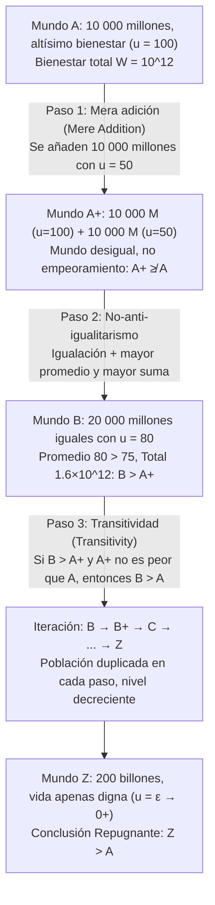

## Introducción: Cuando el «tamaño de la población $N$» se convierte en una variable moral

En la mayoría de los debates clásicos de la ética normativa y la economía del bienestar, razonamos implícitamente bajo el supuesto de una <strong>población fija (Fixed-Population)</strong>: ya existe un número determinado $N$ de individuos en el mundo, y la tarea de la filosofía moral consiste en distribuir justamente los recursos entre esas $N$ personas o maximizar su bienestar agregado. Sin embargo, en cuanto ampliamos nuestra mirada hacia las políticas de cambio climático, el agotamiento de los recursos planetarios, la ética reproductiva o el <strong>largasplacismo (Longtermism)</strong> y los riesgos existenciales (Existential Risks) que comprometen el futuro de la humanidad durante milenios, ese supuesto se derrumba: nuestras decisiones actuales determinan no solo <em>cuán bien</em> vivirán los humanos futuros (calidad de vida $u_i$), sino también <em>cuántas</em> personas existirán (tamaño de la población $N$), e incluso <em>qué individuos concretos</em> llegarán a nacer.

Este es el territorio de la <strong>ética de la población (Population Ethics)</strong> y la <strong>axiología de población variable (Variable-Population Axiology)</strong>. En 1984, el gran filósofo británico <strong>Derek Parfit (1942–2017)</strong> publicó su obra maestra <em>Reasons and Persons</em> (<em>Razones y personas</em>, Parte IV), provocando un terremoto intelectual en la filosofía contemporánea. Parfit demostró que si adoptamos el <strong>utilitarismo total (Total Utilitarianism)</strong> —la formulación canónica del utilitarismo desde Henry Sidgwick—, nos veremos arrastrados de forma inexorable hacia una proposición moralmente escalofriante: la <strong>«Conclusión Repugnante» (The Repugnant Conclusion)</strong>. Más inquietante aún fue comprobar en las décadas siguientes que cualquier intento de modificar el utilitarismo total para escapar de esta conclusión arroja a la teoría hacia paradojas todavía más atroces.

---

## Capítulo 1: De la población fija a la población variable: La encrucijada de Sidgwick

### 1.1 Definición formal de las funciones de bienestar social

Sea un mundo posible (o estado poblacional) $X$ compuesto por $N(X) \in \mathbb{N}^+$ individuos, representado mediante el vector de niveles de bienestar neto vitalicio $X = (u_1, u_2, \dots, u_N) \in \mathbb{R}^N$. En ética de la población establecemos una línea de referencia fundamental —el <strong>nivel neutro de bienestar (Neutral Level)</strong> $u = 0$—:
* Cuando $u_i > 0$, la vida del individuo $i$ es globalmente <strong>digna de ser vivida (A life worth living)</strong>;
* Cuando $u_i = 0$, la vida es estrictamente neutra (axiológicamente equivalente a la no existencia);
* Cuando $u_i < 0$, la vida está dominada por el sufrimiento y <strong>no merece ser vivida (A life not worth living)</strong>.

Cuando dos mundos tienen exactamente el mismo tamaño de población ($N(X) = N(Y) = N$), el <strong>utilitarismo total (Total Utilitarianism)</strong> y el <strong>utilitarismo promedio (Average Utilitarianism)</strong> producen exactamente el mismo ordenamiento:

$$W_{\text{total}}(X) = \sum_{i=1}^{N} u_i = N \cdot \bar{u}, \qquad W_{\text{avg}}(X) = \frac{1}{N} \sum_{i=1}^{N} u_i = \bar{u}$$

### 1.2 La elección de Henry Sidgwick

Sin embargo, cuando $N$ puede variar, ambos criterios divergen drásticamente. Mientras que economistas como John Stuart Mill o Knut Wicksell se inclinaban por el bienestar per cápita $\bar{u}$, el gran sistematizador del utilitarismo clásico <strong>Henry Sidgwick</strong> sentenció en <em>The Methods of Ethics</em> (1874) que, si el bien último es el excedente neto de felicidad en el universo, debemos maximizar el producto de la felicidad media por el número de seres capaces de disfrutarla, es decir, $W_{\text{total}}(X) = N \cdot \bar{u}$. Esta elección matemática aparentemente intachable encendió la mecha de la paradoja de Parfit.

---

## Capítulo 2: Derek Parfit y la «Conclusión Repugnante» (The Repugnant Conclusion)

### 2.1 El mundo $A$ frente al mundo $Z$: Mozart y filosofía contra música de ascensor y patatas

En el § 142 de <em>Reasons and Persons</em>, Parfit plantea comparar dos mundos posibles internamente igualitarios pero de distinto tamaño demográfico:

* <strong>El mundo $A$ (Mundo de altísimo bienestar)</strong>: Cuenta con $N_A = 10\,000\text{ millones} = 10^{10}$ de habitantes. Cada persona disfruta de una calidad de vida extraordinariamente alta ($u_A = 100$) —salud plena, libertad, afectos profundos, creatividad científica y lo que Parfit sintetiza como <strong>«Mozart y filosofía (Mozart and philosophy)»</strong>—. El bienestar total del mundo $A$ es:
  $$W_{\text{total}}(A) = N_A \cdot u_A = 10^{10} \times 100 = 10^{12}$$
* <strong>El mundo $Z$ (Mundo superpoblado de supervivencia marginal)</strong>: Alberga una población descomunal de $N_Z = 200\text{ billones} = 2 \times 10^{14}$ de individuos. La calidad de vida de cada habitante supera apenas por un margen ínfimo el punto neutro cero ($u_Z = \varepsilon = 0.01 > 0$). Sus vidas son monótonas y precarias, sin alta cultura ni alegrías intensas, contando únicamente con lo que Parfit denomina <strong>«música ambiental barata (Muzak) y patatas (Muzak and potatoes)»</strong>. No obstante, dado el colosal tamaño de $N_Z$, el bienestar total del mundo $Z$ alcanza:
  $$W_{\text{total}}(Z) = N_Z \cdot u_Z = (2 \times 10^{14}) \times 0.01 = 2 \times 10^{12}$$

Dado que $W_{\text{total}}(Z) = 2 \times 10^{12} > 10^{12} = W_{\text{total}}(A)$, el utilitarismo total dictamina que <strong>el mundo $Z$ es moralmente superior al mundo $A$ ($Z \succ A$)</strong>. Parfit bautizó este resultado como la <strong>«Conclusión Repugnante» (The Repugnant Conclusion)</strong>:

> <strong>Definición de la Conclusión Repugnante</strong>: Para cualquier población posible de al menos diez mil millones de personas con una altísima calidad de vida, existe otra población posible mucho más numerosa cuya existencia, en igualdad de condiciones, sería mejor, aunque sus miembros lleven vidas que apenas merecen ser vividas ($u_i = \varepsilon \to 0^+$).

### 2.2 ¿Por qué resulta tan repugnante esta conclusión?

Esta conclusión choca frontalmente con nuestra intuición moral porque implica que <strong>la mera cantidad (Quantity) puede sustituir sin límite alguno a la calidad (Quality)</strong>. Las cumbres más sublimes del espíritu humano (Mozart y la filosofía) quedan derrotadas en la contabilidad utilitarista por una masa interminable de existencias casi vegetativas.

---

## Capítulo 3: La paradoja de la mera adición (The Mere Addition Paradox)

¿Podríamos evitar la Conclusión Repugnante simplemente rechazando el utilitarismo total? Parfit diseñó la demoledora <strong>paradoja de la mera adición (The Mere Addition Paradox)</strong> para demostrar que tres principios intuitivos sumamente moderados e independientes del utilitarismo total bastan para empujarnos por una pendiente resbaladiza hasta el mundo $Z$.

Analicemos los tres pasos del argumento de Parfit:

1. <strong>Del mundo $A$ al mundo $A^+$ (Principio de la mera adición / Mere Addition Principle)</strong>:
   Al mundo $A$ (10 000 millones de personas con $u=100$) añadimos en un continente separado —sin afectar en absoluto a los habitantes originales— otros 10 000 millones de personas que disfrutan de una vida feliz con $u=50$. Obtenemos así el mundo $A^+$.
   Según el <strong>principio de la mera adición</strong>, añadir personas cuyas vidas merecen claramente ser vividas ($u > 0$) sin perjudicar a nadie no hace que el mundo sea <strong>peor</strong>. Por tanto, $A^+$ <strong>no es peor que $A$</strong> ($A^+ \not\prec A$).
2. <strong>Del mundo $A^+$ al mundo $B$ (No-anti-igualitarismo / Dominancia igualitaria)</strong>:
   El mundo $A^+$ presenta una desigualdad entre 10 000 millones con $u=100$ y 10 000 millones con $u=50$ (promedio: $75$, total: $1{,}5 \times 10^{12}$). Comparémoslo con el <strong>mundo $B$</strong>, donde esos mismos 20 000 millones de personas disfrutan todos por igual de $u = 80$ (promedio: $80$, total: $1{,}6 \times 10^{12}$).
   El mundo $B$ tiene mayor bienestar total, mayor bienestar promedio <em>y</em> perfecta igualdad: por consiguiente, <strong>el mundo $B$ es estrictamente mejor que el mundo $A^+$ ($B \succ A^+$)</strong>.
3. <strong>Transitividad (Transitivity) y pendiente iterativa</strong>:
   Si $B$ es mejor que $A^+$ y $A^+$ no es peor que $A$, la <strong>transitividad</strong> exige que <strong>el mundo $B$ (20 000 M, $u=80$) sea mejor que el mundo $A$ (10 000 M, $u=100$)</strong>. Repitiendo el proceso ($B \to B^+ \to C \to \dots \to Z$), llegamos inevitablemente a $Z \succ A$.

---

## Capítulo 4: Intentos de escape y su fracaso: De la Conclusión Sádica al problema de la no-identidad

Todas las axiologías alternativas propuestas para eludir la Conclusión Repugnante desembocan en contraparadojas devastadoras:

| Modelo axiológico | Función de bienestar social $W(X)$ | ¿Evita la Conclusión Repugnante? | Coste teórico fatal y paradoja derivada |
| :--- | :--- | :--- | :--- |
| <strong>Utilitarismo total</strong> | $W_{\text{total}} = \sum_{i=1}^{N} u_i = N \cdot \bar{u}$ | <strong>No</strong> (implica $Z \succ A$) | Sustitución ilimitada de calidad por cantidad |
| <strong>Utilitarismo promedio</strong> | $W_{\text{avg}} = \frac{1}{N} \sum_{i=1}^{N} u_i = \bar{u}$ | <strong>Sí</strong> ($\bar{u}_A = 100 > \varepsilon = \bar{u}_Z$) | «Adición al infierno» y <strong>Conclusión Sádica (Sadistic Conclusion)</strong> |
| <strong>Valor variable (Hurka / Ng)</strong> | $W_{\text{var}} = f(N) \cdot \bar{u}, \ \lim_{N \to \infty} f(N) = M$ | <strong>Sí</strong> (techo asintótico $M$) | Viola la mera adición para $N$ grande e induce la Conclusión Sádica |
| <strong>Utilitarismo de nivel crítico (CLU)</strong> | $W_{\text{CL}} = \sum_{i=1}^{N} (u_i - \alpha) \ (\alpha > 0)$ | <strong>Sí</strong> (contribución negativa si $\varepsilon < \alpha$) | <strong>Conclusión Muy Sádica (Very Sadistic Conclusion)</strong> |
| <strong>Enfoque centrado en la persona (Narveson)</strong> | Solo evalúa efectos sobre personas concretas | <strong>Condicional</strong> | Choca con la <strong>Asimetría</strong> (McMahan) y la <strong>No-identidad</strong> (Parfit) |

### 4.1 El utilitarismo promedio y la «Conclusión Sádica» (The Sadistic Conclusion)

El <strong>utilitarismo promedio</strong> ($W_{\text{avg}} = \bar{u}$) prefiere $A$ sobre $Z$, pero genera consecuencias absurdas:
* <strong>La adición al infierno (Addition to Hell)</strong>: En un mundo de 100 personas torturadas con $u = -100$, hacer nacer a otra persona torturada con $u = -90$ «eleva» el promedio a $-99{,}91$: ¡crear una vida de tormento sería una mejora moral!
* <strong>La Conclusión Sádica (The Sadistic Conclusion)</strong>: Demostrada por el filósofo sueco <strong>Gustaf Arrhenius</strong>, revela que ante una población muy feliz, el utilitarismo promedio prefiere a menudo <strong>añadir un pequeño número de personas atrozmente torturadas ($u < 0$) antes que un gran número de personas felices ($u > 0$, pero por debajo del promedio previo)</strong>, ¡porque unos pocos torturados rebajan menos la media general que muchos moderadamente felices!

### 4.2 Valor variable y Utilitarismo de nivel crítico (Critical-Level Utilitarianism)

1. <strong>Modelos de valor variable (Thomas Hurka, Yew-Kwang Ng)</strong>: Amortiguan $N$ mediante una función cóncava acotada $\lim_{N \to \infty} f(N) = M < \infty$.
2. <strong>Utilitarismo de nivel crítico (Blackorby, Bossert y Donaldson)</strong>: Introduce un umbral positivo $\alpha > 0$:
   $$W_{\text{CL}}(X) = \sum_{i=1}^{N} (u_i - \alpha) = N \cdot (\bar{u} - \alpha) \quad (\alpha > 0)$$
   Toda vida con $0 < u_i < \alpha$ resta valor social.

<strong>El precio fatal — La Conclusión Muy Sádica (The Very Sadistic Conclusion)</strong>: Para un mundo $Z$ suficientemente numeroso con $0 < \varepsilon < \alpha$, $W_{\text{CL}}(Z) = N_Z(\varepsilon - \alpha)$ tiende a $-\infty$. En consecuencia, el utilitarismo de nivel crítico dictamina que <strong>un infierno poblado por miles de personas torturadas permanentemente ($u = -1000$) es estrictamente mejor que un mundo pacífico $Z$ donde cientos de billones de seres llevan una vida positiva</strong>.

### 4.3 Enfoques centrados en la persona, la Asimetría y el problema de la no-identidad

En 1967, <strong>Jan Narveson</strong> enunció el lema de los <strong>enfoques centrados en la persona (Person-Affecting Views)</strong>: <strong>«Estamos a favor de hacer feliz a la gente, no de fabricar gente feliz (We are in favor of making people happy, not of making happy people).»</strong>

Pero esta postura tropieza con dos escollos insalvables:
1. <strong>La Asimetría procreativa de Jeff McMahan (1981)</strong>: Tenemos el deber moral de no traer al mundo a un niño destinado al tormento ($u < 0$), pero ningún deber de engendrar a un niño porque vaya a ser feliz ($u > 0$).
2. <strong>El problema de la no-identidad de Parfit (The Non-Identity Problem)</strong>: Si la humanidad elige hoy una política de <strong>Agotamiento de recursos (Depletion)</strong> frente a una de <strong>Conservación (Conservation)</strong>, ello altera todos los hábitos cotidianos y los momentos de concepción. Por ende, dentro de 300 años, los 10 000 millones de humanos que nacerán bajo la política de Agotamiento en un planeta contaminado ($u = 20 > 0$) serán <strong>genética y numéricamente individuos completamente distintos</strong> de los que habrían nacido bajo la Conservación ($u = 100$) ($\text{Pop}_{\text{deplete}} \cap \text{Pop}_{\text{conserve}} = \emptyset$). Dado que sin la política de Agotamiento esas personas jamás habrían existido y su vida sigue siendo digna de vivirse ($u = 20 > 0$), ¡la política de Agotamiento <strong>no ha perjudicado a ninguna persona concreta</strong>! Para condenar la devastación ecológica necesitamos principios impersonales (Impersonal), lo que nos devuelve de lleno a la Conclusión Repugnante.

---

## Capítulo 5: El teorema de imposibilidad de Arrhenius y el giro del largasplacismo

### 5.1 El teorema de imposibilidad en ética de la población (Gustaf Arrhenius)

Extendiendo el método axiomático de Kenneth Arrow, <strong>Gustaf Arrhenius</strong> demostró matemáticamente que <strong>ninguna relación de orden transitiva $\succeq$ puede satisfacer simultáneamente los cuatro axiomas siguientes</strong>:
1. <strong>Dominancia igualitaria (Egalitarian Dominance)</strong>: A igual población, un mundo con mayor bienestar total y perfecta igualdad es mejor.
2. <strong>Condición de calidad (Evitar la Conclusión Repugnante)</strong>: Un mundo de altísimo bienestar $A$ es mejor que un mundo de supervivencia marginal $Z$.
3. <strong>Condición de cantidad (Mera adición)</strong>: Añadir vidas positivas no empeora el mundo.
4. <strong>No-sadismo (Non-Sadism)</strong>: Añadir vidas torturadas ($u < 0$) nunca es mejor que añadir vidas felices ($u > 0$).

### 5.2 La declaración conjunta de 2021 y el largasplacismo contemporáneo

En 2021, 29 filósofos y economistas de primer nivel —entre ellos Peter Singer, Hilary Greaves, Toby Ord, William MacAskill y Yew-Kwang Ng— publicaron en el <em>Journal of Political Philosophy</em> el manifiesto <em>Overcoming the Repugnant Conclusion</em>. Sostuvieron que la obsesión por evitar a toda costa la Conclusión Repugnante ha llevado a la ética a callejones mucho peores (como la Conclusión Sádica), y que nuestro rechazo intuitivo hacia el mundo $Z$ se debe en gran medida a nuestra <strong>insensibilidad de escala (Scope Insensitivity)</strong> ante cifras astronómicas como $2 \times 10^{14}$. Para el <strong>largasplacismo (Longtermism)</strong> contemporáneo, mitigar los riesgos existenciales e impulsar el progreso sostenible nos permite aspirar a un futuro que combine <strong>tanto una vasta población (gran $N$) como una altísima calidad de vida (alto $\bar{u}$)</strong>.
