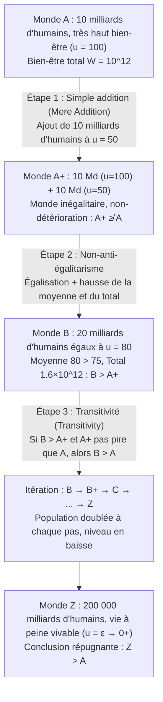

## Introduction : Quand la « taille de la population $N$ » devient elle-même une variable morale

Dans la plupart des problèmes classiques de l’éthique normative et de l’économie du bien-être, nous raisonnons implicitement à <strong>population fixe (Fixed-Population)</strong> : il existe déjà un nombre déterminé $N$ d’individus, et la tâche de la philosophie morale consiste à répartir équitablement les ressources entre ces $N$ personnes ou à maximiser leur bien-être global. Or, dès que nous élargissons notre horizon aux politiques climatiques, à l’épuisement des ressources terrestres, à la procréation, ou encore au <strong>longtermisme (Longtermism)</strong> et aux risques existentiels (Existential Risks) qui engagent l’avenir de l’humanité sur des millénaires, ce présupposé s’effondre : nos choix actuels déterminent non seulement <em>à quel point</em> les humains futurs seront heureux (qualité de vie $u_i$), mais aussi <em>combien</em> d’êtres humains existeront (taille de la population $N$), et même <em>quels individus spécifiques</em> verront le jour.

Tel est le domaine de l’<strong>éthique de la population (Population Ethics)</strong> et de l’<strong>axiologie à population variable (Variable-Population Axiology)</strong>. En 1984, le grand philosophe britannique <strong>Derek Parfit (1942–2017)</strong> a publié son chef-d’œuvre <em>Reasons and Persons</em> (Quatrième partie), provoquant une onde de choc dans toute la philosophie contemporaine. Il y démontrait que l’<strong>utilitarisme total (Total Utilitarianism)</strong> — la version canonique de l’utilitarisme depuis Henry Sidgwick — conduit inéluctablement à une proposition moralement vertigineuse : la <strong>« Conclusion répugnante » (The Repugnant Conclusion)</strong>. Plus troublant encore, les recherches axiomatiques ultérieures ont prouvé que toute tentative d’amender l’utilitarisme total pour échapper à cette conclusion précipite la théorie dans d’autres paradoxes encore plus intolérables.

---

## Chapitre 1 : De la population fixe à la population variable : La bifurcation de Sidgwick

### 1.1 Définition formelle des fonctions de bien-être social

Soit un monde possible (ou état démographique) $X$ comprenant $N(X) \in \mathbb{N}^+$ individus, représenté par le vecteur des niveaux de bien-être net sur la vie entière $X = (u_1, u_2, \dots, u_N) \in \mathbb{R}^N$. En éthique de la population, on fixe une ligne de référence cruciale — le <strong>niveau neutre de bien-être (Neutral Level)</strong> $u = 0$ :
* Si $u_i > 0$, la vie de l’individu $i$ <strong>vaut globalement la peine d’être vécue (A life worth living)</strong> ;
* Si $u_i = 0$, la vie est strictement neutre (axiologiquement équivalente à la non-existence) ;
* Si $u_i < 0$, la vie est dominée par la souffrance et <strong>ne vaut pas la peine d’être vécue (A life not worth living)</strong>.

Lorsque deux mondes comptent exactement le même nombre d’individus ($N(X) = N(Y) = N$), l’<strong>utilitarisme total (Total Utilitarianism)</strong> et l’<strong>utilitarisme moyen (Average Utilitarianism)</strong> engendrent exactement le même classement :

$$W_{\text{total}}(X) = \sum_{i=1}^{N} u_i = N \cdot \bar{u}, \qquad W_{\text{avg}}(X) = \frac{1}{N} \sum_{i=1}^{N} u_i = \bar{u}$$

### 1.2 Le choix d’Henry Sidgwick

Dès que $N$ devient variable, en revanche, les deux critères divergent radicalement. Tandis que des économistes comme John Stuart Mill ou Knut Wicksell privilégiaient le bien-être moyen $\bar{u}$, le grand théoricien de l’utilitarisme classique <strong>Henry Sidgwick</strong> trancha clairement dans <em>The Methods of Ethics</em> (1874) : si le bien ultime est le surplus net de bonheur dans l’univers, nous devons maximiser le produit de l’intensité moyenne du bonheur par le nombre d’êtres capables d’en jouir, soit $W_{\text{total}}(X) = N \cdot \bar{u}$. C’est ce choix mathématique apparemment irréprochable qui ouvre la boîte de Pandore de Parfit.

---

## Chapitre 2 : Derek Parfit et la « Conclusion répugnante » (The Repugnant Conclusion)

### 2.1 Le monde $A$ contre le monde $Z$ : Mozart et la philosophie vs la musique d’ascenseur et les pommes de terre

Au § 142 de <em>Reasons and Persons</em>, Parfit nous invite à comparer deux mondes possibles parfaitement égalitaires mais de tailles différentes :

* <strong>Le monde $A$ (Monde d’excellence et de très haut bien-être)</strong> : Il compte $N_A = 10\text{ milliards} = 10^{10}$ d’habitants. Chacun y jouit d’une qualité de vie exceptionnelle ($u_A = 100$) — santé florissante, liberté, amour profond, découvertes scientifiques et ce que Parfit résume par <strong>« Mozart et la philosophie (Mozart and philosophy) »</strong>. Le bien-être total du monde $A$ s’élève à :
  $$W_{\text{total}}(A) = N_A \cdot u_A = 10^{10} \times 100 = 10^{12}$$
* <strong>Le monde $Z$ (Monde surpeuplé de survie marginale)</strong> : Il abrite une population gigantesque de $N_Z = 200\,000\text{ milliards} = 2 \times 10^{14}$ d’individus. La vie de chaque habitant dépasse à peine le seuil neutre zéro ($u_Z = \varepsilon = 0.01 > 0$). Leur existence est terne, dépourvue de toute haute culture ou joie intense, n’offrant pour toute consolation que <strong>« de la musique d’ascenseur (Muzak) et des pommes de terre (Muzak and potatoes) »</strong>. Pourtant, en raison de l’immensité de $N_Z$, le bien-être total du monde $Z$ atteint :
  $$W_{\text{total}}(Z) = N_Z \cdot u_Z = (2 \times 10^{14}) \times 0.01 = 2 \times 10^{12}$$

Puisque $W_{\text{total}}(Z) = 2 \times 10^{12} > 10^{12} = W_{\text{total}}(A)$, l’utilitarisme total implique nécessairement que <strong>le monde $Z$ est moralement supérieur au monde $A$ ($Z \succ A$)</strong>. Parfit nomme ce résultat la <strong>« Conclusion répugnante » (The Repugnant Conclusion)</strong> :

> <strong>Définition de la Conclusion répugnante</strong> : Pour toute population possible d’au moins dix milliards de personnes jouissant d’une très haute qualité de vie, il existe une autre population possible beaucoup plus nombreuse dont l’existence, toutes choses égales par ailleurs, serait meilleure, bien que ses membres mènent des vies qui valent à peine la peine d’être vécues ($u_i = \varepsilon \to 0^+$).

### 2.2 Pourquoi cette conclusion répugne-t-elle à notre intuition ?

Cette conclusion heurte de plein fouet notre sens moral parce qu’elle affirme que <strong>la quantité brute (Quantity) peut se substituer sans limite à la qualité (Quality)</strong>. Les sommets de l’esprit humain et du bonheur (Mozart et la philosophie) se voient détrônés dans le calcul utilitariste par une prolifération industrielle d’existences quasi végétatives.

---

## Chapitre 3 : Le paradoxe de la simple addition (The Mere Addition Paradox)

Pourrait-on éviter la Conclusion répugnante en rejetant simplement l’utilitarisme total ? Parfit a conçu le redoutable <strong>paradoxe de la simple addition (The Mere Addition Paradox)</strong> pour démontrer que trois principes intuitifs très faibles et indépendants de l’utilitarisme total suffisent à nous entraîner sur une pente glissante jusqu’au monde $Z$.

Suivons les trois étapes du raisonnement de Parfit :

1. <strong>Du monde $A$ au monde $A^+$ (Principe de la simple addition / Mere Addition Principle)</strong> :
   Au monde $A$ (10 milliards d’individus à $u=100$), ajoutons sur un continent séparé — sans affecter en rien les premiers habitants — 10 milliards de personnes supplémentaires menant une vie heureuse à $u=50$. On obtient le monde $A^+$.
   Selon le <strong>principe de la simple addition</strong>, ajouter des personnes dont la vie vaut nettement la peine d’être vécue ($u > 0$) sans nuire à personne ne rend pas le monde <strong>pire</strong>. Donc $A^+$ n’est <strong>pas pire que $A$</strong> ($A^+ \not\prec A$).
2. <strong>Du monde $A^+$ au monde $B$ (Non-anti-égalitarisme / Dominance égalitaire)</strong> :
   Le monde $A^+$ comporte une inégalité entre 10 milliards d’individus à $u=100$ et 10 milliards à $u=50$ (moyenne : $75$, total : $1{,}5 \times 10^{12}$). Comparons-le au <strong>monde $B$</strong>, où ces mêmes 20 milliards d’individus jouissent tous également de $u = 80$ (moyenne : $80$, total : $1{,}6 \times 10^{12}$).
   Le monde $B$ a un bien-être total supérieur, une moyenne supérieure <em>et</em> une égalité parfaite : <strong>le monde $B$ est donc strictement meilleur que le monde $A^+$ ($B \succ A^+$)</strong>.
3. <strong>Transitivité (Transitivity) et glissement itératif</strong> :
   Si $B$ est meilleur que $A^+$ et que $A^+$ n’est pas pire que $A$, la <strong>transitivité</strong> impose que <strong>le monde $B$ (20 Md, $u=80$) est meilleur que le monde $A$ (10 Md, $u=100$)</strong> ! En réitérant l’opération ($B \to B^+ \to C \to \dots \to Z$), on aboutit inexorablement à $Z \succ A$.

---

## Chapitre 4 : Les tentatives d’évasion et leur faillite : De la Conclusion sadique au problème de la non-identité

Toutes les axiologies alternatives proposées pour échapper à la Conclusion répugnante se heurtent à des contre-paradoxes dévastateurs :

| Modèle axiologique | Fonction de bien-être social $W(X)$ | Évite la Conclusion répugnante ? | Coût théorique fatal & Paradoxe induit |
| :--- | :--- | :--- | :--- |
| <strong>Utilitarisme total</strong> | $W_{\text{total}} = \sum_{i=1}^{N} u_i = N \cdot \bar{u}$ | <strong>Non</strong> (implique $Z \succ A$) | Substitution illimitée de la qualité par la quantité |
| <strong>Utilitarisme moyen</strong> | $W_{\text{avg}} = \frac{1}{N} \sum_{i=1}^{N} u_i = \bar{u}$ | <strong>Oui</strong> ($\bar{u}_A = 100 > \varepsilon = \bar{u}_Z$) | « Addition à l’enfer » & <strong>Conclusion sadique (Sadistic Conclusion)</strong> |
| <strong>Valeur variable (Hurka / Ng)</strong> | $W_{\text{var}} = f(N) \cdot \bar{u}, \ \lim_{N \to \infty} f(N) = M$ | <strong>Oui</strong> (plafond asymptotique $M$) | Viole la simple addition pour $N$ grand, induit la Conclusion sadique |
| <strong>Utilitarisme à niveau critique (CLU)</strong> | $W_{\text{CL}} = \sum_{i=1}^{N} (u_i - \alpha) \ (\alpha > 0)$ | <strong>Oui</strong> (contribution négative si $\varepsilon < \alpha$) | <strong>Conclusion très sadique (Very Sadistic Conclusion)</strong> |
| <strong>Approche centrée sur la personne (Narveson)</strong> | N’évalue que l’effet sur des personnes existantes | <strong>Sous condition</strong> | Butée sur l’<strong>Asymétrie</strong> (McMahan) & la <strong>Non-identité</strong> (Parfit) |

### 4.1 L’utilitarisme moyen et la « Conclusion sadique » (The Sadistic Conclusion)

L’<strong>utilitarisme moyen</strong> ($W_{\text{avg}} = \bar{u}$) préfère bien $A$ à $Z$, mais au prix de conséquences absurdes :
* <strong>L’addition à l’enfer (Addition to Hell)</strong> : Dans un monde composé de 100 damnés souffrant le martyre ($u = -100$), faire naître un nouvel être torturé à $u = -90$ fait « remonter » la moyenne à $-99{,}91$ — créer une vie de supplice serait donc un progrès moral !
* <strong>La Conclusion sadique (The Sadistic Conclusion)</strong> : Mise en évidence par le philosophe suédois <strong>Gustaf Arrhenius</strong>, elle montre qu’à partir d’une population très heureuse, l’utilitarisme moyen préfère souvent <strong>ajouter un petit nombre de personnes atrocement torturées ($u < 0$) plutôt qu’un grand nombre de personnes heureuses ($u > 0$, mais sous la moyenne initiale)</strong>, car quelques suppliciés font moins baisser la moyenne générale qu’une foule de gens modérément heureux !

### 4.2 Valeur variable et Utilitarisme à niveau critique (Critical-Level Utilitarianism)

1. <strong>Les modèles à valeur variable (Thomas Hurka, Yew-Kwang Ng)</strong> : Amortissent $N$ par une fonction concave bornée $\lim_{N \to \infty} f(N) = M < \infty$.
2. <strong>L’utilitarisme à niveau critique (Blackorby, Bossert et Donaldson)</strong> : Introduit un seuil positif $\alpha > 0$ :
   $$W_{\text{CL}}(X) = \sum_{i=1}^{N} (u_i - \alpha) = N \cdot (\bar{u} - \alpha) \quad (\alpha > 0)$$
   Toute vie telle que $0 < u_i < \alpha$ réduit la valeur sociale totale.

<strong>Le prix fatal — La Conclusion très sadique (The Very Sadistic Conclusion)</strong> : Pour un monde $Z$ suffisamment peuplé avec $0 < \varepsilon < \alpha$, $W_{\text{CL}}(Z) = N_Z(\varepsilon - \alpha)$ tend vers $-\infty$. Dès lors, l’utilitarisme à niveau critique juge qu’<strong>un enfer peuplé de milliers d’individus torturés en permanence ($u = -1000$) est strictement meilleur qu’un monde paisible $Z$ où des centaines de milliers de milliards d’êtres mènent une vie positive !</strong>

### 4.3 Les approches centrées sur la personne, l’Asymétrie et le problème de la non-identité

En 1967, <strong>Jan Narveson</strong> formulait la devise des <strong>approches centrées sur la personne (Person-Affecting Views)</strong> : <strong>« Nous sommes favorables au fait de rendre les gens heureux, et non de fabriquer des gens heureux (We are in favor of making people happy, not of making happy people). »</strong>

Mais cette position se brise sur deux obstacles majeurs :
1. <strong>L’Asymétrie procréative de Jeff McMahan (1981)</strong> : Nous avons le devoir moral de ne pas faire naître un enfant voué à une vie de souffrance ($u < 0$), mais aucun devoir de faire naître un enfant parce qu’il serait heureux ($u > 0$).
2. <strong>Le problème de la non-identité de Parfit (The Non-Identity Problem)</strong> : Supposons que l’humanité choisisse entre une politique d’<strong>Épuisement des ressources (Depletion)</strong> et une politique de <strong>Préservation (Conservation)</strong>. Ce choix macroéconomique modifie tous les déplacements, les rencontres et les instants de conception. Par conséquent, dans 300 ans, les 10 milliards d’humains qui naîtront sous la politique d’Épuisement dans un monde pollué ($u = 20 > 0$) seront <strong>génétiquement et numériquement des individus totalement différents</strong> de ceux qui seraient nés sous la politique de Préservation ($u = 100$) ($\text{Pop}_{\text{deplete}} \cap \text{Pop}_{\text{conserve}} = \emptyset$). Puisque sans la politique d’Épuisement ces individus n’auraient jamais existé et que leur vie vaut malgré tout la peine d’être vécue ($u = 20 > 0$), la politique d’Épuisement <strong>n’a nui à aucune personne particulière</strong> ! Pour condamner la destruction écologique, il faut donc réintroduire des principes impersonnels (Impersonal) — ce qui nous ramène droit vers la Conclusion répugnante.

---

## Chapitre 5 : Le théorème d’impossibilité d’Arrhenius et le tournant du longtermisme

### 5.1 Le théorème d’impossibilité en éthique de la population (Gustaf Arrhenius)

En généralisant la méthode axiomatique de Kenneth Arrow, <strong>Gustaf Arrhenius</strong> a démontré qu’<strong>aucune relation de préférence transitive $\succeq$ ne peut satisfaire simultanément les quatre axiomes suivants</strong> :
1. <strong>Dominance égalitaire (Egalitarian Dominance)</strong> : À population égale, un monde plus heureux au total et parfaitement égalitaire est meilleur.
2. <strong>Condition de qualité (Évitement de la Conclusion répugnante)</strong> : Un monde de très haut bien-être $A$ est meilleur qu’un monde de survie marginale $Z$.
3. <strong>Condition de quantité (Simple addition)</strong> : Ajouter des vies positives ne rend pas le monde pire.
4. <strong>Non-sadisme (Non-Sadism)</strong> : Ajouter des vies torturées ($u < 0$) n’est jamais meilleur qu’ajouter des vies heureuses ($u > 0$).

### 5.2 La déclaration conjointe de 2021 et le longtermisme contemporain

En 2021, 29 philosophes et économistes de premier plan — dont Peter Singer, Hilary Greaves, Toby Ord, William MacAskill et Yew-Kwang Ng — ont publié dans le <em>Journal of Political Philosophy</em> un manifeste intitulé <em>Overcoming the Repugnant Conclusion</em>. Ils y soutiennent que le refus dogmatique de la Conclusion répugnante a conduit l’éthique dans des impasses bien pires (comme la Conclusion sadique), et que notre malaise intuitif face au monde $Z$ provient largement de notre <strong>insensibilité d’échelle (Scope Insensitivity)</strong> face à de très grands nombres comme $2 \times 10^{14}$. Pour le <strong>longtermisme</strong> contemporain, la réduction des risques existentiels et le progrès durable visent précisément à garantir aux générations futures <strong>à la fois une vaste population (grand $N$) et une qualité de vie florissante (haut $\bar{u}$)</strong>.
