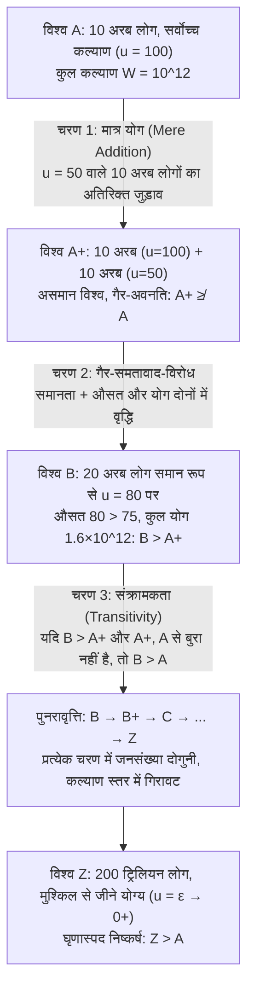

## प्रस्तावना: जब ‘जनसंख्या का आकार $N$’ स्वयं एक नैतिक चर (Moral Variable) बन जाता है

मानकीय नीतिशास्त्र (Normative Ethics) और कल्याणकारी अर्थशास्त्र की अधिकांश शास्त्रीय बहसों में हम परोक्ष रूप से <strong>स्थिर जनसंख्या (Fixed-Population)</strong> की मान्यता के भीतर सोचते हैं: दुनिया में पहले से ही $N$ व्यक्तियों की एक निश्चित संख्या मौजूद है, और नैतिक दर्शन का कार्य उन $N$ लोगों के बीच संसाधनों का न्यायपूर्ण वितरण करना या उनके कुल कल्याण को अधिकतम करना है। किंतु जैसे ही हम अपनी दृष्टि जलवायु परिवर्तन नीतियों, पृथ्वी के संसाधनों के दोहन, प्रजनन नीतिशास्त्र, अथवा सहस्राब्दियों तक मानवता के भविष्य को निर्धारित करने वाले <strong>दीर्घकालवाद (Longtermism)</strong> और अस्तित्वगत जोखिमों (Existential Risks) की ओर फैलाते हैं, यह मान्यता ढह जाती है: हमारे आज के निर्णय केवल यह तय नहीं करते कि भविष्य के मनुष्य <em>कितना अच्छा</em> जिएँगे (जीवन की गुणवत्ता $u_i$), बल्कि यह भी तय करते हैं कि भविष्य में <em>कितने</em> मनुष्य अस्तित्व में होंगे (जनसंख्या का आकार $N$), और यहाँ तक कि <em>कौन-से विशिष्ट व्यक्ति</em> जन्म लेंगे।

यही <strong>जनसंख्या नीतिशास्त्र (Population Ethics)</strong> और <strong>परिवर्ती-जनसंख्या मूल्यमीमांसा (Variable-Population Axiology)</strong> का अध्ययन क्षेत्र है। वर्ष 1984 में महान ब्रिटिश दार्शनिक <strong>डेरेक पार्फिट (Derek Parfit, 1942–2017)</strong> ने अपनी युगांतरकारी कृति <em>Reasons and Persons</em> (भाग IV) प्रकाशित की, जिसने समकालीन दर्शन में भूचाल ला दिया। पार्फिट ने सिद्ध किया कि यदि हम हेनरी सिजविक (Henry Sidgwick) के समय से मानक माने जाने वाले <strong>कुल उपयोगितावाद (Total Utilitarianism)</strong> को अपनाते हैं, तो हम अनिवार्य रूप से एक ऐसे निष्कर्ष पर पहुँचेंगे जो हमारी नैतिक अंतर्दृष्टि को झकझोर देता है—जिसे उन्होंने <strong>‘घृणास्पद निष्कर्ष’ (The Repugnant Conclusion)</strong> नाम दिया। इससे भी अधिक चौंकाने वाली बात यह रही कि इस निष्कर्ष से बचने के लिए कुल उपयोगितावाद में संशोधन करने का हर प्रयास सिद्धांत को और भी भयावह विरोधाभासों में धकेल देता है।

---

## अध्याय 1: स्थिर जनसंख्या से परिवर्ती जनसंख्या तक: सिजविक का दोराहा

### 1.1 सामाजिक कल्याण फलनों की औपचारिक परिभाषा

मान लीजिए कि कोई संभावित विश्व (या जनसंख्या अवस्था) $X$ कुल $N(X) \in \mathbb{N}^+$ व्यक्तियों से मिलकर बना है, जिसे आजीवन शुद्ध कल्याण सदिश $X = (u_1, u_2, \dots, u_N) \in \mathbb{R}^N$ द्वारा दर्शाया गया है। जनसंख्या नीतिशास्त्र में हम एक मूलभूत संदर्भ रेखा निर्धारित करते हैं—<strong>तटस्थ कल्याण स्तर (Neutral Level)</strong> $u = 0$:
* जब $u_i > 0$ हो, तो व्यक्ति $i$ का जीवन समग्र रूप से <strong>जीने योग्य (A life worth living)</strong> है;
* जब $u_i = 0$ हो, तो जीवन पूर्णतः तटस्थ बिंदु पर है (मूल्यमीमांसा की दृष्टि से अस्तित्वहीनता के समतुल्य);
* जब $u_i < 0$ हो, तो जीवन घोर पीड़ा से भरा है और समग्र रूप से <strong>जीने योग्य नहीं (A life not worth living)</strong> है।

जब दो विश्वों की जनसंख्या का आकार समान होता है ($N(X) = N(Y) = N$), तब <strong>कुल उपयोगितावाद (Total Utilitarianism)</strong> और <strong>औसत उपयोगितावाद (Average Utilitarianism)</strong> बिल्कुल समान वरीयता क्रम प्रदान करते हैं:

$$W_{\text{total}}(X) = \sum_{i=1}^{N} u_i = N \cdot \bar{u}, \qquad W_{\text{avg}}(X) = \frac{1}{N} \sum_{i=1}^{N} u_i = \bar{u}$$

### 1.2 हेनरी सिजविक का चुनाव

किंतु जब जनसंख्या $N$ परिवर्ती हो, तो दोनों मापदंड पूरी तरह अलग हो जाते हैं। जहाँ जॉन स्टुअर्ट मिल या नुट विकसेल जैसे अर्थशास्त्री प्रति व्यक्ति औसत कल्याण $\bar{u}$ पर बल देते थे, वहीं शास्त्रीय उपयोगितावाद के शिखर दार्शनिक <strong>हेनरी सिजविक (Henry Sidgwick)</strong> ने <em>The Methods of Ethics</em> (1874) में स्पष्ट किया कि यदि परम श्रेय ब्रह्मांड में सुख का शुद्ध आधिक्य है, तो हमें औसत सुख और सुख भोगने वाले प्राणियों की संख्या के गुणनफल अर्थात् $W_{\text{total}}(X) = N \cdot \bar{u}$ को अधिकतम करना चाहिए। इसी तार्किक चुनाव ने पार्फिट के विरोधाभास की नींव रखी।

---

## अध्याय 2: डेरेक पार्फिट और ‘घृणास्पद निष्कर्ष’ (The Repugnant Conclusion)

### 2.1 विश्व $A$ बनाम विश्व $Z$: मोज़ार्ट और दर्शन बनाम लिफ्ट-संगीत और आलू

<em>Reasons and Persons</em> के अनुच्छेद 142 में पार्फिट हमें आंतरिक रूप से पूर्णतः समतावादी किंतु भिन्न जनसंख्या आकार वाले दो संभावित विश्वों की तुलना करने को कहते हैं:

* <strong>विश्व $A$ (अत्युच्च कल्याण वाला विश्व)</strong>: इसमें $N_A = 10\text{ अरब} = 10^{10}$ लोग रहते हैं। प्रत्येक व्यक्ति असाधारण रूप से उच्च जीवन-गुणवत्ता ($u_A = 100$) का आनंद लेता है—उत्तम स्वास्थ्य, स्वतंत्रता, गहरा प्रेम, वैज्ञानिक सृजन और वह सब जिसे पार्फिट संक्षेप में <strong>“मोज़ार्ट और दर्शन (Mozart and philosophy)”</strong> कहते हैं। विश्व $A$ का कुल कल्याण है:
  $$W_{\text{total}}(A) = N_A \cdot u_A = 10^{10} \times 100 = 10^{12}$$
* <strong>विश्व $Z$ (सीमांत अस्तित्व वाला अति-भीड़भाड़ युक्त विश्व)</strong>: इसमें $N_Z = 200\text{ ट्रिलियन (200 लाख करोड़)} = 2 \times 10^{14}$ व्यक्तियों की विशाल जनसंख्या रहती है। प्रत्येक निवासी के जीवन की गुणवत्ता शून्य के तटस्थ स्तर से बस नाममात्र ऊपर ($u_Z = \varepsilon = 0.01 > 0$) है। उनका जीवन नीरस और अभावग्रस्त है, जिसमें न कोई उच्च संस्कृति है और न गहरा आनंद; उनके पास केवल वही है जिसे पार्फिट <strong>“सस्ता पार्श्व संगीत (Muzak) और आलू (Muzak and potatoes)”</strong> कहते हैं। फिर भी, चूँकि $N_Z$ अत्यंत विशाल है, विश्व $Z$ का कुल कल्याण यहाँ तक पहुँच जाता है:
  $$W_{\text{total}}(Z) = N_Z \cdot u_Z = (2 \times 10^{14}) \times 0.01 = 2 \times 10^{12}$$

चूँकि $W_{\text{total}}(Z) = 2 \times 10^{12} > 10^{12} = W_{\text{total}}(A)$ है, इसलिए कुल उपयोगितावाद के अनुसार <strong>विश्व $Z$ नैतिक रूप से विश्व $A$ से श्रेष्ठ है ($Z \succ A$)</strong>। पार्फिट ने इसे <strong>‘घृणास्पद निष्कर्ष’ (The Repugnant Conclusion)</strong> नाम दिया:

> <strong>घृणास्पद निष्कर्ष की परिभाषा</strong>: अत्यंत उच्च जीवन-गुणवत्ता वाले कम से कम दस अरब लोगों की किसी भी संभावित जनसंख्या के मुकाबले, एक अन्य बहुत बड़ी जनसंख्या का अस्तित्व—अन्य बातें समान रहने पर—अधिक बेहतर होगा, भले ही उसके सदस्यों का जीवन बस मुश्किल से जीने लायक ($u_i = \varepsilon \to 0^+$) क्यों न हो।

### 2.2 यह निष्कर्ष इतना घृणास्पद क्यों प्रतीत होता है?

यह निष्कर्ष हमारी नैतिक अंतर्दृष्टि से इसलिए टकराता है क्योंकि इसका अर्थ है कि <strong>मात्र मात्रा (Quantity) बिना किसी सीमा के गुणवत्ता (Quality) को प्रतिस्थापित कर सकती है</strong>। मानव सभ्यता की सर्वोच्च बौद्धिक और सौंदर्यात्मक उपलब्धियाँ (मोज़ार्ट और दर्शन) उपयोगितावादी खाते में अर्ध-चेतन जैसे सीमांत जीवनों की अनंत भीड़ से हार जाती हैं।

---

## अध्याय 3: मात्र योग का विरोधाभास (The Mere Addition Paradox)

क्या हम कुल उपयोगितावाद को त्यागकर घृणास्पद निष्कर्ष से बच सकते हैं? पार्फिट ने <strong>मात्र योग का विरोधाभास (The Mere Addition Paradox)</strong> रचकर सिद्ध किया कि कुल उपयोगितावाद से स्वतंत्र, अत्यंत सामान्य दिखने वाले तीन सहज नैतिक सिद्धांत भी हमें फिसलन भरी ढलान से सीधे विश्व $Z$ में धकेल देते हैं।

आइए पार्फिट के तर्क के तीनों चरणों को देखें:

1. <strong>विश्व $A$ से विश्व $A^+$ तक (मात्र योग का सिद्धांत / Mere Addition Principle)</strong>:
   विश्व $A$ (10 अरब लोग, $u=100$) में हम एक अलग महाद्वीप पर—मूल निवासियों को तनिक भी प्रभावित किए बिना—$u=50$ का सुखी जीवन जीने वाले 10 अरब और लोगों को जोड़ देते हैं। इससे विश्व $A^+$ बनता है।
   <strong>मात्र योग सिद्धांत</strong> के अनुसार, बिना किसी को नुकसान पहुँचाए सुखी और जीने योग्य जीवन ($u > 0$) वाले लोगों को जोड़ना दुनिया को <strong>बदतर नहीं बनाता</strong>। अतः $A^+$ कम से कम <strong>$A$ से बुरा नहीं है</strong> ($A^+ \not\prec A$)।
2. <strong>विश्व $A^+$ से विश्व $B$ तक (समतावादी प्रभुत्व / Non-Anti-Egalitarianism)</strong>:
   विश्व $A^+$ में $u=100$ वाले 10 अरब और $u=50$ वाले 10 अरब लोगों के बीच असमानता है (औसत: $75$, कुल: $1{,}5 \times 10^{12}$)। अब <strong>विश्व $B$</strong> पर विचार करें, जहाँ वे ही 20 अरब लोग समान रूप से $u = 80$ का आनंद लेते हैं (औसत: $80$, कुल: $1{,}6 \times 10^{12}$)।
   विश्व $B$ में कुल कल्याण अधिक है, औसत कल्याण अधिक है <em>और</em> पूर्ण समानता भी है: इसलिए <strong>विश्व $B$ निश्चित रूप से विश्व $A^+$ से बेहतर है ($B \succ A^+$)</strong>।
3. <strong>संक्रामकता (Transitivity) और क्रमिक ढलान</strong>:
   यदि $B$, $A^+$ से बेहतर है और $A^+$, $A$ से बुरा नहीं है, तो <strong>संक्रामकता</strong> के नियम से <strong>विश्व $B$ (20 अरब, $u=80$) विश्व $A$ (10 अरब, $u=100$) से बेहतर है</strong>! इस प्रक्रिया को दोहराने पर ($B \to B^+ \to C \to \dots \to Z$) हम अनिवार्य रूप से $Z \succ A$ पर पहुँच जाते हैं।

---

## अध्याय 4: बचने के प्रयास और उनकी विफलता: परपीड़क निष्कर्ष से गैर-तदात्म्य समस्या तक

घृणास्पद निष्कर्ष से बचने के लिए प्रस्तावित सभी वैकल्पिक मूल्य-सिद्धांत भयानक प्रति-विरोधाभासों में फँस जाते हैं:

| मूल्यमीमांसीय मॉडल | सामाजिक कल्याण फलन $W(X)$ | क्या घृणास्पद निष्कर्ष से बचता है? | घातक सैद्धांतिक कीमत और उत्पन्न विरोधाभास |
| :--- | :--- | :--- | :--- |
| <strong>कुल उपयोगितावाद</strong> | $W_{\text{total}} = \sum_{i=1}^{N} u_i = N \cdot \bar{u}$ | <strong>नहीं</strong> ($Z \succ A$ उत्पन्न करता है) | मात्रा द्वारा गुणवत्ता का असीमित प्रतिस्थापन |
| <strong>औसत उपयोगितावाद</strong> | $W_{\text{avg}} = \frac{1}{N} \sum_{i=1}^{N} u_i = \bar{u}$ | <strong>हाँ</strong> ($\bar{u}_A = 100 > \varepsilon = \bar{u}_Z$) | ‘नरक में योग’ तथा <strong>परपीड़क निष्कर्ष (Sadistic Conclusion)</strong> |
| <strong>परिवर्ती मूल्य (Hurka / Ng)</strong> | $W_{\text{var}} = f(N) \cdot \bar{u}, \ \lim_{N \to \infty} f(N) = M$ | <strong>हाँ</strong> (अनंतस्पर्शी सीमा $M$) | बड़ी $N$ पर मात्र योग का उल्लंघन और परपीड़क निष्कर्ष |
| <strong>क्रांतिक स्तर उपयोगितावाद (CLU)</strong> | $W_{\text{CL}} = \sum_{i=1}^{N} (u_i - \alpha) \ (\alpha > 0)$ | <strong>हाँ</strong> ($\varepsilon < \alpha$ पर ऋणात्मक योगदान) | <strong>अत्यंत परपीड़क निष्कर्ष (Very Sadistic Conclusion)</strong> |
| <strong>व्यक्ति-प्रभावी दृष्टिकोण (Narveson)</strong> | केवल मूर्त व्यक्तियों पर प्रभाव का मूल्यांकन | <strong>सशर्त</strong> | <strong>प्रजनन असममिति</strong> (मैकमाहन) व <strong>गैर-तदात्म्य समस्या</strong> (पार्फिट) |

### 4.1 औसत उपयोगितावाद और ‘परपीड़क निष्कर्ष’ (The Sadistic Conclusion)

<strong>औसत उपयोगितावाद</strong> ($W_{\text{avg}} = \bar{u}$) विश्व $A$ को $Z$ से ऊपर तो रखता है, पर इसके परिणाम बेतुके हैं:
* <strong>नरक में योग (Addition to Hell)</strong>: यदि किसी दुनिया में 100 लोग $u = -100$ की नारकीय यातना झेल रहे हों, तो $u = -90$ की यातना झेलने वाले एक और व्यक्ति का जन्म औसत को बढ़ाकर $-99{,}91$ कर देता है—अर्थात् एक पीड़ित जीवन पैदा करना नैतिक सुधार माना जाएगा!
* <strong>परपीड़क निष्कर्ष (The Sadistic Conclusion)</strong>: स्वीडिश दार्शनिक <strong>गुस्ताव अरेनियस (Gustaf Arrhenius)</strong> ने सिद्ध किया कि एक अत्यंत सुखी समाज में औसत उपयोगितावाद अक्सर <strong>बड़ी संख्या में सुखी लोगों ($u > 0$, पर पूर्व औसत से कम) को जोड़ने की तुलना में, घोर यातना झेलने वाले ($u < 0$) थोड़े-से लोगों को जोड़ना अधिक पसंद करता है</strong>, क्योंकि कुछ पीड़ित लोग कुल औसत को उतना नीचे नहीं गिराते जितना मध्यम रूप से सुखी बहुत सारे लोग गिराते हैं!

### 4.2 परिवर्ती मूल्य और क्रांतिक स्तर उपयोगितावाद (Critical-Level Utilitarianism)

1. <strong>परिवर्ती मूल्य मॉडल (थॉमस हर्का, येव-क्वांग एनजी)</strong>: $N$ के प्रभाव को एक परिबद्ध अवतल फलन $\lim_{N \to \infty} f(N) = M < \infty$ से सीमित करते हैं।
2. <strong>क्रांतिक स्तर उपयोगितावाद (ब्लैकॉर्बी, बोसर्ट और डोनाल्डसन)</strong>: एक धनात्मक क्रांतिक दहलीज $\alpha > 0$ प्रस्तुत करता है:
   $$W_{\text{CL}}(X) = \sum_{i=1}^{N} (u_i - \alpha) = N \cdot (\bar{u} - \alpha) \quad (\alpha > 0)$$
   यहाँ $0 < u_i < \alpha$ वाला प्रत्येक जीवन कुल सामाजिक मूल्य को घटाता है।

<strong>घातक कीमत — अत्यंत परपीड़क निष्कर्ष (The Very Sadistic Conclusion)</strong>: $0 < \varepsilon < \alpha$ वाले पर्याप्त विशाल विश्व $Z$ के लिए $W_{\text{CL}}(Z) = N_Z(\varepsilon - \alpha)$ का मान $-\infty$ की ओर जाता है। फलस्वरूप, क्रांतिक स्तर उपयोगितावाद यह निर्णय देता है कि <strong>हजारों निरंतर प्रताड़ित लोगों ($u = -1000$) से भरा एक छोटा नरक उस शांत विश्व $Z$ से नैतिक रूप से बेहतर है जहाँ खरबों लोग सकारात्मक जीवन जी रहे हैं!</strong>

### 4.3 व्यक्ति-प्रभावी दृष्टिकोण, असममिति और गैर-तदात्म्य समस्या

1967 में <strong>जान नार्वेसन (Jan Narveson)</strong> ने <strong>व्यक्ति-प्रभावी दृष्टिकोण (Person-Affecting Views)</strong> का प्रसिद्ध सूत्र दिया: <strong>“हम लोगों को सुखी बनाने के पक्ष में हैं, सुखी लोग पैदा करने के पक्ष में नहीं (We are in favor of making people happy, not of making happy people)।”</strong>

परंतु यह दृष्टिकोण दो बड़ी बाधाओं से टकराता है:
1. <strong>जेफ मैकमाहन की प्रजनन असममिति (The Asymmetry, 1981)</strong>: हमारा यह दृढ़ नैतिक कर्तव्य है कि हम यातनापूर्ण जीवन ($u < 0$) जीने वाले बच्चे को जन्म न दें, किंतु सुखी जीवन ($u > 0$) जीने वाले बच्चे को जन्म देने का कोई नैतिक कर्तव्य नहीं है।
2. <strong>पार्फिट की गैर-तदात्म्य समस्या (The Non-Identity Problem)</strong>: यदि मानवता आज संसाधनों के <strong>संरक्षण (Conservation)</strong> के बजाय <strong>अति-दोहन (Depletion)</strong> की नीति चुनती है, तो इससे लोगों की दिनचर्या और गर्भाधान के क्षण बदल जाते हैं। परिणामस्वरूप, 300 वर्ष बाद अति-दोहन नीति के तहत प्रदूषित पृथ्वी पर जन्म लेने वाले 10 अरब लोग ($u = 20 > 0$) संरक्षण नीति ($u = 100$) के तहत जन्म लेने वाले लोगों से <strong>आनुवंशिक और संख्यात्मक रूप से बिल्कुल भिन्न व्यक्ति होंगे</strong> ($\text{Pop}_{\text{deplete}} \cap \text{Pop}_{\text{conserve}} = \emptyset$)। चूँकि अति-दोहन नीति के बिना उन लोगों का अस्तित्व ही नहीं होता और उनका जीवन फिर भी जीने योग्य ($u = 20 > 0$) है, इसलिए अति-दोहन नीति ने <strong>किसी भी विशिष्ट व्यक्ति को नुकसान नहीं पहुँचाया</strong>! पर्यावरण विनाश की निंदा करने के लिए हमें अवैयक्तिक (Impersonal) सिद्धांतों का सहारा लेना ही पड़ता है—जो हमें वापस घृणास्पद निष्कर्ष की ओर ले जाता है।

---

## अध्याय 5: अरेनियस का असंभवता प्रमेय और दीर्घकालवाद (Longtermism) का नया प्रतिमान

### 5.1 जनसंख्या नीतिशास्त्र का असंभवता प्रमेय (गुस्ताव अरेनियस)

केनेथ एरो की स्वयंसिद्ध पद्धति को आगे बढ़ाते हुए <strong>गुस्ताव अरेनियस</strong> ने गणितीय रूप से सिद्ध किया कि <strong>कोई भी संक्रामक वरीयता संबंध $\succeq$ निम्नलिखित चार स्वयंसिद्धों को एक साथ संतुष्ट नहीं कर सकता</strong>:
1. <strong>समतावादी प्रभुत्व (Egalitarian Dominance)</strong>: समान जनसंख्या होने पर अधिक कुल कल्याण और पूर्ण समानता वाला विश्व बेहतर है।
2. <strong>गुणवत्ता शर्त (घृणास्पद निष्कर्ष से बचाव)</strong>: अत्युच्च कल्याण वाला विश्व $A$ सीमांत अस्तित्व वाले विश्व $Z$ से बेहतर है।
3. <strong>मात्रा शर्त (मात्र योग)</strong>: सकारात्मक जीवनों को जोड़ने से विश्व बदतर नहीं होता।
4. <strong>गैर-परपीड़न (Non-Sadism)</strong>: पीड़ित जीवनों ($u < 0$) को जोड़ना सुखी जीवनों ($u > 0$) को जोड़ने से कभी बेहतर नहीं हो सकता।

### 5.2 2021 का संयुक्त घोषणापत्र और समकालीन दीर्घकालवाद (Longtermism)

वर्ष 2021 में पीटर सिंगर, हिलरी ग्रीव्स, टोबी ऑर्ड, विलियम मैकआस्किल और येव-क्वांग एनजी सहित 29 शीर्ष दार्शनिकों और अर्थशास्त्रियों ने <em>Journal of Political Philosophy</em> में <em>Overcoming the Repugnant Conclusion</em> नामक घोषणापत्र प्रकाशित किया। उन्होंने तर्क दिया कि घृणास्पद निष्कर्ष से बचने की हठधर्मिता ने नीतिशास्त्र को परपीड़क निष्कर्ष जैसी कहीं अधिक भयानक गलियों में धकेल दिया है, और विश्व $Z$ के प्रति हमारी सहज अरुचि मुख्यतः $2 \times 10^{14}$ जैसी खगोलीय संख्याओं के प्रति हमारी <strong>पैमाना असंवेदनशीलता (Scope Insensitivity)</strong> के कारण है। समकालीन <strong>दीर्घकालवाद (Longtermism)</strong> के लिए, अस्तित्वगत जोखिमों को रोकना और सतत वैज्ञानिक प्रगति को बढ़ावा देना हमें एक ऐसे भविष्य की ओर ले जा सकता है जहाँ <strong>भावी पीढ़ियों की विशाल जनसंख्या (बड़ा $N$) और सर्वोच्च जीवन-गुणवत्ता (उच्च $\bar{u}$)</strong> दोनों एक साथ साकार हो सकें।
