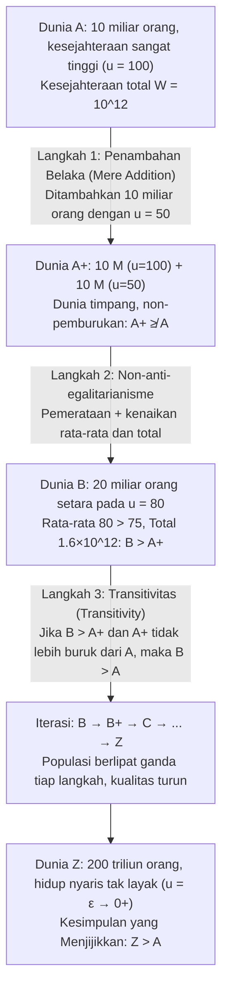

## Pendahuluan: Ketika “Ukuran Populasi $N$” Menjadi Variabel Moral

Dalam sebagian besar perdebatan klasik etika normatif dan ekonomi kesejahteraan, kita secara implisit bernalar di bawah asumsi <strong>populasi tetap (Fixed-Population)</strong>: sudah ada sejumlah $N$ individu yang pasti di dunia, dan tugas filsafat moral adalah mendistribusikan sumber daya secara adil di antara $N$ orang tersebut atau memaksimalkan kesejahteraan agregat mereka. Namun, begitu kita memperluas cakrawala ke kebijakan perubahan iklim,바isnya sumber daya bumi, etika reproduksi, atau <strong>장기주의 / longtermisme (Longtermism)</strong> dan risiko eksistensial (Existential Risks) yang menentukan nasib umat manusia selama ribuan tahun ke depan, asumsi tersebut runtuh: keputusan kita hari ini menentukan bukan hanya <em>seberapa baik</em> manusia masa depan akan hidup (kualitas hidup $u_i$), melainkan juga <em>berapa banyak</em> manusia yang akan ada (ukuran populasi $N$), dan bahkan <em>individu spesifik mana</em> yang akan dilahirkan.

Inilah ranah kajian <strong>etika populasi (Population Ethics)</strong> dan <strong>aksiologi populasi variabel (Variable-Population Axiology)</strong>. Pada tahun 1984, filsuf besar Inggris <strong>Derek Parfit (1942–2017)</strong> menerbitkan mahakaryanya <em>Reasons and Persons</em> (Bagian IV), yang mengguncang filsafat kontemporer. Parfit membuktikan bahwa jika kita menganut <strong>utilitarianisme total (Total Utilitarianism)</strong>—rumusan kanonik utilitarianisme sejak Henry Sidgwick—kita pasti akan digiring menuju suatu proposisi yang secara moral mengerikan: <strong>“Kesimpulan yang Menjijikkan” (The Repugnant Conclusion)</strong>. Lebih mengejutkan lagi, penelitian aksiomatik pada dekade-dekade berikutnya membuktikan bahwa setiap upaya memodifikasi utilitarianisme total demi menghindari kesimpulan ini justru menjerumuskan teori ke dalam paradoks lain yang jauh lebih mengerikan.

---

## Bab 1: Dari Populasi Tetap ke Populasi Variabel: Persimpangan Sidgwick

### 1.1 Definisi Formal Fungsi Kesejahteraan Sosial

Misalkan suatu dunia yang mungkin (atau keadaan populasi) $X$ terdiri atas $N(X) \in \mathbb{N}^+$ individu, yang direpresentasikan oleh vektor tingkat kesejahteraan bersih seumur hidup $X = (u_1, u_2, \dots, u_N) \in \mathbb{R}^N$. Dalam etika populasi, kita menetapkan garis acuan mendasar—<strong>tingkat kesejahteraan netral (Neutral Level)</strong> $u = 0$:
* Ketika $u_i > 0$, kehidupan individu $i$ secara keseluruhan <strong>layak untuk dijalani (A life worth living)</strong>;
* Ketika $u_i = 0$, kehidupan berada pada titik netral murni (secara aksiologis setara dengan ketidakadaan);
* Ketika $u_i < 0$, kehidupan didominasi oleh penderitaan berat dan <strong>tidak layak untuk dijalani (A life not worth living)</strong>.

Ketika dua dunia memiliki ukuran populasi yang persis sama ($N(X) = N(Y) = N$), <strong>utilitarianisme total (Total Utilitarianism)</strong> dan <strong>utilitarianisme rata-rata (Average Utilitarianism)</strong> menghasilkan urutan peringkat yang sepenuhnya identik:

$$W_{\text{total}}(X) = \sum_{i=1}^{N} u_i = N \cdot \bar{u}, \qquad W_{\text{avg}}(X) = \frac{1}{N} \sum_{i=1}^{N} u_i = \bar{u}$$

### 1.2 Pilihan Henry Sidgwick

Akan tetapi, ketika $N$ dapat berubah, kedua kriteria tersebut berpisah secara drastis. Sementara ekonom seperti John Stuart Mill atau Knut Wicksell cenderung memperhatikan kesejahteraan per kapita $\bar{u}$, tokoh puncak utilitarianisme klasik <strong>Henry Sidgwick</strong> menegaskan dalam <em>The Methods of Ethics</em> (1874) bahwa jika kebaikan tertinggi adalah surplus bersih kebahagiaan di alam semesta, kita wajib memaksimalkan hasil kali rata-rata kebahagiaan dengan jumlah makhluk yang mampu menikmatinya, yakni $W_{\text{total}}(X) = N \cdot \bar{u}$. Pilihan matematis yang tampak sangat wajar inilah yang menyulut sumbu paradoks Parfit.

---

## Bab 2: Derek Parfit dan “Kesimpulan yang Menjijikkan” (The Repugnant Conclusion)

### 2.1 Dunia $A$ vs. Dunia $Z$: Mozart dan Filsafat Melawan Musik Lift dan Kentang

Dalam § 142 <em>Reasons and Persons</em>, Parfit mengajak kita membandingkan dua dunia yang secara internal sama-sama egaliter namun berbeda ukuran populasinya:

* <strong>Dunia $A$ (Dunia Kesejahteraan Sangat Tinggi)</strong>: Dihuni oleh $N_A = 10\text{ miliar} = 10^{10}$ manusia. Setiap orang menikmati kualitas hidup yang luar biasa tinggi ($u_A = 100$)—kesehatan prima, kebebasan, cinta mendalam, penemuan ilmiah, serta apa yang dirangkum Parfit sebagai <strong>“Mozart dan filsafat (Mozart and philosophy)”</strong>. Kesejahteraan total Dunia $A$ adalah:
  $$W_{\text{total}}(A) = N_A \cdot u_A = 10^{10} \times 100 = 10^{12}$$
* <strong>Dunia $Z$ (Dunia Sangat Padat dengan Kelangsungan Hidup Marginal)</strong>: Menampung populasi raksasa sebesar $N_Z = 200\text{ triliun} = 2 \times 10^{14}$ individu. Kualitas hidup setiap penghuninya hanya sedikit sekali di atas titik netral nol ($u_Z = \varepsilon = 0.01 > 0$). Hidup mereka monoton dan miskin makna, tanpa budaya tinggi maupun kegembiraan mendalam, hanya menyisakan apa yang disebut Parfit sebagai <strong>“musik latar murahan (Muzak) dan kentang (Muzak and potatoes)”</strong>. Namun, karena ukuran $N_Z$ yang begitu kolosal, kesejahteraan total Dunia $Z$ mencapai:
  $$W_{\text{total}}(Z) = N_Z \cdot u_Z = (2 \times 10^{14}) \times 0.01 = 2 \times 10^{12}$$

Karena $W_{\text{total}}(Z) = 2 \times 10^{12} > 10^{12} = W_{\text{total}}(A)$, utilitarianisme total menetapkan bahwa <strong>Dunia $Z$ secara moral lebih baik daripada Dunia $A$ ($Z \succ A$)</strong>. Parfit menamai hasil ini <strong>“Kesimpulan yang Menjijikkan” (The Repugnant Conclusion)</strong>:

> <strong>Definisi Kesimpulan yang Menjijikkan</strong>: Untuk setiap kemungkinan populasi yang terdiri atas sedikitnya sepuluh miliar orang dengan kualitas hidup sangat tinggi, terdapat kemungkinan populasi lain yang jauh lebih besar yang keberadaannya—jika hal-hal lain setara—akan lebih baik, meskipun para anggotanya menjalani kehidupan yang nyaris tidak layak untuk dijalani ($u_i = \varepsilon \to 0^+$).

### 2.2 Mengapa Kesimpulan Ini Begitu Menjijikkan bagi Intuisi Kita?

Kesimpulan ini menabrak intuisi moral kita karena menyiratkan bahwa <strong>kuantitas belaka (Quantity) dapat menggantikan kualitas (Quality) tanpa batas</strong>. Pencapaian tertinggi jiwa manusia (Mozart dan filsafat) dikalahkan dalam pembukuan utilitarian oleh kerumunan tak berujung dari kehidupan yang nyaris vegetatif.

---

## Bab 3: Paradoks Penambahan Belaka (The Mere Addition Paradox)

Dapatkah kita menghindari Kesimpulan yang Menjijikkan hanya dengan menolak utilitarianisme total? Parfit merancang <strong>Paradoks Penambahan Belaka (The Mere Addition Paradox)</strong> untuk membuktikan bahwa tiga prinsip intuitif yang sangat moderat dan tidak bergantung pada utilitarianisme total sudah cukup untuk menyeret kita menuruni lereng licin langsung menuju Dunia $Z$.

Mari kita telaah ketiga langkah argumen Parfit:

1. <strong>Dari Dunia $A$ ke Dunia $A^+$ (Prinsip Penambahan Belaka / Mere Addition Principle)</strong>:
   Ke dalam Dunia $A$ (10 miliar orang dengan $u=100$) kita tambahkan di benua terpisah—tanpa memengaruhi penduduk asli sedikit pun—10 miliar orang lain yang menikmati hidup bahagia dengan $u=50$. Kita peroleh Dunia $A^+$.
   Menurut <strong>prinsip penambahan belaka</strong>, menambahkan orang-orang yang hidupnya jelas layak dijalani ($u > 0$) tanpa merugikan siapa pun tidak membuat dunia menjadi <strong>lebih buruk</strong>. Jadi, $A^+$ <strong>tidak lebih buruk daripada $A$</strong> ($A^+ \not\prec A$).
2. <strong>Dari Dunia $A^+$ ke Dunia $B$ (Non-anti-egalitarianisme / Dominansi Egaliter)</strong>:
   Dunia $A^+$ memiliki ketimpangan antara 10 miliar orang dengan $u=100$ dan 10 miliar orang dengan $u=50$ (rata-rata: $75$, total: $1{,}5 \times 10^{12}$). Bandingkan dengan <strong>Dunia $B$</strong>, di mana 20 miliar orang yang sama semuanya menikmati secara setara $u = 80$ (rata-rata: $80$, total: $1{,}6 \times 10^{12}$).
   Dunia $B$ memiliki total kesejahteraan lebih tinggi, rata-rata lebih tinggi, <em>dan</em> kesetaraan sempurna: oleh karena itu, <strong>Dunia $B$ secara tegas lebih baik daripada Dunia $A^+$ ($B \succ A^+$)</strong>.
3. <strong>Transitivitas (Transitivity) dan Lereng Iteratif</strong>:
   Jika $B$ lebih baik daripada $A^+$ dan $A^+$ tidak lebih buruk daripada $A$, maka <strong>transitivitas</strong> menuntut bahwa <strong>Dunia $B$ (20 miliar, $u=80$) lebih baik daripada Dunia $A$ (10 miliar, $u=100$)</strong>! Dengan mengulangi proses ini ($B \to B^+ \to C \to \dots \to Z$), kita tak terelakkan lagi tiba pada $Z \succ A$.

---

## Bab 4: Upaya Pelarian dan Kegagalannya: Dari Kesimpulan Sadis hingga Masalah Non-Identitas

Semua aksiologi alternatif yang diajukan untuk menghindari Kesimpulan yang Menjijikkan justru berujung pada kontraparadoks yang menghancurkan:

| Model Aksiologis | Fungsi Kesejahteraan Sosial $W(X)$ | Menghindari Repugnant Conclusion? | Biaya Teoretis Fatal & Paradoks Turunan |
| :--- | :--- | :--- | :--- |
| <strong>Utilitarianisme Total</strong> | $W_{\text{total}} = \sum_{i=1}^{N} u_i = N \cdot \bar{u}$ | <strong>Tidak</strong> (mengimplikasikan $Z \succ A$) | Substitusi tak terbatas kualitas oleh kuantitas |
| <strong>Utilitarianisme Rata-rata</strong> | $W_{\text{avg}} = \frac{1}{N} \sum_{i=1}^{N} u_i = \bar{u}$ | <strong>Ya</strong> ($\bar{u}_A = 100 > \varepsilon = \bar{u}_Z$) | “Penambahan ke Neraka” & <strong>Kesimpulan Sadis (Sadistic Conclusion)</strong> |
| <strong>Nilai Variabel (Hurka / Ng)</strong> | $W_{\text{var}} = f(N) \cdot \bar{u}, \ \lim_{N \to \infty} f(N) = M$ | <strong>Ya</strong> (batas atas asimtotik $M$) | Melanggar penambahan belaka pada $N$ besar & memicu Kesimpulan Sadis |
| <strong>Utilitarianisme Tingkat Kritis (CLU)</strong> | $W_{\text{CL}} = \sum_{i=1}^{N} (u_i - \alpha) \ (\alpha > 0)$ | <strong>Ya</strong> (kontribusi negatif jika $\varepsilon < \alpha$) | <strong>Kesimpulan Sangat Sadis (Very Sadistic Conclusion)</strong> |
| <strong>Pandangan Memengaruhi-Orang (Narveson)</strong> | Hanya menilai dampak pada individu konkret | <strong>Kondisional</strong> | Terbentur <strong>Asimetri</strong> (McMahan) & <strong>Masalah Non-Identitas</strong> (Parfit) |

### 4.1 Utilitarianisme Rata-rata dan “Kesimpulan Sadis” (The Sadistic Conclusion)

<strong>Utilitarianisme rata-rata</strong> ($W_{\text{avg}} = \bar{u}$) memang memilih $A$ di atas $Z$, tetapi melahirkan konsekuensi absurd:
* <strong>Penambahan ke Neraka (Addition to Hell)</strong>: Dalam dunia berisi 100 orang yang disiksa hebat dengan $u = -100$, melahirkan satu lagi orang yang disiksa dengan $u = -90$ “menaikkan” rata-rata menjadi $-99{,}91$: menciptakan kehidupan penuh siksaan dianggap sebagai perbaikan moral!
* <strong>Kesimpulan Sadis (The Sadistic Conclusion)</strong>: Dibuktikan oleh filsuf Swedia <strong>Gustaf Arrhenius</strong>, paradoks ini menunjukkan bahwa pada populasi yang sangat bahagia, utilitarianisme rata-rata kerap lebih memilih <strong>menambahkan segelintir orang yang disiksa secara kejam ($u < 0$) ketimbang menambahkan banyak sekali orang bahagia ($u > 0$, namun di bawah rata-rata awal)</strong>, karena sedikit orang yang disiksa menurunkan nilai rata-rata lebih kecil dibandingkan banyak orang yang cukup bahagia!

### 4.2 Nilai Variabel dan Utilitarianisme Tingkat Kritis (Critical-Level Utilitarianism)

1. <strong>Model Nilai Variabel (Thomas Hurka, Yew-Kwang Ng)</strong>: Meredam $N$ melalui fungsi cekung terbatas $\lim_{N \to \infty} f(N) = M < \infty$.
2. <strong>Utilitarianisme Tingkat Kritis (Blackorby, Bossert, dan Donaldson)</strong>: Memperkenalkan ambang positif $\alpha > 0$:
   $$W_{\text{CL}}(X) = \sum_{i=1}^{N} (u_i - \alpha) = N \cdot (\bar{u} - \alpha) \quad (\alpha > 0)$$
   Setiap kehidupan dengan $0 < u_i < \alpha$ mengurangi nilai sosial total.

<strong>Biaya Fatal — Kesimpulan Sangat Sadis (The Very Sadistic Conclusion)</strong>: Untuk Dunia $Z$ yang cukup besar dengan $0 < \varepsilon < \alpha$, nilai $W_{\text{CL}}(Z) = N_Z(\varepsilon - \alpha)$ menuju $-\infty$. Akibatnya, utilitarianisme tingkat kritis memutuskan bahwa <strong>neraka kecil yang dihuni ribuan orang yang disiksa terus-menerus ($u = -1000$) secara tegas lebih baik daripada Dunia $Z$ yang damai tempat ratusan triliun makhluk menjalani kehidupan positif!</strong>

### 4.3 Pandangan Memengaruhi-Orang, Asimetri, dan Masalah Non-Identitas

Pada tahun 1967, <strong>Jan Narveson</strong> merumuskan semboyan <strong>pandangan memengaruhi-orang (Person-Affecting Views)</strong>: <strong>“Kita mendukung upaya membuat orang menjadi bahagia, bukan mencetak orang-orang bahagia (We are in favor of making people happy, not of making happy people).”</strong>

Namun pandangan ini terbentur pada dua rintangan besar:
1. <strong>Asimetri Prokreasi Jeff McMahan (1981)</strong>: Kita memiliki kewajiban moral yang kuat untuk tidak melahirkan anak yang ditakdirkan hidup penuh siksaan ($u < 0$), tetapi tidak memiliki kewajiban moral untuk melahirkan anak karena ia akan hidup bahagia ($u > 0$).
2. <strong>Masalah Non-Identitas Parfit (The Non-Identity Problem)</strong>: Jika umat manusia hari ini memilih kebijakan <strong>Pengurasan Sumber Daya (Depletion)</strong> alih-alih <strong>Konservasi (Conservation)</strong>, hal itu mengubah seluruh jadwal aktivitas harian dan waktu pembuahan. Akibatnya, 300 tahun mendatang, 10 miliar manusia yang lahir di bawah kebijakan Pengurasan di planet yang tercemar ($u = 20 > 0$) akan menjadi <strong>individu-individu yang secara genetik dan numerik sama sekali berbeda</strong> dari mereka yang akan lahir di bawah kebijakan Konservasi ($u = 100$) ($\text{Pop}_{\text{deplete}} \cap \text{Pop}_{\text{conserve}} = \emptyset$). Karena tanpa kebijakan Pengurasan orang-orang tersebut tidak akan pernah ada sama sekali dan hidup mereka masih layak dijalani ($u = 20 > 0$), kebijakan Pengurasan <strong>tidak merugikan satu pun individu konkret</strong>! Untuk mengecam perusakan ekologis, kita membutuhkan prinsip impersonal (Impersonal)—yang kembali membawa kita ke Kesimpulan yang Menjijikkan.

---

## Bab 5: Teorema Ketidakmungkinan Arrhenius dan Pergeseran Paradigma Longtermisme

### 5.1 Teorema Ketidakmungkinan dalam Etika Populasi (Gustaf Arrhenius)

Dengan memperluas metode aksiomatik Kenneth Arrow, <strong>Gustaf Arrhenius</strong> membuktikan secara matematis bahwa <strong>tidak ada relasi urutan transitif $\succeq$ yang dapat memenuhi keempat aksioma berikut secara bersamaan</strong>:
1. <strong>Dominansi Egaliter (Egalitarian Dominance)</strong>: Pada populasi yang sama, dunia dengan total kesejahteraan lebih tinggi dan kesetaraan sempurna adalah lebih baik.
2. <strong>Syarat Kualitas (Menghindari Kesimpulan yang Menjijikkan)</strong>: Dunia berkesejahteraan sangat tinggi $A$ lebih baik daripada dunia kelangsungan hidup marginal $Z$.
3. <strong>Syarat Kuantitas (Penambahan Belaka)</strong>: Menambahkan kehidupan positif tidak memperburuk dunia.
4. <strong>Non-Sadisme (Non-Sadism)</strong>: Menambahkan kehidupan yang disiksa ($u < 0$) tidak pernah lebih baik daripada menambahkan kehidupan bahagia ($u > 0$).

### 5.2 Pernyataan Bersama Tahun 2021 dan Longtermisme Kontemporer

Pada tahun 2021, 29 filsuf dan ekonom terkemuka—termasuk Peter Singer, Hilary Greaves, Toby Ord, William MacAskill, dan Yew-Kwang Ng—menerbitkan manifesto <em>Overcoming the Repugnant Conclusion</em> di <em>Journal of Political Philosophy</em>. Mereka berargumen bahwa obsesi untuk menghindari Kesimpulan yang Menjijikkan dengan segala cara telah menjerumuskan etika ke jalan buntu yang jauh lebih buruk (seperti Kesimpulan Sadis), dan bahwa penolakan intuitif kita terhadap Dunia $Z$ sebagian besar disebabkan oleh <strong>ketidakpekaan skala (Scope Insensitivity)</strong> terhadap angka astronomis seperti $2 \times 10^{14}$. Bagi <strong>longtermisme (Longtermism)</strong> kontemporer, memitigasi risiko eksistensial dan mendorong kemajuan berkelanjutan memungkinkan kita memperjuangkan masa depan yang menggabungkan <strong>populasi masa depan yang besar (nilai $N$ besar) sekaligus kualitas hidup yang sangat luhur (nilai $\bar{u}$ tinggi)</strong>.
