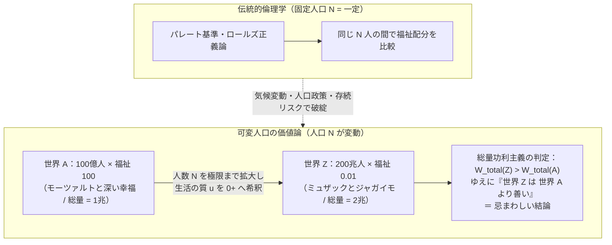
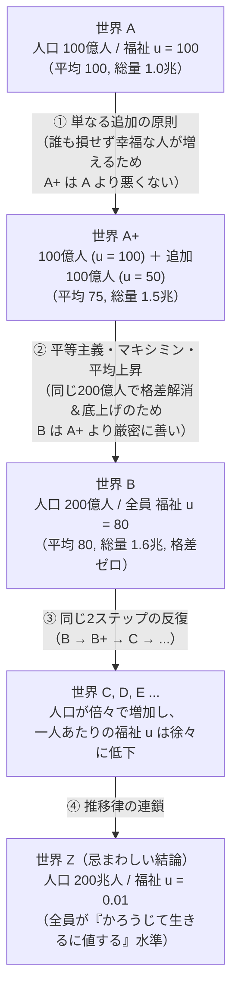

「もし私たちが、幸福な人生を送る人々の数を増やすことができるなら、世界はそれによって必ずより良い場所になるのだろうか？」

一見すると、この問いに対する答えは自明であるかのように思える。苦しんでいる人を増やすのは悪だが、生きるに値する充実した人生を享受する人々が増えることは、道徳的に望ましいことではないか――。しかし、この素朴な直観を論理的極限まで推し進めたとき、私たちは倫理学の歴史上もっとも深い奈落の一つへと突き落とされることになる。

1984年、オックスフォード大学の哲学者<strong>デレク・パーフィット（Derek Parfit）</strong>は、20世紀後半の道徳哲学における最高傑作と評される大著『理由と人格（Reasons and Persons）』の第4部において、<strong>「人口倫理学（Population Ethics）」</strong>という全く新しい研究領域を切り拓いた。そこで彼が定式化した<strong>「忌まわしい結論（The Repugnant Conclusion）」</strong>は、功利主義のみならず、平等主義、優先主義、義務論を含むあらゆる道徳理論に対して、40年以上にわたって未解決の突きつけられた刃となっている。

本稿では、固定人口を前提とした伝統的倫理学の限界から出発し、ヘンリー・シジウィックに端を発する<strong>総量功利主義（Total Utilitarianism）</strong>と<strong>平均功利主義（Average Utilitarianism）</strong>の分裂、パーフィットの「忌まわしい結論」とそれを背後から支える<strong>「単なる追加のパラドックス（Mere Addition Paradox）」</strong>、さらにはそれを回避しようとして考案された数々の代替公理系が次々と<strong>「サディスティックな結論（Sadistic Conclusion）」</strong>などのさらなる悪夢に呑み込まれていく様を、数理モデルと論理構造の両面から徹底的に解き明かす。そして最後に、グスタフ・アレニウスによる<strong>「人口倫理の不可能性定理」</strong>と、2021年にウィリアム・マッカスキルやピーター・シンガーらが発表した歴史的声明が示す現代的到達点を論じる。

---

## 1. 固定人口から可変人口へ：倫理学が見落としてきた次元

### 1.1 伝統的厚生経済学と倫理学の暗黙の前提

アリストテレスの徳倫理学から、カントの定言命法、ベンサムの功利計算、さらにはジョン・ロールズの『正義論（A Theory of Justice）』に至るまで、2000年以上にわたる西洋道徳哲学の大部分は、ある一つの暗黙の前提の上に築かれてきた。それは、<strong>「道徳的判断の対象となる人々の集合（人口サイズ $N$ および個人の同一性）は、あらかじめ固定されている」</strong>という前提である。

ミクロ経済学や厚生経済学における<strong>パレート効率性（Pareto Efficiency）</strong>の定義を思い出してみよう。ある社会状態 $X$ が別の社会状態 $Y$ をパレート支配するとは、社会に存在する個人 $i \in \{1, 2, \dots, N\}$ の誰一人として状態 $Y$ より効用が低くならず（$\forall i, u_i(X) \ge u_i(Y)$）、かつ少なくとも一人の効用が厳密に高くなる（$\exists j, u_j(X) > u_j(Y)$）ことを意味する。この定義が機能するのは、状態 $X$ と状態 $Y$ の双方に<strong>「同じ $N$ 人の同じ個人たち」</strong>が存在しているからにほかならない。

ロールズの「無知のヴェール（Veil of Ignorance）」も同様である。原初状態（Original Position）に集う契約当事者たちは、自分が社会のどの階層に生まれるかは知らないが、「自分が何らかの形でその社会に存在するメンバーの一人である」ことは前提としている。もし選択する政策によって、そもそも生まれてくる人々の数 $N$ が10億人になったり1000億人になったりする場合、「無知のヴェール」の背後にいる意思決定者は一体何人いると想定すべきなのか？ 存在しなかったかもしれない潜在的な人々も契約に参加できるのか？ ロールズ自身、世代間正義の議論においてこの問題に直面し、人口サイズそのものを決定する原理を自分の枠組みから事実上除外せざるを得なかった。

### 1.2 現実世界の選択はすべて「可変人口問題」である

しかし、私たちが21世紀に直面しているマクロな政策課題や倫理的決断のほとんどは、人口サイズ $N$ と将来世代の顔ぶれを根本的に変化させる<strong>「可変人口（Variable-Population）」</strong>の問題である。

* <strong>気候変動と資源配分政策</strong>：化石燃料の消費を今すぐ制限するか、それとも短期的な経済成長を優先するかという選択は、今後数百年にわたって地球が養える人口の規模 $N$ と、その人々の生活の質（Quality of Life）のトレードオフに直結する。
* <strong>人口政策と少子化対策</strong>：政府が出生率を高める政策を採るべきか、あるいは地球環境の負荷を減らすために人口減少を容認すべきかは、「より少ないが一人あたりが豊かな社会」と「より多いが一人あたりの資源が限られた社会」のどちらが望ましいかという価値判断を含んでいる。
* <strong>人類存続リスク（Existential Risk）と長期主義（Longtermism）</strong>：パンデミック、核戦争、暴走する汎用人工知能（AGI）によって人類が絶滅することの「道徳的な悪さ」とは何か？ 現存する80億人が命を失う悲劇だけでなく、「将来生まれてくるはずだった何兆人もの幸福な世代が永遠に失われること」も道徳的損失に算入すべきなのか？

これらの問いに答えるためには、人口サイズ $N(X)$ が状態 $X$ ごとに異なる場合でも、世界 $X$ と世界 $Y$ のどちらがより善い（$\succ$）かを比較できる<strong>「可変人口の価値論（Variable-Population Axiology）」</strong>が不可欠となる。

### 1.3 古典的功利主義の分裂：ミル／ヴィクセル vs. シジウィック

実は、19世紀後半の古典的功利主義者たちは、すでにこの問題に気づき始めていた。ジェレミ・ベンサムが提唱した「最大多数の最大幸福（The greatest happiness of the greatest number）」というスローガンは、修辞的には魅力的だが、数学的には曖昧である。「最大多数（人口 $N$ の最大化）」と「一人あたりの最大幸福（平均効用 $\bar{u}$ の最大化）」が衝突したとき、どちらを優先すべきなのか？

ここで功利主義は二つの陣営に分裂した。

第一の陣営は、<strong>ジョン・スチュアート・ミル（John Stuart Mill）</strong>やスウェーデンの経済学者<strong>クヌート・ヴィクセル（Knut Wicksell）</strong>に代表される<strong>「平均功利主義（Average Utilitarianism）」</strong>である。ミルは『経済学原理（Principles of Political Economy）』（1848年）の中で、すでに人口密度が十分に高い社会において、さらなる人口増加によって自然の静寂や孤独の空間が失われ、一人あたりの生活水準が切り詰められることを強く警戒した。この立場を数式化すると、ある世界 $X = (u_1, u_2, \dots, u_N)$ の道徳的価値 $W_{\text{avg}}(X)$ は、個人の福祉（効用）の算術平均によって定義される。

$$W_{\text{avg}}(X) = \frac{1}{N} \sum_{i=1}^{N} u_i = \bar{u}$$

この基準に従えば、社会の目的は「人類全体の幸福の総量」を増やすことではなく、<strong>「一人あたりの平均的な生活の質 $\bar{u}$」</strong>を最大化することにある。したがって、平均値を引き下げるような人口増加は道徳的な退歩とみなされる。

これに対し、第二の陣営として決定的な反論を行ったのが、ケンブリッジ大学の哲学者<strong>ヘンリー・シジウィック（Henry Sidgwick）</strong>であった。彼はその主著『倫理学の方法（The Methods of Ethics）』（1874年、第4巻第1章）において、功利主義の究極原理を厳密に分析し、次のように論じた。もし「快楽（幸福）がそれ自体として唯一の本来的善である」という功利主義の根本前提を受け入れるならば、平均値そのものに道徳的価値があるはずがない。平均とは単なる統計上の割り算の結果にすぎず、宇宙の中に実在する善の量は、存在するすべての意識的主体が経験する純粋な幸福の<strong>「総和（Total Sum）」</strong>でなければならない。

これが<strong>「総量功利主義（Total Utilitarianism）」</strong>である。世界 $X$ の道徳的価値 $W_{\text{total}}(X)$ は、人口サイズ $N$ と平均効用 $\bar{u}$ の積として定義される。

$$W_{\text{total}}(X) = \sum_{i=1}^{N} u_i = N \cdot \bar{u}$$

シジウィックは明確にこう結論づけた。「もし追加される人々が全体として正の幸福（生きるに値する人生）を享受するのであれば、たとえそれによって社会全体の平均的な幸福度が低下したとしても、人口が増加する方が道徳的に望ましい。厳密に言えば、私たちが最大化すべき目標は、<strong>現在生きているすべての人々の平均的幸福度と、その人々の数との積（Product）</strong>である」。

シジウィックのこの一文こそが、110年後にデレク・パーフィットによってパンドラの箱として開かれることになる定式化であった。

---

## 2. デレク・パーフィットと『忌まわしい結論』の衝撃

### 2.1 福祉のゼロ点（中立水準）と「生きるに値する人生」

パーフィットの議論を正確に理解するためには、まず個人の生涯福祉（Lifetime Well-being）$u_i \in \mathbb{R}$ のスケールにおける<strong>「ゼロ点（Neutral Level, $u = 0$）」</strong>の定義を明確にしておく必要がある。

人口倫理学において $u_i = 0$ とは、その人生が本人にとって「生きるに値する（worth living）」とも「生きない方がまし（not worth living）」とも言えない<strong>中立的な境界線</strong>を指す。たとえば、生涯を通じて一切の意識を持たない状態や、わずかな快楽とわずかな苦痛が完全に相殺され、「その人生を経験することと、最初から生まれてこなかったことの間に、本人にとって何の利害の違いもない」状態が $u = 0$ である。

* <strong>$u_i > 0$（正の福祉）</strong>：喜怒哀楽のすべてを総合したとき、生きていることが本人にとってプラスであり、「生まれてきてよかった」と評価できる人生。
* <strong>$u_i < 0$（負の福祉）</strong>：耐え難い激痛や絶望的な苦しみに満ちており、いかなる肯定的な経験によっても償われず、本人にとって「生まれてこない方がよかった」と評価される人生。

このスケールを設定した上で、パーフィットは『理由と人格』第17章において、二つの極端な可能世界――<strong>「世界 $A$」</strong>と<strong>「世界 $Z$」</strong>――の比較を読者に突きつけた。

### 2.2 世界 $A$ と 世界 $Z$：「モーツァルトと哲学」対「ミュザックとジャガイモ」

まず、<strong>世界 $A$</strong> を想像してみよう。
この世界には <strong>100億人（$N_A = 10^{10}$）</strong> の人々が存在している。そして、その全員が極めて高い生活の質（たとえば <strong>$u = 100$</strong>）を享受している。彼らは健康で、深い愛情と友情に恵まれ、知的な探究や科学的発見に喜びを見出し、モーツァルトの音楽や高度な芸術を味わい、創造的で自由な人生を全うしている。世界 $A$ における幸福の総量は次のようになる。

$$W_{\text{total}}(A) = N_A \cdot u_A = 10^{10} \times 100 = 10^{12}$$

次に、<strong>世界 $Z$</strong> を想像してみよう。
この世界には、想像を絶するほど膨大な数の人々――たとえば <strong>200兆人（$N_Z = 2 \times 10^{14}$）</strong>――がひしめき合って生きている。彼らの人生には、拷問のような激しい苦痛があるわけではない。そのため、彼らの福祉はゼロ（中立水準）よりはほんのわずかだけ高い（<strong>$u_Z = \varepsilon = 0.01 > 0$</strong>）。しかし、その人生にはモーツァルトも、シェイクスピアも、深い恋愛も、知的な興奮も一切存在しない。パーフィットの有名な比喩を借りれば、彼らの人生にある唯一の楽しみは、<strong>「単調なBGM（ミュザック、エレベーター音楽）を聴きながら、味気ないジャガイモを食べること（Muzak and potatoes）」</strong>だけである。それでも、完全に無であるよりはほんの僅かにマシであるため、彼らの人生は辛うじて「生きるに値する（barely worth living）」領域にとどまっている。

では、この世界 $Z$ における幸福の総量 $W_{\text{total}}(Z)$ を計算してみよう。

$$W_{\text{total}}(Z) = N_Z \cdot u_Z = (2 \times 10^{14}) \times 0.01 = 2 \times 10^{12}$$

驚くべきことに、$W_{\text{total}}(Z) = 2 \times 10^{12} > W_{\text{total}}(A) = 10^{12}$ となる。もし人口 $N_Z$ をさらに増やせば、一人あたりの幸福度 $\varepsilon > 0$ がどれほどゼロに限りなく近い微小数であったとしても、アルキメデスの性質（Archimedean Property: 任意の正の実数 $\varepsilon > 0$ と $M > 0$ に対し、$N \cdot \varepsilon > M$ となる自然数 $N$ が必ず存在する）により、総量功利主義は<strong>「世界 $Z$ は世界 $A$ よりも道徳的に優れた理想的な世界である（$Z \succ A$）」</strong>と判定するのである。

パーフィットはこの帰結を次のように定式化し、それを<strong>『忌まわしい結論（The Repugnant Conclusion）』</strong>と名づけた。

> <strong>【忌まわしい結論（The Repugnant Conclusion）】</strong>
> 全員が極めて高い生活の質を享受している、少なくとも100億人からなる任意の可能な人口（世界 $A$）に対して、他の条件が等しければ、そのメンバー全員が「かろうじて生きるに値するにすぎない人生」を送っているとしても、その存在が世界 $A$ よりも道徳的に善いことになるような、はるかに巨大な想像可能な人口（世界 $Z$）が必ず存在する。

### 2.3 なぜ『忌まわしい結論』はこれほど直観に反するのか？

多くの人々がこの結論に強い拒絶感（Repugnance）を抱く理由は、単なる審美的な嫌悪感にとどまらない。ここには、人間の価値判断における根本的な構造が関わっている。

第一に、<strong>「最高度の質的価値が、最低限の量的反復によって完全に代替可能である」</strong>という主張への違和感である。人類が何千年もかけて到達した芸術、科学、哲学、深い精神的結合、自己実現といった高次の価値（ミルが呼んだ「高次の快楽」）が、どれほど膨大な数であれ、単調な感覚的刺激（「ミュザックとジャガイモ」や、あるいは爬虫類が日向ぼっこで感じるような微弱な快）の足し算によって追い抜かれ、道徳的に凌駕されるというのは、価値の次元を取り違えているように思える。

第二に、もし総量功利主義が正しいとすれば、私たちが目指すべき人類の究極の未来像（ユートピア）は、一人ひとりが豊かで自由な文明を築くことではなく、<strong>「生存ギリギリのカロリーと微弱な快楽物質を与えられた人間（あるいは人工意識）を、宇宙の物理的限界まで高密度に詰め込んだ超巨大養鶏場のような世界」</strong>になってしまうという点である。経済学者のロビン・ハンソンや哲学者ニック・ボストロムが指摘するように、もし超知能AIに「宇宙の総効用を最大化せよ」という目的関数を与えたならば、AIは人間の豊かな文明を解体し、最小限の計算資源でわずかな快楽シグナル（ヘドニウム）を反復再生する極小のデジタル意識を10の50乗個生成するだろう。これこそが、世界 $Z$ のテクノロジー版にほかならない。

---

## 3. 単なる追加のパラドックス（Mere Addition Paradox）：総量功利主義を捨てても逃げられない理由

「それなら簡単だ。総量功利主義などという極端な理論を捨ててしまえばよいのではないか！」

『忌まわしい結論』を初めて聞いた人の多くはそう考える。しかし、パーフィットが真に天才的だったのは、総量功利主義を一切前提としなくとも、私たちが日常的に信じている<strong>極めて穏当で反論しがたい3つの道徳的直観（非功利主義的な原則を含む）</strong>を組み合わせるだけで、論理的必然として世界 $A$ から世界 $Z$ へと追い詰められてしまうことを証明した点にある。

これが、『理由と人格』第19章で提示された<strong>「単なる追加のパラドックス（The Mere Addition Paradox）」</strong>およびその連鎖形である<strong>「アルファベット・パラドックス（Alphabet Paradox）」</strong>である。

### 3.1 ステップ1：$A$ から $A^+$ への移行（「単なる追加」の原則）

いま、出発点として先ほどの<strong>世界 $A$</strong>（100億人が全員 $u = 100$ の極めて幸福な生活を送っている世界）を考える。

ここに、<strong>世界 $A^+$</strong> という別の可能世界を導入しよう。
世界 $A^+$ には、世界 $A$ と全く同じ100億人の人々が存在し、彼らは何の影響も受けずに $u = 100$ の幸福をそのまま享受している。ただし、世界 $A^+$ には（たとえば海を隔てた別の大陸、あるいは別の惑星に、互いに存在を知らないまま）<strong>もう一つのグループとして100億人の人々</strong>が追加で存在している。この追加された100億人の生活水準は $u = 50$ である。

注意してほしいのは、$u = 50$ というのは決して惨めな人生ではないという点だ。中立水準 $u = 0$ をはるかに上回る、十分に幸福で充実した「生きるに値する素晴らしい人生」である（ただ、最初のグループの $u = 100$ ほど超人的に恵まれてはいないというだけである）。また、二つのグループは物理的に隔絶されており、互いの存在を知らないため、嫉妬や相対的剥奪感によって不効用が生じることもない。

さて、ここで問おう。<strong>「世界 $A^+$ は、世界 $A$ よりも道徳的に『悪い（worse than）』世界だろうか？」</strong>

元々いた100億人は1ミリも損をしていない（$u = 100$ のまま）。そして新たに存在することになった100億人は、生まれてきたことを心から喜べる $u = 50$ の幸福な人生を送っている。もし「世界 $A^+$ は世界 $A$ より悪い」と主張するなら、「幸福な人々が新たに生まれてくること自体が、誰にも害を与えていないにもかかわらず、宇宙を道徳的に汚染し悪化させた」と言わなければならない。

パーフィットは、これを否定する極めて穏当な原則を定式化した。

> <strong>【単なる追加の原則（The Mere Addition Principle）】</strong>
> 他の人々の福祉に一切の悪影響を与えず、かつ全員が十分に生きるに値する正の福祉（$u > 0$）を享受している人々を単に追加しただけの世界（$A^+$）は、元の世界（$A$）よりも<strong>悪くはない（not worse than, $A^+ \not\prec A$）</strong>。

「より善い（better）」とさえ言う必要はない。ただ「元の世界より<strong>悪くはない</strong>」と認めるだけでよいのである。

### 3.2 ステップ2：$A^+$ から $B$ への移行（反・不平等主義とパレート的改善）

次に、この世界 $A^+$（$u = 100$ が100億人、$u = 50$ が100億人、合計200億人）と、<strong>世界 $B$</strong> を比較しよう。
世界 $B$ には、世界 $A^+$ と<strong>全く同じ人数である200億人</strong>が存在している。そして、その200億人全員が <strong>$u = 80$</strong> の高い生活水準を平等に享受している。

世界 $A^+$ と世界 $B$（どちらも人口200億人で固定！）を比べると、何が起きているだろうか？

1. <strong>総効用の増加</strong>：世界 $A^+$ の総効用は $100\text{億}\times 100 + 100\text{億}\times 50 = 1.5\text{兆}$ だが、世界 $B$ の総効用は $200\text{億}\times 80 = 1.6\text{兆}$ に増えている。
2. <strong>平均効用の増加</strong>：世界 $A^+$ の平均効用は $(100 + 50)/2 = 75$ だが、世界 $B$ の平均効用は $80$ に上昇している。
3. <strong>不平等の解消（平等主義的改善）</strong>：世界 $A^+$ には $100$ と $50$ という巨大な格差が存在していたが、世界 $B$ では全員が $80$ で完全に平等である。
4. <strong>最も不遇な人々の底上げ（ロールズのマキシミン原理／優先主義的改善）</strong>：社会で最も低い立場にある100億人の福祉が、$50$ から $80$ へと大幅に引き上げられている（恵まれた層の $20$ の減少と引き換えに、恵まれない層が $30$ 増加している）。

つまり、総量功利主義、平均功利主義、平等主義（Egalitarianism）、優先主義（Prioritarianism）、ロールズ的マキシミン原理の<strong>すべての道徳理論が満場一致で「世界 $B$ は世界 $A^+$ よりも厳密に善い（$B \succ A^+$）」と判定する</strong>のである！

### 3.3 ステップ3：推移律の罠と世界 $Z$ への滑り坂（Alphabet Paradox）

ここでステップ1とステップ2の結果を並べてみよう。

* ステップ1：世界 $A^+$ は世界 $A$ より<strong>悪くはない</strong>（$A^+ \not\prec A$）。
* ステップ2：世界 $B$ は世界 $A^+$ より<strong>厳密に善い</strong>（$B \succ A^+$）。

もし「〜より悪くない」と「〜より厳密に善い」の間に通常の<strong>推移的な整合性（Transitivity）</strong>が成り立つならば、ここから<strong>「世界 $B$ は世界 $A$ より悪くない（むしろ善い、$B \succ A$ または $B \not\prec A$）」</strong>という結論が導かれる。
しかし、世界 $A$（100億人が $u = 100$）と世界 $B$（200億人が $u = 80$）を見比べてほしい。人口が倍増する代わりに、一人あたりの最高水準の生活の質が $100$ から $80$ へと切り下げられている！

そして恐ろしいことに、このプロセスは世界 $B$ で止まらない。
世界 $B$（200億人が $u = 80$）に対して、再び「単なる追加」を行って $u = 40$ の200億人を加えた<strong>世界 $B^+$</strong> を作り、次にそれを平等化・底上げした<strong>世界 $C$</strong>（400億人が全員 $u = 64$）へと移行する。

$$A \xrightarrow{\text{単なる追加}} A^+ \xrightarrow{\text{平等化・平均上昇}} B \xrightarrow{\text{単なる追加}} B^+ \xrightarrow{\text{平等化・平均上昇}} C \longrightarrow \cdots \longrightarrow Z$$

この2ステップのサイクルを何回も反復（イテレーション）していくと、各ステップでは「誰にも害を与えない幸福な人々の追加」と「人口固定のもとでの平均上昇・格差是正・底上げ」しか行っていないにもかかわらず、私たちは最終的に<strong>世界 $Z$（何百兆人もの人々が $u = \varepsilon$ の「ミュザックとジャガイモ」で暮らす世界）</strong>へと強制的に連行されてしまうのである！

この「単なる追加のパラドックス」が突きつける論理的トリレンマは極めて冷酷である。世界 $Z$（忌まわしい結論）を拒絶するためには、私たちは以下のどれか一つを否定しなければならない。

1. <strong>「単なる追加の原則」を否定する</strong>：すなわち、「既存の誰にも害を与えず、生まれてくる本人たちも幸福であるにもかかわらず、平均値より低い幸福な人々が生まれてくることは世界を道徳的に悪化させる」と主張する。
2. <strong>「反・不平等主義（$B \succ A^+$）」を否定する</strong>：すなわち、同じ200億人の社会において、総効用も平均効用も高く、格差がなく、最底辺層が $50$ から $80$ に底上げされている世界 $B$ よりも、少数の特権層が $100$ を維持している不平等な世界 $A^+$ の方が優れている（エリート主義）と主張する。
3. <strong>「より善い（$\succ$）」という関係の推移律（Transitivity）を否定する</strong>：すなわち、道徳的価値の順序関係が循環したり断裂したりすることを認める。

果たして、これらの脱出路は本当に機能するのだろうか？ 次節では、哲学者や経済学者たちが試みた5つの主要な代替理論と、それらが引き起こす「さらに恐ろしいパラドックス」を検証する。

---

## 4. 代替公理系の墓場：『忌まわしい結論』を逃れようとすると何が起きるか

パーフィットの問題提起以降、多くの倫理学者や理論経済学者が『忌まわしい結論』を回避できる新しい価値関数 $W(X)$ の構築を試みた。しかし、そこには巧妙な数理的トラップが待ち受けていた。一つの直観的パラドックスを塞ごうとして公理を修正すると、別の場所からさらにグロテスクな直観違反が噴出するのである。

### 4.1 第1の脱出路：平均功利主義（Average Utilitarianism）とその破綻

もっとも単純な解決策は、ステップ1の「単なる追加の原則」を真っ向から拒絶し、ミルやヴィクセルのように<strong>平均功利主義</strong>（$W_{\text{avg}}(X) = \frac{1}{N}\sum u_i$）を採用することである。
実際、平均功利主義のもとでは、世界 $A$（平均 $100$）に $u = 50$ の100億人を追加した世界 $A^+$ の平均値は $75$ に下がるため、$A^+ \prec A$ となり、滑り坂は最初の1歩目で食い止められる。世界 $Z$（平均 $0.01$）が世界 $A$（平均 $100$）を上回ることも絶対にない。

しかし、平均功利主義には、哲学者のほぼ全員が「忌まわしい結論以上に受け入れがたい」とみなす<strong>4つの致命的欠陥</strong>が存在する。

#### ① 隠者（孤独な超幸福者）のパラドックス
宇宙にたった一人だけ、福祉 $u = 100.1$ を享受するナルシストな隠者が生きている世界と、1000億人の人々が愛と連帯の中で $u = 100$ の素晴らしい人生を送っている世界を比較しよう。平均功利主義は、前者の平均（$100.1$）が後者の平均（$100$）を上回るというだけの理由で、<strong>「1000億人の豊かな文明よりも、たった一人の世界の方が道徳的に優れている」</strong>と判定してしまう。

#### ② 地獄への追加（Addition to Hell）のパラドックス
いま、全員が $u = -100$ という耐え難い拷問のような苦しみに喘いでいる「地獄の世界」があるとしよう。この世界に、毎日激しい苦痛に苛まれるが、元の住民よりはほんの少しだけ苦痛が軽い人々（たとえば $u = -99$ の「生まれてこない方がよかった悲惨な人生」）を大量に追加するとどうなるか？
驚くべきことに、$-100$ の集団に $-99$ の人々を追加すると、社会全体の<strong>平均値は $-100$ から $-99.5$ へと「上昇」する</strong>！ したがって平均功利主義は、<strong>「地獄の平均値を引き上げるために、一生苦しみ続ける不幸な子供たちを新たにどんどん産み増やすことが道徳的義務である」</strong>という狂気じみた結論を導き出す。

#### ③ サディスティックな結論（The Sadistic Conclusion）
スウェーデンの哲学者グスタフ・アレニウス（Gustaf Arrhenius）が定式化した、平均功利主義に対する決定的な反証である。
いま、非常に高い福祉（$u = 100$）を享受している100億人の既存社会があるとしよう。ここに、次の二つの選択肢のうちどちらか一方を追加しなければならないとする。

* <strong>選択肢1（幸福な人々の追加）</strong>：$u = 50$ という十分に幸福な人生を送る人々を <strong>10億人</strong> 追加する。
* <strong>選択肢2（拷問される人の追加）</strong>：$u = -100$ という想像を絶する激痛と絶望のうちに生涯を終える人を <strong>たった1人</strong> 追加する。

常識的な道徳感覚であれば、誰一人として不幸にならず10億人が幸せに暮らす「選択肢1」を選び、無実の人間が拷問のような一生を送る「選択肢2」を絶対に避けるべきだと考えるだろう。
ところが、平均功利主義で両者の平均値を計算するとどうなるか？

$$\text{選択肢1の平均} = \frac{10^{10} \times 100 + 10^9 \times 50}{1.1 \times 10^{10}} = \frac{1050}{11} \approx 95.45$$

$$\text{選択肢2の平均} = \frac{10^{10} \times 100 + 1 \times (-100)}{10^{10} + 1} \approx 99.99999998$$

なんと、$u = 50$ の幸福な10億人は「分母 $N$ を大きく増やして平均値を $95.45$ まで薄めてしまう」のに対し、$u = -100$ の拷問される1人は「分母を1しか増やさないため、平均値をほぼ $100$ のまま維持できる」のである！ その結果、平均功利主義は<strong>「10億人の幸福な人々を生み出すくらいなら、1人の人間を拷問にかけた方が道徳的に遥かに善い世界になる」</strong>と判定する。アレニウスはこれを<strong>『サディスティックな結論（The Sadistic Conclusion）』</strong>と呼んだ。

#### ④ エジプトの農民と銀河系外の宇宙人への依存性
平均功利主義のもとでは、あなたが今日、幸福度 $u = 70$ の子供をもう一人産むことが「善いこと」か「悪いこと」かは、過去の歴史上すべての人間（古代エジプトの農民や中世の農奴を含む）および100億光年離れた銀河にいる宇宙人の平均幸福度が $70$ より高かったか低かったかに依存することになる。無関係な他者の平均値によって目の前の命の価値がプラスにもマイナスにも反転するというのは、道徳的理由として完全に常軌を逸している。

---

### 4.2 第2の脱出路：可変価値説・漸近上限モデル（Variable Value / Capped Models）

総量功利主義（$W = N \cdot \bar{u}$）と平均功利主義（$W = \bar{u}$）の両極端を避けるため、トマス・ハーカ（Thomas Hurka）や黄有光（Yew-Kwang Ng）らが提案したのが、<strong>「人口サイズ $N$ の限界価値が逓減し、無限大で一定の上限 $M$ に漸近する」</strong>という折衷モデルである。

$$W_{\text{var}}(X) = f(N) \cdot \bar{u} \quad \left(\text{ただし } f'(N) > 0,\ f''(N) < 0,\ \lim_{N \to \infty} f(N) = M < \infty \right)$$

たとえば $f(N) = M \left(1 - e^{-kN}\right)$ のような関数を設定すれば、人口 $N$ が小さいうちは総量功利主義のように人口増加を高く評価し、人口 $N$ が巨大になると $f(N)$ が上限 $M$ に張り付くため、世界 $Z$ の価値は高々 $M \cdot \varepsilon$ に抑えられ、$W_{\text{var}}(A) > M \cdot \varepsilon$ となって『忌まわしい結論』を回避できるように見える。

しかし、このモデルもすぐに破綻することが判明した。なぜなら、<strong>既存の人口 $N$ がすでに十分に大きい世界（たとえば銀河系規模に広がった文明）を基準にした瞬間、$f(N) \approx M$（定数）となってしまい、そこから先の振る舞いが平均功利主義と完全に一致してしまう</strong>からである。その結果、高人口ベースラインのもとでは、先述の『サディスティックな結論』（大勢の幸福な人々を追加するより、少数の苦しむ人を追加した方が $f(N)\cdot \bar{u}$ の低下が少ない）がそのまま復活してしまうのである。

---

### 4.3 第3の脱出路：臨界水準功利主義（Critical-Level Utilitarianism）と『極めてサディスティックな結論』

経済学者のチャールズ・ブラックオービー（Charles Blackorby）、ウォルター・ボサート（Walter Bossert）、デイヴィッド・ドナルドソン（David Donaldson）らが体系化した、厚生経済学においてもっとも有名な回避策が<strong>「臨界水準功利主義（Critical-Level Utilitarianism: CLU）」</strong>である。

CLUは、各個人の福祉 $u_i$ から、正の定数である<strong>「臨界水準（Critical Level）$\alpha > 0$」</strong>（たとえば $\alpha = 30$）を差し引いた値を足し合わせる。

$$W_{\text{CL}}(X) = \sum_{i=1}^{N} (u_i - \alpha) = N \cdot (\bar{u} - \alpha) \quad (\alpha > 0)$$

このモデルの巧妙な点は、「本人にとって生きるに値する中立水準（$u = 0$）」と、「社会に追加されたときに世界の道徳的価値を高める臨界水準（$u = \alpha > 0$）」を切り離したことにある。
これにより、世界 $Z$ の人々の福祉 $u_Z = \varepsilon = 0.01$ は臨界水準 $\alpha = 30$ を下回るため、一人追加されるごとに世界の価値は $(0.01 - 30) = -29.99$ ずつ<strong>減少</strong>する。よって $W_{\text{CL}}(Z) \to -\infty$ となり、『忌まわしい結論』は完璧にブロックされる。また、一人あたりの寄与 $(u_i - \alpha)$ の総和をとる加法分離可能な形式を保っているため、過去の死者や遠くの宇宙人の福祉に依存することもない。

では、臨界水準功利主義は人口倫理の聖杯となったのだろうか？
否である。アレニウスは、CLUが平均功利主義よりもさらに恐ろしい帰結――<strong>『極めてサディスティックな結論（The Very Sadistic Conclusion）』</strong>――を導くことを証明した。

臨界水準 $\alpha = 30$ のもとで、福祉 $u = 25$ の人々を考えてみよう。$u = 25$ はゼロ（中立水準）よりはるかに高く、本人たちにとっては喜びや充実感に満ちた幸福な人生である。しかし、CLUの数式上では、彼らの社会的寄与は $u_i - \alpha = 25 - 30 = -5$ という<strong>負の値（マイナス）</strong>としてカウントされる！
その結果、何が起きるか？

* <strong>世界 $X$（拷問の世界）</strong>：100人の人間が $u = -100$ の凄惨な拷問を受けている世界。
  $$W_{\text{CL}}(X) = 100 \times (-100 - 30) = -13,000$$
* <strong>世界 $Y$（幸福な人々の世界）</strong>：1万人の人間が $u = 25$ の幸福で満ち足りた人生を送っている世界。
  $$W_{\text{CL}}(Y) = 10,000 \times (25 - 30) = -50,000$$

なんと、臨界水準功利主義は $W_{\text{CL}}(X) = -13,000 > W_{\text{CL}}(Y) = -50,000$ と計算し、<strong>「誰一人として不幸な人がいない1万人の幸福な社会（$u = 25$）よりも、全員が地獄の拷問に苦しむ100人の社会（$u = -100$）の方が道徳的に優れている」</strong>という結論を下すのである！
平均功利主義の「サディスティックな結論」では、高福祉の既存人口（$u=100$）が存在しているという前提が必要だったが、CLUの「極めてサディスティックな結論」では、既存人口すら必要ない。<strong>純粋に幸福な人々だけからなる社会が、純粋に拷問される人々だけからなる地獄よりも「悪い」と判定されてしまう</strong>のである。これは倫理理論として致命的な崩壊と言わざるを得ない。

---

### 4.4 第4の脱出路：語彙的閾値（Lexical Thresholds）と通約不可能性（Incommensurability）

数式の線形な足し算や引き算が問題を生むのだとすれば、「質的に高次の価値（モーツァルト）は、いかなる量の低次の価値（ミュザックとジャガイモ）によっても決して凌駕されない」という<strong>語彙的優先性（Lexical Priority / Superior Goods）</strong>を導入すればどうだろうか？ ジェームズ・グリフィン（James Griffin）やロジャー・クリスプ（Roger Crisp）らが探求したアプローチである。

しかし、この「語彙的閾値モデル」には、<strong>「連続体のパラドックス（Continuum / Spectrum Argument）」</strong>という鋭い刃が突き刺さる。
モーツァルトの交響曲（$u = 100$）とミュザック（$u = 0.01$）の間には、不連続な断絶があるわけではない。モーツァルトよりほんのわずかだけ劣るハイドン（$u = 99$）、それより少しだけ劣るサロン音楽（$u = 98$）……というように、知覚できないほど微小な質的変化の連続体（スペクトラム）$u_0, u_1, u_2, \dots, u_k$ を作ることができる。
もし語彙的閾値が存在するなら、次の二つのうちどちらかを選ばなければならない。

1. <strong>任意の隣接ステップ間で語彙的優位が成り立つとする場合</strong>：$u = 100$ の1人の人生は、$u = 99.9$ の人生が何百兆人分集まった世界よりも優れているという極端な超エリート主義に陥る。
2. <strong>ある特定の境界値 $u^* = 42.000$ にだけ「崖（ナイフエッジ）」があるとする場合</strong>：$u = 42.001$ の人生と $u = 41.999$ の人生の間には、本人の実感としてはほとんど何の違いもないにもかかわらず、前者は無限の価値を持ち、後者は何兆人集まっても前者の1人分に及ばないという、完全に恣意的で不条理な断絶が生じる。

また、ルース・チャン（Ruth Chang）やパーフィット自身が検討した<strong>「通約不可能性／不完全な順序付け（Incommensurability / Rough Comparability）」</strong>――すなわち、「世界 $A^+$ と世界 $A$ は、どちらが善いとも悪いとも言えず、等しくもない（比較不能である）」とすることで推移律の連鎖を断ち切るアプローチ――も、単なる追加のパラドックスの変形版（支配原理を用いた比較）によって、依然として『忌まわしい結論』と論理的矛盾を引き起こすことが証明されている。

---

### 4.5 第5の脱出路：人格影響説（Person-Affecting View）とプロクリエイションの非対称性

ここで、まったく異なる哲学的アプローチが登場する。1967年にカナダの哲学者ヤン・ナーヴェソン（Jan Narveson）が提唱した<strong>「人格影響説（Person-Affecting View）」</strong>である。ナーヴェソンは、人口倫理の混乱を鮮やかな一行のスローガンで一刀両断した。

> <strong>「私たちは『人々を幸せにすること（making people happy）』には賛成だが、『幸せな人々を作ること（making happy people）』に賛成しているわけではない。」</strong>

つまり、道徳的義務や価値というものは常に「すでに存在している（あるいは選択にかかわらず必ず存在する）具体的な人格（Person）」に対してのみ発生するのであり、「幸福という抽象的な物質を宇宙という容器の中にどれだけ詰め込めるか」という非人格的（Impersonal）な視点そのものが誤りだ、という主張である。

この考え方を生殖倫理（Procreative Ethics）において定式化したのが、ジェフ・マクマハン（Jeff McMahan）による有名な<strong>「非対称性命題（The Asymmetry）」</strong>である。

* <strong>【苦痛に関する義務（負の側面）】</strong>：もし生まれてくる子供が惨めな人生（$u < 0$）を送ることが予見されるなら、私たちはその子供を<strong>産まない強い道徳的理由（義務）</strong>がある。
* <strong>【幸福に関する中立性（正の側面）】</strong>：もし生まれてくる子供が幸福な人生（$u > 0$）を送ることが予見されるとしても、私たちはその子供を<strong>産むべき道徳的理由（義務）は一切ない</strong>（産まなくても誰も損をしないからである）。

この「非対称性」は、私たちの日常的な生殖に関する直観（「不幸になる子を産むのは悪いことだが、幸せになるからといって子作りをしないカップルが道徳的悪を犯しているわけではない」）と驚くほどよく合致する。そして、幸せな人を増やしても世界の道徳的価値は上がらないとすれば、世界 $Z$ が世界 $A$ を上回ることもない。

しかし、この魅力的な「人格影響説」と「非対称性」にも、<strong>二つの巨大な時限爆弾</strong>が埋め込まれていた。

#### ① パーフィットの「非同一性問題（The Non-Identity Problem）」
『理由と人格』第16章でパーフィットが提示した、現代倫理学でもっとも有名な思考実験である。
いま、人類が今後のエネルギー・環境政策として<strong>「保全政策（Conservation）」</strong>と<strong>「枯渇政策（Depletion）」</strong>のどちらかを選ぶとしよう。「枯渇政策」を選べば、今後200年間はわずかに快適になるが、300年後以降の地球環境は激しく破壊され、将来世代の生活水準は $u = 100$ から $u = 10$（かろうじて生きるに値する水準）へと劇的に低下する。

ところが、ここに生物学的な事実がある。私たちが一人の人間としてこの世に生まれるためには、特定の瞬間に特定の精子と特定の卵子が出会わなければならない。もし社会全体が「保全政策」ではなく「枯渇政策」を選べば、人々の移動、職業、結婚のタイミング、受精の瞬間はすべて変化する。その結果、<strong>300年後に「枯渇政策」のもとで生まれてくる200億人の個人たちは、「保全政策」が選ばれていたならば誰一人としてこの世に生まれてこなかった（まったく別の200億人が生まれていた）</strong>のである！

すると、「具体的な個人にとって悪いかどうか」だけを問う厳密な<strong>人格影響説</strong>のもとでは、何が起きるか？
300年後に枯渇した地球（$u = 10$）に生まれた個人 $P$ にとって、「枯渇政策」は彼に害を与えただろうか？ 否！ もし私たちが「保全政策」を選んでいたら、個人 $P$ は $u = 100$ になっていたのではなく、<strong>そもそも存在していなかった（$u = 0$）</strong>のである。そして $u = 10 > 0$（生きるに値する人生）である以上、個人 $P$ にとっても「枯渇政策が選ばれて自分が生まれてきたこと」は利益でこそあれ、害ではない！
つまり、厳密な人格影響説を採用すると、<strong>「将来の地球環境を徹底的に破壊して未来世代の生活水準を最低限まで突き落としても、それによって被害を受ける特定の個人はどこにも存在しないため、道徳的に何の問題もない」</strong>という衝撃的な結論（あるいは人類が自発的に絶滅しても誰にも害を与えないという結論）を認めざるを得なくなるのである。

#### ② 非対称性の論理的不整合（不確実性と選択の循環）
さらに、マクマハンの「非対称性」（幸福な人の追加は道徳的に中立であり、世界の価値を変えない）を認めると、次のような自己矛盾が生じる。
あるカップルが子供を産まない状態（$O$）と、福祉 $u = 50$ の子供 $X$ を産む状態を比較すると、非対称性により「$X$ を産むことは $O$ と道徳的に同等（中立）」である。同様に、福祉 $u = 100$ の別の子供 $Y$ を産むことも「$O$ と道徳的に同等（中立）」である。
もし両者がともに $O$ と同等の価値しか持たないなら、$X$（$u = 50$）を産むことと $Y$（$u = 100$）を産むことも道徳的に同等であるはずだ。しかし、どうせ一人産むのであれば、より健康で幸福な $Y$（$u = 100$）が生まれる方を選ぶべきであることは明らかである（$Y \succ X$）。このように、「存在する前の追加は価値ゼロだが、存在することが決まった途端に価値が生じる」というルールは、確率的不確実性や複数選択肢のもとで深刻な<strong>非推移性（サイクリックな矛盾）</strong>を引き起こすのである。

---

## 5. アレニウスの不可能性定理と2021年のパラダイムシフト

### 5.1 人口倫理における「アローの不可能性定理」

ここまで見てきたように、総量功利主義、平均功利主義、可変価値説、臨界水準功利主義、語彙的閾値、人格影響説のすべてが、どこかで深刻なパラドックスに衝突する。「まだ私たちが思いついていないだけで、すべての直観を満たす完璧な数式 $W(X)$ がどこかにあるのではないか？」と期待したくなるかもしれない。

しかし、その希望を数学的に完全に打ち砕いたのが、グスタフ・アレニウス（Gustaf Arrhenius）による<strong>「人口倫理学における不可能性定理（Impossibility Theorems in Population Ethics）」</strong>（特に第6不可能性定理）である。

社会選択理論においてケネス・アロー（Kenneth Arrow）が「どれほど民主的に見える投票ルールであっても、パレート原理・無関係な選択肢からの独立性・非独裁制を同時に満たすことは数学的に不可能である」と証明したのと全く同様に、アレニウスは可変人口の順序関係 $\succsim$ に関して、以下の<strong>極めて基本的で穏当な公理群をすべて同時に満たす道徳理論（価値関数）は論理的に存在しえない（空集合である）</strong>ことを厳密に証明した。

1. <strong>領域の無制限性・推移性（Transitivity）</strong>：すべての可能世界の間で整合的な順序付けができること。
2. <strong>平等主義的優越（Egalitarian Dominance）</strong>：人口が同じ二つの世界で、一方の世界が全員平等であり、かつもう一方の不平等な世界よりも総福祉・平均福祉ともに高いならば、前者の世界の方が善い（先の $B \succ A^+$ に対応する最小限の条件）。
3. <strong>一般化された非極端優先性（General Non-Extreme Priority）</strong>：すでに極めて恵まれている1人の福祉がほんの少し上がることよりも、それよりわずかに低い福祉を持つ膨大な数の人々の福祉が大幅に上がることの方を優先する（極端なエリート主義の排除）。
4. <strong>忌まわしい結論の回避（Avoidance of the Repugnant Conclusion）</strong>：高い福祉の世界 $A$ が、かろうじて生きるに値する巨大な世界 $Z$ よりも善いと判定されること。
5. <strong>サディスティックな結論の回避（Avoidance of the Sadistic Conclusion）</strong>：正の福祉を持つ幸福な人々を追加するよりも、負の福祉（苦痛・拷問）を持つ人々を追加する方が善いと判定されることがないこと。

以下の比較表は、主要な6つの価値論（Axiologies）がこの不可能性定理の前でどのように引き裂かれているかを一覧にしたものである。

| 価値論（Axiology） | 数理モデル $W(X)$ | 『忌まわしい結論』の回避 | 『サディスティックな結論』の回避 | 非同一性問題の解決 | 推移律の維持 | 最大の致命傷・パラドックス |
| :--- | :--- | :---: | :---: | :---: | :---: | :--- |
| <strong>総量功利主義</strong> (Total Utilitarianism) | $\sum_{i=1}^N u_i = N \cdot \bar{u}$ | ❌ （受容する） | ⭕ | ⭕ | ⭕ | <strong>忌まわしい結論</strong>（世界 $Z \succ$ 世界 $A$）を正面から肯定する |
| <strong>平均功利主義</strong> (Average Utilitarianism) | $\frac{1}{N}\sum_{i=1}^N u_i = \bar{u}$ | ⭕ | ❌ | ⭕ | ⭕ | <strong>サディスティックな結論</strong>、地獄への追加義務、隠者のパラドックス |
| <strong>漸近上限モデル</strong> (Variable Value / Ng) | $f(N)\cdot \bar{u}$ ($\lim f(N) = M$) | ⭕ （低人口時） | ❌ （高人口時） | ⭕ | ⭕ | 既存人口が大きいとき平均功利主義へ縮退しサディスティックな結論が復活 |
| <strong>臨界水準功利主義</strong> (Critical-Level / BBD) | $\sum_{i=1}^N (u_i - \alpha)$ ($\alpha > 0$) | ⭕ | ❌ | ⭕ | ⭕ | <strong>極めてサディスティックな結論</strong>（幸福な大集団より拷問の小集団を優先） |
| <strong>語彙的閾値・比較不能説</strong> (Lexical / Incommensurable) | 非アルキメデス的順序 / 部分順序 | ⭕ | ⭕ | ⭕ | ❌ | <strong>連続体のパラドックス</strong>、恣意的な境界線、または推移律・支配原理の破綻 |
| <strong>人格影響説・非対称性</strong> (Person-Affecting) | 現存・特定の個人の利害のみ評価 | ⭕ | ⭕ | ❌ | ❌ | <strong>非同一性問題</strong>（将来世代の環境破壊や人類絶滅を悪と判定できない）、選択の循環 |

この表が示す事実は明白である。<strong>『忌まわしい結論』を拒絶しようとすると、私たちは「無実の人を拷問する方が幸せな人を増やすより善い（サディスティックな結論）」か、「将来の地球環境を破壊しても誰も被害を受けない（非同一性問題）」か、「論理の推移律そのものを捨てる」かのどれかを選ばざるを得ない</strong>のである。

### 5.2 2021年の歴史的転換：「忌まわしい結論を恐れるのをやめよう」

この40年間にわたる理論的袋小路を経て、2021年、現代倫理学の世界で一つの歴史的な出来事が起きた。
ステファン・ズーバー（Stéphane Zuber）、マーク・フルールバエ（Marc Fleurbaey）らの呼びかけのもと、<strong>ピーター・シンガー（Peter Singer）、ウィリアム・マッカスキル（William MacAskill）、ヒラリー・グリーヴス（Hilary Greaves）、トービヨン・タンショー（Torbjörn Tännsjö）、リチャード・チャペル（Richard Yetter Chappell）ら29名の第一線の哲学者・経済学者</strong>が『Journal of Moral Philosophy』誌上に共同声明論文 <strong>"What Should We Agree on about the Repugnant Conclusion?"（忌まわしい結論について私たちは何に合意すべきか？）</strong> を発表したのである。

彼らの中心的な主張は、従来の倫理学の常識を覆すものだった。

> <strong>「『忌まわしい結論』を回避できるかどうかを、道徳理論や社会厚生関数の必須条件（Adequacy Condition）として扱うべきではない。」</strong>

なぜ彼らは、パーフィットですら「忌まわしい（Repugnant）」と呼んで恐れた結論を受け入れる（あるいは少なくとも理論の失格事由としない）方向へと舵を切ったのだろうか？ そこには、<strong>人間の直観（Intuition）そのものに潜む認知バイアス</strong>の解明が大きく関わっている。

#### ① スコープ不感受性（Scope Insensitivity / 巨大数に対する盲目）
行動経済学者ダニエル・カーネマンらが実証したように、人間の脳は進化の過程で数十人〜数百人の部族社会に適応して作られたため、<strong>天文学的な巨大数（$10^{10}$ と $10^{15}$ の違い）を直観的に想像する能力を完全に欠いている</strong>。
私たちが「100億人の世界 $A$」と「200兆人の世界 $Z$」を頭の中で比較するとき、脳は「100億」も「200兆」も単なる「たくさんの人」という同じ1枚のメンタル・イメージに圧縮してしまう。その結果、私たちは無意識のうちに<strong>「世界 $A$ の1人の人生（$u = 100$）」と「世界 $Z$ の1人の人生（$u = 0.01$）」を一対一で比較してしまい</strong>、「当然 $A$ の方がいいに決まっている！」と直観するのである。人数の乗数（2万倍の差）を脳が体感できない以上、世界 $Z$ に対する私たちの嫌悪感は、道徳的真理の洞察ではなく、単なる<strong>「巨大数の掛け算ができないことによる認知的錯覚（算数エラー）」</strong>にすぎないのではないか、という指摘である。

#### ② 「かろうじて生きるに値する人生（$u = \varepsilon > 0$）」の誤認
もう一つの強力な錯覚は、私たちが世界 $Z$（「ミュザックとジャガイモ」）を想像するとき、無意識のうちに<strong>「退屈で、陰鬱で、抑うつ的で、スラム街のように惨めなディストピア」</strong>を思い描いてしまうことである。
しかし、もしその人生が本当に退屈や惨めさで苦痛を感じているなら、それは $u > 0$ ではなく <strong>$u < 0$（負の福祉）</strong> である！ 総量功利主義であっても、$u < 0$ の人々を増やすことは明確に「悪」として退ける。
逆に、厳密な意味で <strong>$u = \varepsilon > 0$（本当に生きるに値する正の人生）</strong> とはどのような状態か？ 哲学者トービヨン・タンショーやタイラー・コーエンが指摘するように、現実の地球上で私たちが送っている日常の大部分――美味しい食事を食べ、穏やかな音楽を聴き、痛みもなく平穏に眠りにつく日々――は、実はモーツァルトの恍惚（$u=100$）よりも、この穏やかな正の福祉に近いかもしれない。もし「苦痛が一切なく、穏やかな満足がある人生」が何百兆人も存在し、その全員が「生まれてきてよかった」と感じているならば、それを「忌まわしい」と呼ぶこと自体が、特権的な知識人のスノビズム（エリート主義的偏見）ではないかという批判である。

#### ③ 時間軸と空間軸の非対称性という錯覚
さらに考えてみよう。もし「1人の人間が100年間、最高の恍惚（$u=100$）を味わって死ぬこと」と、「1人の人間が100万年間、穏やかで心地よい平穏な幸福（$u=0.01$）を長く味わい続けること」を比較したとき、後者を「忌まわしい」と感じる人は少ないだろう（時間的な長さが質の低さを補うことは直観的に理解できる）。もし<strong>1人の人生の時間軸に沿った積算</strong>において量が質を上回りうるなら、なぜそれが<strong>空間軸（異なる個人の数）に沿った積算</strong>になった途端に「忌まわしい」と拒絶されなければならないのか？

---

## 6. 結論：人口倫理学が照らし出す人類の未来

デレク・パーフィットが『理由と人格』の末尾で記したように、人口倫理学は単なる哲学者のパズルではない。それは、人類が自らの未来をどのように設計するかという実践的な羅針盤そのものである。

もし私たちが「今すでに生きている人々」の利害だけしか見ない近視眼的な視点（狭い人格影響説）にとどまるならば、数百年後の地球環境がどうなろうと、あるいは人類が静かに子どもを産むのをやめて絶滅しようと、そこには大きな道徳的悲劇はないことになってしまう。
逆に、もし私たちが将来世代の福祉をも真剣に道徳的配慮の対象に含めるならば、私たちは否応なくシジウィックとパーフィットが格闘した「数と質」の深淵に立たされる。

もちろん、現実の地球環境においては、有限な資源や生態系の制約（Carrying Capacity）が存在するため、無制限な人口爆発は環境破壊や飢餓を引き起こし、一人あたりの福祉を $u < 0$ の領域へと転落させる。したがって、実践的な政策レベルでは、総量功利主義であっても「地球の収容限界を超えてやみくもに人口を増やすこと」を推奨するわけでは決してない。真に総効用 $N \cdot \bar{u}$ を最大化するための最適戦略は、地球環境を保全して人類文明の存続期間（時間的な $N$）を何百万年、何億年へと延ばし、かつ一人ひとりが高い生活の質 $\bar{u}$ を享受できる持続可能な社会を築くことである。

それでもなお、理論の根底にある問いは消えない。
「幸せな人を増やせば、世界はよくなるのか？」
パーフィットは生涯の終わりまで、自らが発見した『忌まわしい結論』を回避し、かつ他のいかなるパラドックスにも陥らない「理論X（Theory X）」を探し続けた。アレニウスの不可能性定理は、私たちが直観のすべてを無傷のまま救い出す「魔法の理論X」が存在しないことを示した。

だからこそ、人口倫理学を学ぶことは、私たち自身の道徳的直観がどのような前提と限界の上に成り立っているのかを暴き出す知的試練なのである。私たちは「質の絶対性」を守るために論理の一貫性を犠牲にするのか、それとも「すべての正の幸福には等しく価値がある」という徹底した普遍主義を受け入れ、人間の直観の限界（スコープ不感受性）を乗り越えていくのか。パーフィットが投げかけたこの問いは、人工知能や宇宙進出によって「生命と意識の数」そのものを自在に設計しうる時代を迎えた21世紀の人類にとって、かつてないほどの重みをもって響き続けている。

---

## 参考文献・主要論考

* Parfit, Derek (1984). *Reasons and Persons*. Oxford University Press.（デレク・パーフィット『理由と人格――非人格性の倫理へ』森村進訳、勁草書房、1998年）
* Sidgwick, Henry (1874/1907). *The Methods of Ethics* (7th ed.). Macmillan.
* Narveson, Jan (1967). "Utilitarianism and New Generations." *Mind*, 76(301), 62–72.
* McMahan, Jeff (1981). "Problems of Population Theory." *Ethics*, 92(1), 96–127.
* Blackorby, Charles, Bossert, Walter, & Donaldson, David (2005). *Population Issues in Social Choice Theory, Welfare Economics, and Ethics*. Cambridge University Press.
* Arrhenius, Gustaf (2000). "An Impossibility Theorem for Welfarist Axiologies." *Economics and Philosophy*, 16(2), 247–266.
* Arrhenius, Gustaf (2024). *Population Ethics: Theory and Practice*. Oxford University Press.
* Zuber, Stéphane, Venkatesh, Nikhil, Tännsjö, Torbjörn, Tarn, Christian, Singer, Peter, MacAskill, William, Greaves, Hilary, et al. (2021). "What Should We Agree on about the Repugnant Conclusion?" *Utilitas*, 33(4), 379–383.
* Greaves, Hilary, & MacAskill, William (2021). "The Case for Strong Longtermism." *Global Priorities Institute Working Paper*.
