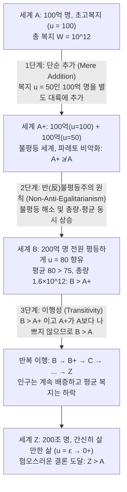

## 서론: ‘인구 규모 $N$’ 자체가 도덕적 변수가 될 때

고전적인 규범 윤리학과 후생경제학의 대다수 논의는 암묵적으로 <strong>고정 인구(Fixed-Population)</strong>의 틀을 전제한다. 즉, 세계에 이미 정해진 수($N$)의 개인들이 존재하며, 윤리학의 과제는 이 $N$명의 사람들 사이에서 자원을 공정하게 배분하거나 그들의 총 복지를 극대화하는 것이다. 그러나 기후 변화 정책, 지구 자원 고갈, 출산 장려 정책, 우주 식민지 개척, 나아가 인류의 수만 년 미래를 다루는 <strong>장기주의(Longtermism)</strong>와 실존적 위험(Existential Risk)으로 시야를 넓히는 순간 이 전제는 무너진다. 오늘날 우리의 선택은 미래 세대가 ‘얼마나 잘 살 것인가(삶의 질 $u_i$)’뿐만 아니라, 미래에 ‘얼마나 많은 사람이 존재할 것인가(인구 규모 $N$)’, 심지어 ‘구체적으로 누가 태어날 것인가’까지 결정하기 때문이다.

이것이 바로 <strong>인구 윤리학(Population Ethics)</strong>과 <strong>가변 인구 가치론(Variable-Population Axiology)</strong>의 탐구 영역이다. 1984년, 현대 영미 철학계의 가장 위대한 윤리학자 중 한 명인 <strong>데릭 파핏(Derek Parfit, 1942–2017)</strong>은 시대를 앞서간 역작 『이유와 인격』(<em>Reasons and Persons</em>) 제4부에서 현대 철학계에 거대한 충격을 던졌다. 그는 헨리 시지윅(Henry Sidgwick) 이래 공리주의의 가장 정통적인 정식화로 받아들여져 온 <strong>총량 공리주의(Total Utilitarianism)</strong>를 논리적으로 밀고 나가면, 우리의 도덕적 직관을 근본부터 뒤흔드는 <strong>‘혐오스러운 결론(The Repugnant Conclusion)’</strong>에 필연적으로 도달함을 증명했다. 더욱 충격적인 사실은, 이 결론을 피하기 위해 고안된 모든 대안 이론들이 그보다 더 끔찍한 역설에 빠진다는 점이다.

---

## 제1장 고정 인구에서 가변 인구로: 헨리 시지윅의 갈림길

### 1.1 사회후생함수의 정식화

어떤 가능 세계(또는 인구 상태) $X$에 $N(X) \in \mathbb{N}^+$명의 개인이 존재하고, 각 개인의 평생 순(純)복지 벡터가 $X = (u_1, u_2, \dots, u_N) \in \mathbb{R}^N$으로 주어진다고 하자. 인구 윤리학에서는 <strong>중립적 복지 수준(Neutral Level)</strong> $u = 0$을 기준선으로 설정한다.
* $u_i > 0$일 때: 개인 $i$의 삶은 전체적으로 <strong>살 만한 가치가 있는 삶(A life worth living)</strong>이다.
* $u_i = 0$일 때: 삶이 순수한 중립 상태에 있거나 태어나지 않은 무(無)의 상태와 동등하다.
* $u_i < 0$일 때: 개인 $i$의 삶은 극심한 고통으로 인해 전체적으로 <strong>살 가치가 없는 삶(A life not worth living)</strong>이다.

비교하는 두 세계의 인구수가 같을 때($N(X) = N(Y) = N$)는 <strong>총량 공리주의(Total Utilitarianism)</strong>와 <strong>평균 공리주의(Average Utilitarianism)</strong>가 완전히 동일한 가치 순위를 산출한다.

$$W_{\text{total}}(X) = \sum_{i=1}^{N} u_i = N \cdot \bar{u}, \qquad W_{\text{avg}}(X) = \frac{1}{N} \sum_{i=1}^{N} u_i = \bar{u}$$

### 1.2 헨리 시지윅의 선택

그러나 인구 규모 $N$이 변할 수 있을 때 두 입장은 정면으로 충돌한다. 존 스튜어트 밀이나 크누트 빅셀 같은 초기 사상가들은 1인당 평균 행복 $\bar{u}$에 주목했으나, 고전 공리주의를 완성한 <strong>헨리 시지윅(Henry Sidgwick)</strong>은 『윤리학의 방법』(<em>The Methods of Ethics</em>, 1874)에서 다음과 같이 통찰했다. 만약 공리주의가 추구하는 궁극적 선이 우주 전체의 쾌락 총량이라면, 우리는 기존 인구의 평균 행복을 높이는 것뿐만 아니라 양(+)의 행복을 누리는 인구의 수 자체를 늘리는 방식으로도 선을 증진해야 한다. 시지윅은 명확히 $W_{\text{total}}(X) = N \cdot \bar{u}$를 선택했고, 바로 이 합리적 선택이 파핏의 역설을 낳는 도화선이 되었다.

---

## 제2장 파핏과 ‘혐오스러운 결론’(The Repugnant Conclusion)

### 2.1 세계 $A$와 세계 $Z$: 모차르트와 철학 vs. 배경음악(Muzak)과 감자

『이유와 인격』 제142절에서 파핏은 다음과 같은 두 가능 세계를 비교하는 사고실험을 제시한다.

* <strong>세계 $A$(고복지 엘리트 세계)</strong>: 인구 $N_A = 100\text{억 명} = 10^{10}$명이 살고 있다. 이 세계의 모든 구성원은 극도로 높은 삶의 질($u_A = 100$)을 누린다. 그들은 건강하고 자유로우며, 심오한 학문적 탐구와 예술, 사랑, 그리고 파핏의 표현대로 <strong>‘모차르트와 철학(Mozart and philosophy)’</strong>을 향유한다. 세계 $A$의 총 복지는 다음과 같다.
  $$W_{\text{total}}(A) = N_A \cdot u_A = 10^{10} \times 100 = 10^{12}$$
* <strong>세계 $Z$(극도로 과밀한 한계 생존 세계)</strong>: 상상을 초월할 만큼 거대한 인구, 예컨대 $N_Z = 200\text{조 명} = 2 \times 10^{14}$명이 살고 있다. 이 세계의 모든 사람은 중립 수준($0$)을 간신히 넘는 극미한 삶의 질($u_Z = \varepsilon = 0.01 > 0$)만을 누린다. 그들의 삶에는 고급 문화나 깊은 기쁨이 전혀 없으며, 파핏이 비유한 <strong>‘싸구려 배경음악(Muzak)과 감자(Muzak and potatoes)’</strong>만이 유일한 위안이다. 그러나 인구수 $N_Z$가 워낙 거대하기 때문에 세계 $Z$의 총 복지는 다음과 같이 계산된다.
  $$W_{\text{total}}(Z) = N_Z \cdot u_Z = (2 \times 10^{14}) \times 0.01 = 2 \times 10^{12}$$

$W_{\text{total}}(Z) = 2 \times 10^{12} > 10^{12} = W_{\text{total}}(A)$이므로, 총량 공리주의에 따르면 <strong>세계 $Z$는 세계 $A$보다 도덕적으로 엄밀히 더 우월한 세계이다($Z \succ A$)</strong>. 파핏은 이를 <strong>‘혐오스러운 결론(The Repugnant Conclusion)’</strong>이라 명명했다.

> <strong>혐오스러운 결론의 정의</strong>: 매우 높은 삶의 질을 누리는 사람들로 이루어진 어떤 가능한 인구 집단(세계 $A$)에 대해서도, 단지 삶이 간신히 살 만한 가치가 있는 수준($u_i = \varepsilon \to 0^+$)에 불과한 사람들로 이루어져 있더라도 그 인구수가 충분히 많기만 하다면, 다른 조건이 같을 때 전자보다 더 나은 거대 인구 집단(세계 $Z$)이 반드시 존재한다.

### 2.2 왜 이 결론은 혐오스러운가?

이 결론이 직관적으로 강한 거부감을 불러일으키는 이유는 <strong>양(Quantity)이 질(Quality)을 무한정 대체할 수 있다</strong>고 선언하기 때문이다. 인류 문명이 도달할 수 있는 최고의 지적·미적 성취(모차르트와 철학)가, 거대한 양계장처럼 빽빽하게 들어찬 채 감자와 단조로운 소음만으로 연명하는 무수한 생명들의 단순 합산에 의해 도덕적으로 압도당한다는 것은 우리의 깊은 가치 직관과 충돌한다.

---

## 제3장 단순 추가의 역설(The Mere Addition Paradox): 심연으로 향하는 미끄러운 경사길

총량 공리주의를 버리면 혐오스러운 결론을 피할 수 있을까? 파핏은 <strong>단순 추가의 역설(The Mere Addition Paradox)</strong>을 통해, 총량 공리주의를 전혀 전제하지 않고 지극히 온건하고 거부하기 힘든 세 가지 직관적 원칙만으로도 똑같이 세계 $Z$에 도달하게 됨을 증명했다.

파핏의 3단계 논증은 다음과 같다.

1. <strong>세계 $A$에서 세계 $A^+$로 (단순 추가의 원칙 Mere Addition Principle)</strong>:
   세계 $A$(100억 명, $u=100$)에 더해, 기존 주민들에게 아무런 영향도 주지 않는 별도의 대륙에 복지 수준이 $u=50$(충분히 행복하고 살 가치가 있는 삶)인 100억 명을 <strong>단순 추가(Mere Addition)</strong>하여 세계 $A^+$를 만든다.
   <strong>단순 추가의 원칙</strong>에 따르면, 기존 사람들의 복지를 전혀 해치지 않으면서 살 가치가 있는 행복한 사람들을 추가하는 것은 세계를 <strong>더 나쁘게 만들지 않는다</strong>. 따라서 세계 $A^+$는 최소한 세계 $A$보다 나쁘지 않다($A^+ \not\prec A$).
2. <strong>세계 $A^+$에서 세계 $B$로 (반-불평등주의 배제 원칙 / 평등 우위 원칙)</strong>:
   세계 $A^+$에는 $u=100$인 100억 명과 $u=50$인 100억 명 사이의 계급 불평등이 존재한다(총 복지 1조 5천억, 평균 복지 75). 이제 똑같은 200억 명이 모두가 평등하게 $u=80$을 누리는 <strong>세계 $B$</strong>를 생각해보자(총 복지 1조 6천억, 평균 복지 80).
   세계 $B$는 세계 $A^+$보다 총 복지도 높고, 평균 복지도 높으며, 완벽한 평등까지 달성했다! 따라서 <strong>세계 $B$는 세계 $A^+$보다 엄밀히 더 좋다($B \succ A^+$)</strong>.
3. <strong>이행성(Transitivity)과 반복</strong>:
   $B$가 $A^+$보다 더 좋고($B \succ A^+$), $A^+$가 $A$보다 나쁘지 않다면, 가치 관계의 <strong>이행성(Transitivity)</strong>에 의해 <strong>세계 $B$(200억 명, $u=80$)는 세계 $A$(100억 명, $u=100$)보다 더 좋다($B \succ A$)</strong>는 결론이 도출된다.
   이 과정을 $B \to B^+ \to C \to \dots \to Z$로 반복하면, 우리는 결국 <strong>세계 $Z$가 세계 $A$보다 더 좋다($Z \succ A$)</strong>는 혐오스러운 결론에 도달하고 만다.

---

## 제4장 탈출의 시도와 파산: 가학적 결론에서 비동일성 문제까지

혐오스러운 결론을 피하기 위해 다양한 대안 가치론이 제시되었으나, 모두 치명적인 역설에 직면했다.

| 인구 가치론 모델 | 수학적 사회후생함수 $W(X)$ | 혐오스러운 결론 회피 여부 | 치명적 이론적 대가 및 파생 역설 |
| :--- | :--- | :--- | :--- |
| <strong>총량 공리주의 (Total Utilitarianism)</strong> | $W_{\text{total}} = \sum_{i=1}^{N} u_i = N \cdot \bar{u}$ | <strong>아니오</strong> ($Z \succ A$ 직접 도출) | 양이 질을 무한 대체, ‘배경음악과 감자’의 세계 정당화 |
| <strong>평균 공리주의 (Average Utilitarianism)</strong> | $W_{\text{avg}} = \frac{1}{N} \sum_{i=1}^{N} u_i = \bar{u}$ | <strong>예</strong> ($\bar{u}_A = 100 > \varepsilon = \bar{u}_Z$) | ‘지옥에의 추가’ 및 <strong>가학적 결론 (Sadistic Conclusion)</strong> 도출 |
| <strong>가변 가치론 / 점근 상한론 (Variable Value)</strong> | $W_{\text{var}} = f(N) \cdot \bar{u}, \ \lim_{N \to \infty} f(N) = M$ | <strong>예</strong> (인구 가치에 상한 $M$ 존재) | 거대 인구 구간에서 단순 추가 원칙 위배 및 가학적 결론 유발 |
| <strong>임계 수준 공리주의 (Critical-Level, CLU)</strong> | $W_{\text{CL}} = \sum_{i=1}^{N} (u_i - \alpha) \ (\alpha > 0)$ | <strong>예</strong> ($\varepsilon < \alpha$일 때 음의 기여) | <strong>극단적 가학적 결론 (Very Sadistic Conclusion)</strong> 도출 |
| <strong>개인 영향적 관점 (Person-Affecting View)</strong> | ‘현존하거나 실재할 특정 개인’에의 영향만 평가 | <strong>조건부</strong> | <strong>출산의 비대칭성 (Asymmetry)</strong> 및 <strong>비동일성 문제 (Non-Identity Problem)</strong> |

### 4.1 평균 공리주의와 ‘가학적 결론’(The Sadistic Conclusion)

<strong>평균 공리주의</strong> $W_{\text{avg}}(X) = \bar{u}$를 채택하면 $A \succ Z$를 쉽게 얻을 수 있다. 그러나 평균 공리주의는 두 가지 끔찍한 귀결을 낳는다.
* <strong>지옥에의 추가(Addition to Hell)</strong>: 모든 사람이 $u = -100$의 극심한 고문을 겪는 지옥 세계에, $u = -90$의 끔찍한 고통을 겪는 사람을 추가로 태어나게 하면 평균 복지가 $-100$에서 $-99.9$로 ‘상승’한다. 평균 공리주의는 생지옥 속에서 고통받을 생명을 추가로 탄생시키는 것이 세계를 개선하는 선행이라고 판정한다!
* <strong>가학적 결론(The Sadistic Conclusion)</strong>: 스웨덴 철학자 <strong>구스타프 아레니우스(Gustaf Arrhenius)</strong>가 정식화한 역설이다. 기존 고복지 사회에 (선택 1) 평균보다는 낮지만 충분히 행복한 삶을 사는 많은 사람들을 추가하는 것과, (선택 2) <strong>끔찍한 고문을 겪는($u < 0$) 극소수의 사람들을 추가하는 것</strong>을 비교해보자. 고문당하는 사람의 수가 충분히 적으면 전체 평균을 아주 조금만 깎아먹기 때문에, 평균 공리주의는 <strong>행복한 다수를 추가하는 것보다 고문당하는 소수를 추가하는 것이 도덕적으로 더 우월하다</strong>고 선언한다.

### 4.2 가변 가치론과 임계 수준 공리주의(Critical-Level Utilitarianism)

1. <strong>토머스 허카(Thomas Hurka)와 황유광(Yew-Kwang Ng)의 가변 가치론</strong>: 인구수 $N$이 늘어날수록 한계 가치가 체감하여 $\lim_{N \to \infty} f(N) = M < \infty$으로 수렴한다고 본다($W_{\text{var}} = f(N)\cdot\bar{u}$).
2. <strong>블랙오비·보서트·도널드슨(Blackorby, Bossert, and Donaldson)의 임계 수준 공리주의(CLU)</strong>: 중립 수준보다 높은 양의 임계치 $\alpha > 0$(예: $\alpha = 10$)를 도입하여 사회후생함수를 다음과 같이 정의한다.
   $$W_{\text{CL}}(X) = \sum_{i=1}^{N} (u_i - \alpha) = N \cdot (\bar{u} - \alpha) \quad (\alpha > 0)$$
   이 모델에서는 $0 < u_i < \alpha$인 삶이 추가될 때마다 사회후생이 감소하므로 혐오스러운 결론이 차단된다.

그러나 아레니우스는 CLU가 <strong>‘극단적 가학적 결론(The Very Sadistic Conclusion)’</strong>을 낳음을 증명했다. $0 < \varepsilon < \alpha$인 세계 $Z$의 인구 $N_Z$가 충분히 크면 $W_{\text{CL}}(Z) = N_Z(\varepsilon - \alpha)$는 거대한 음수가 된다. 그 결과, <strong>전원이 매일 끔찍한 고문을 당하는($u = -1000$) 소규모 지옥 세계가, 수백조 명이 평온하고 살 만한 삶($u = \varepsilon > 0$)을 누리는 세계 $Z$보다 도덕적으로 더 좋다는 황당한 결론</strong>이 도출된다.

### 4.3 개인 영향적 관점(Person-Affecting View), 비대칭성, 그리고 비동일성 문제

철학자 <strong>얀 나베슨(Jan Narveson)</strong>은 1967년 유명한 슬로건을 제시했다. <strong>“우리는 사람들을 행복하게 만드는 것에 찬성하지, 행복한 사람들을 만들어내는 것에 찬성하지 않는다(We are in favor of making people happy, not of making happy people).”</strong> 이것이 <strong>개인 영향적 관점(Person-Affecting View)</strong>이다.

그러나 이 관점은 두 가지 난관에 부딪힌다.
1. <strong>제프 맥마한(Jeff McMahan, 1981)의 출산 비대칭성(The Asymmetry)</strong>: 우리는 고통스러운 삶($u < 0$)을 살 아이를 낳지 말아야 할 강한 도덕적 의무가 있다고 믿으면서도, 행복한 삶($u > 0$)을 살 아이를 반드시 낳아야 할 도덕적 의무는 없다고 믿는다. 이 비대칭성을 일관되게 설명하기란 극히 어렵다.
2. <strong>파핏의 ‘비동일성 문제’(The Non-Identity Problem)</strong>: 인류가 <strong>‘자원 고갈 정책(Depletion)’</strong>과 <strong>‘자원 보존 정책(Conservation)’</strong> 중 하나를 선택한다고 하자. 고갈 정책을 택하면 300년 뒤의 미래 세대는 심각한 환경 오염 속에서 $u = 20$의 삶을 살고, 보존 정책을 택하면 $u = 100$의 풍요로운 삶을 산다.
   파핏은 거시 정책이 바뀌면 사람들의 일상과 결혼·수정 시점이 달라져, <strong>300년 뒤 고갈 정책 하에서 태어나는 100억 명과 보존 정책 하에서 태어나는 100억 명은 유전적·개체적으로 단 한 명도 겹치지 않는 완전히 다른 사람들($\text{Pop}_{\text{deplete}} \cap \text{Pop}_{\text{conserve}} = \emptyset$)</strong>임을 지적했다. 만약 고갈 정책을 택하지 않았다면 고갈 세계의 사람들은 아예 태어나지도 못했을 것이며, 그들에게도 $u = 20 > 0$의 삶은 태어나지 않는 것보다 나쁘지 않다! 따라서 좁은 의미의 개인 영향적 관점만으로는 <strong>고갈 정책이 300년 뒤의 누구에게도 해를 끼치지 않았다</strong>는 결론에 빠져 환경 파괴를 비판할 수 없게 된다. 결국 비인격적(Impersonal) 총량 원칙을 다시 받아들일 수밖에 없으며, 이는 다시 혐오스러운 결론으로 이어진다.

---

## 제5장 아레니우스의 불가능성 정리와 현대 장기주의(Longtermism)의 전환

### 5.1 아레니우스의 인구 윤리학 불가능성 정리

스웨덴 철학자 <strong>구스타프 아레니우스(Gustaf Arrhenius)</strong>는 케네스 애로(Kenneth Arrow)의 사회선택이론을 확장하여, <strong>다음 네 가지 기본 도덕 직관을 동시에 만족하는 이행적(Transitive) 인구 가치 순위 $\succeq$는 수학적으로 존재할 수 없음</strong>을 증명했다.
1. <strong>평등 우위 원칙(Egalitarian Dominance)</strong>: 인구수가 같을 때 총 복지가 더 크고 더 평등한 세계가 우월하다.
2. <strong>질적 조건 / 혐오스러운 결론 회피(Quality)</strong>: 고복지 세계 $A$는 한계 생존 세계 $Z$보다 우월하다.
3. <strong>양적 조건 / 단순 추가(Quantity)</strong>: 긍정적 복지를 누리는 사람들의 추가는 세계를 악화시키지 않는다.
4. <strong>비가학성 원칙(Non-Sadism)</strong>: 고통받는 인구($u < 0$)를 추가하는 것이 행복한 인구($u > 0$)를 추가하는 것보다 우월할 수는 없다.

### 5.2 2021년 『정치철학 저널』 공동 선언과 장기주의(Longtermism)

2021년 피터 싱어(Peter Singer), 힐러리 그리브스(Hilary Greaves), 토비 오드(Toby Ord), 윌리엄 맥어스킬(William MacAskill), 황유광 등 29명의 세계적 석학들은 『정치철학 저널』(<em>Journal of Political Philosophy</em>)에 「혐오스러운 결론을 넘어서」(<em>Overcoming the Repugnant Conclusion</em>)라는 공동 성명을 발표했다.

그들은 ‘혐오스러운 결론’을 피하려는 집착이 오히려 가학적 결론이나 비이행성 같은 훨씬 심각한 오류를 낳았다고 지적하며, 인간이 세계 $Z$에 거부감을 느끼는 이유는 (1) 200조($2 \times 10^{14}$)라는 천문학적 수의 크기를 직관적으로 체감하지 못하는 <strong>범위 둔감성(Scope Insensitivity)</strong>과, (2) $u = \varepsilon > 0$인 삶을 은연중에 고통스러운 지옥($u < 0$)으로 잘못 상상하는 오류 때문이라고 분석했다. 오늘날 <strong>장기주의(Longtermism)</strong>와 실존적 위험 연구는 인류 멸종을 막고 지속 가능한 기술 발전을 이룩함으로써 미래 세대가 <strong>거대한 인구 규모(큰 $N$)와 지극히 높은 삶의 질(높은 $\bar{u}$)을 동시에 달성</strong>하도록 이끄는 실천적 윤리학으로 나아가고 있다.
