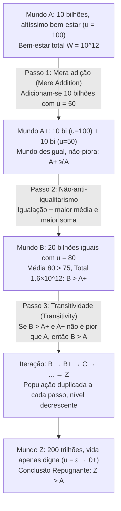

## Introdução: Quando o “tamanho da população $N$” se torna uma variável moral

Na maioria dos debates clássicos da ética normativa e da economia do bem-estar, raciocinamos implicitamente sob a premissa de uma <strong>população fixa (Fixed-Population)</strong>: já existe um número determinado $N$ de indivíduos no mundo, e a tarefa da filosofia moral consiste em distribuir de forma justa os recursos entre essas $N$ pessoas ou maximizar seu bem-estar agregado. Contudo, assim que ampliamos nosso horizonte para políticas de mudanças climáticas, esgotamento de recursos planetários, ética reprodutiva ou para o <strong>longoprazismo (Longtermism)</strong> e os riscos existenciais (Existential Risks) que moldam o destino da humanidade por milênios, essa premissa desmorona: nossas decisões atuais determinam não apenas <em>quão bem</em> viverão os humanos futuros (qualidade de vida $u_i$), mas também <em>quantas</em> pessoas existirão (tamanho da população $N$), e até mesmo <em>quais indivíduos específicos</em> virão a nascer.

Esse é o domínio da <strong>ética populacional (Population Ethics)</strong> e da <strong>axiologia de população variável (Variable-Population Axiology)</strong>. Em 1984, o grande filósofo britânico <strong>Derek Parfit (1942–2017)</strong> publicou sua obra-prima <em>Reasons and Persons</em> (Parte IV), provocando um abalo sísmico na filosofia contemporânea. Parfit demonstrou que, se adotarmos o <strong>utilitarismo total (Total Utilitarianism)</strong> — a formulação canônica do utilitarismo desde Henry Sidgwick —, seremos inevitavelmente conduzidos a uma proposição moralmente perturbadora: a <strong>“Conclusão Repugnante” (The Repugnant Conclusion)</strong>. Mais inquietante ainda foi constatar, nas décadas seguintes, que qualquer tentativa de modificar o utilitarismo total para escapar dessa conclusão lança a teoria em paradoxos ainda mais intoleráveis.

---

## Capítulo 1: Da população fixa à população variável: A encruzilhada de Sidgwick

### 1.1 Definição formal das funções de bem-estar social

Seja um mundo possível (ou estado populacional) $X$ composto por $N(X) \in \mathbb{N}^+$ indivíduos, representado pelo vetor de níveis de bem-estar líquido vitalício $X = (u_1, u_2, \dots, u_N) \in \mathbb{R}^N$. Na ética populacional, estabelecemos uma linha de referência fundamental — o <strong>nível neutro de bem-estar (Neutral Level)</strong> $u = 0$:
* Quando $u_i > 0$, a vida do indivíduo $i$ é globalmente <strong>digna de ser vivida (A life worth living)</strong>;
* Quando $u_i = 0$, a vida é estritamente neutra (axiologicamente equivalente à não existência);
* Quando $u_i < 0$, a vida é dominada pelo sofrimento e <strong>não vale a pena ser vivida (A life not worth living)</strong>.

Quando dois mundos possuem exatamente o mesmo tamanho populacional ($N(X) = N(Y) = N$), o <strong>utilitarismo total (Total Utilitarianism)</strong> e o <strong>utilitarismo médio (Average Utilitarianism)</strong> produzem exatamente o mesmo ordenamento:

$$W_{\text{total}}(X) = \sum_{i=1}^{N} u_i = N \cdot \bar{u}, \qquad W_{\text{avg}}(X) = \frac{1}{N} \sum_{i=1}^{N} u_i = \bar{u}$$

### 1.2 A escolha de Henry Sidgwick

Quando $N$ pode variar, entretanto, os dois critérios divergem drasticamente. Enquanto economistas como John Stuart Mill ou Knut Wicksell priorizavam o bem-estar per capita $\bar{u}$, o grande sistematizador do utilitarismo clássico <strong>Henry Sidgwick</strong> afirmou em <em>The Methods of Ethics</em> (1874) que, se o bem último é o excedente líquido de felicidade no universo, devemos maximizar o produto da felicidade média pelo número de seres capazes de desfrutá-la, isto é, $W_{\text{total}}(X) = N \cdot \bar{u}$. Essa escolha matemática aparentemente impecável acendeu o estopim do paradoxo de Parfit.

---

## Capítulo 2: Derek Parfit e a “Conclusão Repugnante” (The Repugnant Conclusion)

### 2.1 Mundo $A$ versus Mundo $Z$: Mozart e filosofia contra música de elevador e batatas

No § 142 de <em>Reasons and Persons</em>, Parfit propõe comparar dois mundos possíveis internamente igualitários, mas de tamanhos demográficos distintos:

* <strong>O Mundo $A$ (Mundo de altíssimo bem-estar)</strong>: Possui $N_A = 10\text{ bilhões} = 10^{10}$ de habitantes. Cada pessoa desfruta de uma qualidade de vida extraordinariamente elevada ($u_A = 100$) — saúde plena, liberdade, afetos profundos, descobertas científicas e aquilo que Parfit resume como <strong>“Mozart e filosofia (Mozart and philosophy)”</strong>. O bem-estar total do Mundo $A$ é:
  $$W_{\text{total}}(A) = N_A \cdot u_A = 10^{10} \times 100 = 10^{12}$$
* <strong>O Mundo $Z$ (Mundo superpovoado de sobrevivência marginal)</strong>: Abriga uma população colossal de $N_Z = 200\text{ trilhões} = 2 \times 10^{14}$ de indivíduos. A qualidade de vida de cada habitante supera apenas por uma fração ínfima o ponto neutro zero ($u_Z = \varepsilon = 0.01 > 0$). Suas vidas são monótonas e precárias, sem alta cultura nem alegrias intensas, contando apenas com o que Parfit chama de <strong>“música ambiente barata (Muzak) e batatas (Muzak and potatoes)”</strong>. Contudo, dado o tamanho gigantesco de $N_Z$, o bem-estar total do Mundo $Z$ atinge:
  $$W_{\text{total}}(Z) = N_Z \cdot u_Z = (2 \times 10^{14}) \times 0.01 = 2 \times 10^{12}$$

Como $W_{\text{total}}(Z) = 2 \times 10^{12} > 10^{12} = W_{\text{total}}(A)$, o utilitarismo total determina que <strong>o Mundo $Z$ é moralmente superior ao Mundo $A$ ($Z \succ A$)</strong>. Parfit batizou esse resultado como a <strong>“Conclusão Repugnante” (The Repugnant Conclusion)</strong>:

> <strong>Definição da Conclusão Repugnante</strong>: Para qualquer população possível de pelo menos dez bilhões de pessoas com uma altíssima qualidade de vida, existe outra população possível muito mais numerosa cuja existência, em igualdade de condições, seria melhor, embora seus membros levem vidas que mal valem a pena ser vividas ($u_i = \varepsilon \to 0^+$).

### 2.2 Por que essa conclusão parece tão repugnante?

Essa conclusão choca frontalmente nossa intuição moral porque implica que <strong>a mera quantidade (Quantity) pode substituir sem qualquer limite a qualidade (Quality)</strong>. Os ápices mais sublimes do espírito humano (Mozart e a filosofia) são derrotados na contabilidade utilitarista por uma massa interminável de existências quase vegetativas.

---

## Capítulo 3: O Paradoxo da Mera Adição (The Mere Addition Paradox)

Poderíamos evitar a Conclusão Repugnante simplesmente rejeitando o utilitarismo total? Parfit concebeu o demolidor <strong>Paradoxo da Mera Adição (The Mere Addition Paradox)</strong> para demonstrar que três princípios intuitivos extremamente moderados e independentes do utilitarismo total bastam para nos empurrar por uma ladeira escorregadia até o Mundo $Z$.

Analisemos os três passos do argumento de Parfit:

1. <strong>Do Mundo $A$ ao Mundo $A^+$ (Princípio da Mera Adição / Mere Addition Principle)</strong>:
   Ao Mundo $A$ (10 bilhões de pessoas com $u=100$) adicionamos em um continente separado — sem afetar em nada os habitantes originais — outros 10 bilhões de pessoas que desfrutam de uma vida feliz com $u=50$. Obtemos assim o Mundo $A^+$.
   Segundo o <strong>princípio da mera adição</strong>, adicionar pessoas cujas vidas claramente valem a pena ser vividas ($u > 0$) sem prejudicar ninguém não torna o mundo <strong>pior</strong>. Portanto, $A^+$ <strong>não é pior que $A$</strong> ($A^+ \not\prec A$).
2. <strong>Do Mundo $A^+$ ao Mundo $B$ (Não-anti-igualitarismo / Dominância Igualitária)</strong>:
   O Mundo $A^+$ apresenta uma desigualdade entre 10 bilhões com $u=100$ e 10 bilhões com $u=50$ (média: $75$, total: $1{,}5 \times 10^{12}$). Comparemo-lo com o <strong>Mundo $B$</strong>, onde esses mesmos 20 bilhões de pessoas desfrutam todos igualmente de $u = 80$ (média: $80$, total: $1{,}6 \times 10^{12}$).
   O Mundo $B$ tem maior bem-estar total, maior bem-estar médio <em>e</em> perfeita igualdade: consequentemente, <strong>o Mundo $B$ é estritamente melhor que o Mundo $A^+$ ($B \succ A^+$)</strong>.
3. <strong>Transitividade (Transitivity) e inclinação iterativa</strong>:
   Se $B$ é melhor que $A^+$ e $A^+$ não é pior que $A$, a <strong>transitividade</strong> exige que <strong>o Mundo $B$ (20 bi, $u=80$) seja melhor que o Mundo $A$ (10 bi, $u=100$)</strong>. Repetindo o processo ($B \to B^+ \to C \to \dots \to Z$), chegamos inevitavelmente a $Z \succ A$.

---

## Capítulo 4: Tentativas de fuga e seu fracasso: Da Conclusão Sádica ao problema da não-identidade

Todas as axiologias alternativas propostas para escapar da Conclusão Repugnante desembocam em contraparadoxos devastadores:

| Modelo axiológico | Função de bem-estar social $W(X)$ | Evita a Conclusão Repugnante? | Custo teórico fatal e paradoxo derivado |
| :--- | :--- | :--- | :--- |
| <strong>Utilitarismo total</strong> | $W_{\text{total}} = \sum_{i=1}^{N} u_i = N \cdot \bar{u}$ | <strong>Não</strong> (implica $Z \succ A$) | Substituição ilimitada de qualidade por quantidade |
| <strong>Utilitarismo médio</strong> | $W_{\text{avg}} = \frac{1}{N} \sum_{i=1}^{N} u_i = \bar{u}$ | <strong>Sim</strong> ($\bar{u}_A = 100 > \varepsilon = \bar{u}_Z$) | “Adição ao inferno” e <strong>Conclusão Sádica (Sadistic Conclusion)</strong> |
| <strong>Valor variável (Hurka / Ng)</strong> | $W_{\text{var}} = f(N) \cdot \bar{u}, \ \lim_{N \to \infty} f(N) = M$ | <strong>Sim</strong> (teto assintótico $M$) | Viola a mera adição para $N$ grande e induz a Conclusão Sádica |
| <strong>Utilitarismo de nível crítico (CLU)</strong> | $W_{\text{CL}} = \sum_{i=1}^{N} (u_i - \alpha) \ (\alpha > 0)$ | <strong>Sim</strong> (contribuição negativa se $\varepsilon < \alpha$) | <strong>Conclusão Muito Sádica (Very Sadistic Conclusion)</strong> |
| <strong>Visão centrada na pessoa (Narveson)</strong> | Avalia apenas efeitos sobre pessoas concretas | <strong>Condicional</strong> | Esbarra na <strong>Assimetria</strong> (McMahan) e na <strong>Não-identidade</strong> (Parfit) |

### 4.1 O utilitarismo médio e a “Conclusão Sádica” (The Sadistic Conclusion)

O <strong>utilitarismo médio</strong> ($W_{\text{avg}} = \bar{u}$) prefere $A$ a $Z$, mas gera consequências absurdas:
* <strong>A adição ao inferno (Addition to Hell)</strong>: Em um mundo de 100 pessoas torturadas com $u = -100$, fazer nascer outra pessoa torturada com $u = -90$ “eleva” a média para $-99{,}91$: criar uma vida de tormento seria uma melhoria moral!
* <strong>A Conclusão Sádica (The Sadistic Conclusion)</strong>: Demonstrada pelo filósofo sueco <strong>Gustaf Arrhenius</strong>, revela que diante de uma população muito feliz, o utilitarismo médio frequentemente prefere <strong>adicionar um pequeno número de pessoas atrozmente torturadas ($u < 0$) do que um grande número de pessoas felizes ($u > 0$, mas abaixo da média prévia)</strong>, porque alguns poucos torturados reduzem menos a média geral do que muitos moderadamente felizes!

### 4.2 Valor variável e Utilitarismo de nível crítico (Critical-Level Utilitarianism)

1. <strong>Modelos de valor variável (Thomas Hurka, Yew-Kwang Ng)</strong>: Amortecem $N$ por meio de uma função côncava limitada $\lim_{N \to \infty} f(N) = M < \infty$.
2. <strong>Utilitarismo de nível crítico (Blackorby, Bossert e Donaldson)</strong>: Introduz um limiar positivo $\alpha > 0$:
   $$W_{\text{CL}}(X) = \sum_{i=1}^{N} (u_i - \alpha) = N \cdot (\bar{u} - \alpha) \quad (\alpha > 0)$$
   Toda vida com $0 < u_i < \alpha$ subtrai valor social.

<strong>O preço fatal — A Conclusão Muito Sádica (The Very Sadistic Conclusion)</strong>: Para um Mundo $Z$ suficientemente numeroso com $0 < \varepsilon < \alpha$, $W_{\text{CL}}(Z) = N_Z(\varepsilon - \alpha)$ tende a $-\infty$. Em consequência, o utilitarismo de nível crítico determina que <strong>um inferno povoado por milhares de pessoas torturadas permanentemente ($u = -1000$) é estritamente melhor que um mundo pacífico $Z$ onde centenas de trilhões de seres levam uma vida positiva</strong>.

### 4.3 Visões centradas na pessoa, a Assimetria e o problema da não-identidade

Em 1967, <strong>Jan Narveson</strong> enunciou o lema das <strong>visões centradas na pessoa (Person-Affecting Views)</strong>: <strong>“Somos a favor de fazer as pessoas felizes, não de fabricar pessoas felizes (We are in favor of making people happy, not of making happy people).”</strong>

Mas essa postura tropeça em dois obstáculos intransponíveis:
1. <strong>A Assimetria procriativa de Jeff McMahan (1981)</strong>: Temos o dever moral de não trazer ao mundo uma criança destinada ao tormento ($u < 0$), mas nenhum dever de gerar uma criança porque ela será feliz ($u > 0$).
2. <strong>O problema da não-identidade de Parfit (The Non-Identity Problem)</strong>: Se a humanidade escolhe hoje uma política de <strong>Esgotamento de recursos (Depletion)</strong> em vez de uma de <strong>Conservação (Conservation)</strong>, isso altera todos os hábitos cotidianos e os momentos de concepção. Portanto, daqui a 300 anos, os 10 bilhões de humanos que nascerão sob a política de Esgotamento em um planeta poluído ($u = 20 > 0$) serão <strong>genética e numericamente indivíduos completamente diferentes</strong> daqueles que teriam nascido sob a Conservação ($u = 100$) ($\text{Pop}_{\text{deplete}} \cap \text{Pop}_{\text{conserve}} = \emptyset$). Visto que sem a política de Esgotamento essas pessoas jamais teriam existido e sua vida continua valendo a pena ($u = 20 > 0$), a política de Esgotamento <strong>não prejudicou nenhuma pessoa concreta</strong>! Para condenar a devastação ecológica precisamos de princípios impessoais (Impersonal), o que nos devolve diretamente à Conclusão Repugnante.

---

## Capítulo 5: O teorema da impossibilidade de Arrhenius e a virada do longoprazismo

### 5.1 O teorema da impossibilidade na ética populacional (Gustaf Arrhenius)

Estendendo o método axiomático de Kenneth Arrow, <strong>Gustaf Arrhenius</strong> demonstrou matematicamente que <strong>nenhuma relação de ordem transitiva $\succeq$ pode satisfazer simultaneamente os quatro axiomas seguintes</strong>:
1. <strong>Dominância igualitária (Egalitarian Dominance)</strong>: Com igual população, um mundo com maior bem-estar total e perfeita igualdade é melhor.
2. <strong>Condição de qualidade (Evitar a Conclusão Repugnante)</strong>: Um mundo de altíssimo bem-estar $A$ é melhor que um mundo de sobrevivência marginal $Z$.
3. <strong>Condição de quantidade (Mera adição)</strong>: Adicionar vidas positivas não piora o mundo.
4. <strong>Não-sadismo (Non-Sadism)</strong>: Adicionar vidas torturadas ($u < 0$) nunca é melhor que adicionar vidas felizes ($u > 0$).

### 5.2 A declaração conjunta de 2021 e o longoprazismo contemporâneo

Em 2021, 29 filósofos e economistas de primeira linha — entre eles Peter Singer, Hilary Greaves, Toby Ord, William MacAskill e Yew-Kwang Ng — publicaram no <em>Journal of Political Philosophy</em> o manifesto <em>Overcoming the Repugnant Conclusion</em>. Sustentaram que a obsessão em evitar a todo custo a Conclusão Repugnante levou a ética a becos muito piores (como a Conclusão Sádica), e que nossa rejeição intuitiva ao Mundo $Z$ deve-se em grande medida à nossa <strong>insensibilidade de escala (Scope Insensitivity)</strong> diante de cifras astronômicas como $2 \times 10^{14}$. Para o <strong>longoprazismo (Longtermism)</strong> contemporâneo, mitigar os riscos existenciais e impulsionar o progresso sustentável permite almejar um futuro que combine <strong>tanto uma vasta população (grande $N$) quanto uma altíssima qualidade de vida (alto $\bar{u}$)</strong>.
