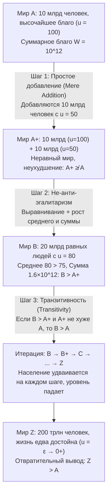

## Введение: Когда «численность населения $N$» сама становится моральной переменной

В большинстве классических дискуссий нормативной этики и экономики благосостояния мы неявно рассуждаем в рамках <strong>фиксированной численности населения (Fixed-Population)</strong>: в мире уже существует определенное число $N$ индивидов, и задача моральной философии состоит в том, чтобы справедливо распределить ресурсы между этими $N$ людьми или максимизировать их совокупное благосостояние. Однако как только мы обращаемся к климатической политике, истощению ресурсов планеты, репродуктивной этике или к <strong>лонгтермизму (Longtermism)</strong> и экзистенциальным рискам (Existential Risks), определяющим судьбу человечества на тысячелетия вперед, эта предпосылка рушится: наши сегодняшние решения определяют не только то, <em>насколько хорошо</em> будут жить будущие люди (качество жизни $u_i$), но и то, <em>сколько</em> вообще людей будет существовать (численность населения $N$), и даже то, <em>какие именно конкретные индивиды</em> родятся на свет.

Это предметная область <strong>популяционной этики (Population Ethics)</strong> и <strong>аксиологии переменного населения (Variable-Population Axiology)</strong>. В 1984 году выдающийся британский философ <strong>Дерек Парфит (Derek Parfit, 1942–2017)</strong> опубликовал свой главный труд <em>Reasons and Persons</em> («Причины и лица», Часть IV), вызвавший интеллектуальное землетрясение в современной философии. Парфит доказал, что если мы принимаем <strong>тотальный (суммарный) утилитаризм (Total Utilitarianism)</strong> — каноническую версию утилитаризма со времен Генри Сиджвика, — мы неизбежно приходим к интуитивно пугающему положению, которое он назвал <strong>«Отвратительным выводом» (The Repugnant Conclusion)</strong>. Еще более поразительным стало открытие последующих десятилетий: любая попытка модифицировать тотальный утилитаризм ради избежания этого вывода ввергает теорию в еще более чудовищные парадоксы.

---

## Глава 1. От фиксированного населения к переменному: развилка Сиджвика

### 1.1 Формальное определение функций общественного благосостояния

Пусть возможный мир (или демографическое состояние) $X$ состоит из $N(X) \in \mathbb{N}^+$ индивидов и описывается вектором пожизненного чистого благосостояния $X = (u_1, u_2, \dots, u_N) \in \mathbb{R}^N$. В популяционной этике вводится ключевая точка отсчета — <strong>нейтральный уровень благосостояния (Neutral Level)</strong> $u = 0$:
* При $u_i > 0$ жизнь индивида $i$ в целом <strong>достойна того, чтобы быть прожитой (A life worth living)</strong>;
* При $u_i = 0$ жизнь строго нейтральна (аксиологически эквивалентна небытию);
* При $u_i < 0$ жизнь наполнена страданиями и в целом <strong>не стоит того, чтобы жить (A life not worth living)</strong>.

Пока два сравниваемых мира имеют одинаковую численность населения ($N(X) = N(Y) = N$), <strong>тотальный утилитаризм (Total Utilitarianism)</strong> и <strong>средний утилитаризм (Average Utilitarianism)</strong> дают абсолютно идентичное ранжирование:

$$W_{\text{total}}(X) = \sum_{i=1}^{N} u_i = N \cdot \bar{u}, \qquad W_{\text{avg}}(X) = \frac{1}{N} \sum_{i=1}^{N} u_i = \bar{u}$$

### 1.2 Выбор Генри Сиджвика

Однако когда $N$ становится переменной величиной, оба критерия радикально расходятся. В то время как экономисты вроде Джона Стюарта Милля или Кнута Викселля ориентировались на подушевое благосостояние $\bar{u}$, классик утилитаризма <strong>Генри Сиджвик (Henry Sidgwick)</strong> в «Методах этики» (<em>The Methods of Ethics</em>, 1874) прямо указал: если высшее благо есть чистый избыток счастья во Вселенной, мы должны максимизировать произведение среднего счастья на число существ, способных его испытывать, то есть $W_{\text{total}}(X) = N \cdot \bar{u}$. Именно этот математически безупречный шаг заложил мину парадокса Парфита.

---

## Глава 2. Дерек Парфит и «Отвратительный вывод» (The Repugnant Conclusion)

### 2.1 Мир $A$ против Мира $Z$: Моцарт и философия против фоновой музыки и картошки

В § 142 «Причин и лиц» Парфит предлагает сравнить два внутренне полностью эгалитарных мира разной численности:

* <strong>Мир $A$ (Мир высочайшего благосостояния)</strong>: Население составляет $N_A = 10\text{ миллиардов} = 10^{10}$ человек. Каждый житель наслаждается исключительно высоким качеством жизни ($u_A = 100$) — крепким здоровьем, свободой, глубокой любовью, научным творчеством и тем, что Парфит называет <strong>«Моцартом и философией (Mozart and philosophy)»</strong>. Суммарное благосостояние Мира $A$ равно:
  $$W_{\text{total}}(A) = N_A \cdot u_A = 10^{10} \times 100 = 10^{12}$$
* <strong>Мир $Z$ (Сверхперенаселенный мир пограничного выживания)</strong>: В нем обитает гигантское население $N_Z = 200\text{ триллионов} = 2 \times 10^{14}$ человек. Качество жизни каждого индивида лишь на ничтожную величину превышает нулевой порог ($u_Z = \varepsilon = 0.01 > 0$). Их жизнь скудна и однообразна, в ней нет ни высокой культуры, ни ярких радостей, а единственным утешением служат <strong>«дешевая фоновая музыка (Muzak) и картошка (Muzak and potatoes)»</strong>. Тем не менее из-за колоссального масштаба $N_Z$ суммарное благосостояние Мира $Z$ достигает:
  $$W_{\text{total}}(Z) = N_Z \cdot u_Z = (2 \times 10^{14}) \times 0.01 = 2 \times 10^{12}$$

Поскольку $W_{\text{total}}(Z) = 2 \times 10^{12} > 10^{12} = W_{\text{total}}(A)$, тотальный утилитаризм обязывает признать, что <strong>Мир $Z$ в моральном отношении строго лучше Мира $A$ ($Z \succ A$)</strong>. Парфит назвал этот результат <strong>«Отвратительным выводом» (The Repugnant Conclusion)</strong>:

> <strong>Определение Отвратительного вывода</strong>: Для любой возможной популяции из по крайней мере десяти миллиардов людей с очень высоким качеством жизни существует другая возможная, гораздо более многочисленная популяция, существование которой при прочих равных условиях было бы лучше, хотя ее члены ведут жизнь, которая едва стоит того, чтобы быть прожитой ($u_i = \varepsilon \to 0^+$).

### 2.2 Почему этот вывод вызывает такое отторжение?

Этот вывод противоречит нашей глубокой моральной интуиции, поскольку утверждает, что <strong>голое количество (Quantity) может безгранично замещать собой качество (Quality)</strong>. Высшие достижения человеческого духа и счастья (Моцарт и философия) оказываются повержены в утилитаристской бухгалтерии бесконечной массой полурастительного существования.

---

## Глава 3. Парадокс простого добавления (The Mere Addition Paradox)

Можно ли избежать Отвратительного вывода, просто отказавшись от тотального утилитаризма? Парфит сконструировал сокрушительный <strong>парадокс простого добавления (The Mere Addition Paradox)</strong>, доказав, что три совершенно безобидных, независимых от тотального утилитаризма интуитивных принципа шаг за шагом сталкивают нас по наклонной плоскости прямо в Мир $Z$.

Проследим три шага аргумента Парфита:

1. <strong>От Мира $A$ к Миру $A^+$ (Принцип простого добавления / Mere Addition Principle)</strong>:
   К Миру $A$ (10 млрд человек с $u=100$) мы добавляем на отдельном континенте — никак не затрагивая прежних жителей — еще 10 млрд человек, ведущих счастливую жизнь с $u=50$. Получаем Мир $A^+$.
   Согласно <strong>принципу простого добавления</strong>, добавление людей с достойной положительной жизнью ($u > 0$) без ущерба для кого-либо не делает мир <strong>хуже</strong>. Следовательно, $A^+$ <strong>не хуже $A$</strong> ($A^+ \not\prec A$).
2. <strong>От Мира $A^+$ к Миру $B$ (Не-анти-эгалитаризм / Эгалитарное доминирование)</strong>:
   В Мире $A^+$ существует неравенство между 10 млрд с $u=100$ и 10 млрд с $u=50$ (среднее: $75$, сумма: $1{,}5 \times 10^{12}$). Сравним его с <strong>Миром $B$</strong>, где все те же 20 млрд человек в равной мере обладают высоким уровнем $u = 80$ (среднее: $80$, сумма: $1{,}6 \times 10^{12}$).
   В Мире $B$ выше суммарное благо, выше среднее благо <em>и</em> достигнуто полное равенство: значит, <strong>Мир $B$ строго лучше Мира $A^+$ ($B \succ A^+$)</strong>.
3. <strong>Транзитивность (Transitivity) и итеративный спуск</strong>:
   Если $B$ лучше $A^+$, а $A^+$ не хуже $A$, то в силу <strong>транзитивности</strong> отношения «лучше» <strong>Мир $B$ (20 млрд, $u=80$) строго лучше Мира $A$ (10 млрд, $u=100$)</strong>! Повторяя эту процедуру ($B \to B^+ \to C \to \dots \to Z$), мы неотвратимо приходим к $Z \succ A$.

---

## Глава 4. Попытки бегства и их крах: от Садистского вывода к проблеме неидентичности

Все альтернативные аксиологии, предложенные для обхода Отвратительного вывода, порождают разрушительные контрпарадоксы:

| Аксиологическая модель | Функция благосостояния $W(X)$ | Избегает Отвратительного вывода? | Фатальная теоретическая цена и контрпарадокс |
| :--- | :--- | :--- | :--- |
| <strong>Тотальный утилитаризм</strong> | $W_{\text{total}} = \sum_{i=1}^{N} u_i = N \cdot \bar{u}$ | <strong>Нет</strong> (влечет $Z \succ A$) | Неограниченное замещение качества количеством |
| <strong>Средний утилитаризм</strong> | $W_{\text{avg}} = \frac{1}{N} \sum_{i=1}^{N} u_i = \bar{u}$ | <strong>Да</strong> ($\bar{u}_A = 100 > \varepsilon = \bar{u}_Z$) | «Добавление в ад» и <strong>Садистский вывод (Sadistic Conclusion)</strong> |
| <strong>Переменная ценность (Hurka / Ng)</strong> | $W_{\text{var}} = f(N) \cdot \bar{u}, \ \lim_{N \to \infty} f(N) = M$ | <strong>Да</strong> (асимптотический потолок $M$) | Нарушает простое добавление при больших $N$, ведет к Садистскому выводу |
| <strong>Критический уровень (CLU)</strong> | $W_{\text{CL}} = \sum_{i=1}^{N} (u_i - \alpha) \ (\alpha > 0)$ | <strong>Да</strong> (отрицательный вклад при $\varepsilon < \alpha$) | <strong>Крайне садистский вывод (Very Sadistic Conclusion)</strong> |
| <strong>Персоноцентричный подход (Narveson)</strong> | Оценивает лишь влияние на конкретных лиц | <strong>Условно</strong> | Разбивается об <strong>Асимметрию</strong> (Макмахан) и <strong>Неидентичность</strong> (Парфит) |

### 4.1 Средний утилитаризм и «Садистский вывод» (The Sadistic Conclusion)

<strong>Средний утилитаризм</strong> ($W_{\text{avg}} = \bar{u}$) ставит $A$ выше $Z$, но ценой абсурдных следствий:
* <strong>Добавление в ад (Addition to Hell)</strong>: если в мире живут 100 мучеников с $u = -100$, рождение еще одного страдальца с $u = -90$ «повышает» средний показатель до $-99{,}91$ — создание обреченной на пытки жизни объявляется моральным улучшением!
* <strong>Садистский вывод (The Sadistic Conclusion)</strong>: сформулированный шведским философом <strong>Густавом Аррениусом (Gustaf Arrhenius)</strong>, он показывает, что при добавлении к очень счастливому обществу средний утилитаризм часто предпочитает <strong>добавить небольшое число жестоко пытаемых людей ($u < 0$), нежели большое число счастливых людей ($u > 0$, но ниже прежнего среднего)</strong>, поскольку несколько мучеников снижают общую среднюю меньше, чем множество умеренно счастливых людей!

### 4.2 Переменная ценность и утилитаризм критического уровня (Critical-Level Utilitarianism)

1. <strong>Модели переменной ценности (Томас Хурка, Яо-Кван Нг)</strong>: демпфируют $N$ строго вогнутой ограниченной функцией $\lim_{N \to \infty} f(N) = M < \infty$.
2. <strong>Утилитаризм критического уровня (Блэкорби, Боссерт и Дональдсон)</strong>: вводит положительный порог $\alpha > 0$:
   $$W_{\text{CL}}(X) = \sum_{i=1}^{N} (u_i - \alpha) = N \cdot (\bar{u} - \alpha) \quad (\alpha > 0)$$
   Любая жизнь с $0 < u_i < \alpha$ вычитает ценность из общей суммы.

<strong>Фатальная цена — Крайне садистский вывод (The Very Sadistic Conclusion)</strong>: для достаточно большого Мира $Z$ с $0 < \varepsilon < \alpha$ величина $W_{\text{CL}}(Z) = N_Z(\varepsilon - \alpha)$ стремится к $-\infty$. В итоге утилитаризм критического уровня постановляет, что <strong>крошечный ад, населенный тысячей непрерывно пытаемых людей ($u = -1000$), морально строго лучше мирного Мира $Z$, где сотни триллионов существ живут позитивной жизнью!</strong>

### 4.3 Персоноцентричный подход, Асимметрия и проблема неидентичности

В 1967 году <strong>Ян Нарвесон (Jan Narveson)</strong> провозгласил лозунг <strong>персоноцентричного подхода (Person-Affecting View)</strong>: <strong>«Мы за то, чтобы делать людей счастливыми, а не за то, чтобы производить счастливых людей (We are in favor of making people happy, not of making happy people)».</strong>

Но эта позиция наталкивается на два непреодолимых препятствия:
1. <strong>Прокреативная Асимметрия Джеффа Макмахана (1981)</strong>: у нас есть строгий моральный долг не рожать ребенка, обреченного на мучения ($u < 0$), но нет долга рожать ребенка ради того, что он будет счастлив ($u > 0$).
2. <strong>Проблема неидентичности Парфита (The Non-Identity Problem)</strong>: если человечество сегодня выбирает политику <strong>Истощения ресурсов (Depletion)</strong> вместо <strong>Сохранения (Conservation)</strong>, это меняет весь ход повседневной жизни, браков и моментов зачатия. Поэтому через 300 лет те 10 млрд людей, которые родятся при политике Истощения на загрязненной планете ($u = 20 > 0$), будут <strong>генетически и нумерически совершенно другими людьми</strong>, нежели те, кто родился бы при политике Сохранения ($u = 100$) ($\text{Pop}_{\text{deplete}} \cap \text{Pop}_{\text{conserve}} = \emptyset$). Поскольку без политики Истощения эти люди вообще никогда не появились бы на свет, а их жизнь все же достойна проживания ($u = 20 > 0$), политика Истощения <strong>не причинила вреда ни одному конкретному человеку</strong>! Чтобы осудить экологическое хищничество, мы вынуждены апеллировать к безличным (Impersonal) принципам — что вновь возвращает нас к Отвратительному выводу.

---

## Глава 5. Теорема о невозможности Аррениуса и поворот современного лонгтермизма

### 5.1 Теорема о невозможности в популяционной этике (Густав Аррениус)

Развивая аксиоматический метод Кеннета Эрроу, <strong>Густав Аррениус</strong> математически доказал, что <strong>не существует ни одного транзитивного отношения предпочтения $\succeq$, способного одновременно удовлетворить четырем следующим аксиомам</strong>:
1. <strong>Эгалитарное доминирование (Egalitarian Dominance)</strong>: при равной численности мир с большим суммарным благом и полным равенством лучше.
2. <strong>Условие качества (Избежание Отвратительного вывода)</strong>: мир высочайшего благосостояния $A$ лучше мира пограничного выживания $Z$.
3. <strong>Условие количества (Простое добавление)</strong>: добавление позитивных жизней не ухудшает мир.
4. <strong>Не-садизм (Non-Sadism)</strong>: добавление мученических жизней ($u < 0$) никогда не лучше добавления счастливых жизней ($u > 0$).

### 5.2 Совместное заявление 2021 года и современный лонгтермизм

В 2021 году 29 ведущих философов и экономистов — включая Питера Сингера, Хилари Гривз, Тоби Орда, Уильяма Макаскилла и Яо-Кван Нга — опубликовали в <em>Journal of Political Philosophy</em> манифест <em>Overcoming the Repugnant Conclusion</em>. Они показали, что догматическое стремление во что бы то ни стало избежать Отвратительного вывода завело этику в гораздо более опасные тупики (такие как Садистский вывод), а наше интуитивное неприятие Мира $Z$ во многом объясняется <strong>нечувствительностью к масштабу (Scope Insensitivity)</strong> перед лицом астрономических чисел вроде $2 \times 10^{14}$. Для современного <strong>лонгтермизма (Longtermism)</strong> предотвращение экзистенциальных катастроф и устойчивый научно-технологический прогресс позволяют стремиться к будущему, сочетающему <strong>как огромную численность будущих поколений (большое $N$), так и высочайшее качество их жизни (высокое $\bar{u}$)</strong>.
